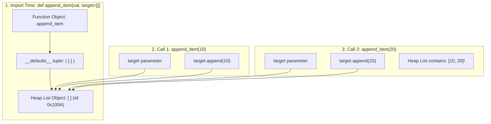
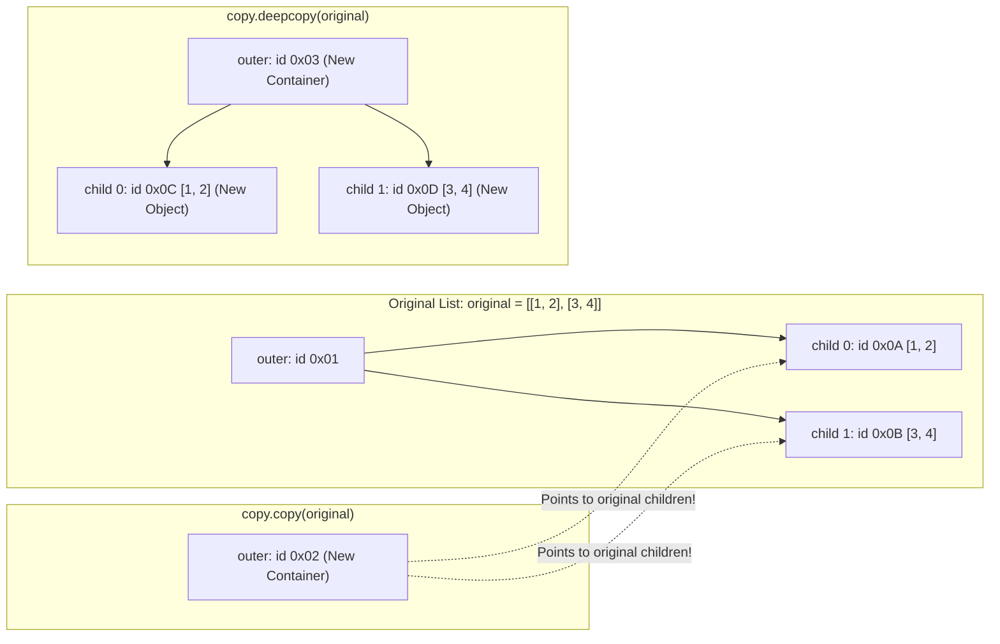

# Lesson 02: Mutability, Identity and Copying

> **Prerequisites:** [How Python Runs Your Code: Objects, Names and Bytecode](../01-how-python-runs-your-code/README.md) and [Track 27 Overview](../README.md).  
> **Estimated Reading Time:** 18 minutes  
> **Target Audience:** Engineers preparing for LLD, OOP, C#, or Python technical screening and architecture rounds.

> [!TIP]
> **The One Rule of Mutability & Identity:** Variables in Python never hold objects; variables are **names bound to objects** on the heap. The `is` operator checks identity (`id(a) == id(b)`), testing whether two names point to the exact same memory address. The `==` operator delegates to `__eq__` to compare logical values. When an object is mutable, in-place modification affects every reference bound to it. When reassigning a variable (`a = b`), you merely re-tag a name; you never copy data.

---

## 1. Why This Matters: The Interview Trap

"What is the difference between `is` and `==`, and why should you never use a list as a default argument?" is one of the most reliable filters in Python technical screens. 

### The Weak Answer
> *"The `==` operator checks if values are equal, and `is` is just a faster version of `==` for comparing things like strings or numbers. A list is a bad default argument because Python reloads functions every time and lists take up too much memory. And Python is pass-by-reference because when you pass a list to a function, it modifies the original list."*

### The Senior Strong Answer
> *"In Python, `==` tests **value equality** by invoking the left operand's `__eq__()` method, whereas `is` tests **object identity** by comparing memory addresses (`id(a) == id(b)`). While CPython interns small integers (-5 to 256) and some string literals—causing `is` to return `True` by accident—using `is` for equality checks is a critical bug.  
> 
> A list is a disastrous default argument because Python's `def` statement is an executable declaration evaluated **once at import/definition time**, not per invocation. The default list object is created once and stored in the function's `__defaults__` tuple on the heap. Every subsequent call that does not supply an argument shares that single mutated list instance. The idiomatic fix is the `target=None` sentinel pattern.  
> 
> Furthermore, Python is neither pure pass-by-value nor pure pass-by-reference; it uses **pass-by-assignment** (call-by-object-reference). Function parameters are local names bound to the caller's objects. Mutating an object modifies the caller's state, but reassigning the parameter rebinds the local name without altering the caller's variable."*

### Argument Passing Taxonomy

| Evaluation Model | Definition | Python Behavior | C# Comparison |
| :--- | :--- | :--- | :--- |
| **Pass-by-Value** | Function receives an independent copy of the value/memory bits. | Immutable primitives (ints, floats) appear to behave like this because rebinding cannot mutate the original object. | Value types (`struct`, `int`, `DateTime`) copied by default onto the call stack. |
| **Pass-by-Reference** | Function receives an alias to the caller's variable storage location; rebinding changes the caller's variable. | **Never**. Reassigning a local name (`x = [1, 2]`) never changes what the caller's variable points to. | Supported explicitly via the `ref` or `out` keywords (`void Update(ref int x)`). |
| **Pass-by-Assignment (Object Reference)** | Function receives a shared pointer to the underlying heap object. Mutating in-place affects the caller; rebinding affects only the local scope. | **Standard Python behavior** for all objects without exception. | Default behavior for C# reference types (`class`). Passing `List<T>` passes the reference by value. |

---

## 2. Visual Mental Model / Taxonomic Comparison

### Variable Names as Pointers & The Default Argument Trap

In Python, names are labels in symbol tables pointing to heap objects. When you declare `def append_item(val, target=[]):`, the default list is allocated once in the function object's `__defaults__`.



### Shallow Copy vs. Deep Copy

When duplicating complex nested structures, understanding container references versus item references prevents catastrophic shared-state corruption.



### Mutability Matrix of Python Built-ins

| Type | Mutable? | Hashable? (Valid Dict Key / Set Member) | Duplication Strategy (`copy.copy`) |
| :--- | :--- | :--- | :--- |
| `int`, `float`, `bool` | No | Yes | Returns identical object (`copy.copy(x) is x`) |
| `str` | No | Yes | Returns identical object (strings are interned/immutable) |
| `tuple` | No* | Yes (if all contained items are hashable) | Returns identical object if empty/immutable |
| `frozenset` | No | Yes | Returns identical object |
| `list` | **Yes** | No (`TypeError: unhashable type: 'list'`) | Creates new list container with shared item references |
| `dict` | **Yes** | No (`TypeError: unhashable type: 'dict'`) | Creates new dictionary with shared key/value references |
| `set` | **Yes** | No (`TypeError: unhashable type: 'set'`) | Creates new set with shared element references |
| Custom Class | **Yes** (by default) | Yes (by default, based on `id()`) | Creates new instance with copied attribute dict |

*\*Note: A tuple is immutable in its structure, but if it holds a reference to a mutable object (like a list), the contents of that list can still be mutated in place.*

---

## 3. Code Implementation

The following code illustrates all five core aspects:
1. `is` vs `==` semantics and identity verification.
2. The mutable default argument bug and its `None` sentinel remediation.
3. Shallow vs deep copying with nested collections.
4. Tuples containing mutable elements.
5. Pass-by-assignment: mutating in place vs rebinding local names.

````carousel
```python
import copy
from typing import Any, List, Optional


def run_demonstration() -> None:
    # 1. Identity ('is') vs Value Equality ('==')
    a: List[int] = [1, 2, 3]
    b: List[int] = [1, 2, 3]
    # == compares contents; 'is' compares memory addresses (id)
    print(f"a == b: {a == b}, a is b: {a is b}")

    # 2. Mutable default argument trap & fix
    def append_bad(val: int, target: List[int] = []) -> List[int]:
        # Trap: target binds to the same list instance across calls
        target.append(val)
        return target

    def append_good(val: int, target: Optional[List[int]] = None) -> List[int]:
        # Idiomatic fix: allocate fresh list per call if None
        if target is None:
            target = []
        target.append(val)
        return target

    print("Bad defaults:", append_bad(1), append_bad(2))
    print("Good defaults:", append_good(1), append_good(2))

    # 3. Shallow vs Deep Copy
    original: List[List[int]] = [[1, 2], [3, 4]]
    shallow: List[List[int]] = copy.copy(original)
    deep: List[List[int]] = copy.deepcopy(original)

    # Mutating nested list affects original and shallow copy, but not deepcopy
    original[0].append(99)
    print(f"Original: {original}")
    print(f"Shallow:  {shallow}")
    print(f"Deep:     {deep}")

    # 4. Tuple containing a mutable item
    # The tuple container is immutable, but the list it points to is mutable
    t: tuple[List[int], str] = ([10, 20], "immutable")
    t[0].append(30)
    print(f"Tuple with mutated list: {t}")

    # 5. Pass-by-assignment: Mutating vs Rebinding
    def modify(lst: List[int], val: int) -> None:
        lst.append(val)     # In-place mutation affects caller's object
        lst = [999]         # Rebinding re-tags local name; caller is unaffected

    nums: List[int] = [1, 2]
    modify(nums, 3)
    print(f"After modify: {nums}")


if __name__ == "__main__":
    run_demonstration()
```
<!-- slide -->
```csharp
using System;
using System.Collections.Generic;
using System.Linq;

public class Program
{
    // Simulating the Python mutable default trap in C#:
    // C# prevents new() as a default argument at compile-time (CS1736).
    // An anti-pattern in C# is caching a static shared list across calls.
    private static readonly List<int> SharedBadDefault = new();

    public static List<int> AppendBad(int val, List<int>? target = null)
    {
        target ??= SharedBadDefault;
        target.Add(val);
        return target;
    }

    public static List<int> AppendGood(int val, List<int>? target = null)
    {
        target ??= new List<int>();
        target.Add(val);
        return target;
    }

    // Pass-by-object-reference: Mutating vs Rebinding
    public static void Modify(List<int> lst, int val)
    {
        lst.Add(val);      // Mutates underlying heap object
        lst = new List<int> { 999 }; // Rebinds local variable pointer only
    }

    public static void Main()
    {
        // 1. Identity vs Value Equality
        var a = new List<int> { 1, 2, 3 };
        var b = new List<int> { 1, 2, 3 };
        bool valueEqual = a.SequenceEqual(b);
        bool identityEqual = object.ReferenceEquals(a, b);
        Console.WriteLine($"a == b: {valueEqual}, a is b: {identityEqual}");

        // 2. Mutable default argument trap & fix
        AppendBad(1);
        var bad1 = new List<int>(SharedBadDefault);
        AppendBad(2);
        var bad2 = new List<int>(SharedBadDefault);
        Console.WriteLine($"Bad defaults: [{string.Join(", ", bad1)}] [{string.Join(", ", bad2)}]");

        var good1 = AppendGood(1);
        var good2 = AppendGood(2);
        Console.WriteLine($"Good defaults: [{string.Join(", ", good1)}] [{string.Join(", ", good2)}]");

        // 3. Shallow vs Deep Copy
        var original = new List<List<int>> { new() { 1, 2 }, new() { 3, 4 } };
        // Shallow copy: new list container, shared sublist references
        var shallow = new List<List<int>>(original);
        // Deep copy: new container and new sublist instances
        var deep = original.Select(sub => new List<int>(sub)).ToList();

        original[0].Add(99);
        Console.WriteLine($"Original: [[{string.Join(", ", original[0])}], [{string.Join(", ", original[1])}]]");
        Console.WriteLine($"Shallow:  [[{string.Join(", ", shallow[0])}], [{string.Join(", ", shallow[1])}]]");
        Console.WriteLine($"Deep:     [[{string.Join(", ", deep[0])}], [{string.Join(", ", deep[1])}]]");

        // 4. ReadOnly tuple/struct containing a mutable list
        (List<int> list, string tag) t = (new List<int> { 10, 20 }, "immutable");
        t.list.Add(30);
        Console.WriteLine($"Tuple with mutated list: ([{string.Join(", ", t.list)}], '{t.tag}')");

        // 5. Pass-by-object-reference: Mutating vs Rebinding
        var nums = new List<int> { 1, 2 };
        Modify(nums, 3);
        Console.WriteLine($"After modify: [{string.Join(", ", nums)}]");
    }
}
```
````

**Expected Output (Both Languages):**

```text
a == b: True, a is b: False
Bad defaults: [1, 2] [1, 2]
Good defaults: [1] [2]
Original: [[1, 2, 99], [3, 4]]
Shallow:  [[1, 2, 99], [3, 4]]
Deep:     [[1, 2], [3, 4]]
Tuple with mutated list: ([10, 20, 30], 'immutable')
After modify: [1, 2, 3]
```

---

## 4. Where You Already Use It

- **In Python:**
  - **`dataclasses.field(default_factory=list)`:** Python's `@dataclass` explicitly forbids mutable default values (raising `ValueError: mutable default <class 'list'> for field items is not allowed: use default_factory`). This is direct defense against the mutable default trap.
  - **CPython Integer & String Interning:** CPython pre-allocates an array of integer objects for values between `-5` and `256`. Therefore, `x = 256; y = 256; x is y` evaluates to `True`, but `x = 257; y = 257; x is y` evaluates to `False` in interactive mode.
  - **Dictionary Keys & Hash Maps:** Python requires dictionary keys to be hashable and to never change their hash code while stored. Because lists and dicts are mutable, their `__hash__` method is set to `None`.
  - **`sys.intern()`:** Used heavily in compilers, AST processors, and JSON parsers to deduplicate repeated string instances into single memory addresses for $O(1)$ pointer comparison using `is`.

- **In C# / .NET:**
  - **`record` Types & Non-Destructive Mutation:** The `with` expression in C# (`var updated = order with { Price = 20m };`) performs a shallow copy via the compiler-generated copy constructor while mutating specific properties.
  - **Compile-Time Default Parameter Constraints:** C# rejects `void Process(List<int> items = new())` with compile error CS1736, forcing developers to use `List<int>? items = null` and runtime initialization.
  - **`ReferenceEquals` vs `Equals`:** `object.ReferenceEquals(a, b)` mirrors Python's `is`, whereas `a.Equals(b)` or `==` mirrors `__eq__`.

---

## 5. Pitfalls and When Not to Use It

1. **The Mutable Default Argument Bug:**
   - Writing `def fetch_records(query, cache={}):` causes all queries across all threads and user requests to share the same dictionary cache on the heap. Data leaks across user sessions or requests.
   - *Fix:* Always default to `None` and initialize inside the function: `cache = {} if cache is None else cache`.

2. **The Augmented Assignment Tuple Paradox:**
   - What happens with `t = ([1, 2], 3); t[0] += [4]`?
   - CPython evaluates `t[0].extend([4])` (which successfully mutates the list), and then attempts to assign the result back to `t[0]` (which raises `TypeError: 'tuple' object does not support item assignment`).
   - The result: An exception is thrown, **yet the list inside the tuple is still modified!** Never use in-place augmented operators (`+=`, `*=`) on mutable objects nested inside immutable containers.

3. **The Multiplication Duplication Trap:**
   - Writing `matrix = [[0] * 3] * 3` creates an outer list with three elements that all reference the **exact same inner list** instance on the heap. Executing `matrix[0][0] = 1` changes all three rows to `[1, 0, 0]`.
   - *Fix:* Use list comprehensions to construct independent instances: `matrix = [[0] * 3 for _ in range(3)]`.

4. **Comparing Strings or Integers with `is`:**
   - Writing `if status is "ACTIVE":` or `if count is 1000:` works in simple test scripts due to compiler constant folding or integer interning, but fails silently in production when strings are generated dynamically from HTTP payloads or database records. Always use `==` for values; reserve `is` exclusively for singletons (`is None`, `is True`, `is False`, or sentinel objects).

---

## 6. Exercises & Practical Drills

### Exercise 1: The Multiplication Trap
Predict the output of the following code and provide the correct idiomatic fix:
```python
board = [["-"] * 3] * 3
board[0][0] = "X"
for row in board:
    print(" ".join(row))
```

<details>
<summary>Answer</summary>

**Output:**
```text
X - -
X - -
X - -
```

**Explanation:**  
The `* 3` operator on the outer list performs a shallow repetition of references. It does not create three distinct lists; it copies the reference to the single inner list `["-", "-", "-"]` three times. Mutating `board[0][0]` mutates the single shared list.

**Idiomatic Fix:**  
Use a list comprehension to allocate three separate inner list objects:
```python
board = [["-" for _ in range(3)] for _ in range(3)]
board[0][0] = "X"
```
</details>

### Exercise 2: The Tuple Augmented Assignment Puzzle
Explain exactly why this code raises an exception, and state what `t` contains after the exception is handled:
```python
t = ([1, 2], 3)
try:
    t[0] += [4]
except TypeError as e:
    print(f"Caught: {e}")
print("t is now:", t)
```

<details>
<summary>Answer</summary>

**Output:**
```text
Caught: 'tuple' object does not support item assignment
t is now: ([1, 2, 4], 3)
```

**Explanation:**  
The bytecode generated for `t[0] += [4]` executes two steps:
1. `ROT_TWO` followed by `INPLACE_ADD`: CPython calls `t[0].__iadd__([4])`, which is implemented as an in-place `extend()` on the mutable list. This successfully appends `4` to the list at memory address `id(t[0])`.
2. `STORE_SUBSCR`: The bytecode then attempts to assign the return value of `__iadd__` back to index 0 of the tuple: `t[0] = <result>`. Because tuples are immutable and disallow item assignment, CPython raises a `TypeError`.

The mutation happens *before* the assignment check fails, leaving the mutated element in place.
</details>

### Exercise 3: Designing a Safe Default Sentinel
You have a function where `None` is a valid user-supplied argument. How do you implement a default argument that distinguishes between "the caller passed `None`" and "the caller passed nothing"?

<details>
<summary>Answer</summary>

Use a private sentinel object instance:
```python
_MISSING = object()


def process_value(val: Any = _MISSING) -> str:
    if val is _MISSING:
        return "No argument was provided"
    if val is None:
        return "Caller explicitly provided None"
    return f"Received value: {val}"
```
Using `object()` creates a unique singleton instance on the heap whose memory address cannot collide with any user data, allowing exact `is _MISSING` identity comparison.
</details>

---

## 7. Interview Questions & Model Answers

> [!interview]
> **Question 1: What is the difference between `is` and `==`?**  
> **Strong Answer:**  
> "`is` checks **object identity**, while `==` checks **value equality**.  
> 
> When you evaluate `a is b`, Python compares the memory addresses of the two operands (`id(a) == id(b)`). It returns `True` if and only if both variables point to the exact same object on the heap. It cannot be overridden.  
> 
> When you evaluate `a == b`, Python delegates to the `__eq__()` dunder method of the left operand (`a.__eq__(b)`). This checks whether the two objects represent equal data, even if they reside at completely different memory addresses. For example, two separately constructed lists `[1, 2]` and `[1, 2]` have `==` evaluate to `True`, but `is` evaluate to `False`. As a rule, use `is` only when checking for identity with singletons (like `is None`), and `==` for comparing values."

> [!interview]
> **Question 2: Why is a list a bad default argument?**  
> **Strong Answer:**  
> "A list is a dangerous default argument because default parameter expressions in Python are evaluated **once**, at the time the function definition (`def` statement) is executed—typically at module import—not each time the function is called.  
> 
> The created list instance is stored directly in the function object's `__defaults__` attribute. If any invocation modifies that list in place (such as by calling `.append()`), that mutation persists across all subsequent invocations that rely on the default value. This creates accidental shared state across function calls, web requests, or concurrent threads.  
> 
> The senior, idiomatic solution is to use `None` as the default argument sentinel and allocate a fresh list inside the function body using `if target is None: target = []`."

> [!interview]
> **Question 3: What is the difference between copy and deepcopy?**  
> **Strong Answer:**  
> "The difference lies in how nested and compound objects are handled.  
> 
> A **shallow copy** (`copy.copy()` or `list.copy()`) constructs a new outer container object, but inserts references into it to the original child objects. If an element inside the copied container is mutable, mutating that element through the copy also mutates it in the original container.  
> 
> A **deep copy** (`copy.deepcopy()`) recursively constructs a new outer container *and* new duplicates of every child object found within the original structure. Furthermore, `deepcopy` maintains an internal memo dictionary (`memo={}`) during copying to avoid infinite loops caused by circular or self-referential object graphs. Deep copies guarantee total isolation of nested state at the cost of higher memory and execution time."

> [!interview]
> **Question 4: Is Python pass by value or pass by reference?**  
> **Strong Answer:**  
> "Python is neither traditional pass-by-value nor pass-by-reference; it uses **pass-by-assignment**, also known as **call-by-object-reference**.  
> 
> When you pass an argument to a function, the function's parameter name is bound to the exact same object reference that the caller holds.  
> 
> If you perform an **in-place mutation** on that object (for example, `lst.append(5)` or `dict_obj['key'] = 'val'`), the change is reflected in the caller's scope because both names reference the same heap object.  
> 
> However, if you **reassign** the parameter name inside the function (for example, `lst = [1, 2, 3]`), you are simply rebinding that local name to a brand-new object on the heap. Rebinding does not overwrite the memory of the original object, nor does it alter the caller's variable binding. Unlike true pass-by-reference (such as C#'s `ref`), Python provides no mechanism to rebind a caller's variable from within a function."

> [!interview]
> **Question 5: Can a tuple be changed?**  
> **Strong Answer:**  
> "The tuple structure itself is strictly immutable: once initialized, its length is fixed, and the references it holds cannot be reassigned, added, or removed. Attempting `t[0] = new_val` always raises a `TypeError`.  
> 
> However, **the objects referenced by a tuple can be mutable**. If a tuple contains a list, dictionary, or custom class instance (e.g., `t = ([1, 2], 'active')`), the contents of that nested list can be mutated in place via `t[0].append(3)`. The tuple still holds the exact same reference (memory address) at index 0, so the tuple's internal integrity invariant is maintained even though the aggregate data has changed.  
> 
> A critical side effect of this is hashability: a tuple is only hashable (and therefore valid as a dictionary key or set element) if **all** of its constituent items are themselves hashable. A tuple containing a mutable list raises `TypeError: unhashable type: 'list'` if you pass it to `hash()`."

---

## 8. Sources & Further Reading

- [Python 3 Documentation: The Data Model](https://docs.python.org/3/reference/datamodel.html)
- [Python 3 Documentation: The `copy` module](https://docs.python.org/3/library/copy.html)
- [Ned Batchelder: Facts and Myths about Python names and values](https://nedbatchelder.com/text/names.html)
- [Fluent Python (2nd Edition) by Luciano Ramalho: Chapter 6 - Object References, Mutability, and Recycling](https://www.oreilly.com/library/view/fluent-python-2nd/9781492056348/)
- [Microsoft Learn: Reference types and Value types in C#](https://learn.microsoft.com/en-us/dotnet/csharp/language-reference/keywords/reference-types)

---

Previous: [How Python Runs Your Code: Objects, Names and Bytecode](../01-how-python-runs-your-code/README.md) · Next: [Functions: *args, **kwargs, Closures and Scope](../03-functions-args-kwargs-closures-and-scope/README.md)
