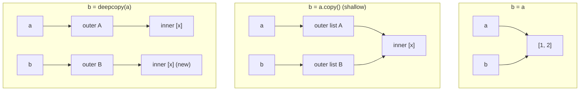

# Lesson 02: Mutability, Identity and Copying

> **Prerequisites:** [Lesson 01: How Python Runs Your Code](../01-how-python-runs-your-code/README.md)  
> **Reading time:** ~22 minutes  
> **Audience:** Anyone asked "what does this print?" about lists, defaults, `+=`, or "shallow vs deep copy"

> [!NOTE]
> **In one line:** Python names point at objects; **mutable** objects (`list`, `dict`, `set`) change in place and are therefore *shared* through aliases, **immutable** ones (`int`, `str`, `tuple`, `frozenset`) never change — "changing" them rebinds a name.

> [!TIP]
> **Golden rule:** Before predicting any output, ask two questions: *Is this object mutable?* and *How many names point at it?* The mutable default argument, `b = a`, `[[0]*3]*3`, and shallow copies are all the same bug.

> [!TIP]
> **Try it:** Run the file below and compare each printed line to your prediction. Then try [Python Tutor](https://pythontutor.com/) on `[[0]*2]*2` to *see* the arrows. Sketch the aliasing in [LLD Studio](/tools/lld-studio/) as two names → one object.

---

## 1. The smell: the questions behind the questions

> **Predict-the-output snippet.** The last line raises `TypeError` on purpose (after mutating the list). Answers are in the runnable demo in section 3; write yours down first.

```python
# snippet — predict the output
def add(item, bucket=[]):
    bucket.append(item)
    return bucket

print(add(1), add(2))        # ?
grid = [[0] * 2] * 2
grid[0][0] = 9
print(grid)                  # ?
t = ([1], 2)
t[0].append(3)               # allowed?
t[0] += [4]                  # allowed?  (famous)
```

Interviewers love these because the answer reveals whether you hold the right mental model.



---

## 2. Reference table

| Type | Mutable? | Hashable? | `x += y` does | Notes |
| :--- | :---: | :---: | :--- | :--- |
| `int`, `float`, `bool`, `str`, `bytes` | No | Yes | **Rebinds** `x` to a new object | |
| `tuple`, `frozenset` | No (shallow) | Yes *if contents are* | Rebinds | A tuple can *contain* mutable objects |
| `list`, `bytearray` | **Yes** | No | **Mutates in place** (`__iadd__`) | |
| `dict`, `set` | **Yes** | No | `\|=` mutates | Keys must be hashable |
| user class | Yes (by default) | Yes by `id` unless `__eq__` defined | — | Defining `__eq__` removes default `__hash__` |

| Copy kind | How | What is copied | Gotcha |
| :--- | :--- | :--- | :--- |
| Alias | `b = a` | nothing | Same object |
| Shallow | `a.copy()`, `a[:]`, `list(a)`, `copy.copy(a)`, `dict(a)` | the outer container | Inner objects still shared |
| Deep | `copy.deepcopy(a)` | everything reachable (handles cycles) | Slow; may copy things you didn't want (connections) |

---

## 3. Walkthrough: seven behaviours in one file

**What to say as you read the code:**

1. `is` is identity; `==` is value. `None` is compared with `is`.
2. The default argument is created once → shared state.
3. `[[0]*3]*3` repeats the *same* inner list three times.
4. Shallow copy duplicates only the outer list.
5. `deepcopy` duplicates everything and supports cycles.
6. `+=` mutates lists but rebinds tuples/ints.
7. Hashability: only immutable-ish objects can be dict keys.

````carousel
```python
import copy


def add_bad(item, bucket=[]):
    bucket.append(item)
    return bucket


def add_good(item, bucket=None):
    if bucket is None:
        bucket = []
    bucket.append(item)
    return bucket


def demo() -> None:
    # 1) identity vs equality
    a = [1, 2]
    b = [1, 2]
    print("equal:", a == b, "| same object:", a is b)        # True False

    # 2) mutable default argument
    print(add_bad(1), add_bad(2), add_bad.__defaults__)      # [1, 2] [1, 2] ([1, 2],)
    print(add_good(1), add_good(2))                          # [1] [2]

    # 3) repeated references
    bad = [[0] * 2] * 2
    bad[0][0] = 9
    good = [[0] * 2 for _ in range(2)]
    good[0][0] = 9
    print(bad, good)                                         # [[9, 0], [9, 0]] [[9, 0], [0, 0]]

    # 4) shallow vs deep copy
    original = [[1, 2], [3]]
    shallow = original.copy()
    deep = copy.deepcopy(original)
    original[0].append(99)
    print(shallow[0], deep[0])                               # [1, 2, 99] [1, 2]

    # 5) += mutates lists, rebinds ints
    lst = [1]
    alias = lst
    lst += [2]
    print(alias)                                             # [1, 2]  (same object mutated)
    num = 10
    other = num
    num += 1
    print(num, other)                                        # 11 10

    # 6) the famous tuple trap
    t = ([1], 2)
    try:
        t[0] += [4]          # list is mutated, THEN tuple item assignment fails
    except TypeError as err:
        print("TypeError:", err)
    print(t)                                                 # ([1, 4], 2)

    # 7) hashability
    d = {(1, 2): "ok"}
    try:
        d[[1, 2]] = "nope"
    except TypeError as err:
        print("TypeError:", err)

    # bonus: cycles are handled by deepcopy
    ring = [1]
    ring.append(ring)
    clone = copy.deepcopy(ring)
    print(clone[1] is clone)                                 # True


if __name__ == "__main__":
    demo()
```
<!-- slide -->
```csharp
// C#: List<T> is a reference type (alias), int is a value type (copy),
// and string is an immutable reference type.
var a = new List<int> { 1, 2 };
var b = a;               // alias
b.Add(3);
Console.WriteLine(a.Count);                 // 3

int x = 10; int y = x; x++;                 // value copy
Console.WriteLine($"{x} {y}");              // 11 10

var shallow = new List<List<int>> { new() { 1 } };
var copy = new List<List<int>>(shallow);    // shallow: inner lists shared
copy[0].Add(2);
Console.WriteLine(shallow[0].Count);        // 2
// Deep copy needs explicit code or serialization; there is no built-in DeepCopy.
```
````

---

## 4. Edges

- **`is` with literals.** `x is 256` happens to work (small-int cache), `x is 1000` may not; since 3.8, `is` with a literal raises `SyntaxWarning`. Use `==`; reserve `is` for `None`, `True`, `False`, sentinels.
- **Default arguments are evaluated once.** Applies to any mutable default: list, dict, set, even `datetime.now()` (frozen at definition!). Use `None` and compute inside.
- **Sentinel pattern.** If `None` is a legal value, use `_MISSING = object()` and compare with `is`.
- **Aliasing across function calls.** Passing a list to a function lets the callee mutate your list. Document it, or copy defensively (`list(items)`), or take a tuple.
- **Shared class attributes.** `class A: items = []` shares one list across all instances (lesson 06).
- **Dictionary keys must be hashable and stable.** Mutating an object used as a key (after defining `__hash__` on mutable state) corrupts the dict.
- **`copy.copy` on custom classes** uses `__copy__`/`__reduce__`; if your object holds a socket or a lock, deep-copying it is wrong.
- **Concurrency.** Sharing a mutable object between threads needs a lock; sharing an immutable one doesn't — one reason to prefer tuples/frozen dataclasses.
- **Interning.** Equal short strings may be the same object; never rely on it.
- **`a += b` vs `a = a + b`.** For lists the first mutates (aliases see it), the second builds a new list and rebinds `a` (aliases do not). Same for `extend` vs `+`.
- **`dict.fromkeys(keys, [])`** puts *one* list under every key — the mutable default bug in disguise. Use a dict comprehension or `collections.defaultdict(list)`.
- **`@dataclass` rejects `items: list = []`** with `ValueError` (it catches the mutable default for you); the fix is `field(default_factory=list)`.
- **`__eq__` without `__hash__`** makes instances unhashable — usable as neither dict keys nor set members. A frozen dataclass generates both consistently.
- **Sentinels vs `None`.** `d.get(k, None)` cannot tell "missing" from "stored `None`"; use a private `object()` sentinel when that distinction matters (see lab probe 4).

### Try it — mutation lab (runnable)

The demo above covers the headline traps. This lab covers the *follow-ups* interviewers use when you answer the headline ones correctly. Save as `mutation_lab.py`; every probe is an `assert`.

```python
import copy
from dataclasses import dataclass, field

# 1) `a += b` mutates; `a = a + b` rebinds. Same-looking line, different aliasing outcome.
x = [1]
alias = x
x += [2]
assert alias == [1, 2]            # alias saw it: in-place __iadd__
y = [1]
alias2 = y
y = y + [2]
assert alias2 == [1] and y == [1, 2]   # alias did NOT see it: y now names a new list

# 2) dict.fromkeys shares ONE value object across every key
bad = dict.fromkeys("ab", [])
bad["a"].append(1)
assert bad == {"a": [1], "b": [1]}
good = {k: [] for k in "ab"}
good["a"].append(1)
assert good == {"a": [1], "b": []}

# 3) A function that mutates its argument vs one that does not
def sort_in_place(items):
    items.sort()
    return items

def sorted_copy(items):
    return sorted(items)

data = [3, 1, 2]
sorted_copy(data)
assert data == [3, 1, 2]          # untouched
sort_in_place(data)
assert data == [1, 2, 3]          # caller's list changed

# 4) Sentinel: when None is a legal value, `None` cannot mean "not given"
_MISSING = object()

def get(d, key, default=_MISSING):
    if key in d:
        return d[key]
    if default is _MISSING:
        raise KeyError(key)
    return default

assert get({"a": None}, "a") is None          # a real None value
assert get({}, "a", None) is None             # an explicit None default
try:
    get({}, "a")
except KeyError:
    pass

# 5) dataclass: a mutable default is rejected for you (use default_factory)
try:
    @dataclass
    class Bad:
        items: list = []                      # ValueError at class-creation time
except ValueError as e:
    print("dataclass refused:", e)

@dataclass
class Good:
    items: list = field(default_factory=list)

assert Good().items is not Good().items       # one list per instance

# 6) __eq__ without __hash__ makes instances unhashable; a frozen dataclass gets both
class P:
    def __init__(self, v): self.v = v
    def __eq__(self, o): return self.v == o.v

try:
    {P(1): "x"}
except TypeError as e:
    print("unhashable:", e)

@dataclass(frozen=True)
class FP:
    v: int

assert {FP(1): "x"}[FP(1)] == "x"             # equal frozen values find the same key

# 7) Shallow copy of a dict of lists shares the lists; deepcopy does not
cfg = {"hosts": ["a"]}
shallow, deep = dict(cfg), copy.deepcopy(cfg)
cfg["hosts"].append("b")
assert shallow["hosts"] == ["a", "b"] and deep["hosts"] == ["a"]
print("mutability lab ok")
```

Expected output:

```text
dataclass refused: mutable default <class 'list'> for field items is not allowed: use default_factory
unhashable: unhashable type: 'P'
mutability lab ok
```

Then, without running anything, predict and write down:

1. `a = [1]; b = a; a = a + [2]; print(b)` → `[1]`. Why does `+=` give the opposite answer?
2. `row = [0] * 3; grid = [row] * 3; grid[0][0] = 1; print(row)` → `[1, 0, 0]`. Which name is shared?
3. `t = (1, 2); t += (3,); print(t)` → `(1, 2, 3)` with **no** error. Why is this fine when `t[0] += [4]` was not? (Hint: `t += x` rebinds the name; `t[0] += x` assigns into the tuple.)

---

## 5. What you'd say in two minutes

> "Python variables are names bound to objects. Immutable types — int, str, tuple — can't change, so `x += 1` rebinds the name; mutable types — list, dict, set — change in place, so every alias sees the change. That's the cause of the mutable default argument bug: the default is evaluated once when `def` runs, so I use `None` and build the list inside. It's also why `[[0]*3]*3` gives three references to one row, and why a shallow copy of a nested list still shares the inner lists. For independence I use a comprehension or `copy.deepcopy`, which also handles cycles. For comparisons, `==` asks 'equal values', `is` asks 'same object', and I only use `is` with `None` and sentinels. In design terms I prefer immutable values — tuples, frozen dataclasses — for anything shared across threads or used as a dict key."

---

## 6. Anti-patterns

| Anti-pattern | Why it fails | Fix |
| :--- | :--- | :--- |
| `def f(x, acc=[])` | One list for the process lifetime | `acc=None` |
| `grid = [[0]*n]*m` | Rows alias | `[[0]*n for _ in range(m)]` |
| `if x is "yes":` | Interning accident | `==` |
| `import copy; copy.deepcopy(huge)` in a hot path | Slow, copies unneeded state | Immutable data or targeted copying |
| Returning an internal list from a getter | Callers mutate your state | Return a copy or a tuple |
| Mutable object as a dict key | Hash changes → lost entries | Use tuples/frozen types |

---

## 7. Interview questions

<details>
<summary><strong>1. `is` vs `==`? [BASIC]</strong></summary>

`==` calls `__eq__` and compares values; `is` compares object identity. Use `is` for `None` and sentinels only.

</details>

<details>
<summary><strong>2. What does `a = [1,2]; b = a; b.append(3); print(a)` show, and why? [BASIC]</strong></summary>

`[1, 2, 3]`. `b = a` binds a second name to the same list; `append` mutates that one object.

</details>

<details>
<summary><strong>3. Explain the mutable default argument bug and fix. [BASIC]</strong></summary>

Defaults are evaluated once at function definition, so a `[]` default is a single shared list. Use `None` as the default and create the list inside the function.

</details>

<details>
<summary><strong>4. Shallow vs deep copy? [BASIC]</strong></summary>

Shallow copies the container but not the objects inside (inner objects remain shared). Deep copy recursively copies reachable objects and handles cycles with a memo dictionary.

</details>

<details>
<summary><strong>5. What happens with `t = ([1], 2); t[0] += [4]`? [TRICKY]</strong></summary>

The list is extended in place (`__iadd__` mutates), then Python tries to assign the result back to `t[0]`, which raises `TypeError` because tuples don't support item assignment. The tuple now shows `([1, 4], 2)` — both an exception *and* a mutation.

</details>

<details>
<summary><strong>6. Why can't a list be a dict key? [BASIC]</strong></summary>

Lists are mutable and unhashable; if the contents changed, the hash would too and the dict couldn't find the entry. Use a tuple (of hashables) or `frozenset`.

</details>

<details>
<summary><strong>7. A function `normalize(items)` sorts the caller's list in place. How do you fix it? [SCENARIO]</strong></summary>

Return `sorted(items)` (a new list) instead of calling `.sort()`, or document the mutation and name it accordingly. Prefer functions that don't mutate their inputs unless that's the point.

</details>

<details>
<summary><strong>8. How would you create a deep copy of a config that contains a database connection? [SCENARIO]</strong></summary>

Don't deep-copy the connection. Define `__deepcopy__` (or copy only the data portion) so non-copyable resources stay shared or are recreated; or separate config *data* from *resources* so only data is copied.

</details>

---

## 8. One-page cheat sheet

```text
Immutable   int float bool str bytes tuple frozenset   -> "change" = rebind
Mutable     list dict set bytearray, most user objects -> change in place, aliases see it
Compare     == value  |  is identity (None, sentinels only)
Default     def f(x=None): x = [] if x is None else x      # never def f(x=[])
Copy        a.copy() / a[:] / list(a)  = shallow  |  copy.deepcopy(a) = deep (cycles OK)
Grid        [[0]*n for _ in range(m)]   NOT   [[0]*n]*m
+=          list: in-place (alias sees)  |  int/str/tuple: rebinds
Hash        dict keys / set members must be hashable (immutable-ish)
Tuple trap  t[0] += [..] mutates AND raises TypeError
Prefer      immutable values for shared / threaded / dict-key data
```

---

## Further reading

- [Python docs: `copy` module](https://docs.python.org/3/library/copy.html)
- [Python FAQ: why are default values shared between objects?](https://docs.python.org/3/faq/programming.html#why-are-default-values-shared-between-objects)
- [Ned Batchelder — Facts and myths about Python names and values](https://nedbatchelder.com/text/names.html)

Previous: [How Python Runs Your Code](../01-how-python-runs-your-code/README.md) · Next: [Functions: *args, **kwargs, Closures and Scope](../03-functions-args-kwargs-closures-and-scope/README.md)
