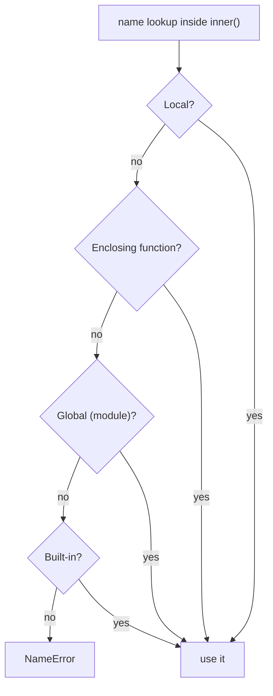

# Lesson 03: Functions — `*args`, `**kwargs`, Closures and Scope

> **Prerequisites:** [Lesson 02: Mutability, Identity and Copying](../02-mutability-identity-and-copying/README.md) · [Refresher: Functions](../../../learn/00-python-refresher/05-functions/README.md)  
> **Reading time:** ~22 minutes  
> **Audience:** Candidates asked about parameter kinds, `*args/**kwargs`, LEGB, `nonlocal`, or "why do all my lambdas return the same value?"

> [!NOTE]
> **In one line:** Functions are first-class objects; parameters come in five kinds (positional-only, normal, `*args`, keyword-only, `**kwargs`); names resolve by **LEGB** (Local → Enclosing → Global → Built-in); a **closure** is a function that remembers variables from the scope where it was defined.

> [!TIP]
> **Golden rule:** Closures capture **variables**, not values. If a closure is created in a loop and called later, it sees the variable's *final* value. Bind the value early with a default argument (`lambda i=i: ...`) or `functools.partial`.

> [!TIP]
> **Try it:** Run the example in section 3 (it ends by printing the counter's captured cell), then run the [scope lab](#try-it--scope-lab-runnable) below — nine asserted probes covering the follow-up questions. Model "function + captured environment" as an object in [LLD Studio](/tools/lld-studio/) — a closure is a tiny object with one method.

---

## 1. The smell: how this shows up

- *"What do `*args` and `**kwargs` do?"*
- *"What does `def f(a, /, b, *, c)` mean?"*
- *"Why does this print `2 2 2`?"* (late binding)
- *"What's `nonlocal`? How is it different from `global`?"*
- *"Write a counter without a class."* (closure)



---

## 2. Parameter kinds at a glance

```text
def f(pos_only, /, normal, *args, kw_only, **kwargs): ...
       ^^^^^^^^   ^^^^^^   ^^^^^  ^^^^^^^   ^^^^^^^^
       by position  either   extras  by name   extra names
```

| Kind | Syntax | Caller may pass | Why use it |
| :--- | :--- | :--- | :--- |
| Positional-only (3.8+) | before `/` | by position only | Names are not API; freedom to rename |
| Normal | plain name | position or keyword | Default |
| Var-positional | `*args` | any number of extras → **tuple** | Wrappers, variadic APIs |
| Keyword-only | after `*` / `*args` | by name only | Force clarity for flags |
| Var-keyword | `**kwargs` | extra named args → **dict** | Forwarding, config bags |

Unpacking at the call site: `f(*seq, **mapping)`. Order of definition: positional-only, normal, `*args`, keyword-only, `**kwargs`.

| Scope keyword | Effect |
| :--- | :--- |
| `global x` | Assignments to `x` inside the function rebind the *module* variable |
| `nonlocal x` | Assignments rebind `x` in the nearest *enclosing function* |
| (none) | Assignment makes `x` local for the **whole** function body |

---

## 3. Walkthrough: counter, late binding, forwarding

**Scenario:** build (1) a counter closure, (2) a list of adders created in a loop, (3) a wrapper that forwards any arguments.

1. A closure keeps state in a *cell*; `nonlocal` lets the inner function **rebind** it.
2. Without `nonlocal`, `count += 1` makes `count` local → `UnboundLocalError`.
3. Closures created in a loop share the loop variable. Fix with default args or `partial`.
4. A forwarder uses `*args, **kwargs` so it doesn't care about the target's signature.

````carousel
```python
from functools import partial


def make_counter(start: int = 0):
    count = start

    def next_value() -> int:
        nonlocal count            # rebind the enclosing variable
        count += 1
        return count

    return next_value


def broken_counter():
    count = 0

    def bump():
        count += 1                # UnboundLocalError: assignment makes it local
        return count

    return bump


def late_binding():
    return [lambda x: x + i for i in range(3)]


def early_binding():
    return [lambda x, i=i: x + i for i in range(3)]


def forward(target, *args, **kwargs):
    print(f"calling {target.__name__} args={args} kwargs={kwargs}")
    return target(*args, **kwargs)


def describe(a, /, b, *, c, **extras):
    return f"a={a} b={b} c={c} extras={extras}"


def main() -> None:
    c1, c2 = make_counter(), make_counter(100)
    print(c1(), c1(), c2())                                   # 1 2 101

    try:
        broken_counter()()
    except UnboundLocalError as err:
        print("UnboundLocalError:", err)

    print([f(10) for f in late_binding()])                    # [12, 12, 12]
    print([f(10) for f in early_binding()])                   # [10, 11, 12]
    print([partial(pow, 2)(n) for n in (3, 4)])               # [8, 16]

    print(forward(describe, 1, 2, c=3, z=9))
    try:
        describe(a=1, b=2, c=3)                               # a is positional-only
    except TypeError as err:
        print("TypeError:", err)
    try:
        describe(1, 2, 3)                                     # c is keyword-only
    except TypeError as err:
        print("TypeError:", err)

    cell = c1.__closure__[0]
    print("captured cell:", cell.cell_contents, "| free vars:", c1.__code__.co_freevars)


if __name__ == "__main__":
    main()
```
<!-- slide -->
```csharp
// C# lambdas also capture VARIABLES. `for` shares one variable; `foreach` creates one per iteration.
var fs = new List<Func<int, int>>();
for (int i = 0; i < 3; i++) fs.Add(x => x + i);
Console.WriteLine(string.Join(",", fs.Select(f => f(10))));   // 13,13,13

var gs = new List<Func<int, int>>();
foreach (var i in Enumerable.Range(0, 3)) gs.Add(x => x + i);
Console.WriteLine(string.Join(",", gs.Select(f => f(10))));   // 10,11,12

// Counter closure
Func<int> MakeCounter(int start = 0) { int c = start; return () => ++c; }
var next = MakeCounter();
Console.WriteLine($"{next()} {next()}");                       // 1 2

// params object[] ~ *args; named arguments ~ keyword arguments (no **kwargs equivalent)
```
````

Key results: `[12, 12, 12]` vs `[10, 11, 12]` — the late-binding trap and its fix. Expected output of the Python tab (the exact `UnboundLocalError` and `TypeError` wording is from Python 3.13; older versions differ slightly):

```text
1 2 101
UnboundLocalError: cannot access local variable 'count' where it is not associated with a value
[12, 12, 12]
[10, 11, 12]
[8, 16]
calling describe args=(1, 2) kwargs={'c': 3, 'z': 9}
a=1 b=2 c=3 extras={'z': 9}
TypeError: describe() missing 1 required positional argument: 'a'
TypeError: describe() takes 2 positional arguments but 3 were given
captured cell: 2 | free vars: ('count',)
```

Note the first `TypeError`: `describe` has `**extras`, so `a=1` is legal syntax, but it is routed into `extras` instead of binding the positional-only `a` — which is therefore reported as *missing*. (Without `**extras`, the message would say `got some positional-only arguments passed as keyword arguments`.)

---

## 4. Edges

- **`UnboundLocalError`.** Any assignment in a function (even later in the body) makes the name local for the whole body; reading it earlier fails. `global`/`nonlocal` change that.
- **Mutating vs rebinding.** A closure can *mutate* a captured list without `nonlocal`; only *rebinding* needs it.
- **Mutable defaults vs late binding.** Two different "evaluated when?" facts that look alike. A default value is evaluated **once, when `def` runs** (lesson 02). A closure reads its captured variable **each time it is called**. That is why `lambda i=i: ...` fixes the loop: the default freezes the value at definition time.
- **`*args` is a tuple, `**kwargs` is a dict** — a copy; mutating `kwargs` doesn't affect the caller's dict.
- **Keyword-only flags** prevent `send(msg, True, False)` — use `send(msg, *, retry=False, urgent=False)`.
- **Name collisions in `**kwargs`.** Passing the same key twice (`f(a=1, **{"a": 2})`) raises `TypeError`.
- **Closures and memory.** A closure keeps the whole captured variable alive; long-lived callbacks can pin large objects.
- **Threads.** A shared closure counter is **not** thread-safe: `count += 1` is read-modify-write. Use a lock or `itertools.count()`.
- **Recursion limit.** Default ~1000 frames; Python does no tail-call optimisation. Convert to loops or use an explicit stack.

### Try it — scope lab (runnable)

The follow-ups interviewers ask once you get the headline traps right. Save as `scope_lab.py`; every probe is an `assert` or a printed message, so a wrong claim fails loudly.

```python
import threading

# 1) Assignment ANYWHERE in the body makes the name local for the WHOLE body
x = "global"
def reads_then_assigns():
    print(x)          # UnboundLocalError: x is local here because of the line below
    x = "local"

try:
    reads_then_assigns()
except UnboundLocalError as e:
    print("1:", e)

# 2) global vs nonlocal
hits = 0
def bump_global():
    global hits
    hits += 1

def outer():
    n = 0
    def inner():
        nonlocal n
        n += 1
    inner(); inner()
    return n

bump_global(); bump_global()
assert hits == 2 and outer() == 2

# 3) Mutating a captured list needs no nonlocal; rebinding does
def make_log():
    entries = []
    def add(item):
        entries.append(item)       # mutation: fine
    return add, entries
add, entries = make_log()
add("a"); add("b")
assert entries == ["a", "b"]

# 4) **kwargs is a fresh dict; mutating it never touches the caller's dict
def strip_secret(**kw):
    kw.pop("secret", None)
    return kw

cfg = {"user": "u", "secret": "s"}
out = strip_secret(**cfg)
assert "secret" in cfg and "secret" not in out and out is not cfg

# 5) Same key twice -> TypeError at call time
def f(a): return a
try:
    f(a=1, **{"a": 2})
except TypeError as e:
    print("5:", e)

# 6) Keyword-only flags make call sites unambiguous
def send(msg, *, retry=False, urgent=False):
    return (msg, retry, urgent)
assert send("hi", urgent=True) == ("hi", False, True)
try:
    send("hi", True, False)
except TypeError as e:
    print("6:", e)

# 7) Late-binding fix: three ways, same result
from functools import partial
def add_to(x, i): return x + i
late   = [lambda x: x + i for i in range(3)]
default = [lambda x, i=i: x + i for i in range(3)]
part   = [partial(add_to, i=i) for i in range(3)]
make   = lambda i: (lambda x: x + i)
factory = [make(i) for i in range(3)]
assert [g(10) for g in late] == [12, 12, 12]
for fixed in (default, part, factory):
    assert [g(10) for g in fixed] == [10, 11, 12]

# 8) Closure counter vs itertools.count under threads: count() hands out unique values
import itertools
ticket = itertools.count(1)
seen = []
def worker():
    for _ in range(1000):
        seen.append(next(ticket))
ts = [threading.Thread(target=worker) for _ in range(4)]
[t.start() for t in ts]; [t.join() for t in ts]
assert len(set(seen)) == 4000       # next() on itertools.count is atomic under the GIL (CPython)

# 9) Recursion limit is real, and there is no tail-call optimisation
import sys
def depth(n): return 0 if n == 0 else 1 + depth(n - 1)
try:
    depth(sys.getrecursionlimit() + 10)
except RecursionError:
    print("9: RecursionError at limit", sys.getrecursionlimit())
print("scope lab ok")
```

Expected output:

```text
1: cannot access local variable 'x' where it is not associated with a value
5: __main__.f() got multiple values for keyword argument 'a'
6: send() takes 1 positional argument but 3 were given
9: RecursionError at limit 1000
scope lab ok
```

---

## 5. What you'd say in two minutes

> "Functions are objects, so I can pass, return and store them. Parameters come in five kinds: positional-only before `/`, normal, `*args` collecting extras into a tuple, keyword-only after `*`, and `**kwargs` collecting extra names into a dict — I use keyword-only for boolean flags so call sites read clearly. Names resolve LEGB: local, enclosing, global, built-in. A closure is a function plus the variables it captured from an enclosing scope, stored in cells — `nonlocal` lets it rebind them, which is how I'd write a counter without a class. The classic trap is closures in a loop: they capture the variable, not the value, so they all see the last value; I bind early with a default argument or `functools.partial`."

---

## 6. Anti-patterns

| Anti-pattern | Why it fails | Fix |
| :--- | :--- | :--- |
| `lambda: i` in a loop | Late binding → all same | `lambda i=i: i` / `partial` |
| `def f(*args, **kwargs)` as a public API | Hides the contract, no IDE help | Explicit parameters; use `**kwargs` only when forwarding |
| Boolean positional flags | `f(x, True, False)` is unreadable | Keyword-only parameters |
| `global` counters | Hidden shared state | Closure, class, or `itertools.count` |
| Mutating `kwargs` and expecting caller effects | It's a new dict | Return a new value |
| Deep recursion on big inputs | RecursionError | Iterate or use an explicit stack |

---

## 7. Interview questions

<details>
<summary><strong>1. What do `*args` and `**kwargs` do? [BASIC]</strong></summary>

In a `def`, `*args` collects extra positional arguments into a tuple and `**kwargs` collects extra keyword arguments into a dict. At a call site, `*seq` and `**mapping` unpack them into separate arguments.

</details>

<details>
<summary><strong>2. Explain LEGB. [BASIC]</strong></summary>

Name lookup order: Local, Enclosing function(s), Global (module), Built-in. Assignment inside a function makes the name local unless declared `global` or `nonlocal`.

</details>

<details>
<summary><strong>3. What is a closure? [BASIC]</strong></summary>

A function that retains access to variables from the enclosing scope where it was defined, even after that scope has returned. Python stores them in cell objects, visible via `__closure__`.

</details>

<details>
<summary><strong>4. `global` vs `nonlocal`? [BASIC]</strong></summary>

`global x` binds assignments to the module-level `x`. `nonlocal x` binds to the nearest enclosing *function's* `x`. `nonlocal` can't reach module scope.

</details>

<details>
<summary><strong>5. Why does `[lambda: i for i in range(3)]` give 2, 2, 2? [TRICKY]</strong></summary>

All lambdas close over the same variable `i`, which is 2 when they finally run. Capture the value with `lambda i=i: i` or `partial`.

</details>

<details>
<summary><strong>6. What does `def f(a, /, b, *, c)` mean? [TRICKY]</strong></summary>

`a` is positional-only, `b` can be either, `c` is keyword-only. So `f(1, 2, c=3)` and `f(1, b=2, c=3)` work; `f(a=1, ...)` and `f(1, 2, 3)` raise `TypeError`.

</details>

<details>
<summary><strong>7. Write a function that counts calls without a class or global. [SCENARIO]</strong></summary>

A closure with `nonlocal`, or a function attribute (`f.calls += 1`), or a decorator. For thread safety use a lock or `itertools.count()`.

</details>

<details>
<summary><strong>8. A wrapper must forward to any function. Which signature? [SCENARIO]</strong></summary>

`def wrapper(*args, **kwargs): return target(*args, **kwargs)`, plus `functools.wraps(target)` so name and docstring survive (lesson 04).

</details>

---

## 8. One-page cheat sheet

```text
Param kinds   def f(po, /, normal, *args, kwonly, **kwargs)
              *args -> tuple    **kwargs -> dict    call: f(*seq, **map)
Scope         LEGB: Local -> Enclosing -> Global -> Built-in
              assignment anywhere in body => local;  global x / nonlocal x override
Closure       function + captured cells (__closure__); nonlocal to rebind
Trap          closures capture VARIABLES: lambda i=i: i   |   functools.partial(f, i)
Defaults      evaluated once at def time (see lesson 02)
Style         keyword-only for flags; explicit params in public APIs; **kwargs only to forward
Limits        no TCO, recursion ~1000; count += 1 is not thread-safe
```

---

## Further reading

- [Python tutorial: defining functions](https://docs.python.org/3/tutorial/controlflow.html#more-on-defining-functions)
- [PEP 570: positional-only parameters](https://peps.python.org/pep-0570/)
- [Python reference: naming and binding](https://docs.python.org/3/reference/executionmodel.html#naming-and-binding)

Previous: [Mutability, Identity and Copying](../02-mutability-identity-and-copying/README.md) · Next: [Decorators](../04-decorators/README.md)
