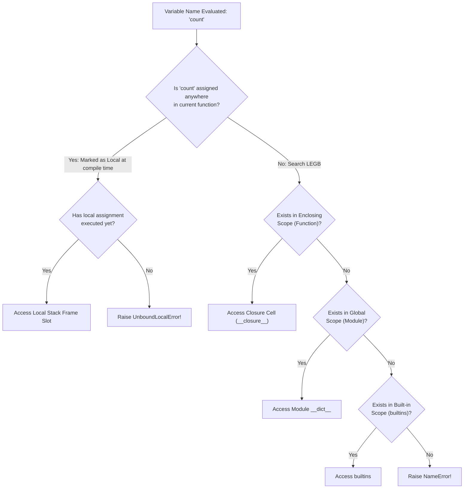
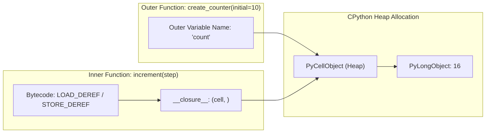

# Lesson 03: Functions: *args, **kwargs, Closures and Scope

> **Prerequisites:** [Mutability, Identity and Copying](../02-mutability-identity-and-copying/README.md) and [Track 27 Overview](../README.md).  
> **Estimated Reading Time:** 18 minutes  
> **Target Audience:** Engineers preparing for LLD, OOP, C#, or Python technical screening and architecture rounds.

> [!TIP]
> **The One Rule of Scope & Closures:** Python binds **names, not values**. When resolving names, Python searches upward through **LEGB** (Local, Enclosing, Global, Built-in). If a name is assigned anywhere inside a function, Python marks it as strictly **Local** at compile time unless explicitly declared `global` or `nonlocal`. A closure does not freeze a snapshot of variable values; it captures **cell references** to the enclosing environment, which is why loop-captured closures exhibit late binding.

---

## 1. Why This Matters: The Interview Trap

Few questions expose a candidate's grasp of Python's execution model faster than closures, variable resolution, and variadic arguments. 

Consider this classic trap:
```python
multipliers = [lambda x: x * i for i in range(3)]
print([m(2) for m in multipliers])
```

### The Weak Answer
> *"It outputs `[0, 2, 4]` because the loop runs for `i = 0, 1, 2`, creating a lambda for each multiplier, and then we multiply each by 2."*

This candidate fails immediately. The actual output is **`[4, 4, 4]`**.

### The Senior Strong Answer
> *"It prints `[4, 4, 4]` because Python closures use **late binding**: the inner lambda looks up the variable `i` in its enclosing scope when the function is **called**, not when it is **defined**. By the time any lambda is invoked, the comprehension has completed, and `i` remains bound to its final value of `2`. Since all three lambdas share the exact same cell reference to `i`, every lambda computes `2 * 2 = 4`.  
> 
> To fix this, you must bind the value at definition time using a default argument (`lambda x, i=i: x * i`), or construct a dedicated closure factory function that allocates an independent enclosing frame per iteration.  
> 
> Furthermore, Python uses the **LEGB** rule (Local -> Enclosing -> Global -> Built-in) for name lookup. However, name resolution is decided statically at compile time: if a variable is assigned anywhere within a function body, it is treated as local throughout that entire function, which is the exact reason referencing a global variable prior to a local assignment raises an `UnboundLocalError`."*

### Scope Resolution Hierarchy (LEGB)

| Scope | Description | Lifetime | Modification Keyword Needed Inside Local Function |
| :--- | :--- | :--- | :--- |
| **Local (L)** | Names assigned inside the current function body (or parameter list). | Created upon function invocation; destroyed when function exits. | None (assignment automatically creates local binding). |
| **Enclosing (E)** | Names defined in any enclosing functions from the inside out (closures). | Persists as long as any inner function maintains a reference (`__closure__`). | **`nonlocal`** (rebinds nearest enclosing non-global scope variable). |
| **Global (G)** | Names defined at the top level of the current module file. | Entire lifetime of the running Python process / module import. | **`global`** (rebinds top-level module variable). |
| **Built-in (B)** | Pre-loaded builtins provided by the `builtins` module (`len`, `range`, `ValueError`). | Lifetime of the Python runtime. | Never rebind builtins (doing so shadows the global name). |

---

## 2. Visual Mental Model / Taxonomic Comparison

### LEGB Resolution Flow and the `UnboundLocalError` Trap

Python inspects the AST at compile time. If an assignment operator (`=`, `+=`, `:=`) targets a variable anywhere inside a function, that variable name is marked as `CO_FAST` (purely local).



### Anatomy of a Closure

When an inner function accesses a name from an enclosing scope, CPython creates a `cell` object on the heap that bridges both frames.



### Python Function Parameter Taxonomy (PEP 570 & PEP 3102)

Python provides five distinct parameter classifications. Notice how `/` and `*` act as positional-only and keyword-only boundary markers:

```text
def func(pos_only1, pos_only2, /, standard_param, *args, kw_only1, kw_only2=10, **kwargs):
                               ^                 ^
                     Positional-Only Marker  Keyword-Only Marker
```

| Parameter Category | Syntax Example | How Callers Can Pass It | Primary Use Case |
| :--- | :--- | :--- | :--- |
| **Positional-Only** | `def f(a, b, /):` | Positional only: `f(1, 2)`. Passing `f(a=1)` raises `TypeError`. | C-extensions, APIs where parameter names have no semantic value or may change without breaking consumers. |
| **Standard (Positional or Keyword)** | `def f(a, b):` | Either: `f(1, 2)` or `f(a=1, b=2)`. | General-purpose library functions. |
| **Variadic Positional (`*args`)** | `def f(*args):` | Zero or more positional arguments, packed into a `tuple`. | Interceptors, decorators, math functions like `min(*values)`. |
| **Keyword-Only** | `def f(*, key):` or after `*args` | Named only: `f(key=1)`. Positional call raises `TypeError`. | Boolean flags, configuration options, preventing accidental argument misalignment. |
| **Variadic Keyword (`**kwargs`)** | `def f(**kwargs):` | Zero or more keyword arguments, packed into a `dict`. | Dynamic option bags, dependency injection, decorator forwarding. |

---

## 3. Code Implementation

The following code demonstrates:
1. Positional-only (`/`), standard, `*args`, keyword-only (`*`), and `**kwargs` parameters.
2. Unpacking arguments dynamically at the call site (`*` and `**`).
3. Closures with state mutation using `nonlocal` and closure cell introspection.
4. The late-binding loop trap and both standard remediation patterns.

````carousel
```python
from typing import Any, Callable, Dict, List, Tuple


# 1. Advanced Parameter Kinds: Positional-only (/), standard, *args, keyword-only, **kwargs
def request_handler(
    endpoint: str,
    /,  # Positional-only marker: endpoint cannot be passed as a keyword
    method: str = "GET",
    *flags: str,  # Variadic positional arguments packed into a tuple
    timeout: int = 30,  # Keyword-only parameter because it follows *flags
    **headers: str,  # Variadic keyword arguments packed into a dict
) -> str:
    sorted_headers = sorted(headers.items())
    return (
        f"{method} {endpoint} flags={flags} timeout={timeout} headers={sorted_headers}"
    )


# 2. Closures and State Preservation via nonlocal
def create_counter(initial: int = 0) -> Callable[[int], int]:
    count = initial  # Enclosing scope variable

    def increment(step: int = 1) -> int:
        nonlocal count  # Rebinds 'count' in the enclosing frame, not local
        count += step
        return count

    return increment


def run_demonstration() -> None:
    # Invoking request handler with unpacking
    custom_flags: Tuple[str, ...] = ("auth", "cache")
    custom_headers: Dict[str, str] = {
        "X-Trace": "1234",
        "Accept": "application/json",
    }
    output = request_handler(
        "/users",
        "POST",
        *custom_flags,  # Unpacks tuple into *flags
        timeout=60,  # Keyword-only argument
        **custom_headers,  # Unpacks dict into **headers
    )
    print("Handler output:", output)

    # Invoking stateful closure
    counter = create_counter(10)
    print("Counter steps:", counter(1), counter(5))
    # Introspecting the underlying closure cell directly
    cell_val = counter.__closure__[0].cell_contents  # type: ignore
    print("Closure captured value:", cell_val)

    # 3. Late Binding Trap in Closures & Fixes
    # Trap: All lambdas reference the same 'i' variable from the enclosing scope
    broken_multipliers = [lambda x: x * i for i in range(3)]
    # Fix: Default argument evaluates 'i' at lambda definition time
    fixed_multipliers = [lambda x, i=i: x * i for i in range(3)]

    print("Broken multipliers (x=2):", [m(2) for m in broken_multipliers])
    print("Fixed multipliers (x=2):", [m(2) for m in fixed_multipliers])


if __name__ == "__main__":
    run_demonstration()
```
<!-- slide -->
```csharp
using System;
using System.Collections.Generic;
using System.Linq;

public class Program
{
    // 1. C# equivalent: Optional parameters, params array, and dictionary options
    public static string RequestHandler(
        string endpoint,
        string method = "GET",
        int timeout = 30,
        string[]? flags = null,
        Dictionary<string, string>? headers = null)
    {
        flags ??= Array.Empty<string>();
        headers ??= new Dictionary<string, string>();

        var flagStr = $"('{string.Join("', '", flags)}')";
        var headerItems = headers.OrderBy(k => k.Key).Select(kv => $"('{kv.Key}', '{kv.Value}')");
        return $"{method} {endpoint} flags={flagStr} timeout={timeout} headers=[{string.Join(", ", headerItems)}]";
    }

    // 2. Closures in C#: The compiler generates a hidden <>c__DisplayClass to hold 'count'
    public static Func<int, int> CreateCounter(int initial = 0)
    {
        int count = initial; // Captured on heap inside compiler-generated DisplayClass
        return (step) =>
        {
            count += step; // Directly mutates the captured field
            return count;
        };
    }

    public static void Main()
    {
        // 1. Invoking request handler
        var customFlags = new[] { "auth", "cache" };
        var customHeaders = new Dictionary<string, string>
        {
            ["X-Trace"] = "1234",
            ["Accept"] = "application/json"
        };
        Console.WriteLine("Handler output: " + RequestHandler("/users", "POST", 60, customFlags, customHeaders));

        // 2. Invoking stateful closure
        var counter = CreateCounter(10);
        Console.WriteLine($"Counter steps: {counter(1)} {counter(5)}");
        Console.WriteLine($"Closure captured value: {counter(0)}");

        // 3. Late Binding Trap in C#:
        // In for loops, capturing the loop variable captures the shared variable address
        var brokenMultipliers = new List<Func<int, int>>();
        int finalI = 0;
        for (int i = 0; i < 3; i++)
        {
            finalI = i; // Shared variable retains 2 at the end of the iterations
            brokenMultipliers.Add(x => x * finalI);
        }

        // Fix: Capture a local copy scoped inside each iteration
        var fixedMultipliers = new List<Func<int, int>>();
        for (int i = 0; i < 3; i++)
        {
            int captured = i; // Fresh stack allocation per iteration
            fixedMultipliers.Add(x => x * captured);
        }

        Console.WriteLine("Broken multipliers (x=2): [" + string.Join(", ", brokenMultipliers.Select(m => m(2))) + "]");
        Console.WriteLine("Fixed multipliers (x=2): [" + string.Join(", ", fixedMultipliers.Select(m => m(2))) + "]");
    }
}
```
````

**Expected Output (Both Languages):**

```text
Handler output: POST /users flags=('auth', 'cache') timeout=60 headers=[('Accept', 'application/json'), ('X-Trace', '1234')]
Counter steps: 11 16
Closure captured value: 16
Broken multipliers (x=2): [4, 4, 4]
Fixed multipliers (x=2): [0, 2, 4]
```

---

## 4. Where You Already Use It

- **In Python:**
  - **Decorators (`*args, **kwargs`):** Every standard Python decorator uses `def wrapper(*args, **kwargs): return func(*args, **kwargs)` to transparently intercept any function signature without knowing its parameters.
  - **FastAPI & Starlette Middleware:** Middleware functions close over the `app` instance or next HTTP handler (`call_next`), maintaining request lifetime state.
  - **`functools.partial`:** Curries functions by capturing positional and keyword arguments inside an internal closure-like callable.
  - **Standard Library Builtins:** Functions like `print(*objects, sep=' ', end='\n', file=None, flush=False)` use keyword-only arguments to prevent callers from accidentally passing options as printed text.
  - **PEP 570 Positional-Only Parameters:** Built-in functions implemented in C (`pow(x, y, z=None, /)`, `len(obj, /)`) use positional-only arguments because parameter names are not part of the public contract.

- **In C# / .NET:**
  - **`params T[] args`:** Enables methods like `string.Format(string format, params object[] args)` or `string.Concat(...)` to accept arbitrary positional arguments.
  - **LINQ Closures:** When you write `int threshold = 50; var query = users.Where(u => u.Age > threshold);`, the C# compiler generates an internal closure class (`DisplayClass`) capturing `threshold` by reference.
  - **ASP.NET Core RequestDelegate:** Middleware pipelines chain `RequestDelegate` functions using closures that capture next-delegate handles and scoped service providers.

---

## 5. Pitfalls and When Not to Use It

1. **The `UnboundLocalError` Collision:**
   - Consider:
     ```python
     total = 100


     def add_tax():
       print(total)  # Raises UnboundLocalError!
       total += 10
     ```
   - *Why:* Because `total` is assigned to on line 4 (`+=` is an assignment), Python compiles `total` as a **local** variable across the entire function scope. Line 3 tries to read the local variable before it has received a value.
   - *Fix:* Declare `global total` if mutating module state, or pass `total` as an explicit argument.

2. **Late-Binding in Loops & UI Callbacks:**
   - Constructing callback functions or threads inside a loop without parameter default binding (`lambda btn=btn: ...`) causes every callback to execute against the final iterated element.

3. **Indiscriminate `*args` and `**kwargs`:**
   - Catch-all signatures destroy code discoverability, break IDE autocomplete, and incapacitate static type checkers (`mypy`, `pyright`). Never use `**kwargs` when you know the fixed set of parameters your function expects; define explicit typed arguments instead.

4. **Accidental Memory Retention via Closures:**
   - A closure keeps its entire enclosing frame alive in memory as long as the closure exists. If an outer function creates a 500MB pandas DataFrame and an inner closure references only an integer length `len(df)`, the entire DataFrame remains pinned in RAM unless you explicitly extract the integer before defining the closure.

---

## 6. Exercises & Practical Drills

### Exercise 1: Spot the Scope Bug
What error does the following code raise, and what are two distinct ways to fix it?
```python
active_connections = 0


def record_connection():
  active_connections += 1
  return active_connections
```

<details>
<summary>Answer</summary>

**Error:**  
`UnboundLocalError: cannot access local variable 'active_connections' where it is not associated with a value`.  
Because `active_connections += 1` performs assignment, the compiler marks `active_connections` as purely local. The right-hand side tries to read the local variable before assignment.

**Fix 1: Using `global`**
```python
active_connections = 0


def record_connection():
  global active_connections
  active_connections += 1
  return active_connections
```

**Fix 2: Object-Oriented Encapsulation (Senior Architectural Fix)**
```python
class ConnectionPool:

  def __init__(self):
    self.active_count = 0

  def record(self) -> int:
    self.active_count += 1
    return self.active_count
```
</details>

### Exercise 2: Designing an API Contract with Parameter Markers
Design a function `create_order` where:
- `user_id` and `cart_id` MUST be passed positionally.
- `notify_customer` and `express_shipping` MUST be passed as keyword arguments.
- Any additional arbitrary metadata key-value pairs can be forwarded to the billing provider.

<details>
<summary>Answer</summary>

```python
from typing import Any, Dict


def create_order(
    user_id: int,
    cart_id: str,
    /,  # Everything before / is Positional-Only
    *,  # Keyword-Only boundary
    notify_customer: bool = True,
    express_shipping: bool = False,
    **metadata: Any,  # Catches all remaining keyword arguments
) -> Dict[str, Any]:
  return {
      "user_id": user_id,
      "cart_id": cart_id,
      "notify": notify_customer,
      "express": express_shipping,
      "metadata": metadata,
  }


# Valid call:
order = create_order(
    101, "cart_abc", notify_customer=False, partner_code="AFF123"
)

# Invalid call (raises TypeError):
# order = create_order(user_id=101, cart_id="cart_abc")
```
</details>

### Exercise 3: Stateful Rate-Limiting Closure
Implement a closure `make_rate_limiter(max_calls: int)` that allows up to `max_calls` invocations. Subsequent calls should raise a `RuntimeError("Rate limit exceeded")`. Do not use classes or global variables.

<details>
<summary>Answer</summary>

```python
from typing import Callable


def make_rate_limiter(max_calls: int) -> Callable[[], None]:
  calls_made = 0

  def check_limit() -> None:
    nonlocal calls_made
    if calls_made >= max_calls:
      raise RuntimeError("Rate limit exceeded")
    calls_made += 1

  return check_limit


# Verification:
limiter = make_rate_limiter(2)
limiter()  # call 1: ok
limiter()  # call 2: ok
# limiter()  # call 3: raises RuntimeError
```
</details>

---

## 7. Interview Questions & Model Answers

> [!interview]
> **Question 1: What are `*args` and `**kwargs`?**  
> **Strong Answer:**  
> "`*args` and `**kwargs` are Python's syntax for defining variadic functions:  
> 
> - **`*args`** collects any number of positional arguments into an immutable `tuple`. In the function signature, the asterisk `*` is the packing operator; when used in a function call (e.g., `func(*items)`), it unpacks an iterable into discrete positional arguments.  
> - **`**kwargs`** collects arbitrary keyword arguments into a standard mutable `dict`. In the signature, `**` packs keyword arguments; in a call (e.g., `func(**options)`), it unpacks dictionary keys and values into keyword arguments.  
> 
> Their primary architectural use is writing higher-order functions like decorators, proxy classes, and middleware that must accept and forward arbitrary method signatures without coupling to specific parameter definitions."

> [!interview]
> **Question 2: What is a closure?**  
> **Strong Answer:**  
> "A closure is a first-class function that retains access to variables from its lexical enclosing scope even after that enclosing outer function has finished executing and its stack frame has returned.  
> 
> In Python, closures are implemented via cell objects. When an inner function references an outer variable, CPython allocates a `PyCellObject` on the heap. Both the enclosing scope and the inner function's `__closure__` attribute point to this cell object.  
> 
> Closures provide state encapsulation without classes, and serve as the structural backbone for decorators, function currying, and callback factories. A critical property is **late binding**: the closure references the cell variable itself, meaning name lookups resolve the current value at call time rather than the value when the closure was defined."

> [!interview]
> **Question 3: What is the LEGB rule?**  
> **Strong Answer:**  
> "The LEGB rule specifies the exact sequence in which Python resolves variable names during execution:  
> 
> 1. **Local (L):** Names defined inside the currently executing function body or parameter list.  
> 2. **Enclosing (E):** Names defined in the local scope of any enclosing functions, evaluated from the innermost enclosing scope outward (closures).  
> 3. **Global (G):** Names defined at the top level of the current module file, or explicitly declared with the `global` keyword.  
> 4. **Built-in (B):** Pre-loaded system builtins in the `builtins` module (e.g., `len`, `range`, `Exception`).  
> 
> If a name is not found in any of these four scopes, Python raises a `NameError`.  
> 
> Importantly, Python determines variable scope **statically at compile time**. If a name is assigned anywhere inside a function, Python marks it as Local for that entire function. If you attempt to read that name before the assignment line executes, Python raises an `UnboundLocalError` rather than falling back to Enclosing or Global."

> [!interview]
> **Question 4: What does `nonlocal` do?**  
> **Strong Answer:**  
> "`nonlocal` is a keyword introduced in PEP 3104 that causes an identifier to refer to a previously bound variable in the **nearest enclosing lexical scope**, excluding the global (module) scope.  
> 
> In standard Python, assigning to a variable inside an inner function (`x = 10`) creates a new local variable `x`, shadowing the outer variable and leaving the outer state untouched.  
> 
> Declaring `nonlocal x` instructs Python that assignments to `x` should mutate the variable in the outer enclosing function's cell instead of creating a local binding. It allows closures to maintain and modify stateful counters, accumulators, and flags across invocations without falling back to global variables or full class instances."

---

## 8. Sources & Further Reading

- [PEP 3102: Keyword-Only Arguments](https://peps.python.org/pep-3102/)
- [PEP 570: Python Positional-Only Parameters](https://peps.python.org/pep-0570/)
- [PEP 3104: Access to Names in Outer Scopes (`nonlocal`)](https://peps.python.org/pep-3104/)
- [Python 3 Documentation: Execution Model and Scopes](https://docs.python.org/3/reference/executionmodel.html)
- [Microsoft Learn: Lambda Expressions and Closures in C#](https://learn.microsoft.com/en-us/dotnet/csharp/language-reference/operators/lambda-expressions)

---

Previous: [Mutability, Identity and Copying](../02-mutability-identity-and-copying/README.md) · Next: [Decorators](../04-decorators/README.md)
