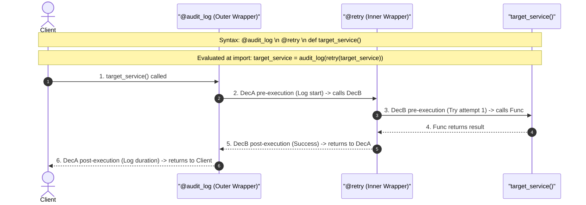

# Lesson 04: Decorators

> **Prerequisites:** [Functions: *args, **kwargs, Closures and Scope](../03-functions-args-kwargs-closures-and-scope/README.md) and [Track 27 Overview](../README.md).  
> **Estimated Reading Time:** 18 minutes  
> **Target Audience:** Engineers preparing for LLD, OOP, C#, or Python technical screening and architecture rounds.

> [!TIP]
> **The One Rule of Decorators:** A decorator is syntactic sugar for rebinding a callable: writing `@dec` immediately above `def func():` is evaluated as `func = dec(func)` at module import time. If the decorator accepts arguments (`@dec(args)`), it is a **decorator factory** that returns the actual decorator: `func = dec(args)(func)`. Always decorate your inner wrapper with `@functools.wraps(func)` to preserve the wrapped function's identity, docstring, and signature introspection.

---

## 1. Why This Matters: The Interview Trap

Decorators appear in virtually every senior Python interview because they test the convergence of first-class functions, closures, variadic arguments, and metaprogramming.

Consider this standard interview challenge:
*"Write a retry decorator with configurable max retries. What happens if you omit `@functools.wraps`, and how does Python's `@` syntax relate to the GoF Decorator Pattern?"*

### The Weak Answer
> *"A decorator is a function with an `@` symbol on top that adds extra features before and after another function. `@functools.wraps` is optional styling so the function looks nice. Python decorators and the Gang of Four Decorator pattern are basically the exact same thing."*

### The Senior Strong Answer
> *"Syntactically, a Python decorator is a higher-order callable that takes a function as an argument and returns either a modified function or a wrapper callable. It executes **once at module definition time**, replacing the original function name in the symbol table with the wrapper.  
> 
> Omitting `@functools.wraps` is a severe defect in production systems: it replaces the function's `__name__`, `__doc__`, `__annotations__`, and `__module__` with those of the generic wrapper (e.g., `'wrapper'`). In web frameworks like Flask or FastAPI, this causes endpoint name collisions (`AssertionError: View function mapping is overwriting an existing endpoint function: wrapper`), breaks OpenAPI schema generation, and cripples debugging stack traces.  
> 
> When arguments are required (e.g., `@retry(max_attempts=3)`), we write a **three-tier closure**: the outermost function accepts the configuration arguments and returns the decorator; the middle function accepts the target function; the innermost function is the variadic wrapper that intercepts the invocation.  
> 
> Finally, Python decorators are **behavioral interceptors applied to callables at the language level**, whereas the Gang of Four Decorator pattern is an **object-oriented structural pattern** wrapping class instances implementing a common interface to add responsibilities dynamically at runtime."*

### Interception Paradigms Compared

| Mechanism | Structure | Execution Timing | Metadata Preservation | Primary Use Cases |
| :--- | :--- | :--- | :--- | :--- |
| **Simple Decorator** | 2-level nested function | Definition / Import time | Requires `@functools.wraps` | Logging, timing, profiling, authorization checks. |
| **Parameterized Decorator** | 3-level nested function (factory) | Factory runs at definition time; wrapper runs at call time | Requires `@functools.wraps` on inner wrapper | `@retry(times=3)`, `@rate_limit(per_sec=10)`, `@validate_roles("admin")`. |
| **Class as Decorator** | Class implementing `__call__` | `__init__` takes `func`; `__call__` executes wrapper | Preserved via `functools.update_wrapper` in `__init__` | Stateful metrics, call counting, caching instances. |
| **GoF Decorator Pattern** | Object composition (`Wrapper implements IService`) | Runtime instantiation per instance | Preserved by implementing shared interface | Adding encryption/compression layers to `Stream` or `IOrderService`. |

---

## 2. Visual Mental Model / Taxonomic Comparison

### The Decorator Lifecycle: Definition Time vs Call Time

A decorator's wrapping logic executes once when the module loads, not when the decorated function is called.

```mermaid
flowchart TD
    subgraph DefinitionTime["1. Module Load / Definition Time"]
        DefFunc["def target_function() is parsed"]
        ExecFactory["retry(max_attempts=3) executes -> returns Decorator"]
        ExecDec["Decorator(target_function) executes -> returns Wrapper"]
        Rebind["target_function name rebound to Wrapper!"]
        DefFunc --> ExecFactory
        ExecFactory --> ExecDec
        ExecDec --> Rebind
    end

    subgraph CallTime["2. Runtime Invocation: target_function()"]
        Caller["Caller invokes target_function(*args, **kwargs)"]
        EnterWrapper["Wrapper starts: Initialises attempts = 0"]
        TryOriginal["Calls original target_function()"]
        Catch["Catches transient exception -> Retries"]
        ReturnVal["Returns successful payload or raises exhausted error"]
        
        Caller --> EnterWrapper
        EnterWrapper --> TryOriginal
        TryOriginal --> Catch
        Catch -->|Retry < 3| TryOriginal
        Catch -->|Retry >= 3| ReturnVal
    end
```



### Stacking Order Mechanics

When stacking multiple decorators, they apply from the **bottom up** (inside out), but execute from the **top down** (outside in):



---

## 3. Code Implementation

The following code demonstrates:
1. Metadata preservation using `@functools.wraps`.
2. A 3-level parameterized retry decorator.
3. Class-based decorator pattern with state tracking.
4. Built-in memoization using `@functools.lru_cache` and cache statistics introspection.

````carousel
```python
import functools
import time
from typing import Any, Callable, Dict, Tuple, TypeVar

F = TypeVar("F", bound=Callable[..., Any])


# 1. Parameterized Decorator Factory (3 Levels)
def retry(max_attempts: int = 3) -> Callable[[F], F]:
    """Decorator factory that retries an operation upon failure."""

    def decorator(func: F) -> F:
        @functools.wraps(func)  # Critical: preserves __name__, __doc__, __annotations__
        def wrapper(*args: Any, **kwargs: Any) -> Any:
            attempts = 0
            while attempts < max_attempts:
                try:
                    return func(*args, **kwargs)
                except ValueError:
                    attempts += 1
                    if attempts >= max_attempts:
                        raise
            raise RuntimeError("Exhausted retries")

        return wrapper  # type: ignore[return-value]

    return decorator


# 2. Demonstration of @functools.wraps preserving metadata
def identity_decorator(func: F) -> F:
    @functools.wraps(func)
    def wrapper(*args: Any, **kwargs: Any) -> Any:
        return func(*args, **kwargs)

    return wrapper  # type: ignore[return-value]


@identity_decorator
def compute(x: int) -> int:
    """Computes square."""
    return x * x


# 3. Built-in Memoization with lru_cache
@functools.lru_cache(maxsize=128)
def fib(n: int) -> int:
    """Computes nth Fibonacci number using recursion and LRU caching."""
    if n < 2:
        return n
    return fib(n - 1) + fib(n - 2)


def run_demonstration() -> None:
    # 1. Verify preserved metadata
    print("Preserved func name:", compute.__name__)
    print("Preserved func doc:", compute.__doc__)

    # 2. Test parameterized retry decorator
    call_count = 0

    @retry(max_attempts=3)
    def flaky_api() -> str:
        nonlocal call_count
        call_count += 1
        if call_count < 3:
            raise ValueError("Temporary network glitch")
        return "Success on attempt 3"

    print("Flaky API result:", flaky_api())

    # 3. Test lru_cache hits and misses
    fib(10)
    info = fib.cache_info()
    print(f"Cache info: hits={info.hits}, misses={info.misses}, currsize={info.currsize}")


if __name__ == "__main__":
    run_demonstration()
```
<!-- slide -->
```csharp
using System;
using System.Collections.Generic;
using System.ComponentModel;
using System.Reflection;

public class Program
{
    // 1. C# Higher-Order Delegate Wrapper (Equivalent to Parameterized Decorator)
    public static Func<TResult> Retry<TResult>(Func<TResult> func, int maxAttempts = 3)
    {
        return () =>
        {
            int attempts = 0;
            while (attempts < maxAttempts)
            {
                try
                {
                    return func();
                }
                catch (ArgumentException)
                {
                    attempts++;
                    if (attempts >= maxAttempts) throw;
                }
            }
            throw new InvalidOperationException("Exhausted retries");
        };
    }

    // 2. Metadata preservation: C# delegates hold references to MethodInfo
    [Description("Computes square.")]
    public static int Compute(int x) => x * x;

    // 3. LRU Cache / Memoization wrapper matching cache_info metrics
    public class Memoizer<T, TResult> where T : notnull
    {
        private readonly Func<T, TResult> _func;
        private readonly Dictionary<T, TResult> _cache = new();
        public int Hits { get; private set; }
        public int Misses { get; private set; }
        public int CurrSize => _cache.Count;

        public Memoizer(Func<T, TResult> func) => _func = func;

        public TResult Invoke(T key)
        {
            if (_cache.TryGetValue(key, out var cached))
            {
                Hits++;
                return cached;
            }
            Misses++;
            var result = _func(key);
            _cache[key] = result;
            return result;
        }
    }

    public static void Main()
    {
        // 1. Verify preserved metadata
        Func<int, int> computeDel = Compute;
        var method = computeDel.Method;
        var descAttr = (DescriptionAttribute?)Attribute.GetCustomAttribute(method, typeof(DescriptionAttribute));
        Console.WriteLine($"Preserved func name: {method.Name.ToLower()}");
        Console.WriteLine($"Preserved func doc: {descAttr?.Description}");

        // 2. Test parameterized retry decorator
        int callCount = 0;
        Func<string> flakyApi = () =>
        {
            callCount++;
            if (callCount < 3)
                throw new ArgumentException("Temporary network glitch");
            return "Success on attempt 3";
        };

        var decoratedApi = Retry(flakyApi, maxAttempts: 3);
        Console.WriteLine("Flaky API result: " + decoratedApi());

        // 3. Test LRU Cache memoization (Fibonacci)
        Memoizer<int, int>? fibMemo = null;
        fibMemo = new Memoizer<int, int>(n =>
        {
            if (n < 2) return n;
            return fibMemo!.Invoke(n - 1) + fibMemo.Invoke(n - 2);
        });

        fibMemo.Invoke(10);
        Console.WriteLine($"Cache info: hits={fibMemo.Hits}, misses={fibMemo.Misses}, currsize={fibMemo.CurrSize}");
    }
}
```
````

**Expected Output (Both Languages):**

```text
Preserved func name: compute
Preserved func doc: Computes square.
Flaky API result: Success on attempt 3
Cache info: hits=8, misses=11, currsize=11
```

---

## 4. Where You Already Use It

- **In Python:**
  - **`functools.lru_cache` and `functools.cache`:** Standard memoization decorators storing up to `maxsize` return values in a doubly linked hash map.
  - **`@property`, `@classmethod`, `@staticmethod`:** Built-in descriptor-based decorators transforming regular functions into getter/setter properties or binding class references.
  - **`@dataclasses.dataclass`:** Class decorator that inspects class type annotations and generates `__init__`, `__repr__`, `__eq__`, and `__hash__` dunder methods dynamically.
  - **FastAPI / Flask Routing:** `@app.get("/users/{id}")` registers endpoint path functions into URL dispatch routing tables while parsing type annotations for JSON deserialization and validation.
  - **pytest `@pytest.mark.parametrize`:** Metaprogramming decorator generating parameterized test permutations at test collection time.

- **In C# / .NET:**
  - **ASP.NET Core Action Filters:** Attributes like `[Authorize]`, `[ResponseCache]`, and custom `ActionFilterAttribute` implementations intercepting HTTP controller executions.
  - **MediatR Pipeline Behaviors:** Implementing `IPipelineBehavior<TRequest, TResponse>` wraps CQRS handlers with cross-cutting concerns (logging, validation, transactions) using the Decorator / Chain of Responsibility pattern.
  - **Scrutor / DynamicProxy:** Decorating DI services via `services.Decorate<IOrderService, CachedOrderService>()`.

---

## 5. Pitfalls and When Not to Use It

1. **Omitting `functools.wraps`:**
   - When you write a decorator without `@functools.wraps(func)`, the wrapper function replaces `__name__` with `"wrapper"` and `__doc__` with `None`. In web frameworks like Flask, registering two endpoints with the same decorator throws `AssertionError: View function mapping is overwriting an existing endpoint function: wrapper` because Flask uses `__name__` as the internal route endpoint key.

2. **The Import-Time Side-Effect Trap:**
   - Any code placed outside the inner wrapper runs at **module import time**, not when the decorated function is executed. If a decorator connects to a database or reads environment variables directly in its outer body, it executes during test suite discovery or Docker image builds before environment configuration is injected.

3. **Decorating Instance Methods Without Forwarding `self`:**
   - If a decorator wrapper is defined as `def wrapper(*args, **kwargs):`, it correctly forwards `self` as `args[0]`. However, if the wrapper explicitly unpacks specific arguments (`def wrapper(target_arg):`), decorating an instance method fails with `TypeError: wrapper() takes 1 positional argument but 2 were given` because Python passes `self` as the first argument.

4. **Memory Leaks via Unbounded `lru_cache(maxsize=None)`:**
   - `lru_cache(maxsize=None)` (or `@functools.cache`) never evicts entries. If decorated functions accept unique or non-repeating parameters (such as customer IDs or UUIDs), the cache dictionary grows monotonically until the process crashes with `MemoryError`.

---

## 6. Exercises & Practical Drills

### Exercise 1: The Universal Dual-Use Decorator
Write a decorator `@log_call` that can be invoked **both** with and without parentheses:
```python
@log_call
def add(a, b):
  return a + b


@log_call(prefix="[MATH]")
def multiply(a, b):
  return a * b
```

<details>
<summary>Answer</summary>

```python
import functools
from typing import Any, Callable, Optional


def log_call(
    _func: Optional[Callable[..., Any]] = None, *, prefix: str = "[INFO]"
) -> Callable[..., Any]:
  def decorator(func: Callable[..., Any]) -> Callable[..., Any]:
    @functools.wraps(func)
    def wrapper(*args: Any, **kwargs: Any) -> Any:
      print(f"{prefix} Calling {func.__name__}")
      return func(*args, **kwargs)

    return wrapper

  # If _func is None, @log_call(prefix="...") was called -> return decorator
  if _func is None:
    return decorator
  # If _func is passed, @log_call was called without parens -> execute decorator directly
  return decorator(_func)
```
</details>

### Exercise 2: Debugging Route Overwrite Error
A developer writes this in Flask/FastAPI:
```python
def require_auth(func):
  def wrapper(*args, **kwargs):
    # auth logic...
    return func(*args, **kwargs)

  return wrapper


@app.get("/items")
@require_auth
def get_items():
  return []


@app.get("/users")
@require_auth
def get_users():
  return []
```
Why does this raise an `AssertionError` during startup, and what is the exact one-line fix?

<details>
<summary>Answer</summary>

**Cause:**  
Without `@functools.wraps(func)`, both `get_items` and `get_users` have their `__name__` attribute replaced by `"wrapper"`. Web frameworks use `func.__name__` as the unique endpoint identifier in their URL routing table. When the router encounters the second function named `"wrapper"`, it detects a routing key collision.

**Fix:**  
Decorate `wrapper` with `@functools.wraps(func)`:
```python
import functools


def require_auth(func):
  @functools.wraps(func)
  def wrapper(*args, **kwargs):
    return func(*args, **kwargs)

  return wrapper
```
</details>

### Exercise 3: Class-Based Call Counter Decorator
Implement a class-based decorator `CallCounter` that counts how many times the decorated function has been executed and exposes this count via an attribute `.call_count`.

<details>
<summary>Answer</summary>

```python
import functools
from typing import Any, Callable


class CallCounter:

  def __init__(self, func: Callable[..., Any]) -> None:
    self.func = func
    self.call_count = 0
    functools.update_wrapper(self, func)

  def __call__(self, *args: Any, **kwargs: Any) -> Any:
    self.call_count += 1
    return self.func(*args, **kwargs)


@CallCounter
def greet(name: str) -> str:
  return f"Hello {name}"


greet("Alice")
greet("Bob")
print(f"Total calls: {greet.call_count}")  # Prints: Total calls: 2
```
</details>

---

## 7. Interview Questions & Model Answers

> [!interview]
> **Question 1: What is a decorator? Write one.**  
> **Strong Answer:**  
> "A decorator is a callable that takes a function as an argument and returns either a modified function or a replacement wrapper callable. It provides clean syntactic sugar (`@decorator`) for higher-order function interception: writing `@dec` above `def f():` is equivalent to `f = dec(f)` evaluated at module definition time.  
> 
> Here is a production-grade timing decorator:
> ```python
> import functools
> import time
> 
> 
> def timeit(func):
>   @functools.wraps(func)
>   def wrapper(*args, **kwargs):
>     start = time.perf_counter()
>     try:
>       return func(*args, **kwargs)
>     finally:
>       elapsed = time.perf_counter() - start
>       print(f'{func.__name__} executed in {elapsed:.4f}s')
> 
>   return wrapper
> ```
> This accepts arbitrary positional and keyword arguments via `*args` and `**kwargs`, measures execution time guaranteed by a `finally` block, and preserves the original function's signature and metadata via `@functools.wraps`."

> [!interview]
> **Question 2: Why use `functools.wraps`?**  
> **Strong Answer:**  
> "`functools.wraps` is a convenience decorator applied to the inner wrapper function inside a custom decorator.  
> 
> When a function is wrapped, the outer variable name points to the generic `wrapper` function. Without `@functools.wraps`, all introspective metadata—including `__name__`, `__doc__`, `__module__`, `__annotations__`, and `__qualname__`—is overwritten by the wrapper's generic attributes.  
> 
> Using `wraps` invokes `functools.update_wrapper`, copying the original metadata and attaching a `__wrapped__` attribute pointing back to the raw, unwrapped function. This is critical for:
> 1. Web frameworks (Flask, FastAPI) that use `__name__` for URL endpoint registration and route conflict detection.
> 2. Automated documentation tools (Sphinx, OpenAPI / Swagger) that inspect docstrings and type annotations.
> 3. Unit testing frameworks and mock libraries that unwrap functions via `__wrapped__` to test core logic in isolation."

> [!interview]
> **Question 3: How do you write a decorator that takes arguments?**  
> **Strong Answer:**  
> "To write a decorator that accepts arguments, you construct a **three-tier nested closure**:  
> 
> 1. The **outermost function** is the *decorator factory*. It accepts the configuration arguments (e.g., `max_retries`, `timeout`) and returns the actual decorator.  
> 2. The **middle function** is the *decorator*. It accepts the target function (`func`) and returns the wrapper.  
> 3. The **innermost function** is the *wrapper*. Decorated with `@functools.wraps(func)`, it accepts `*args` and `**kwargs`, intercepts the call, and executes the cross-cutting concern using the parameters captured from the outer scopes.  
> 
> For example:
> ```python
> def repeat(num_times: int):
>   def decorator_repeat(func):
>     @functools.wraps(func)
>     def wrapper(*args, **kwargs):
>       for _ in range(num_times - 1):
>         func(*args, **kwargs)
>       return func(*args, **kwargs)
> 
>     return wrapper
> 
>   return decorator_repeat
> ```
> At import time, `@repeat(num_times=3)` evaluates `repeat(3)`, which returns `decorator_repeat`, which then evaluates `decorator_repeat(target_function)`."

> [!interview]
> **Question 4: What does `lru_cache` do?**  
> **Strong Answer:**  
> "`functools.lru_cache` is a standard library memoization decorator that wraps a callable with a Least Recently Used (LRU) cache.  
> 
> It stores function return values keyed by a hash of the positional and keyword arguments passed to the call. If the function is invoked again with identical arguments, `lru_cache` returns the cached value in $O(1)$ time without re-executing the wrapped function body. If the cache reaches its configured `maxsize`, the least recently accessed entry is discarded.  
> 
> Key mechanics and considerations:
> - **Hashability requirement:** All arguments passed to the decorated function must be hashable. Passing a mutable `list` or `dict` raises `TypeError: unhashable type`.
> - **Monitoring and maintenance:** It exposes `.cache_info()` (returning `hits`, `misses`, `maxsize`, and `currsize`) and `.cache_clear()` for manual cache invalidation.
> - **Memory management:** Setting `maxsize=None` (or using `@functools.cache` in Python 3.9+) enables an unbounded cache, which risks unbounded memory growth if the parameter space is infinite."

---

## 8. Sources & Further Reading

- [PEP 318: Decorators for Functions and Methods](https://peps.python.org/pep-0318/)
- [Python 3 Documentation: `functools` module](https://docs.python.org/3/library/functools.html)
- [Graham Dumpleton: Advanced Python Decorator Mechanics (wrapt)](https://github.com/GrahamDumpleton/wrapt/blob/develop/blog/README.md)
- [Fluent Python (2nd Edition) by Luciano Ramalho: Chapter 9 - Decorators and Closures](https://www.oreilly.com/library/view/fluent-python-2nd/9781492056348/)
- [Microsoft Learn: Aspect-Oriented Programming and Action Filters in ASP.NET Core](https://learn.microsoft.com/en-us/aspnet/core/mvc/controllers/filters)

---

Previous: [Functions: *args, **kwargs, Closures and Scope](../03-functions-args-kwargs-closures-and-scope/README.md) · Next: [Iterators, Generators and yield](../05-iterators-generators-and-yield/README.md)
