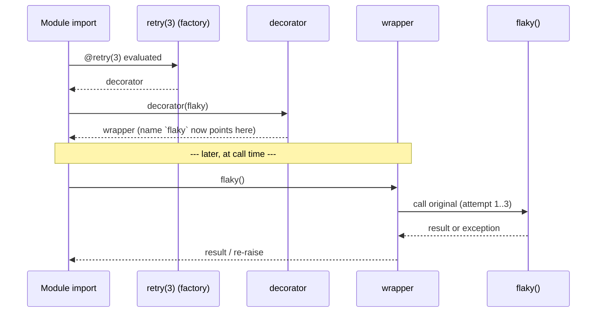

# Lesson 04: Decorators

> **Prerequisites:** [Lesson 03: Functions, Closures and Scope](../03-functions-args-kwargs-closures-and-scope/README.md)  
> **Reading time:** ~22 minutes  
> **Audience:** Candidates asked to "write a decorator", "write one with arguments", or "how is this different from the Decorator pattern?"

> [!NOTE]
> **In one line:** `@dec` above `def f` means `f = dec(f)`, executed **once at definition time**; the decorator returns a wrapper closure that runs on every call, and `@functools.wraps` keeps the original's name, docstring and signature.

> [!TIP]
> **Golden rule:** Every real decorator has three parts — accept `*args, **kwargs`, call the original, and use `@functools.wraps`. A decorator **with arguments** is a *factory*: one extra layer that returns the decorator.

> [!TIP]
> **Try it:** Run the file below, then delete one `@functools.wraps` line and watch `__name__` become `wrapper`. In [LLD Studio](/tools/lld-studio/) draw a decorator as `Client → Wrapper → Target` — the same shape as the GoF Decorator, but applied to a *callable*.

---

## 1. The smell: how this gets asked

*"Write a decorator that retries a flaky call three times."* Then, quickly:

- *"Now make the number of attempts configurable."* (decorator factory)
- *"What breaks if you forget `functools.wraps`?"*
- *"In what order do stacked decorators run?"*
- *"Is this the Decorator design pattern?"*



Stacking: `@a` over `@b` over `def f` is `f = a(b(f))` — **applied bottom-up, executed top-down** (outermost wrapper runs first).

---

## 2. Forms at a glance

| Form | Shape | Use for |
| :--- | :--- | :--- |
| Simple | `def dec(fn): @wraps(fn) def wrapper(*a, **k): ...; return wrapper` | timing, logging, auth checks |
| With arguments | `def dec(arg): def real(fn): @wraps(fn) def wrapper(...)...; return real` | `@retry(times=3)`, `@route("/x")` |
| Class-based | class with `__init__(self, fn)` and `__call__` | decorators that hold state (call counters) |
| Class decorator | `def dec(cls): ...; return cls` | `@dataclass`, registries |
| Built-ins | `@property`, `@classmethod`, `@staticmethod`, `functools.cache`, `lru_cache` | day-to-day |

| | Python `@decorator` | GoF Decorator pattern |
| :--- | :--- | :--- |
| Acts on | a function / class (at definition) | an *object* implementing an interface (at runtime) |
| Mechanism | rebinding a name | composition: wrapper holds the wrapped object |
| Example | `@retry`, `@cache` | `GzipStream(EncryptedStream(FileStream))` |

---

## 3. Walkthrough: timing, retry with arguments, a counter, caching

**Requirements:** (1) `timed` — measure; (2) `retry(times, on=...)` — configurable; (3) `CountCalls` — class-based state; (4) `lru_cache` — memoise with stats.

**Extension point:** because decorators compose, a new cross-cutting concern is another decorator, not an edit to business code.

````carousel
```python
import functools
import time
from typing import Callable


def timed(fn):
    @functools.wraps(fn)                         # keep __name__, __doc__, __wrapped__
    def wrapper(*args, **kwargs):
        start = time.perf_counter()
        try:
            return fn(*args, **kwargs)
        finally:                                 # runs on success AND on exception
            elapsed = time.perf_counter() - start
            print(f"[timed] {fn.__name__} took {elapsed * 1000:.1f} ms")
    return wrapper


def retry(times: int = 3, on: tuple[type[Exception], ...] = (ConnectionError,)):
    """Decorator FACTORY: retry(...) returns the real decorator."""
    def decorator(fn: Callable):
        @functools.wraps(fn)
        def wrapper(*args, **kwargs):
            for attempt in range(1, times + 1):
                try:
                    return fn(*args, **kwargs)
                except on as err:
                    print(f"[retry] attempt {attempt}/{times} failed: {err}")
                    if attempt == times:
                        raise
        return wrapper
    return decorator


class CountCalls:
    """Class-based decorator holding state."""
    def __init__(self, fn):
        functools.update_wrapper(self, fn)
        self._fn = fn
        self.calls = 0

    def __call__(self, *args, **kwargs):
        self.calls += 1
        return self._fn(*args, **kwargs)


_attempts = {"n": 0}


@timed
@retry(times=3)
def flaky_fetch(url: str) -> str:
    """Pretend network call: fails twice, then succeeds."""
    _attempts["n"] += 1
    if _attempts["n"] < 3:
        raise ConnectionError(f"timeout #{_attempts['n']}")
    return f"payload from {url}"


@CountCalls
def greet(name: str) -> str:
    return f"hi {name}"


@functools.lru_cache(maxsize=None)
def fib(n: int) -> int:
    return n if n < 2 else fib(n - 1) + fib(n - 2)


def main() -> None:
    print(flaky_fetch("https://example.test"))
    print(flaky_fetch.__name__, "|", flaky_fetch.__doc__)       # metadata kept
    print(flaky_fetch.__wrapped__.__name__)                      # the inner (retry) wrapper

    greet("a"); greet("b")
    print("calls:", greet.calls)

    fib(30)
    info = fib.cache_info()
    print(f"cache: hits={info.hits} misses={info.misses}")       # hits=28 misses=31

    def no_wraps(fn):
        def wrapper(*a, **k):
            return fn(*a, **k)
        return wrapper

    @no_wraps
    def documented():
        """I have docs."""
    print(documented.__name__, documented.__doc__)               # wrapper None


if __name__ == "__main__":
    main()
```
<!-- slide -->
```csharp
// C#: no @-syntax, but the same idea is a higher-order function (or ASP.NET filter / MediatR behavior).
static Func<T, TResult> Retry<T, TResult>(Func<T, TResult> fn, int times = 3) => arg =>
{
    for (var attempt = 1; ; attempt++)
    {
        try { return fn(arg); }
        catch (TimeoutException) when (attempt < times)
        {
            Console.WriteLine($"attempt {attempt} failed");
        }
    }
};

var calls = 0;
Func<string, string> flaky = url =>
{
    if (++calls < 3) throw new TimeoutException();
    return $"payload from {url}";
};

Console.WriteLine(Retry(flaky)("https://example.test"));

// The GoF Decorator in C#: wrapper object with the same interface
public interface IOrderService { decimal Total(int id); }
public sealed class CachedOrderService(IOrderService inner) : IOrderService
{
    private readonly Dictionary<int, decimal> _cache = new();
    public decimal Total(int id) => _cache.TryGetValue(id, out var v) ? v : _cache[id] = inner.Total(id);
}
```
````

Output notes: the call prints two `[retry]` lines, then the `[timed]` line as the outermost wrapper finishes, and only then does `main` print the payload. `fib(30)` gives `hits=28 misses=31`; the undecorated-with-`wraps` function prints `wrapper None`.

---

## 4. Edges and traps

- **Forgetting `functools.wraps`.** Every decorated function is named `wrapper`; Flask/FastAPI register routes by name and raise "overwriting an existing endpoint"; docs and tracebacks lie.
- **Decorating methods.** `wrapper(*args, **kwargs)` forwards `self` correctly; a wrapper with fixed parameters breaks.
- **Work at import time.** Code in the decorator *outside* the wrapper runs on import (config reads, DB connections) — surprising in tests.
- **Stacking order.** `@auth` above `@cache` means auth runs first, cache sits inside. Order is behaviour; for web routes the framework decorator (`@app.get`) must be outermost.
- **`lru_cache` pitfalls.** Arguments must be hashable; `maxsize=None` is unbounded (memory leak for unbounded key spaces); on methods it keeps `self` alive — prefer a per-instance cache or `cached_property`.
- **Async functions.** A sync wrapper around `async def` returns an un-awaited coroutine; write `async def wrapper` and `await fn(...)` (or detect with `inspect.iscoroutinefunction`).
- **Decorators with and without parentheses.** Support `@log` and `@log(prefix="x")` by accepting `fn=None, *, prefix=...`.
- **Thread safety.** A per-function counter in a wrapper is racy; use a lock.
- **Debugging.** Use `fn.__wrapped__` to reach the original, e.g. in tests.

### Try it — decorator lab (runnable)

The walkthrough shows the three standard shapes. This lab covers the follow-ups from section 1 that the walkthrough only describes: **stacking order**, **`@log` vs `@log(...)`**, **sync and async**, and a **production-grade retry** (backoff, jitter, only transient errors). Save as `decorator_lab.py`; every claim is an `assert`.

```python
import asyncio
import functools
import inspect

# 1) Stacking order: applied bottom-up, executed top-down
trace: list[str] = []


def tag(name):
    def decorator(fn):
        trace.append(f"apply {name}")                 # runs ONCE, at definition time
        @functools.wraps(fn)
        def wrapper(*a, **k):
            trace.append(f"enter {name}")
            try:
                return fn(*a, **k)
            finally:
                trace.append(f"exit {name}")
        return wrapper
    return decorator


@tag("outer")
@tag("inner")
def f():
    trace.append("body")


f()
assert trace == ["apply inner", "apply outer", "enter outer", "enter inner", "body", "exit inner", "exit outer"], trace


# 2) One decorator usable as @log AND @log(prefix="x")
calls: list[str] = []


def log(fn=None, *, prefix="call"):
    def decorator(func):
        @functools.wraps(func)
        def wrapper(*a, **k):
            calls.append(f"{prefix}:{func.__name__}")
            return func(*a, **k)
        return wrapper
    return decorator(fn) if fn is not None else decorator   # bare @log vs @log(...)


@log
def a(): ...


@log(prefix="x")
def b(): ...


a(); b()
assert calls == ["call:a", "x:b"], calls


# 3) A decorator that works for sync AND async functions
def timed_calls(fn):
    stats = {"n": 0}

    if inspect.iscoroutinefunction(fn):
        @functools.wraps(fn)
        async def wrapper(*a, **k):                  # must itself be async, and await
            stats["n"] += 1
            return await fn(*a, **k)
    else:
        @functools.wraps(fn)
        def wrapper(*a, **k):
            stats["n"] += 1
            return fn(*a, **k)

    wrapper.stats = stats
    return wrapper


@timed_calls
def sync_add(x, y):
    return x + y


@timed_calls
async def async_add(x, y):
    await asyncio.sleep(0)
    return x + y


assert sync_add(1, 2) == 3 and asyncio.run(async_add(2, 3)) == 5
assert sync_add.stats["n"] == 1 and async_add.stats["n"] == 1

# the bug the edge section warns about: a SYNC wrapper around async def
def broken(fn):
    def wrapper(*a, **k):
        return fn(*a, **k)                          # returns an un-awaited coroutine
    return wrapper


@broken
async def work():
    return 1


coro = work()
assert inspect.iscoroutine(coro)                    # not 1: nothing has run yet
coro.close()


# 4) Retry with backoff + jitter, injectable sleep so the demo is instant
def retry(times=3, on=(ConnectionError,), base=0.1, sleep=None):
    import random
    import time
    nap = sleep or time.sleep

    def decorator(fn):
        @functools.wraps(fn)
        def wrapper(*a, **k):
            for attempt in range(1, times + 1):
                try:
                    return fn(*a, **k)
                except on:
                    if attempt == times:
                        raise
                    nap(base * 2 ** (attempt - 1) * random.uniform(0.5, 1.5))   # exponential + jitter
        return wrapper
    return decorator


naps: list[float] = []
state = {"n": 0}


@retry(times=4, sleep=naps.append)
def flaky():
    state["n"] += 1
    if state["n"] < 4:
        raise ConnectionError
    return "ok"


assert flaky() == "ok" and len(naps) == 3 and naps[2] > naps[0]   # 3 sleeps; backoff always outgrows jitter


@retry(times=3, sleep=lambda s: None)
def buggy():
    raise ValueError("a bug, not a transient fault")


try:
    buggy()
except ValueError:
    pass                                           # NOT retried: only `on=` errors are
assert f.__wrapped__.__name__ == "f"               # wraps => __wrapped__ reaches the inner function
print("decorator lab ok")
```

Expected output (and no warnings):

```text
decorator lab ok
```

Then:

1. **Reorder.** Swap the two `@tag` lines and predict the new `trace` before running it.
2. **Break the async wrapper.** In probe 3 delete the `inspect.iscoroutinefunction` branch so every function gets the sync wrapper. Predict which assert fails. *(Surprisingly, none of the call-result asserts: the sync wrapper returns the coroutine and `asyncio.run` happily runs it. What breaks is `inspect.iscoroutinefunction(async_add)`, which is now `False`, so frameworks that dispatch on it — FastAPI, pytest-asyncio — treat the function as sync. And any "after" code in a `try/finally` would run when the coroutine is created, not when it finishes, so your timing would measure nothing.)* Add `assert inspect.iscoroutinefunction(async_add)` to see it fail.
3. **Make `retry` idempotency-aware.** Add a parameter `only_if=lambda exc: ...` so it can refuse to retry a `PaymentDeclined` or a 4xx. Which of the anti-patterns in section 6 does this remove?
4. **Test the cache.** Write `@functools.lru_cache(maxsize=2)` on a function, call it with 3 distinct arguments, and use `cache_info()` to prove the first one was evicted.

---

## 5. What you'd say in two minutes

> "A decorator is a callable that takes a function and returns a replacement — `@dec` is just `f = dec(f)` run once when the function is defined. The replacement is usually a closure that does something before and after calling the original with `*args, **kwargs`, and I always apply `functools.wraps` so the name, docstring and annotations survive and `__wrapped__` is set; without it Flask would see every endpoint as `wrapper`. If it needs configuration, like `@retry(times=3)`, I write a factory: the outer function takes the config, returns the real decorator, which returns the wrapper. Stacked decorators are applied bottom-up and executed top-down. It's related to, but not the same as, the GoF Decorator pattern, which wraps *objects* that share an interface at runtime; Python's `@` decorates callables at definition time."

---

## 6. Anti-patterns

| Anti-pattern | Why it fails | Fix |
| :--- | :--- | :--- |
| No `functools.wraps` | Lost metadata, routing collisions | Always `@wraps(fn)` |
| Bare `except:` in a retry decorator | Retries on `KeyboardInterrupt` and bugs | Retry only specific, transient exceptions |
| Retry without backoff/limit | Retry storms | Max attempts + exponential backoff + jitter |
| Retrying non-idempotent calls | Duplicate charges | Idempotency keys; don't retry unsafe operations |
| `lru_cache` on a method with unbounded inputs | Memory leak | Bounded `maxsize`, per-instance cache |
| Business logic inside a decorator | Hidden, untestable | Keep decorators for cross-cutting concerns |

---

## 7. Interview questions

<details>
<summary><strong>1. What is a decorator? Write one. [BASIC]</strong></summary>

A callable taking a function and returning a replacement; `@dec` is `f = dec(f)` at definition time. Example: `timed` above — wrapper takes `*args, **kwargs`, times the call in `try/finally`, uses `@functools.wraps(fn)`.

</details>

<details>
<summary><strong>2. Why `functools.wraps`? [BASIC]</strong></summary>

It copies `__name__`, `__doc__`, `__module__`, `__qualname__`, annotations and `__dict__` from the original onto the wrapper and sets `__wrapped__`. Frameworks, docs, debuggers and `inspect.signature` depend on that metadata.

</details>

<details>
<summary><strong>3. How do you write a decorator that takes arguments? [BASIC]</strong></summary>

Three levels: outer function takes the arguments and returns the decorator; the decorator takes `fn` and returns the wrapper; the wrapper takes `*args, **kwargs`. `@retry(3)` evaluates `retry(3)` first, then applies the result to the function.

</details>

<details>
<summary><strong>4. In what order do stacked decorators apply and run? [TRICKY]</strong></summary>

Applied bottom-up (`a(b(f))`), executed top-down: the outer wrapper's pre-code runs first, then the inner's, then `f`, then the post-code unwinds in reverse.

</details>

<details>
<summary><strong>5. Python decorator vs the Decorator pattern? [TRICKY]</strong></summary>

Python's `@` rebinds a function/class at definition time; the GoF pattern composes objects at runtime so a wrapper implements the same interface as the wrapped object. Same spirit (wrap to add behaviour), different mechanism and granularity.

</details>

<details>
<summary><strong>6. What does `lru_cache` require and risk? [TRICKY]</strong></summary>

Hashable arguments; it stores results keyed by args. Risks: unbounded memory with `maxsize=None`, stale results if the function isn't pure, and pinning `self` on methods. Inspect with `cache_info()`, clear with `cache_clear()`.

</details>

<details>
<summary><strong>7. Decorate an `async def`. What changes? [SCENARIO]</strong></summary>

The wrapper must itself be `async def` and `await` the call; otherwise you return a coroutine without running or timing it. For a decorator that supports both, branch on `inspect.iscoroutinefunction(fn)`.

</details>

<details>
<summary><strong>8. Two Flask routes both fail with "overwriting endpoint wrapper". Why? [SCENARIO]</strong></summary>

A decorator under `@app.route` didn't use `functools.wraps`, so both view functions are named `wrapper`; Flask keys endpoints by function name. Add `@wraps(fn)` (or pass `endpoint=`).

</details>

---

## 8. One-page cheat sheet

```text
@dec  ==  f = dec(f)        runs ONCE at definition, wrapper runs EVERY call
Template:
    def dec(fn):
        @functools.wraps(fn)
        def wrapper(*args, **kwargs):
            ...before...
            try:    return fn(*args, **kwargs)
            finally: ...after...
        return wrapper
With args:   def dec(arg): def real(fn): ... return real      @dec(3)
Stacking:    @a @b def f  ->  a(b(f))   applied bottom-up, runs top-down
Class-based: __init__(fn) + __call__ + functools.update_wrapper(self, fn)
Async:       wrapper must be `async def` + await
Cache:       lru_cache(maxsize=N) / cache; hashable args; watch memory
Not same as: GoF Decorator (object wrapper, same interface, runtime)
```

---

## Further reading

- [PEP 318: decorators for functions and methods](https://peps.python.org/pep-0318/)
- [`functools` documentation](https://docs.python.org/3/library/functools.html)
- Luciano Ramalho, *Fluent Python* (2nd ed.), chapter 9: Decorators and closures

Previous: [Functions, Closures and Scope](../03-functions-args-kwargs-closures-and-scope/README.md) · Next: [Iterators, Generators and yield](../05-iterators-generators-and-yield/README.md)
