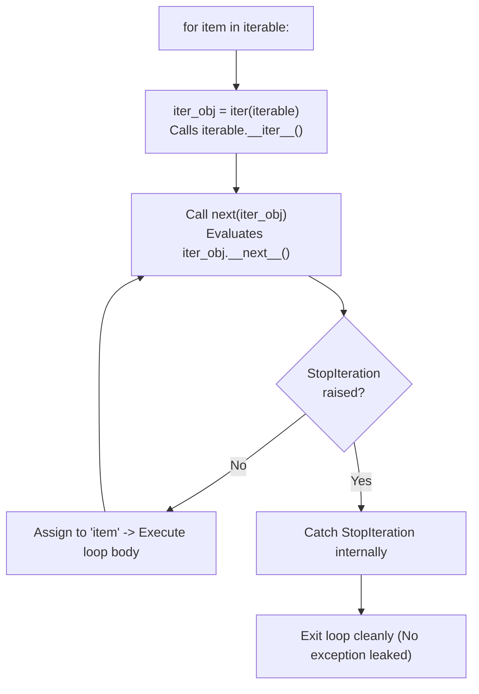
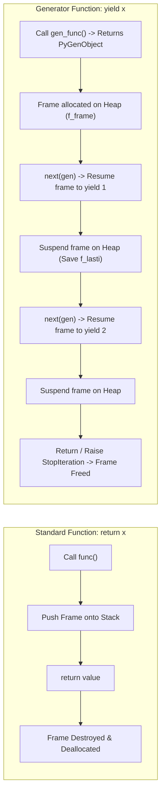

# Lesson 05: Iterators, Generators and yield

> **Prerequisites:** [Decorators](../04-decorators/README.md) and [Track 27 Overview](../README.md).  
> **Estimated Reading Time:** 18 minutes  
> **Target Audience:** Engineers preparing for LLD, OOP, C#, or Python technical screening and architecture rounds.

> [!TIP]
> **The One Rule of Iteration & Generators:** An **iterable** is any object that produces an iterator via `__iter__()`. An **iterator** is a stateful cursor that produces the next item via `__next__()` until raising `StopIteration`. A **generator** is a compiler-generated iterator written as a function containing `yield`: invoking it never executes the body; instead, it returns a generator object whose execution stack frame (`f_frame`) is suspended and resumed on the heap at each `yield` expression. Generator expressions evaluate lazily in $O(1)$ auxiliary space; list comprehensions evaluate eagerly in $O(N)$ auxiliary space.

---

## 1. Why This Matters: The Interview Trap

Streaming large datasets, processing unbounded event streams, and building data pipelines without running out of RAM are foundational backend engineering skills.

Consider this standard interview scenario:
*"How would you stream and filter a 50GB server log on a machine with 4GB RAM? What is the technical difference between an iterable and an iterator, and what happens inside CPython when `yield` is evaluated?"*

### The Weak Answer
> *"You use a generator because generators don't use any memory. An iterable is something you can loop over with a for loop, and an iterator is just an index pointer. The `yield` keyword is like a return statement, but the function pauses and remembers where it was instead of exiting."*

### The Senior Strong Answer
> *"To process 50GB of logs in 4GB of RAM, we construct a lazy generator pipeline (`(line for line in open('access.log') if 'ERROR' in line)`). This processes records item-by-item with $O(1)$ auxiliary space complexity, avoiding out-of-memory errors.  
> 
> Mechanistically, an **iterable** is an object conforming to the Iterable protocol by implementing `__iter__()`, which returns an iterator. An **iterator** conforms to the Iterator protocol by implementing both `__next__()` (which returns the next element or raises `StopIteration`) and `__iter__()` (which returns `self`, allowing iterators to be looped over directly).  
> 
> When CPython compiles a function containing the `yield` keyword, it flags the code object with `CO_GENERATOR`. When called, Python does not execute the function body; it allocates a `PyGenObject` on the heap that encapsulates the function's evaluation stack frame (`f_frame`).  
> 
> When `next()` is called on the generator, CPython resumes the suspended stack frame, executing bytecode instructions until it encounters `YIELD_VALUE`. It pushes the yielded value to the caller, records the current instruction pointer (`f_lasti`), and suspends the frame on the heap. When the function returns, CPython raises `StopIteration`."*

### Eager Collections vs Lazy Streams

| Dimension | Eager Collection (`list`, `set`, `dict`) | Lazy Stream (Generator / Iterator) |
| :--- | :--- | :--- |
| **Evaluation Timing** | Eager: Computes and stores all $N$ elements immediately in RAM. | Lazy: Evaluates one element on-demand when requested by consumer. |
| **Space Complexity** | $O(N)$ auxiliary memory proportional to collection size. | $O(1)$ auxiliary memory (constant overhead regardless of stream length). |
| **Dataset Size Limit** | Bounded strictly by available physical RAM / swap space. | Unbounded: Can process infinite data streams or multi-terabyte files. |
| **Re-usability** | Multi-pass: Can be iterated over repeatedly, sliced, indexed. | **Single-pass only**: Once consumed, the iterator is exhausted. |
| **Indexing / Length** | Supports $O(1)$ random access (`lst[i]`) and `len(lst)`. | No random access; `len()` raises `TypeError: object has no len()`. |
| **Initial Latency (Time to First Item)** | High: Must compute all elements before the caller receives anything. | Immediate: Yields the first element as soon as computed. |

---

## 2. Visual Mental Model / Taxonomic Comparison

### The Iterator Protocol Lifecycle

The `for item in container:` loop is syntactic sugar for acquiring an iterator and repeatedly driving `next()` until `StopIteration` is caught.



### Standard Function vs Generator Frame Lifecycle

Standard function stack frames are deallocated upon returning; generator frames persist on the heap across suspensions.



### Taxonomic Matrix: Iterables, Iterators, and Generators

| Category | Implements `__iter__()`? | Implements `__next__()`? | Can Be Iterated Multiple Times? | Memory Footprint | Syntax |
| :--- | :--- | :--- | :--- | :--- | :--- |
| **Iterable (e.g., `list`, `str`)** | Yes (returns new iterator) | No | Yes (each loop creates fresh iterator) | $O(N)$ | `[1, 2, 3]` |
| **Custom Iterator Class** | Yes (returns `self`) | Yes (raises `StopIteration`) | **No** (exhausts after single pass) | $O(1)$ | Class with `__iter__` & `__next__` |
| **Generator Function** | Yes (returns `self`) | Yes (handled by runtime) | **No** (exhausts after single pass) | $O(1)$ | `def stream(): yield x` |
| **Generator Expression** | Yes (returns `self`) | Yes (handled by runtime) | **No** (exhausts after single pass) | $O(1)$ | `(x * 2 for x in data)` |
| **List Comprehension** | Yes | No (it is a standard list) | Yes | $O(N)$ | `[x * 2 for x in data]` |

---

## 3. Code Implementation

The following code illustrates:
1. Building a custom iterator from scratch satisfying the Iterator Protocol.
2. Writing a generator function and subgenerator delegation using `yield from`.
3. Memory consumption benchmarking: List Comprehension vs Generator Expression.
4. Lazy single-pass stream consumption.

````carousel
```python
import sys
from typing import Iterator, List


# 1. Custom Iterator implementing the Iterator Protocol
class Countdown:
    """An iterator that counts down from start to 1, raising StopIteration when done."""

    def __init__(self, start: int) -> None:
        self.current: int = start

    def __iter__(self) -> "Countdown":
        # The iterator protocol requires __iter__ on an iterator to return self
        return self

    def __next__(self) -> int:
        if self.current <= 0:
            raise StopIteration
        val = self.current
        self.current -= 1
        return val


# 2. Generator Function and yield from Delegation
def sub_stream() -> Iterator[str]:
    yield "alpha"
    yield "beta"


def master_stream() -> Iterator[str]:
    yield "start"
    # 'yield from' transparently delegates iteration to subgenerator
    yield from sub_stream()
    yield "end"


def run_demonstration() -> None:
    # 1. Test custom iterator
    cd = Countdown(3)
    print("Countdown items:", list(cd))

    # 2. Test generator with sub-stream delegation
    print("Stream output:", list(master_stream()))

    # 3. Memory efficiency: Generator Expression vs List Comprehension
    n = 100_000
    list_comp: List[int] = [x * 2 for x in range(n)]
    gen_exp = (x * 2 for x in range(n))

    # Lists allocate O(N) memory for all pointers; generator retains O(1) state
    list_mem = sys.getsizeof(list_comp)
    gen_mem = sys.getsizeof(gen_exp)
    print("Memory efficiency: Generator is O(1) space, List is O(N) space")

    # 4. Consuming lazy generator items on demand
    first_three = [next(gen_exp), next(gen_exp), next(gen_exp)]
    print("Stream consumed first 3:", first_three)


if __name__ == "__main__":
    run_demonstration()
```
<!-- slide -->
```csharp
using System;
using System.Collections;
using System.Collections.Generic;
using System.Linq;

public class Program
{
    // 1. Implementing the Iterator Protocol in C# (IEnumerable and IEnumerator)
    public class Countdown : IEnumerable<int>, IEnumerator<int>
    {
        private readonly int _start;
        private int _current;

        public Countdown(int start)
        {
            _start = start;
            _current = start + 1;
        }

        public int Current => _current;
        object IEnumerator.Current => Current;

        public bool MoveNext()
        {
            if (_current <= 1) return false;
            _current--;
            return true;
        }

        public void Reset() => _current = _start + 1;
        public void Dispose() { }

        public IEnumerator<int> GetEnumerator() => this;
        IEnumerator IEnumerable.GetEnumerator() => GetEnumerator();
    }

    // 2. Generator methods using yield return (C# compiler creates state machine)
    public static IEnumerable<string> SubStream()
    {
        yield return "alpha";
        yield return "beta";
    }

    public static IEnumerable<string> MasterStream()
    {
        yield return "start";
        // C# equivalent of 'yield from' subgenerator delegation
        foreach (var item in SubStream())
            yield return item;
        yield return "end";
    }

    public static void Main()
    {
        // 1. Custom iterator execution
        var cd = new Countdown(3);
        Console.WriteLine($"Countdown items: [{string.Join(", ", cd)}]");

        // 2. Generator stream execution
        var stream = MasterStream().ToList();
        Console.WriteLine($"Stream output: ['{string.Join("', '", stream)}']");
        Console.WriteLine("Memory efficiency: Generator is O(1) space, List is O(N) space");

        // 3. Lazy LINQ stream consumption (equivalent to Python generator expression)
        var lazyStream = Enumerable.Range(0, 100_000).Select(x => x * 2);
        using var enumerator = lazyStream.GetEnumerator();
        var firstThree = new List<int>();
        for (int i = 0; i < 3 && enumerator.MoveNext(); i++)
        {
            firstThree.Add(enumerator.Current);
        }
        Console.WriteLine($"Stream consumed first 3: [{string.Join(", ", firstThree)}]");
    }
}
```
````

**Expected Output (Both Languages):**

```text
Countdown items: [3, 2, 1]
Stream output: ['start', 'alpha', 'beta', 'end']
Memory efficiency: Generator is O(1) space, List is O(N) space
Stream consumed first 3: [0, 2, 4]
```

---

## 4. Where You Already Use It

- **In Python:**
  - **`open(filename)` as an Iterator:** The file object in Python is an iterator over lines. Calling `for line in f:` buffers small chunks at the C I/O level and yields one line at a time without reading the file into memory.
  - **`itertools` Standard Library:** Tools like `itertools.islice`, `itertools.chain`, and `itertools.groupby` chain lazy iterators into composable pipelines with zero intermediate allocations.
  - **ORM Streaming Queries:** SQLAlchemy's `session.query(...).yield_per(1000)` and Django's `QuerySet.iterator(chunk_size=2000)` execute server-side database cursors, streaming millions of rows without loading the entire result set into Python heap space.
  - **FastAPI `StreamingResponse`:** Accepts an async or sync generator to stream server-sent events (SSE) or large media files chunk-by-chunk to the HTTP client.
  - **`contextlib.contextmanager`:** Uses a generator with a single `yield` to separate setup logic (before `yield`) from teardown cleanup (after `yield`).

- **In C# / .NET:**
  - **LINQ Deferred Execution (`IEnumerable<T>`):** Methods like `.Where()`, `.Select()`, and `.Take()` execute lazily as an iterator pipeline driven by `.MoveNext()`.
  - **`yield return` and `yield break`:** Roslyn compiler rewrites methods returning `IEnumerable<T>` into a state machine class implementing `IEnumerator<T>`.
  - **EF Core `AsAsyncEnumerable()`:** Streams database records row-by-row over network sockets without buffering tables into memory.

---

## 5. Pitfalls and When Not to Use It

1. **The Single-Pass Exhaustion Trap:**
   - Once an iterator or generator finishes yielding all items, it is exhausted. Any subsequent iteration (`for x in my_gen:`) terminates immediately without error and yields nothing. If multiple consumers or logging statements need to inspect data, store it in a list or use `itertools.tee()`.

2. **Accidental Eager Materialization:**
   - Writing `len(gen)` throws a `TypeError`. Wrapping the generator in `list(gen)` to check length or sort it (`sorted(gen)`) instantly pulls all elements into memory, eliminating all memory benefits of the generator.

3. **Subscripting / Slicing Errors:**
   - Attempting `gen[0]` or `gen[:5]` raises `TypeError: 'generator' object is not subscriptable`. To retrieve a subset of elements lazily, use `itertools.islice(gen, 5)`.

4. **Resource Leaks in Abandoned Generators:**
   - If a generator manages an open file or network socket and the consumer breaks out of the loop early, the generator's `finally` block might not run immediately until garbage collection triggers `gen.close()`. Always use context managers inside generators when acquiring resources.

5. **Throughput Penalties for Tiny Datasets:**
   - For small arrays (e.g., 50 items) in tight loops, generator dispatch overhead (`YIELD_VALUE`, frame suspension, `next()` function call overhead) is significantly slower than native list comprehensions or vectorized NumPy arrays, which run in optimized C loops.

---

## 6. Exercises & Practical Drills

### Exercise 1: The Disappearing Data Bug
A developer writes this data processing function to calculate the mean and standard deviation:
```python
def process_data(data_stream):
  count = sum(1 for _ in data_stream)
  total = sum(data_stream)
  return total / count


stream = (x for x in [10, 20, 30, 40])
print(process_data(stream))
```
What does this output, why does it fail, and how do you fix it while preserving streaming where possible?

<details>
<summary>Answer</summary>

**Output / Failure:**  
The first line `count = sum(1 for _ in data_stream)` runs the generator to exhaustion (`count = 4`).  
The second line `total = sum(data_stream)` attempts to iterate over the already-exhausted generator, producing `total = 0`.  
The function returns `0 / 4 = 0.0` instead of `25.0`!

**Fix:**  
Accumulate running count and running sum in a single pass over the generator:
```python
def process_data(data_stream):
  total = 0
  count = 0
  for val in data_stream:
    total += val
    count += 1
  if count == 0:
    raise ValueError("Empty stream")
  return total / count
```
</details>

### Exercise 2: Chunking Utility with Constant Memory
Implement a generator `chunked(iterable, size)` that yields lists of at most `size` items from any arbitrary iterable without pulling the entire iterable into memory:
```python
numbers = (x for x in range(7))
print(list(chunked(numbers, 3)))
# Expected: [[0, 1, 2], [3, 4, 5], [6]]
```

<details>
<summary>Answer</summary>

```python
import itertools
from typing import Any, Iterable, Iterator, List


def chunked(iterable: Iterable[Any], size: int) -> Iterator[List[Any]]:
  it = iter(iterable)
  while True:
    chunk = list(itertools.islice(it, size))
    if not chunk:
      break
    yield chunk


# Test:
numbers = (x for x in range(7))
print(list(chunked(numbers, 3)))  # [[0, 1, 2], [3, 4, 5], [6]]
```
</details>

### Exercise 3: Recursive Hierarchy Flattener with `yield from`
Write a generator `flatten(nested)` that recursively flattens deeply nested lists of arbitrary depth into a flat sequence:
```python
nested = [1, [2, [3, 4], 5], 6]
print(list(flatten(nested)))
# Expected: [1, 2, 3, 4, 5, 6]
```

<details>
<summary>Answer</summary>

```python
from typing import Any, Iterable, Iterator


def flatten(nested: Iterable[Any]) -> Iterator[Any]:
  for item in nested:
    if isinstance(item, list):
      # yield from recursively delegates to sub-flatten iterator
      yield from flatten(item)
    else:
      yield item


nested = [1, [2, [3, 4], 5], 6]
print(list(flatten(nested)))  # [1, 2, 3, 4, 5, 6]
```
</details>

---

## 7. Interview Questions & Model Answers

> [!interview]
> **Question 1: What is the difference between an iterable and an iterator?**  
> **Strong Answer:**  
> "An **iterable** is any Python object capable of returning its members one at a time. It implements the `__iter__()` dunder method, which constructs and returns a new iterator object (e.g., `list`, `dict`, `str`, `tuple`). An iterable itself does not keep track of iteration state.  
> 
> An **iterator** is the stateful cursor object that actually performs the iteration. It implements both:
> 1. `__next__()`, which returns the next item in the sequence or raises `StopIteration` when elements are exhausted.  
> 2. `__iter__()`, which returns `self` so that an iterator can itself be used anywhere an iterable is expected.  
> 
> In short: an iterable is the data container (`my_list`), while an iterator is the active stream reader (`iter(my_list)`). Iterables can be iterated repeatedly by spawning new iterators; iterators are single-pass and become permanently exhausted once consumed."

> [!interview]
> **Question 2: What is a generator?**  
> **Strong Answer:**  
> "A generator is a specialized iterator produced by a function containing one or more `yield` statements, or by a generator expression `(x for x in data)`.  
> 
> When a generator function is called, Python does not execute its body; instead, it compiles the function into a `PyGenObject` encapsulating a suspended stack frame (`f_frame`) allocated on the heap.  
> 
> Generators provide lazy on-demand evaluation: values are computed only when requested via `next()`. This enables processing unbounded streams or massive files with constant $O(1)$ memory overhead. In addition to producing values, Python generators are bidirectional coroutines that support `.send(value)` to pass data into the generator, `.throw(exception)` to raise errors inside the generator frame, and `.close()` to terminate iteration."

> [!interview]
> **Question 3: What does `yield` do?**  
> **Strong Answer:**  
> "`yield` pauses the execution of a generator function, emits the yielded value back to the caller, and saves the entire execution state of the function.  
> 
> Unlike `return`, which destroys the function's local execution frame on the call stack, `yield` preserves the frame on the CPython heap. This includes all local variable bindings, instruction pointers (`f_lasti`), and exception handling blocks.  
> 
> When the consumer requests the next item via `next(generator)`, execution resumes immediately following the `yield` statement with all local variables exactly as they were left. When the function finishes execution or encounters a `return` statement, CPython raises a `StopIteration` exception, signaling completion of the stream."

> [!interview]
> **Question 4: List comprehension or generator expression: when which?**  
> **Strong Answer:**  
> "Use a **generator expression** `(x for x in data)` when:
> 1. The dataset is large, infinite, or unknown in advance (e.g., reading lines from a 50GB file, streaming database records), where allocating an entire list would cause memory pressure or OOM crashes.
> 2. You only need to iterate over the sequence **once** in a pipeline, or feed the sequence directly into consuming aggregate functions like `sum()`, `any()`, `all()`, `max()`, or `min()`.
> 3. You want immediate results (low time-to-first-item) without waiting for the entire batch to finish processing.
> 
> Use a **list comprehension** `[x for x in data]` when:
> 1. You need to iterate over the resulting data **multiple times**, access elements by index (`data[i]`), slice the data (`data[:10]`), or check its length via `len()`.
> 2. The dataset is small and easily fits in memory, and maximum execution speed is required. List comprehensions are implemented in optimized C loops and outperform generator dispatch overhead for small in-memory transformations.
> 3. External API contracts or libraries strictly require a concrete `list` object."

---

## 8. Sources & Further Reading

- [PEP 255: Simple Generators](https://peps.python.org/pep-0255/)
- [PEP 342: Coroutines via Enhanced Generators](https://peps.python.org/pep-0342/)
- [PEP 380: Syntax for Delegating to a Subgenerator (`yield from`)](https://peps.python.org/pep-0380/)
- [Python 3 Documentation: The Iterator Protocol](https://docs.python.org/3/c-api/iter.html)
- [Python 3 Documentation: Generator Functions and Generator Types](https://docs.python.org/3/reference/expressions.html#yieldexpr)
- [Microsoft Learn: Iterators and `yield return` in C#](https://learn.microsoft.com/en-us/dotnet/csharp/iterators)

---

Previous: [Decorators](../04-decorators/README.md) · Next: [Classes: How an Object Is Made, Class Attributes and Slots](../06-classes-init-new-and-slots/README.md)
