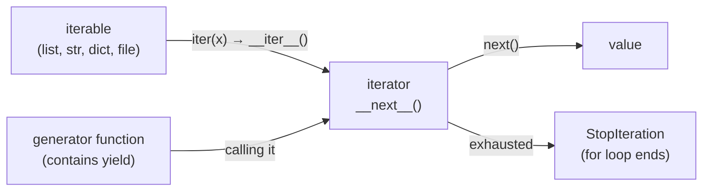

# Lesson 05: Iterators, Generators and `yield`

> **Prerequisites:** [Lesson 03: Functions and Closures](../03-functions-args-kwargs-closures-and-scope/README.md) · [Refresher: Decisions and loops](../../../learn/00-python-refresher/04-decisions-and-loops/README.md)  
> **Reading time:** ~22 minutes  
> **Audience:** Candidates asked "what's the iterator protocol?", "generator vs list?", or to process a huge file without loading it

> [!NOTE]
> **In one line:** An **iterable** produces an **iterator** via `__iter__`; an iterator yields values via `__next__` until `StopIteration`; a **generator** is the easy way to write one — a function with `yield` whose state is frozen between values — and it is lazy and single-use.

> [!TIP]
> **Golden rule:** If you only loop over the result once, use a generator (or generator expression) — `O(1)` memory. If you need to index, `len`, or loop twice, build a list. A generator is *exhausted* after one pass.

> [!TIP]
> **Try it:** Run the section 3 file (the second line of output, `[3, 2, 1] []`, is the exhausted-generator trap), then run the [generator lab](#try-it--generator-lab-runnable) below — 13 asserted probes for the follow-ups. Sketch the pipeline `read → filter → map → sink` as boxes in [LLD Studio](/tools/lld-studio/) — that's the Iterator/pipeline pattern.

---

## 1. The smell: how this gets asked

- *"Difference between an iterable and an iterator?"*
- *"What does `yield` do? How is it different from `return`?"*
- *"Process a 50 GB log for lines containing ERROR."*
- *"Why does my generator work once and then return nothing?"*
- *"List comprehension vs generator expression?"*



A `for` loop is just: `it = iter(x)`; repeatedly `next(it)`; stop on `StopIteration`.

---

## 2. Reference

| Term | Has | Reusable? | Example |
| :--- | :--- | :---: | :--- |
| Iterable | `__iter__` (or `__getitem__` with ints) | Yes (new iterator each time) | `list`, `str`, `dict`, `range` |
| Iterator | `__iter__` (returns self) **and** `__next__` | **No** — single pass | `iter([1,2])`, file objects, generators |
| Generator function | contains `yield` | call → new generator | `def count(): yield 1` |
| Generator expression | `(x for x in xs)` | No | lazy `sum(x*x for x in xs)` |

| | List comprehension | Generator expression |
| :--- | :--- | :--- |
| Syntax | `[f(x) for x in xs]` | `(f(x) for x in xs)` |
| Evaluation | Eager | Lazy |
| Memory | `O(n)` | `O(1)` |
| Indexing / `len` / twice | Yes | No |

Handy tools: `yield from`, `itertools` (`islice`, `chain`, `groupby`, `tee`), `enumerate`, `zip`, `next(it, default)`.

---

## 3. Walkthrough: a lazy log pipeline

**Requirements:** read lines, keep errors, parse the timestamp, take the first N — without ever holding the file in memory.

1. `read_lines` yields lines lazily (a file object is already an iterator).
2. `only_errors` filters.
3. `parse` maps to tuples.
4. `islice` stops early — upstream stages stop doing work too (pull-based).
5. A class-based iterator shows what a generator saves you from writing.

````carousel
```python
import io
from itertools import islice
from typing import Iterable, Iterator

LOG = """\
2026-11-23T10:00:01 INFO  boot
2026-11-23T10:00:02 ERROR db timeout
2026-11-23T10:00:03 INFO  ok
2026-11-23T10:00:04 ERROR disk full
2026-11-23T10:00:05 ERROR oom
"""


def read_lines(stream) -> Iterator[str]:
    for line in stream:                      # file objects are iterators
        print("  [read]", line.split()[0][-8:])
        yield line.rstrip("\n")


def only_errors(lines: Iterable[str]) -> Iterator[str]:
    return (ln for ln in lines if " ERROR " in ln)      # generator expression


def parse(lines: Iterable[str]) -> Iterator[tuple[str, str]]:
    for ln in lines:
        ts, _level, msg = ln.split(None, 2)
        yield ts, msg


class Countdown:
    """What a generator saves you from writing."""
    def __init__(self, start: int) -> None:
        self._n = start

    def __iter__(self) -> "Countdown":
        return self

    def __next__(self) -> int:
        if self._n <= 0:
            raise StopIteration
        self._n -= 1
        return self._n + 1


def countdown(n: int):
    while n > 0:
        yield n
        n -= 1


def running_total():
    """Generators can receive values with send()."""
    total = 0
    while True:
        incoming = yield total
        if incoming is not None:
            total += incoming


def flatten(nested):
    for item in nested:
        if isinstance(item, list):
            yield from flatten(item)          # delegate to a sub-generator
        else:
            yield item


def main() -> None:
    pipeline = parse(only_errors(read_lines(io.StringIO(LOG))))
    print("first two errors:", list(islice(pipeline, 2)))       # stops reading early

    gen = countdown(3)
    print(list(gen), list(gen))                                   # [3, 2, 1] []   exhausted!
    print(list(Countdown(3)))                                     # [3, 2, 1]

    acc = running_total()
    next(acc)                                                     # prime the generator
    print(acc.send(10), acc.send(5))                              # 10 15

    print(list(flatten([1, [2, [3, 4]], 5])))                     # [1, 2, 3, 4, 5]

    squares = (n * n for n in range(1_000_000))                   # nothing computed yet
    print(sum(squares) > 0, next(iter([]), "default"))            # True default

    import sys
    print("list bytes > gen bytes:", sys.getsizeof([n for n in range(10_000)]) > sys.getsizeof(n for n in range(10_000)))


if __name__ == "__main__":
    main()
```
<!-- slide -->
```csharp
// C#: IEnumerable<T> + `yield return` is the same idea (lazy; the compiler generates a state machine).
static IEnumerable<int> Countdown(int n)
{
    while (n > 0) yield return n--;
}

var seq = Countdown(3);
Console.WriteLine(string.Join(",", seq));   // 3,2,1
Console.WriteLine(string.Join(",", seq));   // 3,2,1  <- an IEnumerable can be enumerated again:
                                            //            each foreach calls GetEnumerator() anew.
// Python's generator is the *iterator* itself (one pass); C#'s IEnumerable is the *iterable*.

static IEnumerable<string> ErrorsOnly(IEnumerable<string> lines) =>
    lines.Where(l => l.Contains(" ERROR "));   // LINQ is lazy too (deferred execution)
```
````

Expected output of the Python tab (`[read]` appears for only the first four of five lines — `islice` stops pulling after the 2nd error, so line five is never read):

```text
  [read] 10:00:01
  [read] 10:00:02
  [read] 10:00:03
  [read] 10:00:04
first two errors: [('2026-11-23T10:00:02', 'db timeout'), ('2026-11-23T10:00:04', 'disk full')]
[3, 2, 1] []
[3, 2, 1]
10 15
[1, 2, 3, 4, 5]
True default
list bytes > gen bytes: True
```

---

## 4. Edges

- **Exhaustion.** `gen = (x for x in data)` can be consumed once; a second loop silently sees nothing. Return a *function* or an iterable object if callers need to re-iterate.
- **Late evaluation hides errors.** An exception inside a generator fires when it's first consumed, not when it's created.
- **Closure over loop variable inside generator expressions.** The *outermost* iterable is evaluated immediately; the rest is lazy — later mutation of captured variables is visible.
- **`return value` inside a generator** becomes `StopIteration.value` (used by `yield from`).
- **`StopIteration` in a generator body** is converted to `RuntimeError` (PEP 479) — don't leak it.
- **Resource cleanup.** A generator holding a file/lock needs `try/finally` or `with`; if the consumer abandons it, `close()` (or garbage collection) raises `GeneratorExit` at the `yield` so `finally` runs.
- **`sum(generator)` vs `list`** — memory vs random access. `len(generator)` is a `TypeError`.
- **`itertools.tee` buffers** whatever one branch consumed ahead — no free lunch.
- **Concurrency.** Generators aren't thread-safe; two threads calling `next()` at the same moment can raise `ValueError: generator already executing` (lab probe 11 triggers the same error deterministically by having a generator call `next()` on itself).
- **`send()` before priming.** The first call must be `next(g)` or `g.send(None)`; sending a real value to a just-started generator is a `TypeError` (probe 10).
- **`async` generators** (`async def` + `yield`) use `async for` — different protocol (`__aiter__`/`__anext__`).

### Try it — generator lab (runnable)

The follow-ups interviewers use once you get iterable-vs-iterator right. Save as `generator_lab.py`; every probe is an `assert` (or a printed error message), so a wrong claim fails loudly.

```python
import itertools, contextlib

# 1) The for loop is just iter() + next() until StopIteration
def manual_for(obj):
    it, out = iter(obj), []
    while True:
        try:
            out.append(next(it))
        except StopIteration:
            return out
assert manual_for("abc") == ["a", "b", "c"]

# 2) Iterator vs iterable: iter(iterator) is itself; iter(list) is a NEW object each time
it = iter([1, 2])
assert iter(it) is it
lst = [1, 2]
assert iter(lst) is not iter(lst)

# 3) Old-style iterable: __getitem__ with ints 0,1,2... works until IndexError
class Legacy:
    def __getitem__(self, i):
        if i >= 3:
            raise IndexError
        return i * 10
assert list(Legacy()) == [0, 10, 20]

# 4) Reusable iterable = object whose __iter__ returns a FRESH generator each time
class Countdown:
    def __init__(self, n): self.n = n
    def __iter__(self):
        n = self.n
        while n > 0:
            yield n
            n -= 1
cd = Countdown(3)
assert list(cd) == [3, 2, 1] and list(cd) == [3, 2, 1]      # twice: works

# 5) Errors surface at first next(), not at creation
def boom():
    raise ValueError("late")
    yield                                    # makes this a generator function
g = boom()                                   # no exception yet
try:
    next(g)
except ValueError:
    pass

# 6) Generator expression: outermost iterable evaluated NOW, the rest lazily
data = [1, 2, 3]
ge = (x * 10 for x in data)
data = [100]                                 # rebinding: ge still iterates the OLD list
assert list(ge) == [10, 20, 30]
data2 = [1, 2, 3]
ge2 = (x * 10 for x in data2)
data2.append(4)                              # mutation of the SAME list is visible
assert list(ge2) == [10, 20, 30, 40]

# 7) `return value` in a generator -> StopIteration.value, which `yield from` evaluates to
def inner():
    yield 1
    return "done"
def outer():
    result = yield from inner()
    yield f"inner returned {result}"
assert list(outer()) == [1, "inner returned done"]
g = inner(); next(g)
try:
    next(g)
except StopIteration as e:
    assert e.value == "done"

# 8) PEP 479: StopIteration escaping a generator body becomes RuntimeError
def leaky():
    yield 1
    raise StopIteration
try:
    list(leaky())
except RuntimeError as e:
    print("8:", e)

# 9) Cleanup: abandoning a generator runs `finally` via GeneratorExit (close())
log = []
def reader():
    log.append("open")
    try:
        for i in range(10):
            yield i
    finally:
        log.append("closed")
r = reader()
next(r); next(r)
assert log == ["open"]
r.close()
assert log == ["open", "closed"]
with contextlib.closing(reader()) as r2:     # same thing, deterministic and exception-safe
    next(r2)
assert log == ["open", "closed", "open", "closed"]

# 10) send(): first call must be next()/send(None) or you get TypeError
def acc():
    total = 0
    while True:
        total += (yield total) or 0
a = acc()
try:
    a.send(5)
except TypeError as e:
    print("10:", e)
next(a)
assert a.send(5) == 5 and a.send(2) == 7

# 11) A generator re-entering itself -> ValueError (what two racing threads would trigger)
def selfish():
    yield next(me)
me = selfish()
try:
    next(me)
except ValueError as e:
    print("11:", e)

# 12) tee buffers what one branch consumed ahead
a_it, b_it = itertools.tee(iter(range(5)))
assert list(itertools.islice(a_it, 3)) == [0, 1, 2]     # a ran ahead 3 items; tee now holds them for b
assert list(b_it) == [0, 1, 2, 3, 4]

# 13) Single-pass aggregates over a stream: any() stops at the first hit
seen = []
def noisy():
    for i in range(10):
        seen.append(i)
        yield i
assert any(i == 3 for i in noisy()) and seen == [0, 1, 2, 3]
print("generator lab ok")
```

Expected output:

```text
8: generator raised StopIteration
10: can't send non-None value to a just-started generator
11: generator already executing
generator lab ok
```

---

## 5. What you'd say in two minutes

> "An iterable has `__iter__` returning an iterator; an iterator has `__next__` that returns the next value and raises `StopIteration` when done — that's exactly what a `for` loop drives. A generator function is the shortcut: any function containing `yield` returns a generator object, and each `next()` runs until the next `yield`, freezing its local state in between. That makes it lazy and `O(1)` in memory, so I'd stream a 50 GB log as a pipeline of generators: read lines, filter errors, parse, and `islice` the first N — upstream stages only do the work that's pulled. The catch is that a generator is one-shot; if I need to iterate twice or index, I'd build a list or return an iterable object that creates a fresh generator each time. For nested sources I use `yield from`."

---

## 6. Anti-patterns

| Anti-pattern | Why it fails | Fix |
| :--- | :--- | :--- |
| `lines = f.readlines()` on a huge file | Loads everything | `for line in f:` / generator |
| `len(gen)` or `gen[0]` | Not supported | `list(gen)` if small, or `next(gen)` |
| Reusing an exhausted generator | Silently empty | Re-create it or return an iterable |
| `[x for x in ...]` just to feed `sum`/`any` | Wasted memory | `sum(x for x in ...)` |
| Hand-written `__iter__/__next__` for simple sequences | Boilerplate and bugs | A generator function |
| Catching `StopIteration` manually in loops | Unneeded | Use `for` or `next(it, default)` |

---

## 7. Interview questions

<details>
<summary><strong>1. Iterable vs iterator? [BASIC]</strong></summary>

An iterable can produce an iterator (`__iter__`); an iterator produces values (`__next__`) and is its own `__iter__`. Lists are iterables, not iterators; `iter(list)` is an iterator and is single-use.

</details>

<details>
<summary><strong>2. What does `yield` do vs `return`? [BASIC]</strong></summary>

`yield` produces a value and *suspends* the function, keeping locals and position; the next `next()` resumes after it. `return` ends the function (in a generator, it ends iteration).

</details>

<details>
<summary><strong>3. List comprehension vs generator expression? [BASIC]</strong></summary>

List: eager, `O(n)` memory, reusable and indexable. Generator: lazy, `O(1)` memory, single pass. Use generators when you stream or aggregate once.

</details>

<details>
<summary><strong>4. Why does iterating my generator twice give nothing the second time? [BASIC]</strong></summary>

Generators are iterators: once exhausted they stay exhausted. Create a new one (call the generator function again) or store results in a list.

</details>

<details>
<summary><strong>5. What is `yield from`? [TRICKY]</strong></summary>

It delegates to a sub-iterator, yielding its values and passing `send`/`throw` through, and evaluates to the sub-generator's `return` value. It replaces `for x in sub: yield x`.

</details>

<details>
<summary><strong>6. Read a 50 GB file and return the top 10 error messages. [SCENARIO]</strong></summary>

Stream lines with a generator, filter, count in a `collections.Counter` (or a bounded heap if key space is large), `most_common(10)`. Memory is bounded by distinct messages, not file size.

</details>

<details>
<summary><strong>7. What happens if the consumer stops early and the generator holds a file? [TRICKY]</strong></summary>

When the generator is closed or garbage-collected, `GeneratorExit` is raised at the `yield`, so `finally`/`with` blocks run. For deterministic cleanup use `contextlib.closing(gen)` or an explicit `gen.close()`.

</details>

<details>
<summary><strong>8. How does Python's generator compare to C# `yield return`? [BASIC]</strong></summary>

Both give you a lazy, resumable function, by different mechanisms: CPython keeps a suspended frame inside the generator object, while the C# compiler rewrites the method into a state-machine class. Python's generator object *is* the iterator (one pass); C#'s method returns `IEnumerable<T>`, which can be enumerated repeatedly because each loop calls `GetEnumerator()` and re-runs the method body from the top.

</details>

---

## 8. One-page cheat sheet

```text
for x in obj:   it = iter(obj);  while True: x = next(it)  ... StopIteration ends
Iterable   __iter__ -> iterator          Iterator  __next__ (+ __iter__ returns self)
Generator  function with yield           lazy, O(1) memory, ONE pass
Gen-expr   (f(x) for x in xs)            list-comp [f(x) for x in xs] is eager
yield from sub_iterable                  delegate (and get its return value)
gen.send(v) / .throw() / .close()        coroutine-style control
itertools  islice chain groupby tee count cycle product
Rules      loop once -> generator;  index/len/twice -> list
Traps      exhausted generators, errors surface late, StopIteration inside gen -> RuntimeError
```

---

## Further reading

- [Python docs: Iterator types](https://docs.python.org/3/library/stdtypes.html#iterator-types)
- [PEP 255: simple generators](https://peps.python.org/pep-0255/) · [PEP 380: `yield from`](https://peps.python.org/pep-0380/)
- [`itertools` documentation](https://docs.python.org/3/library/itertools.html)

Previous: [Decorators](../04-decorators/README.md) · Next: [Classes: How an Object Is Made](../06-classes-init-new-and-slots/README.md)
