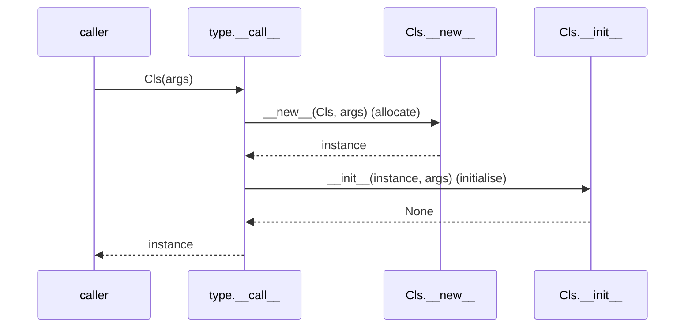

# Lesson 06: Classes — How an Object Is Made, Class Attributes and `__slots__`

> **Prerequisites:** [Lesson 02: Mutability and Identity](../02-mutability-identity-and-copying/README.md) · [LLD 01: Classes & Objects](../../01-classes-objects-and-oop-building-blocks/README.md)  
> **Reading time:** ~22 minutes  
> **Audience:** Candidates asked "`__new__` vs `__init__`", "class vs instance attribute", "`@classmethod` vs `@staticmethod`", or "what is `__slots__` for?"

> [!NOTE]
> **In one line:** Calling a class runs `__new__` (allocate and return the instance) then `__init__` (initialise it); attributes live in the **instance** `__dict__` or on the **class**, and lookup checks the instance first, then the class chain; `__slots__` removes the per-instance dict to save memory.

> [!TIP]
> **Golden rule:** Mutable *class* attributes are shared by every instance; assignment through an instance creates a **new instance attribute** that shadows the class one. Put per-object state in `__init__`; put constants and defaults for immutable values on the class.

> [!TIP]
> **Try it:** Run the section 3 file, then add `print(Account.__dict__.keys())` and `print(a.__dict__)` at the end of `main()` to see where each attribute lives. Then run the [class lab](#try-it--class-lab-runnable) below — eleven asserted probes, including a deterministic singleton race. Draw the lookup chain *instance → class → base classes* in [LLD Studio](/tools/lld-studio/).

---

## 1. The smell: how this gets asked

- *"What's the difference between `__new__` and `__init__`?"* (and "when would you override `__new__`?")
- *"Why did changing `self.count` in one object not change another, but `items.append` did?"*
- *"`@staticmethod` vs `@classmethod` vs a normal method?"*
- *"What does `__slots__` buy you, and what does it cost?"*
- *"How would you implement a Singleton in Python?"*



`__init__` is only called if `__new__` returned an instance of `Cls`. Attribute lookup: `obj.x` → `type(obj).__mro__` data descriptors → `obj.__dict__` → class attributes / non-data descriptors → `__getattr__`.

---

## 2. Reference

| Method kind | First arg | Defined with | Use for |
| :--- | :--- | :--- | :--- |
| Instance method | `self` | `def m(self)` | Behaviour on one object |
| `@classmethod` | `cls` | decorator | Alternative constructors (`from_json`), subclass-aware factories |
| `@staticmethod` | none | decorator | A utility that logically belongs to the class |
| `@property` | `self` | decorator | Computed/validated attribute (lesson 16) |

| | `__new__` | `__init__` |
| :--- | :--- | :--- |
| Role | Create (allocate) the object | Initialise the created object |
| Receives | `cls` | `self` |
| Returns | An instance | Must return `None` |
| Override when | Immutable subclasses (`int`, `str`, `tuple`), singletons, caching/flyweights | Almost always |

| Attribute home | Shared? | Example |
| :--- | :---: | :--- |
| Class attribute | Yes (all instances) | `rate = 0.05`, `registry = []` (careful!) |
| Instance attribute | No | `self.balance = 0` |
| `__slots__` entry | No (no `__dict__`) | `__slots__ = ("x", "y")` |

---

## 3. Walkthrough: `Account` with alternative constructors, a singleton and slots

**Requirements:** an `Account` with per-instance balance, a class-level interest rate, a `from_string` constructor, a counter of created accounts, a singleton `Config`, and a memory-lean `Point`.

1. Instance state in `__init__`; constants on the class.
2. `@classmethod from_string` uses `cls(...)` so subclasses work.
3. `@staticmethod` for a pure helper that needs no state.
4. `__new__` returns the same object for a singleton (note: `__init__` runs each time!).
5. `__slots__` for lots of tiny objects.

````carousel
```python
import sys


class Account:
    interest_rate = 0.05                  # class attribute (immutable value: safe)
    created = 0                           # shared counter (rebind on the CLASS)

    def __init__(self, owner: str, balance: float = 0.0) -> None:
        self.owner = owner                # instance attributes
        self.balance = balance
        Account.created += 1              # NOT self.created += 1 (that would shadow)

    @classmethod
    def from_string(cls, text: str) -> "Account":
        owner, balance = text.split(":")
        return cls(owner, float(balance))     # cls => subclass-aware

    @staticmethod
    def is_valid_amount(amount: float) -> bool:
        return amount > 0                 # no self/cls needed

    def __repr__(self) -> str:
        return f"Account({self.owner!r}, {self.balance})"


class Savings(Account):
    interest_rate = 0.08


class Config:
    _instance = None

    def __new__(cls, *args, **kwargs):
        if cls._instance is None:
            cls._instance = super().__new__(cls)
        return cls._instance

    def __init__(self, env: str = "dev") -> None:
        self.env = env                    # runs on EVERY Config(...) call!


class PointDict:
    def __init__(self, x: int, y: int) -> None:
        self.x, self.y = x, y


class PointSlots:
    __slots__ = ("x", "y")                # no per-instance __dict__

    def __init__(self, x: int, y: int) -> None:
        self.x, self.y = x, y


class Celsius(float):
    """Immutable subclass: must customise __new__ (value is fixed at creation)."""
    def __new__(cls, value: float):
        return super().__new__(cls, round(value, 1))


def main() -> None:
    a = Account("ada", 10)
    b = Savings.from_string("bob:25")
    print(a, b, type(b).__name__, Account.created)                # created == 2

    a.interest_rate = 0.99                # creates an INSTANCE attribute (shadows)
    print(a.interest_rate, Account.interest_rate, b.interest_rate)  # 0.99 0.05 0.08
    print("interest_rate" in a.__dict__, Account.is_valid_amount(5))

    c1, c2 = Config("prod"), Config("test")
    print(c1 is c2, c1.env)                                       # True test  (init ran twice!)

    p1, p2 = PointDict(1, 2), PointSlots(1, 2)
    print("has __dict__:", hasattr(p1, "__dict__"), hasattr(p2, "__dict__"))
    try:
        p2.z = 3
    except AttributeError as err:
        print("AttributeError:", err)
    print(sys.getsizeof(p1) + sys.getsizeof(p1.__dict__) > sys.getsizeof(p2))   # True

    print(Celsius(36.66), isinstance(Celsius(1), float))          # 36.7 True


if __name__ == "__main__":
    main()
```
<!-- slide -->
```csharp
// C#: constructors only initialise (allocation is done by `new`); static members are per type.
public class Account
{
    public static double InterestRate = 0.05;      // ~ class attribute (single copy)
    public static int Created;                     // shared counter
    public string Owner { get; }
    public double Balance { get; private set; }

    public Account(string owner, double balance = 0)
    {
        Owner = owner; Balance = balance; Created++;
    }

    // ~ @classmethod alternative constructor: a static factory
    public static Account FromString(string text)
    {
        var parts = text.Split(':');
        return new Account(parts[0], double.Parse(parts[1]));
    }

    // ~ @staticmethod
    public static bool IsValidAmount(double amount) => amount > 0;
}

// Singleton in C#: private constructor + Lazy<T> (or, better, DI singleton lifetime)
public sealed class Config
{
    private static readonly Lazy<Config> _lazy = new(() => new Config());
    public static Config Instance => _lazy.Value;
    private Config() { }
}
```
````

Notes: `Account.created` is 2 after two constructions; `interest_rate` on `a` becomes an *instance* attribute after assignment; the singleton's `__init__` runs again with `"test"`.

Expected output of the Python tab:

```text
Account('ada', 10) Account('bob', 25.0) Savings 2
0.99 0.05 0.08
True True
True test
has __dict__: True False
AttributeError: 'PointSlots' object has no attribute 'z' and no __dict__ for setting new attributes
True
36.7 True
```

---

## 4. Edges

- **Shadowing.** `self.count += 1` on a class attribute reads the class value and writes an *instance* attribute — the class value never changes. Use `ClassName.count`.
- **Mutable class attributes.** `class A: items = []` is shared by all instances (and subclasses); use `__init__` or `dataclasses.field(default_factory=list)`.
- **Singleton gotcha.** `__new__` returning the same object doesn't stop `__init__` running each call. Prefer a module-level instance or a DI container.
- **`__new__` for immutables.** For `int`/`str`/`tuple` subclasses the value must be set in `__new__` — `__init__` is too late.
- **`__slots__`:** no `__dict__` (no dynamic attributes), no `__weakref__` unless listed, inheritance needs `__slots__` in every class to keep the saving (a plain subclass gets a `__dict__` back), two bases that both have non-empty slots cannot be combined (`TypeError: multiple bases have instance lay-out conflict`), and `functools.cached_property` fails because it needs a `__dict__`. Saves memory (about 30% in lab probe 11) mainly for millions of instances. Lab probes 5–7 show each failure.
- **`@staticmethod` smell.** If it never needs the class, consider a module-level function — static methods are namespaced functions, nothing more.
- **`@classmethod` + inheritance.** Use `cls(...)` not `ClassName(...)` so subclasses construct themselves.
- **Name mangling.** `__x` becomes `_Class__x` to avoid subclass clashes — not privacy.
- **Thread safety.** Lazy singleton creation in `__new__` is a check-then-act race; use a lock or create it at import time. Probe 10 widens the window with `sleep` and gets several "singletons" from four threads, then fixes it with a `Lock`.
- **Weird `__new__`.** If `__new__` returns something that is not an instance of the class, `__init__` is silently skipped (probe 1).
- **Pickle/copy** work on slotted classes with the default protocol (2+); the old protocols 0/1 raise `TypeError` unless you define `__getstate__` (probe 8).

### Try it — class lab (runnable)

The follow-ups interviewers use after you explain `__new__` vs `__init__`. Save as `class_lab.py`; every probe is an `assert` or a printed error message, so a wrong claim fails loudly. Probe 10 uses `sleep` to make a race reliable, and probe 11's exact ratio varies by Python version.

```python
import pickle, threading, time, tracemalloc, weakref
from functools import cached_property

# 1) __init__ runs only if __new__ returned an instance of the class
class Weird:
    def __new__(cls):
        return 42                      # not a Weird instance
    def __init__(self):
        raise AssertionError("never called")
assert Weird() == 42

# 2) self.count += 1 reads the class value, writes an INSTANCE attribute
class Counter:
    count = 0
    def bump_wrong(self): self.count += 1
    def bump_right(self): type(self).count += 1
c1, c2 = Counter(), Counter()
c1.bump_wrong()
assert Counter.count == 0 and c1.count == 1 and "count" in c1.__dict__
c2.bump_right()
assert Counter.count == 1 and c1.count == 1 and c2.count == 1   # c1 still shadows with its own 1

# 3) Mutable class attribute is shared by every instance (and subclass)
class Bag:
    items = []
class SubBag(Bag): pass
Bag().items.append("x")
assert SubBag().items == ["x"] and Bag.items is SubBag.items

# 4) classmethod with cls() is subclass-aware; hard-coding the class is not
class Shape:
    @classmethod
    def good(cls): return cls()
    @staticmethod
    def bad(): return Shape()
class Circle(Shape): pass
assert type(Circle.good()) is Circle and type(Circle.bad()) is Shape

# 5) __slots__: subclass WITHOUT __slots__ gets a __dict__ back (saving lost)
class Slim:
    __slots__ = ("x",)
class Fat(Slim): pass
class StillSlim(Slim):
    __slots__ = ("y",)
assert hasattr(Fat(), "__dict__") and not hasattr(StillSlim(), "__dict__")

# 6) __slots__: two bases with non-empty slots cannot be combined; slots also disable weakrefs unless listed
class A: __slots__ = ("a",)
class B: __slots__ = ("b",)
try:
    class AB(A, B): pass
except TypeError as e:
    print("6:", e)
try:
    weakref.ref(A())
except TypeError as e:
    print("6b:", e)
class WithWeak:
    __slots__ = ("v", "__weakref__")
w = WithWeak(); assert weakref.ref(w)() is w

# 7) cached_property needs a __dict__ -> unusable on a slotted class
try:
    class Bad:
        __slots__ = ("n",)
        @cached_property
        def double(self): return self.n * 2
    b = Bad(); b.n = 2
    b.double
except TypeError as e:
    print("7:", e)

# 8) Pickle round-trips slotted objects with the default protocol
class P:
    __slots__ = ("x", "y")
    def __init__(self, x, y): self.x, self.y = x, y
p = pickle.loads(pickle.dumps(P(1, 2)))
assert (p.x, p.y) == (1, 2)
try:
    pickle.dumps(P(1, 2), protocol=1)   # old protocols have no slots support
except TypeError as e:
    print("8:", e)

# 9) Name mangling is renaming, not privacy
class Vault:
    def __init__(self): self.__secret = 7
assert Vault()._Vault__secret == 7

# 10) Singleton via __new__: init runs every call, and the lazy check-then-act races
class Single:
    _instance = None
    def __new__(cls):
        if cls._instance is None:
            time.sleep(0.05)               # widen the race window on purpose
            cls._instance = super().__new__(cls)
        return cls._instance
made = []
ts = [threading.Thread(target=lambda: made.append(Single())) for _ in range(4)]
[t.start() for t in ts]; [t.join() for t in ts]
print("10: racing threads built more than one singleton:", len({id(m) for m in made}) > 1)
assert len({id(m) for m in made}) > 1

class Locked:
    _instance, _lock = None, threading.Lock()
    def __new__(cls):
        with cls._lock:
            if cls._instance is None:
                time.sleep(0.05)
                cls._instance = super().__new__(cls)
        return cls._instance
made.clear()
ts = [threading.Thread(target=lambda: made.append(Locked())) for _ in range(4)]
[t.start() for t in ts]; [t.join() for t in ts]
assert len({id(m) for m in made}) == 1

# 11) Measured: slots vs dict for 100k objects
class PD:
    def __init__(self, x, y): self.x, self.y = x, y
class PS:
    __slots__ = ("x", "y")
    def __init__(self, x, y): self.x, self.y = x, y
def measure(cls):
    tracemalloc.start()
    objs = [cls(i, i) for i in range(100_000)]
    size, _ = tracemalloc.get_traced_memory()
    tracemalloc.stop()
    return size
d, s = measure(PD), measure(PS)
print(f"11: slots use less memory than dict instances: {s < d}  (ratio is roughly 0.6-0.8; varies by Python version)")
assert s < d
print("class lab ok")
```

Expected output:

```text
6: multiple bases have instance lay-out conflict
6b: cannot create weak reference to 'A' object
7: No '__dict__' attribute on 'Bad' instance to cache 'double' property.
8: a class that defines __slots__ without defining __getstate__ cannot be pickled
10: racing threads built more than one singleton: True
11: slots use less memory than dict instances: True  (ratio is roughly 0.6-0.8; varies by Python version)
class lab ok
```

---

## 5. What you'd say in two minutes

> "Calling a class goes through `type.__call__`: first `__new__` allocates and returns the instance, then `__init__` initialises it, and `__init__` runs only if `__new__` returned an instance of that class. I override `__new__` only for immutable subclasses, singletons or flyweights; otherwise `__init__`. Attributes live in the instance `__dict__` or on the class, and lookup checks the instance first and then the MRO — so assigning through an instance creates a new instance attribute that shadows the class one, and a mutable class attribute like a list is shared by everyone. `@classmethod` gets the class and is how I write alternative constructors that respect subclasses; `@staticmethod` is just a namespaced function. `__slots__` removes the per-instance dict, saving memory for millions of small objects at the cost of dynamic attributes and some inheritance flexibility."

---

## 6. Anti-patterns

| Anti-pattern | Why it fails | Fix |
| :--- | :--- | :--- |
| `class A: items = []` | Shared across instances | Create in `__init__` |
| `self.counter += 1` for a class counter | Shadows, doesn't share | `Class.counter += 1` |
| Singleton via `__new__` with stateful `__init__` | Re-initialised each call | Module-level instance / DI |
| `ClassName(...)` inside `@classmethod` | Breaks subclasses | `cls(...)` |
| `__slots__` "for performance" on a few objects | Complexity for no gain | Measure first |
| Heavy work in `__init__` (I/O, network) | Hard to test, slow construction | Factory method / lazy init |

---

## 7. Interview questions

<details>
<summary><strong>1. `__new__` vs `__init__`? [BASIC]</strong></summary>

`__new__(cls)` creates and returns the instance (a static method taking the class); `__init__(self)` initialises it and returns `None`. Override `__new__` for immutable types, singletons or flyweights.

</details>

<details>
<summary><strong>2. Class attribute vs instance attribute? [BASIC]</strong></summary>

Class attributes live on the class and are shared; instance attributes live in `obj.__dict__`. Lookup checks the instance first, so assignment through an instance shadows the class attribute without changing it.

</details>

<details>
<summary><strong>3. `@classmethod` vs `@staticmethod`? [BASIC]</strong></summary>

`@classmethod` receives the class (`cls`) — use it for alternative constructors and subclass-aware logic. `@staticmethod` receives nothing — a plain function placed in the class namespace.

</details>

<details>
<summary><strong>4. What does `__slots__` do? What's the catch? [TRICKY]</strong></summary>

It declares a fixed set of attributes stored in compact slots instead of a per-instance dict, reducing memory and slightly speeding attribute access. Catch: no arbitrary new attributes, no `__weakref__` unless declared, and subclasses must also define `__slots__` to retain the benefit.

</details>

<details>
<summary><strong>5. Implement a Singleton in Python. [SCENARIO]</strong></summary>

Simplest: a module-level instance (modules are imported once). Or `__new__` caching with a lock. Or a decorator/metaclass. In applications, prefer a DI container's singleton lifetime so it stays testable.

</details>

<details>
<summary><strong>6. Why does `self.count += 1` not update the class counter? [TRICKY]</strong></summary>

It expands to `self.count = self.count + 1`: read from the class, write to the instance. The class attribute is untouched. Use `type(self).count += 1` or `ClassName.count += 1`.

</details>

<details>
<summary><strong>7. How do you make an immutable `Money(int)` subclass? [SCENARIO]</strong></summary>

Override `__new__` to validate and call `super().__new__(cls, value)`; `__init__` can't change an `int`'s value. For richer types prefer `@dataclass(frozen=True)`.

</details>

<details>
<summary><strong>8. Class-level `registry = []` in a base class collects every subclass instance — bug? [SCENARIO]</strong></summary>

It's shared across the whole hierarchy by design or by accident; if each subclass needs its own, create it in `__init_subclass__` (lesson 16). If you want one global registry, name it explicitly and document it.

</details>

---

## 8. One-page cheat sheet

```text
Cls(args)   ->  __new__(cls, args) [allocate]  ->  __init__(self, args) [initialise, returns None]
Lookup      instance.__dict__  ->  class  ->  bases (MRO)       (data descriptors win first)
Class attr  shared; instance assignment SHADOWS it;  mutate shared state via Class.attr
@classmethod  cls first: alternative constructors, use cls(...)
@staticmethod no first arg: namespaced function
__new__     immutable subclasses, singleton, flyweight (init runs again!)
__slots__   no __dict__, memory saver, no dynamic attrs, repeat in subclasses
__x         name-mangled to _Class__x, not private
Singleton   module-level instance  >  __new__ hack  >  metaclass
```

---

## Further reading

- [Python tutorial: classes](https://docs.python.org/3/tutorial/classes.html)
- [Python data model: `__new__` and `__slots__`](https://docs.python.org/3/reference/datamodel.html#object.__new__)
- [Descriptor HowTo Guide](https://docs.python.org/3/howto/descriptor.html)

Previous: [Iterators, Generators and yield](../05-iterators-generators-and-yield/README.md) · Next: [Dunder Methods and the Data Model](../07-dunder-methods-and-the-data-model/README.md)
