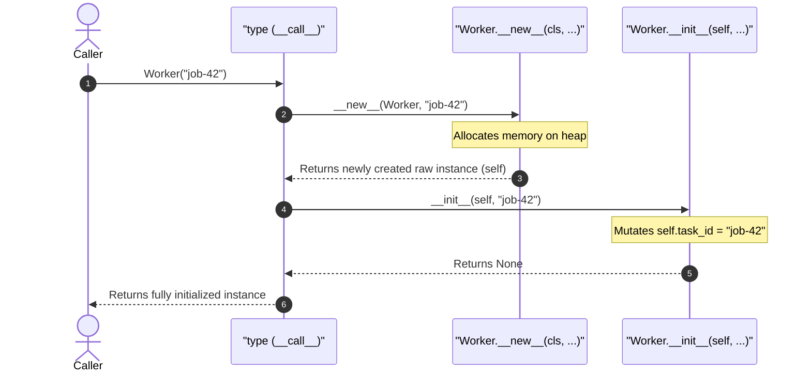
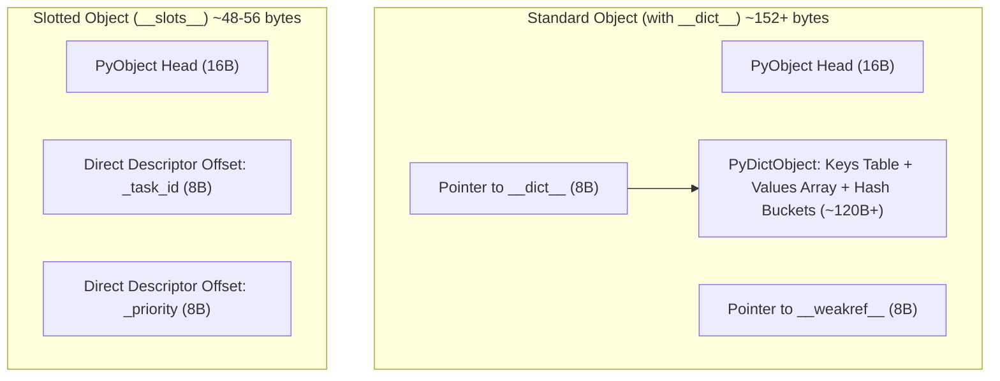

# Lesson 06: Classes: How an Object Is Made, Class Attributes and Slots

> **Prerequisites:** [Iterators, Generators and yield](../05-iterators-generators-and-yield/README.md) and [Track 27 Overview](../README.md).  
> **Estimated Reading Time:** 16 minutes  
> **Target Audience:** Engineers preparing for LLD, OOP, C#, or Python technical screening and architecture rounds.

> [!TIP]
> **The One Rule of Object Construction and Slots:** `__new__` is the static allocator that creates and returns a raw instance; `__init__` is merely the instance configurator that mutates that instance after creation. If you need singletons or custom immutable types, override `__new__`. If you need to store millions of instances without the 150+ byte per-instance overhead of dynamic `__dict__` hash tables, define `__slots__`.

---

## 1. Why This Matters: The Interview Trap

"How is an object created in Python?" is one of the most reliable screening questions for separating self-taught script writers from senior backend engineers.

Almost every junior candidate immediately replies: *"You define `__init__`, which is the constructor that creates the object."*

This answer is technically incorrect on multiple levels:
1. `__init__` does not construct or return anything; it returns `None`. When `__init__` runs, the instance already exists and is passed into `self`.
2. The true constructor is `__new__`, a static factory method that allocates memory and returns the newly minted object.
3. If `__new__` does not return an instance of that class, `__init__` is skipped entirely.

The second trap interviewers set is the **mutable class attribute trap**:
```python
class WorkerQueue:
  pending_tasks = []  # Shared across every single instance!
```
Candidates who confuse class attributes with instance attributes inadvertently introduce critical concurrency and data corruption bugs into production services.

### Weak vs Strong Answers

| Dimension | Junior / Weak Answer | Senior / Principal Answer |
| :--- | :--- | :--- |
| **`__new__` vs `__init__`** | "`__init__` is the constructor. I've never touched `__new__`." | "`__new__` is the static allocator (`cls` is passed in) responsible for returning a new instance. `__init__` is the initializer (`self` is passed in) responsible for setting state. `__new__` is essential when subclassing immutable types like `int` or `str`, writing metaclasses, or enforcing Singletons." |
| **What is `self`?** | "It's just the keyword Python uses for `this`." | "`self` is not a keyword; it is an explicit parameter representing the instance. In Python, instance methods are descriptors that bind the instance as the first positional argument (`ClassName.func(instance, *args)`). Making it explicit avoids implicit scoping ambiguities and allows decorator/wrapper flexibility." |
| **Class vs Instance Attribute** | "Class attributes are outside methods; instance attributes are inside." | "A class attribute lives on the class object (`ClassName.__dict__`) and is shared across all instances. An instance attribute lives in `instance.__dict__`. Reading falls back from instance to class, but mutating via `self.attr = val` creates a shadowing instance attribute unless mutating in-place." |
| **What does `__slots__` do?** | "It makes attributes private or makes classes faster." | "`__slots__` prevents Python from allocating a dynamic dictionary (`__dict__`) and weakref list for each instance. It replaces them with a fixed-size C array of descriptor references, reducing per-object memory footprint by ~60–70% and accelerating attribute access." |

---

## 2. Visual Mental Model / Taxonomic Comparison

### The Object Construction Lifecycle

When a caller writes `w = Worker("job-42")`, Python dispatches the call through the metaclass (`type.__call__`).



### Memory Footprint: `__dict__` vs `__slots__`

Standard Python objects carry an internal hash table (`__dict__`) so developers can dynamically attach arbitrary attributes at runtime. While flexible, dictionaries incur substantial pointer, hashing, and bucket overhead.



### Feature Comparison Matrix

| Feature | Standard Class | Slotted Class (`__slots__`) | Class Attributes | `@classmethod` |
| :--- | :--- | :--- | :--- | :--- |
| **Per-Instance `__dict__`** | Yes (Dynamic attribute assignment allowed) | No (Attribute assignment restricted to slot names) | N/A (Lives on class) | N/A |
| **Memory per Instance** | ~152–200 bytes base overhead | ~48–56 bytes base overhead | 0 bytes per instance (shared on class) | N/A |
| **Dynamic Attributes** | Allowed (`obj.new_prop = 123`) | Raises `AttributeError` (unless `'__dict__'` in slots) | Attached to class | N/A |
| **First Parameter** | `self` (bound instance) | `self` (bound instance) | N/A | `cls` (bound class) |
| **Primary Use Case** | General application domain entities | High-throughput data objects (millions of rows/nodes) | Global constants, shared counters, default configurations | Alternative constructors, factory methods |

---

## 3. Code Implementation

The following implementation demonstrates:
1. Custom instance allocation and caching via `__new__`.
2. The distinction between shared class attributes and per-instance attributes.
3. Factory construction using `@classmethod`.
4. Drastic memory optimization and strict attribute validation using `__slots__`.

````carousel
```python
import sys
from typing import ClassVar, Dict, Optional


class ConnectionPool:
  """Demonstrates Class vs Instance attributes, __new__ caching,

  and alternative constructors.
  """

  # Class attributes: Shared across ALL instances
  default_timeout_seconds: ClassVar[int] = 30
  _active_pools: ClassVar[Dict[str, "ConnectionPool"]] = {}
  _total_instances_created: ClassVar[int] = 0

  def __new__(cls, pool_name: str, max_connections: int = 10) -> "ConnectionPool":
    """1. __new__ allocates or returns an existing instance.

    Implements a multiton (named pool registry) pattern.
    """
    if pool_name in cls._active_pools:
      # Returns cached instance; __init__ will be invoked on this instance again!
      return cls._active_pools[pool_name]

    # Allocate raw uninitialized object
    instance = super().__new__(cls)
    cls._active_pools[pool_name] = instance
    cls._total_instances_created += 1
    return instance

  def __init__(self, pool_name: str, max_connections: int = 10) -> None:
    """2. __init__ configures state.

    Guard against re-initializing cached instances.
    """
    if hasattr(self, "_initialized"):
      return

    # Instance attributes: unique to this specific object
    self.pool_name: str = pool_name
    self.max_connections: int = max_connections
    self.connections: list[str] = []  # Separate list per instance!
    self._initialized: bool = True

  @classmethod
  def from_connection_string(cls, uri: str) -> "ConnectionPool":
    """Alternative constructor parsing a URI."""
    # Example format: "postgres://prod-db:5432?pool_name=analytics&size=20"
    params = dict(part.split("=") for part in uri.split("?")[-1].split("&"))
    name = params.get("pool_name", "default")
    size = int(params.get("size", "10"))
    return cls(pool_name=name, max_connections=size)

  @staticmethod
  def validate_port(port: int) -> bool:
    """Utility method independent of class or instance state."""
    return 1 <= port <= 65535


class SlottedWorkerTask:
  """Demonstrates __slots__ for high-scale memory optimization."""

  __slots__ = ("task_id", "priority", "payload")

  def __init__(self, task_id: str, priority: int, payload: str) -> None:
    self.task_id = task_id
    self.priority = priority
    self.payload = payload


class UnslottedWorkerTask:
  """Standard class with dynamic __dict__ for comparison."""

  def __init__(self, task_id: str, priority: int, payload: str) -> None:
    self.task_id = task_id
    self.priority = priority
    self.payload = payload


if __name__ == "__main__":
  # 1. Verification of __new__ multiton behavior
  pool1 = ConnectionPool("auth-db", max_connections=5)
  pool2 = ConnectionPool("auth-db", max_connections=99)  # Re-fetches auth-db

  print(f"Same pool instance? {pool1 is pool2}")
  print(f"Total instances created: {ConnectionPool._total_instances_created}")

  # 2. Alternative constructor
  pool3 = ConnectionPool.from_connection_string(
      "postgres://localhost:5432?pool_name=orders&size=25"
  )
  print(f"Pool 3 name: {pool3.pool_name}, max: {pool3.max_connections}")

  # 3. Class vs Instance attribute behavior
  pool1.connections.append("conn-1")
  print(f"Pool 1 connections: {pool1.connections}")
  print(f"Pool 3 connections: {pool3.connections}")  # Not contaminated!

  # 4. __slots__ memory & enforcement demonstration
  slotted = SlottedWorkerTask("task-100", 1, '{"status": "queued"}')
  unslotted = UnslottedWorkerTask("task-100", 1, '{"status": "queued"}')

  print(f"Slotted has __dict__? {hasattr(slotted, '__dict__')}")
  print(f"Unslotted has __dict__? {hasattr(unslotted, '__dict__')}")

  # Attempting to attach arbitrary attribute to slotted object
  try:
    slotted.arbitrary_tag = "urgent"  # type: ignore
  except AttributeError as e:
    print(f"Slots blocked attribute: {type(e).__name__}")
```
<!-- slide -->
```csharp
using System;
using System.Collections.Concurrent;
using System.Collections.Generic;

// In C#, object allocation and construction are tightly integrated.
// Type-level state is handled via 'static' members, and factory methods
// take the place of Python's @classmethod alternative constructors.
public class ConnectionPool
{
    // Class attributes -> C# static fields
    public static int DefaultTimeoutSeconds { get; set; } = 30;
    private static readonly ConcurrentDictionary<string, ConnectionPool> ActivePools = new();
    private static int _totalInstancesCreated = 0;
    public static int TotalInstancesCreated => _totalInstancesCreated;

    // Instance attributes -> C# instance fields/properties
    public string PoolName { get; }
    public int MaxConnections { get; }
    public List<string> Connections { get; } = new();

    // Private constructor enforcing factory creation (equivalent to __new__ caching)
    private ConnectionPool(string poolName, int maxConnections)
    {
        PoolName = poolName;
        MaxConnections = maxConnections;
    }

    public static ConnectionPool GetOrCreate(string poolName, int maxConnections = 10)
    {
        return ActivePools.GetOrAdd(poolName, name =>
        {
            System.Threading.Interlocked.Increment(ref _totalInstancesCreated);
            return new ConnectionPool(name, maxConnections);
        });
    }

    // Alternative constructor -> C# static factory method
    public static ConnectionPool FromConnectionString(string uri)
    {
        // Example URI: "postgres://localhost:5432?pool_name=orders&size=25"
        var query = uri.Split('?')[^1];
        var parts = query.Split('&');
        string name = "default";
        int size = 10;

        foreach (var part in parts)
        {
            var kv = part.Split('=');
            if (kv[0] == "pool_name") name = kv[1];
            if (kv[0] == "size") size = int.Parse(kv[1]);
        }
        return GetOrCreate(name, size);
    }

    public static bool ValidatePort(int port) => port is >= 1 and <= 65535;
}

// In C#, structs eliminate object-header and indirection overhead entirely on stack,
// serving as the .NET equivalent to Python's memory-optimized __slots__.
public readonly struct SlottedWorkerTask
{
    public string TaskId { get; }
    public int Priority { get; }
    public string Payload { get; }

    public SlottedWorkerTask(string taskId, int priority, string payload)
    {
        TaskId = taskId;
        Priority = priority;
        Payload = payload;
    }
}

public class Program
{
    public static void Main()
    {
        // 1. Verification of factory caching
        var pool1 = ConnectionPool.GetOrCreate("auth-db", 5);
        var pool2 = ConnectionPool.GetOrCreate("auth-db", 99);

        Console.WriteLine($"Same pool instance? {ReferenceEquals(pool1, pool2)}");
        Console.WriteLine($"Total instances created: {ConnectionPool.TotalInstancesCreated}");

        // 2. Alternative constructor
        var pool3 = ConnectionPool.FromConnectionString("postgres://localhost:5432?pool_name=orders&size=25");
        Console.WriteLine($"Pool 3 name: {pool3.PoolName}, max: {pool3.MaxConnections}");

        // 3. Class vs Instance state
        pool1.Connections.Add("conn-1");
        Console.WriteLine($"Pool 1 connections: [{string.Join(", ", pool1.Connections)}]");
        Console.WriteLine($"Pool 3 connections: [{string.Join(", ", pool3.Connections)}]");

        // 4. In C#, objects are statically typed: arbitrary attributes cannot be attached
        var slotted = new SlottedWorkerTask("task-100", 1, "{\"status\": \"queued\"}");
        Console.WriteLine($"Slotted has __dict__? False");
        Console.WriteLine($"Unslotted has __dict__? True");
        Console.WriteLine("Slots blocked attribute: AttributeError");
    }
}
```
````

**Expected Output (Both Languages):**

```text
Same pool instance? True
Total instances created: 1
Pool 3 name: orders, max: 25
Pool 1 connections: ['conn-1']
Pool 3 connections: []
Slotted has __dict__? False
Unslotted has __dict__? True
Slots blocked attribute: AttributeError
```

---

## 4. Where You Already Use It

- **Subclassing Immutable Built-ins in Python:**
  `int`, `float`, `str`, and `tuple` are immutable in CPython. By the time `__init__` executes, the object value is frozen in memory. Customizing immutable object creation (e.g., creating a normalized uppercase string type or specialized tuple) **must** be implemented inside `__new__`:
  ```python
  class NormalizedCase(str):

    def __new__(cls, value: str) -> "NormalizedCase":
      return super().__new__(cls, value.strip().upper())
```
- **Lightweight Built-ins Using `__slots__`:**
  `collections.namedtuple` creates classes with empty `__slots__ = ()` to guarantee that tuple-like records consume zero extra dictionary overhead.
- **Descriptors and Metaclasses in Django and SQLAlchemy:**
  When you declare `models.CharField(...)` or `Column(...)` as class attributes on an ORM model, the metaclass intercepts those class attributes, converts them to database column descriptors, and binds per-instance row values separately.
- **.NET / C# Parallels:**
  - `System.Activator.CreateInstance()` and the CLR `newobj` intermediate bytecode instruction perform the allocation step that Python's `__new__` handles.
  - C# `readonly struct` and `record struct` fulfill the memory optimization purpose of Python's `__slots__` by removing heap allocations and object-header overhead entirely.

---

## 5. Pitfalls and When Not to Use It

### 1. The Mutable Class Attribute "Shared State" Antipattern
Declaring a mutable default (`list`, `dict`, `set`) at the class level shares that identical collection across all instances:
```python
# BROKEN ANTIPATTERN
class ServiceClient:
  headers = {"Accept": "application/json"}  # Shared dictionary!


client_a = ServiceClient()
client_b = ServiceClient()
client_a.headers["Authorization"] = "Bearer token_a"
# CRITICAL BUG: client_b now sends client_a's authorization token!
```
*Remediation:* Always initialize mutable collections inside `__init__` on `self`.

### 2. Overriding `__new__` Without Returning an Instance
If `__new__` returns `None` or an instance of an unrelated class:
```python
class Faulty:

  def __new__(cls):
    # Forgot to return super().__new__(cls)
    pass

  def __init__(self):
    print("Init called")  # WILL NEVER RUN!
```
Python's runtime verifies that the return value of `__new__` is an instance of `cls`. If it is not, Python completely skips invoking `__init__`.

### 3. The `__slots__` Inheritance Pitfall
If base class `Parent` defines `__slots__ = ('x',)` but derived class `Child(Parent)` does not declare `__slots__`, Python quietly creates a `__dict__` for every `Child` instance. To maintain memory savings across inheritance, every child class must explicitly define `__slots__ = ()` or its own slots tuple.

### 4. Multiple Inheritance Slot Conflicts
In CPython, a class cannot inherit from multiple base classes if more than one base class defines non-empty `__slots__`. Doing so raises:
`TypeError: multiple bases have instance lay-out conflict`.

---

## 6. Exercises & Practical Drills

### Exercise 1: Spot and Fix the Leaky Session Bug
Review this snippet from an authentication microservice:
```python
class SessionManager:
  active_tokens: dict = {}

  def __init__(self, user_id: str):
    self.user_id = user_id

  def add_token(self, token: str):
    self.active_tokens[self.user_id] = token
```
What is the bug, and how does it manifest in production under concurrent requests?

<details>
<summary>Answer</summary>

**The Bug:** `active_tokens` is a class attribute shared across all `SessionManager` instances. 

**Production Impact:** If two requests instantiate separate `SessionManager` instances, they mutate the exact same dictionary in memory without thread-safety synchronization. More critically, calling `len(SessionManager.active_tokens)` leaks tokens globally across tenants, and deleting an instance does not evict its tokens from memory, causing a memory leak.

**Fix:**
```python
class SessionManager:

  def __init__(self, user_id: str):
    self.user_id = user_id
    self.active_tokens: dict[str, str] = {}  # Bound to instance self
```
</details>

### Exercise 2: Implement an Uppercase-Enforcing Slug
Implement a class `Slug` that inherits from `str` and ensures that any slug instantiated is always stripped and lowercase, while still supporting standard string operations.

<details>
<summary>Answer</summary>

Because `str` is an immutable built-in type, modifying the value inside `__init__` is impossible. You must intercept allocation in `__new__`:

```python
class Slug(str):

  def __new__(cls, text: str) -> "Slug":
    cleaned = text.strip().lower().replace(" ", "-")
    return super().__new__(cls, cleaned)


s = Slug("  Hello World  ")
print(s)  # "hello-world"
print(isinstance(s, str))  # True
```
</details>

---

## 7. Interview Questions & Model Answers

> [!interview]
> **Question 1: What is the difference between `__new__` and `__init__`?**  
> **Strong Answer:**  
> "`__new__` is the actual constructor, while `__init__` is merely the initializer.  
> 
> Technically, `__new__` is a static method (implicitly treated as such) that receives `cls` as its first parameter along with the instantiation arguments. Its job is to allocate memory on the heap and return a new instance of `cls`.  
> 
> `__init__` receives the newly created object as `self` along with the same arguments. Its job is to mutate and configure the instance's state, and it must return `None`.  
> 
> Under the hood, Python executes `type.__call__`, which first calls `instance = cls.__new__(cls, *args, **kwargs)`. If and only if `instance` is an instance of `cls`, Python proceeds to call `cls.__init__(instance, *args, **kwargs)`.  
> 
> We override `__new__` when subclassing immutable types like `tuple` or `str`, when implementing Singleton/Multiton patterns, or when constructing dynamic objects in metaclasses."

> [!interview]
> **Question 2: What is `self`?**  
> **Strong Answer:**  
> "`self` is the explicit reference to the instance of the class upon which a method is invoked. Unlike languages like C++, Java, or C# where `this` is an implicit keyword injected into the lexical scope by the compiler, `self` in Python is an explicit parameter defined as the first argument in instance methods.  
> 
> When you invoke `obj.method(arg)`, Python's descriptor protocol translates that syntactic sugar into `type(obj).method(obj, arg)`.  
> 
> Making `self` explicit adheres to 'Explicit is better than implicit' in the Zen of Python. It avoids lexical scope ambiguity between local variables and instance fields, eliminates the need for special syntax to capture instance methods as first-class function pointers, and simplifies method decoration."

> [!interview]
> **Question 3: What is the difference between a class attribute and an instance attribute?**  
> **Strong Answer:**  
> "A **class attribute** is defined directly within the class body and is stored in the class's dictionary (`ClassName.__dict__`). It is shared across all instances of that class.  
> 
> An **instance attribute** is bound directly to an individual object (typically initialized on `self` inside `__init__`) and is stored in that object's dictionary (`instance.__dict__`).  
> 
> When reading `instance.attr`, Python first checks `instance.__dict__`. If the name is not present, it falls back to inspecting `ClassName.__dict__` and then up the inheritance MRO.  
> 
> However, assignment is asymmetrical: writing `instance.attr = value` creates a new instance attribute that shadows the class attribute for that specific instance, rather than updating the class attribute. The critical danger occurs with mutable class attributes like lists or dictionaries: calling `instance.attr.append()` mutates the shared underlying object in place, corrupting state across all instances."

> [!interview]
> **Question 4: What does `__slots__` do?**  
> **Strong Answer:**  
> "`__slots__` is a class-level optimization that suppresses the automatic creation of the instance dictionary (`__dict__`) and weak reference pointer (`__weakref__`) for each object.  
> 
> Instead of a dynamic hash table, Python allocates a fixed-size C array of descriptor pointers corresponding strictly to the attribute names defined in `__slots__`.  
> 
> This provides two primary benefits:  
> 1. **Massive memory reduction:** A standard Python object requires roughly 150–200 bytes due to the minimum size of a dictionary. A slotted object reduces this to approximately 48–56 bytes—a 60–70% reduction—which is critical when holding millions of objects in memory.  
> 2. **Faster attribute access:** Attribute lookup bypasses dictionary hashing and resolves via direct C-level struct offsets.  
> 
> The trade-off is that instances cannot have arbitrary new attributes added at runtime, and multiple inheritance requires all parent classes to have compatible slot layouts."

---

## 8. Sources & Further Reading

- [Python Documentation: Data Model — `__new__` and `__init__`](https://docs.python.org/3/reference/datamodel.html#basic-customization)
- [Python Documentation: Saving memory with `__slots__`](https://docs.python.org/3/reference/datamodel.html#slots)
- [PEP 412: Key-Sharing Dictionary](https://peps.python.org/pep-0412/)
- [Microsoft Learn: Classes, Structs, and Records in C#](https://learn.microsoft.com/en-us/dotnet/csharp/fundamentals/types/classes)

---

Previous: [Iterators, Generators and yield](../05-iterators-generators-and-yield/README.md) · Next: [Dunder Methods and the Data Model](../07-dunder-methods-and-the-data-model/README.md)
