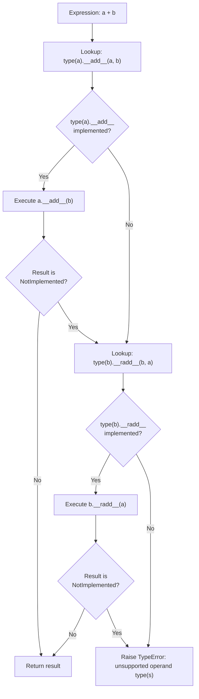
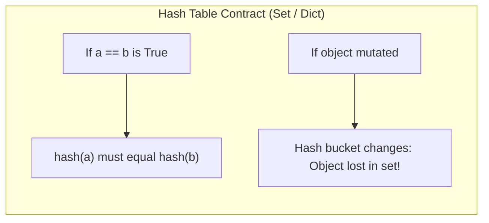

# Lesson 07: Dunder Methods and the Data Model

> **Prerequisites:** [Classes: How an Object Is Made, Class Attributes and Slots](../06-classes-init-new-and-slots/README.md) and [Track 27 Overview](../README.md).  
> **Estimated Reading Time:** 18 minutes  
> **Target Audience:** Engineers preparing for LLD, OOP, C#, or Python technical screening and architecture rounds.

> [!TIP]
> **The One Rule of the Python Data Model:** Python syntax never calls methods directly on objects; it delegates through the special "dunder" protocols defined on the object's type (`type(x)`). When you evaluate `a == b`, `len(a)`, or `a + b`, Python calls `type(a).__eq__(a, b)`, `type(a).__len__(a)`, and `type(a).__add__(a, b)`. Crucially, if you define `__eq__`, Python automatically sets `__hash__ = None` to safeguard the hash table invariant: equal objects **must** produce identical hashes and remain immutable while stored in sets or dictionaries.

---

## 1. Why This Matters: The Interview Trap

In senior Python interviews, the interviewer often tests whether you understand **protocols** or if you simply memorize syntax:
1. *"What happens if you define `__eq__` on a class and put its instance in a `set`?"*
2. *"Why does `len(my_obj)` work, but assigning `my_obj.__len__ = lambda: 5` fails?"*
3. *"When should you return `NotImplemented` versus raising `NotImplementedError`?"*

A junior developer answers:
- *"Dunder methods are magic methods that let you override operators."*
- *"If you define `__eq__`, it just compares equality; the set works fine."*
- *"`__repr__` and `__str__` are basically the same as Java or C#'s `toString()`."*

All three answers reveal dangerous gaps in understanding the CPython data model:
- Defining `__eq__` without `__hash__` renders your class **unhashable**: Python sets `__hash__ = None`, causing `TypeError: unhashable type` the moment an instance is passed to a `set` or used as a `dict` key.
- Dunder methods are looked up on the **class** (`type(self)`), bypassing the instance dictionary (`self.__dict__`) entirely for performance and C-level slot dispatch.
- `__repr__` is an unambiguous, developer-focused representation that ideally re-evaluates to the object (`eval(repr(x)) == x`). `__str__` is a friendly, end-user display. If `__str__` is missing, Python falls back to `__repr__`; if `__repr__` is missing, Python falls back to generic memory addresses.

### Weak vs Strong Answers

| Dimension | Junior / Weak Answer | Senior / Principal Answer |
| :--- | :--- | :--- |
| **`__str__` vs `__repr__`** | "`__str__` is for printing, `__repr__` is for debugging." | "`__repr__` aims to be unambiguous, detailed, and ideally an executable Python expression (`eval(repr(x)) == x`) targeting developers. `__str__` is for human-readable display targeting end users. Fallback is one-way: if `__str__` is omitted, Python falls back to `__repr__`." |
| **`__eq__` and `__hash__`** | "You only need `__eq__` to compare two objects with `==`." | "Hash table invariants require: `a == b ==> hash(a) == hash(b)`. If you implement `__eq__`, Python sets `__hash__ = None` by default to prevent mutable equality from corrupting hash buckets. You must implement `__hash__` explicitly on immutable fields to restore hashability." |
| **Making Objects Callable** | "You write a regular function instead of a class." | "Implement `__call__(self, *args, **kwargs)`. This lets instances act as stateful closures, decorators, or strategy objects while maintaining class encapsulation, properties, and inheritance." |
| **Operator Overloading Return** | "Raise `TypeError` if the other operand has the wrong type." | "Return the singleton `NotImplemented`. This signals Python to reflect the operator and attempt the reverse operation on the right-hand operand (`__radd__`, `__rsub__`). Only if both return `NotImplemented` does Python raise `TypeError`." |

---

## 2. Visual Mental Model / Taxonomic Comparison

### Protocol Lookup Flow

When you write `result = a + b`, Python does not look inside `a.__dict__`. It routes through the CPython type slots:



### The Hash Table Contract



### Python Data Model Protocols Matrix

| Protocol Category | Dunder Methods | Invoked By Python Syntax | C# Equivalent |
| :--- | :--- | :--- | :--- |
| **String Representation** | `__repr__`, `__str__`, `__format__` | `repr(x)`, `str(x)`, `print(x)`, `f"{x}"` | `ToString()`, `IFormattable` |
| **Equality & Hashing** | `__eq__`, `__hash__` | `a == b`, `hash(x)`, `x in set_or_dict` | `Equals(object)`, `GetHashCode()`, `IEquatable<T>` |
| **Comparison & Ordering** | `__lt__`, `__le__`, `__gt__`, `__ge__` | `<`, `<=`, `>`, `>=`, `sorted()`, `min()` | `IComparable<T>`, `operator <` |
| **Container / Sequence** | `__len__`, `__getitem__`, `__contains__`, `__iter__` | `len(c)`, `c[i]`, `val in c`, `for item in c:` | `IReadOnlyList<T>`, `IEnumerable<T>`, indexer `this[i]` |
| **Callable Object** | `__call__` | `instance(arg1, arg2)` | `Invoke()`, delegate `Action`, `Func` |
| **Context Management** | `__enter__`, `__exit__` | `with manager as m:` | `IDisposable`, `using (...)` |
| **Arithmetic Operators** | `__add__`, `__radd__`, `__iadd__` | `a + b`, `b + a`, `a += b` | `operator +` |

---

## 3. Code Implementation

The following carousel demonstrates an immutable value object, `Money`, and a transaction container, `Ledger`. It illustrates:
1. `__repr__` and `__str__` contrast.
2. Safe `__eq__` and `__hash__` implementation with frozen immutability.
3. Operator overloading with `NotImplemented` fallback and `@functools.total_ordering`.
4. Making an object callable via `__call__` for dynamic fee calculation.
5. Container protocol (`__len__`, `__getitem__`, `__contains__`).

````carousel
```python
from decimal import Decimal
from functools import total_ordering
from typing import Any, List, Union


@total_ordering
class Money:
  """Immutable Value Object implementing core Python Data Model protocols."""

  __slots__ = ("_amount", "_currency")

  def __init__(self, amount: Union[int, float, str, Decimal], currency: str):
    # Enforce invariant: Money is immutable once constructed
    super().__setattr__("_amount", Decimal(str(amount)))
    super().__setattr__("_currency", currency.upper())

  def __setattr__(self, name: str, value: Any) -> None:
    raise AttributeError("Money instances are immutable.")

  @property
  def amount(self) -> Decimal:
    return self._amount

  @property
  def currency(self) -> str:
    return self._currency

  # 1. String Representation Protocol
  def __repr__(self) -> str:
    """Developer representation: valid code to recreate object."""
    return f"Money({self._amount!r}, {self._currency!r})"

  def __str__(self) -> str:
    """User-friendly representation."""
    return f"{self._currency} {self._amount:.2f}"

  # 2. Equality and Hash Table Contract
  def __eq__(self, other: object) -> bool:
    if not isinstance(other, Money):
      return NotImplemented
    return self._amount == other._amount and self._currency == other._currency

  def __hash__(self) -> int:
    """Hash invariant: equal objects MUST yield identical hashes."""
    return hash((self._amount, self._currency))

  # 3. Ordering Protocol (total_ordering generates <=, >, >= from <)
  def __lt__(self, other: object) -> bool:
    if not isinstance(other, Money):
      return NotImplemented
    if self._currency != other._currency:
      raise TypeError(
          f"Cannot compare different currencies: {self._currency} and"
          f" {other._currency}"
      )
    return self._amount < other._amount

  # 4. Arithmetic Operator Overloading
  def __add__(self, other: object) -> "Money":
    if not isinstance(other, Money):
      return NotImplemented
    if self._currency != other._currency:
      raise ValueError(
          f"Currency mismatch: cannot add {self._currency} and {other._currency}"
      )
    return Money(self._amount + other._amount, self._currency)


class FeeCalculator:
  """Callable Strategy Object using __call__."""

  def __init__(self, fee_percentage: Decimal) -> None:
    self.fee_percentage = fee_percentage

  def __call__(self, money: Money) -> Money:
    """Allows instance to be called directly: fee = calculator(money)."""
    fee_amount = (money.amount * self.fee_percentage).quantize(Decimal("0.01"))
    return Money(fee_amount, money.currency)


class Ledger:
  """Sequence and Container Protocol."""

  def __init__(self) -> None:
    self._records: List[Money] = []

  def record(self, item: Money) -> None:
    self._records.append(item)

  def __len__(self) -> int:
    return len(self._records)

  def __getitem__(self, index: int) -> Money:
    return self._records[index]

  def __contains__(self, item: object) -> bool:
    return item in self._records


if __name__ == "__main__":
  # Representation
  m1 = Money("100.00", "USD")
  m2 = Money("50.00", "USD")
  m3 = Money("100.00", "USD")

  print(f"repr: {repr(m1)}")
  print(f"str: {str(m1)}")

  # Equality and Hashing in Sets
  wallet = {m1, m2}
  print(f"m1 == m3: {m1 == m3}")
  print(f"m3 in wallet: {m3 in wallet}")

  # Arithmetic and Ordering
  total = m1 + m2
  print(f"Total: {total}")
  print(f"m2 < m1: {m2 < m1}")

  # Callable Strategy
  calc = FeeCalculator(Decimal("0.03"))  # 3% processing fee
  fee = calc(m1)
  print(f"Fee on {m1}: {fee}")

  # Container Protocol
  ledger = Ledger()
  ledger.record(m1)
  ledger.record(m2)
  print(f"Ledger length: {len(ledger)}")
  print(f"First item: {ledger[0]}")
  print(f"Contains m2? {m2 in ledger}")
```
<!-- slide -->
```csharp
using System;
using System.Collections;
using System.Collections.Generic;

// In C#, protocols map directly to operator overloading, standard interfaces
// (IEquatable<T>, IComparable<T>), and indexers.
public readonly struct Money : IEquatable<Money>, IComparable<Money>
{
    public decimal Amount { get; }
    public string Currency { get; }

    public Money(decimal amount, string currency)
    {
        Amount = amount;
        Currency = currency.ToUpperInvariant();
    }

    // 1. String Representation
    public override string ToString() => $"{Currency} {Amount:F2}";

    public string ToDebugString() => $"Money({Amount}, \"{Currency}\")";

    // 2. Equality and Hash Table Contract
    public bool Equals(Money other) => Amount == other.Amount && Currency == other.Currency;

    public override bool Equals(object? obj) => obj is Money other && Equals(other);

    public override int GetHashCode() => HashCode.Combine(Amount, Currency);

    public static bool operator ==(Money left, Money right) => left.Equals(right);
    public static bool operator !=(Money left, Money right) => !left.Equals(right);

    // 3. Comparison Protocol
    public int CompareTo(Money other)
    {
        if (Currency != other.Currency)
            throw new ArgumentException($"Cannot compare currencies: {Currency} and {other.Currency}");
        return Amount.CompareTo(other.Amount);
    }

    public static bool operator <(Money left, Money right) => left.CompareTo(right) < 0;
    public static bool operator >(Money left, Money right) => left.CompareTo(right) > 0;
    public static bool operator <=(Money left, Money right) => left.CompareTo(right) <= 0;
    public static bool operator >=(Money left, Money right) => left.CompareTo(right) >= 0;

    // 4. Arithmetic Operators
    public static Money operator +(Money left, Money right)
    {
        if (left.Currency != right.Currency)
            throw new InvalidOperationException($"Currency mismatch: {left.Currency} and {right.Currency}");
        return new Money(left.Amount + right.Amount, left.Currency);
    }
}

// Callable Strategy Pattern in C# via Func<T, TResult> or Invoke method
public class FeeCalculator
{
    private readonly decimal _feePercentage;

    public FeeCalculator(decimal feePercentage)
    {
        _feePercentage = feePercentage;
    }

    public Money Invoke(Money money)
    {
        decimal feeAmount = Math.Round(money.Amount * _feePercentage, 2);
        return new Money(feeAmount, money.Currency);
    }
}

// Container / Sequence Protocol in C#
public class Ledger : IReadOnlyList<Money>
{
    private readonly List<Money> _records = new();

    public void Record(Money item) => _records.Add(item);

    public int Count => _records.Count;

    public Money this[int index] => _records[index];

    public IEnumerator<Money> GetEnumerator() => _records.GetEnumerator();
    IEnumerator IEnumerable.GetEnumerator() => GetEnumerator();
}

public class Program
{
    public static void Main()
    {
        var m1 = new Money(100.00m, "USD");
        var m2 = new Money(50.00m, "USD");
        var m3 = new Money(100.00m, "USD");

        Console.WriteLine($"repr: {m1.ToDebugString()}");
        Console.WriteLine($"str: {m1}");

        var wallet = new HashSet<Money> { m1, m2 };
        Console.WriteLine($"m1 == m3: {m1 == m3}");
        Console.WriteLine($"m3 in wallet: {wallet.Contains(m3)}");

        var total = m1 + m2;
        Console.WriteLine($"Total: {total}");
        Console.WriteLine($"m2 < m1: {m2 < m1}");

        var calc = new FeeCalculator(0.03m);
        var fee = calc.Invoke(m1);
        Console.WriteLine($"Fee on {m1}: {fee}");

        var ledger = new Ledger();
        ledger.Record(m1);
        ledger.Record(m2);
        Console.WriteLine($"Ledger length: {ledger.Count}");
        Console.WriteLine($"First item: {ledger[0]}");
        Console.WriteLine($"Contains m2? {ledger.Contains(m2)}");
    }
}
```
````

**Expected Output (Both Languages):**

```text
repr: Money(Decimal('100.00'), 'USD')
str: USD 100.00
m1 == m3: True
m3 in wallet: True
Total: USD 150.00
m2 < m1: True
Fee on USD 100.00: USD 3.00
Ledger length: 2
First item: USD 100.00
Contains m2? True
```

---

## 4. Where You Already Use It

- **`requests.Response.__bool__`:**
  When you write `if response:` after an HTTP call, Python calls `response.__bool__()`. The library authors implemented `__bool__` to return `True` if `status_code < 400`, and `False` otherwise.
- **`pathlib.Path.__truediv__`:**
  Constructing filesystem paths cleanly with `/` (`path = Path("/etc") / "nginx" / "nginx.conf"`) delegates to `__truediv__`.
- **PyTorch `nn.Module.__call__`:**
  Neural network layers are invoked like functions: `output = model(inputs)`. PyTorch implements `__call__` to register forward hooks, telemetry, and backpropagation gradients before delegating to `forward()`.
- **.NET Standard Library Comparisons:**
  - `System.DateTime` overrides `operator -` to return a `System.TimeSpan`.
  - Collections implementing `IReadOnlyList<T>` expose `this[int index]` indexers matching Python's `__getitem__`.
  - C# `using` blocks invoke `IDisposable.Dispose()`, mirroring Python's `with` context manager (`__enter__` and `__exit__`).

---

## 5. Pitfalls and When Not to Use It

### 1. The Mutated Hash Key "Vanish" Trap
If a class implements `__hash__` using a mutable attribute, mutating that attribute after inserting the object into a `set` or `dict` breaks retrieval:
```python
class MutableUser:

  def __init__(self, username: str):
    self.username = username

  def __eq__(self, other):
    return isinstance(other, MutableUser) and self.username == other.username

  def __hash__(self):
    return hash(self.username)


u = MutableUser("alice")
s = {u}
u.username = "bob"  # Mutated in place!

print(u in s)  # Prints: False! The object still lives in memory but is lost.
```
*Rule:* Only hash immutable attributes (`id`, UUIDs, frozen tuples).

### 2. Attaching Dunders to Instances Directly
Beginners often attempt monkey-patching dunders on instances:
```python
class Box:
  pass


b = Box()
b.__len__ = lambda: 10
len(b)  # RAISES TypeError: 'Box' object has no len()
```
CPython searches for special methods strictly on the **class** (`type(b).__len__`), bypassing the instance `__dict__` for speed and slot optimization.

### 3. Raising `NotImplementedError` Instead of Returning `NotImplemented`
In arithmetic and comparison operators (`__eq__`, `__add__`), returning `NotImplemented` is a control signal that tells Python: *"I do not know how to handle this type; try the other operand's reflected method."*  
Raising `NotImplementedError` terminates execution immediately and aborts the fallback mechanism.

---

## 6. Exercises & Practical Drills

### Exercise 1: Fix the Unhashable Set Bug
A candidate wrote this entity for deduplication:
```python
class Product:

  def __init__(self, sku: str, price: float):
    self.sku = sku
    self.price = price

  def __eq__(self, other: object) -> bool:
    return isinstance(other, Product) and self.sku == other.sku


catalog = {Product("SKU-1", 19.99), Product("SKU-2", 49.99)}
```
Running this raises `TypeError: unhashable type: 'Product'`. Why does this happen, and how do you fix it while maintaining equality by SKU?

<details>
<summary>Answer</summary>

**Explanation:** In Python 3, defining `__eq__` automatically sets `__hash__ = None` on the class. Python does this deliberately to prevent mutable instances from violating hash invariants.

**Fix:** Implement `__hash__` using the immutable `sku` attribute:
```python
class Product:

  def __init__(self, sku: str, price: float):
    self.sku = sku
    self.price = price

  def __eq__(self, other: object) -> bool:
    return isinstance(other, Product) and self.sku == other.sku

  def __hash__(self) -> int:
    return hash(self.sku)
```
</details>

### Exercise 2: Build a Callable Decorator Class with Call Tracking
Implement a class decorator `CountCalls` that wraps any function, increments a call counter on each invocation, and makes the count accessible via `func.call_count`.

<details>
<summary>Answer</summary>

```python
from functools import wraps
from typing import Any, Callable


class CountCalls:

  def __init__(self, func: Callable[..., Any]) -> None:
    self.func = func
    self.call_count: int = 0
    wraps(func)(self)  # Preserves docstring and metadata

  def __call__(self, *args: Any, **kwargs: Any) -> Any:
    self.call_count += 1
    return self.func(*args, **kwargs)


@CountCalls
def process_order(order_id: str) -> str:
  return f"Processed {order_id}"


process_order("A1")
process_order("A2")
print(process_order.call_count)  # Prints: 2
```
</details>

---

## 7. Interview Questions & Model Answers

> [!interview]
> **Question 1: What is the difference between `__str__` and `__repr__`?**  
> **Strong Answer:**  
> "`__repr__` is intended for developers and debugging: it should be unambiguous, detailed, and ideally valid Python code that recreates the object if evaluated (`eval(repr(obj)) == obj`).  
> 
> `__str__` is intended for end users: it provides an informal, human-readable representation suitable for display in logs or user interfaces.  
> 
> When Python formats an object (e.g., via `print()` or `f'{obj}'`), it looks for `__str__`. If `__str__` is not defined, Python falls back to `__repr__`. However, the reverse is not true: `repr()` will never fall back to `__str__`. As a best practice, always implement `__repr__` first so your class always has an informative string representation."

> [!interview]
> **Question 2: What are dunder (magic) methods?**  
> **Strong Answer:**  
> "Dunder methods (short for 'double underscore' methods) are Python's language-level hooks that implement the Python Data Model. They enable custom classes to seamlessly integrate with Python syntax, operators, and built-in functions.  
> 
> For example:  
> - `len(x)` delegates to `type(x).__len__(x)`  
> - `a + b` delegates to `type(a).__add__(a, b)`  
> - `x in collection` delegates to `type(collection).__contains__(collection, x)`  
> - `with ctx:` delegates to `__enter__` and `__exit__`  
> 
> They allow user-defined types to behave as first-class citizens with the same ergonomic interfaces as built-in types (`list`, `dict`, `int`), adhering to the principle of polymorphic protocols rather than explicit method names."

> [!interview]
> **Question 3: Why must `__hash__` change when you define `__eq__`?**  
> **Strong Answer:**  
> "Hash tables (like Python's `set` and `dict`) depend on a strict mathematical invariant: **if two objects are equal according to `__eq__`, their hash values must be identical (`a == b ==> hash(a) == hash(b)`)**.  
> 
> By default, user-defined classes inherit `object.__eq__` (which checks identity `is`) and `object.__hash__` (derived from memory address).  
> 
> When you override `__eq__` to compare attribute values, you break this relationship. If Python allowed the default hash to remain, two objects with identical attributes would produce different hash codes and land in different hash buckets, causing duplicates in sets and lookup misses in dictionaries.  
> 
> To prevent this silent data corruption, Python 3 automatically sets `__hash__ = None` on any class that defines `__eq__` without `__hash__`. You must explicitly define `__hash__` based on the immutable fields used in `__eq__`."

> [!interview]
> **Question 4: How do you make an object callable?**  
> **Strong Answer:**  
> "You make an object callable by implementing the `__call__(self, *args, **kwargs)` dunder method on its class.  
> 
> When an instance of that class is invoked with parentheses (`instance(a, b)`), Python routes the execution to `instance.__call__(a, b)`.  
> 
> This is widely used in production for:  
> 1. **Stateful decorators:** A class decorator can maintain state (such as call counts, execution timing, or cache tables) across invocations while presenting a callable interface.  
> 2. **Configurable strategies and factories:** Initializing an object with complex configuration (like DB pools or API keys) and passing it as a callable pipeline stage.  
> 3. **Machine learning models:** Libraries like PyTorch design `nn.Module` with `__call__` to intercept inference calls for hook execution before running the forward pass."

---

## 8. Sources & Further Reading

- [Python Documentation: The Data Model](https://docs.python.org/3/reference/datamodel.html)
- [Python Documentation: Emulating Container Types](https://docs.python.org/3/reference/datamodel.html#emulating-container-types)
- [PEP 207: Rich Comparisons](https://peps.python.org/pep-0207/)
- [Microsoft Learn: Operator Overloading in C#](https://learn.microsoft.com/en-us/dotnet/csharp/language-reference/operators/operator-overloading)

---

Previous: [Classes: How an Object Is Made, Class Attributes and Slots](../06-classes-init-new-and-slots/README.md) · Next: [Inheritance, super() and the MRO](../08-inheritance-super-and-the-mro/README.md)
