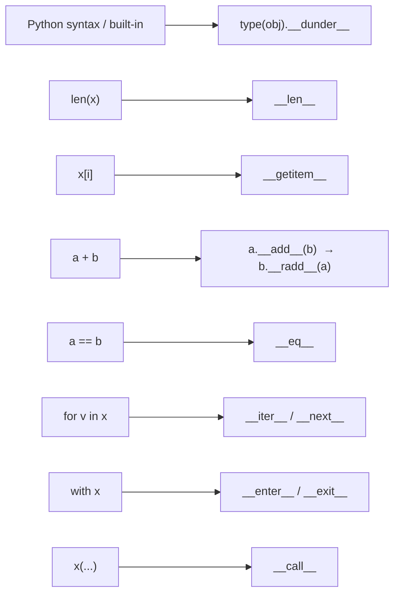

# Lesson 07: Dunder Methods and the Data Model

> **Prerequisites:** [Lesson 06: Classes](../06-classes-init-new-and-slots/README.md)  
> **Reading time:** ~22 minutes  
> **Audience:** Candidates asked "`__str__` vs `__repr__`", "how do you make `==` / `len` / `[]` work on your class?", or "`__eq__` and `__hash__`?"

> [!NOTE]
> **In one line:** Python's syntax and built-ins are **protocols**: `len(x)` calls `type(x).__len__`, `a + b` calls `__add__`, `x[i]` calls `__getitem__`, `for` uses `__iter__`. Implement the dunder ("special") methods and your class behaves like a built-in.

> [!TIP]
> **Golden rule:** Dunders are called **by Python, on the type**, not by you. Define `__repr__` always (for debugging), `__eq__` and `__hash__` *together*, and return `NotImplemented` (not `False` or an exception) when you don't know how to handle the other operand.

> [!TIP]
> **Try it:** Run the section 3 file, then delete `__hash__` from `Money` and re-run — `{a, Money(500)}` in `main()` now raises `TypeError: unhashable type: 'Money'`. Then run the [data-model lab](#try-it--data-model-lab-runnable) below (13 asserted probes). In [LLD Studio](/tools/lld-studio/) model `Money` as a **value object**: equality by value, immutable, hashable.

---

## 1. The smell: how this gets asked

- *"What's the difference between `__str__` and `__repr__`?"*
- *"Make this `Deck` class work with `len()`, indexing, `in`, and `for`."*
- *"If I override `__eq__`, what else must I do?"*
- *"What does `a + b` actually call, and what if `a.__add__` fails?"*
- *"What's `__call__`? `__bool__`? `__getattr__`?"*



---

## 2. Reference: the dunders you actually use

| Group | Methods | Triggered by |
| :--- | :--- | :--- |
| Representation | `__repr__`, `__str__`, `__format__` | `repr()`, `print()`/`str()`, f-strings |
| Equality & hashing | `__eq__`, `__hash__`, `__ne__` | `==`, `set`, `dict` keys |
| Ordering | `__lt__`, `__le__`, `__gt__`, `__ge__` | `<`, `sorted` (needs `__lt__`) |
| Truthiness & size | `__bool__`, `__len__` | `if x:`, `len(x)` |
| Container | `__getitem__`, `__setitem__`, `__delitem__`, `__contains__`, `__iter__` | `x[i]`, `in`, `for` |
| Arithmetic | `__add__`, `__radd__`, `__iadd__`, `__mul__`, `__neg__` … | `+`, `+=`, `*`, unary `-` |
| Callable | `__call__` | `obj()` |
| Context | `__enter__`, `__exit__` | `with` (lesson 11) |
| Attribute access | `__getattr__`, `__getattribute__`, `__setattr__`, `__delattr__` | `obj.x` fallbacks/hooks |
| Lifecycle | `__new__`, `__init__`, `__del__` | construction / finalisation |

| | `__repr__` | `__str__` |
| :--- | :--- | :--- |
| Audience | Developers (debug, logs, REPL) | End users |
| Goal | Unambiguous; ideally `eval`-able: `Money(5, 'USD')` | Readable: `$5.00` |
| Fallback | Default `<Money object at 0x…>` | Falls back to `__repr__` |

**Rule:** implement `__repr__` first; add `__str__` only if the user-facing form differs.

---

## 3. Walkthrough: `Money` (value object) and `Deck` (sequence)

**Requirements:** `Money` — immutable, comparable, hashable, addable, printable. `Deck` — works with `len`, indexing/slicing, `in`, iteration, `reversed`, and `sorted`.

1. `__eq__` compares fields and returns `NotImplemented` for foreign types.
2. `__hash__` uses the *same* fields; objects that compare equal must hash equal.
3. `__add__` returns a new `Money`; `__radd__` makes `sum([...])` work (`0 + Money`).
4. `__len__` + `__getitem__` alone give you iteration, `in`, `reversed`.
5. `__call__` turns an instance into a function-like object.

````carousel
```python
from functools import total_ordering


@total_ordering
class Money:
    __slots__ = ("_cents", "_cur")

    def __init__(self, cents: int, currency: str = "USD") -> None:
        object.__setattr__(self, "_cents", int(cents))
        object.__setattr__(self, "_cur", currency)

    def __setattr__(self, name, value):                     # immutability
        raise AttributeError("Money is immutable")

    def __repr__(self) -> str:
        return f"Money({self._cents}, {self._cur!r})"

    def __str__(self) -> str:
        return f"{self._cents / 100:.2f} {self._cur}"

    def __eq__(self, other: object) -> bool:
        if not isinstance(other, Money):
            return NotImplemented                            # let Python try the reflected op
        return (self._cents, self._cur) == (other._cents, other._cur)

    def __lt__(self, other: "Money") -> bool:
        if not isinstance(other, Money) or other._cur != self._cur:
            return NotImplemented
        return self._cents < other._cents

    def __hash__(self) -> int:
        return hash((self._cents, self._cur))               # same fields as __eq__

    def __add__(self, other):
        if not isinstance(other, Money) or other._cur != self._cur:
            return NotImplemented
        return Money(self._cents + other._cents, self._cur)

    def __radd__(self, other):
        return self if other == 0 else NotImplemented       # lets sum() start from 0

    def __bool__(self) -> bool:
        return self._cents != 0


class Deck:
    RANKS = [str(n) for n in range(2, 11)] + list("JQKA")
    SUITS = "♠♥♦♣"

    def __init__(self) -> None:
        self._cards = [f"{r}{s}" for s in self.SUITS for r in self.RANKS]

    def __len__(self) -> int:
        return len(self._cards)

    def __getitem__(self, index):                           # int or slice
        return self._cards[index]


class Multiplier:
    def __init__(self, factor: int) -> None:
        self.factor = factor

    def __call__(self, x: int) -> int:
        return x * self.factor


def main() -> None:
    a, b = Money(500), Money(250)
    print(repr(a), "|", a, "|", a + b, "|", sum([a, b, Money(50)]))
    print(a == Money(500), a != b, a > b, sorted([a, b])[0], bool(Money(0)))
    print({a, Money(500)} == {a}, a == "5.00")               # True False (NotImplemented → False)
    try:
        a._cents = 1
    except AttributeError as err:
        print("AttributeError:", err)
    try:
        a + Money(1, "EUR")
    except TypeError as err:
        print("TypeError:", err)

    d = Deck()
    print(len(d), d[0], d[-1], d[:3], "A♠" in d)             # 52 2♠ A♣ ['2♠','3♠','4♠'] True
    print(list(reversed(d))[0], len(list(d)))                # A♣ 52  (iteration comes free)

    triple = Multiplier(3)
    print(triple(7), callable(triple))                       # 21 True


if __name__ == "__main__":
    main()
```
<!-- slide -->
```csharp
// C#: the same protocols are interfaces / overridable members.
public readonly record struct Money(long Cents, string Currency = "USD") : IComparable<Money>
{
    // record struct generates Equals/GetHashCode/ToString by value  (~ __eq__/__hash__/__repr__)
    public static Money operator +(Money a, Money b) =>          // ~ __add__
        a.Currency == b.Currency ? new(a.Cents + b.Cents, a.Currency)
                                 : throw new InvalidOperationException("currency mismatch");

    // Simplification: ignores currency. The Python version returns NotImplemented for mixed currencies.
    public int CompareTo(Money other) => Cents.CompareTo(other.Cents);   // ~ __lt__ / sorted
    public override string ToString() => $"{Cents / 100.0:F2} {Currency}";  // ~ __str__
}

public sealed class Deck : IReadOnlyList<string>          // ~ __len__ + __getitem__ + __iter__
{
    private readonly List<string> _cards = new() { "2S", "3S" };
    public int Count => _cards.Count;
    public string this[int i] => _cards[i];                // ~ __getitem__
    public IEnumerator<string> GetEnumerator() => _cards.GetEnumerator();
    System.Collections.IEnumerator System.Collections.IEnumerable.GetEnumerator() => GetEnumerator();
}
```
````

Expected output of the Python tab:

```text
Money(500, 'USD') | 5.00 USD | 7.50 USD | 8.00 USD
True True True 2.50 USD False
True False
AttributeError: Money is immutable
TypeError: unsupported operand type(s) for +: 'Money' and 'Money'
52 2♠ A♣ ['2♠', '3♠', '4♠'] True
A♣ 52
21 True
```

(The mixed-currency `TypeError` text is Python's generic message, because `__add__` returned `NotImplemented` and `__radd__` declined too. Wrap it in your own `CurrencyMismatch` error if callers need a clearer message — see lesson 12.)

---

## 4. Edges

- **`__eq__` without `__hash__`.** Defining `__eq__` sets `__hash__ = None` — the class becomes unhashable (can't go in sets / be dict keys). Define both or use a frozen dataclass.
- **Equal ⇒ same hash.** The converse isn't required. Hash only immutable fields; mutating a hashed field corrupts sets/dicts.
- **`NotImplemented` vs `NotImplementedError`.** The former is a *value* returned from binary dunders so Python can try the reflected method (`__radd__`, `__eq__` on the other side); the latter is an *exception* for abstract methods.
- **`__str__` must return `str`;** returning `None` raises `TypeError`.
- **`__bool__` / `__len__`.** Without `__bool__`, truthiness falls back to `__len__ != 0`, then to `True`.
- **`__getitem__` iteration** works with integers 0…IndexError but is a legacy fallback; prefer `__iter__` when you can.
- **`__del__` is unreliable** (timing, cycles, interpreter shutdown). Use context managers.
- **Operators on unrelated types:** mixing `Money` currencies should be an explicit error, not silent coercion.
- **`__slots__` + immutability** via `__setattr__` is a pattern; for most code use `@dataclass(frozen=True)` (lesson 10).
- **Dunder lookup bypasses the instance:** `obj.__len__ = ...` on an instance won't change `len(obj)`; Python looks on the *type*.
- **Reflected-operator priority.** If the right operand's class is a *subclass* of the left's and overrides the reflected method, it is tried **first** (lab probe 6). `+=` uses `__iadd__` (in place, aliases see it) and falls back to `__add__` + rebinding (probe 8).
- **Both sides `NotImplemented` for `==`** does not raise: Python falls back to identity, so the result is `False` unless it is the same object (probe 7). Only ordering and arithmetic raise `TypeError`.
- **Concurrency:** immutable value objects with correct `__hash__` are safe to share between threads.

### Try it — data-model lab (runnable)

The follow-ups interviewers use after `__eq__`/`__hash__`. Save as `data_model_lab.py`; every probe is an `assert` (or a printed error message), so a wrong claim fails loudly.

```python
from functools import total_ordering

# 1) __repr__ is what containers show; str() falls back to repr() but not the reverse
class OnlyRepr:
    def __repr__(self): return "OnlyRepr()"
class OnlyStr:
    def __str__(self): return "friendly"
assert str(OnlyRepr()) == "OnlyRepr()"
assert repr(OnlyStr()).startswith("<__main__.OnlyStr object at 0x")
assert str([OnlyStr()]).startswith("[<__main__.OnlyStr object")   # list uses repr of elements, not str

# 2) __str__ must return a str
class BadStr:
    def __str__(self): return None
try:
    str(BadStr())
except TypeError as e:
    print("2:", e)

# 3) __eq__ alone makes the class unhashable; mutating a hashed field loses the entry
class Eq:
    def __init__(self, v): self.v = v
    def __eq__(self, o): return self.v == o.v
assert Eq.__hash__ is None
class Mut:
    def __init__(self, v): self.v = v
    def __eq__(self, o): return isinstance(o, Mut) and self.v == o.v
    def __hash__(self): return hash(self.v)
m = Mut(1); s = {m}
m.v = 2                                   # hash changed under the set's feet
assert m not in s and len(s) == 1         # present but unfindable: corrupted

# 4) Truthiness: __bool__, else __len__, else always True
class HasLen:
    def __len__(self): return 0
class Plain: pass
class Both:
    def __len__(self): return 5
    def __bool__(self): return False
assert not HasLen() and Plain() and not Both()

# 5) Reflected operators: Python tries the right operand's __radd__ when left says NotImplemented
class Left:
    def __add__(self, o): return NotImplemented
class Right:
    def __radd__(self, o): return "reflected"
assert Left() + Right() == "reflected"
try:
    Left() + Left()
except TypeError as e:
    print("5:", e)

# 6) A subclass's reflected method gets priority over the left operand
class Base:
    def __add__(self, o): return "Base.__add__"
class Child(Base):
    def __radd__(self, o): return "Child.__radd__"
assert Base() + Child() == "Child.__radd__"

# 7) NotImplemented vs raising: returning it lets the other side answer; == falls back to identity
class Strict:
    def __eq__(self, o): return NotImplemented
assert (Strict() == Strict()) is False       # both NotImplemented -> identity comparison -> False
s1 = Strict(); assert (s1 == s1) is True     # same object -> identity says True

# 8) += uses __iadd__ if present (in place), otherwise __add__ and rebinding
class V:
    def __init__(self, items): self.items = items
    def __iadd__(self, o): self.items.extend(o); return self
class W:
    def __init__(self, items): self.items = items
    def __add__(self, o): return W(self.items + list(o))
v = V([1]); v_alias = v; v += [2]
assert v_alias.items == [1, 2]                # in place: alias sees it
w = W([1]); w_alias = w; w += [2]
assert w_alias.items == [1] and w.items == [1, 2]   # rebound to a new object

# 9) Dunders are looked up on the TYPE: patching the instance has no effect on len()
class Sized: 
    def __len__(self): return 1
z = Sized()
z.__len__ = lambda: 99
assert z.__len__() == 99 and len(z) == 1

# 10) Legacy iteration via __getitem__ vs __iter__ taking priority; `in` uses __contains__ first
class Seq:
    def __getitem__(self, i):
        if i > 2: raise IndexError
        return i
    def __iter__(self): return iter(["from __iter__"])
    def __contains__(self, x): return x == "magic"
assert list(Seq()) == ["from __iter__"] and "magic" in Seq() and 1 not in Seq()

# 11) @total_ordering derives the rest from __eq__ + ONE ordering method
@total_ordering
class Ver:
    def __init__(self, n): self.n = n
    def __eq__(self, o): return self.n == o.n
    def __lt__(self, o): return self.n < o.n
assert Ver(1) <= Ver(1) and Ver(2) >= Ver(1) and Ver(3) > Ver(2)
assert [v.n for v in sorted([Ver(3), Ver(1), Ver(2)])] == [1, 2, 3]   # sorted() only needs __lt__

# 12) __format__ drives f-string specs
class Temp:
    def __init__(self, c): self.c = c
    def __format__(self, spec): return f"{self.c:{spec or '.1f'}}C"
assert f"{Temp(21.456)}" == "21.5C" and f"{Temp(21.456):.0f}" == "21C"

# 13) Floats are a bad home for money; cents (int) are exact
assert 0.1 + 0.2 != 0.3 and 10 + 20 == 30
print("data-model lab ok")
```

Expected output:

```text
2: __str__ returned non-string (type NoneType)
5: unsupported operand type(s) for +: 'Left' and 'Left'
data-model lab ok
```

---

## 5. What you'd say in two minutes

> "Python's data model means the language syntax and built-ins call special methods on the type: `len` calls `__len__`, `a + b` calls `__add__` and falls back to `b.__radd__`, `for` uses `__iter__`, and `==` uses `__eq__`. So to make my class feel native I implement the protocols. I always write `__repr__` for debugging, and add `__str__` only if users need a different view. If I define `__eq__`, I must also define a consistent `__hash__` — equal objects must hash equal — otherwise Python makes the class unhashable. For comparisons I return `NotImplemented` for foreign types so Python can try the reflected operation instead of raising. For a sequence-like class, `__len__` and `__getitem__` get me indexing, slicing, `in`, `reversed` and iteration. A value object like `Money` is immutable, hashable and safe to share across threads."

---

## 6. Anti-patterns

| Anti-pattern | Why it fails | Fix |
| :--- | :--- | :--- |
| `__eq__` without `__hash__` | Unhashable (silently) | Define both / frozen dataclass |
| `__hash__` using mutable fields | Set/dict corruption | Hash only immutable state |
| `raise NotImplementedError` in `__add__` | Blocks reflected ops | `return NotImplemented` |
| `__str__` that raises or does I/O | `print`/logging crashes | Keep dunders cheap and pure |
| Overloading operators surprisingly (`+` to append to a DB) | Violates least surprise | Use named methods |
| Relying on `__del__` for cleanup | Not guaranteed | `with` / `try-finally` |

---

## 7. Interview questions

<details>
<summary><strong>1. `__str__` vs `__repr__`? [BASIC]</strong></summary>

`__repr__` is for developers: unambiguous, ideally reconstructs the object. `__str__` is for users: readable. `print` uses `__str__` and falls back to `__repr__`; containers show their elements with `__repr__`.

</details>

<details>
<summary><strong>2. If you override `__eq__`, what else must you do? [BASIC]</strong></summary>

Define a consistent `__hash__` (equal objects → equal hashes) or accept the class becomes unhashable. Ensure the hashed fields are immutable.

</details>

<details>
<summary><strong>3. How do you make a class work with `len()` and `[]`? [BASIC]</strong></summary>

Implement `__len__` and `__getitem__` (accepting ints and slices). With those, `in`, iteration and `reversed()` also work via the sequence fallback.

</details>

<details>
<summary><strong>4. What happens on `a + b` if `a.__add__(b)` returns `NotImplemented`? [TRICKY]</strong></summary>

Python tries `b.__radd__(a)`. If that also returns `NotImplemented` (or doesn't exist), it raises `TypeError: unsupported operand type(s)`.

</details>

<details>
<summary><strong>5. `NotImplemented` vs `NotImplementedError`? [TRICKY]</strong></summary>

`NotImplemented` is a singleton returned from binary special methods to say "I can't handle this operand". `NotImplementedError` is an exception, typically raised by abstract methods.

</details>

<details>
<summary><strong>6. What is `__call__` good for? [SCENARIO]</strong></summary>

Making instances callable: stateful decorators, strategy objects, configurable validators, or classes that must satisfy a `Callable[[int], int]` type while holding state.

</details>

<details>
<summary><strong>7. Why does `sum([Money(1), Money(2)])` need `__radd__`? [TRICKY]</strong></summary>

`sum` starts with the integer `0`, so the first operation is `0 + Money(1)`. `int.__add__` doesn't know `Money`, so Python calls `Money.__radd__(0)`, which should return `self` for zero.

</details>

<details>
<summary><strong>8. How would you make `Money` safe as a dict key? [SCENARIO]</strong></summary>

Make it immutable (no setters, `__slots__`/frozen dataclass), implement `__eq__` and `__hash__` over the same fields (amount and currency), and avoid floats for the amount.

</details>

---

## 8. One-page cheat sheet

```text
repr()  -> __repr__ (devs)        str()/print -> __str__ (users, falls back to repr)
==      -> __eq__                 set/dict    -> __hash__  (define BOTH, same fields, immutable)
< sorted-> __lt__ (+ @total_ordering)          bool(x) -> __bool__ else __len__
len(x)  -> __len__                x[i], x[a:b] -> __getitem__     in -> __contains__ / iteration
for     -> __iter__               a + b -> __add__ -> b.__radd__    a += b -> __iadd__ -> __add__
x(...)  -> __call__               with x -> __enter__/__exit__      obj.attr -> __getattr__ (fallback)
Return NotImplemented (value) for unsupported operands; NotImplementedError is for abstract methods
Dunders are looked up on the TYPE, not the instance
Prefer: @dataclass(frozen=True) for value objects
```

---

## Further reading

- [Python data model](https://docs.python.org/3/reference/datamodel.html)
- [`functools.total_ordering`](https://docs.python.org/3/library/functools.html#functools.total_ordering)
- Luciano Ramalho, *Fluent Python* (2nd ed.), Part II: Data structures / the Python data model

Previous: [Classes](../06-classes-init-new-and-slots/README.md) · Next: [Inheritance, super() and the MRO](../08-inheritance-super-and-the-mro/README.md)
