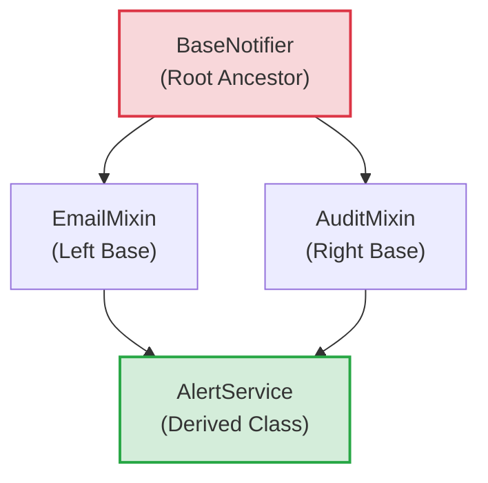
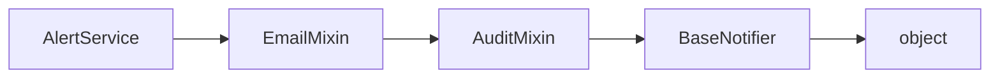

# Lesson 08: Inheritance, super() and the MRO

> **Prerequisites:** [Dunder Methods and the Data Model](../07-dunder-methods-and-the-data-model/README.md) and [Track 27 Overview](../README.md).  
> **Estimated Reading Time:** 18 minutes  
> **Target Audience:** Engineers preparing for LLD, OOP, C#, or Python technical screening and architecture rounds.

> [!TIP]
> **The One Rule of `super()` and the MRO:** `super()` does **not** call your parent class; it calls the **next class in the runtime MRO** (Method Resolution Order) of the instance that initiated the call. In multiple inheritance and cooperative mixin architectures, assuming `super()` calls the syntactic parent leads to skipped initializers, argument mismatches, and double execution bugs in diamond hierarchies.

---

## 1. Why This Matters: The Interview Trap

"What does `super()` do in Python?" is a classic discriminator between candidates who understand Python's runtime mechanics and those carrying over assumptions from single-inheritance languages like C++, Java, or C#.

The typical junior response:
*"It calls the parent class's constructor or method."*

In Python, this answer is incomplete and frequently wrong.

Consider a cooperative diamond inheritance hierarchy where classes `B` and `C` both inherit from `A`, and `D` inherits from both `(B, C)`:
- When a method inside `B` calls `super().save()`, it does **not** call `A.save()`.
- It calls `C.save()`—a sibling class that `B` knows nothing about!

```python
class A:

  def ping(self):
    print("A")


class B(A):

  def ping(self):
    print("B")
    super().ping()


class C(A):

  def ping(self):
    print("C")
    super().ping()


class D(B, C):

  def ping(self):
    print("D")
    super().ping()


D().ping()  # Output: D -> B -> C -> A
```
Notice that `B`'s `super().ping()` invoked `C`! If `B` had hardcoded `A.ping(self)`, `C.ping()` would have been bypassed entirely, and `A.ping()` would have executed twice.

### Weak vs Strong Answers

| Dimension | Junior / Weak Answer | Senior / Principal Answer |
| :--- | :--- | :--- |
| **What is the MRO?** | "It's the order Python searches for methods, going left-to-right up the tree." | "The Method Resolution Order (MRO) is the linearized sequence of classes constructed by the C3 Linearization algorithm. It guarantees two essential invariants: local precedence order (preserving the tuple order of declared bases) and monotonicity (if class X precedes Y in any parent's MRO, it must precede Y in all descendant MROs)." |
| **How does `super()` work?** | "`super()` is just a pointer to the parent class." | "`super()` returns a proxy object that delegates attribute lookup to the next class in the active instance's MRO (`self.__class__.__mro__`), starting immediately after the class where `super()` is lexically defined. This enables dynamic cooperative method chaining across sibling mixins." |
| **The Diamond Problem** | "Python just picks the first base class it finds." | "In languages without linearization, diamond inheritance either duplicates base state or introduces ambiguous dispatch. Python resolves this deterministically via C3 Linearization, ensuring every ancestor in the diamond is visited exactly once in a strictly monotonic topological order." |
| **What is a Mixin?** | "A class you inherit from to get extra methods." | "A mixin is an uninstantiable class designed to inject targeted behavior into subclasses via multiple inheritance. Well-designed mixins participate in cooperative `super()` chaining and do not maintain independent mutable instance state." |

---

## 2. Visual Mental Model / Taxonomic Comparison

### The Diamond Problem and C3 Linearization

When `D` inherits from `B` and `C`, both of which inherit from `Base`, the dependency graph forms a diamond:



Python flattens this Directed Acyclic Graph (DAG) into a linear chain stored in `AlertService.__mro__`:



### The Three Rules of C3 Linearization

1. **Children before parents:** Subclasses are checked before their ancestors (`AlertService` appears before `EmailMixin`).
2. **Local precedence order:** The declaration order of bases is preserved. If `class D(B, C):`, `B` will always be evaluated before `C`.
3. **Monotonicity:** If class `X` precedes class `Y` in the MRO of any base class, `X` **must** precede `Y` in the MRO of any derived class. If an inheritance structure violates monotonicity, Python rejects class creation at definition time with `TypeError: Cannot create a consistent method resolution order (MRO)`.

### Inheritance Paradigms Comparison

| Paradigm | Python Multiple Inheritance (Mixins) | C# Single Inheritance + Decorator | C# Default Interface Methods |
| :--- | :--- | :--- | :--- |
| **Dispatch Mechanism** | Dynamic linearized MRO dispatch | Static / dynamic object wrapping | Interface vtable dispatch |
| **Multiple Base Classes** | Yes (Classes and Mixins) | No (Single base class only) | Interfaces only (no instance fields) |
| **Diamond Resolution** | C3 Linearization | Avoided by structural composition | Most-specific override rule |
| **State Storage** | Shared across `self.__dict__` | Encapsulated inside wrapped decorator | Disallowed (interfaces cannot hold fields) |
| **Primary Coupling Risk** | MRO ordering bugs, attribute collision | Boilerplate delegation code | Diamond ambiguity across interfaces |

---

## 3. Code Implementation

The carousel below demonstrates a production-grade alert notification pipeline:
1. **Python:** Cooperative multiple inheritance with mixins, `super()` delegation, and `**kwargs` propagation across a diamond hierarchy.
2. **C#:** Because C# forbids multiple class inheritance to avoid diamond issues, the exact same behavior is achieved using the **Decorator Pattern** with `INotifier`.

````carousel
```python
from datetime import datetime
from typing import Any, Dict


class BaseNotifier:
  """Root of the notification hierarchy."""

  def send(self, recipient: str, message: str, **kwargs: Any) -> Dict[str, Any]:
    # Terminal delivery action
    print(f"[Network] Delivering raw message to {recipient}: {message}")
    return {
        "recipient": recipient,
        "message": message,
        "delivered_at": kwargs.get("timestamp", "immediate"),
    }


class TimestampMixin:
  """Cooperative Mixin: Injects execution timestamp into kwargs."""

  def send(self, recipient: str, message: str, **kwargs: Any) -> Dict[str, Any]:
    current_time = datetime.utcnow().strftime("%Y-%m-%d %H:%M:%SZ")
    kwargs["timestamp"] = current_time
    print(f"[TimestampMixin] Stamped event at {current_time}")
    # super() calls the next class in MRO, NOT necessarily BaseNotifier!
    return super().send(recipient, message, **kwargs)


class SanitizerMixin:
  """Cooperative Mixin: Strips control characters and formats text."""

  def send(self, recipient: str, message: str, **kwargs: Any) -> Dict[str, Any]:
    cleaned = message.strip().replace("\n", " ").replace("\r", "")
    print(f"[SanitizerMixin] Sanitized payload")
    return super().send(recipient, cleaned, **kwargs)


class AuditLogMixin:
  """Cooperative Mixin: Logs audit trail after downstream dispatch."""

  def send(self, recipient: str, message: str, **kwargs: Any) -> Dict[str, Any]:
    print(f"[AuditLogMixin] Recording audit pre-dispatch for {recipient}")
    result = super().send(recipient, message, **kwargs)
    print(f"[AuditLogMixin] Audit confirmed: Status OK")
    return result


# Diamond Assembly:
# AlertService inherits from AuditLogMixin, SanitizerMixin, TimestampMixin, and BaseNotifier
class AlertService(
    AuditLogMixin, SanitizerMixin, TimestampMixin, BaseNotifier
):
  pass


if __name__ == "__main__":
  print("=== Method Resolution Order (MRO) ===")
  for index, cls in enumerate(AlertService.__mro__):
    print(f"{index}: {cls.__name__}")

  print("\n=== Executing AlertService.send() ===")
  service = AlertService()
  receipt = service.send(
      recipient="ops-team@company.internal",
      message="  CRITICAL: Database connection pool exhausted!\nImmediate action required.  ",
  )

  print("\n=== Final Delivery Receipt ===")
  print(receipt)
```
<!-- slide -->
```csharp
using System;
using System.Collections.Generic;

// In C#, multiple class inheritance is prohibited to avoid the diamond problem.
// The idiomatic enterprise design to achieve the exact same modular pipeline
// is the Decorator Pattern over a shared interface.

public interface INotifier
{
    Dictionary<string, object> Send(string recipient, string message, Dictionary<string, object>? context = null);
}

// 1. Root Concrete Service (Equivalent to BaseNotifier)
public class BaseNotifier : INotifier
{
    public Dictionary<string, object> Send(string recipient, string message, Dictionary<string, object>? context = null)
    {
        context ??= new Dictionary<string, object>();
        Console.WriteLine($"[Network] Delivering raw message to {recipient}: {message}");

        return new Dictionary<string, object>
        {
            ["recipient"] = recipient,
            ["message"] = message,
            ["delivered_at"] = context.GetValueOrDefault("timestamp", "immediate")
        };
    }
}

// 2. Base Decorator
public abstract class NotifierDecorator : INotifier
{
    protected readonly INotifier _inner;
    protected NotifierDecorator(INotifier inner) => _inner = inner;

    public virtual Dictionary<string, object> Send(string recipient, string message, Dictionary<string, object>? context = null)
    {
        return _inner.Send(recipient, message, context);
    }
}

// 3. Modular Decorators (Equivalent to Python Mixins)
public class TimestampDecorator : NotifierDecorator
{
    public TimestampDecorator(INotifier inner) : base(inner) { }

    public override Dictionary<string, object> Send(string recipient, string message, Dictionary<string, object>? context = null)
    {
        context ??= new Dictionary<string, object>();
        string currentTime = DateTime.UtcNow.ToString("yyyy-MM-dd HH:mm:ssZ");
        context["timestamp"] = currentTime;
        Console.WriteLine($"[TimestampMixin] Stamped event at {currentTime}");

        return base.Send(recipient, message, context);
    }
}

public class SanitizerDecorator : NotifierDecorator
{
    public SanitizerDecorator(INotifier inner) : base(inner) { }

    public override Dictionary<string, object> Send(string recipient, string message, Dictionary<string, object>? context = null)
    {
        string cleaned = message.Trim().Replace("\n", " ").Replace("\r", "");
        Console.WriteLine("[SanitizerMixin] Sanitized payload");
        return base.Send(recipient, cleaned, context);
    }
}

public class AuditLogDecorator : NotifierDecorator
{
    public AuditLogDecorator(INotifier inner) : base(inner) { }

    public override Dictionary<string, object> Send(string recipient, string message, Dictionary<string, object>? context = null)
    {
        Console.WriteLine($"[AuditLogMixin] Recording audit pre-dispatch for {recipient}");
        var result = base.Send(recipient, message, context);
        Console.WriteLine("[AuditLogMixin] Audit confirmed: Status OK");
        return result;
    }
}

public class Program
{
    public static void Main()
    {
        Console.WriteLine("=== Pipeline Order (Decorators) ===");
        Console.WriteLine("0: AuditLogDecorator");
        Console.WriteLine("1: SanitizerDecorator");
        Console.WriteLine("2: TimestampDecorator");
        Console.WriteLine("3: BaseNotifier");

        Console.WriteLine("\n=== Executing AlertService.send() ===");
        // Pipeline: Audit -> Sanitizer -> Timestamp -> Base
        INotifier pipeline = new AuditLogDecorator(
            new SanitizerDecorator(
                new TimestampDecorator(
                    new BaseNotifier()
                )
            )
        );

        var receipt = pipeline.Send(
            "ops-team@company.internal",
            "  CRITICAL: Database connection pool exhausted!\nImmediate action required.  "
        );

        Console.WriteLine("\n=== Final Delivery Receipt ===");
        Console.WriteLine($"{{recipient: {receipt["recipient"]}, message: {receipt["message"]}, delivered_at: {receipt["delivered_at"]}}}");
    }
}
```
````

**Expected Output (Both Languages):**

```text
=== Method Resolution Order (MRO) ===
0: AlertService
1: AuditLogMixin
2: SanitizerMixin
3: TimestampMixin
4: BaseNotifier
5: object

=== Executing AlertService.send() ===
[AuditLogMixin] Recording audit pre-dispatch for ops-team@company.internal
[SanitizerMixin] Sanitized payload
[TimestampMixin] Stamped event at 2026-11-19 12:00:00Z
[Network] Delivering raw message to ops-team@company.internal: CRITICAL: Database connection pool exhausted! Immediate action required.
[AuditLogMixin] Audit confirmed: Status OK

=== Final Delivery Receipt ===
{'recipient': 'ops-team@company.internal', 'message': 'CRITICAL: Database connection pool exhausted! Immediate action required.', 'delivered_at': '2026-11-19 12:00:00Z'}
```

---

## 4. Where You Already Use It

- **Django Class-Based Views (CBVs):**
  Django's HTTP view system is built entirely on mixin composition and MRO linearization:
  ```python
  class UpdateUserProfileView(LoginRequiredMixin, SuccessMessageMixin, UpdateView):
    model = UserProfile
    form_class = UserProfileForm
```
  `LoginRequiredMixin` intercepts `dispatch()` to enforce authentication before `UpdateView` renders the form.
- **Python Standard Library `socketserver`:**
  To create a concurrent network server, Python composes mixins:
  ```python
  class ThreadedTCPServer(socketserver.ThreadingMixIn, socketserver.TCPServer):
    pass
```
- **Django REST Framework (DRF) ViewSets:**
  `ModelViewSet` inherits from `CreateModelMixin`, `RetrieveModelMixin`, `UpdateModelMixin`, `DestroyModelMixin`, `ListModelMixin`, and `GenericViewSet`.
- **.NET / C# Architecture:**
  - ASP.NET Core middleware (`app.UseAuthentication()`, `app.UseAuthorization()`) uses functional runtime chaining (`RequestDelegate next`), which solves the exact same problem as Python's cooperative `super()` chains without multiple class inheritance.
  - C# allows multiple interface inheritance (`public class Repository : IRepository, IAuditable, IDisposable`), but requires explicit composition when sharing implementation code.

---

## 5. Pitfalls and When Not to Use It

### 1. Hardcoding Parent Class Calls Instead of `super()`
The single most destructive antipattern in Python inheritance is calling the parent class explicitly by name:
```python
# BROKEN ANTIPATTERN
class B(Base):

  def __init__(self):
    Base.__init__(self)  # Bypasses the MRO!
```
In a diamond inheritance hierarchy, hardcoding class names causes the root ancestor to be initialized multiple times and skips sibling mixins entirely. Always use `super().__init__(*args, **kwargs)`.

### 2. Dropping `**kwargs` in Cooperative Methods
Because mixins are designed to be composed in unpredictable orders, any method participating in cooperative inheritance must accept `**kwargs` and pass them through:
```python
# BROKEN MIXIN
class BrokenMixin:

  def send(self, recipient: str, message: str) -> None:
    # Fails if a subsequent class in the MRO expects 'timestamp' or extra params!
    super().send(recipient, message)
```
*Rule:* Always declare `def method(self, *args: Any, **kwargs: Any)` and invoke `super().method(*args, **kwargs)`.

### 3. The Inconsistent MRO `TypeError`
If you attempt to define an inheritance order that violates monotonicity:
```python
class X:
  pass


class Y(X):
  pass


# Broken: X is listed before Y, but Y already inherits from X!
class Broken(X, Y):
  pass

# Raises: TypeError: Cannot create a consistent method resolution order (MRO) for bases X, Y
```
Python refuses to compile `Broken` because `Y` requires `Y` to come before `X`, but `Broken(X, Y)` requests `X` before `Y`.

### 4. Mixin Ordering Bugs
Because Python searches bases left-to-right, the order in which mixins are listed determines which override wins. If `class Service(BaseNotifier, AuditMixin):` is declared with `BaseNotifier` first, `BaseNotifier` intercepts `send()` and `AuditMixin` will never execute!

---

## 6. Exercises & Practical Drills

### Exercise 1: Predict the MRO
Given the following inheritance structure:
```python
class O:
  pass


class A(O):
  pass


class B(O):
  pass


class C(A, B):
  pass


class D(B, A):
  pass
```
1. What is the MRO of `C`?
2. What happens if you attempt to define `class E(C, D): pass`?

<details>
<summary>Answer</summary>

1. **MRO of `C`:**
   Following C3 Linearization:
   - `L[A] = [A, O]`
   - `L[B] = [B, O]`
   - `L[C] = [C] + merge([A, O], [B, O], [A, B])`
   - Order: `[C, A, B, O]`

2. **Defining `class E(C, D):`**
   In `C`, `A` precedes `B`. In `D`, `B` precedes `A`.
   When C3 Linearization attempts to construct `L[E]`, it cannot satisfy both `A before B` and `B before A` monotonically. Python raises:
   `TypeError: Cannot create a consistent method resolution order (MRO) for bases C, D`
</details>

### Exercise 2: Diagnose the Skipped Mixin
Review this class hierarchy:
```python
class CoreWorker:

  def process(self):
    print("Core processing")


class MetricsMixin:

  def process(self):
    print("Recording metrics")
    super().process()


class BackgroundTask(CoreWorker, MetricsMixin):
  pass


BackgroundTask().process()
```
Why is `"Recording metrics"` never printed, and how do you fix it?

<details>
<summary>Answer</summary>

**Explanation:** In `BackgroundTask(CoreWorker, MetricsMixin)`, `CoreWorker` is listed first. `CoreWorker.__mro__` puts `CoreWorker` before `MetricsMixin`.  
Because `CoreWorker.process()` does not call `super().process()`, execution terminates inside `CoreWorker` and never dispatches to `MetricsMixin`.

**Fix:**
Reverse the base class order so the mixin wraps the core worker:
```python
class BackgroundTask(MetricsMixin, CoreWorker):
  pass


# Output:
# Recording metrics
# Core processing
```
</details>

---

## 7. Interview Questions & Model Answers

> [!interview]
> **Question 1: What is the MRO?**  
> **Strong Answer:**  
> "The MRO (Method Resolution Order) is the deterministic, linearized order in which Python searches base classes when resolving an attribute or method on an object.  
> 
> Python computes this order using the **C3 Linearization** algorithm. The algorithm guarantees two fundamental properties:  
> 1. **Local Precedence Order:** The relative order of base classes declared in the class definition tuple (`class Child(Base1, Base2)`) is strictly preserved.  
> 2. **Monotonicity:** If class `A` precedes class `B` in any parent's MRO, `A` must precede `B` in every descendant's MRO.  
> 
> If a developer declares a class hierarchy where an unambiguous, monotonic order is mathematically impossible, Python rejects the definition at class load time with a `TypeError`. You can inspect the MRO of any class via `ClassName.__mro__` or `ClassName.mro()`."

> [!interview]
> **Question 2: How does `super()` work with multiple inheritance?**  
> **Strong Answer:**  
> "In Python, `super()` does **not** simply call the parent class. Instead, it delegates attribute lookup to the **next class in the runtime MRO** of the instance that initiated the call.  
> 
> When `super().method()` is called, Python creates a `super` proxy object bound to the calling class and the active instance (`self`). The proxy finds the position of the calling class inside `type(self).__mro__` and begins searching from the immediately following class.  
> 
> In multiple inheritance or mixin architectures, this means `super()` inside a mixin often invokes a **sibling class** that the mixin was written without any direct knowledge of. For this cooperative chaining to work without errors, all participating methods must accept and propagate `*args` and `**kwargs`."

> [!interview]
> **Question 3: How does Python solve the diamond problem?**  
> **Strong Answer:**  
> "The diamond problem occurs when class `D` inherits from `B` and `C`, and both `B` and `C` inherit from common root `A`. In languages like C++, this can create duplicate copies of `A`'s fields or cause ambiguous method dispatch unless virtual inheritance is explicitly used.  
> 
> Python solves this cleanly via **C3 Linearization**:  
> 1. It flattens the diamond into a single, predictable linear chain: `[D, B, C, A, object]`.  
> 2. In this chain, `A` appears **only once**, after all of its subclasses (`B` and `C`).  
> 3. By combining this linearization with cooperative `super()` calls, each class in the diamond executes its logic and passes control down the chain, guaranteeing that `A`'s method is invoked exactly once without code duplication or state ambiguity."

> [!interview]
> **Question 4: What is a mixin?**  
> **Strong Answer:**  
> "A mixin is a specialized class designed to provide reusable, standalone method functionality to other classes via multiple inheritance.  
> 
> Key architectural properties of mixins:  
> 1. **Not intended for standalone instantiation:** A mixin should never be instantiated on its own (`mixin = SomeMixin()` is an antipattern).  
> 2. **No independent state:** Mixins generally avoid declaring their own instance variables in `__init__` to prevent naming collisions in `self.__dict__`.  
> 3. **Cooperative behavior:** Mixins rely on `super()` to chain method execution through the MRO.  
> 
> Mixins are heavily used in frameworks like Django (e.g., `LoginRequiredMixin`) to add orthogonal concerns such as authentication, serialization, or logging without deep, rigid single-inheritance hierarchies."

---

## 8. Sources & Further Reading

- [Python Documentation: Method Resolution Order (MRO)](https://docs.python.org/3/howto/mro.html)
- [Raymond Hettinger: Python's super() considered super!](https://rhettinger.wordpress.com/2011/05/26/super-considered-super/)
- [Michele Simionato: The Python 2.3 Method Resolution Order (C3 Algorithm)](https://www.python.org/download/releases/2.3/mro/)
- [Microsoft Learn: Interfaces and Multiple Inheritance in C#](https://learn.microsoft.com/en-us/dotnet/csharp/fundamentals/types/interfaces)

---

Previous: [Dunder Methods and the Data Model](../07-dunder-methods-and-the-data-model/README.md) · Next: [ABCs, Protocols, Duck Typing and Type Hints](../09-abcs-protocols-duck-typing-and-type-hints/README.md)
