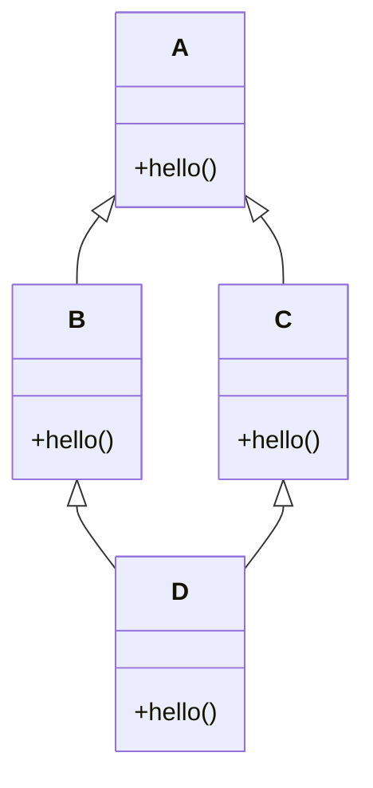

# Lesson 08: Inheritance, `super()` and the MRO

> **Prerequisites:** [Lesson 06: Classes](../06-classes-init-new-and-slots/README.md) · [LLD 24 · Inheritance, Composition and the Diamond Problem](../../24-oop-interview-questions/05-inheritance-composition-and-the-diamond-problem/README.md)  
> **Reading time:** ~22 minutes  
> **Audience:** Candidates asked about multiple inheritance, "what does `super()` return?", the diamond problem, or mixins

> [!NOTE]
> **In one line:** Python allows multiple inheritance and orders the base classes with the **C3 linearisation (MRO)**; `super()` doesn't mean "my parent" — it means "the **next class after this one in the MRO of the instance's type**", which is what makes cooperative multiple inheritance work.

> [!TIP]
> **Golden rule:** In a cooperative hierarchy every `__init__`/method calls `super()` **exactly once** and passes unknown `**kwargs` along. Break that and a class in the middle of the MRO gets skipped (or called twice).

> [!TIP]
> **Try it:** Predict `D.__mro__` from the base list first, then run the section 3 file to check. Then run the [MRO lab](#try-it--mro-lab-runnable) below — it proves what goes wrong when you call `A.hello(self)` instead of `super()`, when you put the mixin on the wrong side, and when a stray keyword argument reaches `object`. In [LLD Studio](/tools/lld-studio/) draw the diamond `A ← B, C ← D` and write the MRO next to it. Then ask: would composition be simpler?

---

## 1. The smell: how this gets asked

- *"What is the MRO? How is it computed?"*
- *"What does `super()` do in a diamond?"*
- *"What's the diamond problem and how does Python solve it?"*
- *"Mixins — when and how?"*
- *"Inheritance or composition here?"*



`D.__mro__ == (D, B, C, A, object)` — each class appears once, children before parents, and the order of bases in `class D(B, C)` is preserved.

---

## 2. Reference

| Concept | Meaning |
| :--- | :--- |
| MRO | Method Resolution Order: the linear list searched for attributes/methods (`Cls.__mro__`, `Cls.mro()`) |
| C3 linearisation | `L[D] = D + merge(L[B], L[C], [B, C])` — keeps local precedence and monotonicity; raises `TypeError` if no consistent order |
| `super()` | Proxy that continues the lookup **after the current class** in `type(self).__mro__` |
| Mixin | Small class adding one capability, no state of its own, not meant to stand alone (`LoggingMixin`) |
| Cooperative inheritance | Everyone calls `super()` and forwards `**kwargs` |

| Question | Inheritance | Composition |
| :--- | :--- | :--- |
| Relationship | is-a (substitutable) | has-a / uses-a |
| Coupling | High (to parent's internals) | Low (to an interface) |
| Change behaviour at runtime | No | Yes (swap collaborator) |
| Default choice? | Only when LSP holds | **Yes** |

**Computing C3 for `class D(B, C)`** where `B(A)`, `C(A)`:

```text
L[A] = [A, object]
L[B] = [B, A, object]        L[C] = [C, A, object]
L[D] = D + merge([B,A,object], [C,A,object], [B,C])
     = D, B            (B is head of list 1 and not in the tail of others)
     → D, B, C         (A is in the tail of [C,A,object], so skip; take C)
     → D, B, C, A, object
```

---

## 3. Walkthrough: diamond, cooperative `__init__`, mixin

**Requirements:** show `super()` following the MRO; build a cooperative `__init__` chain with keyword arguments; add a `JsonMixin`; show an inconsistent MRO error.

1. `D.hello` calls `super().hello()`; `B` calls `super()` too, so `C` runs *between* `B` and `A`.
2. If `B` called `A.hello(self)` directly (not `super()`), `C` would be skipped.
3. Cooperative `__init__`: each class takes its own parameters and forwards the rest with `**kwargs`.
4. Mixins go **before** the main base: `class User(JsonMixin, Base)`.

````carousel
```python
import json


class A:
    def hello(self) -> str:
        return "A"


class B(A):
    def hello(self) -> str:
        return "B>" + super().hello()


class C(A):
    def hello(self) -> str:
        return "C>" + super().hello()


class D(B, C):
    def hello(self) -> str:
        return "D>" + super().hello()


# ── cooperative __init__ ─────────────────────────────────────────────
class Base:
    def __init__(self, **kwargs) -> None:
        super().__init__(**kwargs)           # end of chain: object.__init__() takes no kwargs
        self.log = ["Base"]


class Named(Base):
    def __init__(self, name: str, **kwargs) -> None:
        super().__init__(**kwargs)
        self.name = name
        self.log.append("Named")


class Timestamped(Base):
    def __init__(self, created: str = "now", **kwargs) -> None:
        super().__init__(**kwargs)
        self.created = created
        self.log.append("Timestamped")


class Doc(Named, Timestamped):
    def __init__(self, title: str, **kwargs) -> None:
        super().__init__(**kwargs)
        self.title = title
        self.log.append("Doc")


# ── mixin ────────────────────────────────────────────────────────────
class JsonMixin:
    def to_json(self) -> str:
        return json.dumps({k: v for k, v in vars(self).items() if k != "log"})


class Report(JsonMixin, Doc):
    pass


# ── composition alternative ──────────────────────────────────────────
class Serializer:
    def dump(self, obj) -> str:
        public = {k: v for k, v in vars(obj).items() if not k.startswith("_")}
        return json.dumps(public)


class ReportComposed:
    def __init__(self, title: str, serializer: Serializer) -> None:
        self.title = title
        self._serializer = serializer       # swap at runtime / fake in tests

    def to_json(self) -> str:
        return self._serializer.dump(self)


def main() -> None:
    print(D().hello())                                     # D>B>C>A
    print([k.__name__ for k in D.__mro__])                 # ['D', 'B', 'C', 'A', 'object']

    d = Doc(title="Q4", name="plan", created="2026-11-23")
    print(d.log)                                           # Base first, then the rest unwinds
    print([k.__name__ for k in Doc.__mro__])

    r = Report(title="R", name="n")
    print(r.to_json())

    print(ReportComposed("R", Serializer()).to_json())

    try:
        class X(A, B):                                     # A before its own subclass B
            pass
    except TypeError as err:
        print("TypeError:", str(err)[:60])


if __name__ == "__main__":
    main()
```
<!-- slide -->
```csharp
// C#: one base class + many interfaces => no diamond of *state*.
public interface ILogger { void Log(string m) => Console.WriteLine(m); }   // default interface method
public interface IAudit  { void Log(string m) => Console.WriteLine("audit:" + m); }

public class Service : ILogger, IAudit
{
    // Both defaults define Log(string): the class MUST resolve the ambiguity explicitly.
    void ILogger.Log(string m) => Console.WriteLine("L:" + m);
    void IAudit.Log(string m)  => Console.WriteLine("A:" + m);
}

// Reuse across unrelated classes => composition / delegation, or extension methods.
public sealed class Report(IJsonSerializer serializer)
{
    public string ToJson() => serializer.Serialize(this);
}
public interface IJsonSerializer { string Serialize(object o); }
```
````

Expected output of the Python tab (the last line is cut at 60 characters by the code):

```text
D>B>C>A
['D', 'B', 'C', 'A', 'object']
['Base', 'Timestamped', 'Named', 'Doc']
['Doc', 'Named', 'Timestamped', 'Base', 'object']
{"created": "now", "name": "n", "title": "R"}
{"title": "R"}
TypeError: Cannot create a consistent method resolution order (MRO) for
```

Read the `log` line against the MRO: `Doc.__init__` calls `super()` first, so the chain runs *down* to `Base`, and each class appends to `log` as the calls *unwind* — the reverse of the MRO, minus `object`.

---

## 4. Edges

- **`super()` isn't the parent.** In `B`, `super()` may resolve to `C` (not `A`) when the instance is a `D`. Always think "next in `type(self).__mro__`".
- **`super()` in a mixin** must accept and forward `*args/**kwargs`, because it can't know what's next.
- **End of chain.** `object.__init__` rejects unexpected arguments — leftover `**kwargs` raise `TypeError`. Put a `Base` that consumes the rest, or ensure all kwargs are claimed.
- **Mixed signatures.** Positional-only `__init__(self, a, b)` can't be cooperative; use keyword arguments.
- **Inconsistent MRO.** `class X(A, B)` where `B` subclasses `A` raises `TypeError: Cannot create a consistent method resolution order`.
- **Calling `Parent.method(self)` explicitly** bypasses the MRO — breaks cooperative chains and can double-call a shared base.
- **Overriding without calling super** drops parent behaviour (setup, validation). Decide intentionally.
- **Deep hierarchies.** More than ~3 levels is a smell; prefer composition and small protocols (lesson 09).
- **LSP.** A subclass that narrows inputs or throws new errors breaks callers (the `Square(Rectangle)` trap).
- **Django/ORM mixin order:** mixins first, base model last, because the MRO searches left to right.
- **Thread safety** is unaffected by MRO; shared base-class state still needs locks.

### Try it — MRO lab (runnable)

The follow-ups that separate people who memorised the MRO from people who understand it. Save as `mro_lab.py`; every probe is an `assert` (or a printed error message), so a wrong claim fails loudly.

```python
# Shared diamond used by several probes
calls = []
class A:
    def hello(self): calls.append("A")
class B(A):
    def hello(self): calls.append("B"); super().hello()
class C(A):
    def hello(self): calls.append("C"); super().hello()
class D(B, C):
    def hello(self): calls.append("D"); super().hello()

# 1) MRO prediction and "each class once"
assert [k.__name__ for k in D.__mro__] == ["D", "B", "C", "A", "object"]
D().hello(); assert calls == ["D", "B", "C", "A"]

# 2) super() in B depends on the INSTANCE type: standalone B goes straight to A
calls.clear(); B().hello(); assert calls == ["B", "A"]
calls.clear(); D().hello(); assert calls == ["D", "B", "C", "A"]   # same B.hello, now reaches C

# 3) Calling the parent explicitly bypasses the MRO: C is skipped, and a shared base can run twice
class B2(A):
    def hello(self): calls.append("B2"); A.hello(self)           # explicit, not super()
class C2(A):
    def hello(self): calls.append("C2"); A.hello(self)
class D2(B2, C2):
    def hello(self): calls.append("D2"); B2.hello(self); C2.hello(self)   # the old, pre-super idiom
calls.clear(); D2().hello()
assert calls == ["D2", "B2", "A", "C2", "A"]                       # A ran TWICE

# 4) Mixin order decides who wins
class Loud:
    def speak(self): return "LOUD " + super().speak()
class Animal:
    def speak(self): return "hi"
class Dog1(Loud, Animal): pass
class Dog2(Animal, Loud): pass
assert Dog1().speak() == "LOUD hi"      # mixin first: it wraps the base
assert Dog2().speak() == "hi"           # base first: the mixin is never reached

# 5) Leftover kwargs reach object.__init__ and blow up
class Named:
    def __init__(self, name, **kw):
        super().__init__(**kw)
        self.name = name
try:
    Named("x", colour="red")
except TypeError as e:
    print("5:", e)

# 6) Cooperative __init__: every class takes its own args, forwards the rest
class Base:
    def __init__(self, **kw):
        assert not kw, f"unclaimed: {kw}"      # end-of-chain guard gives a clearer error
        super().__init__()
class N(Base):
    def __init__(self, name, **kw): super().__init__(**kw); self.name = name
class T(Base):
    def __init__(self, stamp="now", **kw): super().__init__(**kw); self.stamp = stamp
class Doc(N, T): pass
d = Doc(name="n", stamp="s"); assert (d.name, d.stamp) == ("n", "s")
try:
    Doc(name="n", typo=1)
except AssertionError as e:
    print("6:", e)

# 7) super(B, obj) lets you pick the starting point explicitly
d_ = D()
assert super(B, d_).hello.__qualname__ == "C.hello"      # after B in D's MRO comes C
assert super(D, d_).hello.__qualname__ == "B.hello"

# 8) Inconsistent MRO fails at class creation; swapping fixes it
try:
    class X(A, B): pass
except TypeError as e:
    print("8:", str(e)[:50])
class X(B, A): pass
assert [k.__name__ for k in X.__mro__] == ["X", "B", "A", "object"]

# 9) Inheriting for reuse leaks the parent's API; composition does not
class BadStack(list):
    def push(self, x): self.append(x)
s = BadStack(); s.push(1); s.push(2)
s.insert(0, 99)                              # nobody wanted a stack that allows this
assert s == [99, 1, 2]
class Stack:
    def __init__(self): self._items = []
    def push(self, x): self._items.append(x)
    def pop(self): return self._items.pop()
st = Stack(); st.push(1)
assert not hasattr(st, "insert") and st.pop() == 1

# 10) LSP: a mutable Square breaks code written for Rectangle
class Rect:
    def __init__(self, w, h): self.w, self.h = w, h
    def set_w(self, w): self.w = w
    def area(self): return self.w * self.h
class Square(Rect):
    def set_w(self, w): self.w = self.h = w          # keeps it square... and surprises callers
def widen(r: Rect):
    r.set_w(5)
    return r.area()
assert widen(Rect(1, 2)) == 10
assert widen(Square(2, 2)) == 25                      # caller expected 5 * 2 == 10

# 11) A class attribute lookup follows the same MRO
class P1: tag = "P1"
class P2(P1): pass
class P3(P1): tag = "P3"
class Q(P2, P3): pass
assert Q.tag == "P3"        # MRO is Q, P2, P3, P1 -> P3 comes before P1
print("mro lab ok")
```

Expected output:

```text
5: object.__init__() takes exactly one argument (the instance to initialize)
6: unclaimed: {'typo': 1}
8: Cannot create a consistent method resolution order
mro lab ok
```

---

## 5. What you'd say in two minutes

> "Python supports multiple inheritance and resolves attribute lookup with the MRO, computed by C3 linearisation: children before parents, base order preserved, each class once; `Cls.__mro__` shows it, and an impossible ordering raises `TypeError`. `super()` doesn't mean 'my parent' — it continues the search after the current class in the *instance's* MRO. That's how the diamond is solved: in `D(B, C)` with both extending `A`, `D.hello` → `B.hello` → `C.hello` → `A.hello`, and `A` runs once, as long as every class calls `super()`. For constructors I use keyword arguments and pass `**kwargs` up. I use small mixins for single capabilities and put them before the main base. But my default is composition — has-a with an injected collaborator — and I only inherit for a real is-a that respects Liskov."

---

## 6. Anti-patterns

| Anti-pattern | Why it fails | Fix |
| :--- | :--- | :--- |
| `Parent.__init__(self)` in multiple inheritance | Skips the MRO; double init | `super().__init__(**kwargs)` |
| Inheriting for code reuse (`class Stack(list)`) | Exposes the whole `list` API; coupling | Hold a list (composition) |
| Mixins with state and `__init__` | Order-dependent surprises | Stateless mixins |
| Deep hierarchies / "base class with 30 hooks" | Fragile base-class problem | Composition, Strategy |
| `super()` without forwarding `**kwargs` | Breaks cooperation | Forward unknown args |
| `Square(Rectangle)` mutable | LSP violation | Immutable shapes / shared interface |

---

## 7. Interview questions

<details>
<summary><strong>1. What is the MRO and how is it computed? [BASIC]</strong></summary>

The order in which Python searches classes for an attribute. It uses C3 linearisation: a class's MRO is itself plus a merge of its bases' MROs and the list of bases, preserving local order and monotonicity. Inspect with `Cls.__mro__`.

</details>

<details>
<summary><strong>2. What does `super()` actually do? [BASIC]</strong></summary>

Returns a proxy that looks up the next class after the *current class* in the MRO of `type(self)`. It enables cooperative multiple inheritance; it's not "the parent class".

</details>

<details>
<summary><strong>3. How does Python solve the diamond problem? [BASIC]</strong></summary>

By C3 linearisation: the shared base (`A`) appears once, after all its subclasses. With cooperative `super()` calls it runs exactly once.

</details>

<details>
<summary><strong>4. Why does `class X(A, B)` fail when `B` subclasses `A`? [TRICKY]</strong></summary>

It asks `A` to come before its own subclass `B`, which contradicts "children before parents": no consistent linearisation exists, so `TypeError`. Swap the order: `class X(B, A)`.

</details>

<details>
<summary><strong>5. When is a mixin appropriate? [SCENARIO]</strong></summary>

When adding one orthogonal capability (JSON serialisation, logging, `__repr__` generation) to unrelated classes without shared state. Put it before the main base. If it needs state or complex setup, use composition.

</details>

<details>
<summary><strong>6. Inheritance vs composition for `Stack`? [SCENARIO]</strong></summary>

Composition: a `Stack` that holds a list exposes only `push/pop/peek`. Inheriting from `list` leaks `insert`, `sort`, etc. and couples you to the parent's implementation.

</details>

<details>
<summary><strong>7. Your multi-inherited `__init__` raises `TypeError: object.__init__() takes exactly one argument`. Why? [TRICKY]</strong></summary>

Some keyword arguments weren't consumed by any class before reaching `object.__init__`. Ensure each class takes its own parameters and forwards the rest, and that every parameter is claimed by exactly one class.

</details>

<details>
<summary><strong>8. How does C# avoid the diamond problem? [BASIC]</strong></summary>

Single class inheritance plus multiple interfaces. Default interface methods can still conflict, in which case the implementing class must resolve it explicitly.

</details>

---

## 8. One-page cheat sheet

```text
MRO        Cls.__mro__ / Cls.mro()   C3: children before parents, base order kept, each class once
D(B, C)    D, B, C, A, object  (A after both B and C)
super()    next class AFTER the current one in type(self).__mro__   (not "the parent")
Cooperative  every method: call super() ONCE; __init__(self, own, **kwargs): super().__init__(**kwargs)
Mixin      small, stateless, listed BEFORE the main base:  class Report(JsonMixin, Doc)
Errors     inconsistent order -> TypeError at class creation;  leftover kwargs -> object.__init__ TypeError
Prefer     composition + Protocols;  inherit only for LSP-respecting is-a
Avoid      Parent.__init__(self) in multi-inheritance, deep hierarchies, inheriting for reuse
```

---

## Further reading

- [The Python 2.3 Method Resolution Order (C3)](https://docs.python.org/3/howto/mro.html)
- [`super()` documentation](https://docs.python.org/3/library/functions.html#super)
- Raymond Hettinger — [Python's super() considered super!](https://rhettinger.wordpress.com/2011/05/26/super-considered-super/)

Previous: [Dunder Methods](../07-dunder-methods-and-the-data-model/README.md) · Next: [ABCs, Protocols, Duck Typing and Type Hints](../09-abcs-protocols-duck-typing-and-type-hints/README.md)
