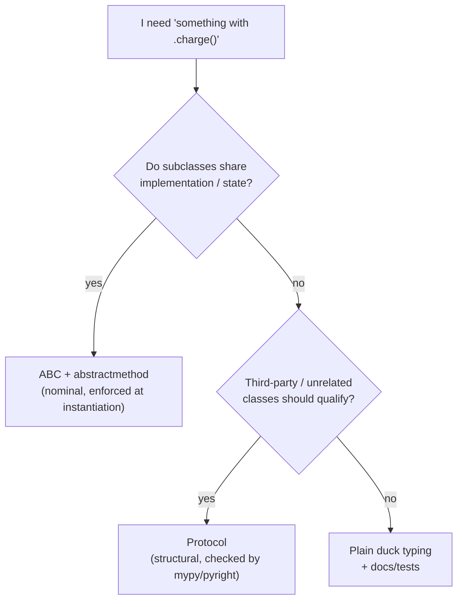

# Lesson 09: ABCs, Protocols, Duck Typing and Type Hints

> **Prerequisites:** [Lesson 08: Inheritance and the MRO](../08-inheritance-super-and-the-mro/README.md) · [LLD 24 · Abstract Class vs Interface](../../24-oop-interview-questions/03-abstract-class-vs-interface/README.md)  
> **Reading time:** ~22 minutes  
> **Audience:** Candidates asked "interface in Python?", "ABC vs Protocol?", "do type hints do anything at run time?"

> [!NOTE]
> **In one line:** Python has three ways to say "this must support these methods": **duck typing** (just call it), **ABCs** (*nominal* — you must inherit or register, and abstract methods are enforced at instantiation), and **Protocols** (*structural* — any class with the right methods qualifies, checked by type checkers). Type hints are metadata; Python does **not** enforce them at run time.

> [!TIP]
> **Golden rule:** Depend on a **small Protocol** at the boundary you want to fake or swap (gateway, clock, repository); use an **ABC** when subclasses share real implementation (a template-method skeleton) or you need runtime enforcement of abstract methods.

> [!TIP]
> **Try it:** Run the section 3 file, then `python -m mypy` on it. Even unmodified it reports three errors — the three lines that misuse things on purpose (`Broken()`, `Report()`, `typed("not an int")`). Now replace `FakeGateway.charge` with some other method: mypy adds a **fourth** error on the `Checkout(gw)` line (`incompatible type ... expected "PaymentGateway"`). Python itself would only fail when `.charge()` is finally called. Then run the [protocol lab](#try-it--protocol-lab-runnable) below. Draw `Checkout → PaymentGateway ⇠ Stripe / Fake` in [LLD Studio](/tools/lld-studio/).

---

## 1. The smell: how this gets asked

- *"Does Python have interfaces?"*
- *"ABC vs Protocol — when each?"*
- *"What is duck typing? What's its downside?"*
- *"Do type hints affect runtime? How would you validate input?"*
- *"Why do dependency-injected services in Python often take a `Protocol`?"*



---

## 2. Reference

| | Duck typing | `abc.ABC` | `typing.Protocol` |
| :--- | :--- | :--- | :--- |
| Typing style | Implicit | **Nominal** (inherit or `register`) | **Structural** (shape matches) |
| Enforced when | At the failing call | **At instantiation** (`TypeError`) | By type checkers (static); `@runtime_checkable` for `isinstance` (names only) |
| Shared code | None | Yes (concrete methods, state) | No (interface only) |
| Third-party classes | Work | Need `register()` | Work automatically |
| Best for | Scripts, small code | Framework base classes, template method | DI boundaries, fakes, callbacks |

| Hint feature | Meaning | Runtime effect |
| :--- | :--- | :--- |
| `x: int` | Annotation | Stored in `__annotations__`; **ignored** by the interpreter |
| `list[str]`, `dict[str, int]` | Generic builtins (3.9+) | None |
| `X \| None` (3.10+), `Optional[X]` | Union | None |
| `Callable[[int], str]` | Callable type | None |
| `TypeVar`, `Generic[T]` | Generic functions/classes | None |
| `Literal["a", "b"]`, `Final`, `TypedDict` | Narrow/constrain | None (checkers only) |

Enforcement at run time needs *code*: `isinstance`, pydantic, `beartype`, or explicit validation.

---

## 3. Walkthrough: a payment gateway, three ways

**Requirements:** `Checkout` charges via a gateway. Production uses `Stripe`; tests use a fake; a third-party `LegacyBank` class (which we can't edit) must also work.

1. **Protocol** `PaymentGateway` with `charge(amount_cents) -> str`.
2. `Checkout` takes the protocol — knows nothing else.
3. `LegacyBank` has a matching method but no inheritance → still accepted.
4. **ABC** version for a template-method base (`Report`) where subclasses fill in steps and inherit shared code.
5. Hints are inspected, not enforced — show `get_type_hints` and a runtime check.

````carousel
```python
from abc import ABC, abstractmethod
from typing import Protocol, get_type_hints, runtime_checkable


# ── Structural: a Protocol at the DI boundary ────────────────────────
@runtime_checkable
class PaymentGateway(Protocol):
    def charge(self, amount_cents: int) -> str: ...


class Stripe:
    def charge(self, amount_cents: int) -> str:
        return f"stripe:{amount_cents}"


class LegacyBank:                       # unrelated third-party class: no inheritance
    def charge(self, amount_cents: int) -> str:
        return f"legacy:{amount_cents}"


class FakeGateway:
    def __init__(self) -> None:
        self.calls: list[int] = []

    def charge(self, amount_cents: int) -> str:
        self.calls.append(amount_cents)
        return "fake-tx"


class Checkout:
    def __init__(self, gateway: PaymentGateway) -> None:
        self._gateway = gateway

    def pay(self, amount_cents: int) -> str:
        return self._gateway.charge(amount_cents)


# ── Nominal: an ABC with shared implementation (template method) ─────
class Report(ABC):
    def render(self) -> str:                         # concrete, shared
        return f"{self.header()}\n{self.body()}"

    def header(self) -> str:
        return "== REPORT =="

    @abstractmethod
    def body(self) -> str: ...                       # must be implemented


class SalesReport(Report):
    def body(self) -> str:
        return "sales: 42"


class Broken(Report):                                # forgot body()
    pass


def typed(a: int, b: "list[str] | None" = None) -> bool:
    return True


def main() -> None:
    for gw in (Stripe(), LegacyBank(), FakeGateway()):
        print(type(gw).__name__, "->", Checkout(gw).pay(500))

    print(isinstance(Stripe(), PaymentGateway), isinstance(object(), PaymentGateway))  # True False
    print(SalesReport().render())

    try:
        Broken()
    except TypeError as err:
        print("TypeError:", err)
    try:
        Report()
    except TypeError as err:
        print("TypeError:", str(err)[:48])

    # Hints are metadata only
    print(get_type_hints(typed))
    print(typed("not an int"))                       # runs fine: Python does not enforce hints

    # Runtime validation is something YOU add
    def validated(a):
        if not isinstance(a, int):
            raise TypeError(f"expected int, got {type(a).__name__}")
        return a

    try:
        validated("x")
    except TypeError as err:
        print("TypeError:", err)

    # Duck typing: anything with .read() works
    import io
    for src in (io.StringIO("abc"), open(__file__, encoding="utf-8")):
        print(type(src).__name__, len(src.read(3)))
        src.close()


if __name__ == "__main__":
    main()
```
<!-- slide -->
```csharp
// C#: nominal typing. A class must DECLARE `: IPaymentGateway` (no structural matching).
public interface IPaymentGateway { string Charge(int amountCents); }

public sealed class Stripe : IPaymentGateway
{
    public string Charge(int amountCents) => $"stripe:{amountCents}";
}

// A third-party class that doesn't implement the interface needs an ADAPTER:
public sealed class LegacyBank { public string Charge(int c) => $"legacy:{c}"; }
public sealed class LegacyBankAdapter(LegacyBank inner) : IPaymentGateway
{
    public string Charge(int amountCents) => inner.Charge(amountCents);
}

// abstract class: shared implementation + abstract members, enforced at compile time
public abstract class Report
{
    public string Render() => $"== REPORT ==\n{Body()}";
    protected abstract string Body();
}
// Types ARE enforced: passing a string where int is expected is a compile error.
```
````

Expected output of the Python tab (the abstract-class wording is Python 3.12+; older versions say `with abstract method body`; `get_type_hints` on the string annotation needs 3.10+):

```text
Stripe -> stripe:500
LegacyBank -> legacy:500
FakeGateway -> fake-tx
True False
== REPORT ==
sales: 42
TypeError: Can't instantiate abstract class Broken without an implementation for abstract method 'body'
TypeError: Can't instantiate abstract class Report without 
{'a': <class 'int'>, 'b': list[str] | None, 'return': <class 'bool'>}
True
TypeError: expected int, got str
StringIO 3
TextIOWrapper 3
```

---

## 4. Edges

- **`isinstance` with a Protocol** requires `@runtime_checkable` (otherwise `TypeError`) and only checks that the *methods exist* — not their signatures or return types (lab probes 1–2).
- **Protocols aren't enforced at run time.** A fake missing a method fails when called, not when passed — rely on mypy/pyright in CI.
- **ABC enforcement is at instantiation,** not class definition: `class Broken(Report): pass` is fine until `Broken()`.
- **`@abstractmethod` can have a body** (callable via `super()`), and abstract properties/classmethods are supported.
- **`abc.ABC.register(cls)`** makes a *virtual* subclass for `isinstance` without inheritance — for third-party types. It is a promise, not a check: a registered class that lacks the abstract methods still passes `isinstance` (probe 7).
- **Hints and performance.** No runtime cost beyond annotation storage (unless you use `from __future__ import annotations`/strings, which defer evaluation); libraries like pydantic and FastAPI *read* hints to validate/inject.
- **`Any` and gradual typing.** One `Any` can silently switch off checking downstream.
- **Over-specifying parameters.** Accept the narrowest protocol you need (`Iterable[str]`, `Sequence`, `Mapping`) and return concrete types — more reusable.
- **Duck-typing downside:** errors appear late and far from the cause; mitigate with tests, Protocols, and small interfaces.
- **Mutable defaults in annotated signatures** are still shared (lesson 02).

### Try it — protocol lab (runnable)

The follow-ups interviewers use after ABC vs Protocol. Save as `protocol_lab.py`; every probe is an `assert` (or a printed error message). Probe 10 runs `mypy` if it is installed and is skipped otherwise.

```python
import importlib.util, subprocess, sys, typing
from abc import ABC, abstractmethod
from typing import Protocol, runtime_checkable

# 1) A Protocol without @runtime_checkable cannot be used with isinstance
class Closer(Protocol):
    def close(self) -> None: ...
try:
    isinstance(object(), Closer)
except TypeError as e:
    print("1:", str(e)[:60])

# 2) @runtime_checkable checks NAMES only: a wrong signature still passes
@runtime_checkable
class Gateway(Protocol):
    def charge(self, amount_cents: int) -> str: ...
class WrongSig:
    def charge(self) -> None: ...                # different parameters AND return type
assert isinstance(WrongSig(), Gateway)           # True: only "has .charge" was checked

# 3) issubclass() is refused for protocols with data members
@runtime_checkable
class HasName(Protocol):
    name: str
class Named:
    def __init__(self): self.name = "n"
assert isinstance(Named(), HasName)              # instance check works (attribute exists)
try:
    issubclass(Named, HasName)
except TypeError as e:
    print("3:", str(e)[:60])

# 4) ABC enforcement happens at instantiation, not at class definition
class Shape(ABC):
    @abstractmethod
    def area(self) -> float: ...
class Half(Shape): pass                          # no error here
try:
    Half()
except TypeError as e:
    print("4:", str(e)[:48])

# 5) An abstract method can have a body and be reached through super()
class Base(ABC):
    @abstractmethod
    def greet(self): return "base"
class Impl(Base):
    def greet(self): return "impl+" + super().greet()
assert Impl().greet() == "impl+base"

# 6) Abstract properties are enforced the same way
class HasId(ABC):
    @property
    @abstractmethod
    def ident(self) -> int: ...
try:
    HasId()
except TypeError:
    pass
class Concrete(HasId):
    ident = 7                                    # a plain class attribute satisfies it
assert Concrete().ident == 7

# 7) register(): a virtual subclass passes isinstance but inherits nothing and is NOT checked
class ThirdParty:
    pass
Shape.register(ThirdParty)
tp = ThirdParty()
assert isinstance(tp, Shape) and not hasattr(tp, "area")     # "is a Shape" with no area()!

# 8) Protocol classes cannot be instantiated, but you CAN inherit from one explicitly
class Greeter(Protocol):
    def greet(self) -> str: return "default hello"       # protocols may carry default bodies
class English(Greeter): pass                             # explicit subclass inherits the default
assert English().greet() == "default hello"
try:
    Greeter()
except TypeError as e:
    print("8:", e)

# 9) Hints are stored, not enforced; get_type_hints resolves strings
def f(a: int, b: "list[str] | None" = None) -> bool:
    return True
assert f.__annotations__["a"] is int and f("not an int") is True
assert typing.get_type_hints(f)["b"] == (list[str] | None)

# 10) Nothing is checked at call time, yet a type checker catches it (skipped if mypy is absent)
if importlib.util.find_spec("mypy"):
    snippet = "def f(a: int) -> int:\n    return a\nf('x')\n"
    r = subprocess.run([sys.executable, "-m", "mypy", "-c", snippet], capture_output=True, text=True)
    assert r.returncode == 1 and "incompatible type" in r.stdout
    print("10: mypy flagged the call that Python happily runs")
else:
    print("10: mypy not installed - skipped")

# 11) Duck typing, LBYL vs EAFP
class Duck:
    def quack(self): return "quack"
def lbyl(x): return x.quack() if hasattr(x, "quack") else "n/a"
def eafp(x):
    try:
        return x.quack()
    except AttributeError:
        return "n/a"
assert lbyl(Duck()) == eafp(Duck()) == "quack" and lbyl(1) == eafp(1) == "n/a"
print("abc/protocol lab ok")
```

Expected output:

```text
1: Instance and class checks can only be used with @runtime_che
3: Protocols with non-method members don't support issubclass()
4: Can't instantiate abstract class Half without an
8: Protocols cannot be instantiated
10: mypy flagged the call that Python happily runs
abc/protocol lab ok
```

---

## 5. What you'd say in two minutes

> "Python doesn't have an `interface` keyword; it has three tools. Plain duck typing — if it has the method, call it — is flexible but fails late. `abc.ABC` is nominal: subclasses inherit and, if they leave an `@abstractmethod` unimplemented, instantiation raises `TypeError`; I use it when subclasses share real implementation, like a template-method base. `typing.Protocol` is structural: any class with the right methods satisfies it, even a third-party one I can't edit, and mypy or pyright checks that — I use it at dependency-injection boundaries so tests can pass a fake. Type hints themselves are just metadata in `__annotations__`; the interpreter ignores them, so if I need runtime validation I add `isinstance` checks or a library like pydantic. Compared to C#, which is nominal and compile-time checked, Python trades some safety for flexibility, and I recover it with a type checker in CI."

---

## 6. Anti-patterns

| Anti-pattern | Why it fails | Fix |
| :--- | :--- | :--- |
| ABC for an interface with no shared code | Forces inheritance, blocks third-party types | Protocol |
| `isinstance(x, SomeConcreteClass)` everywhere | Defeats duck typing, hurts testing | Program to a Protocol/behaviour |
| Fat Protocol with 15 methods | Fakes become huge (ISP) | Role-sized protocols |
| Trusting hints for input validation | They aren't enforced | Validate at boundaries (pydantic) |
| `Any` sprinkled to "make mypy pass" | Silent holes | Narrow types, `object`, generics |
| `hasattr` chains instead of a contract | Brittle | Protocol + type checker |

---

## 7. Interview questions

<details>
<summary><strong>1. Does Python have interfaces? [BASIC]</strong></summary>

Not as a keyword. You express interfaces with duck typing, `abc.ABC` with abstract methods (nominal), or `typing.Protocol` (structural, static).

</details>

<details>
<summary><strong>2. ABC vs Protocol? [BASIC]</strong></summary>

ABC: inheritance-based, can hold shared implementation, enforced at instantiation. Protocol: structural — matching methods suffice, no inheritance needed, enforced by type checkers (and shallowly by `runtime_checkable`). Use Protocol for boundaries, ABC for shared skeletons.

</details>

<details>
<summary><strong>3. What is duck typing? [BASIC]</strong></summary>

"If it walks like a duck": suitability is determined by the presence of the needed methods/attributes at call time, not the class. EAFP style: try it and handle `AttributeError`/`TypeError`.

</details>

<details>
<summary><strong>4. Do type hints change behaviour? [BASIC]</strong></summary>

No — the interpreter stores but ignores them. Tools (mypy, pyright, IDEs) and libraries (pydantic, FastAPI, dataclasses) read them. To validate at run time you must write or use code that does.

</details>

<details>
<summary><strong>5. When does an ABC raise its error? [TRICKY]</strong></summary>

On instantiation of a class with unimplemented abstract methods (`TypeError: Can't instantiate abstract class …`), not when the subclass is defined.

</details>

<details>
<summary><strong>6. How do you make a third-party class satisfy your ABC? [SCENARIO]</strong></summary>

`MyABC.register(ThirdParty)` for `isinstance` purposes, or write an adapter that subclasses the ABC and delegates. With a Protocol you need nothing — if the methods match, it already qualifies.

</details>

<details>
<summary><strong>7. What does `@runtime_checkable` actually check? [TRICKY]</strong></summary>

Only that the attributes/methods named in the protocol exist on the object — not signatures, argument types or return types. `isinstance` works for data members (it checks the attribute exists on the instance) but `issubclass` is refused for protocols that have non-method members. It's a convenience, not a contract.

</details>

<details>
<summary><strong>8. How would you test `Checkout` without calling Stripe? [SCENARIO]</strong></summary>

Inject a fake that satisfies the `PaymentGateway` protocol (records calls, returns canned values). No patching required — this is why DI boundaries are typed with Protocols.

</details>

---

## 8. One-page cheat sheet

```text
Duck typing   call it; fail late; EAFP.            Good for small scopes.
ABC           class X(ABC) + @abstractmethod       nominal; TypeError at instantiation; shared code; register() for 3rd-party
Protocol      class P(Protocol): def m(self)...    structural; checked by mypy/pyright; no inheritance needed
@runtime_checkable  isinstance(obj, P) -> names only, not signatures
Hints         stored in __annotations__, IGNORED at runtime; get_type_hints(f) to read
Validate      isinstance / pydantic / beartype at the boundaries
Choose        shared implementation -> ABC | boundary to fake/swap -> Protocol | tiny script -> duck typing
Accept wide (Iterable, Mapping), return concrete; small role-sized protocols
```

---

## Further reading

- [PEP 544: Protocols — structural subtyping](https://peps.python.org/pep-0544/)
- [`abc` — Abstract Base Classes](https://docs.python.org/3/library/abc.html)
- [typing documentation](https://docs.python.org/3/library/typing.html) · [mypy cheat sheet](https://mypy.readthedocs.io/en/stable/cheat_sheet_py3.html)

Previous: [Inheritance, super() and the MRO](../08-inheritance-super-and-the-mro/README.md) · Next: [dataclasses, NamedTuple, Enum and pydantic](../10-dataclasses-namedtuples-enums-and-pydantic/README.md)
