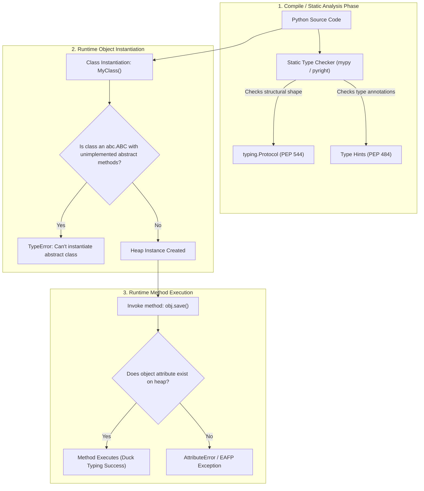
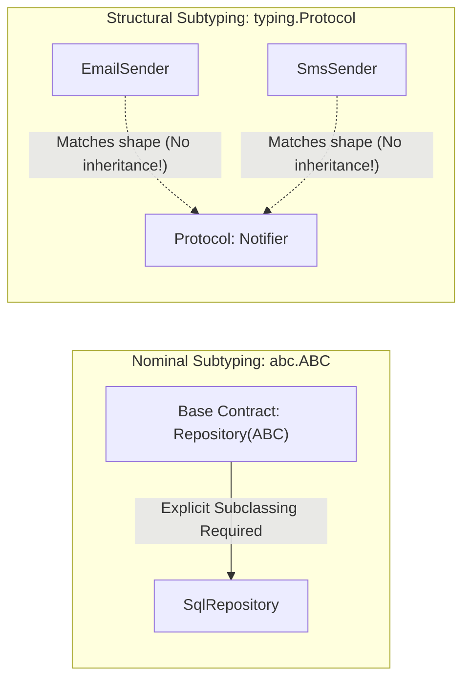

# Lesson 09: ABCs, Protocols, Duck Typing and Type Hints

> **Prerequisites:** [Inheritance, super() and the MRO](../08-inheritance-super-and-the-mro/README.md) and [Track 27 Overview](../README.md).  
> **Estimated Reading Time:** 18 minutes  
> **Target Audience:** Engineers preparing for LLD, OOP, C#, or Python technical screening and architecture rounds.

> [!TIP]
> **The One Rule of Contracts in Python:** Python contracts exist along an enforcement continuum: **Duck Typing** relies on runtime behavior (EAFP); **`abc.ABC`** enforces nominal inheritance and method presence at instantiation time; **`typing.Protocol`** enables compile-time structural subtyping (static duck typing); and **Type Hints** are purely advisory metadata completely erased and ignored by CPython at runtime unless inspected by static analyzers like `mypy` or validation libraries like Pydantic.

---

## 1. Why This Matters: The Interview Trap

"Does Python have interfaces, and how do you design contracts in large production codebases without runtime surprises?" is a quintessential technical screening question. It separates engineers who treat Python as an ad-hoc scripting tool from those who understand interface design, type theory, and large-scale architectural modularity.

### The Weak Answer
> *"Python doesn't have interfaces like C# or Java. Python is dynamically typed and uses duck typing: if it walks like a duck and quacks like a duck, it's a duck. If you want interfaces, you just add type hints like `def process(repo: Repo)` and Python will throw a `TypeError` at runtime if the caller passes the wrong object."*

### The Senior Strong Answer
> *"Python provides three distinct mechanisms for defining interface contracts, each operating at a different point in the compilation and execution lifecycle:
> 
> 1. **Pure Duck Typing (Runtime Behavioral):** The traditional Python approach following the **EAFP** (*Easier to ask for forgiveness than permission*) philosophy. Code invokes methods directly without upfront type checks and handles `AttributeError` if unsupported.
> 2. **Abstract Base Classes (`abc.ABC` - Nominal Subtyping):** Enforces contracts through explicit inheritance. Classes must explicitly subclass `ABC` and implement all `@abstractmethod` decorators; otherwise, CPython blocks instantiation at runtime with a `TypeError`. ABCs also support virtual subclassing via `ABC.register()`.
> 3. **Protocols (`typing.Protocol` - Structural Subtyping / Static Duck Typing):** Introduced in PEP 544, Protocols define contracts based on structure rather than inheritance. A class satisfies a `Protocol` simply by implementing the matching attributes and method signatures without ever importing or subclassing the Protocol. Static type checkers (`mypy`, `pyright`) verify compliance during CI/CD.
> 
> Crucially, **standard type hints are purely non-enforcing annotations**. CPython stores them in `__annotations__` and erases them during bytecode evaluation. Calling `def double(x: int) -> int` with `double('abc')` executes without error, producing `'abcabc'`. Runtime enforcement requires third-party tools like Pydantic or manual assertions."*

### Contract Strategy Taxonomy

| Strategy | Coupling Model | Verification Time | Inheritance Required? | Runtime Impact | Best Used For |
| :--- | :--- | :--- | :--- | :--- | :--- |
| **Duck Typing** | Zero coupling (implicit) | Runtime (at invocation) | No | None (standard opcode dispatch) | Small utilities, rapid scripts, pluggable components |
| **`abc.ABC`** | High coupling (nominal) | Runtime (at instantiation) | **Yes** (or `.register()`) | Tiny (metaclass check during `__new__`) | Framework plugins, core domain abstractions, template methods |
| **`typing.Protocol`** | Low coupling (structural) | Compile time (via `mypy`/`pyright`) | **No** (structural match) | Zero at runtime (erased) | Modern clean architecture, decoupled boundaries, library APIs |
| **Type Hints** | Informational | Static analysis time only | N/A | Zero (ignored by VM) | Developer tooling, IDE autocompletion, self-documentation |
| **C# `interface`** | Nominal contract | Compile time & runtime | **Yes** (implements interface) | Zero overhead (direct vtable dispatch) | Standard enterprise contract enforcement in .NET |

---

## 2. Visual Mental Model / Taxonomic Comparison

### Contract Enforcement Lifecycle

The following diagram illustrates where each contract enforcement strategy operates—from static analysis to runtime instantiation and method execution:



### Nominal Subtyping (ABC) vs Structural Subtyping (Protocol)



### Comprehensive Comparison Matrix

| Feature | Dynamic Duck Typing | `abc.ABC` | `typing.Protocol` | C# `interface` |
| :--- | :--- | :--- | :--- | :--- |
| **Type System Model** | Dynamic behavioral | Nominal (explicit hierarchy) | Structural (shape matching) | Nominal (explicit contract) |
| **Enforcement Trigger** | Method invocation (`obj.method()`) | Class instantiation (`MyClass()`) | Static analysis (`mypy`) | Compilation (`csc`) |
| **Subclassing Obligation** | None | Must inherit or call `.register()` | None | Must declare `: IInterface` |
| **Signature Validation** | None (crashes at runtime if wrong args) | Verifies method presence at `__init__` | Verifies full parameter and return types statically | Strict compile-time signature verification |
| **Runtime Introspection** | `hasattr(obj, 'method')` | `isinstance(obj, MyABC)` | `isinstance()` only with `@runtime_checkable` | `obj is IInterface` |
| **Performance Overhead** | None | Microsecond check during `__new__` | None at runtime (unless `@runtime_checkable`) | Zero overhead |

---

## 3. Code Implementation

The carousel below shows:
1. Nominal enforcement using `abc.ABC` blocking instantiation of incomplete subclasses.
2. Structural contract fulfillment via `typing.Protocol`, allowing uncoupled classes to fulfill contracts without inheritance.
3. Behavioral Duck Typing implementing EAFP (*Easier to ask for forgiveness than permission*).
4. Demonstrating that standard runtime Python ignores type hint annotations without raising errors.
5. C# parallel demonstrating interfaces, structural reflection checks, and dynamic typing.

````carousel
```python
from abc import ABC, abstractmethod
from typing import Protocol, runtime_checkable


# 1. Nominal Contract via ABC
class Repository(ABC):
    @abstractmethod
    def save(self, data: str) -> str:
        """Abstract method that all subclasses must implement."""
        pass


class SqlRepository(Repository):
    def save(self, data: str) -> str:
        return f"SQL saved: {data}"


class IncompleteRepository(Repository):
    # Fails to implement abstract method save()
    pass


# 2. Structural Contract via Protocol
@runtime_checkable
class Notifier(Protocol):
    def notify(self, message: str) -> str:
        ...


class EmailSender:
    # Notice: Does NOT explicitly inherit from Notifier!
    def notify(self, message: str) -> str:
        return f"Email sent: {message}"


# 3. Duck Typing with EAFP
def execute_save(repo: object) -> str:
    try:
        # EAFP: Attempt method invocation directly without checking type
        return getattr(repo, "save")("order_100")
    except AttributeError:
        return "Execution failed: missing save method"


# 4. Type Hint Runtime Illusion
def double(val: int) -> int:
    return val * 2


def run_demonstration() -> None:
    print("1. Nominal ABC Enforcement:")
    try:
        IncompleteRepository()  # type: ignore[abstract]
    except TypeError:
        print("ABC blocked instantiation: True")

    sql_repo = SqlRepository()
    print(f"SqlRepository save: {execute_save(sql_repo)}")

    print("2. Structural Protocol (Static Duck Typing):")
    email = EmailSender()
    # Structural check enabled by @runtime_checkable
    print(f"EmailSender matches Notifier: {isinstance(email, Notifier)}")
    print(f"Email output: {email.notify('alert')}")

    print("3. Duck Typing & EAFP:")
    print(f"Invalid repo save: {execute_save(object())}")

    print("4. Runtime Type Hint Illusion:")
    # Passing string 'abc' to a function annotated with int!
    str_result = double("abc")  # type: ignore[arg-type]
    print(f"Runtime type hints enforced: False (result: {str_result})")


if __name__ == "__main__":
    run_demonstration()
```
<!-- slide -->
```csharp
using System;
using System.Reflection;

// 1. Nominal Contract via Abstract Class
public abstract class Repository
{
    public abstract string Save(string data);
}

public class SqlRepository : Repository
{
    public override string Save(string data) => $"SQL saved: {data}";
}

// 2. Structural Contract (Protocol-like interface contract)
public interface INotifier
{
    string Notify(string message);
}

public class EmailSender
{
    // Notice: Does NOT explicitly implement INotifier!
    public string Notify(string message) => $"Email sent: {message}";
}

public class Program
{
    // 3. Duck Typing with EAFP using C# dynamic dispatch
    public static string ExecuteSave(object repo)
    {
        try
        {
            dynamic dynamicRepo = repo;
            return dynamicRepo.Save("order_100");
        }
        catch (Exception)
        {
            return "Execution failed: missing save method";
        }
    }

    // 4. Runtime behavior demonstration
    public static object DoubleValue(dynamic val)
    {
        // Demonstrating dynamic execution where type hints are not bound statically
        return val + val;
    }

    public static void Main()
    {
        Console.WriteLine("1. Nominal ABC Enforcement:");
        try
        {
            Activator.CreateInstance(typeof(Repository));
        }
        catch (MissingMethodException)
        {
            Console.WriteLine("ABC blocked instantiation: True");
        }

        var sqlRepo = new SqlRepository();
        Console.WriteLine($"SqlRepository save: {ExecuteSave(sqlRepo)}");

        Console.WriteLine("2. Structural Protocol (Static Duck Typing):");
        var email = new EmailSender();
        // Protocol check: does EmailSender structurally possess the required Notify signature?
        MethodInfo? method = typeof(EmailSender).GetMethod(
            nameof(EmailSender.Notify),
            new[] { typeof(string) }
        );
        bool matches = method != null && method.ReturnType == typeof(string);
        Console.WriteLine($"EmailSender matches Notifier: {matches}");
        Console.WriteLine($"Email output: {email.Notify("alert")}");

        Console.WriteLine("3. Duck Typing & EAFP:");
        Console.WriteLine($"Invalid repo save: {ExecuteSave(new object())}");

        Console.WriteLine("4. Runtime Type Hint Illusion:");
        dynamic strVal = "abc";
        var strResult = DoubleValue(strVal);
        Console.WriteLine($"Runtime type hints enforced: False (result: {strResult})");
    }
}
```
````

**Expected Output (Both Languages):**

```text
1. Nominal ABC Enforcement:
ABC blocked instantiation: True
SqlRepository save: SQL saved: order_100
2. Structural Protocol (Static Duck Typing):
EmailSender matches Notifier: True
Email output: Email sent: alert
3. Duck Typing & EAFP:
Invalid repo save: Execution failed: missing save method
4. Runtime Type Hint Illusion:
Runtime type hints enforced: False (result: abcabc)
```

---

## 4. Where You Already Use It

- **In Python:**
  - **`collections.abc`:** The standard library models core container behaviors via ABCs: `Iterable`, `Iterator`, `Mapping`, `Sequence`, `MutableMapping`. Functions check container capabilities using `isinstance(data, collections.abc.Mapping)` rather than concrete types like `dict`.
  - **`typing.Protocol` (PEP 544):** Standard protocols include `typing.Iterable` (structural duck typing for iterators), `os.PathLike` (any object implementing `__fspath__()`), and `contextlib.AbstractContextManager`.
  - **`io.IOBase` Virtual Subclasses:** CPython's I/O hierarchy uses `io.IOBase.register(RawIOBase)` to implement virtual subclassing without multiple inheritance conflicts.
  - **`mypy` and `pyright` in Production CI:** Enterprise codebases run static type checks as a pre-commit or CI step, converting Python's runtime duck typing into compile-time verified structural typing.

- **In C# / .NET:**
  - **Pattern-Based Duck Typing in Roslyn:** In C#, you can use `foreach` on any class that exposes a public parameterless `GetEnumerator()` method returning an object with `MoveNext()` and `Current`—**without implementing `IEnumerable` or `IEnumerable<T>`**. Similarly, `await` works on any type providing a `GetAwaiter()` method.
  - **`IDisposable` and `IAsyncDisposable`:** Standard nominal interfaces guaranteeing resource disposal lifecycle contracts.
  - **Generic Type Constraints:** `where T : class, IRepository, new()` provides compile-time contract enforcement with zero runtime reflection overhead.

---

## 5. Pitfalls and When Not to Use It

1. **The Type Hint False Sense of Security:**
   - Writing `def transfer(amount: float, recipient: str):` does **not** protect against callers passing `transfer(-500, 12345)`. The CPython interpreter does not validate types. If you need runtime data validation, use **Pydantic** or explicit validation checks.

2. **The `@runtime_checkable` Blind Spot:**
   - `@runtime_checkable` allows `isinstance(obj, MyProtocol)`. However, it **only checks whether the attributes/methods exist**—it **does not check parameter signatures, type annotations, or return types!** If `MyProtocol` expects `def render(width: int, height: int) -> str:`, an object with `def render(self): pass` still returns `True` for `isinstance(obj, MyProtocol)`. Furthermore, checking protocols at runtime is slow. Use `@runtime_checkable` sparingly.

3. **Missing `ABC` Inheritance:**
   - Declaring `@abstractmethod` on a class that does **not** inherit from `abc.ABC` (or does not use `metaclass=ABCMeta`) does nothing. The decorator is recorded as an attribute, but Python will happily allow callers to instantiate the class with unimplemented abstract methods.

4. **The LBYL Concurrency Race Condition:**
   - Writing *Look Before You Leap* code like:
     ```python
     if hasattr(file_handler, "flush"):
         file_handler.flush()
     ```
     in concurrent or dynamic environments can introduce subtle bugs. The Pythonic idiom is **EAFP**:
     ```python
     try:
         file_handler.flush()
     except AttributeError:
         pass
     ```

---

## 6. Exercises & Practical Drills

### Exercise 1: The `@runtime_checkable` Protocol Trap
Given the following Protocol and class, predict whether `isinstance(worker, WorkHandler)` evaluates to `True` or `False`. Explain why this happens:

```python
from typing import Protocol, runtime_checkable


@runtime_checkable
class WorkHandler(Protocol):
    def process(self, job_id: int, payload: dict) -> bool:
        ...


class BrokenWorker:
    def process(self) -> None:
        pass


worker = BrokenWorker()
print("Matches protocol:", isinstance(worker, WorkHandler))
```

<details>
<summary>Answer</summary>

**Output:**
```text
Matches protocol: True
```

**Explanation:**  
`@runtime_checkable` on a Protocol only performs a shallow check: it verifies that `hasattr(BrokenWorker, "process")` and that `callable(getattr(BrokenWorker, "process"))` is true. It **does not inspect function signatures, argument counts, or return type annotations at runtime**. Static type checkers like `mypy` would flag this as an error during static analysis, but runtime `isinstance` returns `True`.
</details>

### Exercise 2: The Inactive Abstract Method
Find the bug in this code. Why does `PaymentGateway()` instantiate successfully despite not implementing `charge()`?

```python
from abc import abstractmethod


class PaymentGateway:
    @abstractmethod
    def charge(self, amount: int) -> bool:
        pass


gateway = PaymentGateway()
print("Gateway created:", gateway)
```

<details>
<summary>Answer</summary>

**Bug:**  
`PaymentGateway` does not inherit from `abc.ABC` (nor does it set `metaclass=ABCMeta`).

**Explanation:**  
The `@abstractmethod` decorator simply sets an attribute flag `charge.__isabstractmethod__ = True`. The runtime enforcement that inspects this flag and blocks instantiation lives inside `ABCMeta.__new__`. Without subclassing `ABC`, the standard type constructor creates the object normally.

**Fix:**
```python
from abc import ABC, abstractmethod


class PaymentGateway(ABC):
    @abstractmethod
    def charge(self, amount: int) -> bool:
        pass
```
</details>

### Exercise 3: Decoupling via Protocol
You are given a third-party caching library `RedisCache` that has a `get(key: str) -> str` method. Your internal service currently requires `class Service(ABC): def fetch(self, cache: CacheBase)`. How do you refactor `CacheBase` to accept `RedisCache` without modifying third-party code or creating a wrapper adapter?

<details>
<summary>Answer</summary>

Replace the nominal abstract base class with a structural `typing.Protocol`:

```python
from typing import Protocol


class CacheProtocol(Protocol):
    def get(self, key: str) -> str:
        ...


class Service:
    def __init__(self, cache: CacheProtocol) -> None:
        self.cache = cache

    def execute(self, key: str) -> str:
        return self.cache.get(key)
```

Because `CacheProtocol` is structural, `RedisCache` satisfies the contract automatically. Static analyzers like `mypy` pass without requiring `RedisCache` to inherit from `CacheProtocol`.
</details>

---

## 7. Interview Questions & Model Answers

> [!interview]
> **Question 1: Does Python have interfaces?**  
> **Strong Answer:**  
> "Python does not have a dedicated `interface` keyword like C# or Java, but it provides full architectural support for interfaces through two standard library mechanisms:
> 
> 1. **Nominal Interfaces via `abc.ABC`:** An Abstract Base Class with `@abstractmethod` decorators acts as an explicit nominal interface. Subclasses must explicitly inherit from the ABC and implement all abstract methods; otherwise, CPython raises a `TypeError` on instantiation. It also supports virtual subclassing via `MyABC.register(TargetClass)`.
> 2. **Structural Interfaces via `typing.Protocol` (PEP 544):** Protocols define interfaces structurally (static duck typing). Any class that implements the methods and properties defined in the `Protocol` automatically satisfies the interface without explicit inheritance.
> 
> In modern Python architecture, `typing.Protocol` is the preferred tool for decoupled interfaces across package boundaries, while `abc.ABC` is preferred when shared default behavior or strict runtime instantiation enforcement is needed."

> [!interview]
> **Question 2: What is duck typing?**  
> **Strong Answer:**  
> "Duck typing is a dynamic typing paradigm derived from the phrase: *'If it walks like a duck and quacks like a duck, it's a duck.'*  
> 
> In Python, an object's suitability for a given operation is determined by the presence of specific methods, attributes, and runtime behaviors, rather than its position in an explicit class inheritance tree. For example, a function that iterates over an input does not check `if isinstance(data, list)`; it simply executes `for item in data:`, relying on whether the object implements the `__iter__()` or `__getitem__()` dunder methods.  
> 
> Duck typing is tightly coupled with Python's **EAFP** (*Easier to ask for forgiveness than permission*) design philosophy: rather than validating an object's capabilities upfront with defensive checks, code attempts the desired operation inside a `try...except` block, catching `AttributeError` or `TypeError` if unsupported."

> [!interview]
> **Question 3: What is the difference between an ABC and a Protocol?**  
> **Strong Answer:**  
> "The fundamental difference is **nominal subtyping versus structural subtyping**:
> 
> - **`abc.ABC` is nominal:** A class is only considered a subtype of an ABC if it **explicitly subclasses it in its class definition** (e.g., `class SqlRepo(RepositoryABC):`) or is explicitly registered as a virtual subclass (`RepositoryABC.register(SqlRepo)`). Enforcement happens at **runtime during object instantiation**; if an abstract method is missing, `__new__` raises a `TypeError`.
> - **`typing.Protocol` is structural (PEP 544):** A class is considered a subtype of a Protocol based strictly on its **shape and method signatures**. No explicit inheritance is required. A class defined in a separate library automatically satisfies a Protocol without modifying its source code. Enforcement happens primarily at **compile/lint time via static type checkers (`mypy`, `pyright`)**.
> 
> Use an **ABC** when building framework base classes that provide template methods or require strict runtime enforcement. Use a **Protocol** when defining domain boundaries, decoupling microservices, or writing reusable libraries."

> [!interview]
> **Question 4: Are type hints enforced at run time?**  
> **Strong Answer:**  
> "No, standard Python type hints are **not enforced at run time**.  
> 
> When CPython compiles and runs Python code, type annotations are evaluated once at definition time and stored as dictionary metadata in the module, class, or function's `__annotations__` attribute (or handled lazily via PEP 563 / PEP 649). During bytecode execution, the virtual machine completely ignores these annotations. Passing a string to a function annotated as `def square(x: int) -> int` will not raise an error unless the function body executes an operation that fails at runtime (e.g., `'abc' ** 2`).  
> 
> Type hints exist primarily for:
> 1. Static type analysis during development and CI/CD (`mypy`, `pyright`).
> 2. IDE autocompletion and refactoring assistance.
> 3. Third-party runtime validation libraries (such as **Pydantic**, **FastAPI**, or **Typeguard**) that explicitly inspect `__annotations__` via reflection to coerce and validate incoming data at system boundaries."

---

## 8. Sources & Further Reading

- [Python 3 Documentation: `abc` - Abstract Base Classes](https://docs.python.org/3/library/abc.html)
- [Python 3 Documentation: `typing` - Support for type hints](https://docs.python.org/3/library/typing.html)
- [PEP 544: Protocols: Structural subtyping (static duck typing)](https://peps.python.org/pep-0544/)
- [PEP 484: Type Hints](https://peps.python.org/pep-0484/)
- [PEP 3119: Introducing Abstract Base Classes](https://peps.python.org/pep-3119/)
- [Microsoft Learn: Interfaces - Define behavior for multiple types](https://learn.microsoft.com/en-us/dotnet/csharp/fundamentals/types/interfaces)

---

Previous: [Inheritance, super() and the MRO](../08-inheritance-super-and-the-mro/README.md) · Next: [dataclasses, NamedTuple, Enum and pydantic](../10-dataclasses-namedtuples-enums-and-pydantic/README.md)
