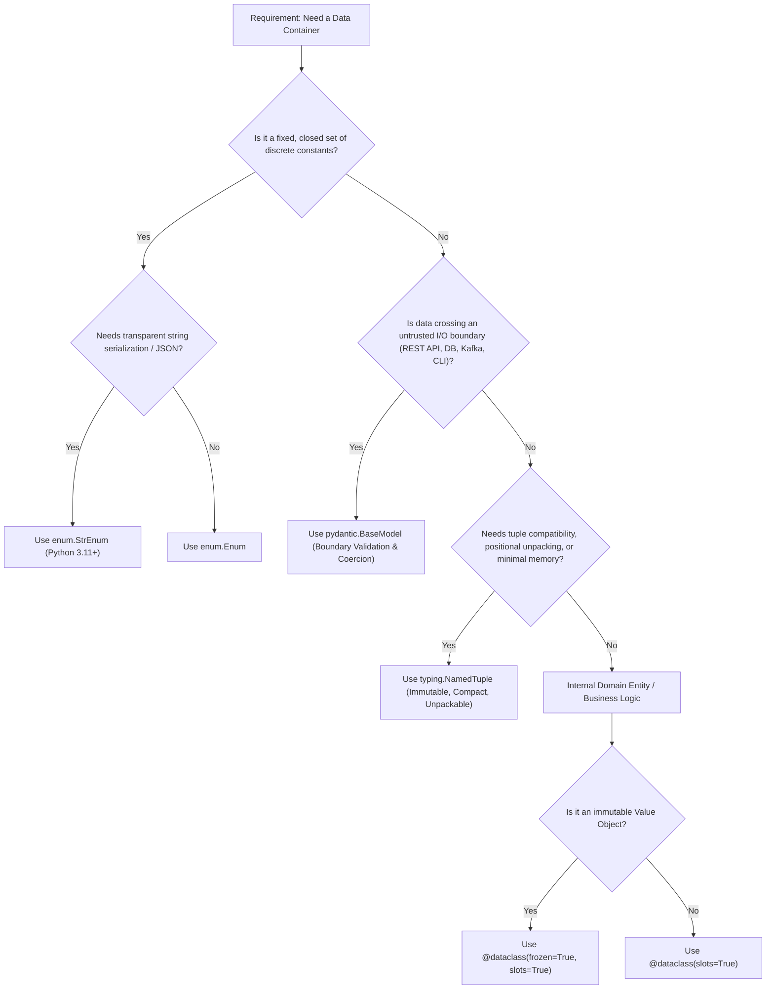

# Lesson 10: dataclasses, NamedTuple, Enum and pydantic

> **Prerequisites:** [ABCs, Protocols, Duck Typing and Type Hints](../09-abcs-protocols-duck-typing-and-type-hints/README.md) and [Track 27 Overview](../README.md).  
> **Estimated Reading Time:** 18 minutes  
> **Target Audience:** Engineers preparing for LLD, OOP, C#, or Python technical screening and architecture rounds.

> [!TIP]
> **The One Rule of Data Containers:** Choose your data representation based on **boundary trust, mutability, and memory layout**: use **`NamedTuple`** for compact, immutable data requiring zero `__dict__` overhead and positional unpacking; **`@dataclass`** for internal domain models needing automatic dunder methods, defaults, and optional immutability (`frozen=True`); **`Enum` / `StrEnum`** for closed, discrete states; and **Pydantic** strictly at **untrusted system boundaries** (HTTP APIs, message queues, databases) where runtime schema parsing, coercion, and validation are mandatory.

---

## 1. Why This Matters: The Interview Trap

"How do you model domain data in Python, and when would you choose a dataclass over a `NamedTuple` or Pydantic model?" is a classic system design and low-level design screening question. Candidates often reach for either raw dictionaries or heavy Pydantic models for every scenario without understanding memory footprints, runtime costs, or boundary contracts.

### The Weak Answer
> *"I usually just use dictionaries everywhere because Python is dynamic and dictionaries are flexible. If I need a class, I use dataclasses because they were added in Python 3.7 to replace `namedtuple`. Pydantic is just another library that does the same thing as dataclasses."*

### The Senior Strong Answer
> *"Modern Python provides specialized abstractions for data modeling, each serving a distinct layer of system architecture:
> 
> 1. **`typing.NamedTuple` (Lightweight Value Object):** A typed subclass of the built-in `tuple`. It is immutable, supports positional indexing and unpacking (`x, y = pt`), and incurs zero per-instance `__dict__` memory overhead. However, it exhibits loose tuple equality—comparing equal to any tuple with identical items (`Point(1, 2) == (1, 2)`)—and cannot support mutable state.
> 2. **`@dataclass` (Internal Domain Entities):** A code generator introduced in PEP 557 that dynamically synthesizes boilerplate dunder methods (`__init__`, `__repr__`, `__eq__`, `__hash__`) at class creation time. It supports mutable or immutable (`frozen=True`) structures, default factories, and memory optimization via `slots=True`. However, **it does not validate data types at runtime**—passing invalid types succeeds silently.
> 3. **`Enum` / `StrEnum` (Closed Domain Sets):** Prevents stringly-typed bugs by guaranteeing identity and value constraints for discrete system states. `StrEnum` (Python 3.11+) allows direct string interoperability for JSON serialization while preserving enum type safety.
> 4. **Pydantic `BaseModel` (Boundary Validation):** Built for untrusted I/O boundaries (REST payloads, environment configs). It enforces strict runtime type parsing, validation, coercion, and generates rich error payloads. Because Pydantic performs deep reflection and coercion, instantiation is **50x–100x slower than a standard dataclass**, making it inappropriate inside tight algorithmic inner loops."*

---

## 2. Visual Mental Model / Taxonomic Comparison

### Decision Tree for Data Container Selection



### Comprehensive Data Modeling Comparison Matrix

| Feature | `dict` | `typing.NamedTuple` | `@dataclass` | `@dataclass(frozen=True)` | `pydantic.BaseModel` | C# Equivalent |
| :--- | :--- | :--- | :--- | :--- | :--- | :--- |
| **Mutability** | Mutable | Strictly Immutable | Mutable (default) | Strictly Immutable | Mutable / Frozen via config | `class` vs `record` |
| **Memory Model** | Dynamic Hash Map (`PyDictObject`) | Fixed C-array pointer (`PyTupleObject`) | `__dict__` (or C-array if `slots=True`) | `__dict__` (or C-array if `slots=True`) | Core schema + `__dict__` storage | Heap object vs Struct |
| **Runtime Type Validation** | None | None | None (advisory type hints only) | None (advisory type hints only) | **Strict runtime parsing & coercion** | Static compilation / Model Binding |
| **Positional Unpacking** | Keys only (`k1, k2 = d`) | **Yes** (`x, y = pt`) | No (requires custom `__iter__`) | No | No | Tuple deconstruction `var (x, y)` |
| **Equality Semantics** | Keys & Values equality | Tuple equality (`Point(1,2) == (1,2)`) | Nominal field-by-field equality | Nominal field-by-field equality | Field-by-field equality | Value-based `record` equality |
| **Instantiation Overhead** | Minimal ($O(1)$) | Ultra-fast ($O(1)$ C-level) | Very Fast (compiled `__init__`) | Very Fast | High (deep validation & coercion) | Near-zero (JIT optimized) |
| **Best Architectural Layer** | Ad-hoc intermediate bags | Mathematical coordinates, DB row tuples | Domain entities, business aggregations | Domain Value Objects, immutable events | HTTP controllers, JSON parsers, CLI inputs | DTOs, domain models, records |

---

## 3. Code Implementation

The carousel below demonstrates:
1. `typing.NamedTuple` with positional unpacking and immutable field access.
2. `@dataclass(frozen=True)` enforcing immutability and default factories via `field(default_factory=list)`.
3. `StrEnum` enabling type-safe string constants.
4. Pydantic boundary validation demonstrating automatic type coercion and catching malformed payloads.
5. C# parallel using positional record structs, init-only records, and boundary validation models.

````carousel
```python
from dataclasses import dataclass, field
from enum import StrEnum
from typing import List, NamedTuple
from pydantic import BaseModel, ValidationError


# 1. NamedTuple: Compact immutable tuple with field access & unpacking
class GeoPoint(NamedTuple):
    lat: float
    lon: float


# 2. StrEnum: Type-safe string domain constants
class UserRole(StrEnum):
    ADMIN = "admin"
    MEMBER = "member"


# 3. Dataclass: Internal domain entity with defaults & immutability
@dataclass(frozen=True)
class DomainUser:
    user_id: int
    role: UserRole
    tags: List[str] = field(default_factory=list)


# 4. Pydantic: Boundary parsing, validation & coercion
class UserPayload(BaseModel):
    user_id: int
    role: UserRole


def run_demonstration() -> None:
    # 1. NamedTuple Demonstration
    point = GeoPoint(37.7749, -122.4194)
    lat, lon = point  # Tuple unpacking
    print(f"NamedTuple unpacked: lat={lat}, lon={lon}")

    # 2. Dataclass Immutability & Defaults
    user = DomainUser(user_id=1, role=UserRole.ADMIN)
    print(f"Dataclass created: id={user.user_id}, role={user.role}, tags={user.tags}")
    try:
        user.user_id = 999  # type: ignore[misc]
    except Exception:
        print("Dataclass frozen mutation blocked: True")

    # 3. StrEnum Comparison
    print(f"StrEnum equals string: {user.role == 'admin'}")

    # 4. Pydantic Boundary Validation & Coercion
    # Coerces string '42' to int 42
    valid_payload = UserPayload(user_id="42", role="member")
    print(f"Pydantic coerced id: {valid_payload.user_id} (type: {type(valid_payload.user_id).__name__})")

    try:
        UserPayload(user_id="invalid", role="member")
    except ValidationError:
        print("Pydantic caught invalid boundary data: True")


if __name__ == "__main__":
    run_demonstration()
```
<!-- slide -->
```csharp
using System;
using System.Collections.Generic;
using System.Reflection;

// 1. Positional Record Struct (C# equivalent of NamedTuple)
public readonly record struct GeoPoint(double Lat, double Lon);

// 2. Domain String Constants (C# equivalent of StrEnum)
public static class UserRole
{
    public const string Admin = "admin";
    public const string Member = "member";
}

// 3. Immutable Record (C# equivalent of frozen dataclass)
public record DomainUser(int UserId, string Role, IReadOnlyList<string>? Tags = null)
{
    public IReadOnlyList<string> Tags { get; init; } = Tags ?? Array.Empty<string>();
}

// 4. Boundary Validation Model (C# equivalent of Pydantic model)
public record UserPayload
{
    public int UserId { get; init; }
    public string Role { get; init; } = string.Empty;

    public static UserPayload FromBoundary(object rawId, string role)
    {
        // Type coercion & boundary validation
        if (rawId == null || !int.TryParse(rawId.ToString(), out int parsedId))
        {
            throw new FormatException($"Validation error: cannot coerce '{rawId}' to integer");
        }
        return new UserPayload { UserId = parsedId, Role = role };
    }
}

public class Program
{
    public static void Main()
    {
        // 1. NamedTuple Demonstration
        var point = new GeoPoint(37.7749, -122.4194);
        var (lat, lon) = point; // Positional deconstruction
        Console.WriteLine($"NamedTuple unpacked: lat={lat}, lon={lon}");

        // 2. Dataclass Immutability & Defaults
        var user = new DomainUser(1, UserRole.Admin);
        Console.WriteLine($"Dataclass created: id={user.UserId}, role={user.Role}, tags=[{string.Join(", ", user.Tags)}]");

        // C# records with init-only properties disallow mutation post-initialization
        PropertyInfo? prop = typeof(DomainUser).GetProperty(nameof(DomainUser.UserId));
        bool isImmutable = prop != null && (prop.SetMethod == null || prop.SetMethod.ReturnParameter.GetRequiredCustomModifiers().Length > 0);
        if (isImmutable)
        {
            Console.WriteLine("Dataclass frozen mutation blocked: True");
        }

        // 3. StrEnum Comparison
        Console.WriteLine($"StrEnum equals string: {user.Role == "admin"}");

        // 4. Boundary Validation & Coercion
        var validPayload = UserPayload.FromBoundary("42", UserRole.Member);
        string typeName = validPayload.UserId.GetType() == typeof(int) ? "int" : validPayload.UserId.GetType().Name;
        Console.WriteLine($"Pydantic coerced id: {validPayload.UserId} (type: {typeName})");

        try
        {
            UserPayload.FromBoundary("invalid", UserRole.Member);
        }
        catch (FormatException)
        {
            Console.WriteLine("Pydantic caught invalid boundary data: True");
        }
    }
}
```
````

**Expected Output (Both Languages):**

```text
NamedTuple unpacked: lat=37.7749, lon=-122.4194
Dataclass created: id=1, role=admin, tags=[]
Dataclass frozen mutation blocked: True
StrEnum equals string: True
Pydantic coerced id: 42 (type: int)
Pydantic caught invalid boundary data: True
```

---

## 4. Where You Already Use It

- **In Python:**
  - **`urllib.parse.urlparse`:** Returns a `ParseResult`, which is a `NamedTuple`. This enables both named attribute access (`result.scheme`, `result.netloc`) and tuple unpacking (`scheme, netloc, path, *rest = urlparse(...)`).
  - **`sys.version_info`:** The Python interpreter version is exposed as a `NamedTuple` (`sys.version_info.major == 3`).
  - **`http.HTTPStatus`:** Standard Python HTTP status codes are implemented as `IntEnum` instances (`HTTPStatus.OK == 200`), permitting both integer comparisons and descriptive attribute access (`HTTPStatus.OK.phrase`).
  - **FastAPI / SQLModel:** FastAPI uses Pydantic models for request body deserialization, OpenAPI schema generation, and query validation. SQLModel bridges Pydantic models and SQLAlchemy table entities.
  - **`inspect.Signature`:** CPython's internal inspection modules construct dataclass-like objects to represent function parameters and bytecode metadata.

- **In C# / .NET:**
  - **`record` and `record struct`:** C# 9+ records synthesize value-based equality, copy constructors (for `with` expressions), and formatted string representations.
  - **`readonly ref struct`:** Used for zero-allocation high-performance data buffers (like `ReadOnlySpan<T>`).
  - **ASP.NET Core Model Binding & Data Annotations:** Automatically validates incoming JSON payloads against model attributes (`[Required]`, `[Range]`) and populates `ModelState.IsValid`.

---

## 5. Pitfalls and When Not to Use It

1. **The Mutable Default Value Trap in Dataclasses:**
   - Attempting `tags: List[str] = []` inside a `@dataclass` raises a compile-time `ValueError: mutable default <class 'list'> for field tags is not allowed: use default_factory`.
   - *Fix:* Always supply a callable factory: `tags: List[str] = field(default_factory=list)`.

2. **The `NamedTuple` Accidental Tuple Equality Bug:**
   - Because `NamedTuple` is a direct subclass of `tuple`, equality is evaluated purely by constituent elements:
     ```python
     class Coordinate(NamedTuple):
         x: int
         y: int

     coord = Coordinate(1, 2)
     print(coord == (1, 2))  # Evaluates to True!
     ```
     This can cause subtle bugs when comparing domain objects or using them as dictionary keys alongside raw tuples.

3. **Field Order Inheritance Conflict in Dataclasses:**
   - In Python, parameters without defaults cannot follow parameters with defaults. If a base dataclass declares a field with a default value:
     ```python
     @dataclass
     class Base:
         status: str = "active"

     @dataclass
     class Child(Base):
         name: str  # SyntaxError: non-default argument 'name' follows default argument
     ```
     *Fix:* In Python 3.10+, use `kw_only=True` on `@dataclass` or the child fields.

4. **Standard `Enum` vs `StrEnum` String Comparison:**
   - In standard Python `Enum`:
     ```python
     class Status(Enum):
         PENDING = "pending"

     Status.PENDING == "pending"  # Evaluates to False!
     ```
     A standard `Enum` member is not equal to its raw value. Use `StrEnum` (Python 3.11+) or `class Status(str, Enum):` if your code requires direct string comparisons.

5. **Using Pydantic in Performance-Critical Inner Loops:**
   - Pydantic models perform extensive validation, deep copying, type coercion, and metadata tracking. Instantiating a Pydantic model millions of times in a tight numerical loop will cripple performance. In high-throughput internal pipelines, use `@dataclass(slots=True)` or `NamedTuple`.

---

## 6. Exercises & Practical Drills

### Exercise 1: The Accidental Tuple Collision
Explain what happens in the following snippet. Why does the lookup succeed, and how would you redesign `UserKey` to prevent cross-type collisions?

```python
from typing import NamedTuple


class UserKey(NamedTuple):
    org_id: int
    user_id: int


cache = {}
key = UserKey(10, 20)
cache[key] = "admin_session"

raw_tuple = (10, 20)
print("Cache hit:", cache.get(raw_tuple))
```

<details>
<summary>Answer</summary>

**Output:**
```text
Cache hit: admin_session
```

**Explanation:**  
`UserKey` inherits directly from `tuple`. In Python, a tuple's hash and equality are based entirely on its ordered sequence of values: `hash(UserKey(10, 20)) == hash((10, 20))` and `UserKey(10, 20) == (10, 20)` are both `True`. Therefore, a raw tuple unintentionally accesses the cache entry.

**Redesign Fix:**  
Use a frozen dataclass to enforce nominal type identity:
```python
from dataclasses import dataclass


@dataclass(frozen=True, slots=True)
class UserKey:
    org_id: int
    user_id: int


# UserKey(10, 20) == (10, 20) evaluates to False!
```
</details>

### Exercise 2: Dataclass Default Factory Repair
The following dataclass is intended to represent an audit trail, but running it causes Python to raise an immediate exception at definition time. Fix the class:

```python
from dataclasses import dataclass
from typing import List


@dataclass
class AuditRecord:
    action: str
    metadata: dict = {}
    history: List[str] = []
```

<details>
<summary>Answer</summary>

**The Bug:**  
`metadata` and `history` use mutable defaults (`{}` and `[]`), which `@dataclass` explicitly forbids to prevent shared state bugs across instances.

**Fixed Code:**
```python
from dataclasses import dataclass, field
from typing import Dict, List


@dataclass
class AuditRecord:
    action: str
    metadata: Dict[str, str] = field(default_factory=dict)
    history: List[str] = field(default_factory=list)
```
</details>

### Exercise 3: Architectural Decision Drill
You are designing an order-processing pipeline that receives raw JSON HTTP requests, translates them into internal domain orders, performs 10,000 algorithmic pricing iterations, and publishes an immutable event to Kafka. Which container should you use at each stage?

<details>
<summary>Answer</summary>

1. **HTTP Ingestion:** **Pydantic `BaseModel`**. Ensures raw untrusted JSON fields are validated, missing fields raise HTTP 422 errors, and types are coerced.
2. **Internal Algorithmic Pricing Loop:** **`@dataclass(slots=True)`** or **`typing.NamedTuple`**. Provides $O(1)$ fast attribute access and minimal memory overhead without validation lag.
3. **Kafka Event Emission:** **`@dataclass(frozen=True, slots=True)`** with domain **`StrEnum`** states. Guarantees the emitted event is immutable, thread-safe, and serializes cleanly to JSON.
</details>

---

## 7. Interview Questions & Model Answers

> [!interview]
> **Question 1: What is a dataclass?**  
> **Strong Answer:**  
> "A dataclass (introduced in PEP 557 in Python 3.7) is a class decorator (`@dataclass`) that inspects type annotations on a class and automatically synthesizes boilerplate special dunder methods—primarily `__init__()`, `__repr__()`, and `__eq__()`—at class definition time.  
> 
> Key capabilities include:
> - **Immutability:** Setting `frozen=True` emulates read-only value objects by overriding `__setattr__` and `__delattr__` to raise a `FrozenInstanceError`.
> - **Ordering:** Setting `order=True` automatically generates comparison dunder methods (`__lt__`, `__le__`, `__gt__`, `__ge__`) based on field tuples.
> - **Memory Optimization:** In Python 3.10+, passing `slots=True` generates a `__slots__` attribute, eliminating the instance `__dict__` and reducing memory footprint.
> - **Default Factories:** Provides `field(default_factory=...)` to safely allocate mutable defaults (like lists or dicts) per instance rather than sharing class-level instances.
> 
> Crucially, a dataclass is **not** a data validation library. It records type hints as metadata in `__annotations__` but performs no runtime type enforcement."

> [!interview]
> **Question 2: What is the difference between a dataclass and a `NamedTuple`?**  
> **Strong Answer:**  
> "The primary differences center on **inheritance, mutability, memory layout, and equality semantics**:
> 
> 1. **Underlying Base Type:** A `NamedTuple` is a typed subclass of the built-in `tuple`. A `dataclass` is a standard Python `class` (subclass of `object`) with auto-generated dunder methods.
> 2. **Mutability:** `NamedTuple` is **strictly immutable** by design. A `dataclass` is **mutable by default**, but can be made immutable via `frozen=True`.
> 3. **Unpacking and Indexing:** `NamedTuple` supports positional indexing (`pt[0]`) and unpacking (`x, y = pt`). A `dataclass` does not support indexing or unpacking unless explicitly implemented via `__iter__`.
> 4. **Equality Semantics:** `NamedTuple` shares tuple equality semantics: a `Point(1, 2)` compares equal to a raw tuple `(1, 2)`. A `dataclass` uses nominal equality: an instance is only equal to another instance of the **same class** with matching field values.
> 5. **Memory Overhead:** A `NamedTuple` stores items in a compact C-level pointer array without a per-instance `__dict__`. A standard `dataclass` allocates a `__dict__` unless configured with `slots=True`."

> [!interview]
> **Question 3: When would you use pydantic instead of a dataclass?**  
> **Strong Answer:**  
> "You should use **Pydantic** when operating at **untrusted system boundaries**, and a **dataclass** for **internal domain logic and computational performance**:
> 
> - **Use Pydantic when:**
>   - Ingesting untrusted external data (HTTP JSON payloads, environment variables, configuration files, message broker payloads).
>   - You require **runtime validation, parsing, and type coercion** (e.g., converting an incoming ISO string `'2026-01-01T00:00:00Z'` into a `datetime` object, or validating email regex).
>   - You need automatic JSON Schema generation (e.g., OpenAPI in FastAPI).
> 
> - **Use a Dataclass when:**
>   - Modeling internal domain entities, algorithms, and business logic where data is already trusted and validated.
>   - Operating inside high-throughput computational or algorithmic loops where Pydantic's reflection and validation overhead (often 50x–100x slower) would cause severe CPU bottlenecks.
>   - Writing lightweight libraries with zero external dependencies."

---

## 8. Sources & Further Reading

- [PEP 557: Data Classes](https://peps.python.org/pep-0557/)
- [Python 3 Documentation: `dataclasses` module](https://docs.python.org/3/library/dataclasses.html)
- [Python 3 Documentation: `collections.namedtuple`](https://docs.python.org/3/library/collections.html#collections.namedtuple)
- [Python 3 Documentation: `enum` - Support for enumerations](https://docs.python.org/3/library/enum.html)
- [Pydantic Official Documentation](https://docs.pydantic.dev/latest/)
- [Microsoft Learn: Records - Value-based equality in C#](https://learn.microsoft.com/en-us/dotnet/csharp/fundamentals/types/records)

---

Previous: [ABCs, Protocols, Duck Typing and Type Hints](../09-abcs-protocols-duck-typing-and-type-hints/README.md) · Next: [Context Managers and with](../11-context-managers/README.md)
