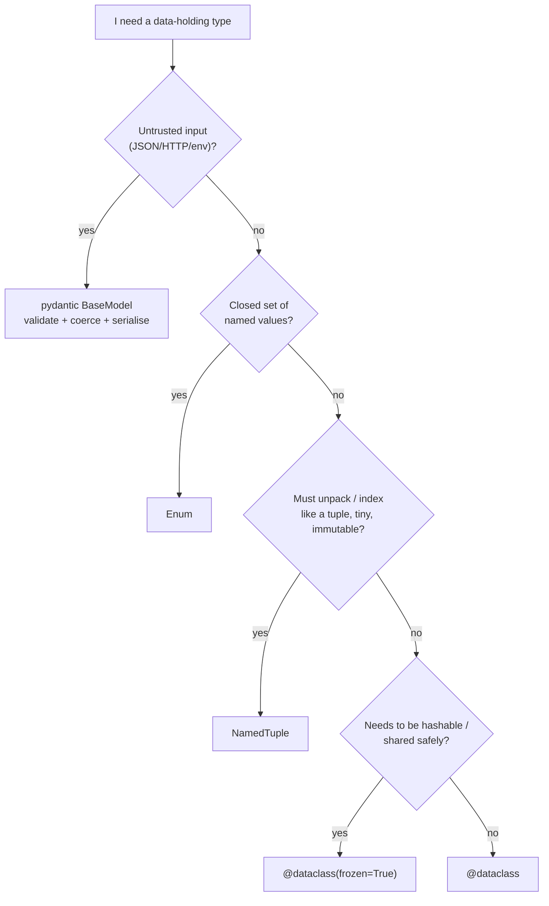

# Lesson 10: `dataclasses`, `NamedTuple`, `Enum` and pydantic

> **Prerequisites:** [Lesson 07: Dunder Methods](../07-dunder-methods-and-the-data-model/README.md) · [Lesson 09: ABCs, Protocols and Type Hints](../09-abcs-protocols-duck-typing-and-type-hints/README.md)  
> **Reading time:** ~22 minutes  
> **Audience:** Candidates asked "dataclass vs NamedTuple vs dict vs pydantic?", "what does `frozen=True` do?", or "`field(default_factory=…)`?"

> [!NOTE]
> **In one line:** Pick the lightest tool that gives the guarantees you need — **`@dataclass`** for mutable/regular data objects, **`frozen=True`** for value objects, **`NamedTuple`** for lightweight immutable records that must behave like tuples, **`Enum`** for a closed set of named values, and **pydantic** when data comes from *outside* and must be validated and coerced.

> [!TIP]
> **Golden rule:** Dataclasses and NamedTuples do **not** validate types at run time — hints are metadata. If the input is untrusted (JSON, HTTP, files), validate at the boundary with pydantic (or explicit checks) and keep plain dataclasses *inside* the domain.

> [!TIP]
> **Try it:** Run the section 3 file; then change `OrderLine` to `frozen=False` (drop `frozen=True`) and re-run — `{line: "ok"}` now raises `TypeError: unhashable type: 'OrderLine'`, and `line.qty = 5` succeeds instead of raising. Then run the [dataclass lab](#try-it--dataclass-lab-runnable) below (needs Python 3.11+ for `StrEnum`; the pydantic probe is skipped if pydantic is absent). Sketch `Order → OrderLine (value) → Status (enum)` in [LLD Studio](/tools/lld-studio/) and decide which of the four tools each box should be.

---

## 1. The smell: how this gets asked

- *"Why use a dataclass instead of a plain class or a dict?"*
- *"What does `@dataclass` generate? How do you make it immutable and hashable?"*
- *"Why can't I write `items: list = []` in a dataclass?"*
- *"NamedTuple vs dataclass?"*
- *"Where do type hints stop and validation start?"*



---

## 2. Reference

| Tool | Mutable | Hashable | Validates | Generated for you | Typical use |
| :--- | :---: | :---: | :---: | :--- | :--- |
| plain `dict` | Yes | No | No | — | Ad-hoc, JSON-ish |
| plain class | Yes | by id | No | nothing | Behaviour-heavy objects |
| `@dataclass` | Yes | No (`eq=True` clears hash) | No | `__init__`, `__repr__`, `__eq__` (+ order, slots optional) | Domain/data objects |
| `@dataclass(frozen=True)` | **No** | Yes | No | + `__hash__`, blocks setattr | Value objects, dict keys |
| `NamedTuple` | No | Yes | No | tuple behaviour, field names | Small records, return values |
| `Enum` | Members fixed | Yes | Membership | identity, `name`, `value`, iteration | Status, type codes |
| pydantic `BaseModel` | Yes (config) | opt-in | **Yes** (+coercion) | validation, `model_dump`, JSON schema | API/config/IO models |

| Dataclass option | Effect |
| :--- | :--- |
| `frozen=True` | Immutable; generates `__hash__` (with `eq=True`) |
| `order=True` | Generates `<`, `<=`, … comparing fields in order |
| `slots=True` (3.10+) | Uses `__slots__` (less memory) |
| `kw_only=True` (3.10+) | All fields keyword-only |
| `field(default_factory=list)` | Fresh mutable default per instance |
| `__post_init__` | Hook for validation/derived fields |
| `InitVar`, `field(init=False)` | Init-only values / computed fields |

---

## 3. Walkthrough: an `Order` model

**Requirements:** an `Order` with lines, a status from a fixed set, an immutable `Money`/`Point`-style value, and validated input from JSON.

1. `Status` as an `Enum` — no magic strings.
2. `OrderLine` as `frozen=True` dataclass — a value object.
3. `Order` as a regular dataclass with `field(default_factory=list)`.
4. `__post_init__` enforces invariants the hints can't.
5. `NamedTuple` for a lightweight `(lat, lon)` pair.
6. pydantic parses external JSON (shown separately as it needs an install).

````carousel
```python
from dataclasses import FrozenInstanceError, dataclass, field, replace
from enum import Enum, auto
from typing import NamedTuple


class Status(Enum):
    NEW = auto()
    PAID = auto()
    SHIPPED = auto()


@dataclass(frozen=True, order=True)
class OrderLine:
    sku: str
    qty: int
    price_cents: int

    def __post_init__(self) -> None:
        if self.qty <= 0 or self.price_cents < 0:
            raise ValueError("qty must be > 0 and price >= 0")

    @property
    def total(self) -> int:
        return self.qty * self.price_cents


@dataclass
class Order:
    order_id: str
    lines: list[OrderLine] = field(default_factory=list)   # NOT `= []`
    status: Status = Status.NEW

    def add(self, line: OrderLine) -> None:
        self.lines.append(line)

    @property
    def total(self) -> int:
        return sum(line.total for line in self.lines)


class GeoPoint(NamedTuple):
    lat: float
    lon: float


def main() -> None:
    line = OrderLine("pen", 3, 150)
    order = Order("o-1")
    order.add(line)
    order.add(replace(line, sku="ink", qty=1, price_cents=900))   # copy-with-change
    print(order)
    print(order.total, order.status.name, Status["PAID"], Status(2))

    try:
        line.qty = 5                                       # frozen
    except FrozenInstanceError as err:
        print("FrozenInstanceError:", err)
    print({line: "ok"}[OrderLine("pen", 3, 150)])         # hashable, equal by value
    print(sorted(order.lines)[0].sku)                      # order=True compares field by field

    try:
        OrderLine("bad", 0, 1)
    except ValueError as err:
        print("ValueError:", err)

    try:
        @dataclass
        class Bad:
            items: list = []                               # mutable default is rejected
    except ValueError as err:
        print("ValueError:", err)

    o2 = Order("o-2")
    o2.add(line)
    print(Order("o-3").lines, o2 == Order("o-2", [line]))  # [] True

    p = GeoPoint(12.9, 77.6)
    lat, lon = p                                           # unpacks like a tuple
    print(p, p.lat, p[1], lat == p[0], isinstance(p, tuple))

    print([s.name for s in Status], Status.PAID in Status, Status.NEW is Status.NEW)

    # Hints are NOT enforced: a dataclass without checks happily stores a str in an int field
    @dataclass
    class Loose:
        qty: int

    print(Loose("not-an-int").qty)                         # not-an-int  (no error)


if __name__ == "__main__":
    main()
```
<!-- slide -->
```python
# Runnable as-is once pydantic v2 is installed: pip install pydantic
# pydantic v2: validation + coercion at the boundary
from pydantic import BaseModel, Field, ValidationError


class OrderLineIn(BaseModel):
    sku: str
    qty: int = Field(gt=0)
    price_cents: int = Field(ge=0)


try:
    print(OrderLineIn.model_validate({"sku": "pen", "qty": "3", "price_cents": 150}))   # "3" coerced to 3
    OrderLineIn.model_validate({"sku": "pen", "qty": 0, "price_cents": 150})
except ValidationError as err:
    print(err.errors()[0]["loc"], err.errors()[0]["type"])                              # ('qty',) greater_than
```
<!-- slide -->
```csharp
// C# analogues
public enum Status { New, Paid, Shipped }

public sealed record OrderLine(string Sku, int Qty, int PriceCents)   // immutable, value equality
{
    public int Total => Qty * PriceCents;
}

public readonly record struct GeoPoint(double Lat, double Lon);       // ~ NamedTuple / frozen dataclass

public sealed class Order
{
    public string OrderId { get; init; } = "";
    public List<OrderLine> Lines { get; } = new();
    public Status Status { get; set; } = Status.New;
}
// Validation on input: DataAnnotations / FluentValidation  (~ pydantic)
```
````

Expected output of the Python tab (the second tab, pydantic v2, prints `sku='pen' qty=3 price_cents=150` then `('qty',) greater_than`):

```text
Order(order_id='o-1', lines=[OrderLine(sku='pen', qty=3, price_cents=150), OrderLine(sku='ink', qty=1, price_cents=900)], status=<Status.NEW: 1>)
1350 NEW Status.PAID Status.PAID
FrozenInstanceError: cannot assign to field 'qty'
ok
ink
ValueError: qty must be > 0 and price >= 0
ValueError: mutable default <class 'list'> for field items is not allowed: use default_factory
[] True
GeoPoint(lat=12.9, lon=77.6) 12.9 77.6 True True
['NEW', 'PAID', 'SHIPPED'] True True
not-an-int
```

---

## 4. Edges

- **Mutable defaults.** `items: list = []` raises `ValueError` in dataclasses (they detect unhashable defaults) — use `field(default_factory=list)`.
- **`frozen=True` is shallow.** A frozen dataclass holding a list can still have the list mutated — and `hash()` then fails with `TypeError: unhashable type: 'list'` because the hash is built from the fields. Use tuples/frozen types for deep immutability (lab probe 1).
- **`datetime.now()` as a default** is *accepted* (datetimes are hashable, so no `ValueError`) but evaluated once; every instance shares the timestamp. Use `default_factory` (probe 6).
- **`eq=True` removes `__hash__`** unless `frozen=True` (or `unsafe_hash=True`). Mutable + hashable objects corrupt dicts/sets.
- **Inheritance & ordering of defaults.** A field without a default can't follow one with a default (`kw_only=True` solves it).
- **No validation.** `OrderLine("x", "oops", 1)` succeeds. Add `__post_init__` checks or use pydantic.
- **`NamedTuple` equals a tuple.** `GeoPoint(1, 2) == (1, 2)` is `True` — surprising for domain types; prefer frozen dataclasses for entities of different meaning.
- **`Enum` comparison.** Compare with `is`/`==` to members, not raw values; use `IntEnum` only when integer behaviour is genuinely needed (it equals `int`s). Use `StrEnum` (3.11+) for string enums. Lookup by value `Status(2)`, by name `Status["PAID"]`.
- **Enum aliases/duplicates.** Same value → alias, not a new member; `@unique` forbids it.
- **pydantic cost.** Validation has overhead; don't use it for hot inner-loop objects. v2 is Rust-backed and much faster than v1, but still not free.
- **Serialisation.** `dataclasses.asdict` is recursive and copies; `Enum` isn't JSON-serialisable by default (use `.value` or `StrEnum`).
- **Concurrency:** frozen dataclasses/NamedTuples are safe to share across threads.

### Try it — dataclass lab (runnable)

The follow-ups interviewers use after you can recite what `@dataclass` generates. Save as `dataclass_lab.py`; every probe is an `assert` (or a printed error message), so a wrong claim fails loudly.

```python
import json, time
from dataclasses import dataclass, field, replace, asdict, InitVar, FrozenInstanceError
from datetime import datetime
from enum import Enum, IntEnum, StrEnum, unique
from typing import NamedTuple

# 1) frozen is SHALLOW: the list inside can still change, and hashing then fails
@dataclass(frozen=True)
class Tags:
    names: list
t = Tags(["a"])
t.names.append("b")                         # allowed: only attribute rebinding is blocked
assert t.names == ["a", "b"]
try:
    hash(t)
except TypeError as e:
    print("1:", e)

# 2) eq=True without frozen clears __hash__; unsafe_hash=True restores it (at your risk)
@dataclass
class M: x: int
@dataclass(unsafe_hash=True)
class U: x: int
assert M.__hash__ is None and hash(U(1)) == hash(U(1))

# 3) A field without a default cannot follow one with a default; kw_only=True fixes it
try:
    @dataclass
    class Bad:
        a: int = 0
        b: int
except TypeError as e:
    print("3:", e)
@dataclass(kw_only=True)
class Good:
    a: int = 0
    b: int
assert Good(b=2).b == 2

# 4) InitVar and field(init=False): init-only input and computed fields
@dataclass
class User:
    name: str
    password: InitVar[str]
    pw_hash: str = field(init=False)
    def __post_init__(self, password):
        self.pw_hash = f"h({password})"
u = User("ann", "secret")
assert u.pw_hash == "h(secret)" and not hasattr(u, "password")

# 5) asdict is recursive and COPIES; replace() makes a changed copy
@dataclass
class Line: sku: str
@dataclass
class Order:
    lines: list
o = Order([Line("pen")])
d = asdict(o)
assert d == {"lines": [{"sku": "pen"}]} and isinstance(d["lines"][0], dict)
o2 = replace(o, lines=[])
assert o.lines and not o2.lines

# 6) datetime.now() as a default is evaluated ONCE (and no error is raised); default_factory is per instance
@dataclass
class Bug:
    at: datetime = datetime.now()
@dataclass
class Fixed:
    at: datetime = field(default_factory=datetime.now)
b1 = Bug(); time.sleep(0.01); b2 = Bug()
assert b1.at == b2.at
f1 = Fixed(); time.sleep(0.01); f2 = Fixed()
assert f1.at != f2.at

# 7) slots=True: no __dict__, fewer surprises from typos
@dataclass(slots=True)
class S: x: int
s = S(1)
try:
    s.y = 2
except AttributeError as e:
    print("7:", type(e).__name__)

# 8) NamedTuple equals a plain tuple, and so do two different record types with the same values
class Point(NamedTuple):
    x: int; y: int
class Size(NamedTuple):
    w: int; h: int
assert Point(1, 2) == (1, 2) == Size(1, 2)               # surprising for domain types
@dataclass(frozen=True)
class P2: x: int; y: int
@dataclass(frozen=True)
class S2: w: int; h: int
assert P2(1, 2) != S2(1, 2)                               # dataclass eq also checks the class

# 9) Enum: aliases, @unique, IntEnum leaks, JSON
class Color(Enum):
    RED = 1
    CRIMSON = 1                                           # alias of RED, not a new member
assert Color.CRIMSON is Color.RED and len(Color) == 1
try:
    @unique
    class C2(Enum):
        A = 1
        B = 1
except ValueError as e:
    print("9:", e)
class Level(IntEnum): LOW = 1
class Plain(Enum): LOW = 1
assert Level.LOW == 1 and Plain.LOW != 1                 # IntEnum compares equal to ints
try:
    json.dumps({"c": Plain.LOW})
except TypeError as e:
    print("9b:", e)
class Name(StrEnum): PAID = "paid"
assert json.dumps({"s": Name.PAID}) == '{"s": "paid"}' and Name("paid") is Name.PAID

# 10) Hints are not enforced by dataclasses; __post_init__ is the cheap fix
@dataclass
class Qty:
    n: int
    def __post_init__(self):
        if not isinstance(self.n, int):
            raise TypeError(f"n must be int, got {type(self.n).__name__}")
try:
    Qty("3")
except TypeError as e:
    print("10:", e)

# 11) pydantic: coercion vs strict (skipped if not installed)
try:
    from pydantic import BaseModel, ConfigDict, ValidationError
except ImportError:
    print("11: pydantic not installed - skipped")
else:
    class Lax(BaseModel):
        qty: int
    class Strict(BaseModel):
        model_config = ConfigDict(strict=True)
        qty: int
    assert Lax(qty="3").qty == 3                         # coerced
    try:
        Strict(qty="3")
    except ValidationError as e:
        print("11:", e.errors()[0]["type"])
    try:
        Lax(qty="abc")
    except ValidationError as e:
        print("11b:", e.errors()[0]["type"])
print("dataclass lab ok")
```

Expected output:

```text
1: unhashable type: 'list'
3: non-default argument 'b' follows default argument 'a'
7: AttributeError
9: duplicate values found in <enum 'C2'>: B -> A
9b: Object of type Plain is not JSON serializable
10: n must be int, got str
11: int_type
11b: int_parsing
dataclass lab ok
```

---

## 5. What you'd say in two minutes

> "I choose by guarantee. A plain `@dataclass` gives me `__init__`, `__repr__` and `__eq__` for free — ideal for domain objects; mutable fields use `default_factory` so instances don't share a list. If I need a value object, `frozen=True` makes it immutable and hashable so it can be a dict key and is safe across threads — though the freeze is shallow. `NamedTuple` is for tiny immutable records that should unpack like tuples. An `Enum` replaces magic strings with a closed set of members. None of these validate types at run time — hints are metadata — so for untrusted input like JSON from an API I use pydantic at the boundary, which validates and coerces, and then work with plain dataclasses inside. In C# the equivalents are `record`, `record struct`, `enum` and DataAnnotations/FluentValidation."

---

## 6. Anti-patterns

| Anti-pattern | Why it fails | Fix |
| :--- | :--- | :--- |
| Passing raw `dict`s around the codebase | Typos, no contract | Dataclass / TypedDict at boundaries |
| `items: list = []` | Rejected (or shared in plain classes) | `default_factory=list` |
| Magic strings for status (`"paid"`) | Typos, no exhaustiveness | `Enum` |
| Trusting hints for external input | Silently wrong types | pydantic / explicit validation |
| Mutable dataclass as a dict key | Hash drift | `frozen=True` |
| Pydantic models everywhere incl. hot loops | Overhead | Validate at edges only |

---

## 7. Interview questions

<details>
<summary><strong>1. What does `@dataclass` generate? [BASIC]</strong></summary>

`__init__`, `__repr__` and `__eq__` from the annotated fields; optionally `__lt__` etc. (`order=True`), `__hash__` (`frozen=True`), `__slots__` (`slots=True`) and keyword-only init (`kw_only=True`).

</details>

<details>
<summary><strong>2. Why can't you write `items: list = []`? [BASIC]</strong></summary>

A mutable default would be shared by all instances (lesson 02). Dataclasses reject it with `ValueError`; use `field(default_factory=list)`.

</details>

<details>
<summary><strong>3. dataclass vs NamedTuple? [BASIC]</strong></summary>

NamedTuple is an immutable tuple with named fields: unpackable, indexable, hashable, lightweight, equal to plain tuples. Dataclass is a regular class: mutable by default, supports methods/inheritance/defaults better, not iterable.

</details>

<details>
<summary><strong>4. How do you make a dataclass immutable and hashable? [BASIC]</strong></summary>

`@dataclass(frozen=True)`; with `eq=True` it generates `__hash__` from the fields. Remember the freeze is shallow.

</details>

<details>
<summary><strong>5. When pydantic over dataclasses? [SCENARIO]</strong></summary>

When data crosses a trust boundary — request bodies, config, files — and you need validation, coercion, error reporting and (de)serialisation (FastAPI is built on it). Inside the domain, plain dataclasses are lighter.

</details>

<details>
<summary><strong>6. Do type hints validate dataclass fields? [TRICKY]</strong></summary>

No. `Order("x", lines="oops")` succeeds. Validate in `__post_init__`, or use pydantic's dataclasses/models.

</details>

<details>
<summary><strong>7. `Enum` vs constants vs `IntEnum`? [TRICKY]</strong></summary>

`Enum` members are distinct, comparable by identity, iterable and self-documenting. Module constants have no grouping or type. `IntEnum` members *are* ints (compare equal to numbers), which leaks — use only for wire-format codes.

</details>

<details>
<summary><strong>8. A dataclass field defaults to `datetime.now()`. What's wrong? [SCENARIO]</strong></summary>

The default is evaluated once at class definition, so every instance gets the same timestamp. Use `field(default_factory=datetime.now)`.

</details>

---

## 8. One-page cheat sheet

```text
@dataclass                 __init__ __repr__ __eq__      mutable;  field(default_factory=list) for mutables
@dataclass(frozen=True)    + __hash__, immutable (shallow) -> value objects, dict keys
@dataclass(order=True, slots=True, kw_only=True)   extras (3.10+)
__post_init__              validate / derive;   replace(obj, x=1) = copy-with-change
NamedTuple                 tuple + names; unpack/index; == plain tuple (surprise)
Enum / StrEnum             closed set; Status["X"], Status(v), iterate; compare with `is`
pydantic BaseModel         validate + coerce + serialise at the boundary (v2: model_validate/model_dump)
Hints                      NOT enforced.  Untrusted input => pydantic.  Inside domain => dataclass
C#                         record / record struct / enum / DataAnnotations
```

---

## Further reading

- [`dataclasses` documentation](https://docs.python.org/3/library/dataclasses.html) · [PEP 557](https://peps.python.org/pep-0557/)
- [`enum` documentation](https://docs.python.org/3/library/enum.html)
- [pydantic documentation](https://docs.pydantic.dev/latest/)

Previous: [ABCs, Protocols, Duck Typing and Type Hints](../09-abcs-protocols-duck-typing-and-type-hints/README.md) · Next: [Context Managers and with](../11-context-managers/README.md)
