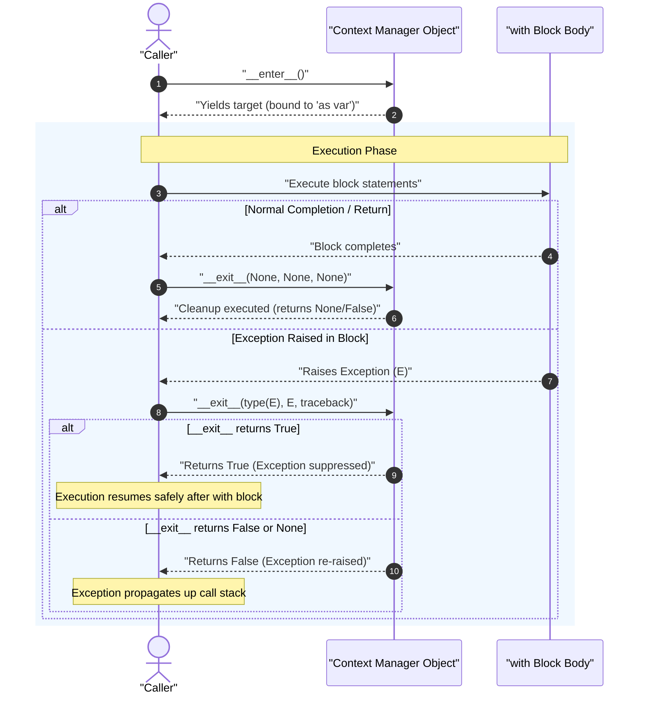

# Lesson 11: Context Managers and with

> **Prerequisites:** [dataclasses, NamedTuple, Enum and pydantic](../10-dataclasses-namedtuples-enums-and-pydantic/README.md) and [Track 27 Overview](../README.md).  
> **Estimated Reading Time:** 18 minutes  
> **Target Audience:** Engineers preparing for LLD, OOP, C#, or Python technical screening and architecture rounds.

> [!TIP]
> **The One Rule of Context Managers:** The `with` statement guarantees that teardown logic executes upon leaving the block, **regardless of whether the block completes normally, returns early, or aborts due to an unhandled exception**. In the context manager protocol, `__enter__()` acquires the resource, while `__exit__(exc_type, exc_val, exc_tb)` handles teardown. If `__exit__` returns `True`, the in-flight exception is suppressed; returning `False` or `None` propagates it. For generator-based context managers (`@contextmanager`), the post-yield cleanup code **must always be wrapped in a `try...finally` block**; otherwise, an exception raised inside the caller's `with` block will abort the generator and leak the resource.

---

## 1. Why This Matters: The Interview Trap

"What does the `with` statement actually do under the hood, and how do you guarantee zero resource leaks in distributed systems?" is an essential question for backend and platform engineers. Candidates who view `with` merely as syntax sugar for closing files frequently write leaky database transactions, swallow fatal errors accidentally, or leave unclosed network sockets during partial failures.

### The Weak Answer
> *"The `with` statement is just syntactic sugar for a `try...finally` block. You use it with `open('file.txt') as f:` so Python closes the file automatically when you are done. You can write your own by making a class with `__enter__` and `__exit__`, where `__exit__` closes things. If an error happens, Python handles it for you."*

### The Senior Strong Answer
> *"The `with` statement implements the **Context Management Protocol** (PEP 343), providing deterministic Resource Acquisition Is Initialization (RAII) and teardown semantics.
> 
> Under the hood, CPython executes a rigorous protocol:
> 1. It evaluates the context expression to retrieve the context manager object.
> 2. It invokes `manager.__enter__()`, binding its return value to the optional `as target` identifier.
> 3. It executes the inner block within an exception handling frame.
> 4. Upon block completion:
>    - If the block exits normally or via `return`: CPython calls `manager.__exit__(None, None, None)`.
>    - If an exception occurs: CPython captures the exception tuple `(exc_type, exc_val, exc_tb)` and passes it to `manager.__exit__()`.
> 5. **Exception Suppression:** If `__exit__` returns a truthy value (`True`), CPython suppresses the exception and resumes normal execution immediately after the `with` block. If `__exit__` returns falsy (`False` or `None`), CPython re-raises the exception up the call stack.
> 
> In addition to class-based managers, Python provides:
> - **`@contextlib.contextmanager`:** A decorator that transforms a generator containing a single `yield` into a context manager. Code before `yield` runs in `__enter__`; code after `yield` runs in `__exit__`. The post-yield code must be protected with `try...finally` because caller exceptions are injected into the generator via `gen.throw()`.
> - **`contextlib.ExitStack`:** A programmatic, LIFO stack for managing dynamic or arbitrary quantities of context managers safely without nested indentation hell.
> - **Async Context Managers (`__aenter__` / `__aexit__`):** Native coroutine-based context management used in `async with` for asynchronous network connections and locks."*

---

## 2. Visual Mental Model / Taxonomic Comparison

### The Complete Lifecycle of a `with` Statement

The sequence diagram below models both execution paths: normal completion and exception dispatch with conditional suppression.



### Context Manager Implementation Taxonomy

| Pattern | Definition Mechanism | Exception Handling Location | Concurrency / Async | Best Used For |
| :--- | :--- | :--- | :--- | :--- |
| **Class-Based** | `__enter__()` and `__exit__()` methods | Inside `__exit__(exc_type, exc_val, exc_tb)` | Synchronous | Stateful managers, complex transaction rollbacks, reusable library clients |
| **Generator-Based** | `@contextlib.contextmanager` wrapping a generator with `yield` | Around `yield` via `try...except...finally` | Synchronous | Lightweight resources, telemetry timers, temporary environment mutations |
| **Async Context Manager** | `__aenter__()` and `__aexit__()` coroutine methods | Inside `async def __aexit__()` | Asynchronous (`async with`) | Non-blocking database connections, Redis pools, `asyncio.Lock` |
| **Dynamic Stack** | `contextlib.ExitStack` / `AsyncExitStack` | Programmatic callbacks registered in LIFO stack | Both | Dynamic resource lists, combining multiple files or distributed locks |
| **C# `IDisposable`** | `void Dispose()` method via `using` statement | Handled outside via `try...catch` around `using` | Synchronous | Memory cleanup, native OS handles, socket termination in .NET |
| **C# `IAsyncDisposable`** | `ValueTask DisposeAsync()` via `await using` | Handled outside via `try...catch` around `await using` | Asynchronous | Asynchronous stream flushing, network disconnections in .NET |

---

## 3. Code Implementation

The carousel below demonstrates:
1. A robust class-based `DatabaseTransaction` context manager that commits on normal completion, rolls back on error, and selectively suppresses a designated `RollbackQuietly` business exception.
2. A generator-based context manager using `@contextlib.contextmanager` protected by `try...finally`.
3. Dynamic resource handling using `contextlib.ExitStack` ensuring guaranteed LIFO (Last-In, First-Out) teardown.
4. The equivalent C# implementation using `IDisposable`, custom RAII transaction scopes, and an `ExitStack` equivalent.

````carousel
```python
import contextlib
from typing import Any, List, Optional, Type


# 1. Custom exception for safe transactional rollbacks
class RollbackQuietly(Exception):
    """Custom exception used to trigger safe rollback without crashing."""
    pass


# 2. Class-Based Context Manager with Rollback & Selective Suppression
class DatabaseTransaction:
    def __init__(self, tx_id: int) -> None:
        self.tx_id = tx_id
        self.active = False

    def __enter__(self) -> "DatabaseTransaction":
        self.active = True
        print(f"[BEGIN] Transaction {self.tx_id}")
        return self

    def execute(self, sql: str) -> None:
        print(f"[SQL] {sql}")

    def __exit__(
        self,
        exc_type: Optional[Type[BaseException]],
        exc_val: Optional[BaseException],
        exc_tb: Optional[Any],
    ) -> bool:
        if exc_type is None:
            print(f"[COMMIT] Transaction {self.tx_id} committed successfully")
            self.active = False
            return False  # Normal exit; nothing to suppress

        print(f"[ROLLBACK] Transaction {self.tx_id} rolled back due to error")
        self.active = False
        # Suppress RollbackQuietly, but allow unexpected critical exceptions to propagate
        if issubclass(exc_type, RollbackQuietly):
            return True  # True instructs Python to swallow the exception
        return False  # False propagates unexpected errors


# 3. Generator-Based Context Manager with @contextmanager
@contextlib.contextmanager
def managed_lock(lock_name: str):
    print(f"[ACQUIRE] {lock_name} acquired")
    try:
        yield lock_name
    finally:
        # Mandatory try...finally guarantees release even if caller raises
        print(f"[RELEASE] {lock_name} released safely")


# 4. Resource tracking for ExitStack demonstration
class Resource:
    def __init__(self, name: str, history: List[str]) -> None:
        self.name = name
        self.history = history

    def __enter__(self) -> "Resource":
        return self

    def __exit__(self, *args: Any) -> None:
        self.history.append(self.name)


def run_demonstration() -> None:
    # 1. Class-Based Context Manager: Success path
    print("1. Class-Based Context Manager (Commit on success):")
    with DatabaseTransaction(1) as tx1:
        tx1.execute("Inserting user 'Alice'")

    # 2. Class-Based Context Manager: Rollback & Suppression path
    print("2. Class-Based Context Manager (Rollback on error):")
    suppressed = False
    try:
        with DatabaseTransaction(2) as tx2:
            tx2.execute("Inserting user 'Bob'")
            raise RollbackQuietly("Simulated validation failure")
        suppressed = True
    except RollbackQuietly:
        suppressed = False
    print(f"Exception suppressed safely: {suppressed}")

    # 3. Generator Context Manager
    print("3. Generator Context Manager (@contextmanager):")
    with managed_lock("Lock") as lock:
        print("[WORK] Processing critical section")

    # 4. Dynamic Resource Management (ExitStack)
    print("4. Dynamic Resource Management (ExitStack):")
    closed_order: List[str] = []
    with contextlib.ExitStack() as stack:
        resources = [
            stack.enter_context(Resource(f"res_{i}", closed_order))
            for i in range(3)
        ]
        print(f"Batch opened: [{', '.join(r.name for r in resources)}]")

    print(f"Batch closed: [{', '.join(closed_order)}]")


if __name__ == "__main__":
    run_demonstration()
```
<!-- slide -->
```csharp
using System;
using System.Collections.Generic;

// 1. Custom Exception for safe rollback
public class RollbackQuietlyException : Exception
{
    public RollbackQuietlyException(string message) : base(message) { }
}

// 2. Class-Based Transaction Manager with RAII
public class DatabaseTransaction : IDisposable
{
    private readonly int _txId;
    private bool _committed = false;

    public DatabaseTransaction(int txId)
    {
        _txId = txId;
        Console.WriteLine($"[BEGIN] Transaction {_txId}");
    }

    public void Execute(string sql)
    {
        Console.WriteLine($"[SQL] {sql}");
    }

    public void Commit()
    {
        _committed = true;
    }

    public void Dispose()
    {
        if (_committed)
        {
            Console.WriteLine($"[COMMIT] Transaction {_txId} committed successfully");
        }
        else
        {
            Console.WriteLine($"[ROLLBACK] Transaction {_txId} rolled back due to error");
        }
    }
}

// 3. Action-based RAII wrapper (simulating generator context manager)
public sealed class ActionDisposable : IDisposable
{
    private readonly Action _onDispose;
    public ActionDisposable(Action onDispose) => _onDispose = onDispose;
    public void Dispose() => _onDispose();
}

// 4. Dynamic Resource Stack (simulating ExitStack)
public class ExitStack : IDisposable
{
    private readonly Stack<IDisposable> _disposables = new();

    public T EnterContext<T>(T resource) where T : IDisposable
    {
        _disposables.Push(resource);
        return resource;
    }

    public void Dispose()
    {
        while (_disposables.Count > 0)
        {
            _disposables.Pop().Dispose();
        }
    }
}

public class Resource : IDisposable
{
    public string Name { get; }
    private readonly List<string> _history;

    public Resource(string name, List<string> history)
    {
        Name = name;
        _history = history;
    }

    public void Dispose()
    {
        _history.Add(Name);
    }
}

public class Program
{
    public static IDisposable ManagedLock(string lockName)
    {
        Console.WriteLine($"[ACQUIRE] {lockName} acquired");
        return new ActionDisposable(() => Console.WriteLine($"[RELEASE] {lockName} released safely"));
    }

    public static void Main()
    {
        // 1. Class-Based Context Manager: Success path
        Console.WriteLine("1. Class-Based Context Manager (Commit on success):");
        using (var tx1 = new DatabaseTransaction(1))
        {
            tx1.Execute("Inserting user 'Alice'");
            tx1.Commit();
        }

        // 2. Class-Based Context Manager: Rollback & Suppression path
        Console.WriteLine("2. Class-Based Context Manager (Rollback on error):");
        bool suppressed = false;
        try
        {
            using (var tx2 = new DatabaseTransaction(2))
            {
                tx2.Execute("Inserting user 'Bob'");
                throw new RollbackQuietlyException("Simulated validation failure");
            }
        }
        catch (RollbackQuietlyException)
        {
            suppressed = true; // Exception intercepted and handled safely
        }
        Console.WriteLine($"Exception suppressed safely: {suppressed}");

        // 3. Generator Context Manager
        Console.WriteLine("3. Generator Context Manager (@contextmanager):");
        using (ManagedLock("Lock"))
        {
            Console.WriteLine("[WORK] Processing critical section");
        }

        // 4. Dynamic Resource Management (ExitStack)
        Console.WriteLine("4. Dynamic Resource Management (ExitStack):");
        var closedOrder = new List<string>();
        using (var stack = new ExitStack())
        {
            var r0 = stack.EnterContext(new Resource("res_0", closedOrder));
            var r1 = stack.EnterContext(new Resource("res_1", closedOrder));
            var r2 = stack.EnterContext(new Resource("res_2", closedOrder));
            Console.WriteLine($"Batch opened: [{r0.Name}, {r1.Name}, {r2.Name}]");
        }
        Console.WriteLine($"Batch closed: [{string.Join(", ", closedOrder)}]");
    }
}
```
````

**Expected Output (Both Languages):**

```text
1. Class-Based Context Manager (Commit on success):
[BEGIN] Transaction 1
[SQL] Inserting user 'Alice'
[COMMIT] Transaction 1 committed successfully
2. Class-Based Context Manager (Rollback on error):
[BEGIN] Transaction 2
[SQL] Inserting user 'Bob'
[ROLLBACK] Transaction 2 rolled back due to error
Exception suppressed safely: True
3. Generator Context Manager (@contextmanager):
[ACQUIRE] Lock acquired
[WORK] Processing critical section
[RELEASE] Lock released safely
4. Dynamic Resource Management (ExitStack):
Batch opened: [res_0, res_1, res_2]
Batch closed: [res_2, res_1, res_0]
```

---

## 4. Where You Already Use It

- **In Python:**
  - **`open(filename)`:** The quintessential context manager; calls the underlying C runtime `close(fd)` immediately upon leaving the `with` block, guaranteeing that OS file handles are reclaimed without waiting for cyclic garbage collection.
  - **`threading.Lock` and `asyncio.Lock`:** `with lock:` acquires the mutex before entry and guarantees `lock.release()` in `__exit__`, preventing deadlock conditions on unhandled exceptions.
  - **`unittest.mock.patch`:** Dynamically alters an attribute, class, or module during the `with` block and restores the original reference upon exit, preventing test pollution.
  - **`decimal.localcontext()`:** Temporarily changes mathematical precision or rounding modes (e.g., `prec=4`) for financial computations within the block and automatically reverts to global precision upon exit.
  - **`tempfile.TemporaryDirectory()`:** Creates a secure temporary folder on disk and recursively removes the directory and all contained files upon exit.
  - **SQLAlchemy / Django `transaction.atomic()`:** Manages database savepoints and transaction commit/rollback lifecycles.

- **In C# / .NET:**
  - **The `using` Statement & `IDisposable`:** The .NET standard for deterministic cleanup of unmanaged resources (file streams, database connections, cryptography handles).
  - **`System.Transactions.TransactionScope`:** Manages ambient distributed transactions; if `scope.Complete()` is not invoked before `Dispose()`, the transaction automatically rolls back.
  - **ASP.NET Core `IServiceScope`:** `using var scope = app.Services.CreateScope();` allocates and disposes scoped dependency injection services per HTTP request.

---

## 5. Pitfalls and When Not to Use It

1. **The Inadvertent Exception Swallowing Bug:**
   - If `__exit__` returns `True` indiscriminately, it swallows **all** exceptions, including `KeyboardInterrupt`, `MemoryError`, `SystemExit`, or `NameError` (typos in your code). This turns critical crashes into silent bugs.
   - *Rule:* Only return `True` for specific, anticipated exception types:
     ```python
     def __exit__(self, exc_type, exc_val, exc_tb):
         self.cleanup()
         return exc_type is not None and issubclass(exc_type, ExpectedBusinessError)
     ```

2. **The Missing `try...finally` in `@contextmanager`:**
   - In a generator context manager, if an exception occurs in the caller's `with` block, Python re-injects that exception into the generator at the `yield` point using `generator.throw()`. If the code after `yield` is not wrapped in `try...finally`, the generator immediately terminates and **the cleanup code is skipped!**
     ```python
     # FATAL BUG: Leak on error!
     @contextmanager
     def open_connection():
         conn = acquire()
         yield conn
         conn.close()  # Never executes if with block raises!
     ```

3. **Re-entering Non-Reentrant Context Managers:**
   - Most context managers are single-use state machines. Reusing the same instance in nested or concurrent `with` statements (e.g., `cm = MyManager(); with cm: with cm: ...`) results in corrupted state or premature cleanup. If re-entrancy is needed, inherit from `contextlib.ReentrantContextManager`.

4. **Deep Indentation Hell with Dynamic Resources:**
   - Opening an unpredictable number of files or resources by nesting `with` statements (`with open(f1): with open(f2): ...`) is unmaintainable. Furthermore, if the fifth resource throws during acquisition, earlier resources may not be tracked cleanly without `contextlib.ExitStack`.

---

## 6. Exercises & Practical Drills

### Exercise 1: Spot the Resource Leak
Explain why the following custom context manager leaks database connections when an unhandled query error occurs, and fix it:

```python
from contextlib import contextmanager


@contextmanager
def get_db_session():
    session = db_pool.acquire()
    print("Session acquired")
    yield session
    session.close()
    print("Session closed")
```

<details>
<summary>Answer</summary>

**The Bug:**  
When an exception is raised inside the caller's `with get_db_session() as s:` block, CPython's context manager machinery executes `gen.throw(exc_type, exc_val, exc_tb)`. This re-raises the exception directly from the `yield session` expression. Because there is no `try...finally` block enclosing the `yield`, execution aborts immediately; `session.close()` is never called, leaking the connection back into the pool.

**Fixed Code:**
```python
from contextlib import contextmanager


@contextmanager
def get_db_session():
    session = db_pool.acquire()
    print("Session acquired")
    try:
        yield session
    finally:
        session.close()
        print("Session closed")
```
</details>

### Exercise 2: Building an Execution Latency & Telemetry Manager
Implement a class-based context manager named `ExecutionTimer` that records the elapsed time in seconds, captures any exception that occurred, and logs the execution metrics upon exit without swallowing exceptions.

<details>
<summary>Answer</summary>

```python
import time
from typing import Any, Optional, Type


class ExecutionTimer:
    def __init__(self, operation_name: str) -> None:
        self.operation_name = operation_name
        self.elapsed_ms: float = 0.0
        self._start_time: float = 0.0

    def __enter__(self) -> "ExecutionTimer":
        self._start_time = time.perf_counter()
        return self

    def __exit__(
        self,
        exc_type: Optional[Type[BaseException]],
        exc_val: Optional[BaseException],
        exc_tb: Optional[Any],
    ) -> bool:
        self.elapsed_ms = (time.perf_counter() - self._start_time) * 1000.0
        status = "FAILED" if exc_type else "SUCCESS"
        print(f"[{status}] {self.operation_name} took {self.elapsed_ms:.2f}ms")
        # Return False so any exception continues propagating
        return False
```
</details>

### Exercise 3: Dynamic Multi-File Merger with `ExitStack`
Write a function `merge_files(source_paths: list[str], output_path: str)` that opens an arbitrary number of source files simultaneously and concatenates their contents into `output_path`. Ensure that if any file fails to open, all already-opened files are closed immediately without leaks.

<details>
<summary>Answer</summary>

```python
from contextlib import ExitStack
from typing import List


def merge_files(source_paths: List[str], output_path: str) -> None:
    with ExitStack() as stack:
        # Open output file first
        out_f = stack.enter_context(open(output_path, "w", encoding="utf-8"))
        
        # Dynamically acquire and track every input file
        input_files = [
            stack.enter_context(open(path, "r", encoding="utf-8"))
            for path in source_paths
        ]
        
        for in_f in input_files:
            out_f.write(in_f.read())
            out_f.write("\n")
    # All files guaranteed closed upon exiting the ExitStack block
```
</details>

---

## 7. Interview Questions & Model Answers

> [!interview]
> **Question 1: What is a context manager?**  
> **Strong Answer:**  
> "A context manager is a Python object that implements the **Context Management Protocol** defined in PEP 343, consisting of two dunder methods: `__enter__()` and `__exit__()`.  
> 
> It provides deterministic setup and teardown semantics around an execution block using the `with` statement. The `__enter__()` method sets up the runtime context (e.g., acquiring locks, opening files, initiating transactions) and optionally returns a target object bound via `as`. The `__exit__()` method receives information about any exception that occurred within the block and executes teardown (releasing locks, closing file descriptors, committing/rolling back transactions). Context managers ensure that cleanup logic runs reliably even when exceptions, runtime errors, or early `return` statements interrupt execution."

> [!interview]
> **Question 2: How do you write one?**  
> **Strong Answer:**  
> "There are two primary ways to write a context manager in Python:
> 
> 1. **Class-Based Implementation:** Define a class that implements `__enter__(self)` and `__exit__(self, exc_type, exc_val, exc_tb)`. In `__exit__`, return `True` if you intend to swallow an exception, or `False`/`None` to allow it to propagate. This approach is best for complex, stateful managers like database connections or network sockets.
> 2. **Generator-Based Implementation via `contextlib.contextmanager`:** Decorate a generator function containing a single `yield` statement. Code preceding `yield` executes during `__enter__`; the yielded value is bound to the `as` variable; and code following `yield` executes during `__exit__`. **The cleanup code must be wrapped in a `try...finally` block**, because any exception thrown in the `with` block is re-injected into the generator at the `yield` point via `generator.throw()`."

> [!interview]
> **Question 3: What does the `with` statement guarantee?**  
> **Strong Answer:**  
> "The `with` statement guarantees that the context manager's `__exit__()` method will be executed **deterministically upon exiting the lexical block**, regardless of how the block terminates.  
> 
> Specifically, it guarantees teardown under all of the following exit conditions:
> - Normal completion of all statements in the block.
> - An unhandled exception raised anywhere within the block.
> - Early exit via a `return`, `break`, or `continue` statement.
> 
> Furthermore, it guarantees that if an exception is raised, `__exit__` will receive the complete exception triple (`exc_type`, `exc_val`, `exc_tb`) before the call stack unwinds, granting the context manager full authority to log, roll back, propagate, or suppress the exception. The only scenarios where `__exit__` does not run are non-graceful process aborts, such as `os._exit()`, a hard SIGKILL, or a physical power failure."

> [!interview]
> **Question 4: What is contextlib.ExitStack and when should you use it?**  
> **Strong Answer:**  
> "`contextlib.ExitStack` is a programmatic context manager designed for managing a dynamic or variable collection of context managers and cleanup callbacks.  
> 
> While the standard `with` statement requires statically known context managers at compile time (e.g., `with A(), B():`), `ExitStack` allows you to register an arbitrary number of context managers at runtime using `stack.enter_context(cm)`.  
> 
> Key capabilities include:
> - **LIFO Teardown Guarantee:** It maintains an internal stack, ensuring that resources are closed in the exact reverse order of entry (Last-In, First-Out), matching traditional call stack unwinding and preventing deadlock in nested lock acquisition.
> - **Partial Acquisition Safety:** If acquiring the $N$-th resource in a loop fails with an exception, `ExitStack` immediately unwinds and closes the previously acquired $N-1$ resources before propagating the exception, preventing resource leaks during partial failures.
> - **Arbitrary Callbacks:** Allows registering arbitrary cleanup callbacks via `stack.callback(cleanup_fn, *args)`."

---

## 8. Sources & Further Reading

- [PEP 343: The "with" Statement](https://peps.python.org/pep-0343/)
- [Python 3 Documentation: `contextlib` — Utilities for with-statement contexts](https://docs.python.org/3/library/contextlib.html)
- [Python 3 Documentation: Context Manager Types](https://docs.python.org/3/library/stdtypes.html#context-manager-types)
- [Fluent Python (2nd Edition) by Luciano Ramalho: Chapter 18 - with, match, and else Blocks](https://www.oreilly.com/library/view/fluent-python-2nd/9781492056348/)
- [Microsoft Learn: `using` statement - ensure the correct use of disposable objects](https://learn.microsoft.com/en-us/dotnet/csharp/language-reference/statements/using)

---

Previous: [dataclasses, NamedTuple, Enum and pydantic](../10-dataclasses-namedtuples-enums-and-pydantic/README.md) · Next: [Exceptions Done Right](../12-exceptions-done-right/README.md)
