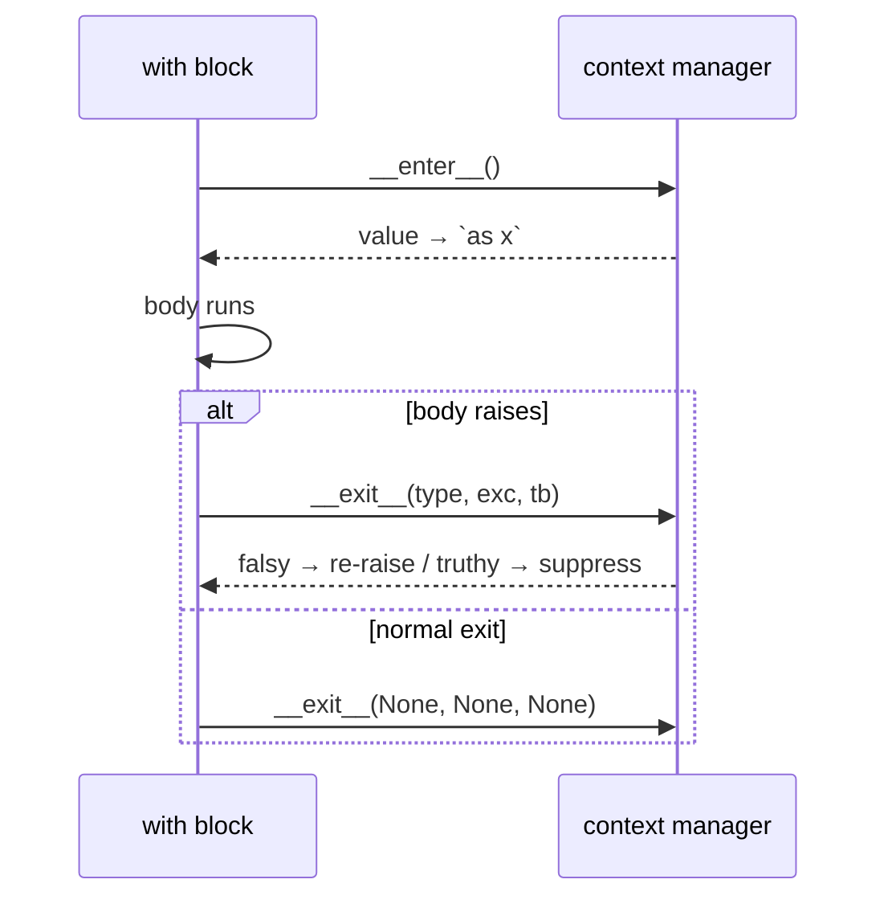

# Lesson 11: Context Managers and `with`

> **Prerequisites:** [Lesson 04: Decorators](../04-decorators/README.md) · [Lesson 05: Generators](../05-iterators-generators-and-yield/README.md)  
> **Reading time:** ~20 minutes  
> **Audience:** Candidates asked "what does `with` guarantee?", "write a context manager", or "`@contextmanager` vs a class?"

> [!NOTE]
> **In one line:** `with expr as x:` calls `expr.__enter__()` (its return value becomes `x`) and **always** calls `__exit__(exc_type, exc, tb)` when the block ends — normally or by exception — which makes it Python's tool for deterministic cleanup (files, locks, transactions, temporary state).

> [!TIP]
> **Golden rule:** Anything you must "undo" — release a lock, close a file, roll back a transaction, restore a setting — belongs in a context manager. Return **`True` from `__exit__` only if you really mean to swallow the exception**; the default (`None`/`False`) lets it propagate.

> [!TIP]
> **Try it:** Run the file; then make `Transaction.__exit__` return `True` and notice the exception disappears — the classic bug (`propagated: boom` is no longer printed). Then run the [context-manager lab](#try-it--context-manager-lab-runnable) below. Model the transaction as `begin → work → commit | rollback` in [LLD Studio](/tools/lld-studio/) — it's the Template Method / RAII shape.

---

## 1. The smell: how this gets asked

- *"What does `with open(...)` do that `open()`/`close()` doesn't?"*
- *"Write a timer / transaction / temporary-directory context manager."*
- *"What are `__enter__` and `__exit__`'s arguments? What does returning `True` do?"*
- *"`contextlib.contextmanager`: how does it work, and what must you remember?"*
- *"How is this different from `try/finally`? From C# `using`?"*



`with A() as a, B() as b:` is nested `with`s: B exits first, then A (LIFO).

---

## 2. Reference

| Tool | Use | Notes |
| :--- | :--- | :--- |
| Class with `__enter__`/`__exit__` | Reusable, stateful managers | Most explicit |
| `@contextlib.contextmanager` | A generator with one `yield` | Code before `yield` = enter; after = exit; wrap `yield` in `try/finally` |
| `contextlib.suppress(Exc)` | Ignore specific exceptions | Replaces `try/except: pass` |
| `contextlib.closing(obj)` | Call `.close()` on exit | For objects without `__exit__` |
| `contextlib.ExitStack` | Dynamic number of managers | Open N files, register callbacks |
| `contextlib.redirect_stdout` | Temporary redirect | Testing |
| `async with` | `__aenter__`/`__aexit__` | Async resources (lesson 15) |

| | `try/finally` | `with` |
| :--- | :--- | :--- |
| Cleanup guaranteed | Yes | Yes |
| Reusable / named | No (copy-paste) | **Yes** |
| Can inspect/suppress exception | Needs `except` | `__exit__` receives it |
| Python / C# analogue | — / `try-finally` | — / `using` |

---

## 3. Walkthrough: a timer, a transaction, `ExitStack`

**Requirements:** (1) `Timer` as a class; (2) `Transaction` that commits on success and rolls back on error but **lets the error propagate**; (3) `temp_setting` with `@contextmanager`; (4) `ExitStack` for many resources.

1. `__enter__` acquires/starts and returns the object bound by `as`.
2. `__exit__` receives the exception info; return falsy to propagate.
3. In `@contextmanager`, always `try: yield … finally: restore` — otherwise an exception skips cleanup.
4. `ExitStack` pops contexts in reverse order, even if a later one fails to open.

````carousel
```python
import time
from contextlib import ExitStack, closing, contextmanager, suppress


class Timer:
    def __enter__(self) -> "Timer":
        self.start = time.perf_counter()
        return self

    def __exit__(self, exc_type, exc, tb) -> bool:
        self.elapsed = time.perf_counter() - self.start
        return False                                   # never swallow exceptions


class Transaction:
    def __init__(self, log: list[str]) -> None:
        self.log = log

    def __enter__(self) -> "Transaction":
        self.log.append("BEGIN")
        return self

    def __exit__(self, exc_type, exc, tb) -> bool:
        self.log.append("ROLLBACK" if exc_type else "COMMIT")
        return False                                   # propagate the error after rollback


settings = {"debug": False}


@contextmanager
def temp_setting(key: str, value):
    old = settings[key]
    settings[key] = value
    try:
        yield settings                                 # body runs here
    finally:                                           # runs even if the body raises
        settings[key] = old


@contextmanager
def tag(name: str, out: list[str]):
    out.append(f"<{name}>")
    yield
    out.append(f"</{name}>")                           # NOTE: skipped if the body raises


class Resource:
    def __init__(self, name: str, log: list[str]) -> None:
        self.name, self.log = name, log
        log.append(f"open {name}")

    def close(self) -> None:
        self.log.append(f"close {self.name}")


def main() -> None:
    with Timer() as t:
        sum(range(100_000))
    print("elapsed set:", t.elapsed >= 0)

    log: list[str] = []
    with Transaction(log):
        log.append("work")
    try:
        with Transaction(log):
            raise ValueError("boom")
    except ValueError as err:
        print("propagated:", err)
    print(log)                       # ['BEGIN','work','COMMIT','BEGIN','ROLLBACK']

    with temp_setting("debug", True) as s:
        print("inside:", s["debug"])
    print("after:", settings["debug"])

    try:
        with temp_setting("debug", True):
            raise RuntimeError("fail")
    except RuntimeError:
        print("restored despite error:", settings["debug"])   # False

    out: list[str] = []
    try:
        with tag("b", out):
            raise KeyError("x")
    except KeyError:
        pass
    print(out)                       # ['<b>']  <- closing tag skipped: needs try/finally

    with suppress(FileNotFoundError):
        open("definitely-missing.txt")
    print("suppressed")

    events: list[str] = []
    with ExitStack() as stack:
        for name in ("a", "b", "c"):
            stack.callback(Resource(name, events).close)    # closes in reverse order
    print(events)

    with closing(Resource("z", events)) as r:
        pass
    print(events[-1])


if __name__ == "__main__":
    main()
```
<!-- slide -->
```csharp
// C#: using / IDisposable is the equivalent; `await using` for IAsyncDisposable.
var log = new List<string>();
using (var tx = new Transaction(log))
{
    // work...
    tx.Commit();
}
Console.WriteLine(string.Join(",", log));   // BEGIN,COMMIT

public sealed class Transaction : IDisposable
{
    private readonly List<string> _log;
    private bool _committed;
    public Transaction(List<string> log) { _log = log; _log.Add("BEGIN"); }
    public void Commit() { _committed = true; _log.Add("COMMIT"); }
    public void Dispose() { if (!_committed) _log.Add("ROLLBACK"); }   // always runs
}

// C# has no way for Dispose to see the exception; Python's __exit__ receives it directly.
```
````

Expected output of the Python tab:

```text
elapsed set: True
propagated: boom
['BEGIN', 'work', 'COMMIT', 'BEGIN', 'ROLLBACK']
inside: True
after: False
restored despite error: False
['<b>']
suppressed
['open a', 'open b', 'open c', 'close c', 'close b', 'close a']
close z
```

Two lines to read closely: `['<b>']` (the closing tag is missing — `tag` has no `try/finally`, which is deliberate) and the `ExitStack` line (resources close in reverse order of registration).

---

## 4. Edges

- **Swallowing exceptions by accident.** `__exit__` returning a truthy value suppresses the exception. A forgotten `return True` (or a `return` in a `finally`) is a nasty bug.
- **`@contextmanager` needs `try/finally`.** If the body raises, the exception is re-thrown *at the `yield`*; code after `yield` without `finally` is skipped (see `tag` above).
- **Exactly one `yield`** in a `@contextmanager` generator.
- **`__enter__` failing** means `__exit__` is not called — acquire carefully (use `ExitStack` for multi-step setup).
- **`as` binds `__enter__`'s return,** not the manager itself — return `self` if you want the object.
- **Reuse.** Many context managers are single-use (generator-based ones definitely: entering the same `@contextmanager` object twice fails — `RuntimeError` or `AttributeError` depending on the Python version). Make a class reusable by building fresh state in `__enter__` (probe 7). To use a manager as a decorator too, subclass `contextlib.ContextDecorator` (probe 8).
- **Partial setup.** With `with A(), B():`, if `B.__enter__` raises, `A` is still exited but `B.__exit__` is not called (probe 2).
- **Files and temp files.** `with` closes a `NamedTemporaryFile(delete=False)` but does not delete it; deletion is still your job (probe 11).
- **Locks.** `with lock:` is the correct way — no forgotten `release()` on exception paths.
- **Order and unwinding.** Multiple managers exit in reverse; exceptions raised inside `__exit__` replace the original (chained via `__context__`).
- **Async.** Use `async with` and `__aenter__`/`__aexit__` (or `@asynccontextmanager`); a sync manager can't `await`.
- **Thread/process safety:** cleanup guarantees are per-thread; a context manager doesn't make shared state thread-safe.
- **Generators with `with` inside** are cleaned up when the generator is closed (lesson 05).

### Try it — context-manager lab (runnable)

The follow-ups interviewers use after the basic `__enter__`/`__exit__` answer. Save as `context_manager_lab.py`; every probe is an `assert` (or a printed message), so a wrong claim fails loudly.

```python
import os, tempfile, threading
from contextlib import ExitStack, ContextDecorator, contextmanager, nullcontext, suppress, redirect_stdout
import io

log = []
class CM:
    def __init__(self, name, fail_enter=False, swallow=False):
        self.name, self.fail_enter, self.swallow = name, fail_enter, swallow
    def __enter__(self):
        if self.fail_enter:
            raise RuntimeError(f"{self.name} enter failed")
        log.append(f"enter {self.name}"); return self
    def __exit__(self, et, e, tb):
        log.append(f"exit {self.name}")
        return self.swallow

# 1) `with A, B`: B exits first; exits run on return / break / continue too
log.clear()
def early():
    with CM("a"), CM("b"):
        return "x"
assert early() == "x" and log == ["enter a", "enter b", "exit b", "exit a"]
log.clear()
for _ in range(2):
    with CM("loop"):
        continue
assert log == ["enter loop", "exit loop"] * 2

# 2) If __enter__ fails, ITS __exit__ is not called, but earlier managers still unwind
log.clear()
try:
    with CM("ok"), CM("bad", fail_enter=True):
        pass
except RuntimeError:
    pass
assert log == ["enter ok", "exit ok"]

# 3) Returning True from __exit__ swallows everything (the bug); the code after `with` runs
swallowed = False
with CM("sw", swallow=True):
    raise ValueError("lost forever")
swallowed = True
assert swallowed

# 4) An exception raised inside __exit__ replaces the original and chains it
class Boom:
    def __enter__(self): return self
    def __exit__(self, *a): raise KeyError("cleanup failed")
try:
    with Boom():
        raise ValueError("original")
except KeyError as e:
    assert isinstance(e.__context__, ValueError)

# 5) @contextmanager: a missing try/finally skips cleanup; with it, cleanup runs
state = []
@contextmanager
def bad():
    state.append("setup"); yield; state.append("cleanup")
@contextmanager
def good():
    state.append("setup")
    try: yield
    finally: state.append("cleanup")
for cm in (bad, good):
    state.clear()
    with suppress(ZeroDivisionError):
        with cm():
            1 / 0
    print("5:", cm.__name__, state)

# 6) @contextmanager can suppress by catching at the yield and NOT re-raising
@contextmanager
def ignore_value_error():
    try: yield
    except ValueError: pass
with ignore_value_error():
    raise ValueError("gone")

# 7) Generator-based managers are single-use; a class that rebuilds state in __enter__ is reusable
@contextmanager
def once():
    yield
cm = once()
with cm: pass
try:
    with cm: pass
except (RuntimeError, AttributeError):          # which one depends on the Python version
    print("7: generator-based manager cannot be re-entered")
class Reusable:
    def __enter__(self): self.items = []; return self.items
    def __exit__(self, *a): return False
r = Reusable()
with r as a: a.append(1)
with r as b: assert b == []

# 8) ContextDecorator: the same manager works as a decorator
calls = []
class Traced(ContextDecorator):
    def __enter__(self): calls.append("in"); return self
    def __exit__(self, *a): calls.append("out"); return False
@Traced()
def work(): calls.append("work")
work()
assert calls == ["in", "work", "out"]

# 9) ExitStack: variable number of resources; if opening #3 fails, #1 and #2 are still closed
closed = []
def opener(i):
    if i == 3: raise OSError("cannot open 3")
    @contextmanager
    def res():
        try: yield i
        finally: closed.append(i)
    return res()
try:
    with ExitStack() as stack:
        for i in (1, 2, 3):
            stack.enter_context(opener(i))
except OSError:
    pass
assert closed == [2, 1]

# 10) nullcontext: optional manager without if/else; redirect_stdout for tests
lock = None
with (lock if lock else nullcontext()):
    pass
buf = io.StringIO()
with redirect_stdout(buf):
    print("captured")
assert buf.getvalue() == "captured\n"

# 11) Real thing: a lock released on exception, a temp file removed on exception
mutex = threading.Lock()
try:
    with mutex:
        raise RuntimeError
except RuntimeError:
    pass
assert not mutex.locked()
path = None
try:
    with tempfile.NamedTemporaryFile("w", delete=False) as fh:
        path = fh.name
        raise RuntimeError
except RuntimeError:
    pass
assert fh.closed and os.path.exists(path)      # file closed by `with`...
os.remove(path)                                # ...but delete=False means YOU still own removal
print("context-manager lab ok")
```

Expected output:

```text
5: bad ['setup']
5: good ['setup', 'cleanup']
7: generator-based manager cannot be re-entered
context-manager lab ok
```

---

## 5. What you'd say in two minutes

> "`with` is deterministic cleanup. Python calls `__enter__` — whose return value binds to `as` — runs the block, then *always* calls `__exit__` with the exception type, value and traceback, or three `None`s on success. If `__exit__` returns a truthy value the exception is suppressed; otherwise it propagates, which is what I want almost always — for a transaction I roll back in `__exit__` and let the error continue. I can write one as a class or, more concisely, with `@contextlib.contextmanager` — a generator with a single `yield`, where I must wrap the `yield` in `try/finally` so cleanup runs on exceptions. For a variable number of resources I use `ExitStack`. It's the same job as C# `using` and `IDisposable`, with the extra ability to see and suppress the exception."

---

## 6. Anti-patterns

| Anti-pattern | Why it fails | Fix |
| :--- | :--- | :--- |
| `f = open(...)` … `f.close()` | Leaks on exceptions | `with open(...)` |
| `return True` in `__exit__` "to be safe" | Hides every error | Return `False`/`None` |
| `@contextmanager` without `try/finally` | Cleanup skipped on error | `try: yield finally: ...` |
| Manual `lock.acquire()` / `release()` | Missed release paths | `with lock:` |
| Heavy work in `__enter__` that can fail midway | Partial acquisition leaks | `ExitStack` / separate managers |
| `try: ... except: pass` | Swallows everything | `contextlib.suppress(SpecificError)` |

---

## 7. Interview questions

<details>
<summary><strong>1. What does `with` guarantee? [BASIC]</strong></summary>

That `__exit__` runs when the block ends — whether normally, by exception, `return`, `break` or `continue` — so cleanup happens deterministically (as long as `__enter__` succeeded).

</details>

<details>
<summary><strong>2. What are the arguments of `__exit__` and what does its return value mean? [BASIC]</strong></summary>

`(exc_type, exc_value, traceback)`, all `None` when no exception. Returning a truthy value suppresses the exception; falsy/`None` lets it propagate.

</details>

<details>
<summary><strong>3. Write a context manager with `contextlib`. What must you remember? [BASIC]</strong></summary>

`@contextmanager def cm(): setup; try: yield value; finally: cleanup`. One `yield`; use `try/finally` so cleanup runs when the body raises.

</details>

<details>
<summary><strong>4. What does `as x` bind to? [TRICKY]</strong></summary>

The return value of `__enter__`, not the context manager object (unless `__enter__` returns `self`, as `open()` does).

</details>

<details>
<summary><strong>5. `with` vs `try/finally`? [BASIC]</strong></summary>

Same guarantee, but a context manager packages the pattern for reuse and exposes exception details to the manager. `try/finally` is fine for one-offs.

</details>

<details>
<summary><strong>6. Open a variable number of files safely. [SCENARIO]</strong></summary>

`with ExitStack() as stack: files = [stack.enter_context(open(p)) for p in paths]` — all are closed in reverse order even if opening one fails.

</details>

<details>
<summary><strong>7. Your transaction manager hides errors — why? [SCENARIO]</strong></summary>

Probably `__exit__` returns `True` (or a truthy value) after rollback, suppressing the exception. Return `False`/`None`; rollback and *re-raise*.

</details>

<details>
<summary><strong>8. Python `with` vs C# `using`? [BASIC]</strong></summary>

Both give deterministic cleanup. C# calls `Dispose()` (no access to the exception); Python's `__exit__` receives the exception and may suppress it. C# 8's `using var` declarations scope to the enclosing block.

</details>

---

## 8. One-page cheat sheet

```text
with cm as x:      x = cm.__enter__() ... cm.__exit__(exc_type, exc, tb)   ALWAYS runs (if enter succeeded)
__exit__ result    truthy = suppress;  falsy/None = propagate  (default: propagate)
@contextmanager    def cm(): setup; try: yield v; finally: cleanup      # one yield
suppress(E)        ignore specific errors      closing(o)  call o.close()
ExitStack          N dynamic resources; callback(); enter_context(); reverse unwinding
Multiple           with A() as a, B() as b:   B exits first
Async              async with / __aenter__/__aexit__ / @asynccontextmanager
Use for            files, locks, transactions, temp state, timers, connections
C#                 using / IDisposable / await using
```

---

## Further reading

- [Python reference: the `with` statement](https://docs.python.org/3/reference/compound_stmts.html#the-with-statement)
- [`contextlib` documentation](https://docs.python.org/3/library/contextlib.html)
- [PEP 343: the "with" statement](https://peps.python.org/pep-0343/)

Previous: [dataclasses, NamedTuple, Enum and pydantic](../10-dataclasses-namedtuples-enums-and-pydantic/README.md) · Next: [Exceptions Done Right](../12-exceptions-done-right/README.md)
