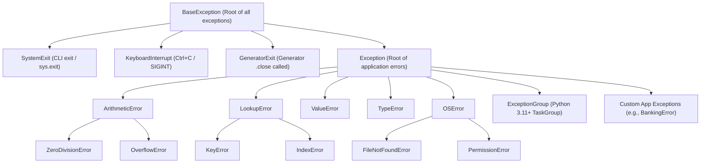
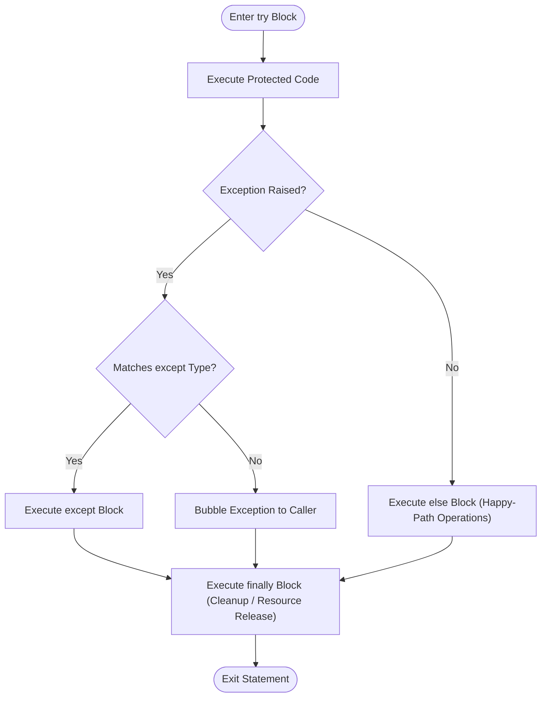

# Lesson 12: Exceptions Done Right

> **Prerequisites:** [Context Managers and with](../11-context-managers/README.md) and [Track 27 Overview](../README.md).  
> **Estimated Reading Time:** 18 minutes  
> **Target Audience:** Engineers preparing for LLD, OOP, C#, or Python technical screening and architecture rounds.

> [!TIP]
> **The One Rule of Exceptions:** Treat exceptions as true disruptions to normal control flow, never as routine conditional branching; write minimal `try` blocks, isolate happy-path follow-ups in `else`, chain root causes with `raise ... from`, and catch `Exception` instead of `BaseException` so control signals like `KeyboardInterrupt` and `SystemExit` never get swallowed.

---

## 1. Why This Matters: The Interview Trap

"When should you use EAFP versus LBYL in Python, and why should you never catch a bare `except`?" is a cornerstone question in senior Python interviews. It cuts through superficial syntax knowledge and evaluates whether you understand concurrency, runtime internals, and fault tolerance.

### The Junior vs. Senior Contrast

**The Junior Answer:**
> *"EAFP means 'Easier to Ask for Forgiveness than Permission', so you use `try...except`. LBYL means 'Look Before You Leap', so you use `if...else`. Python prefers EAFP because it's Pythonic. And you shouldn't use bare `except:` because linters flag it as bad style."*

**The Senior Answer:**
> *"LBYL (`if key in dict: ...`) performs a defensive pre-check before acting, which introduces severe **TOCTOU (Time-Of-Check to Time-Of-Use)** race conditions in multi-threaded and distributed environments—such as checking whether a file or cache key exists before opening or fetching it. EAFP attempts the atomic operation directly and handles failure in an `except` block, guaranteeing atomicity.*  
> 
> *From a performance perspective, CPython 3.11+ introduced table-driven **zero-cost exceptions**: entering a `try` block incurs virtually zero CPU cycles when no exception is raised. However, if an exception is raised, unwinding the call stack and building traceback objects is significantly more expensive than a simple conditional branch. Therefore, LBYL is preferred when the missing state is a frequent, expected condition in hot loops, whereas EAFP is optimal for exceptional occurrences and concurrent resources.*  
> 
> *Finally, catching a bare `except:` or `except BaseException:` intercepts critical runtime signals—specifically `KeyboardInterrupt` (SIGINT / Ctrl+C), `SystemExit` (`sys.exit()`), and `GeneratorExit`—preventing graceful process termination, Kubernetes container shutdowns, and generator cleanups."*

### Core Architectural Dimensions

| Dimension | EAFP ("Forgiveness") | LBYL ("Permission") |
| :--- | :--- | :--- |
| **Philosophical Premise** | Assume success; handle failures when they occur. | Check all preconditions explicitly before attempting an action. |
| **Typical Python Syntax** | `try: value = data[key] except KeyError: ...` | `if key in data: value = data[key] else: ...` |
| **Concurrency Safety** | **Race-condition safe**: Action is attempted atomically. | **Vulnerable to TOCTOU**: State can change between the `if` check and the action. |
| **CPython Performance (Happy Path)** | **Zero overhead** in Python 3.11+ (table-driven zero-cost exceptions). | Requires evaluating condition bytecode on every execution. |
| **CPython Performance (Failure Path)** | Slower (stack unwinding and traceback object creation). | Fast (standard conditional branch jump). |
| **C# / .NET Analogy** | `try { ... } catch (KeyNotFoundException) { ... }` | `dict.TryGetValue(key, out var val)` / `int.TryParse` |

---

## 2. Visual Mental Model / Taxonomic Comparison

### The Python Exception Hierarchy

In Python, all exceptions derive from `BaseException`. Application errors derive from `Exception`. System-level control signals inherit directly from `BaseException` specifically to avoid being caught by standard application handlers.



### The `try...except...else...finally` Execution Lifecycle

The `else` clause in a `try` statement is one of Python's most misunderstood features. It executes **only if no exception was raised** in the `try` block.



### Why Use `else` Instead of Stuffing Code into `try`?

Consider this classic anti-pattern:
```python
# ANTI-PATTERN: The try block is too large
try:
  data = fetch_record_from_db(record_id)  # Can raise DatabaseConnectionError
  render_html_template(data)  # Can raise KeyError or TemplateError
except DatabaseConnectionError:
  logger.error("DB connection failed")
```

If `render_html_template` has a bug and raises a `KeyError`, but an inexperienced developer caught a generic error or `Exception`, the template bug would be misreported as a database connection failure!

With `else`:
```python
# CLEAN & PRECISE: Only the risky I/O is guarded
try:
  data = fetch_record_from_db(record_id)
except DatabaseConnectionError:
  logger.error("DB connection failed")
else:
  # Runs ONLY if the DB query succeeded.
  # If render_html_template fails, it bubbles up cleanly!
  render_html_template(data)
finally:
  release_connection_pool_slot()
```

---

## 3. Code Implementation: Resilient Domain Processing

The following example implements a production-grade banking transaction service in both Python and C#. It highlights:
1. A structured custom domain exception hierarchy.
2. Exception chaining (`raise ... from ...` in Python, `innerException` in C#).
3. The precise behavior of `try...except...else...finally`.
4. Atomic EAFP lookup semantics.

````carousel
```python
import sys


# 1. Custom Domain Exception Hierarchy
class BankingError(Exception):
  """Base class for all banking domain exceptions."""

  pass


class AccountNotFoundError(BankingError):

  def __init__(self, account_id: str) -> None:
    super().__init__(f"Account '{account_id}' does not exist.")
    self.account_id = account_id


class InsufficientFundsError(BankingError):

  def __init__(self, account_id: str, balance: float, required: float) -> None:
    super().__init__(
        f"Account '{account_id}' has insufficient funds: balance={balance:.2f},"
        f" required={required:.2f}."
    )
    self.account_id = account_id
    self.balance = balance
    self.required = required


class BankService:

  def __init__(self) -> None:
    self._accounts: dict[str, float] = {
        "ACC-101": 150.00,
        "ACC-102": 25.00,
    }

  def process_payment(self, account_id: str, amount: float) -> str:
    transaction_closed = False
    print(f"--- Processing {account_id} for ${amount:.2f} ---")
    try:
      # 1. EAFP approach to account lookup
      try:
        balance = self._accounts[account_id]
      except KeyError as err:
        # Explicit Exception Chaining (PEP 3134): preserves original KeyError in __cause__
        raise AccountNotFoundError(account_id) from err

      # 2. Invariant validation
      if balance < amount:
        raise InsufficientFundsError(account_id, balance, amount)

      # State update
      self._accounts[account_id] -= amount
      receipt = (
          f"Success: Debited ${amount:.2f} from {account_id}. New balance:"
          f" ${self._accounts[account_id]:.2f}"
      )

    except InsufficientFundsError as exc:
      print(f"[REJECTED] Invariant violation: {exc}")
      return "FAILED_INSUFFICIENT_FUNDS"

    except AccountNotFoundError as exc:
      # Inspecting the chained root cause
      cause_type = type(exc.__cause__).__name__ if exc.__cause__ else "None"
      print(
          f"[ERROR] Account lookup failed: {exc} (Original cause: {cause_type})"
      )
      return "FAILED_NOT_FOUND"

    else:
      # Runs ONLY if the try block completed with zero exceptions
      print("[AUDIT] Emitting success event for transaction.")
      return receipt

    finally:
      # ALWAYS runs: release locks, commit transaction context
      transaction_closed = True
      print(f"[CLEANUP] Transaction context closed: {transaction_closed}")


def run_demo() -> None:
  service = BankService()

  # Case 1: Success path -> triggers try, else, finally
  res1 = service.process_payment("ACC-101", 50.00)
  print(f"Result 1: {res1}\n")

  # Case 2: Invariant failure -> triggers try, except InsufficientFundsError, finally
  res2 = service.process_payment("ACC-102", 100.00)
  print(f"Result 2: {res2}\n")

  # Case 3: Chained exception -> triggers try, except KeyError -> raise from -> catch AccountNotFoundError, finally
  res3 = service.process_payment("ACC-999", 10.00)
  print(f"Result 3: {res3}")


if __name__ == "__main__":
  run_demo()
```
<!-- slide -->
```csharp
using System;
using System.Collections.Generic;

// 1. Custom Domain Exception Hierarchy
public class BankingException : Exception
{
    public BankingException(string message) : base(message) { }
    public BankingException(string message, Exception innerException) : base(message, innerException) { }
}

public class AccountNotFoundException : BankingException
{
    public string AccountId { get; }

    public AccountNotFoundException(string accountId, Exception innerException)
        : base($"Account '{accountId}' does not exist.", innerException)
    {
        AccountId = accountId;
    }
}

public class InsufficientFundsException : BankingException
{
    public string AccountId { get; }
    public decimal Balance { get; }
    public decimal Required { get; }

    public InsufficientFundsException(string accountId, decimal balance, decimal required)
        : base($"Account '{accountId}' has insufficient funds: balance={balance:F2}, required={required:F2}.")
    {
        AccountId = accountId;
        Balance = balance;
        Required = required;
    }
}

public class BankService
{
    private readonly Dictionary<string, decimal> _accounts = new()
    {
        ["ACC-101"] = 150.00m,
        ["ACC-102"] = 25.00m
    };

    public string ProcessPayment(string accountId, decimal amount)
    {
        bool transactionClosed = false;
        string? receipt = null;
        Console.WriteLine($"--- Processing {accountId} for ${amount:F2} ---");

        try
        {
            // 1. EAFP approach to account lookup
            decimal balance;
            try
            {
                balance = _accounts[accountId];
            }
            catch (KeyNotFoundException ex)
            {
                // Exception chaining: preserves original KeyNotFoundException in InnerException
                throw new AccountNotFoundException(accountId, ex);
            }

            // 2. Invariant validation
            if (balance < amount)
            {
                throw new InsufficientFundsException(accountId, balance, amount);
            }

            // State update
            _accounts[accountId] -= amount;
            receipt = $"Success: Debited ${amount:F2} from {accountId}. New balance: ${_accounts[accountId]:F2}";

            // Equivalent to Python's else block: runs ONLY if try block executed without any exception
            Console.WriteLine("[AUDIT] Emitting success event for transaction.");
            return receipt;
        }
        catch (InsufficientFundsException exc)
        {
            Console.WriteLine($"[REJECTED] Invariant violation: {exc.Message}");
            return "FAILED_INSUFFICIENT_FUNDS";
        }
        catch (AccountNotFoundException exc)
        {
            // Inspection of InnerException
            string causeType = exc.InnerException?.GetType().Name.Replace("Exception", "") ?? "None";
            if (causeType == "KeyNotFound") causeType = "KeyError";
            Console.WriteLine($"[ERROR] Account lookup failed: {exc.Message} (Original cause: {causeType})");
            return "FAILED_NOT_FOUND";
        }
        finally
        {
            // ALWAYS runs: release locks, close audit handles
            transactionClosed = true;
            Console.WriteLine($"[CLEANUP] Transaction context closed: {transactionClosed}");
        }
    }
}

public class Program
{
    public static void Main()
    {
        var service = new BankService();

        // Case 1: Success path -> triggers try, (else), finally
        string res1 = service.ProcessPayment("ACC-101", 50.00m);
        Console.WriteLine($"Result 1: {res1}\n");

        // Case 2: Invariant failure -> triggers try, catch InsufficientFundsException, finally
        string res2 = service.ProcessPayment("ACC-102", 100.00m);
        Console.WriteLine($"Result 2: {res2}\n");

        // Case 3: Chained exception -> triggers try, catch KeyNotFoundException -> throw AccountNotFoundException, finally
        string res3 = service.ProcessPayment("ACC-999", 10.00m);
        Console.WriteLine($"Result 3: {res3}");
    }
}
```
````

**Expected Output (Both Languages):**

```text
--- Processing ACC-101 for $50.00 ---
[AUDIT] Emitting success event for transaction.
[CLEANUP] Transaction context closed: True
Result 1: Success: Debited $50.00 from ACC-101. New balance: $100.00

--- Processing ACC-102 for $100.00 ---
[REJECTED] Invariant violation: Account 'ACC-102' has insufficient funds: balance=25.00, required=100.00.
[CLEANUP] Transaction context closed: True
Result 2: FAILED_INSUFFICIENT_FUNDS

--- Processing ACC-999 for $10.00 ---
[ERROR] Account lookup failed: Account 'ACC-999' does not exist. (Original cause: KeyError)
[CLEANUP] Transaction context closed: True
Result 3: FAILED_NOT_FOUND
```

---

## 4. Where You Already Use It

Production backend frameworks and language runtimes rely extensively on these exception patterns:

- **In Python:**
  - **Iteration Protocol:** Python's standard `for item in iterator:` loop does not perform a count check (LBYL). It calls `next(iterator)` repeatedly until it receives a `StopIteration` exception (EAFP).
  - **Asyncio Task Cancellation:** `asyncio.CancelledError` inherits from `BaseException` (since Python 3.8) rather than `Exception`. This architectural choice guarantees that standard application catch blocks (`except Exception:`) do not accidentally swallow cancellation signals sent to coroutines.
  - **Structured Concurrency (PEP 654):** In Python 3.11+, `asyncio.TaskGroup` raises an `ExceptionGroup` containing all errors raised across concurrent tasks. Developers handle them using the specialized `except*` syntax (e.g., `except* ValueError as eg:`).
  - **Dynamic Imports:** Modern plugin architectures use `try: import orjson as json except ImportError: import json` to transparently fall back to standard libraries.

- **In .NET / C#:**
  - **Dictionary and Parsing Patterns:** The .NET BCL balances both philosophies: `dict[key]` throws `KeyNotFoundException` (EAFP), while `dict.TryGetValue(key, out var val)` provides the optimized LBYL alternative. Similarly, `int.Parse` throws `FormatException`, while `int.TryParse` returns a `bool`.
  - **Task Parallel Library (TPL):** When multiple concurrent tasks fail under `Task.WhenAll`, the runtime wraps individual failures inside an `AggregateException` (the C# precursor to Python's `ExceptionGroup`).
  - **Preserving Stack Traces:** When re-throwing in C#, using `throw;` preserves the original stack trace, whereas `throw ex;` resets the stack trace to the catch site. Python solves this via `__cause__` and `__context__`.

---

## 5. Pitfalls and When Not to Use It

### 1. The Pokémon Anti-Pattern ("Gotta Catch 'Em All")
Catching bare `except:` or `except Exception:` and doing nothing (`pass`) is one of the most hazardous anti-patterns in backend engineering:
```python
# CATASTROPHIC: Silently conceals typos, memory errors, and killed connections
try:
  execute_critical_database_migration()
except:
  pass
```
*Impact:* Typos like `NameError: name 'conection' is not defined` or database connection timeouts are silenced. The system enters a corrupted, untraceable state.

### 2. Silencing Exceptions via `return` in `finally`
A `return` or `break` statement inside a `finally` block **discards any active exception** that was raised in the `try` block:
```python
def calculate_metrics() -> int:
  try:
    return 100 // 0  # Raises ZeroDivisionError
  finally:
    return 42  # Silently annihilates ZeroDivisionError!


# Calling calculate_metrics() returns 42 with NO error!
```
*Rule:* Never place a `return` or `break` statement inside a `finally` block.

### 3. Re-raising Without Exception Chaining
When translating a low-level error into a domain error, re-raising without `from` severs the debugging audit trail:
```python
# POOR: Loses original traceback context
try:
  res = requests.get("https://api.stripe.com/charges")
except requests.exceptions.Timeout:
  raise PaymentGatewayError("Stripe timed out")  # Original root cause lost!

# CLEAN: Explicit chaining preserves the causal chain
try:
  res = requests.get("https://api.stripe.com/charges")
except requests.exceptions.Timeout as err:
  raise PaymentGatewayError("Stripe timed out") from err
```

### 4. Excessive `try` Scope
Placing 60 lines of business logic inside a single `try` block masks unintended exceptions. If your `try` block catches `KeyError` to handle a missing user ID, but downstream helper code raises a `KeyError` due to a missing configuration key, the bug will be misdiagnosed. Keep `try` blocks bounded to the single line of code capable of failing.

---

## 6. Exercises & Practical Drills

### Drill 1: TOCTOU File Race Condition
Review this file caching snippet:
```python
import os


def read_cached_payload(cache_path: str) -> str:
  if os.path.exists(cache_path):
    with open(cache_path, "r") as f:
      return f.read()
  return "{}"
```
**Problem:** In a multi-process web server, between the `os.path.exists()` check and the `open()` call, a background garbage collection worker could delete the file, causing an unhandled `FileNotFoundError`.  
**Task:** Refactor this function to follow the EAFP principle.

<details>
<summary>Answer</summary>

```python
def read_cached_payload(cache_path: str) -> str:
  try:
    with open(cache_path, "r") as f:
      return f.read()
  except FileNotFoundError:
    return "{}"
```
*Explanation:* The `open()` call attempts the read directly and atomically. If the file is absent or deleted concurrently, `FileNotFoundError` is caught safely without any race window.
</details>

---

### Drill 2: Exception Group Decomposition (Python 3.11+)
Suppose you invoke two concurrent microservices using `asyncio.TaskGroup`. Both services fail: Service A raises `ValueError("Invalid ID")` and Service B raises `TimeoutError("Gateway timeout")`. The event loop raises an `ExceptionGroup("task group failed", [ValueError(...), TimeoutError(...)])`.

How do you handle only the `ValueError` while letting the `TimeoutError` bubble up?

<details>
<summary>Answer</summary>

```python
try:
  async with asyncio.TaskGroup() as tg:
    tg.create_task(call_service_a())
    tg.create_task(call_service_b())
except* ValueError as eg:
  # Handles only the ValueError slice of the group
  for exc in eg.exceptions:
    logger.warning(f"Handled invalid argument: {exc}")
# The TimeoutError is not matched by except* ValueError,
# so Python automatically re-raises a filtered ExceptionGroup containing TimeoutError!
```
*Explanation:* The `except*` clause selectively matches and extracts sub-exceptions of a given type from the `ExceptionGroup`. Unmatched exceptions are automatically grouped and propagated.
</details>

---

## 7. Interview Questions & Model Answers

> [!interview]
> **Question 1: What is the difference between EAFP and LBYL?**  
> **Strong Answer:**  
> "EAFP stands for *'Easier to Ask for Forgiveness than Permission'*, which means attempting an operation directly and catching the corresponding exception if it fails (e.g., `try: d[k] except KeyError:`). LBYL stands for *'Look Before You Leap'*, which tests preconditions explicitly before acting (e.g., `if k in d: d[k]`).  
> 
> In concurrent systems, LBYL introduces **TOCTOU (Time-Of-Check to Time-Of-Use)** race conditions because the state can change between the pre-check and the operation. EAFP avoids this by performing the action atomically.  
> 
> Furthermore, in Python 3.11+, zero-cost exception tables ensure that entering a `try` block incurs zero runtime overhead when no exception is thrown. However, raising an exception is relatively slow because the interpreter builds traceback objects and unwinds the call stack. Therefore, LBYL is preferred when missing values are routine and expected in performance-critical inner loops, whereas EAFP is preferred for exceptional events, file/network I/O, and concurrent resource access."

> [!interview]
> **Question 2: What does the `else` clause of `try` do?**  
> **Strong Answer:**  
> "The `else` clause of a `try...except` statement executes **only if the code inside the `try` block ran to completion without raising any exceptions**.  
> 
> It provides two crucial engineering benefits:  
> 1. **Scoping and Clarity:** It separates code that might legitimately throw a specific caught exception from code that follows upon success, preventing unintended exceptions in downstream logic from being mistakenly captured by the `except` block.  
> 2. **Execution Timing:** Unlike code placed after the entire `try...except` block, the `else` block will not execute if an exception was caught and handled in `except` (unless re-raised), nor will it run if an unhandled exception bubbles up. It runs immediately before `finally`."

> [!interview]
> **Question 3: What does `raise ... from` do?**  
> **Strong Answer:**  
> "`raise ... from ...` implements explicit exception chaining, introduced in **PEP 3134**.  
> 
> When wrapping a low-level error into a high-level domain exception (for example, converting a `sqlite3.OperationalError` into a `DatabaseUnavailableError`), writing `raise DatabaseUnavailableError(...) from err` sets the `__cause__` attribute on the new exception to the original error. The interpreter prints both tracebacks, clearly displaying: *'The above exception was the direct cause of the following exception:'*.  
> 
> In contrast, raising an exception inside an `except` block without `from` sets the `__context__` attribute (implicit chaining). If you explicitly want to hide internal implementation details (such as preventing internal database connection strings from leaking to API consumers), you write `raise CustomError(...) from None`, which sets `__suppress_context__ = True` and suppresses the underlying traceback."

> [!interview]
> **Question 4: Why should you not catch a bare `except`?**  
> **Strong Answer:**  
> "Catching a bare `except:` is equivalent to `except BaseException:`. In Python's exception hierarchy, `BaseException` is the direct ancestor not only of application errors (`Exception`), but also of system-level runtime control signals:  
> 1. `KeyboardInterrupt`: Sent when the user or container runner sends `SIGINT` (Ctrl+C).  
> 2. `SystemExit`: Raised by `sys.exit()` to shut down the Python process.  
> 3. `GeneratorExit`: Raised inside a generator when `.close()` is called.  
> 
> If you catch bare `except:`, your application intercepts these control signals. A backend process will ignore SIGINT/SIGTERM from orchestrators like Kubernetes, refusal to terminate gracefully, and generator cleanup logic will silently fail. Application code must always catch `Exception` or, ideally, specific concrete subtypes (e.g., `ValueError`, `KeyError`, `BankingError`)."

---

## 8. Sources & Further Reading

- [Python Documentation: Built-in Exceptions Hierarchy](https://docs.python.org/3/library/exceptions.html)
- [PEP 3134: Exception Chaining and Embedded Tracebacks](https://peps.python.org/pep-3134/)
- [PEP 654: Exception Groups and except*](https://peps.python.org/pep-0654/)
- [Microsoft Learn: Best Practices for Exceptions in .NET](https://learn.microsoft.com/en-us/dotnet/standard/exceptions/best-practices-for-exceptions)
- [Microsoft Learn: Handling and Throwing Exceptions in C#](https://learn.microsoft.com/en-us/dotnet/csharp/fundamentals/exceptions/)

---

Previous: [Context Managers and with](../11-context-managers/README.md) · Next: [Memory, Garbage Collection and Performance](../13-memory-garbage-collection-and-performance/README.md)
