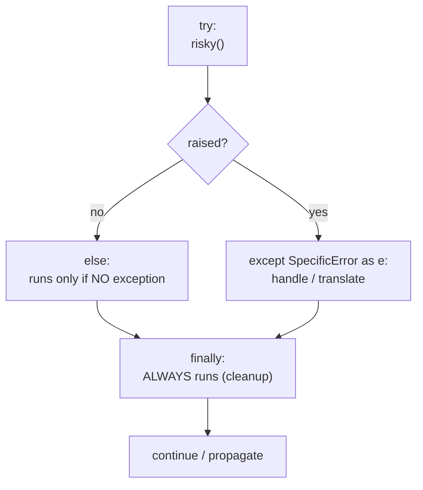
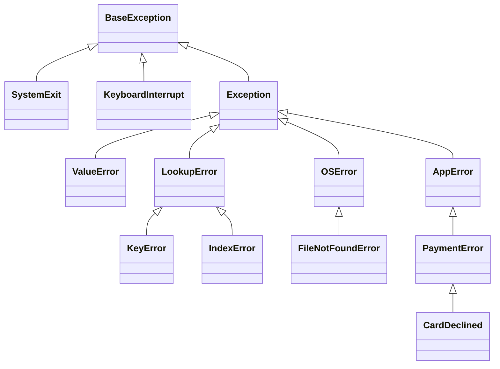

# Lesson 12: Exceptions Done Right

> **Prerequisites:** [Lesson 11: Context Managers](../11-context-managers/README.md) · [Refresher: Errors, files and modules](../../../learn/00-python-refresher/07-errors-files-and-modules/README.md)  
> **Reading time:** ~22 minutes  
> **Audience:** Candidates asked about `try/except/else/finally`, `raise ... from`, custom exceptions, EAFP vs LBYL, or "what's wrong with `except Exception: pass`?"

> [!NOTE]
> **In one line:** Raise **specific** exceptions at the point of failure, catch only what you can **handle**, translate low-level errors into domain errors with `raise NewError(...) from err` (so the cause is kept), and let everything else propagate to one boundary that logs and responds.

> [!TIP]
> **Golden rule:** Never `except:` or `except Exception: pass` in business code. Each `except` clause should answer: *what do I do about this here that the caller can't?* If the answer is "nothing", don't catch it.

> [!TIP]
> **Try it:** Run the section 3 file — it prints `__cause__` for the translated errors and `__context__` vs `__cause__` for an implicit chain — then run the [exceptions lab](#try-it--exceptions-lab-runnable) below (14 asserted probes, including a deterministic EAFP-vs-LBYL race). The section 3 code needs Python 3.11+ (`except*`, `add_note`). Then design the exception tree for your own service in [LLD Studio](/tools/lld-studio/): one base `AppError`, a few domain subclasses, and a single boundary handler.

---

## 1. The smell: how this gets asked

- *"What's the difference between `else` and `finally` in `try`?"*
- *"`raise` vs `raise e` vs `raise X from e`?"*
- *"EAFP vs LBYL — which is Pythonic and why?"*
- *"Design exceptions for a payment service."*
- *"What's wrong with a bare `except`?"*



Exception hierarchy (the bits that matter):



---

## 2. Reference

| Statement | Meaning |
| :--- | :--- |
| `raise Err("msg")` | Raise a new exception |
| `raise` (bare, in `except`) | Re-raise the current one, **preserving the traceback** |
| `raise New(...) from err` | Translate; sets `__cause__` (explicit chaining) |
| `raise New(...) from None` | Translate and **hide** the original (use sparingly) |
| `__cause__` | Set by `from`; shown as "The above exception was the direct cause…" |
| `__context__` | Set implicitly when raised while handling another; "During handling…" |
| `try/except*` (3.11) | Handle parts of an `ExceptionGroup` (TaskGroup, concurrency) |
| `err.add_note("…")` (3.11) | Attach extra context without changing the type |

| Style | Idea | Example |
| :--- | :--- | :--- |
| **EAFP** (Python) | Easier to Ask Forgiveness than Permission — try, handle failure | `try: d[k] except KeyError:` |
| **LBYL** | Look Before You Leap — check first | `if k in d:` |

EAFP wins when checks are racy (file exists → deleted before open) or duplicate the operation's own validation; LBYL wins when failure is *common* and checking is cheap and non-racy.

---

## 3. Walkthrough: a payment service's error design

**Requirements:** a `charge()` that talks to a flaky gateway (raises low-level `TimeoutError`/`ConnectionError`), must expose domain errors (`PaymentError` family), keep the cause for debugging, always release a lock/resource, and let the top-level handler map errors to HTTP codes.

1. Define `AppError` → `PaymentError` → `CardDeclined` / `GatewayUnavailable`.
2. Catch the *specific* low-level errors; translate with `from`.
3. Use `else` for success-only code, `finally` for cleanup.
4. A single boundary function maps exception types to status codes.
5. Show EAFP and `ExceptionGroup`.

````carousel
```python
import logging

logging.basicConfig(level=logging.CRITICAL)


class AppError(Exception):
    """Base for every error this service raises on purpose."""


class PaymentError(AppError):
    pass


class CardDeclined(PaymentError):
    def __init__(self, reason: str) -> None:
        super().__init__(f"card declined: {reason}")
        self.reason = reason


class GatewayUnavailable(PaymentError):
    pass


def gateway_call(amount: int) -> str:
    if amount > 1000:
        raise ValueError("limit exceeded")
    if amount == 13:
        raise TimeoutError("gateway timed out")
    return f"tx-{amount}"


released: list[str] = []


def charge(amount: int) -> str:
    try:
        tx = gateway_call(amount)
    except TimeoutError as err:
        raise GatewayUnavailable("payment gateway unavailable") from err   # keep the cause
    except ValueError as err:
        raise CardDeclined(str(err)) from err
    else:
        return tx                       # only reached when NO exception happened
    finally:
        released.append(f"lock for {amount}")   # always runs, even on return/raise


def to_http(err: Exception) -> int:       # the ONE boundary mapping
    match err:
        case CardDeclined():
            return 402
        case GatewayUnavailable():
            return 503
        case AppError():
            return 400
        case _:
            return 500


def retrieve(d: dict, key: str, default=None):
    try:                                   # EAFP
        return d[key]
    except KeyError:
        return default


def main() -> None:
    print(charge(50))

    for amount in (5000, 13):
        try:
            charge(amount)
        except PaymentError as err:
            cause = err.__cause__
            print(type(err).__name__, "|", err, "| cause:", type(cause).__name__, "| http:", to_http(err))
    print(released)

    # __context__ (implicit) vs __cause__ (explicit)
    try:
        try:
            1 / 0
        except ZeroDivisionError:
            raise RuntimeError("while handling")          # no `from`
    except RuntimeError as err:
        print("context:", type(err.__context__).__name__, "| cause:", err.__cause__)

    # `from None` hides the original
    try:
        try:
            int("x")
        except ValueError:
            raise AppError("bad input") from None
    except AppError as err:
        print("suppressed:", err.__suppress_context__)

    print(retrieve({"a": 1}, "b", "default"))

    # Exception groups (3.11+)
    try:
        raise ExceptionGroup("batch", [ValueError("a"), KeyError("b"), ValueError("c")])
    except* ValueError as grp:
        print("values:", [str(e) for e in grp.exceptions])
    except* KeyError as grp:
        print("keys:", len(grp.exceptions))

    # Add context without changing the type (3.11+)
    try:
        try:
            int("z")
        except ValueError as err:
            err.add_note("while parsing row 42")
            raise
    except ValueError as err:
        print(err.__notes__)

    print(to_http(KeyError("x")))                                  # 500: unknown => server bug


if __name__ == "__main__":
    main()
```
<!-- slide -->
```csharp
// C#: same ideas. `throw;` preserves the stack; `throw ex;` resets it. InnerException = __cause__.
static string Charge(int amount)
{
    try
    {
        return amount == 13 ? throw new TimeoutException() : $"tx-{amount}";
    }
    catch (TimeoutException ex)
    {
        throw new GatewayUnavailable(ex);          // wrap with inner (like `from`)
    }
    finally
    {
        Console.WriteLine("release lock");         // always runs
    }
}

try { Charge(13); }
catch (GatewayUnavailable e) when (e.InnerException is TimeoutException)   // exception filter
{
    Console.WriteLine($"{e.Message} <- {e.InnerException!.GetType().Name}");
}

public class AppException(string message, Exception? inner = null) : Exception(message, inner);
public sealed class GatewayUnavailable(Exception inner)
    : AppException("payment gateway unavailable", inner);
```
````

Expected output of the Python tab:

```text
tx-50
CardDeclined | card declined: limit exceeded | cause: ValueError | http: 402
GatewayUnavailable | payment gateway unavailable | cause: TimeoutError | http: 503
['lock for 50', 'lock for 5000', 'lock for 13']
context: ZeroDivisionError | cause: None
suppressed: True
default
values: ['a', 'c']
keys: 1
['while parsing row 42']
500
```

Note `released` has three entries for three calls — `finally` ran on the success path (`return tx`) and both failure paths.

---

## 4. Edges

- **Bare `except:`** also catches `KeyboardInterrupt` and `SystemExit`; `except Exception:` is the widest you should ever go, and only at a boundary that logs it.
- **Swallowing.** `except Exception: pass` hides bugs. If you must ignore, ignore *one specific* error, with a comment.
- **Order matters.** `except` clauses are checked top to bottom; put subclasses before bases or the subclass clause is unreachable.
- **`return` in `finally`** overrides any in-flight exception or return value — never do it (Python 3.14 emits a `SyntaxWarning` for it, PEP 765; probe 2).
- **`except ... as e` deletes `e`** when the block ends; save it to another name if you need it later (probe 5).
- **`str(KeyError("user"))` is `'user'`** (with quotes) because `KeyError` shows the repr of the key — surprising in logs (probe 6).
- **Any `from` sets `__suppress_context__`.** `from err` and `from None` both hide the implicit "During handling…" text; they differ in `__cause__` (the error vs `None`) (probe 8).
- **`raise e` vs `raise`.** Inside `except`, bare `raise` re-raises with the original traceback; `raise e` adds a new traceback entry (Python 3 keeps the original too, but bare `raise` is idiomatic).
- **Don't use exceptions for ordinary control flow in hot loops** — raising is slower than a check; but `StopIteration`, `KeyError` for missing keys in EAFP are normal.
- **Custom exception design.** Subclass `Exception` (not `BaseException`); keep a base per library/service; include structured fields (`reason`, `code`), not only a message; don't force callers to parse strings.
- **Resource safety.** Use `with` / `finally` for cleanup — not `except`.
- **Concurrency.** In threads, an uncaught exception ends only that thread (printed to stderr); in `asyncio` tasks it's stored until awaited — log or `await` them (lesson 15). Use `ExceptionGroup`/`TaskGroup` for concurrent failures.
- **Logging.** `logger.exception("msg")` inside `except` logs the traceback; don't log *and* re-raise at every layer (duplicate noise) — log once at the boundary.
- **Retry only transient, idempotent failures** (timeouts), with limits and backoff; never retry a `CardDeclined`.

### Try it — exceptions lab (runnable)

The follow-ups interviewers use after `try/except/else/finally` and `raise ... from`. Save as `exceptions_lab.py`; every probe is an `assert`, so a wrong claim fails loudly.

```python
import asyncio, io, logging, os, tempfile, threading, traceback, warnings

# 1) else is NOT protected by the except; code in try is
def parse(s):
    try:
        n = int(s)
    except ValueError:
        return "bad"
    else:
        return 10 // n           # ZeroDivisionError here is NOT caught by the clause above
assert parse("x") == "bad"
try:
    parse("0")
except ZeroDivisionError:
    pass

# 2) finally runs on return; a return INSIDE finally swallows the in-flight exception
trail = []
def runs_on_return():
    try:
        return "value"
    finally:
        trail.append("cleanup")
assert runs_on_return() == "value" and trail == ["cleanup"]
def swallows():
    try:
        raise RuntimeError("lost")
    finally:
        return "finally won"                  # SyntaxWarning on Python 3.14+ (PEP 765)
with warnings.catch_warnings():
    warnings.simplefilter("ignore")
    assert swallows() == "finally won"

# 3) Clause order: a base class listed first makes the subclass clause unreachable (no warning!)
def which(exc):
    try:
        raise exc
    except LookupError:
        return "LookupError clause"
    except KeyError:                          # never reached
        return "KeyError clause"
assert which(KeyError("k")) == "LookupError clause"

# 4) Bare except catches Ctrl-C and sys.exit(); `except Exception` does not
def swallow_bare(exc):
    try:
        raise exc
    except:                                   # noqa: E722  (the anti-pattern, on purpose)
        return "caught"
assert swallow_bare(KeyboardInterrupt()) == swallow_bare(SystemExit()) == "caught"
try:
    try:
        raise KeyboardInterrupt
    except Exception:
        raise AssertionError("should not be caught here")
except KeyboardInterrupt:
    pass

# 5) The `as e` name is deleted when the except block ends
try:
    raise ValueError("v")
except ValueError as e:
    kept = e
try:
    e
except NameError:
    pass
assert str(kept) == "v"                        # save it yourself if you need it later

# 6) str(KeyError) shows the repr of the key: a classic logging surprise
assert str(KeyError("user")) == "'user'" and str(ValueError("user")) == "user"

# 7) bare raise keeps the traceback frames; raising a NEW exception without from sets __context__ only
def inner(): raise ValueError("deep")
def middle():
    try:
        inner()
    except ValueError:
        raise
try:
    middle()
except ValueError as err:
    names = [f.name for f in traceback.extract_tb(err.__traceback__)]
    assert names[-1] == "inner" and "middle" in names

# 8) Translate with `from`: cause is explicit; `from None` hides it from the traceback
class DomainError(Exception): pass
try:
    try: {}["k"]
    except KeyError as k:
        raise DomainError("missing") from k
except DomainError as d:
    assert isinstance(d.__cause__, KeyError) and d.__suppress_context__   # any `from` sets the flag; __cause__ is what differs
try:
    try: {}["k"]
    except KeyError:
        raise DomainError("missing") from None
except DomainError as d:
    assert d.__cause__ is None and d.__suppress_context__ and isinstance(d.__context__, KeyError)

# 9) except* handles matching parts; the rest is re-raised as a new group
try:
    try:
        raise ExceptionGroup("batch", [ValueError("a"), KeyError("b")])
    except* ValueError:
        pass
except ExceptionGroup as rest:
    assert [type(e) for e in rest.exceptions] == [KeyError]

# 10) Threads: an uncaught exception kills only that thread (and goes to excepthook)
seen = []
threading.excepthook = lambda args: seen.append(args.exc_type.__name__)
t = threading.Thread(target=lambda: 1 / 0); t.start(); t.join()
assert seen == ["ZeroDivisionError"]

# 11) asyncio: a failed task stays silent until awaited
async def fail(): raise RuntimeError("quiet")
async def main():
    task = asyncio.create_task(fail())
    await asyncio.sleep(0)                     # task has failed by now, nobody noticed
    assert task.done() and task.exception() is not None
    try:
        await task                              # raised only when awaited
    except RuntimeError:
        return "surfaced on await"
assert asyncio.run(main()) == "surfaced on await"

# 12) EAFP beats LBYL when the world changes between check and use (deterministic simulation)
fd, path = tempfile.mkstemp(); os.close(fd)
def lbyl_read(p):
    if os.path.exists(p):                      # check...
        os.remove(p)                           # ...someone else deletes it (simulated)...
        return open(p).read()                  # ...use: FileNotFoundError despite the check
    return None
try:
    lbyl_read(path)
except FileNotFoundError:
    pass
def eafp_read(p):
    try:
        with open(p) as f:
            return f.read()
    except FileNotFoundError:
        return None                            # one atomic attempt, one place to handle it
assert eafp_read(path) is None

# 13) Log once at the boundary: logger.exception includes the traceback
buf = io.StringIO()
lg = logging.getLogger("lab"); lg.addHandler(logging.StreamHandler(buf)); lg.propagate = False
try:
    1 / 0
except ZeroDivisionError:
    lg.exception("charge failed")
assert "Traceback" in buf.getvalue() and "ZeroDivisionError" in buf.getvalue()

# 14) Structured fields beat parsing str(err)
class CardDeclined(Exception):
    def __init__(self, reason): super().__init__(f"card declined: {reason}"); self.reason = reason
try:
    raise CardDeclined("insufficient_funds")
except CardDeclined as c:
    assert c.reason == "insufficient_funds"
print("exceptions lab ok")
```

Expected output:

```text
exceptions lab ok
```

---

## 5. What you'd say in two minutes

> "I raise specific exceptions where the failure happens and catch only what I can meaningfully handle. In `try/except/else/finally`, `else` runs only on success and `finally` always runs for cleanup — though for resources I prefer `with`. When a low-level error crosses a layer, I translate it into a domain exception with `raise PaymentError(...) from err` so the original stays in `__cause__`; implicit chaining sets `__context__`, and `from None` hides it. I'd define one base `AppError` with a few domain subclasses carrying structured fields, and map them to HTTP status codes in a single boundary handler — anything unexpected becomes a 500 and gets logged with the traceback once. I avoid bare `except` and `except Exception: pass`. Pythonic style is EAFP — try the operation and handle the failure — because checks are racy, but I use LBYL when failure is common and the check is cheap."

---

## 6. Anti-patterns

| Anti-pattern | Why it fails | Fix |
| :--- | :--- | :--- |
| `except: pass` / `except Exception: pass` | Hides bugs, swallows Ctrl-C (bare) | Catch specific errors; log; re-raise |
| `raise Exception("something broke")` | Callers can't distinguish | Specific/custom exception types |
| Parsing `str(err)` to decide behaviour | Brittle | Types + structured fields |
| Catch-log-reraise at every layer | Duplicate logs | Log once at the boundary |
| `return` inside `finally` | Swallows exceptions | Never |
| Wrapping without `from` | Loses clear cause | `raise New(...) from err` |
| Using exceptions as return codes in hot paths | Slow, obscure | Normal returns / `Optional` |

---

## 7. Interview questions

<details>
<summary><strong>1. `else` vs `finally` in `try`? [BASIC]</strong></summary>

`else` runs only if the `try` block raised nothing — for code that shouldn't be protected by the `except`. `finally` always runs — for cleanup — even on `return` or an uncaught exception.

</details>

<details>
<summary><strong>2. `raise`, `raise e`, `raise X from e`? [BASIC]</strong></summary>

Bare `raise` re-raises the current exception, keeping the traceback. `raise X from e` raises a new exception and records `e` as `__cause__` (explicit chain). Raising a new exception inside `except` without `from` records `__context__` implicitly.

</details>

<details>
<summary><strong>3. EAFP vs LBYL? [BASIC]</strong></summary>

EAFP: try and handle the exception — avoids race conditions between check and use, and is idiomatic Python. LBYL: check first — better when failure is frequent or the check is cheap and atomic.

</details>

<details>
<summary><strong>4. Why is `except Exception: pass` bad? [BASIC]</strong></summary>

It hides programming errors and operational failures alike, leaving the program in an unknown state with no log. Catch only what you can handle; otherwise let it propagate to a boundary that logs.

</details>

<details>
<summary><strong>5. How would you design exceptions for a service? [SCENARIO]</strong></summary>

A base `AppError`; subclasses per domain concern (`PaymentError`, `NotFound`, `Conflict`); structured attributes; translate infrastructure errors at the adapter boundary using `from`; one top-level handler mapping to HTTP codes and logging unexpected errors.

</details>

<details>
<summary><strong>6. What does `return` inside `finally` do? [TRICKY]</strong></summary>

It overrides any pending `return` and *swallows* any in-flight exception. Avoid it.

</details>

<details>
<summary><strong>7. What are `ExceptionGroup` and `except*`? [TRICKY]</strong></summary>

Python 3.11 feature to raise several unrelated exceptions at once (used by `asyncio.TaskGroup`). `except* T` handles the matching sub-exceptions and re-raises the rest.

</details>

<details>
<summary><strong>8. C# `throw;` vs `throw ex;`? [TRICKY]</strong></summary>

`throw;` preserves the original stack trace; `throw ex;` resets it to the current line. Python's analogue: bare `raise` is the safe re-raise; use `from` to wrap.

</details>

---

## 8. One-page cheat sheet

```text
try:        risky                    except Specific as e:  handle/translate
else:       success-only code        finally:               cleanup (ALWAYS)
raise                      re-raise, keep traceback
raise New(..) from err     explicit cause  (__cause__)       raise New(..) from None   hide
__context__                implicit chain (raised while handling)
Hierarchy   BaseException > Exception > ...   never catch BaseException; bare except = bad
Design      AppError > DomainError > Specific;   structured fields;  one boundary handler -> HTTP
EAFP        try/except KeyError  (Pythonic)       LBYL if failure common & check atomic
3.11        ExceptionGroup / except* ; err.add_note("ctx")
Never       except: pass | return in finally | parse str(err) | log+raise at every layer
```

---

## Further reading

- [Python tutorial: errors and exceptions](https://docs.python.org/3/tutorial/errors.html)
- [Built-in exceptions](https://docs.python.org/3/library/exceptions.html)
- [PEP 654: Exception Groups and `except*`](https://peps.python.org/pep-0654/)

Previous: [Context Managers and with](../11-context-managers/README.md) · Next: [Memory, Garbage Collection and Performance](../13-memory-garbage-collection-and-performance/README.md)
