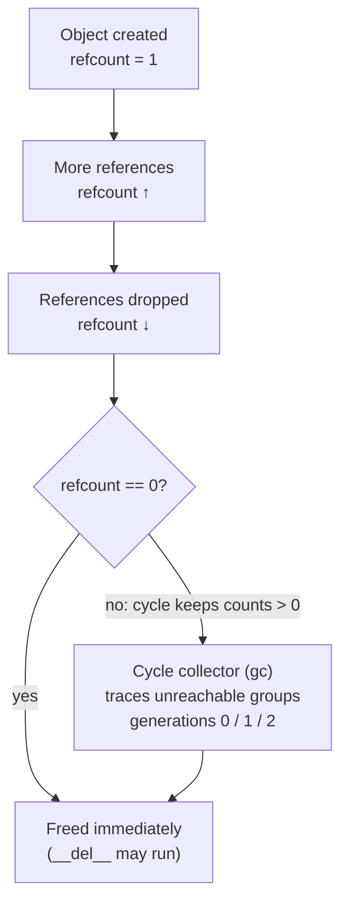
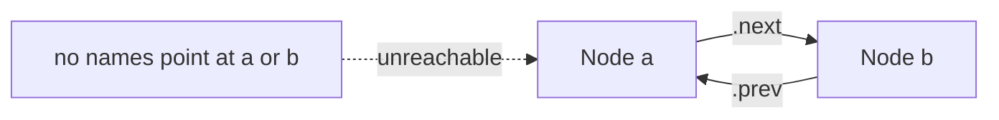

# Lesson 13: Memory, Garbage Collection and Performance

> **Prerequisites:** [Lesson 01: How Python Runs Your Code](../01-how-python-runs-your-code/README.md) · [Lesson 06: Classes and `__slots__`](../06-classes-init-new-and-slots/README.md)  
> **Reading time:** ~22 minutes  
> **Audience:** Candidates asked "how does Python manage memory?", "what's a reference cycle?", "how do you find a memory leak?", or "this is slow — what do you do?"

> [!NOTE]
> **In one line:** CPython frees most objects the instant their **reference count** hits zero, and a separate **cycle collector** (`gc`) reclaims groups of objects that only reference each other; performance work means **measuring first** (`timeit`, `cProfile`, `tracemalloc`) and then fixing algorithms, data structures and I/O before touching micro-optimisations.

> [!TIP]
> **Golden rule:** "Python is slow" is not a diagnosis. Profile, find the one hot spot, and fix *that* — usually an algorithm (`list` membership → `set`), a repeated I/O/DB call, or a blocking call in async code. Leaks in Python are almost always *objects you still reference* (caches, globals, closures, listeners), not lost memory.

> [!TIP]
> **Try it:** Run the section 3 file (expected output is just below it) and watch `freed n1 / freed n2` appear only at `gc.collect()`, while the `weakref` parent is freed the instant `del p` runs. Then run the [memory lab](#try-it--memory-lab-runnable) — it reproduces the `lru_cache` leak, the stored-traceback leak and the `+=` slowdown with asserts. Draw the object graph of the cycle in [LLD Studio](/tools/lld-studio/) — a cycle is just two arrows pointing at each other.

---

## 1. The smell: how this gets asked

- *"How does Python manage memory? Is there a garbage collector?"*
- *"What is a reference cycle? Does `del` free memory?"*
- *"Your service's memory grows forever. How do you find out why?"*
- *"This function is slow. Walk me through what you do."*
- *"`__slots__`, generators, `array`, `bytes` — when do they help?"*





---

## 2. Reference

| Mechanism | What it does | Notes |
| :--- | :--- | :--- |
| **Reference counting** | Free at zero; deterministic | CPython-specific; costs on every assignment |
| **Cycle collector** | Finds unreachable cycles; 3 generations | Run automatically; `gc.collect()`, `gc.get_stats()` |
| **Weak references** | Reference that doesn't keep the object alive | `weakref.ref`, `WeakValueDictionary`, caches/observers |
| **Small-object allocator (pymalloc)** | Pools for objects ≤ 512 bytes | Freed memory often isn't returned to the OS |
| **Interning / caches** | Small ints, some strings | Don't depend on it |
| **GIL** | One thread runs bytecode at a time | Doesn't change memory rules (lesson 14) |

| Tool | Answers | Use |
| :--- | :--- | :--- |
| `timeit` | "Which of these two snippets is faster?" | micro-benchmarks, repeated runs |
| `cProfile` / `pstats` | "Which functions take the time?" | whole-program CPU profile; `py-spy` for live processes |
| `tracemalloc` | "Which lines allocated this memory?" | snapshots + diffs to find leaks |
| `sys.getsizeof` | Shallow size of one object | doesn't include referents |
| `gc.get_objects()`, `objgraph` | "What's alive and who holds it?" | leak hunting |

| Optimisation (in priority order) | Example |
| :--- | :--- |
| 1. Better algorithm / data structure | `x in list` (O(n)) → `set` (O(1)); `sorted` once |
| 2. Do less I/O | batch DB calls; cache; avoid N+1 |
| 3. Right concurrency model | asyncio/threads for I/O; processes for CPU |
| 4. Built-ins / libraries in C | `sum`, `str.join`, `collections`, NumPy |
| 5. Lazy / streaming | generators, `itertools`, iterate files |
| 6. Memory layout | `__slots__`, `array`, tuples, `bytes` |
| 7. Micro-tuning | local variable caching, avoiding attribute lookups — last resort |

---

## 3. Walkthrough: cycles, weakrefs, leak-hunting and a measured fix

**Requirements:** show (1) refcount-based freeing; (2) a cycle surviving until `gc.collect()`; (3) `weakref` avoiding the cycle; (4) `tracemalloc` pointing at a leaking cache; (5) a measured algorithm fix.

1. `__del__` prints when an object dies: shows *when*.
2. Two nodes referencing each other aren't freed by refcount; `gc.collect()` returns how many it found.
3. A parent→child link using `weakref.ref` for the back-pointer breaks the cycle.
4. An unbounded module-level `dict` cache is the classic leak; `tracemalloc` snapshots show growth.
5. `timeit` proves `set` membership beats `list`.

````carousel
```python
import gc
import sys
import timeit
import tracemalloc
import weakref


class Noisy:
    def __init__(self, name: str) -> None:
        self.name = name

    def __del__(self) -> None:
        print(f"  freed {self.name}")


class Node:
    def __init__(self, name: str) -> None:
        self.name = name
        self.other = None

    def __del__(self) -> None:
        print(f"  freed {self.name}")


class Child:
    def __init__(self, parent) -> None:
        self._parent = weakref.ref(parent)         # does not keep the parent alive

    @property
    def parent(self):
        return self._parent()                      # None if the parent is gone


_cache: dict[int, bytes] = {}                      # unbounded: the classic leak


def handle(request_id: int) -> None:
    _cache[request_id] = bytes(1000)               # a NEW 1 KB object each call; never evicted


def main() -> None:
    gc.disable()                                   # make the demo deterministic

    print("1) refcount frees immediately:")
    a = Noisy("a")
    del a                                          # refcount 0 -> freed right here

    print("2) a cycle is NOT freed by refcounting:")
    n1, n2 = Node("n1"), Node("n2")
    n1.other, n2.other = n2, n1
    del n1, n2
    print("  (nothing freed yet)")
    print("  collected:", gc.collect() > 0)         # the cycle collector reclaims them

    print("3) weakref avoids the cycle:")
    p = Noisy("parent")
    c = Child(p)
    print("  parent via weakref:", c.parent.name)
    del p
    print("  after del:", c.parent)                 # None

    print("4) find the leak with tracemalloc:")
    tracemalloc.start()
    before = tracemalloc.take_snapshot()
    for i in range(2000):
        handle(i)
    after = tracemalloc.take_snapshot()
    top = after.compare_to(before, "lineno")[0]
    print("  top growth >= 1 MB:", top.size_diff >= 1_000_000, "| entries:", len(_cache))
    tracemalloc.stop()

    print("5) measure, don't guess:")
    data = list(range(5000))
    as_set = set(data)
    t_list = timeit.timeit("4999 in data", globals={"data": data}, number=2000)
    t_set = timeit.timeit("4999 in s", globals={"s": as_set}, number=2000)
    print("  set faster than list:", t_set < t_list)

    gen = (i * i for i in range(100_000))
    lst = [i * i for i in range(100_000)]
    print("  generator smaller than list:", sys.getsizeof(gen) < sys.getsizeof(lst))
    gc.enable()


if __name__ == "__main__":
    main()
```
<!-- slide -->
```csharp
// C#: tracing GC (generations 0/1/2 + LOH). Cycles are NOT a problem; there is no refcount.
// Finalizers (~__del__) run non-deterministically; use IDisposable (~with) for resources.
// "Leaks" are the same as in Python: objects still referenced (static caches, event handlers).

var cache = new Dictionary<int, byte[]>();        // unbounded static cache = leak
for (int i = 0; i < 2000; i++) cache[i] = new byte[1000];

var weak = new WeakReference<byte[]>(new byte[1000]);   // ~ weakref.ref
GC.Collect();
Console.WriteLine(weak.TryGetTarget(out _));      // False once collected
// Tools: dotnet-counters, dotnet-gcdump, PerfView, BenchmarkDotNet (~ timeit)
```
````

Expected output:

```text
1) refcount frees immediately:
  freed a
2) a cycle is NOT freed by refcounting:
  (nothing freed yet)
  freed n1
  freed n2
  collected: True
3) weakref avoids the cycle:
  parent via weakref: parent
  freed parent
  after del: None
4) find the leak with tracemalloc:
  top growth >= 1 MB: True | entries: 2000
5) measure, don't guess:
  set faster than list: True
  generator smaller than list: True
```

---

## 4. Edges

- **`__del__` is unreliable.** Timing differs on PyPy; it can run at interpreter shutdown or never; since Python 3.4 (PEP 442) cycles with `__del__` are collectable, but don't rely on it. Use `with`/`try-finally`.
- **`del x` removes a name**, not the object; the object is freed only when the last reference goes.
- **Leaks = lingering references.** Common holders: module-level caches/lists, `functools.lru_cache(maxsize=None)` (keeps every argument alive — probe 4), closures and bound methods registered as callbacks, exception tracebacks stored in variables (`err.__traceback__` keeps the failing frame's locals alive — probe 5), logging handlers, thread-local data.
- **`s += x` is only fast by accident.** CPython can resize a string in place when the variable holds the only reference; any extra reference (or an attribute like `self.s += x`) forces a full copy each time. Probe 7 shows an aliased `+=` loop losing badly to `"".join`.
- **Memory isn't always returned to the OS.** The process RSS may not shrink after freeing many small objects (arena fragmentation) — it's reused by Python.
- **`sys.getsizeof` is shallow.** A list of 1M strings reports only the pointer array; use `tracemalloc` or `pympler` for deep size.
- **`gc.disable()`** is sometimes used in short-lived, allocation-heavy scripts or after `fork` (copy-on-write), but then you own cycle hygiene.
- **GC pauses** are generational and usually short; huge object graphs raise gen-2 cost. `gc.freeze()` (3.7+) helps pre-fork servers.
- **Multiprocessing** duplicates memory per process (copy-on-write helps until refcounts touch pages — a known CPython quirk).
- **Premature optimisation.** A 10% micro-gain in a function that's 1% of runtime is worthless; Amdahl's law.
- **Benchmarks lie** if they run cold, once, or measure the wrong input size — repeat, warm up, use realistic data.
- **Concurrency:** adding threads to CPU-bound pure Python won't help (lesson 14); adding caching without bounds will hurt memory.

### Try it — memory lab (runnable)

The follow-ups interviewers use for "how would you find a leak?". Save as ``memory_lab.py``; every probe is an ``assert`` (or a printed message), so a wrong claim fails loudly. Timing probes assert direction only, never exact numbers.

```python
import gc, sys, time, weakref, tracemalloc
from functools import lru_cache

class Thing:
    pass

# 1) Reference counts: getrefcount reports one extra for its own argument; del removes a NAME
x = Thing()
base = sys.getrefcount(x)
y = x
assert sys.getrefcount(x) == base + 1
del y
assert sys.getrefcount(x) == base
w = weakref.ref(x)
alias = x
del x
assert w() is not None          # still alive: `alias` is another reference
del alias
assert w() is None              # last reference gone -> freed immediately

# 2) A cycle survives `del` until the collector runs; gc.collect() reports what it found
gc.collect(); gc.disable()
a, b = Thing(), Thing(); a.o, b.o = b, a
wa = weakref.ref(a)
del a, b
assert wa() is not None         # refcounts never hit zero
assert gc.collect() >= 2 and wa() is None
gc.enable()

# 3) PEP 442: cycles whose objects define __del__ are collectable (Python 3.4+)
finalised = []
class WithDel:
    def __del__(self): finalised.append(1)
gc.disable()
p, q = WithDel(), WithDel(); p.o, q.o = q, p
del p, q
gc.collect()
assert len(finalised) == 2
gc.enable()

# 4) lru_cache(maxsize=None) is a leak: it keeps every argument alive
@lru_cache(maxsize=None)
def describe(obj): return id(obj)
t = Thing()
class Hashable(Thing): pass
h = Hashable(); wh = weakref.ref(h)
describe(h); del h
assert wh() is not None         # the cache still holds it
describe.cache_clear()
assert wh() is None

# 5) A stored exception keeps the failing frame (and its locals) alive via __traceback__
class Big: pass
def run():
    big = Big()
    wr = weakref.ref(big)
    try:
        raise ValueError("x")
    except ValueError as e:
        return e, wr
err, wr = run()
assert wr() is not None         # frame locals kept alive by err.__traceback__
err.__traceback__ = None
gc.collect()
assert wr() is None

# 6) sys.getsizeof is shallow
inner = ["x" * 1000 for _ in range(1000)]
assert sys.getsizeof(inner) < 20_000            # ~8 KB of pointers, not the ~1 MB of strings

# 7) `s += x` is only fast when CPython can resize in place; an extra reference makes it quadratic
def concat_alias(n):
    s = ""
    for _ in range(n):
        keep = s                                 # second reference: no in-place resize possible
        s += "x" * 10
    return s
def concat_join(n):
    return "".join("x" * 10 for _ in range(n))
n = 30_000
t0 = time.perf_counter(); r1 = concat_alias(n); t_alias = time.perf_counter() - t0
t0 = time.perf_counter(); r2 = concat_join(n); t_join = time.perf_counter() - t0
assert r1 == r2 and t_join < t_alias
print("7: aliased += slower than join:", t_join < t_alias)   # the ratio varies by machine; typically 10x-100x+

# 8) Membership: list is O(n), set is O(1)
data = list(range(20_000)); s = set(data)
t0 = time.perf_counter(); [19_999 in data for _ in range(200)]; t_l = time.perf_counter() - t0
t0 = time.perf_counter(); [19_999 in s for _ in range(200)];    t_s = time.perf_counter() - t0
assert t_s < t_l

# 9) WeakValueDictionary: a cache that never keeps its values alive
cache = weakref.WeakValueDictionary()
obj = Hashable(); cache["k"] = obj
assert "k" in cache
del obj
assert "k" not in cache

# 10) A bounded lru_cache stays bounded; an unbounded dict grows with the number of keys
@lru_cache(maxsize=100)
def bounded(i): return bytes(1000)
unbounded = {}
tracemalloc.start()
for i in range(5000):
    bounded(i); unbounded[i] = bytes(1000)
assert bounded.cache_info().currsize == 100 and len(unbounded) == 5000
current, _ = tracemalloc.get_traced_memory(); tracemalloc.stop()
assert current > 4_000_000                      # dominated by the unbounded dict

# 11) The collector has generations and thresholds you can inspect
assert len(gc.get_threshold()) == 3 and len(gc.get_stats()) == 3
print("memory lab ok")
```

Expected output:

```text
7: aliased += slower than join: True
memory lab ok
```

---

## 5. What you'd say in two minutes

> "CPython uses reference counting: when an object's count hits zero it's freed immediately, which is deterministic and why `with` and refcounts feel prompt. Reference counting can't free cycles — two objects pointing at each other — so there's also a generational cycle collector in the `gc` module that finds unreachable groups; I break cycles with `weakref` for back-pointers and caches. Memory 'leaks' in Python are nearly always objects I'm still referencing — an unbounded cache, a registered callback, a global list — so I find them with `tracemalloc` snapshots and diffs. For performance I measure first: `cProfile` or `py-spy` for where time goes, `timeit` for micro-comparisons. Then the order is algorithm and data structure — list to set — reducing I/O, the right concurrency model, built-ins and C-backed libraries, lazy iteration, and only then micro-tuning. `__slots__` and generators help memory when there are millions of objects or records."

---

## 6. Anti-patterns

| Anti-pattern | Why it fails | Fix |
| :--- | :--- | :--- |
| Optimising without profiling | Wasted effort, new bugs | `cProfile` / `py-spy` first |
| Unbounded module-level cache | Memory grows forever | `lru_cache(maxsize=N)`, TTL cache, eviction |
| Relying on `__del__` to release resources | Non-deterministic | Context managers |
| Strong back-references (parent ↔ child) | Cycles delay freeing | `weakref` for back-pointers |
| `x in big_list` in a loop | O(n²) | `set` / `dict` |
| String concatenation in a loop (`s += x`) | Quadratic copying (in general) | `"".join(parts)` |
| Reading a whole file/DB result into memory | Spikes | Iterate/stream/paginate |

---

## 7. Interview questions

<details>
<summary><strong>1. How does Python manage memory? [BASIC]</strong></summary>

CPython uses reference counting (free when it reaches zero) plus a generational cycle collector for reference cycles. Small objects come from a private allocator (pymalloc). It's an implementation detail — PyPy uses a tracing GC.

</details>

<details>
<summary><strong>2. What is a reference cycle and why does it matter? [BASIC]</strong></summary>

Objects referencing each other keep each other's counts above zero even when unreachable from the program, so refcounting alone can't free them; the cycle collector handles them, later and non-deterministically. Use `weakref` for back-references.

</details>

<details>
<summary><strong>3. Does `del x` free memory? [BASIC]</strong></summary>

It deletes the *name*. The object is freed only if that was its last reference.

</details>

<details>
<summary><strong>4. Memory grows in production. How do you find the leak? [SCENARIO]</strong></summary>

Confirm growth (RSS/metrics), then use `tracemalloc` snapshots (start → exercise → compare) or `objgraph`/`gc.get_objects()` to see which types/lines grow and what references them. Typical culprits: unbounded caches, lingering callbacks, stored exceptions, per-request data in globals.

</details>

<details>
<summary><strong>5. A function is slow. Steps? [SCENARIO]</strong></summary>

Reproduce with realistic data; profile (`cProfile`, `py-spy`); find the hot spot; fix algorithm/data structure or I/O first; re-measure with `timeit`/benchmarks; check memory too. Consider concurrency or C-backed libraries only if justified by the profile.

</details>

<details>
<summary><strong>6. What does `__slots__` save? [TRICKY]</strong></summary>

The per-instance `__dict__` (and `__weakref__` unless declared), typically a large fraction of memory for small objects; it matters at millions of instances, not for a few.

</details>

<details>
<summary><strong>7. Why is `"".join(parts)` preferred over `+=` in loops? [BASIC]</strong></summary>

`+=` may create a new string each iteration (CPython has an optimisation for some cases but it's not guaranteed), giving O(n²); `join` computes the total size once and copies each piece once, O(n).

</details>

<details>
<summary><strong>8. How does Python's GC compare to .NET's? [BASIC]</strong></summary>

Python: refcount + cycle collector; deterministic frees for most objects. .NET: tracing generational GC; no refcounts, cycles are fine, finalisation is non-deterministic, so `IDisposable`/`using` handles resources.

</details>

---

## 8. One-page cheat sheet

```text
Freed when   refcount == 0 (immediately)  |  unreachable cycle -> gc (generations 0/1/2)
del x        removes the NAME only
Break cycles weakref.ref / WeakValueDictionary / WeakSet
__del__      avoid; use with / try-finally
Leaks        lingering refs: caches, globals, callbacks, stored tracebacks, lru_cache(maxsize=None)
Tools        timeit (A vs B)  cProfile/py-spy (where)  tracemalloc (who allocated)  sys.getsizeof (shallow!)
Order        measure -> algorithm/data structure -> I/O -> concurrency model -> built-ins/C libs -> lazy -> layout -> micro
Memory       generators, __slots__, array/bytes, stream files, bounded caches
Strings      "".join(parts), not s += x in loops
.NET         tracing GC, IDisposable for resources, WeakReference<T>
```

---

## Further reading

- [`gc` — garbage collector interface](https://docs.python.org/3/library/gc.html)
- [`tracemalloc`](https://docs.python.org/3/library/tracemalloc.html) · [`weakref`](https://docs.python.org/3/library/weakref.html)
- [The Python Profilers](https://docs.python.org/3/library/profile.html) · [PEP 442: safe object finalization](https://peps.python.org/pep-0442/)

Previous: [Exceptions Done Right](../12-exceptions-done-right/README.md) · Next: [The GIL, Threads, Processes and asyncio](../14-the-gil-threads-processes-and-asyncio/README.md)
