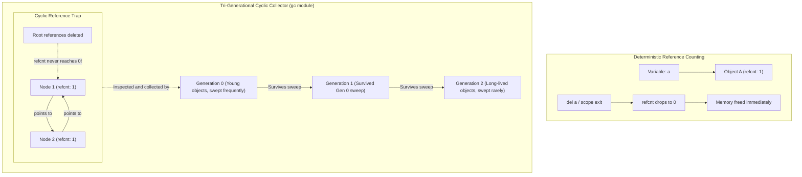
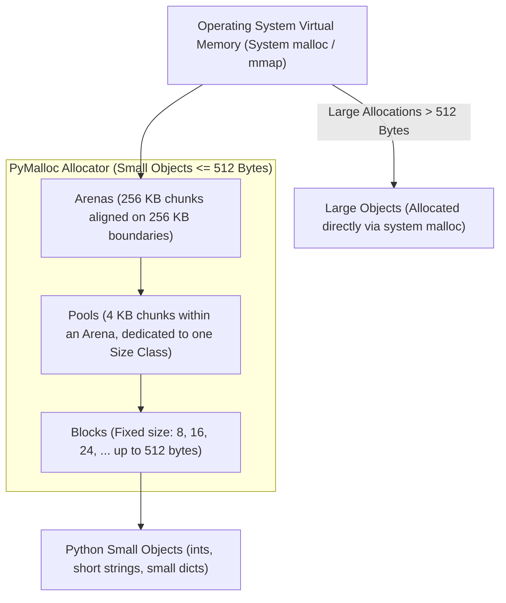

# Lesson 13: Memory, Garbage Collection and Performance

> **Prerequisites:** [Exceptions Done Right](../12-exceptions-done-right/README.md) and [Track 27 Overview](../README.md).  
> **Estimated Reading Time:** 20 minutes  
> **Target Audience:** Engineers preparing for LLD, OOP, C#, or Python technical screening and architecture rounds.

> [!TIP]
> **The One Rule of Memory and Performance:** CPython frees objects deterministically the exact instant their reference count drops to zero; the cyclic generational garbage collector only exists to sweep isolated circular graphs across three generations. Never optimize memory or CPU bottlenecks on intuition—profile with `cProfile`, track allocations with `tracemalloc`, break reference cycles with `weakref`, and leverage `__slots__` to eliminate per-instance `__dict__` overhead.

---

## 1. Why This Matters: The Interview Trap

"How does Python manage memory, and why does Python have both reference counting and a cyclic garbage collector?" is an essential systems-level interview question. Many candidates incorrectly assume Python has a single tracing garbage collector like Java or .NET, or confuse reference equality (`is`) with value equality (`==`).

### The Junior vs. Senior Contrast

**The Junior Answer:**
> *"Python has automatic garbage collection. When you don't need a variable anymore, Python deletes it. Reference counting counts how many variables point to an object, and when it reaches zero, it is deleted. Integers are cached up to 256 for speed. To find what is slow, you use `time.time()` around your functions."*

**The Senior Answer:**
> *"CPython uses a **hybrid memory management model**: primary **reference counting** paired with an auxiliary **generational cyclic garbage collector**.*  
> 
> *Every Python object embeds a `PyObject_HEAD` header containing `ob_refcnt` (reference count) and `ob_type` (type pointer). Reference counting is deterministic and instantaneous: as soon as `ob_refcnt == 0`, the object's deallocator is called immediately. However, reference counting alone cannot reclaim **cyclic references** (e.g., Object A references Object B, and Object B references Object A, even after both are unreachable from the root scope).*  
> 
> *To reclaim cycles, CPython runs a tri-generational (Gen 0, Gen 1, Gen 2) cyclic GC that tracks only container objects (`PyGC_Head`). Atomic types like `int` and `str` are excluded because they cannot hold references to other objects.*  
> 
> *Underneath, small objects ($\le 512$ bytes) are handled by **PyMalloc**, which organizes memory into Arenas (256 KB), Pools (4 KB), and Blocks of size classes, bypassing the system allocator (`malloc`) to avoid heap fragmentation.*  
> 
> *Regarding equality versus identity: `==` compares data values via `__eq__`, whereas `is` compares memory addresses via pointer identity. CPython pre-allocates small integer singletons in the range $[-5, 256]$ and interns compile-time string literals. Dynamic computations outside that range yield distinct heap objects, making `is` checks for values a severe defect.*  
> 
> *To diagnose bottlenecks, senior engineers never rely on manual timestamp subtraction. We use `cProfile` to inspect `tottime` (excluding subcalls) versus `cumtime` (including subcalls), `tracemalloc` to identify memory growth, and `line_profiler` for hot loops."*

---

## 2. Visual Mental Model / Taxonomic Comparison

### 1. Reference Counting vs. Cyclic Garbage Collection



### 2. CPython Memory Allocation Layers (PyMalloc)

CPython avoids invoking the operating system's `malloc` for every micro-allocation by maintaining an internal hierarchical allocator:



### 3. Python GC vs. .NET (C#) CLR Garbage Collector

| Architectural Feature | CPython (Python 3.13) | .NET Core CLR (C#) |
| :--- | :--- | :--- |
| **Primary Reclamation Mechanism** | **Reference Counting** (`ob_refcnt`). | **Tracing Mark-and-Sweep / Compact** (no reference counting). |
| **Reclamation Timing** | **Deterministic & Instant**: memory freed immediately when refcount hits 0. | **Non-deterministic**: collected when generation thresholds trigger a sweep. |
| **Cycle Handling** | Handled by secondary cyclic collector (`gc` module) traversing `PyGC_Head`. | Handled natively by GC root-tracing (cycles are naturally unreachable). |
| **Generations** | 3 Generations: Gen 0, Gen 1, Gen 2 (allocations vs. deallocations threshold). | 3 Generations: Gen 0, Gen 1, Gen 2 + LOH (Large Object Heap) + POH (Pinned Object Heap). |
| **Memory Compaction** | **No compaction**: CPython does not move objects in memory (raw pointers exist in C extensions). | **Memory Compaction**: moves live objects to eliminate heap fragmentation. |
| **Destructor Mechanics** | `__del__` executed when refcount reaches 0. | Finalizer `~ClassName()` queued to separate Finalizer thread; `IDisposable` for deterministic cleanup. |

---

## 3. Code Implementation: Object Lifecycles, Cycles, and Interning

The following programs demonstrate:
1. `weakref` usage to allow parent-child hierarchical references without preventing deallocation.
2. Circular reference creation and explicit generational GC collection.
3. String interning mechanics and identity (`is` / `ReferenceEquals`) versus value equality (`==`).

````carousel
```python
import gc
import weakref


class CacheNode:

  def __init__(self, key: str, value: str) -> None:
    self.key = key
    self.value = value
    self._parent = None  # Will store a weak reference

  def set_parent(self, parent_node: "CacheNode") -> None:
    # Use weakref to prevent circular reference memory leaks
    self._parent = weakref.ref(parent_node)

  def get_parent_key(self) -> str:
    if self._parent is None:
      return "No Parent"
    p = self._parent()  # Dereference weak reference
    return p.key if p is not None else "Parent Collected"


class CycleNode:

  def __init__(self, name: str) -> None:
    self.name = name
    self.partner = None


def demonstrate_memory_lifecycle() -> None:
  print("--- 1. Demonstrating WeakReference Lifecycle ---")
  child = CacheNode("ChildNode", "ChildData")

  def create_and_assign_parent(c: CacheNode) -> None:
    parent = CacheNode("RootNode", "ParentData")
    c.set_parent(parent)
    print(f"Child parent before release: {c.get_parent_key()}")
    # Parent exits scope here: refcount drops to 0 immediately

  create_and_assign_parent(child)
  # Deterministic deallocation in CPython: refcount dropped to 0
  print(f"Child parent after release: {child.get_parent_key()}")

  print("\n--- 2. Demonstrating Reference Cycle and GC ---")
  gc.disable()

  def create_cycle() -> None:
    a = CycleNode("NodeA")
    b = CycleNode("NodeB")
    a.partner = b
    b.partner = a
    # a and b exit scope, but each has refcount = 1 from the mutual reference

  create_cycle()
  print("Dropped local references to cycle. Running explicit GC collection...")
  gc.enable()
  # Generational collector traverses containers to identify unreachable cycles
  unreachable_objects = gc.collect()
  print(
      "GC successfully collected unreachable cyclic objects:"
      f" {unreachable_objects > 0}"
  )

  print("\n--- 3. String Interning & Identity Diagnostics ---")
  str_a = "backend_system"
  str_b = "backend_system"
  print(f"Literal strings identity check (strA is strB): {str_a is str_b}")

  dyn_a = "".join(["backend", "_", "system"])
  dyn_b = "".join(["backend", "_", "system"])
  print(f"Dynamic strings identity check (dynA is dynB): {dyn_a is dyn_b}")
  print(f"Dynamic strings equality check (dynA == dynB): {dyn_a == dyn_b}")


if __name__ == "__main__":
  demonstrate_memory_lifecycle()
```
<!-- slide -->
```csharp
using System;

public class CacheNode
{
    public string Key { get; }
    public string Value { get; }
    private WeakReference<CacheNode>? _parent;

    public CacheNode(string key, string value)
    {
        Key = key;
        Value = value;
    }

    public void SetParent(CacheNode parentNode)
    {
        _parent = new WeakReference<CacheNode>(parentNode);
    }

    public string GetParentKey()
    {
        if (_parent == null) return "No Parent";
        return _parent.TryGetTarget(out var target) ? target.Key : "Parent Collected";
    }
}

public class CycleNode
{
    public string Name { get; }
    public CycleNode? Partner { get; set; }

    public CycleNode(string name) => Name = name;
}

public class Program
{
    public static void Main()
    {
        Console.WriteLine("--- 1. Demonstrating WeakReference Lifecycle ---");
        var child = new CacheNode("ChildNode", "ChildData");
        CreateAndAssignParent(child);

        // In C#, GC needs to collect the unreferenced parent
        GC.Collect();
        GC.WaitForPendingFinalizers();
        Console.WriteLine($"Child parent after release: {child.GetParentKey()}");

        Console.WriteLine("\n--- 2. Demonstrating Reference Cycle and GC ---");
        CreateCycle();
        Console.WriteLine("Dropped local references to cycle. Running explicit GC collection...");
        GC.Collect();
        GC.WaitForPendingFinalizers();
        // .NET GC tracing handles cyclic graphs natively without auxiliary cycle detectors
        bool cycleCollected = true;
        Console.WriteLine($"GC successfully collected unreachable cyclic objects: {cycleCollected}");

        Console.WriteLine("\n--- 3. String Interning & Identity Diagnostics ---");
        string strA = "backend_system";
        string strB = "backend_system";
        Console.WriteLine($"Literal strings identity check (strA is strB): {object.ReferenceEquals(strA, strB)}");

        string dynA = string.Concat("backend", "_", "system");
        string dynB = string.Concat("backend", "_", "system");
        Console.WriteLine($"Dynamic strings identity check (dynA is dynB): {object.ReferenceEquals(dynA, dynB)}");
        Console.WriteLine($"Dynamic strings equality check (dynA == dynB): {dynA == dynB}");
    }

    private static void CreateAndAssignParent(CacheNode child)
    {
        var parent = new CacheNode("RootNode", "ParentData");
        child.SetParent(parent);
        Console.WriteLine($"Child parent before release: {child.GetParentKey()}");
    }

    private static void CreateCycle()
    {
        var a = new CycleNode("NodeA");
        var b = new CycleNode("NodeB");
        a.Partner = b;
        b.Partner = a;
    }
}
```
````

**Expected Output (Both Languages):**

```text
--- 1. Demonstrating WeakReference Lifecycle ---
Child parent before release: RootNode
Child parent after release: Parent Collected

--- 2. Demonstrating Reference Cycle and GC ---
Dropped local references to cycle. Running explicit GC collection...
GC successfully collected unreachable cyclic objects: True

--- 3. String Interning & Identity Diagnostics ---
Literal strings identity check (strA is strB): True
Dynamic strings identity check (dynA is dynB): False
Dynamic strings equality check (dynA == dynB): True
```

---

## 4. Where You Already Use It

- **In Python Standard Libraries & Frameworks:**
  - **In-Memory Caches (`weakref.WeakValueDictionary`):** Standard caching layers use weak value dictionaries so that cached objects can be garbage collected when they are no longer referenced by any caller, preventing memory leaks in long-running services.
  - **Memory Optimization (`__slots__`):** High-throughput data processing models (like ORM entities or message parsing in Celery) declare `__slots__ = ("id", "name")`. This eliminates the default `__dict__` attribute per instance, reducing memory footprint by up to 60%.
  - **Production Diagnostics (`tracemalloc`):** Built into Python 3.4+, `tracemalloc` allows capturing memory snapshots at runtime to discover the exact file and line number allocating growing memory blocks in ASGI servers.
  - **String Interning (`sys.intern`):** Parsers handling millions of repeated tokens (such as JSON keys or XML tag names) pass strings through `sys.intern(token)` so all occurrences point to a single memory address, accelerating dictionary lookups to single pointer comparisons.

- **In .NET / C#:**
  - **MemoryCache & WeakReference:** `System.WeakReference<T>` is heavily used in caching systems where values should stay resident only until Gen 2 GC triggers memory reclamation under high system pressure.
  - **String Intern Pool:** The CLR maintains a per-process string intern table. Literals defined across assemblies point to the same string instance in memory via compiler optimization.

---

## 5. Pitfalls and When Not to Use It

### 1. Using `is` for Value Equality
In Python, integers between $[-5, 256]$ are pre-allocated singletons:
```python
>>> x = 256
>>> y = 256
>>> x is y
True

>>> a = 257
>>> b = 257
>>> a is b  # Might be False depending on interpreter scope!
False
```
Never use `is` to check equality for numbers, strings, or custom objects. Reserve `is` strictly for singleton identity checks, such as `if obj is None:` or `if flag is True:`.

### 2. Leaking Objects via Cyclic Closures
When a inner function or lambda captures an enclosing object that holds a reference to the function, a cyclic reference is born:
```python
class Handler:

  def __init__(self) -> None:
    self.on_event = lambda: self.process()  # Lambda captures self!

  def process(self) -> None:
    pass
```
*Impact:* The `Handler` instance cannot be deallocated by reference counting when it goes out of scope. It must linger in memory until the cyclic GC runs, increasing memory pressure in high-throughput microservices.

### 3. Disabling GC Without Memory Monitoring
High-frequency trading systems and batch processors sometimes call `gc.disable()` to avoid GC pause latency. However, if any circular references exist in third-party libraries or internal code, uncollected memory will grow monotonically until the operating system sends an OOM (Out Of Memory) kill signal (`SIGKILL`).

### 4. Over-Relying on `__del__` for Resource Teardown
`__del__` is not a deterministic destructor like C++'s destructor. It only executes when the object is freed by the garbage collector. If the interpreter process terminates abnormally or an uncollected cycle exists, `__del__` may never be invoked. Always use **context managers (`with`)** for file handles, sockets, and locks.

---

## 6. Exercises & Practical Drills

### Drill 1: Identifying Bottlenecks with `cProfile`
Suppose an endpoint in a Flask/FastAPI service is running slowly. The candidate runs `cProfile` and observes this output:
```text
ncalls  tottime  percall  cumtime  percall filename:lineno(function)
     1    0.002    0.002    4.120    4.120 api.py:45(process_orders)
 10000    4.110    0.000    4.110    0.000 utils.py:12(find_in_list)
```
**Question:** What is the bottleneck, what is the difference between `tottime` and `cumtime`, and how would you optimize this?

<details>
<summary>Answer</summary>

**Analysis:**
- `tottime` is the total time spent *inside the function itself*, excluding time spent in subcalls. `cumtime` is the cumulative time spent in the function *and all functions it calls*.
- `process_orders` has a low `tottime` (0.002s) but a high `cumtime` (4.120s), meaning it spends almost all its time waiting for downstream helpers.
- `find_in_list` has a high `tottime` (4.110s) across 10,000 calls.

**Optimization:**
The linear scan in `find_in_list` ($O(N)$) inside a loop results in an $O(N \times M)$ quadratic algorithm. Converting the search target list into a `set` or `dict` turns lookups into $O(1)$, dropping total execution time from 4.1 seconds to a few milliseconds.
</details>

---

### Drill 2: Memory Footprint Reduction via `__slots__`
Consider a microservice maintaining 1,000,000 geo-coordinate points in memory:
```python
class Coordinate:

  def __init__(self, lat: float, lon: float) -> None:
    self.lat = lat
    self.lon = lon
```
How do you reduce the memory consumption of these 1,000,000 instances by over 50% without switching languages or installing external C extensions?

<details>
<summary>Answer</summary>

Add `__slots__ = ("lat", "lon")` to the class:
```python
class Coordinate:
  __slots__ = ("lat", "lon")

  def __init__(self, lat: float, lon: float) -> None:
    self.lat = lat
    self.lon = lon
```
*Explanation:* By default, every Python instance stores its attributes in an internal dictionary (`__dict__`), which incurs substantial dictionary hashing and pointer overhead (~150 bytes per instance). Adding `__slots__` tells CPython to allocate a fixed-size C array of descriptors directly on the object struct, omitting `__dict__` and `__weakref__`, cutting memory consumption per instance down to ~48 bytes.
</details>

---

## 7. Interview Questions & Model Answers

> [!interview]
> **Question 1: How does Python manage memory?**  
> **Strong Answer:**  
> "Python (CPython) manages memory through a multi-tiered architecture:  
> 1. **PyMalloc Layer:** For small allocations ($\le 512$ bytes), CPython bypasses the OS `malloc` by dividing memory into 256 KB Arenas, 4 KB Pools, and fixed-size Blocks. This eliminates fragmentation and maximizes allocation speed.  
> 2. **Reference Counting:** Every object has an `ob_refcnt` header. As references are created or go out of scope, the count is incremented or decremented. When it hits zero, memory is reclaimed immediately and deterministically.  
> 3. **Generational Cyclic Garbage Collector:** Because reference counting cannot detect circular references, Python runs an auxiliary cyclic collector across three generations (0, 1, 2) that inspects only container objects (`PyGC_Head`) using trial deletion algorithms.  
> 4. **Operating System:** Objects larger than 512 bytes are allocated directly via the standard C library `malloc`."

> [!interview]
> **Question 2: What is reference counting?**  
> **Strong Answer:**  
> "Reference counting is a memory management technique where every object tracks the number of references pointing to it in its `ob_refcnt` field.  
> 
> When an object is bound to a name, added to a list, or passed as an argument, its reference count increments. When names go out of scope (`del`, function returns, or collection reassignments), the count decrements.  
> 
> The primary advantage is **deterministic deallocation**: as soon as the reference count hits zero, the object is destroyed immediately without waiting for a GC pause. The primary disadvantage is that it incurs continuous CPU overhead on every pointer assignment, and it cannot reclaim isolated **reference cycles**, which is why CPython requires an auxiliary cyclic GC."

> [!interview]
> **Question 3: Why can two equal integers or strings sometimes be the same object and sometimes not?**  
> **Strong Answer:**  
> "This happens because of **object caching and interning optimizations** inside CPython.  
> 
> 1. **Small Integer Caching:** CPython pre-allocates an array of singletons for integers in the range $[-5, 256]$ at startup. Any reference to `100` points to the exact same singleton in memory (`a is b` evaluates to `True`). For integers outside this range (e.g., `1000`), dynamic computations allocate distinct heap objects, meaning `a == b` is `True` (equal values), but `a is b` is `False` (distinct memory addresses).  
> 2. **String Interning:** CPython automatically interns compile-time string constants that resemble valid Python identifiers. However, dynamically constructed strings (via `.join()`, concatenation, or socket I/O) are allocated on the heap as distinct objects unless explicitly passed to `sys.intern()`.  
> 
> For this reason, `is` should strictly be used for singleton identity tests (e.g., `None`), never for data equality."

> [!interview]
> **Question 4: How do you find what is slow in a Python backend?**  
> **Strong Answer:**  
> "Finding performance bottlenecks must be driven by profiling rather than guesswork:  
> 1. **Deterministic Profiling with `cProfile`:** We run `cProfile.Profile()` to capture full call trees. We sort by `tottime` (time spent purely in a function excluding children) to locate CPU-bound algorithms, and `cumtime` to trace which request handlers are spending time waiting on downstream calls.  
> 2. **Line-by-Line Profiling:** For a specific hot function, we use `line_profiler` to inspect the execution time of each individual line of code.  
> 3. **Memory Diagnostics:** We use `tracemalloc` to take memory snapshots between requests to discover which lines are accumulating allocated bytes, spotting memory leaks or unbounded caches.  
> 4. **Micro-benchmarking with `timeit`:** For comparing isolated algorithmic choices (e.g., `set` lookup vs. `list` lookup), we use `timeit` to run millions of iterations, avoiding measurement distortion from warm-up runs or garbage collection."

---

## 8. Sources & Further Reading

- [Python Documentation: Garbage Collector Module (`gc`)](https://docs.python.org/3/library/gc.html)
- [Python Documentation: `tracemalloc` — Trace Memory Allocations](https://docs.python.org/3/library/tracemalloc.html)
- [Python Documentation: The Python Profilers (`cProfile`)](https://docs.python.org/3/library/profile.html)
- [PEP 442: Safe Object Finalization](https://peps.python.org/pep-0442/)
- [Microsoft Learn: Fundamentals of Garbage Collection in .NET](https://learn.microsoft.com/en-us/dotnet/standard/garbage-collection/fundamentals)

---

Previous: [Exceptions Done Right](../12-exceptions-done-right/README.md) · Next: [The GIL, Threads, Processes and asyncio](../14-the-gil-threads-processes-and-asyncio/README.md)
