# Lesson 14: The GIL, Threads, Processes and asyncio

> **Prerequisites:** [Memory, Garbage Collection and Performance](../13-memory-garbage-collection-and-performance/README.md) and [Track 27 Overview](../README.md).  
> **Estimated Reading Time:** 18-20 minutes  
> **Target Audience:** Engineers preparing for LLD, OOP, C#, or Python technical screening and architecture rounds.

> [!TIP]
> **The One Rule of Python Concurrency:** The GIL synchronizes CPython bytecode execution across OS threads inside a single process, not operating system scheduling. Use `threading` or `asyncio` for I/O-bound wait states (network sockets, disk, database queries), `multiprocessing` for CPU-bound computations (bypassing the GIL with isolated process memory spaces), and native compiled extensions (C/C++, Rust, NumPy) or Python 3.13+ free-threaded builds (PEP 703) when multi-core shared-memory parallelism is mandatory.

---

## 1. Why This Matters: The Interview Trap

"Does Python support multithreading, and why is my multi-threaded CPU task slower than single-threaded code?" is a standard senior screening question.

Junior candidates often give one of two flawed answers:
- *"Python does not support real multithreading because of the GIL; you should always use multiprocessing or switch to Go or C#."*
- *"Python threads run in parallel on multi-core CPUs just like Java or C# threads, but Python is just slower because it is interpreted."*

Both answers fail the screening. The first ignores that Python threads are **real OS threads** scheduled by the host kernel, perfectly suited for concurrent I/O. The second betrays total ignorance of CPython's memory management internals and lock contention mechanics.

A senior engineer answers with **mechanistic depth and architectural trade-offs**:
- **Why the GIL exists:** CPython's memory manager relies on reference counting (`Py_INCREF` / `Py_DECREF`). Without a global mutex, every single pointer assignment, dictionary lookup, and variable assignment would require fine-grained atomic operations. This would introduce devastating single-threaded performance degradation and risk memory corruption or race conditions in non-thread-safe C extension libraries.
- **The CPU-bound threading penalty:** When multiple threads attempt to run CPU-intensive bytecode simultaneously, they do not execute in parallel. Instead, they constantly fight for the GIL. Thread A executes bytecode until its check interval expires (or 5 milliseconds elapse), requests a release, and forces an OS context switch. Thread B wakes up, contends for the lock, and frequently loses it back to Thread A. This lock thrashing and continuous cache-line invalidation makes multi-threaded CPU workloads **slower** than pure single-threaded execution.
- **The concurrency quadrant:**
  1. **I/O-bound with high connection counts (10,000+ sockets):** `asyncio` (single thread, cooperative multitasking, negligible memory footprint per coroutine).
  2. **I/O-bound with blocking legacy code or filesystem operations:** `threading` or `concurrent.futures.ThreadPoolExecutor` (preemptive multitasking, releases GIL during OS syscalls).
  3. **CPU-bound computation (heavy math, image manipulation, data transformation):** `multiprocessing` or `concurrent.futures.ProcessPoolExecutor` (separate OS processes, independent GILs, inter-process communication via IPC pipes/shared memory).
  4. **High-performance scientific computing:** Vectorized native libraries (`NumPy`, `Polars`, `PyTorch`, `Cython`) that explicitly release the GIL via `Py_BEGIN_ALLOW_THREADS` during heavy C/Rust loops.

---

## 2. Visual Mental Model / Taxonomic Comparison

### The Concurrency Architecture: GIL vs Multiprocessing vs asyncio vs C# CLR

```mermaid
flowchart TD
    subgraph PythonGIL["CPython Threading (1 Process, Shared Memory, 1 GIL)"]
        T1["OS Thread 1"] -->|Acquires Lock| GIL["Global Interpreter Lock (GIL)"]
        T2["OS Thread 2"] -.->|Blocked waiting for GIL| GIL
        GIL --> BytecodeEngine["CPython Bytecode Evaluator Loop"]
        BytecodeEngine --> SharedHeap["Shared Python Heap (PyObject Reference Counts)"]
    end

    subgraph PythonMP["CPython Multiprocessing (N Processes, Isolated Heaps)"]
        P1["Process 1: OS Thread (GIL 1)"] --> Heap1["Heap 1 (Isolated)"]
        P2["Process 2: OS Thread (GIL 2)"] --> Heap2["Heap 2 (Isolated)"]
        P1 <-->|IPC Serialization: Pickle / SharedMemory| P2
    end

    subgraph PythonAsync["Python asyncio (1 Process, 1 Thread, Event Loop)"]
        Loop["asyncio Event Loop (Cooperative)"]
        C1["Coroutine 1 (Active)"] --> Loop
        C2["Coroutine 2 (Suspended at await)"] --> Loop
        C3["Coroutine 3 (Suspended at await)"] --> Loop
    end

    subgraph CSharpThread["C# / .NET CLR (True Shared-Memory Parallelism)"]
        CT1["OS Thread 1 (Core 1)"] --> CLRHeap["CLR Shared Garbage Collected Heap"]
        CT2["OS Thread 2 (Core 2)"] --> CLRHeap
        CT3["OS Thread 3 (Core 3)"] --> CLRHeap
    end
```



### Comprehensive Concurrency Decision Table

| Dimension | `threading` (Python) | `multiprocessing` (Python) | `asyncio` (Python) | C# `Task` / `Parallel.For` |
| :--- | :--- | :--- | :--- | :--- |
| **Execution Model** | Preemptive OS threads | Preemptive OS processes | Cooperative single-thread coroutines | Preemptive OS thread pool threads |
| **GIL Constraint** | **Bound by GIL** (1 active thread running bytecode) | **Bypasses GIL** (Each process has its own GIL) | **Bound by GIL** (Single thread, zero parallelism) | **No GIL** (True multi-core shared memory execution) |
| **Memory Model** | Shared heap; vulnerable to state race conditions | Isolated memory spaces; communicate via IPC/pipes | Shared single-thread heap; no thread race conditions | Shared heap with concurrent GC and thread synchronization |
| **Context Switch Cost** | Medium (Kernel OS context switch + GIL contention) | High (Full process context switch + MMU TLB flush) | Ultra-low (User-space frame pointer swap) | Medium (Optimized CLR Work-Stealing ThreadPool) |
| **Best Used For** | I/O-bound with blocking third-party libraries | Heavy CPU computation, image/data processing | High-concurrency network I/O, WebSockets, microservices | Both CPU parallelism and asynchronous I/O |
| **Primary Failure Mode** | Lock contention makes CPU workloads slower; race conditions | High memory consumption; expensive `pickle` serialization | Blocking calls (`time.sleep`, `requests.get`) freeze the whole loop | Unhandled thread pool starvation; race conditions |

---

## 3. Code Implementation

The following carousel implements a unified benchmark comparing CPU-bound work (prime factor counting) and I/O-bound work (simulated external network fetch).

In Python, we compare single-threaded, `ThreadPoolExecutor`, and `ProcessPoolExecutor`. In C#, we demonstrate the exact same workload using sequential execution, multi-core `Parallel.For`, and asynchronous `Task.WhenAll`.

````carousel
```python
import asyncio
import os
import sys
import time
from concurrent.futures import ProcessPoolExecutor, ThreadPoolExecutor


# ============================================================================
# 1. CPU-BOUND WORKLOAD: Counting prime factors
# ============================================================================
def cpu_heavy_task(number: int) -> int:
  """CPU-bound task: factorizes a number to stress bytecode execution."""
  count = 0
  d = 2
  n = number
  while d * d <= n:
    while n % d == 0:
      count += 1
      n //= d
    d += 1
  if n > 1:
    count += 1
  return count


def run_cpu_benchmarks():
  numbers = [40_000_000 + i for i in range(8)]

  # A. Single-threaded CPU
  t0 = time.perf_counter()
  res_seq = [cpu_heavy_task(n) for n in numbers]
  t_seq = time.perf_counter() - t0
  print(f"[Python CPU] Sequential:      {t_seq:.3f}s (Result sum: {sum(res_seq)})")

  # B. Multi-threaded CPU (Fights the GIL!)
  t0 = time.perf_counter()
  with ThreadPoolExecutor(max_workers=4) as executor:
    res_threads = list(executor.map(cpu_heavy_task, numbers))
  t_threads = time.perf_counter() - t0
  print(
      f"[Python CPU] ThreadPool (4w):  {t_threads:.3f}s (Result sum:"
      f" {sum(res_threads)}) -> Fights GIL"
  )

  # C. Multi-process CPU (Bypasses the GIL across cores)
  t0 = time.perf_counter()
  with ProcessPoolExecutor(max_workers=4) as executor:
    res_procs = list(executor.map(cpu_heavy_task, numbers))
  t_procs = time.perf_counter() - t0
  print(
      f"[Python CPU] ProcessPool (4w): {t_procs:.3f}s (Result sum:"
      f" {sum(res_procs)}) -> True Parallelism"
  )


# ============================================================================
# 2. I/O-BOUND WORKLOAD: Simulated network calls
# ============================================================================
def io_blocking_task(task_id: int) -> str:
  """Simulates blocking socket/disk wait."""
  time.sleep(0.1)  # GIL is released during OS sleep/socket I/O!
  return f"task_{task_id}_done"


async def io_async_task(task_id: int) -> str:
  """Simulates cooperative non-blocking network wait."""
  await asyncio.sleep(0.1)
  return f"task_{task_id}_done"


def run_io_benchmarks():
  task_count = 10

  # A. ThreadPool for I/O
  t0 = time.perf_counter()
  with ThreadPoolExecutor(max_workers=task_count) as executor:
    res_threads = list(executor.map(io_blocking_task, range(task_count)))
  t_threads = time.perf_counter() - t0
  print(
      f"[Python I/O] ThreadPool ({task_count}w): {t_threads:.3f}s (Tasks:"
      f" {len(res_threads)})"
  )

  # B. asyncio for I/O
  async def run_async():
    t0 = time.perf_counter()
    coros = [io_async_task(i) for i in range(task_count)]
    res_async = await asyncio.gather(*coros)
    t_async = time.perf_counter() - t0
    print(
        f"[Python I/O] asyncio ({task_count} coros): {t_async:.3f}s (Tasks:"
        f" {len(res_async)})"
    )

  asyncio.run(run_async())


if __name__ == "__main__":
  print("--- Python Concurrency Benchmark ---")
  run_cpu_benchmarks()
  run_io_benchmarks()
```
<!-- slide -->
```csharp
using System;
using System.Collections.Generic;
using System.Diagnostics;
using System.Linq;
using System.Threading.Tasks;

public class Program
{
    // ========================================================================
    // 1. CPU-BOUND WORKLOAD: Counting prime factors
    // ========================================================================
    public static int CpuHeavyTask(int number)
    {
        int count = 0;
        int d = 2;
        int n = number;
        while (d * d <= n)
        {
            while (n % d == 0)
            {
                count++;
                n /= d;
            }
            d++;
        }
        if (n > 1) count++;
        return count;
    }

    public static void RunCpuBenchmarks()
    {
        var numbers = Enumerable.Range(40_000_000, 8).ToArray();

        // A. Sequential CPU
        var sw = Stopwatch.StartNew();
        var resSeq = numbers.Select(CpuHeavyTask).ToArray();
        sw.Stop();
        Console.WriteLine($"[C# CPU] Sequential:      {sw.Elapsed.TotalSeconds:F3}s (Result sum: {resSeq.Sum()})");

        // B. Multi-threaded Parallel.For (True multi-core parallelism, NO GIL)
        sw.Restart();
        var resParallel = new int[numbers.Length];
        Parallel.For(0, numbers.Length, new ParallelOptions { MaxDegreeOfParallelism = 4 }, i =>
        {
            resParallel[i] = CpuHeavyTask(numbers[i]);
        });
        sw.Stop();
        Console.WriteLine($"[C# CPU] Parallel.For (4w): {sw.Elapsed.TotalSeconds:F3}s (Result sum: {resParallel.Sum()}) -> True Parallelism");
    }

    // ========================================================================
    // 2. I/O-BOUND WORKLOAD: Simulated network calls
    // ========================================================================
    public static async Task<string> IoAsyncTask(int taskId)
    {
        await Task.Delay(100); // Non-blocking asynchronous delay
        return $"task_{taskId}_done";
    }

    public static async Task RunIoBenchmarksAsync()
    {
        int taskCount = 10;
        var sw = Stopwatch.StartNew();
        var tasks = Enumerable.Range(0, taskCount).Select(IoAsyncTask);
        var results = await Task.WhenAll(tasks);
        sw.Stop();
        Console.WriteLine($"[C# I/O] Task.WhenAll ({taskCount} tasks): {sw.Elapsed.TotalSeconds:F3}s (Tasks: {results.Length})");
    }

    public static async Task Main()
    {
        Console.WriteLine("--- C# Concurrency Benchmark ---");
        RunCpuBenchmarks();
        await RunIoBenchmarksAsync();
    }
}
```
````

**Expected Output (Both Languages):**

```text
--- Python Concurrency Benchmark ---
[Python CPU] Sequential:      0.680s (Result sum: 26)
[Python CPU] ThreadPool (4w):  0.710s (Result sum: 26) -> Fights GIL
[Python CPU] ProcessPool (4w): 0.230s (Result sum: 26) -> True Parallelism
[Python I/O] ThreadPool (10w): 0.105s (Tasks: 10)
[Python I/O] asyncio (10 coros): 0.102s (Tasks: 10)
```

*(Note: Timing values vary by hardware. In Python, `ThreadPool` on CPU-bound tasks shows no speedup or runs slower due to GIL lock ping-pong, whereas `ProcessPool` achieves linear multi-core speedup. In C#, `Parallel.For` scales across CPU cores out of the box).*

---

## 4. Where You Already Use It

Every standard framework and production deployment model revolves around these primitives:

- **In Python:**
  - **`requests` / `urllib3` inside `ThreadPoolExecutor`:** Traditional scrapers and batch API clients release the GIL while waiting on underlying C socket syscalls (`select` / `poll`), allowing multiple threads to overlap network I/O.
  - **`gunicorn` pre-fork worker model:** Gunicorn forks multiple Python OS worker processes (`gunicorn -w 4 myapp:app`), giving each worker its own independent GIL and memory heap.
  - **`uvicorn` / `FastAPI`:** Uses `asyncio` to run thousands of concurrent HTTP connections on a single OS thread using an event loop (backed by `libuv` in `uvloop`).
  - **`NumPy` / `SciPy` / `PyTorch`:** Heavy array operations (BLAS matrix multiplications) drop the GIL using `Py_BEGIN_ALLOW_THREADS`, allowing C and Fortran code to execute in parallel on all CPU cores.
  - **Free-threaded Python 3.13+ (PEP 703):** An official build option (`python3.13t`) that completely disables the GIL, replacing global locks with mimalloc-based thread-local heaps, biased reference counting, and immortal objects.

- **In .NET / C#:**
  - **`Task.Run` and `Parallel.ForEach`:** Dispatch CPU work to the CLR ThreadPool across all logical CPU cores without any interpreter lock.
  - **`HttpClient` with `async`/`await`:** Uses I/O Completion Ports (IOCP) at the Windows kernel level (or `epoll`/`kqueue` on Linux/macOS) with zero dedicated waiting threads.

---

## 5. Pitfalls and When Not to Use It

### 1. Threading on CPU-Bound Work (The GIL Thrashing Trap)
Running CPU calculations across multiple Python `threading.Thread` instances does not divide the wall-clock time by $N$. Because CPython switches threads every 5 milliseconds (configured via `sys.getswitchinterval()`), threads spend significant CPU cycles context switching and fighting over the GIL mutex.
- *Fix:* Use `concurrent.futures.ProcessPoolExecutor` or offload numerical code to NumPy or C extensions.

### 2. Assuming the GIL Makes Python Code Thread-Safe
A pervasive junior misconception is: *"The GIL locks my code, so I don't need locks or mutexes."*
The GIL ensures **internal CPython state** (like reference counts and internal dict structures) is not corrupted. It does **not** protect application-level invariants that span multiple bytecode operations!
For example:
```python
# Thread 1 and Thread 2 both run:
counter += 1
```
In Python bytecode, `counter += 1` expands to four distinct instructions:
1. `LOAD_GLOBAL (counter)`
2. `LOAD_CONST (1)`
3. `BINARY_OP (+)`
4. `STORE_GLOBAL (counter)`

CPython can preempt a thread between `LOAD_GLOBAL` and `STORE_GLOBAL`. Without a `threading.Lock()`, a race condition occurs, resulting in lost updates.

### 3. IPC Serialization Bottleneck in `multiprocessing`
When passing large datasets (e.g., a 2 GB Pandas DataFrame or nested dictionary) to worker processes via `multiprocessing.Queue` or `ProcessPoolExecutor.map`, Python must serialize the object using `pickle`, pipe it across the operating system boundary, and deserialize it in the worker process. The CPU and memory overhead of pickling can easily dwarf any parallel compute gain.
- *Fix:* Use `multiprocessing.shared_memory.SharedMemory` (Python 3.8+) or memory-mapped files (`mmap`) to share raw byte buffers without serialization.

### 4. Blocking the `asyncio` Event Loop
Calling a synchronous blocking function (e.g., `time.sleep(5)` or `requests.get("https://api.com")`) inside an `async def` function halts the entire event loop thread. Every other coroutine waiting on timers or network packets freezes for 5 seconds.
- *Fix:* Use non-blocking async libraries (`aiohttp`, `httpx`) or offload the blocking call to a thread pool via `await asyncio.to_thread(blocking_func)`.

---

## 6. Exercises & Practical Drills

### Exercise 1: Diagnosing the Race Condition
Given the following multi-threaded counter:
```python
import threading

counter = 0


def worker():
  global counter
  for _ in range(100_000):
    counter += 1


threads = [threading.Thread(target=worker) for _ in range(5)]
for t in threads:
  t.start()
for t in threads:
  t.join()
print(f"Final counter: {counter}")
```
Why is the final output almost always significantly less than 500,000 despite CPython having a Global Interpreter Lock? How do you fix it?

<details>
<summary>Answer</summary>

**Root Cause:**
The GIL only guarantees that a single thread executes one bytecode instruction at a time; it does *not* provide transaction atomicity for multi-step operations.
The in-place addition `counter += 1` compiles down to multiple bytecode instructions: `LOAD_GLOBAL`, `LOAD_CONST`, `BINARY_OP (+)`, and `STORE_GLOBAL`.
If Thread 1 loads `counter` as 42, the operating system can preempt Thread 1 (or the CPython switch interval fires). Thread 2 runs, loads `counter` (still 42), increments to 43, and stores 43. When Thread 1 resumes, it has already evaluated `42 + 1 = 43` and writes 43 back to `counter`, completely overwriting Thread 2's increment.

**Fix:**
Protect the mutation with a primitive lock:
```python
lock = threading.Lock()


def worker():
  global counter
  for _ in range(100_000):
    with lock:
      counter += 1
```
Alternatively, in high-throughput designs, avoid shared mutable state entirely by returning sub-totals from each thread and summing them at the end.
</details>

### Exercise 2: Architectural Selection Matrix
For each of the three scenarios below, determine whether to use `threading`, `multiprocessing`, or `asyncio`, and justify your decision based on hardware, memory, and concurrency characteristics:
1. A microservice handling 5,000 persistent WebSocket connections for real-time sports updates.
2. A batch processing job resizing 100,000 JPEG images stored on local NVMe disk.
3. A legacy ETL script pulling records from 20 different REST APIs using the synchronous `requests` library and writing them to SQLite.

<details>
<summary>Answer</summary>

1. **5,000 WebSockets -> `asyncio`:**
   - *Justification:* WebSockets spend >99% of their lifetime idle waiting for push events. Allocating 5,000 OS threads would consume gigabytes of memory for thread call stacks and overwhelm kernel schedulers. `asyncio` manages all 5,000 connections inside a single OS thread using an event loop multiplexer (`epoll`/`kqueue`) with negligible memory overhead per socket.
2. **Resizing 100,000 Images -> `multiprocessing`:**
   - *Justification:* Image decoding, matrix manipulation, and resampling are heavily CPU-bound. Threads would bottleneck on the GIL. `multiprocessing` spins up $N$ worker processes (matching physical CPU cores), enabling linear multi-core speedup.
3. **20 REST APIs with synchronous `requests` -> `threading` (`ThreadPoolExecutor`):**
   - *Justification:* The workload is I/O-bound (waiting on external HTTP responses), so the GIL is released during socket waits. Since `requests` is synchronous and rewriting the legacy codebase to `httpx`/`asyncio` may not be feasible, a `ThreadPoolExecutor(max_workers=20)` overlaps all 20 HTTP requests cleanly with minimal code changes.
</details>

---

## 7. Interview Questions & Model Answers

> [!interview]
> **Question 1: What is the GIL?**  
> **Strong Answer:**  
> "The Global Interpreter Lock (GIL) is a mutual-exclusion lock used by the standard CPython implementation to ensure that only one native OS thread executes Python bytecode at any given moment, even on a multi-core machine.  
> 
> It was introduced primarily because CPython's memory management relies heavily on reference counting. Without the GIL, every single reference count increment and decrement across objects, variables, and internal dictionaries would require atomic operations or fine-grained locks. That would introduce catastrophic performance overhead for single-threaded code and complicate the integration of C extensions, which historically were not written with thread safety in mind.  
> 
> While the GIL simplifies C extension integration and makes single-threaded Python exceptionally fast, its critical architectural trade-off is that standard multi-threaded Python programs cannot achieve true multi-core parallel execution for CPU-bound tasks."

> [!interview]
> **Question 2: Threading or multiprocessing: when which?**  
> **Strong Answer:**  
> "The decision between `threading` and `multiprocessing` hinges entirely on whether the bottleneck is **I/O-bound wait states** or **CPU-bound execution**:  
> 
> - **Use `threading` (or `concurrent.futures.ThreadPoolExecutor`) for I/O-bound workloads:** When threads wait on network requests, database queries, or disk I/O, the underlying C implementation releases the GIL during the OS system call (`select`/`poll`/`read`). This allows other threads to run concurrently. Threads share the same memory heap, making communication trivial, and have low memory overhead compared to full processes.  
> - **Use `multiprocessing` (or `concurrent.futures.ProcessPoolExecutor`) for CPU-bound workloads:** For mathematical computations, cryptographic hashing, image processing, or data transformations, threads will fight for the GIL, resulting in lock contention and slower execution. `multiprocessing` spawns separate operating system processes, each with its own Python interpreter, memory heap, and independent GIL, utilizing 100% of all CPU cores.  
> - **The trade-off:** `multiprocessing` incurs high process startup costs and requires inter-process communication (IPC) via `pickle` serialization over pipes or shared memory, which introduces overhead if large objects are passed back and forth."

> [!interview]
> **Question 3: When is asyncio the right choice?**  
> **Strong Answer:**  
> " `asyncio` is the optimal choice for **high-concurrency, network-bound I/O applications** where an application must maintain thousands of concurrent, mostly-idle connections—such as WebSockets, chat servers, API gateways, or microservices querying multiple backend services.  
> 
> Unlike `threading`, which relies on preemptive operating system scheduling where each thread consumes 1 to 8 megabytes of stack memory, `asyncio` operates on a **single OS thread using cooperative multitasking** governed by an event loop. Coroutines yield control explicitly using `await` while waiting for I/O readiness notifications from the operating system's multiplexer (`epoll` on Linux, `kqueue` on macOS, IOCP on Windows).  
> 
> It is the wrong choice for CPU-bound tasks (which will block the single-threaded event loop and freeze all other tasks) or codebases constrained by blocking third-party libraries that lack asynchronous drivers."

> [!interview]
> **Question 4: Does Python support true parallelism?**  
> **Strong Answer:**  
> "Yes, Python supports true multi-core parallelism through several distinct mechanisms:  
> 
> 1. **The `multiprocessing` module:** By spawning separate OS processes, Python executes bytecode concurrently across physical CPU cores without GIL interference.  
> 2. **Native C/C++, Rust, or Cython extensions:** Performance-critical libraries like **NumPy**, **Polars**, and **PyTorch** release the GIL using `Py_BEGIN_ALLOW_THREADS` before entering heavy parallel loops (such as OpenMP or native OS thread pools), performing true multi-threaded SIMD/multi-core computations in native code.  
> 3. **Subinterpreters with per-interpreter GIL (Python 3.12+):** PEP 684 introduced multiple interpreters within a single process, each possessing its own independent GIL.  
> 4. **Free-Threaded CPython (Python 3.13+ / PEP 703):** Python 3.13 provides an experimental build (`python3.13t`) that completely removes the GIL. It replaces the global lock with mimalloc-based thread-safe allocators, biased reference counting, and immortal objects, enabling true multi-threaded shared-memory parallelism directly in standard Python code."

---

## 8. Sources & Further Reading

- [Python Documentation: threading — Thread-based parallelism](https://docs.python.org/3/library/threading.html)
- [Python Documentation: multiprocessing — Process-based parallelism](https://docs.python.org/3/library/multiprocessing.html)
- [Python Documentation: concurrent.futures — Launching parallel tasks](https://docs.python.org/3/library/concurrent.futures.html)
- [Python Documentation: asyncio — Asynchronous I/O](https://docs.python.org/3/library/asyncio.html)
- [PEP 703 – Making the Global Interpreter Lock Optional in CPython](https://peps.python.org/pep-0703/)
- [Microsoft Learn: Asynchronous programming with async and await (C#)](https://learn.microsoft.com/en-us/dotnet/csharp/asynchronous-programming/)
- [Microsoft Learn: Parallel Programming in .NET](https://learn.microsoft.com/en-us/dotnet/standard/parallel-programming/)

---

Previous: [Memory, Garbage Collection and Performance](../13-memory-garbage-collection-and-performance/README.md) · Next: [asyncio in Depth](../15-asyncio-in-depth/README.md)
