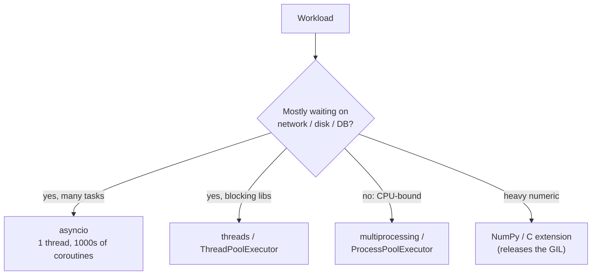
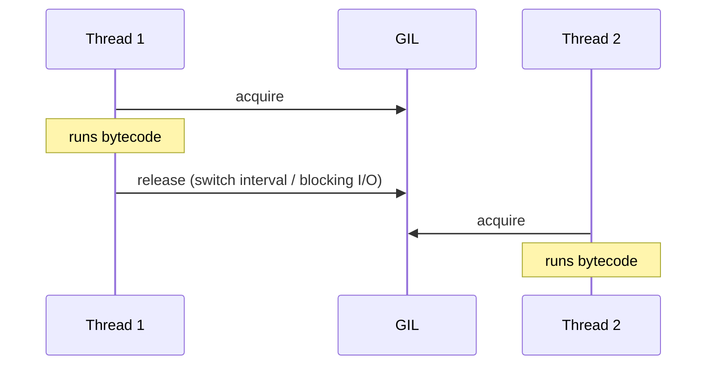

# Lesson 14: The GIL, Threads, Processes and `asyncio`

> **Prerequisites:** [Lesson 05: Generators](../05-iterators-generators-and-yield/README.md) · [Lesson 13: Memory and Performance](../13-memory-garbage-collection-and-performance/README.md) · [LLD 10 · Concurrency-Safe Design](../../10-concurrency-safe-design/README.md)  
> **Reading time:** ~25 minutes  
> **Audience:** Candidates asked "what is the GIL?", "threads vs processes vs asyncio?", or "design a service that makes 1,000 outbound calls"

> [!NOTE]
> **In one line:** The **GIL** lets only one thread run Python bytecode at a time in a CPython process, so threads don't speed up CPU-bound pure-Python code but **do** help I/O-bound code (the GIL is released while waiting); use **processes** for CPU parallelism and **asyncio** (or threads) for many concurrent I/O waits.

> [!TIP]
> **Golden rule:** Choose by *what the work waits on*. Waiting on network/disk → **asyncio** (best at scale) or **threads** (simplest with blocking libraries). Burning CPU → **`multiprocessing` / `ProcessPoolExecutor`** (or C/NumPy code that releases the GIL). Mixed → async front, process pool for CPU.

> [!TIP]
> **Try it:** Run the benchmark and compare the timings for your machine, then run the lab at the end of section 3 (a deterministic lost update, a frozen event loop, a measured `Semaphore` cap, and `run_in_executor` with a process pool). Change the CPU task size and watch the process pool's start-up overhead matter for tiny jobs. Draw the three models as lanes in [LLD Studio](/tools/lld-studio/): *threads share memory; processes don't; coroutines share a thread*.

---

## 1. The smell: how this gets asked

- *"What is the GIL and why does it exist?"*
- *"Do Python threads run in parallel?"*
- *"CPU-bound vs I/O-bound — which tool for each?"*
- *"1,000 HTTP calls per request — threads, processes or asyncio?"*
- *"Is the GIL going away?"* (PEP 703)
- *"Is `counter += 1` thread-safe?"*





---

## 2. Reference

| | Threads | Processes | asyncio |
| :--- | :--- | :--- | :--- |
| Parallel Python bytecode? | **No** (GIL) | **Yes** (own GIL each) | No (one thread) |
| I/O concurrency | Good (≈100s) | Heavy | **Excellent** (10,000s) |
| Memory | Shared | Separate (pickle to share) | Shared |
| Start-up cost | Low | High (spawn) | Very low |
| Needs async-aware libs? | No | No | **Yes** (or `to_thread`) |
| Shared-state bugs | **Races** (locks needed) | Rare (isolated) | Fewer (cooperative; races only across `await`) |
| Typical API | `ThreadPoolExecutor` | `ProcessPoolExecutor` | `asyncio.gather`, `TaskGroup` |

**Why the GIL exists:** CPython's reference counts are not atomic; one global lock makes memory management and C extensions simple and single-threaded code fast. **Trade-off:** no multi-core bytecode parallelism per process.

**PEP 703 (3.13+):** an experimental *free-threaded* build (`python3.13t`) can run without the GIL; it's optional and not the default yet. Say "optional free-threaded build", never "the GIL is gone".

---

## 3. Walkthrough: one workload, three tools

**Requirements:** (1) 10 tasks that each "wait" 0.1 s (simulated I/O); (2) 4 CPU-heavy tasks; (3) show a lost update with threads and the lock fix.

1. Sequential I/O: ~1.0 s. Threads: ≈0.1 s. asyncio: ≈0.1 s.
2. CPU-bound: threads ≈ sequential (GIL); processes scale with cores (minus start-up).
3. `counter += 1` is read-modify-write → needs a `Lock` (or a queue / atomic structure).

````carousel
```python
import asyncio
import sys
import threading
import time
from concurrent.futures import ProcessPoolExecutor, ThreadPoolExecutor


def fake_io(_: int) -> int:
    time.sleep(0.1)                       # blocking wait: releases the GIL
    return 1


async def fake_io_async(_: int) -> int:
    await asyncio.sleep(0.1)              # yields to the event loop
    return 1


def burn(n: int) -> int:                  # pure-Python CPU work (holds the GIL)
    total = 0
    for i in range(n):
        total += i * i
    return total


def timed(label: str, fn) -> float:
    start = time.perf_counter()
    result = fn()
    elapsed = time.perf_counter() - start
    print(f"{label:<22} {elapsed:5.2f}s  result={result}")
    return elapsed


def racy_counter(use_lock: bool, threads: int = 4, per_thread: int = 100_000) -> int:
    state = {"n": 0}
    lock = threading.Lock()

    def work() -> None:
        for _ in range(per_thread):
            if use_lock:
                with lock:
                    state["n"] += 1
            else:
                state["n"] += 1           # read-modify-write: not atomic

    ts = [threading.Thread(target=work) for _ in range(threads)]
    for t in ts:
        t.start()
    for t in ts:
        t.join()
    return state["n"]


def main() -> None:
    gil = getattr(sys, "_is_gil_enabled", lambda: True)()
    print("GIL enabled:", gil)

    # --- I/O-bound: 10 tasks x 0.1 s ---
    seq = timed("sequential I/O", lambda: sum(map(fake_io, range(10))))
    with ThreadPoolExecutor(max_workers=10) as pool:
        thr = timed("threads I/O", lambda: sum(pool.map(fake_io, range(10))))
    async def run_all() -> list[int]:
        return await asyncio.gather(*(fake_io_async(i) for i in range(10)))

    asy = timed("asyncio I/O", lambda: sum(asyncio.run(run_all())))
    print("I/O: threads and asyncio beat sequential:", thr < seq / 3 and asy < seq / 3)

    # --- CPU-bound: 4 tasks ---
    N = 15_000_000
    timed("sequential CPU", lambda: sum(burn(N) for _ in range(4)) > 0)
    with ThreadPoolExecutor(max_workers=4) as pool:
        timed("threads CPU (GIL)", lambda: sum(pool.map(burn, [N] * 4)) > 0)
    with ProcessPoolExecutor(max_workers=4) as pool:
        timed("processes CPU", lambda: sum(pool.map(burn, [N] * 4)) > 0)

    # --- shared state ---
    print("with lock   :", racy_counter(True), "(always 400000)")
    print("without lock:", racy_counter(False), "(<= 400000 on GIL builds; may be exact by luck)")


if __name__ == "__main__":                # REQUIRED for multiprocessing on Windows/macOS (spawn)
    main()
```
<!-- slide -->
```csharp
// C#: real parallelism on threads (no GIL). Pick by workload, as in Python.
// I/O-bound  -> async/await (Task)           CPU-bound -> Parallel.For / PLINQ / Task.Run
var sw = System.Diagnostics.Stopwatch.StartNew();
await Task.WhenAll(Enumerable.Range(0, 10).Select(_ => Task.Delay(100)));   // ~100 ms total
Console.WriteLine($"I/O: {sw.ElapsedMilliseconds} ms");

long total = 0;
Parallel.For(0, 4, _ => { long s = 0; for (long i = 0; i < 1_500_000; i++) s += i * i; Interlocked.Add(ref total, s); });

// Shared counter: Interlocked.Increment(ref n) or lock (_gate) { n++; }
```
````

On a typical laptop: sequential I/O ≈ 1.0 s vs threads/asyncio ≈ 0.1 s; for CPU, threads are no faster than sequential (often *slower*, from GIL contention) while processes drop toward `sequential / cores` plus a start-up cost. On the author's machine: sequential 2.3 s, threads 4.5 s, processes 0.8 s. Exact timings vary — focus on the *ratios*, and note that with small tasks (try `N = 1_500_000`) process start-up dominates and processes lose.

### Try it — GIL and asyncio lab (runnable)

The benchmark above shows *speed*. Two things it cannot show: that the unlocked counter really loses updates (on current CPython `state["n"] += 1` usually comes out exact by luck — see the last line of its output), and the async failure modes interviewers ask about. This lab makes each one measurable. Save as `gil_lab.py` and run it as a script (the `__main__` guard is required for the process pool on Windows and macOS).

```python
"""GIL / asyncio lab. Run it as a script: the __main__ guard is REQUIRED for the process pool."""
import asyncio
import threading
import time
from concurrent.futures import ProcessPoolExecutor


# 1) Lost update, made deterministic (the plain `n += 1` race is rare on modern CPython)
def lost_update(use_lock: bool, threads: int = 8, each: int = 30) -> int:
    state, lock = {"n": 0}, threading.Lock()

    def work() -> None:
        for _ in range(each):
            if use_lock:
                with lock:
                    tmp = state["n"]
                    time.sleep(0.0001)          # give the scheduler a reason to switch mid-update
                    state["n"] = tmp + 1
            else:
                tmp = state["n"]                # read
                time.sleep(0.0001)              # a switch is very likely HERE
                state["n"] = tmp + 1            # write based on a stale read

    ts = [threading.Thread(target=work) for _ in range(threads)]
    [t.start() for t in ts]
    [t.join() for t in ts]
    return state["n"]


# 2) One blocking call freezes the event loop; to_thread does not
async def heartbeat(ticks: list[float], stop: asyncio.Event) -> None:
    while not stop.is_set():
        ticks.append(time.perf_counter())
        await asyncio.sleep(0.01)


async def longest_gap(blocking_call) -> float:
    ticks: list[float] = []
    stop = asyncio.Event()
    beat = asyncio.create_task(heartbeat(ticks, stop))
    await asyncio.sleep(0.05)                   # let the heartbeat settle
    await blocking_call()
    await asyncio.sleep(0.05)
    stop.set()
    await beat
    return max(b - a for a, b in zip(ticks, ticks[1:]))


async def blocks_loop() -> None:
    time.sleep(0.3)                             # BUG: blocks every task


async def uses_thread() -> None:
    await asyncio.to_thread(time.sleep, 0.3)    # the loop keeps running


# 3) Semaphore: prove the concurrency cap by recording the high-water mark
async def bounded(total: int, limit: int) -> int:
    sem, running, peak = asyncio.Semaphore(limit), 0, 0

    async def call(_: int) -> None:
        nonlocal running, peak
        async with sem:
            running += 1
            peak = max(peak, running)
            await asyncio.sleep(0.01)           # pretend HTTP call
            running -= 1

    await asyncio.gather(*(call(i) for i in range(total)))
    return peak


# 4) CPU work from async code: run_in_executor with a process pool
def burn(n: int) -> int:
    return sum(i * i for i in range(n))


async def cpu_from_async() -> list[int]:
    loop = asyncio.get_running_loop()
    with ProcessPoolExecutor(max_workers=2) as pool:
        return await asyncio.gather(*(loop.run_in_executor(pool, burn, 200_000) for _ in range(4)))


def main() -> None:
    lost, safe = lost_update(False), lost_update(True)
    print(f"1) 8 threads x 30 increments (expect 240): unlocked={lost}, locked={safe}")
    assert lost < 240 and safe == 240

    stalled = asyncio.run(longest_gap(blocks_loop))
    smooth = asyncio.run(longest_gap(uses_thread))
    print(f"2) longest heartbeat gap: blocking={stalled:.2f}s  to_thread={smooth:.2f}s")
    assert stalled > 0.25 and smooth < 0.15

    peak = asyncio.run(bounded(total=100, limit=10))
    print(f"3) 100 tasks, Semaphore(10): peak concurrency = {peak}")
    assert peak == 10

    results = asyncio.run(cpu_from_async())
    assert results == [burn(200_000)] * 4
    print("4) run_in_executor(ProcessPool): 4 results, loop never blocked")
    print("gil lab ok")


if __name__ == "__main__":
    main()
```

Expected output (numbers vary; the *shape* must not):

```text
1) 8 threads x 30 increments (expect 240): unlocked=32, locked=240
2) longest heartbeat gap: blocking=0.30s  to_thread=0.02s
3) 100 tasks, Semaphore(10): peak concurrency = 10
4) run_in_executor(ProcessPool): 4 results, loop never blocked
gil lab ok
```

What each probe settles:

| Probe | Interview question it answers | Try next |
| :--- | :--- | :--- |
| 1 | "Is `x += 1` thread-safe?" — read, *possible switch*, write; the lock makes it one step | Remove `time.sleep(0.0001)` and raise `each` to 100,000: the loss becomes rare or vanishes on GIL builds, which is exactly why "it worked in testing" proves nothing |
| 2 | "What happens if I call `requests.get` inside `async def`?" — the heartbeat stops for the whole call | Replace `time.sleep(0.3)` with `await asyncio.sleep(0.3)` and see the gap return to ~0.01 s |
| 3 | "1,000 outbound calls — how do you bound them?" — the `Semaphore` caps in-flight work | Set `limit=100` and watch `peak` follow; note that the *server* you call, not your code, is usually the real limit |
| 4 | "CPU task inside an async service?" — a process pool, awaited through the loop | Swap `ProcessPoolExecutor` for `ThreadPoolExecutor`, time both, and explain the result |

---

## 4. Edges

- **`counter += 1` is not atomic** — it's load, add, store, and the interpreter may switch threads between them. (Free-threaded builds make races *more* visible.) Use `Lock`, `queue.Queue`, or per-thread aggregation.
- **Some operations are atomic enough** (`list.append`, `dict[key] = value` single operations), but don't build designs on it.
- **Processes cost.** Arguments and results are **pickled**; lambdas, open files and locks can't be sent. Tiny tasks are dominated by spawn/IPC overhead — batch work (`chunksize`).
- **`if __name__ == "__main__":` guard** is mandatory with `spawn` (Windows, macOS default) or the pool re-imports and fork-bombs itself.
- **asyncio is single-threaded.** One blocking call (`time.sleep`, `requests.get`, a CPU loop) stalls *every* task. Use async libraries, `asyncio.to_thread` for blocking calls, or `run_in_executor` for CPU (lesson 15).
- **Thread pools size.** I/O pools can be large (50–200); CPU pools ≈ `os.cpu_count()`. Unbounded thread creation exhausts memory.
- **Deadlocks:** acquire multiple locks in a fixed order; prefer `with`; avoid holding a lock while doing I/O; use timeouts.
- **Daemon threads** die abruptly at exit — no cleanup. Prefer cooperative shutdown (`Event`).
- **`threading.local`** gives per-thread state; `contextvars` gives per-task state for asyncio.
- **C extensions release the GIL** (NumPy, hashlib, zlib, many DB drivers) — so threads *can* speed up those.
- **Python 3.12+** has per-interpreter GILs (sub-interpreters) and 3.13 has the optional free-threaded build; ecosystem support is still maturing.
- **Signals / KeyboardInterrupt** are delivered to the main thread only.

---

## 5. What you'd say in two minutes

> "The GIL is a mutex in CPython that lets only one thread execute Python bytecode at a time; it exists because reference counting isn't thread-safe and it keeps the interpreter and C extensions simple. So threads don't give me CPU parallelism for pure Python, but they're fine for I/O because the GIL is released while a thread blocks. My rule: I/O-bound with many concurrent waits → asyncio, with async libraries and a semaphore for bounded concurrency; I/O-bound with blocking libraries → a thread pool; CPU-bound → `ProcessPoolExecutor`, accepting the pickling and start-up costs, or NumPy/C code that releases the GIL; mixed workloads → async front with `run_in_executor` for the CPU part. `counter += 1` isn't atomic, so shared state needs a lock or a queue. PEP 703 adds an optional free-threaded build in 3.13, but it's not the default."

---

## 6. Anti-patterns

| Anti-pattern | Why it fails | Fix |
| :--- | :--- | :--- |
| Threads for CPU-bound pure Python | No speed-up (GIL) | Processes / native code |
| Blocking call inside `async def` | Freezes the event loop | Async library or `to_thread` |
| Process pool for 1 ms tasks | Pickling + spawn overhead dominates | Batch / threads / vectorise |
| Shared mutable state without a lock | Lost updates | `Lock` / `Queue` / immutable messages |
| Unbounded `asyncio.gather` over 100k items | Memory, rate limits, connection exhaustion | `Semaphore` / batching / `TaskGroup` |
| Holding a lock while calling out (I/O) | Deadlocks, latency | Narrow the critical section |
| Forgetting the `__main__` guard | Recursive spawn | Guard the entry point |

---

## 7. Interview questions

<details>
<summary><strong>1. What is the GIL and why does it exist? [BASIC]</strong></summary>

A global lock in CPython allowing one thread to run bytecode at a time. It protects non-atomic reference counting and simplifies C extensions and the interpreter, at the cost of CPU parallelism across threads.

</details>

<details>
<summary><strong>2. Do threads help in Python? [BASIC]</strong></summary>

Yes for I/O-bound work (the GIL is released during blocking I/O) and for C extensions that release it; no for CPU-bound pure Python.

</details>

<details>
<summary><strong>3. Threads vs processes vs asyncio? [BASIC]</strong></summary>

Threads: shared memory, simple with blocking code, GIL-limited. Processes: true parallelism, isolated memory, pickling/start-up costs. asyncio: cooperative single-thread concurrency, scales to huge numbers of I/O waits, needs async-aware code.

</details>

<details>
<summary><strong>4. Is `x += 1` thread-safe? [TRICKY]</strong></summary>

No. It compiles to load/add/store; a thread switch in between loses updates. Use a lock, `queue.Queue`, or `itertools.count()` with care.

</details>

<details>
<summary><strong>5. 1,000 outbound HTTP calls per request. Design? [SCENARIO]</strong></summary>

Use asyncio with `httpx.AsyncClient`, a `Semaphore` (e.g., 50) to bound concurrency, timeouts and retries with backoff, and `TaskGroup`/`gather` to collect results; connection pooling; respect downstream rate limits.

</details>

<details>
<summary><strong>6. Is the GIL being removed? [TRICKY]</strong></summary>

PEP 703 made a free-threaded build available as an experimental, opt-in option in 3.13 (and on a path to becoming supported). The default build still has the GIL; many C extensions need updating.

</details>

<details>
<summary><strong>7. Why do you need `if __name__ == "__main__"` with multiprocessing? [TRICKY]</strong></summary>

With the `spawn` start method children re-import the main module; without the guard they'd execute the pool-creating code again recursively.

</details>

<details>
<summary><strong>8. How do you run a CPU task from async code? [SCENARIO]</strong></summary>

`await loop.run_in_executor(process_pool, cpu_fn, arg)`; use a `ProcessPoolExecutor` for CPU (a thread pool won't parallelise pure Python) and `asyncio.to_thread` for blocking I/O calls.

</details>

---

## 8. One-page cheat sheet

```text
GIL            1 thread runs bytecode per process; released on blocking I/O and in many C extensions
I/O-bound      asyncio (many waits, async libs)  |  ThreadPoolExecutor (blocking libs)
CPU-bound      ProcessPoolExecutor / multiprocessing  | NumPy/C extensions | (3.13t free-threaded, optional)
Mixed          async front + run_in_executor(process_pool, ...)
Shared state   x += 1 is NOT atomic -> Lock / Queue / immutable messages
Processes      pickle args/results; __main__ guard; batch small tasks
asyncio        never block the loop; to_thread for blocking calls; Semaphore to bound
Pool sizes     I/O: 10s-100s | CPU: os.cpu_count()
Deadlock       fixed lock order, with-blocks, no I/O under locks
```

---

## Further reading

- [Python docs: `threading`](https://docs.python.org/3/library/threading.html) · [`multiprocessing`](https://docs.python.org/3/library/multiprocessing.html) · [`concurrent.futures`](https://docs.python.org/3/library/concurrent.futures.html)
- [PEP 703: making the GIL optional](https://peps.python.org/pep-0703/)
- [Python docs: GIL FAQ](https://docs.python.org/3/faq/library.html#can-t-we-get-rid-of-the-global-interpreter-lock)

Previous: [Memory, Garbage Collection and Performance](../13-memory-garbage-collection-and-performance/README.md) · Next: [asyncio in Depth](../15-asyncio-in-depth/README.md)
