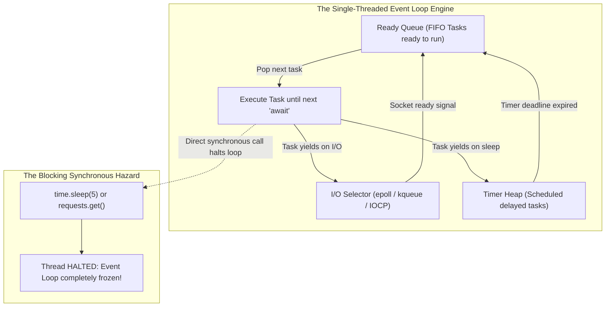
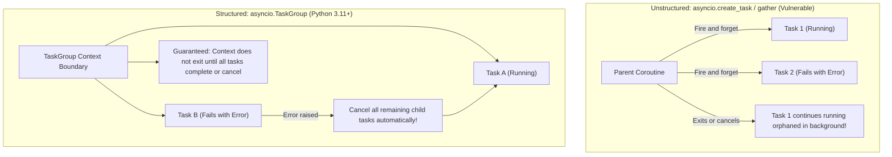

# Lesson 15: asyncio in Depth

> **Prerequisites:** [The GIL, Threads, Processes and asyncio](../14-the-gil-threads-processes-and-asyncio/README.md) and [Track 27 Overview](../README.md).  
> **Estimated Reading Time:** 20 minutes  
> **Target Audience:** Engineers preparing for LLD, OOP, C#, or Python technical screening and architecture rounds.

> [!TIP]
> **The One Rule of asyncio:** Coroutines are dormant state machines until scheduled on an event loop; never block the single OS thread running that loop with synchronous I/O or heavy CPU calculations—offload blocking operations to thread pools via `asyncio.to_thread()`, embrace structured concurrency with `asyncio.TaskGroup` over unmanaged `create_task`, and design all operations for graceful cancellation.

---

## 1. Why This Matters: The Interview Trap

"What actually happens when you call a blocking synchronous library like `time.sleep()` or `requests.get()` inside an `async def` function, and how does the event loop schedule tasks?" is a definitive technical interview question for backend engineers working with FastAPI, Tornado, Sanic, or high-concurrency microservices.

### The Junior vs. Senior Contrast

**The Junior Answer:**
> *"An `async def` function runs asynchronously in the background. If you put `time.sleep(5)`, Python waits 5 seconds for that function while other functions keep running on other threads. A coroutine and a task are basically the same thing. You use `asyncio.gather` to run everything together."*

**The Senior Answer:**
> *"Python's `asyncio` is **single-threaded cooperative multitasking**, not preemptive multithreading. There is only one OS thread executing the event loop.*  
> 
> *The event loop runs a continuous cycle: it polls OS notification primitives (such as `epoll` on Linux, `kqueue` on macOS, or `IOCP` on Windows) to check which I/O file descriptors are ready, and executes callbacks from its internal FIFO ready queue. When a coroutine executes `await`, it suspends itself and yields control back to the event loop, allowing the loop to advance other tasks.*  
> 
> *If you invoke a blocking synchronous function (like `time.sleep()` or `requests.get()`), it does not yield control. It **blocks the entire OS thread**, completely freezing the event loop. No other coroutines can run, health check endpoints fail, heartbeat pings to Redis or Kafka timeout, and all concurrent client connections stall.*  
> 
> *To fix this, blocking operations must be offloaded to an auxiliary thread pool via `asyncio.to_thread()`. Furthermore, a **coroutine** is merely an unstarted state machine created by invoking an `async def` function. A **Task** is a scheduled wrapper that binds a coroutine to the event loop and manages its execution lifecycle. Modern Python 3.11+ mandates **structured concurrency** via `asyncio.TaskGroup`, preventing task leakage and guaranteeing clean cancellation cascades."*

---

## 2. Visual Mental Model / Taxonomic Comparison

### 1. The Event Loop Execution Cycle



### 2. Structured Concurrency (`TaskGroup`) vs. Unstructured Spawning



### 3. Comparison Matrix: Coroutine, Task, Future, and Thread

| Dimension | Coroutine | Task (`asyncio.Task`) | Future (`asyncio.Future`) | OS Thread (`threading.Thread`) |
| :--- | :--- | :--- | :--- | :--- |
| **What It Is** | A dormant generator-like object returned by `async def`. | A concrete wrapper that schedules a coroutine on the loop. | A low-level object representing an eventual result. | An OS-managed execution thread with its own kernel stack. |
| **Execution Trigger** | Must be explicitly driven via `await` or wrapped into a Task. | Scheduled immediately on the loop upon creation (`create_task`). | Resolved when `.set_result()` or `.set_exception()` is called. | Preemptively scheduled by the operating system kernel. |
| **Concurrency Model** | Cooperative (yields voluntarily at `await`). | Cooperative. | Callback/Event-driven. | Preemptive (interrupted at any bytecode by the OS/GIL). |
| **Memory Overhead** | Extremely lightweight (~800 bytes). | Small (~1-2 KB). | Small (~1 KB). | Heavy (~1-8 MB stack allocated per thread). |
| **C# Analogy** | Compiler-generated state machine. | `Task` / `Task<T>`. | `TaskCompletionSource<T>`. | `System.Threading.Thread`. |

---

## 3. Code Implementation: The Resilient Async Pipeline

The following dual implementation showcases:
1. **Async Context Management (`async with` / `await using`)** for resource lifecycle control.
2. **Structured Concurrent Execution** (`asyncio.TaskGroup` in Python, `Task.WhenAll` in C#).
3. **Offloading Synchronous Blocking Operations** via `asyncio.to_thread` / `Task.Run` so the event loop is never starved.
4. **Timeouts and Graceful Cancellation** handling.

````carousel
```python
import asyncio
import time


class AsyncResourceSession:
  """Demonstrates asynchronous context management (async with)."""

  def __init__(self, session_id: str) -> None:
    self.session_id = session_id

  async def __aenter__(self) -> "AsyncResourceSession":
    print(f"[SESSION] Connected session: {self.session_id}")
    return self

  async def __aexit__(self, exc_type, exc_val, exc_tb) -> None:
    print(f"[SESSION] Closed session: {self.session_id}")


def blocking_hash_computation(payload: str) -> str:
  """Simulates a legacy synchronous CPU or blocking I/O operation."""
  time.sleep(0.02)  # Synchronous block that would freeze an event loop
  return f"HASH-{payload}-OK"


async def fetch_inventory(item_id: str) -> str:
  # Non-blocking async I/O simulation
  await asyncio.sleep(0.01)
  return f"Item-{item_id}:InStock"


async def fetch_pricing(item_id: str) -> str:
  # Non-blocking async I/O simulation
  await asyncio.sleep(0.01)
  return f"Item-{item_id}:$49.99"


async def slow_failing_service() -> str:
  # Simulates an external dependency exceeding SLAs
  await asyncio.sleep(0.5)
  return "NeverReached"


async def run_pipeline() -> None:
  print("--- 1. Async Context Manager and Concurrent Tasks ---")
  async with AsyncResourceSession("SES-8801"):
    # Python 3.11+ Structured Concurrency via TaskGroup
    async with asyncio.TaskGroup() as tg:
      t1 = tg.create_task(fetch_inventory("901"))
      t2 = tg.create_task(fetch_pricing("901"))

    print(f"Concurrent result 1: {t1.result()}")
    print(f"Concurrent result 2: {t2.result()}")

  print("\n--- 2. Offloading Blocking Calls via to_thread ---")
  # asyncio.to_thread runs the synchronous function in a separate worker thread
  signature = await asyncio.to_thread(blocking_hash_computation, "ORDER-901")
  print(f"Offloaded worker result: {signature}")

  print("\n--- 3. Timeouts and Graceful Cancellation ---")
  try:
    async with asyncio.timeout(0.05):
      await slow_failing_service()
  except TimeoutError:
    print("Async operation timed out and was cancelled cleanly.")


if __name__ == "__main__":
  asyncio.run(run_pipeline())
```
<!-- slide -->
```csharp
using System;
using System.Threading;
using System.Threading.Tasks;

public class AsyncResourceSession : IAsyncDisposable
{
    public string SessionId { get; }

    public AsyncResourceSession(string sessionId)
    {
        SessionId = sessionId;
        Console.WriteLine($"[SESSION] Connected session: {SessionId}");
    }

    public ValueTask DisposeAsync()
    {
        Console.WriteLine($"[SESSION] Closed session: {SessionId}");
        return ValueTask.CompletedTask;
    }
}

public class Program
{
    private static string BlockingHashComputation(string payload)
    {
        // Simulates a legacy synchronous CPU or blocking I/O operation
        Thread.Sleep(20);
        return $"HASH-{payload}-OK";
    }

    private static async Task<string> FetchInventoryAsync(string itemId)
    {
        // Non-blocking async I/O simulation
        await Task.Delay(10);
        return $"Item-{itemId}:InStock";
    }

    private static async Task<string> FetchPricingAsync(string itemId)
    {
        // Non-blocking async I/O simulation
        await Task.Delay(10);
        return $"Item-{itemId}:$49.99";
    }

    private static async Task<string> SlowFailingServiceAsync(CancellationToken ct)
    {
        // Simulates an external dependency exceeding SLAs
        await Task.Delay(500, ct);
        return "NeverReached";
    }

    public static async Task Main()
    {
        Console.WriteLine("--- 1. Async Context Manager and Concurrent Tasks ---");
        await using (var session = new AsyncResourceSession("SES-8801"))
        {
            var t1 = FetchInventoryAsync("901");
            var t2 = FetchPricingAsync("901");

            await Task.WhenAll(t1, t2);

            Console.WriteLine($"Concurrent result 1: {t1.Result}");
            Console.WriteLine($"Concurrent result 2: {t2.Result}");
        }

        Console.WriteLine("\n--- 2. Offloading Blocking Calls via to_thread ---");
        // Task.Run offloads synchronous work to the thread pool, keeping callers responsive
        string signature = await Task.Run(() => BlockingHashComputation("ORDER-901"));
        Console.WriteLine($"Offloaded worker result: {signature}");

        Console.WriteLine("\n--- 3. Timeouts and Graceful Cancellation ---");
        using var cts = new CancellationTokenSource(TimeSpan.FromMilliseconds(50));
        try
        {
            await SlowFailingServiceAsync(cts.Token);
        }
        catch (OperationCanceledException)
        {
            Console.WriteLine("Async operation timed out and was cancelled cleanly.");
        }
    }
}
```
````

**Expected Output (Both Languages):**

```text
--- 1. Async Context Manager and Concurrent Tasks ---
[SESSION] Connected session: SES-8801
Concurrent result 1: Item-901:InStock
Concurrent result 2: Item-901:$49.99
[SESSION] Closed session: SES-8801

--- 2. Offloading Blocking Calls via to_thread ---
Offloaded worker result: HASH-ORDER-901-OK

--- 3. Timeouts and Graceful Cancellation ---
Async operation timed out and was cancelled cleanly.
```

---

## 4. Where You Already Use It

- **In Python ASGI Frameworks & Libraries:**
  - **FastAPI, Starlette & Uvicorn:** ASGI servers run an event loop (frequently accelerated by `uvloop`, a C-extension binding `libuv`). Route endpoints declared with `async def` run as tasks directly on this loop.
  - **Asynchronous HTTP Clients (`httpx` / `aiohttp`):** When calling downstream microservices, `httpx.AsyncClient()` yields socket reads/writes to the selector, enabling a single process to handle tens of thousands of concurrent outgoing requests.
  - **Async Database Drivers (`asyncpg`):** Unlike synchronous drivers (`psycopg2`) that block the OS thread during SQL execution, `asyncpg` registers PostgreSQL sockets with the loop's `epoll` selector, achieving unmatched throughput.
  - **WebSocket and Event Streams:** `async for message in websocket:` implements the asynchronous iterator protocol (`__aiter__` and `__anext__`) to stream data reactively.

- **In .NET / C#:**
  - **ASP.NET Core Kestrel:** Built entirely on asynchronous I/O completion ports (IOCP). HTTP request pipelines dispatch controllers asynchronously without dedicating an OS thread to waiting on database I/O.
  - **Entity Framework Core:** Methods like `await context.Users.ToListAsync()` return `Task<List<T>>`, yielding the thread back to the CLR ThreadPool until the SQL database responds.

---

## 5. Pitfalls and When Not to Use It

### 1. The Accidental Blocking Call Trap
Calling a synchronous library inside an `async def` function is the #1 cause of catastrophic performance degradation in Python backends:
```python
# CATASTROPHIC: Freezes all other 5,000 active connections on the event loop
@app.get("/users/{user_id}")
async def get_user(user_id: str):
  # requests.get is SYNCHRONOUS and BLOCKING!
  res = requests.get(f"https://auth-service/users/{user_id}")
  return res.json()
```
*Fix:* Use an async HTTP client (`httpx.AsyncClient`) or offload to a thread:
```python
res = await asyncio.to_thread(
    requests.get, f"https://auth-service/users/{user_id}"
)
```

### 2. Unbounded Task Spawning (Connection Exhaustion)
Looping over 10,000 items and spawning tasks via `asyncio.create_task` or `asyncio.gather` creates 10,000 simultaneous network sockets:
```python
# DANGEROUS: Spawns 10,000 concurrent sockets immediately
tasks = [asyncio.create_task(fetch(url)) for url in urls_10k]
await asyncio.gather(*tasks)
```
*Impact:* Crashes the application with `OSError: [Errno 24] Too many open files` or exhausts database connection pools.  
*Fix:* Always bound concurrent execution using an `asyncio.Semaphore(50)`.

### 3. Catching `BaseException` and Swallowing `CancelledError`
When a task is cancelled (due to a timeout or client disconnect), `asyncio` injects `asyncio.CancelledError` into the coroutine at the current `await` point.
```python
# BUG: Prevents task from cancelling cleanly
try:
  await long_running_query()
except BaseException:  # Swallows CancelledError!
  logger.warning("Ignoring error and continuing...")
```
*Rule:* Allow `CancelledError` to propagate, or perform necessary cleanup and re-raise it.

### 4. Running CPU-Bound Calculations in `asyncio`
`asyncio` does **not** bypass the GIL. Offloading heavy numerical calculations or image processing to `asyncio.to_thread` frees the event loop, but the worker thread will still contend for the Global Interpreter Lock with the event loop thread. CPU-intensive operations must be offloaded to separate processes using `concurrent.futures.ProcessPoolExecutor` or Celery.

---

## 6. Exercises & Practical Drills

### Drill 1: Concurrency Limiting with a Semaphore
Suppose you have a list of 500 image URLs to download. Downloading them all at once triggers rate-limiting from the upstream CDN (HTTP 429).  
**Task:** Write a coroutine `download_all(urls)` that downloads all images concurrently, but guarantees that no more than 10 downloads run simultaneously.

<details>
<summary>Answer</summary>

```python
import asyncio
import httpx


async def download_all(urls: list[str]) -> list[bytes]:
  semaphore = asyncio.Semaphore(10)  # Maximum 10 concurrent requests

  async with httpx.AsyncClient() as client:

    async def fetch(url: str) -> bytes:
      async with semaphore:
        response = await client.get(url)
        return response.content

    async with asyncio.TaskGroup() as tg:
      tasks = [tg.create_task(fetch(u)) for u in urls]

    return [t.result() for t in tasks]
```
*Explanation:* The `async with semaphore:` context manager allows 10 tasks to enter simultaneously. The 11th task suspends non-blockingly until one of the active tasks exits the context manager.
</details>

---

### Drill 2: Graceful Task Cancellation with Cleanup
Write an async worker loop `stream_consumer()` that continuously polls messages. Ensure that when the consumer is cancelled via `task.cancel()`, it flushes pending buffers before shutting down.

<details>
<summary>Answer</summary>

```python
import asyncio


async def stream_consumer() -> None:
  try:
    while True:
      msg = await fetch_next_message()
      await process_message(msg)
  except asyncio.CancelledError:
    print("Cancellation requested: Flushing buffers...")
    await flush_pending_buffers()
    raise  # Re-raise CancelledError to let the event loop confirm termination!
```
*Explanation:* When `CancelledError` is caught, we perform the asynchronous cleanup (`flush_pending_buffers()`) and then re-raise the exception so the parent task runner knows cancellation was honored.
</details>

---

## 7. Interview Questions & Model Answers

> [!interview]
> **Question 1: What is the event loop?**  
> **Strong Answer:**  
> "The event loop is the central orchestrator of an asynchronous Python application. Operating on a single OS thread, it continuously coordinates task execution, I/O multiplexing, and timers.  
> 
> Internally, it manages two primary structures:  
> 1. A **Ready Queue** of runnable callbacks and tasks ready for CPU time.  
> 2. An **I/O Selector** (using OS-level primitives like Linux `epoll`, BSD/macOS `kqueue`, or Windows `IOCP`) tracking non-blocking sockets and file descriptors.  
> 
> In each cycle, the loop dispatches ready tasks until they reach an `await` expression and yield control. While tasks are suspended awaiting socket reads or timers, the loop polls the OS selector for completed network events and moves awakened tasks back onto the ready queue. This enables a single thread to handle tens of thousands of concurrent connections without thread context-switching overhead."

> [!interview]
> **Question 2: What is the difference between a coroutine and a task?**  
> **Strong Answer:**  
> "A **coroutine** is the object created when you call an `async def` function. It is a dormant state machine containing code and local variables; it does not execute automatically upon creation. It only executes when explicitly driven via `await coroutine` or passed to an event loop runner.  
> 
> A **Task** is a concrete subclass of `asyncio.Future` that wraps a coroutine and schedules it on the event loop immediately via `asyncio.create_task()` or `TaskGroup.create_task()`. The task registers itself on the loop's ready queue, allowing it to execute independently and concurrently alongside other tasks.  
> 
> In short: a coroutine is a unit of suspended code, while a task is an actively managed, scheduled unit of concurrent work."

> [!interview]
> **Question 3: What happens if you call a blocking function inside async code?**  
> **Strong Answer:**  
> "Calling a blocking synchronous function (such as `time.sleep()`, synchronous `requests.get()`, or a heavy CPU loop) inside an async function **blocks the single OS thread running the event loop**.  
> 
> Because cooperative multitasking requires coroutines to yield control back to the loop via `await`, a blocking call holds the thread hostage. The event loop cannot poll the I/O selector, cannot execute expired timers, and cannot process any other tasks in the ready queue.  
> 
> In production web backends, a single 2-second blocking database or HTTP call freezes the entire service: health checks fail, incoming requests queue up, socket timeouts fire, and overall throughput collapses. Blocking synchronous I/O or CPU work must be offloaded to worker threads using `asyncio.to_thread()` or `ProcessPoolExecutor`."

> [!interview]
> **Question 4: How does structured concurrency with `TaskGroup` differ from `asyncio.gather`?**  
> **Strong Answer:**  
> "Introduced in Python 3.11 via **PEP 654**, `asyncio.TaskGroup` provides **structured concurrency**, whereas `asyncio.gather` represents unstructured or loosely-coupled concurrency.  
> 
> 1. **Lifecycle Scoping:** With `TaskGroup`, all child tasks are bound to the `async with` block scope. The context manager cannot exit until all child tasks finish or are cancelled. With `gather` or `create_task`, tasks can easily leak and continue executing as orphaned background operations if the parent function exits early.  
> 2. **Failure Handling & Cascading Cancellation:** If one task inside a `TaskGroup` raises an exception, the `TaskGroup` automatically cancels all other sibling tasks within the group. It aggregates all failures into an `ExceptionGroup` handled via `except*`. In contrast, if one task in `asyncio.gather()` fails, sibling tasks continue running in the background by default unless manually cancelled."

---

## 8. Sources & Further Reading

- [Python Documentation: Coroutines and Tasks (`asyncio`)](https://docs.python.org/3/library/asyncio-task.html)
- [Python Documentation: Structured Concurrency with `asyncio.TaskGroup`](https://docs.python.org/3/library/asyncio-task.html#task-groups)
- [PEP 492: Coroutines with async and await syntax](https://peps.python.org/pep-0492/)
- [PEP 654: Exception Groups and except*](https://peps.python.org/pep-0654/)
- [Microsoft Learn: Asynchronous programming with async and await in C#](https://learn.microsoft.com/en-us/dotnet/csharp/asynchronous-programming/)

---

Previous: [The GIL, Threads, Processes and asyncio](../14-the-gil-threads-processes-and-asyncio/README.md) · Next: [Metaclasses, Descriptors and How @property Works](../16-metaclasses-descriptors-and-property/README.md)
