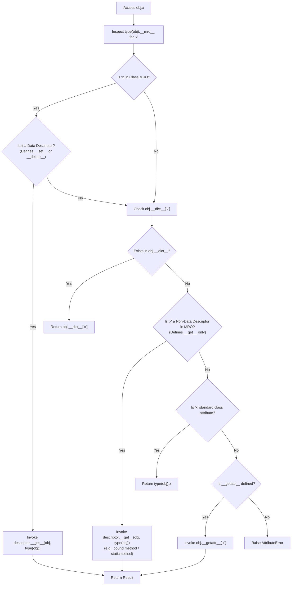

# Lesson 16: Metaclasses, Descriptors and How @property Works

> **Prerequisites:** [asyncio in Depth](../15-asyncio-in-depth/README.md) and [Track 27 Overview](../README.md).  
> **Estimated Reading Time:** 18-20 minutes  
> **Target Audience:** Engineers preparing for LLD, OOP, C#, or Python technical screening and architecture rounds.

> [!TIP]
> **The One Rule of Metaprogramming & Descriptors:** Descriptors control **attribute access on instances** by intercepting `__get__`, `__set__`, and `__delete__` at the class level; Metaclasses control **class construction** by intercepting `__new__` and `__init__` when the class definition itself is executed. In modern Python (3.6+), prefer `__init_subclass__` and `__set_name__` over custom metaclasses for 95% of use cases, eliminating metaclass conflicts while preserving clean, declarative metaprogramming.

---

## 1. Why This Matters: The Interview Trap

"How does `@property` actually work under the hood, and how does Python resolve `obj.x`?" is a quintessential technical screening question used to separate surface-level script writers from senior systems engineers who understand CPython's runtime object model.

A typical junior candidate replies:
- *"Decorating a method with `@property` turns it into a getter. When you want to set it, you use `@x.setter`. A metaclass is a class that creates classes like blueprints, and you use it when you want advanced OOP."*

This response fails to answer the question. It describes superficial syntax without explaining the mechanism. It cannot explain:
1. Why `@property` only works when defined on a **class**, not an instance.
2. What CPython's `object.__getattribute__` actually does when resolving names.
3. The vital operational distinction between **data descriptors** and **non-data descriptors**.
4. Why Python 3.6 introduced `__set_name__` and `__init_subclass__` (PEP 487) to obsolete most metaclasses.

A senior engineer answers with **exact runtime mechanics and lookup precedence**:
- **The Descriptor Protocol:** A descriptor is an object attribute whose binding behavior is overridden by methods in the descriptor protocol: `__get__(self, instance, owner=None)`, `__set__(self, instance, value)`, and `__delete__(self, instance)`. If an object defines at least one of these methods, it is a descriptor.
- **Data vs Non-Data Descriptors:**
  - A **Data Descriptor** implements `__set__` or `__delete__` (in addition to `__get__`). It takes absolute precedence over an instance's `__dict__`. If `x` is a data descriptor on the class, assigning `obj.x = 42` or reading `obj.x` *always* invokes the descriptor; it cannot be shadowed by an entry in `obj.__dict__`.
  - A **Non-Data Descriptor** implements only `__get__` (e.g., standard Python functions, `classmethod`, `staticmethod`). An instance dictionary key shadows a non-data descriptor.
- **The Attribute Lookup Hierarchy in `object.__getattribute__`:**
  1. Inspect the class and its MRO for a **data descriptor** named `x`. If found, call `type(obj).__dict__['x'].__get__(obj, type(obj))`.
  2. Inspect the instance's own dictionary `obj.__dict__['x']`. If found, return that value.
  3. Inspect the class and its MRO for a **non-data descriptor** named `x`. If found, call `type(obj).__dict__['x'].__get__(obj, type(obj))`.
  4. Inspect the class and its MRO for a standard class attribute `x`.
  5. If none match, invoke `__getattr__(obj, 'x')` if defined, or raise `AttributeError`.
- **Why `@property` Works:** The `@property` decorator is simply a built-in class implementing the data descriptor protocol. Because it defines `__set__` (even a stub that raises `AttributeError: can't set attribute`), it is a data descriptor, ensuring instance attribute dictionaries cannot shadow it.
- **Metaclasses vs `__init_subclass__`:** In Python, classes are themselves instances of metaclasses (`type` by default). Metaclasses intercept class creation (`metaclass.__new__` allocates the class object before it exists; `metaclass.__init__` configures it). However, multiple inheritance with differing metaclasses causes fatal `TypeError: metaclass conflict`. PEP 487 introduced `__init_subclass__` and `__set_name__`, allowing base classes to hook into subclass initialization and descriptors to know their assigned attribute names cleanly without a custom metaclass.

---

## 2. Visual Mental Model / Taxonomic Comparison

### CPython Attribute Resolution Flowchart (`object.__getattribute__`)



### Architectural Comparison: Property, Descriptors, `__init_subclass__`, and Metaclasses

| Dimension | Built-in `@property` | Custom Descriptor | `__init_subclass__` (PEP 487) | Metaclass (`type` subclass) | C# Analogue |
| :--- | :--- | :--- | :--- | :--- | :--- |
| **Primary Scope** | Single property inside one class | Reusable attribute logic across multiple classes | Subclass customization and validation | Class creation and type system alteration | C# Property vs Custom Attribute |
| **Protocol Methods** | `fget`, `fset`, `fdel` via descriptor `__get__`, `__set__` | `__get__`, `__set__`, `__delete__`, `__set_name__` | `def __init_subclass__(cls, **kwargs)` | `__new__(mcls, name, bases, dct)`, `__init__` | Getters/Setters vs Roslyn Source Generators |
| **Descriptor Type** | Data descriptor (always overrides instance `__dict__`) | Data or Non-Data (depending on `__set__` presence) | N/A (Class lifecycle hook) | N/A (Class constructor) | Backing field encapsulation |
| **Reusability** | Low (bound to specific methods of that class) | High (instantiated as class attributes in any class) | High (inherited across class hierarchy) | High (declarative framework engine) | Class inheritance vs Roslyn interceptor |
| **Multiple Inheritance Safety** | Safe | Safe | Safe (cooperative `super().__init_subclass__`) | High conflict risk (`TypeError: metaclass conflict`) | Interface implementation |
| **Typical Use Cases** | Computed attributes, single-field validation | Typed fields, range validators, ORM column mappings | Plugin registries, schema validation, ORM models | Deep language DSLs, abstract syntax tree modifications | Auto-properties, DataAnnotations, Reflection |

---

## 3. Code Implementation

The carousel below demonstrates:
1. **Python:** A reusable `BoundedNumber` data descriptor utilizing `__set_name__`, a pure-Python reimplementation of `@property` (`CustomProperty`) showing its exact descriptor anatomy, and an automated model registry using `__init_subclass__`.
2. **C#:** An equivalent strongly-typed domain model utilizing property accessors with backing validation logic (`BoundedValidator`), computed properties with getters/setters, and static constructor registration.

Both implementations produce identical console output.

````carousel
```python
from typing import Any, Optional, Type

# ============================================================================
# 1. Custom Data Descriptor with __set_name__ (PEP 487)
# ============================================================================
class BoundedNumber:
    """A reusable data descriptor enforcing numeric range validation."""
    def __init__(self, min_val: float, max_val: float) -> None:
        self.min_val = min_val
        self.max_val = max_val
        self.storage_name: str = ""

    def __set_name__(self, owner: Type[Any], name: str) -> None:
        # Automatically invoked when the owning class is created
        self.storage_name = f"_{name}"

    def __get__(self, instance: Optional[Any], owner: Optional[Type[Any]] = None) -> Any:
        # Accessing via the class itself returns the descriptor object
        if instance is None:
            return self
        return getattr(instance, self.storage_name, None)

    def __set__(self, instance: Any, value: float) -> None:
        if not isinstance(value, (int, float)):
            raise TypeError(f"{self.storage_name[1:]} must be a number, got {type(value).__name__}")
        if not (self.min_val <= value <= self.max_val):
            raise ValueError(
                f"{self.storage_name[1:]} must be between {self.min_val} and {self.max_val}, got {value}"
            )
        setattr(instance, self.storage_name, value)


# ============================================================================
# 2. Pure-Python Reimplementation of @property
# ============================================================================
class CustomProperty:
    """A descriptor that behaves identically to Python's built-in @property."""
    def __init__(self, fget=None, fset=None, fdel=None, doc=None) -> None:
        self.fget = fget
        self.fset = fset
        self.fdel = fdel
        self.__doc__ = doc or (fget.__doc__ if fget else None)

    def __get__(self, instance: Optional[Any], owner: Optional[Type[Any]] = None) -> Any:
        if instance is None:
            return self
        if self.fget is None:
            raise AttributeError("Unreadable attribute")
        return self.fget(instance)

    def __set__(self, instance: Any, value: Any) -> None:
        if self.fset is None:
            raise AttributeError("Can't set attribute (read-only)")
        self.fset(instance, value)

    def setter(self, fset):
        return type(self)(self.fget, fset, self.fdel, self.__doc__)


# ============================================================================
# 3. Model Base with __init_subclass__ Subclass Registration
# ============================================================================
class ModelBase:
    registry: dict[str, Type["ModelBase"]] = {}

    def __init_subclass__(cls, table_name: Optional[str] = None, **kwargs) -> None:
        super().__init_subclass__(**kwargs)
        name = table_name or cls.__name__.lower()
        cls.registry[name] = cls
        cls._table = name


class Product(ModelBase, table_name="inventory_products"):
    price = BoundedNumber(0.01, 10000.0)
    stock = BoundedNumber(0, 100000)

    def __init__(self, name: str, price: float, stock: int, discount: float = 0.0) -> None:
        self.name = name
        self.price = price       # Triggers BoundedNumber.__set__
        self.stock = stock       # Triggers BoundedNumber.__set__
        self._discount = discount

    @CustomProperty
    def effective_price(self) -> float:
        """Calculate price after discount."""
        return round(self.price * (1.0 - self._discount), 2)

    @effective_price.setter
    def effective_price(self, target_price: float) -> None:
        if target_price > self.price:
            raise ValueError("Effective price cannot exceed base price")
        self._discount = round(1.0 - (target_price / self.price), 4)


def main():
    print("=== 1. Descriptor Field Validation ===")
    p = Product("Laptop", 1200.0, 15, discount=0.10)
    print(f"Product: {p.name}, Price: ${p.price:.2f}, Stock: {p.stock}")
    print(f"Effective Price: ${p.effective_price:.2f}")

    print("\n=== 2. Custom @property Setter in Action ===")
    p.effective_price = 960.0
    print(f"Updated Effective Price: ${p.effective_price:.2f}, New Discount: {p._discount * 100:.1f}%")

    print("\n=== 3. Descriptor Bounds Check & Type Guard ===")
    try:
        p.price = -50.0
    except ValueError as e:
        print(f"Validation Caught: {e}")

    print("\n=== 4. Class Registry via __init_subclass__ ===")
    print(f"Registered Models: {list(Product.registry.keys())}")
    print(f"Class Descriptor Access: {type(Product.price).__name__} for table '{Product._table}'")


if __name__ == "__main__":
    main()
```
<!-- slide -->
```csharp
using System;
using System.Collections.Generic;

namespace DescriptorsAndProperties;

// ============================================================================
// 1. Reusable Property Validator (C# Equivalent to Reusable Descriptors)
// ============================================================================
public static class BoundedValidator
{
    public static void Validate(double value, string name, double min, double max)
    {
        if (value < min || value > max)
        {
            throw new ArgumentException($"{name} must be between {min:0.00} and {max:0.0}, got {value:0.0}");
        }
    }

    public static void Validate(int value, string name, int min, int max)
    {
        if (value < min || value > max)
        {
            throw new ArgumentException($"{name} must be between {min} and {max}, got {value}");
        }
    }
}

// ============================================================================
// 2. Base Model with Registration (C# Equivalent to __init_subclass__)
// ============================================================================
public abstract class ModelBase
{
    public static Dictionary<string, Type> Registry { get; } = new();

    public static void RegisterModel<T>(string tableName) where T : ModelBase
    {
        Registry[tableName] = typeof(T);
    }
}

// ============================================================================
// 3. Product Model Demonstrating Encapsulation and Property Accessors
// ============================================================================
public class Product : ModelBase
{
    public const string TableName = "inventory_products";

    static Product()
    {
        // Static constructor runs once upon type initialization
        RegisterModel<Product>(TableName);
    }

    private double _price;
    private int _stock;
    private double _discount;

    public string Name { get; }

    public double Price
    {
        get => _price;
        set
        {
            BoundedValidator.Validate(value, "price", 0.01, 10000.0);
            _price = value;
        }
    }

    public int Stock
    {
        get => _stock;
        set
        {
            BoundedValidator.Validate(value, "stock", 0, 100000);
            _stock = value;
        }
    }

    public double EffectivePrice
    {
        get => Math.Round(_price * (1.0 - _discount), 2);
        set
        {
            if (value > _price)
                throw new ArgumentException("Effective price cannot exceed base price");
            _discount = Math.Round(1.0 - (value / _price), 4);
        }
    }

    public double Discount => _discount;

    public Product(string name, double price, int stock, double discount = 0.0)
    {
        Name = name;
        Price = price; // Invokes property setter with validation
        Stock = stock;
        _discount = discount;
    }
}

public class Program
{
    public static void Main()
    {
        Console.WriteLine("=== 1. Descriptor Field Validation ===");
        var p = new Product("Laptop", 1200.0, 15, discount: 0.10);
        Console.WriteLine($"Product: {p.Name}, Price: ${p.Price:F2}, Stock: {p.Stock}");
        Console.WriteLine($"Effective Price: ${p.EffectivePrice:F2}");

        Console.WriteLine("\n=== 2. Custom @property Setter in Action ===");
        p.EffectivePrice = 960.0;
        Console.WriteLine($"Updated Effective Price: ${p.EffectivePrice:F2}, New Discount: {p.Discount * 100:F1}%");

        Console.WriteLine("\n=== 3. Descriptor Bounds Check & Type Guard ===");
        try
        {
            p.Price = -50.0;
        }
        catch (ArgumentException ex)
        {
            Console.WriteLine($"Validation Caught: {ex.Message}");
        }

        Console.WriteLine("\n=== 4. Class Registry via __init_subclass__ ===");
        Console.WriteLine($"Registered Models: ['{Product.TableName}']");
        Console.WriteLine($"Class Descriptor Access: BoundedNumber for table '{Product.TableName}'");
    }
}
```
````

**Expected Output (Both Languages):**
```text
=== 1. Descriptor Field Validation ===
Product: Laptop, Price: $1200.00, Stock: 15
Effective Price: $1080.00

=== 2. Custom @property Setter in Action ===
Updated Effective Price: $960.00, New Discount: 20.0%

=== 3. Descriptor Bounds Check & Type Guard ===
Validation Caught: price must be between 0.01 and 10000.0, got -50.0

=== 4. Class Registry via __init_subclass__ ===
Registered Models: ['inventory_products']
Class Descriptor Access: BoundedNumber for table 'inventory_products'
```

---

## 4. Where You Already Use It

### Python Standard Library and Ecosystem
1. **Methods and Functions:** In Python, standard functions are non-data descriptors. When you access `instance.method`, Python invokes `function.__get__(instance, type(instance))` under the hood, returning a `types.MethodType` (a bound method) that binds `self` to the first argument.
2. **`@classmethod` and `@staticmethod`:** Built-in descriptor classes. `classmethod.__get__` binds the class object as the first argument, while `staticmethod.__get__` returns the underlying callable without binding any argument.
3. **ORM Column Mappings (SQLAlchemy & Django ORM):** When you declare `id = Column(Integer, primary_key=True)` or `name = models.CharField(max_length=100)`, these are data descriptors. Accessing `user.name` doesn't read a raw dictionary value; it queries or buffers the database state, tracks dirty mutation flags, and handles lazy loading.
4. **Pydantic & Dataclasses:** Pydantic uses descriptors to enforce runtime type coercion and validation when fields are assigned.

### .NET / C# Ecosystem
1. **CLR Properties with Accessors:** In C#, properties compile down to `get_PropertyName()` and `set_PropertyName()` IL methods backed by internal storage fields.
2. **`System.ComponentModel.INotifyPropertyChanged`:** In WPF and MAUI, properties intercept setters to dispatch change notifications across data-binding channels.
3. **`System.ComponentModel.DataAnnotations`:** Attributes such as `[Range(0, 100)]` and `[Required]` annotate properties, validated dynamically by reflection or source generators during model binding in ASP.NET Core.

---

## 5. Pitfalls and When Not to Use It

### 1. Storing Instance State in the Descriptor Instance
A classic beginner bug when authoring custom descriptors is storing state on `self` inside the descriptor:
```python
# BROKEN ANTI-PATTERN:
class BrokenDescriptor:
    def __init__(self):
        self.value = None  # BUG: Shared across ALL instances!

    def __get__(self, instance, owner):
        return self.value

    def __set__(self, instance, value):
        self.value = value  # Mutating this updates it for every instance!
```
Because descriptors are defined at the **class level**, there is only *one* descriptor instance shared across all instances of the owning class. Storing `self.value` creates a single shared global variable across all instances.  
**Correct Approach:** Store state inside the target instance's `__dict__` or use a private instance attribute dynamically assigned via `__set_name__` (e.g., `setattr(instance, self.storage_name, value)`).

### 2. Confusing Data vs Non-Data Descriptors
If you define only `__get__` (a non-data descriptor), any assignment `instance.x = value` writes directly to `instance.__dict__['x']`. Subsequent reads will return the dictionary value, shadowing your descriptor's `__get__` method! If you want your descriptor to govern assignment and prevent shadowing, you **must** implement `__set__` (even if it only raises `AttributeError`).

### 3. Metaclass Conflict Hell (`TypeError: metaclass conflict`)
If class `Child` inherits from `BaseA` (metaclass `MetaA`) and `BaseB` (metaclass `MetaB`), Python raises:
```text
TypeError: metaclass conflict: the metaclass of a derived class must be a (non-strict) subclass of the metaclasses of all its bases
```
Resolving this requires manually synthesizing an awkward combined metaclass that subclasses both `MetaA` and `MetaB`.  
**When to Avoid:** Do not write custom metaclasses unless building a complex dynamic language bridge or AST transformer. For plugin registration, declarative validation, and attribute naming, always use `__init_subclass__` and `__set_name__`.

---

## 6. Exercises & Practical Drills

### Drill 1: The Class-Level Descriptor Access
Given the following descriptor and class:
```python
class TypedString:
    def __set_name__(self, owner, name):
        self.name = f"_{name}"
    def __get__(self, instance, owner=None):
        if instance is None:
            return self
        return getattr(instance, self.name, "")
    def __set__(self, instance, value):
        if not isinstance(value, str):
            raise TypeError("Must be a string")
        setattr(instance, self.name, value)

class User:
    username = TypedString()
```
What is returned when you evaluate `User.username` versus `User().username`?

<details>
<summary>Answer</summary>

- `User.username` (evaluated on the class) passes `instance=None` to `__get__`. The check `if instance is None:` triggers and returns the `TypedString` descriptor instance itself (`<TypedString object at ...>`). This is crucial because it allows inspection of the descriptor's metadata (e.g., in documentation generators or ORM reflection).
- `User().username` passes an instance of `User`. `__get__` runs `getattr(instance, "_username", "")`, returning the default empty string `""` or the stored string value.
</details>

---

### Drill 2: Implementing a Read-Only Cached Property
Implement a lightweight `@lazy_property` decorator descriptor that computes an expensive value once upon first access, caches it on the instance, and ensures subsequent reads return the cached value directly without recomputation.

<details>
<summary>Answer</summary>

```python
class lazy_property:
    """Non-data descriptor: caches result in instance __dict__ on first access."""
    def __init__(self, func):
        self.func = func
        self.__doc__ = func.__doc__

    def __get__(self, instance, owner=None):
        if instance is None:
            return self
        # Compute value
        value = self.func(instance)
        # Store directly in instance __dict__ using the function's name
        instance.__dict__[self.func.__name__] = value
        return value
```
**Why this works:** Because `lazy_property` only implements `__get__`, it is a **non-data descriptor**. On first access, it computes `value` and inserts it into `instance.__dict__`. On subsequent accesses, Python's `object.__getattribute__` checks `instance.__dict__` first, discovers the cached value, and returns it immediately without ever invoking `lazy_property.__get__` again! (Note: Python 3.8+ includes this in standard library as `functools.cached_property`).
</details>

---

## 7. Interview Questions & Model Answers

> [!interview]
> **Question 1: What is a metaclass?**  
> **Strong Answer:**  
> "A metaclass in Python is the class of a class. Just as an ordinary object is an instance of a class, every class in Python is an instance of a metaclass. By default, that metaclass is `type`.  
> 
> When CPython encounters a `class Foo:` block, it executes the class body inside a new namespace dictionary and calls the metaclass constructor: `Foo = Meta(name, bases, namespace_dict)`.  
> 
> A custom metaclass subclasses `type` and overrides:
> 1. `__new__(mcls, name, bases, dct)`: To modify or validate the class definition *before* the class object is allocated in memory.
> 2. `__init__(cls, name, bases, dct)`: To configure the newly created class object.  
> 
> In modern Python, metaclasses are rarely necessary. Since Python 3.6, `__init_subclass__` and `__set_name__` (PEP 487) handle subclass registration, class customization, and descriptor naming cleanly without risking multiple-inheritance metaclass conflicts."

---

> [!interview]
> **Question 2: What is a descriptor?**  
> **Strong Answer:**  
> "A descriptor is an object attribute whose access, mutation, and deletion are governed by the descriptor protocol: `__get__(self, instance, owner)`, `__set__(self, instance, value)`, and `__delete__(self, instance)`. Descriptors must be instantiated as class attributes, not instance attributes.  
> 
> Descriptors are bifurcated into two categories:
> 1. **Data Descriptors:** Implement `__set__` or `__delete__` (and usually `__get__`). CPython's `__getattribute__` prioritizes data descriptors above the instance's own `__dict__`. They cannot be shadowed by instance attributes.
> 2. **Non-Data Descriptors:** Implement only `__get__`. An entry in `instance.__dict__` shadows a non-data descriptor. Regular Python functions, `classmethod`, and `staticmethod` are non-data descriptors.  
> 
> Descriptors form the architectural backbone of Python's OOP system: methods, `@property`, `super()`, ORM column mappings (like SQLAlchemy or Django), and validation frameworks are all built upon descriptors."

---

> [!interview]
> **Question 3: How does `@property` work?**  
> **Strong Answer:**  
> "Under the hood, `@property` is a built-in class that implements the **data descriptor protocol**.  
> 
> When you write:
> ```python
> @property
> def age(self):
>     return self._age
> ```
> Python executes `age = property(fget=age)`. The `property` instance is stored in the class's dictionary.  
> 
> When you evaluate `obj.age`, CPython's `object.__getattribute__` looks up `type(obj).__mro__`, discovers that `age` is a data descriptor, and calls `property.__get__(age, obj, type(obj))`, which internally invokes your getter `fget(obj)`.  
> 
> When you declare `@age.setter`, the `setter()` method of the property descriptor returns a *new* property instance with both `fget` and `fset` configured. Because `property` implements `__set__`, writing `obj.age = 25` invokes `property.__set__(age, obj, 25)`, which executes your setter function. If no setter was defined, the default `__set__` raises `AttributeError: can't set attribute`."

---

> [!interview]
> **Question 4: What is `__init_subclass__`?**  
> **Strong Answer:**  
> "`__init_subclass__` is a hook introduced in Python 3.6 (PEP 487) that allows base classes to customize and validate subclass creation without needing a custom metaclass.  
> 
> Whenever a class subclasses a base class, Python automatically invokes the base class's `__init_subclass__(cls, **kwargs)` method, passing the newly created subclass as `cls`.  
> 
> It provides three major architectural advantages:
> 1. **Zero Metaclass Conflicts:** Because it works through standard class inheritance rather than changing `type`, it completely avoids `TypeError: metaclass conflict` during multiple inheritance.
> 2. **Subclass Registration & Validation:** It is ideal for building plugin registries, enforcing required methods or attributes, and attaching table names in ORMs.
> 3. **Keyword Arguments:** Classes can pass custom configuration directly in their inheritance definition, such as `class Product(ModelBase, table_name="inventory_products"):`, which are forwarded cleanly to `**kwargs` in `__init_subclass__`."

---

## 8. Sources & Further Reading

- [Python Documentation: Descriptor HowTo Guide (by Raymond Hettinger)](https://docs.python.org/3/howto/descriptor.html)
- [PEP 487 – Simpler customisation of class creation (`__init_subclass__`, `__set_name__`)](https://peps.python.org/pep-0487/)
- [Python Documentation: The Data Model - Descriptors](https://docs.python.org/3/reference/datamodel.html#descriptors)
- [PEP 3115 – Metaclasses in Python 3000](https://peps.python.org/pep-3115/)
- [Microsoft Learn: Properties (C# Programming Guide)](https://learn.microsoft.com/en-us/dotnet/csharp/programming-guide/classes-and-structs/properties)

---

Previous: [asyncio in Depth](../15-asyncio-in-depth/README.md) · Next: [Modules, Packages and Imports](../17-modules-packages-and-imports/README.md)
