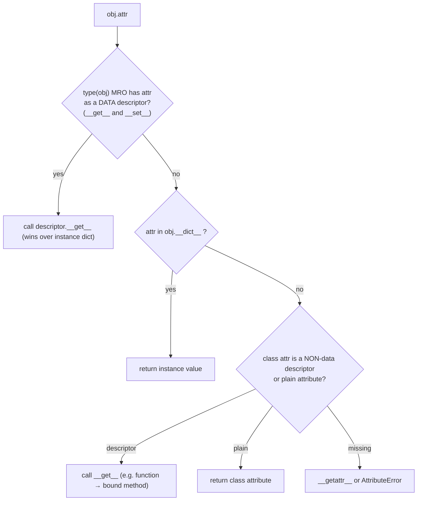
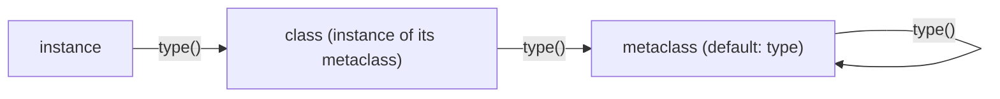

# Lesson 16: Metaclasses, Descriptors and `@property`

> **Prerequisites:** [Lesson 06: Classes, `__init__`, `__new__`, `__slots__`](../06-classes-init-new-and-slots/README.md) · [Lesson 07: Dunder Methods](../07-dunder-methods-and-the-data-model/README.md) · [Lesson 04: Decorators](../04-decorators/README.md)  
> **Reading time:** ~25 minutes  
> **Audience:** Candidates asked "how does `@property` work?", "what is a metaclass?", "how do ORMs/Django models/dataclasses do their magic?"

> [!NOTE]
> **In one line:** Attribute access is governed by the **descriptor protocol** (`__get__`/`__set__`/`__set_name__`) — `property`, methods, `classmethod`, `staticmethod` and `__slots__` are all descriptors — and a **metaclass** is the class of a class (`type` by default) that customizes how classes get *created*.

> [!TIP]
> **Golden rule:** "Metaclasses are deeper magic than 99% of users should ever worry about." Prefer, in order: a plain function/decorator → `__init_subclass__` → a class decorator → a descriptor → a metaclass.

> [!TIP]
> **Try it:** Run the section 3 file (expected output is right below it). Then run the [descriptor lab](#try-it--descriptor-lab-runnable) — probe 1 shows the shared-state bug when a descriptor stores its value on itself, and probe 3 shows `__set_name__` being skipped when a descriptor is attached after class creation. Sketch the lookup order in [LLD Studio](/tools/lld-studio/).

---

## 1. The smell: how this gets asked

- *"How does `@property` work? Is it a decorator?"*
- *"What's the difference between a data and non-data descriptor?"*
- *"Why do functions become bound methods?"*
- *"What is a metaclass? When have you used one?"*
- *"How would you auto-register all subclasses of a plugin base?"*
- *"How does Django's `models.CharField` know its own name?"*





---

## 2. Reference

| Hook | Runs when | Typical use |
| :--- | :--- | :--- |
| `__get__(self, obj, owner)` | Attribute read through descriptor | Computed values, bound methods |
| `__set__(self, obj, value)` | Attribute assignment | Validation (data descriptor) |
| `__delete__` | `del obj.attr` | Rare |
| `__set_name__(self, owner, name)` | When the owning class is created | Learn the attribute name |
| `__init_subclass__(cls, **kw)` | A subclass is defined | Registries, validation (no metaclass needed) |
| `__class_getitem__` | `Cls[int]` | Generics |
| Metaclass `__new__/__init__/__call__` | Class creation / instance creation | Frameworks, enforcing class structure |

| Kind | Defines | Beats instance dict? |
| :--- | :--- | :--- |
| **Data descriptor** | `__get__` + `__set__` (or `__delete__`) | **Yes** |
| **Non-data descriptor** | `__get__` only (functions, `classmethod`) | No (instance can shadow) |

---

## 3. Walkthrough: validated fields, a plugin registry, and `property` unmasked

**Requirements:** reusable validation (`Positive`, `Typed`) across many classes without repeating properties; automatic registration of plugin subclasses; show that `property` is just a descriptor.

1. A **data descriptor** stores values in the instance `__dict__` under a private key and validates in `__set__`; `__set_name__` removes the need to pass the name twice.
2. `__init_subclass__` registers plugins — the 90% case for "metaclass" questions.
3. A tiny metaclass shows the hook order and a real use: refusing classes that don't define a required method.
4. Re-implement `property` in ten lines to prove it's nothing magic.

````carousel
```python
from __future__ import annotations

from typing import Any


class Positive:
    """Reusable validated attribute (data descriptor)."""

    def __set_name__(self, owner: type, name: str) -> None:
        self.public = name
        self.private = f"_{name}"

    def __get__(self, obj: Any, owner: type | None = None):
        if obj is None:
            return self                       # accessed on the class
        return getattr(obj, self.private)

    def __set__(self, obj: Any, value: float) -> None:
        if value <= 0:
            raise ValueError(f"{self.public} must be > 0, got {value}")
        setattr(obj, self.private, value)


class Product:
    price = Positive()
    quantity = Positive()

    def __init__(self, price: float, quantity: int) -> None:
        self.price = price                    # goes through Positive.__set__
        self.quantity = quantity


p = Product(9.99, 3)
print(p.price, p.quantity)
try:
    p.price = -1
except ValueError as e:
    print("rejected:", e)
print("descriptor on class:", type(Product.price).__name__)
print("stored privately:", sorted(k for k in vars(p)))


# --- functions are non-data descriptors → bound methods
class Greeter:
    def hi(self) -> str:
        return "hi"


g = Greeter()
print(type(Greeter.hi).__name__, "->", type(g.hi).__name__)
print("same function:", g.hi.__func__ is Greeter.hi)


# --- property is just a descriptor
class my_property:
    def __init__(self, fget):
        self.fget = fget

    def __get__(self, obj, owner=None):
        return self if obj is None else self.fget(obj)


class Circle:
    def __init__(self, r: float) -> None:
        self.r = r

    @my_property
    def area(self) -> float:
        return round(3.14159 * self.r ** 2, 2)

    @property
    def diameter(self) -> float:
        return self.r * 2

    @diameter.setter
    def diameter(self, d: float) -> None:
        self.r = d / 2


c = Circle(2)
print(c.area, c.diameter)
c.diameter = 10
print(c.r, c.area)

# data vs non-data: instance dict shadows a non-data descriptor, not a data one
g.hi = lambda: "shadowed"
print("non-data shadowed:", g.hi())
try:
    c.__dict__["diameter"] = 99
    print("data descriptor wins:", c.diameter)
except Exception as e:  # pragma: no cover
    print(e)


# --- __init_subclass__: registry without a metaclass
class Plugin:
    registry: dict[str, type] = {}

    def __init_subclass__(cls, /, key: str | None = None, **kw) -> None:
        super().__init_subclass__(**kw)
        Plugin.registry[key or cls.__name__.lower()] = cls


class Csv(Plugin): ...
class Json(Plugin, key="js"): ...


print("registry:", sorted(Plugin.registry))


# --- a metaclass that enforces structure and shows hook order
class Strict(type):
    def __new__(mcs, name, bases, ns):
        print(f"  Strict.__new__  creating class {name}")
        if bases and "run" not in ns:
            raise TypeError(f"{name} must define run()")
        return super().__new__(mcs, name, bases, ns)

    def __call__(cls, *a, **kw):
        print(f"  Strict.__call__ building {cls.__name__} instance")
        return super().__call__(*a, **kw)


class Job(metaclass=Strict):
    pass


class Good(Job):
    def run(self) -> str:
        return "ok"


print(Good().run())
try:
    class Bad(Job):
        pass
except TypeError as e:
    print("rejected class:", e)

print("class of Good:", type(Good).__name__, "| class of that:", type(type(Good)).__name__)
```
<!-- slide -->
```csharp
// C#: no descriptors or metaclasses. Properties are a language feature with accessors;
// "validated reusable field" is a setter, a value object, or a source generator.
var p = new Product { Price = 9.99m };
try { p.Price = -1; }
catch (ArgumentOutOfRangeException e) { Console.WriteLine("rejected: " + e.ParamName); }
Console.WriteLine(p.Price);

class Product
{
    private decimal _price;
    public decimal Price
    {
        get => _price;
        set => _price = value > 0 ? value : throw new ArgumentOutOfRangeException(nameof(value));
    }
}
// Class-creation hooks ≈ attributes + reflection + source generators (compile time), not runtime metaclasses.
```
````

Expected output of the Python tab (the script prints `rejected class: ...` because `Bad` lacks `run()`; the `Strict.__new__` lines show the hook order — class creation for `Job`, `Good` and `Bad`, but `__call__` only once, when `Good()` builds an instance):

```text
9.99 3
rejected: price must be > 0, got -1
descriptor on class: Positive
stored privately: ['_price', '_quantity']
function -> method
same function: True
12.57 4
5.0 78.54
non-data shadowed: shadowed
data descriptor wins: 10.0
registry: ['csv', 'js']
  Strict.__new__  creating class Job
  Strict.__new__  creating class Good
  Strict.__call__ building Good instance
ok
  Strict.__new__  creating class Bad
rejected class: Bad must define run()
class of Good: Strict | class of that: type
```

---

## 4. Edges

- **Descriptors live on the class, not the instance.** A descriptor stored in `self.x = Positive()` does nothing special. State must go **on the instance** (`obj.__dict__`), not on the descriptor, or all instances share it.
- **`__get__` receives `obj=None` for class access** — return `self` so `Product.price` works (docs/introspection).
- **Data beats instance dict; non-data loses.** That's why `obj.method = lambda: ...` can shadow a method but not a property.
- **`property` without a setter is read-only** (`AttributeError: property 'x' of 'C' object has no setter` on 3.11+; older versions say `can't set attribute`).
- **`__slots__` members are descriptors** (member descriptors) — which is why instances have no `__dict__`.
- **`@functools.cached_property`** is a non-data descriptor that writes its result into the instance `__dict__`, so later reads bypass it; needs `__dict__` (not with `__slots__`) and isn't thread-safe in older versions.
- **Metaclass conflicts.** A class can have one metaclass; mixing bases with different metaclasses raises `TypeError: metaclass conflict` (ABCs use `ABCMeta`).
- **`__init_subclass__` runs for every subclass** — pass keyword arguments through `super().__init_subclass__(**kw)`.
- **Metaclass `__call__` controls instance creation** (Singleton in 6 lines) — but a module-level instance or a classmethod is clearer.
- **`type(name, bases, ns)`** is how classes are made dynamically.
- **`__set_name__` is called only at class creation.** Assigning a descriptor to an existing class afterwards doesn't call it.
- **Prefer dataclasses/pydantic/attrs** for field validation — they implement all of this.

### Try it — descriptor lab (runnable)

The follow-ups interviewers use once you know data vs non-data descriptors. Save as ``descriptor_lab.py``; every probe is an ``assert`` (or a printed error message), so a wrong claim fails loudly.

```python
import functools

# 1) Bug: storing the value ON the descriptor shares it across all instances
class SharedPositive:
    def __set_name__(self, owner, name): self.value = None
    def __get__(self, obj, owner=None): return self if obj is None else self.value
    def __set__(self, obj, v): self.value = v
class Item:
    price = SharedPositive()
a, b = Item(), Item()
a.price, b.price = 1, 2
assert a.price == 2                          # a's value was overwritten by b: shared state

# 2) Correct: state lives in the instance __dict__, keyed by the name from __set_name__
class Field:
    def __set_name__(self, owner, name): self.name = name
    def __get__(self, obj, owner=None):
        return self if obj is None else obj.__dict__[self.name]
    def __set__(self, obj, v): obj.__dict__[self.name] = v
class Item2:
    price = Field()
a, b = Item2(), Item2()
a.price, b.price = 1, 2
assert (a.price, b.price) == (1, 2) and isinstance(Item2.price, Field)

# 3) __set_name__ is called only at class creation, not on later assignment
class Late:
    pass
Late.f = Field()
assert not hasattr(Late.f, "name")           # never told its name
try:
    Late().f = 1
except AttributeError as e:
    print("3:", type(e).__name__)

# 4) Data descriptor beats the instance dict; non-data descriptor loses to it
class Data:
    def __get__(self, obj, owner=None): return "descriptor"
    def __set__(self, obj, v): pass
class NonData:
    def __get__(self, obj, owner=None): return "descriptor"
class T:
    d = Data(); n = NonData()
t = T()
t.__dict__["d"] = "instance"; t.__dict__["n"] = "instance"
assert t.d == "descriptor" and t.n == "instance"

# 5) property is read-only without a setter, and says so
class C:
    @property
    def x(self): return 1
try:
    C().x = 2
except AttributeError as e:
    print("5:", e)

# 6) Functions are non-data descriptors; bound methods carry __self__ and __func__
class G:
    def hi(self): return "hi"
g = G()
assert G.hi.__get__(g, G).__func__ is G.hi and g.hi.__self__ is g
assert hasattr(G.hi, "__get__") and not hasattr(G.hi, "__set__")

# 7) __slots__ members are descriptors (member_descriptor): that's why there is no __dict__
class S:
    __slots__ = ("x",)
assert type(S.x).__name__ == "member_descriptor"

# 8) cached_property is non-data: after the first read the value sits in the instance dict
calls = []
class Calc:
    @functools.cached_property
    def heavy(self):
        calls.append(1); return 42
c = Calc()
assert c.heavy == c.heavy == 42 and len(calls) == 1 and "heavy" in c.__dict__

# 9) __init_subclass__ passes class keywords; super() call keeps cooperative chains working
registry = {}
class Base:
    def __init_subclass__(cls, /, key=None, **kw):
        super().__init_subclass__(**kw)
        registry[key or cls.__name__.lower()] = cls
class A(Base): pass
class B(Base, key="bee"): pass
assert registry == {"a": A, "bee": B}
try:
    class Bad(Base, nope=1): pass
except TypeError as e:
    print("9:", e)

# 10) Metaclass conflict, and type() builds classes dynamically
class M1(type): pass
class M2(type): pass
class X(metaclass=M1): pass
class Y(metaclass=M2): pass
try:
    class Z(X, Y): pass
except TypeError as e:
    print("10:", str(e)[:48])
Dyn = type("Dyn", (), {"hello": lambda self: "dyn"})
assert Dyn().hello() == "dyn" and type(Dyn) is type and type(type) is type

# 11) A metaclass __call__ can make a singleton, but it hides global state
class Singleton(type):
    _inst = {}
    def __call__(cls, *a, **kw):
        if cls not in cls._inst:
            cls._inst[cls] = super().__call__(*a, **kw)
        return cls._inst[cls]
class Conf(metaclass=Singleton): pass
assert Conf() is Conf()

# 12) __getattribute__ recursion trap: use object.__getattribute__ inside it
class Safe:
    def __init__(self): self.v = 1
    def __getattribute__(self, name):
        return object.__getattribute__(self, name)
assert Safe().v == 1
class Loop:
    def __getattribute__(self, name):
        return self.other                    # re-enters __getattribute__ forever
try:
    Loop().x
except RecursionError:
    print("12: RecursionError")

# 13) __getattr__ is only the fallback for MISSING attributes
class Fallback:
    real = "found"
    def __getattr__(self, name): return f"fallback:{name}"
f = Fallback()
assert f.real == "found" and f.missing == "fallback:missing"
print("descriptor lab ok")
```

Expected output:

```text
3: AttributeError
5: property 'x' of 'C' object has no setter
9: Bad.__init_subclass__() takes no keyword arguments
10: metaclass conflict: the metaclass of a derived c
12: RecursionError
descriptor lab ok
```

---

## 5. What you'd say in two minutes

> "Attribute lookup goes through the descriptor protocol. If the class attribute defines `__get__` and `__set__`, it's a data descriptor and wins over the instance dict; if only `__get__`, it's non-data and the instance can shadow it. Functions are non-data descriptors, which is how `obj.method` becomes a bound method; `property`, `classmethod` and `staticmethod` are descriptors too, so `@property` isn't magic — I can write it in ten lines. For reusable validation I write a descriptor, store the value in the instance dict, and use `__set_name__` to learn the attribute name. A metaclass is the class of a class — `type` by default — and customizes class creation (`__new__`, `__init__`) or instance creation (`__call__`). I rarely need one: `__init_subclass__` handles plugin registries, class decorators handle most transformations, and dataclasses or pydantic already cover field validation. Frameworks like Django models or SQLAlchemy use metaclasses plus descriptors to turn class bodies into schemas."

---

## 6. Anti-patterns

| Anti-pattern | Why it fails | Fix |
| :--- | :--- | :--- |
| Storing value on the descriptor object | All instances share one value | Store in `obj.__dict__` (use `__set_name__`) |
| Reaching for a metaclass first | Hard to read, metaclass conflicts | `__init_subclass__` / class decorator |
| Getter/setter pairs for plain attributes (Java style) | Noise; breaks nothing if later needed | Public attribute; promote to `@property` when needed |
| Expensive work in `@property` read | Surprising cost per access | `cached_property` or an explicit method |
| `__get__` that ignores `obj is None` | Class access crashes | Return `self` |
| Overriding `__getattribute__` casually | Easy infinite recursion | `__getattr__` for missing attrs only |
| Singleton via metaclass for tests-unfriendly global | Hidden global state | DI / module-level instance |

---

## 7. Interview questions

<details>
<summary><strong>1. How does `@property` work? [BASIC]</strong></summary>

`property` is a built-in class implementing the descriptor protocol. `@property` wraps the getter; `.setter` / `.deleter` create a new property with those functions. Access through an instance calls `fget`; assignment calls `fset`. Without a setter it's read-only.

</details>

<details>
<summary><strong>2. Data vs non-data descriptor? [TRICKY]</strong></summary>

A data descriptor defines `__set__` (or `__delete__`) as well as `__get__`; it takes precedence over the instance `__dict__`. A non-data descriptor defines only `__get__` (functions, `classmethod`, `cached_property`); the instance dict wins. That is why you can overwrite a method on an instance but can't bypass a property.

</details>

<details>
<summary><strong>3. Why does `obj.method` return a bound method? [TRICKY]</strong></summary>

Functions implement `__get__`; when found on the class, `function.__get__(obj, cls)` returns a bound method that passes `obj` as the first argument. `Class.method` (obj `None`) returns the plain function.

</details>

<details>
<summary><strong>4. What is a metaclass and when would you use one? [BASIC]</strong></summary>

The class of a class (default `type`). It lets you customize class creation: validate namespace, auto-register, inject methods. Real uses: ORMs, ABCs (`ABCMeta`), enum implementation. In application code, prefer `__init_subclass__` or class decorators.

</details>

<details>
<summary><strong>5. Auto-register all subclasses of `Plugin`. [SCENARIO]</strong></summary>

Implement `__init_subclass__` on the base and store `cls` in a registry keyed by name or class keyword. No metaclass needed; it also works with multiple inheritance via cooperative `super().__init_subclass__`.

</details>

<details>
<summary><strong>6. Implement a reusable `Positive` field. [SCENARIO]</strong></summary>

A descriptor with `__set_name__` (learn the name), `__get__` (return `self` for class access else `getattr(obj, private)`), `__set__` (validate, then `setattr(obj, private, v)`). State lives on the instance.

</details>

<details>
<summary><strong>7. `property` vs `__getattr__` vs `__getattribute__`? [TRICKY]</strong></summary>

`property` serves one named attribute. `__getattr__` is a fallback invoked only when normal lookup fails. `__getattribute__` intercepts **every** access (dangerous: recursion; use `object.__getattribute__`).

</details>

<details>
<summary><strong>8. What is the C# equivalent? [BASIC]</strong></summary>

C# properties with accessors cover `@property`; there are no descriptors or runtime metaclasses. Cross-cutting class customization uses attributes + reflection or source generators at compile time.

</details>

---

## 8. One-page cheat sheet

```text
Lookup:  data descriptor (class MRO)  >  instance __dict__  >  non-data descriptor / class attr  >  __getattr__
Descriptor protocol:  __get__(self,obj,owner)  __set__(self,obj,val)  __delete__  __set_name__(self,owner,name)
  data = __get__ + __set__ ;  non-data = __get__ only
  obj is None  ->  accessed via class: return self
  keep per-instance state in obj.__dict__, NOT on the descriptor
Built on descriptors: function->bound method, property, classmethod, staticmethod, __slots__, cached_property
Hooks:  __init_subclass__ (subclass defined)  class decorator  metaclass(__new__, __init__, __call__)
Order of preference:  function < __init_subclass__ < class decorator < descriptor < metaclass
type(name, bases, ns)  creates classes dynamically;  type(type) is type
```

---

## Further reading

- [Descriptor HowTo Guide](https://docs.python.org/3/howto/descriptor.html)
- [Data model: customizing class creation](https://docs.python.org/3/reference/datamodel.html#customizing-class-creation)
- [PEP 487: `__init_subclass__` and `__set_name__`](https://peps.python.org/pep-0487/)

Previous: [asyncio in Depth](../15-asyncio-in-depth/README.md) · Next: [Modules, Packages and Imports](../17-modules-packages-and-imports/README.md)
