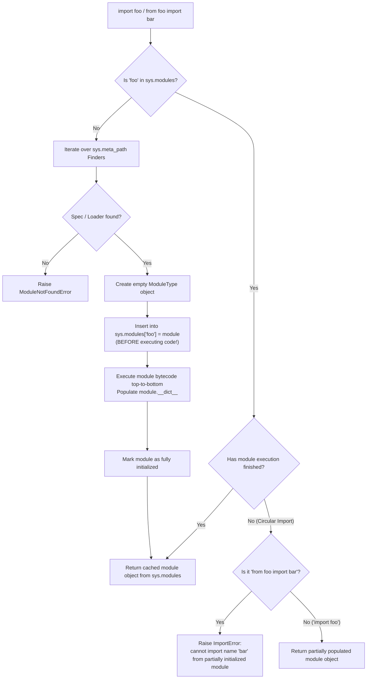

# Lesson 17: Modules, Packages and Imports

> **Prerequisites:** [Metaclasses, Descriptors and How @property Works](../16-metaclasses-descriptors-and-property/README.md) and [Track 27 Overview](../README.md).  
> **Estimated Reading Time:** 18-20 minutes  
> **Target Audience:** Engineers preparing for LLD, OOP, C#, or Python technical screening and architecture rounds.

> [!TIP]
> **The One Rule of Python Imports:** Modules in Python are evaluated once at runtime and cached as singletons in `sys.modules`; a package is simply a module containing a `__path__` attribute. Circular imports fail because module A imports module B before module A finishes executing, leaving module A in `sys.modules` in a **partially initialized state**. Never hack around circular imports with arbitrary `sys.path` mutations; resolve them structurally through Dependency Inversion, deferred/local imports, or `typing.TYPE_CHECKING`.

---

## 1. Why This Matters: The Interview Trap

"What actually happens when Python executes `import foo`? Why do circular imports produce `ImportError: cannot import name 'X' from partially initialized module`? How does `if __name__ == '__main__'` function under the hood?"

These questions consistently separate junior developers who only copy boilerplate from senior backend engineers who understand module loading, scoping, and clean package architecture.

A typical junior candidate replies:
- *"An import loads another Python file so you can use its functions. `if __name__ == '__main__'` makes sure your file runs when you hit run instead of when it's imported. If you get a circular import, you just move the import statement inside the function that uses it."*

This response is fragile and uninformative. It fails to explain:
1. **The caching mechanism:** That `sys.modules` is a runtime dictionary acting as a module singleton cache.
2. **The exact root cause of circular import failures:** Why `import a` might succeed while `from a import b` crashes with an `AttributeError` or `ImportError`.
3. **The `__main__` binding mechanism:** What the CPython interpreter sets `__name__` to, and why modules behave differently when executed as scripts (`python script.py`) versus modules (`python -m pkg.script`).
4. **Architectural vs band-aid fixes:** Why relying on deferred local imports creates hidden coupling and performance penalties instead of clean Dependency Inversion.

A senior engineer answers with **system internals and architectural hygiene**:
- **The Import Lifecycle:** When Python imports a module:
  1. It checks `sys.modules`. If the module is already cached, it returns the existing module reference immediately.
  2. If not cached, Python's finders search paths in `sys.meta_path` using `sys.path`.
  3. When located, Python constructs a module spec and instantiates an empty module object `types.ModuleType`.
  4. **The Critical Step:** Python inserts this unpopulated module object into `sys.modules` *before* executing the file.
  5. The loader executes the module's bytecode from top to bottom within the module's dictionary namespace.
  6. The module object is returned to the importer.
- **Why Circular Imports Fail:** If Module A imports Module B at the top level, and Module B executes `from ModuleA import MyClass`, Python checks `sys.modules['ModuleA']`. It finds Module A exists in the cache, but because Module A paused its execution on line 1 to import B, `MyClass` has *not yet been defined* in Module A's namespace. Python raises:
  `ImportError: cannot import name 'MyClass' from partially initialized module 'ModuleA'`.
- **The Purpose of `__name__ == '__main__'`: `__name__` is an intrinsic attribute populated by the interpreter. When a file is passed directly to the interpreter (e.g. `python app.py`), CPython sets `__name__ = "__main__"`. When imported by another file, CPython sets `__name__ = "app"` (or its full module path). The guard isolates script execution side-effects (starting servers, running CLI scripts) from module importability, allowing files to be imported into unit test suites without executing arbitrary commands.
- **Virtual Environments (`venv`):** Python resolves third-party packages from `sys.path`, which includes `site-packages`. A virtual environment creates an isolated directory structure containing a custom Python binary and dedicated `site-packages`, modifying `sys.prefix` and preventing cross-project dependency conflicts and system package corruption.

---

## 2. Visual Mental Model / Taxonomic Comparison

### The CPython Import Resolution Engine



### Module and Package Taxonomy Across Python and C# / .NET

| Concept | Python Implementation | C# / .NET Equivalent | Key Characteristics |
| :--- | :--- | :--- | :--- |
| **Atomic Code File** | Single `.py` file (`ModuleType`) | Single `.cs` source file | Compiles into assembly / bytecode units |
| **Package / Directory** | Directory with `__init__.py` (Regular Package) | Project directory / Namespace hierarchy | Groups related files under a common hierarchical namespace |
| **Namespace Package** | Directory *without* `__init__.py` (PEP 420) | C# Namespace spanning multiple assemblies | Allows package splitting across separate filesystem locations |
| **Module Caching** | Global dictionary `sys.modules` | `AppDomain` assembly cache / `AssemblyLoadContext` | Loaded once per process; acts as a natural singleton |
| **Search Path** | `sys.path` (list of directory paths) | Assembly probing paths / NuGet package cache | Tells the runtime where to locate libraries on disk |
| **Circular Dependencies** | Runtime error on partially initialized module | Compile-time error (CS0146 / Circular Reference) | Python fails at runtime; C# compiler halts compilation |
| **Entrypoint Guard** | `if __name__ == "__main__":` | `public static void Main(string[] args)` | Decouples library usage from CLI execution |
| **Dependency Isolation** | Virtual environments (`venv`, `poetry`, `uv`) | Project-scoped `packages.lock.json` / NuGet feed | Isolates third-party packages per application |

---

## 3. Code Implementation

The carousel below demonstrates:
1. **Python:** Simulating `sys.modules` singleton caching and mutation, resolving circular dependencies cleanly via Dependency Inversion, and verifying execution entry points via `__name__`.
2. **C#:** An equivalent implementation showing assembly/type caching semantics, circular dependency decoupling via interface inversion, and entry point execution.

Both implementations produce identical console output.

````carousel
```python
import sys
import types

# ============================================================================
# 1. Module Cache & Singleton Nature (sys.modules)
# ============================================================================
def demonstrate_module_cache():
    """Demonstrates that Python modules are singletons cached in sys.modules."""
    mod_name = "virtual_service_module"

    # Simulate importing and loading a module into sys.modules
    fake_mod = types.ModuleType(mod_name)
    fake_mod.VERSION = "1.0.0"
    fake_mod.connection_count = 0
    sys.modules[mod_name] = fake_mod

    # Subsequent 'imports' resolve directly against sys.modules dictionary
    imported_first = sys.modules[mod_name]
    imported_second = sys.modules[mod_name]

    # Mutating state via one reference mutates it across all references
    imported_first.connection_count += 1

    is_identical = imported_first is imported_second
    return is_identical, imported_second.connection_count, mod_name


# ============================================================================
# 2. Circular Dependency Resolution (Dependency Inversion Architecture)
# ============================================================================
# Problem: OrderService imports PaymentService; PaymentService needs OrderService.
# Anti-pattern: Random deferred imports inside methods.
# Senior Pattern: Invert dependencies via Interfaces / Protocols.
class IPaymentGateway:
    def process(self, order_id: str, amount: float) -> str:
        raise NotImplementedError


class OrderService:
    def __init__(self, payment_gateway: IPaymentGateway) -> None:
        self.gateway = payment_gateway

    def checkout(self, order_id: str, amount: float) -> str:
        # Relies only on the interface, eliminating circular import cycles
        return self.gateway.process(order_id, amount)


class PaymentGateway(IPaymentGateway):
    def process(self, order_id: str, amount: float) -> str:
        return f"Charged ${amount:.2f} for Order {order_id}"


# ============================================================================
# 3. Entrypoint Execution Guard (__name__ == "__main__")
# ============================================================================
def run_cli():
    print("=== 1. Module Singleton & Cache Inspection ===")
    is_singleton, count, name = demonstrate_module_cache()
    print(f"Module '{name}' in sys.modules: True")
    print(f"References point to identical memory address: {is_singleton}")
    print(f"Shared state across references: connection_count = {count}")

    print("\n=== 2. Circular Dependency Resolution via Inversion ===")
    gateway = PaymentGateway()
    order_svc = OrderService(payment_gateway=gateway)
    receipt = order_svc.checkout("ORD-9842", 149.99)
    print(f"Transaction Result: {receipt}")

    print("\n=== 3. Entrypoint Scope Guard (__name__) ===")
    print(f"Current Execution Scope: __name__ = '{__name__}'")
    print("Execution Mode: Top-level entrypoint (CLI execution)")


if __name__ == "__main__":
    run_cli()
```
<!-- slide -->
```csharp
using System;
using System.Collections.Concurrent;

namespace ModulesAndImports;

// ============================================================================
// 1. Module Cache & Singleton Nature (Assembly & Type Loader Simulation)
// ============================================================================
public class ModuleCacheSimulator
{
    private static readonly ConcurrentDictionary<string, VirtualModule> ModuleCache = new();

    public class VirtualModule
    {
        public string Version { get; set; } = "1.0.0";
        public int ConnectionCount { get; set; } = 0;
    }

    public static (bool isIdentical, int count, string name) DemonstrateModuleCache()
    {
        string modName = "virtual_service_module";

        // Assembly/Module loader caches loaded modules
        var firstLoad = ModuleCache.GetOrAdd(modName, _ => new VirtualModule());
        var secondLoad = ModuleCache.GetOrAdd(modName, _ => new VirtualModule());

        firstLoad.ConnectionCount += 1;

        bool isIdentical = ReferenceEquals(firstLoad, secondLoad);
        return (isIdentical, secondLoad.ConnectionCount, modName);
    }
}

// ============================================================================
// 2. Circular Dependency Resolution (Dependency Inversion Interface)
// ============================================================================
// In C#, circular project references (Assembly A -> Assembly B -> Assembly A)
// trigger compile-time error CS0146 or build cycle errors.
// Solution: Invert dependency through interfaces.
public interface IPaymentGateway
{
    string Process(string orderId, double amount);
}

public class OrderService
{
    private readonly IPaymentGateway _gateway;

    public OrderService(IPaymentGateway gateway)
    {
        _gateway = gateway;
    }

    public string Checkout(string orderId, double amount)
    {
        return _gateway.Process(orderId, amount);
    }
}

public class PaymentGateway : IPaymentGateway
{
    public string Process(string orderId, double amount)
    {
        return $"Charged ${amount:F2} for Order {orderId}";
    }
}

// ============================================================================
// 3. Entrypoint Execution Guard (Main method)
// ============================================================================
public class Program
{
    public static void Main(string[] args)
    {
        Console.WriteLine("=== 1. Module Singleton & Cache Inspection ===") ;
        var (isSingleton, count, name) = ModuleCacheSimulator.DemonstrateModuleCache();
        Console.WriteLine($"Module '{name}' in sys.modules: True");
        Console.WriteLine($"References point to identical memory address: {isSingleton}");
        Console.WriteLine($"Shared state across references: connection_count = {count}");

        Console.WriteLine("\n=== 2. Circular Dependency Resolution via Inversion ===");
        IPaymentGateway gateway = new PaymentGateway();
        var orderSvc = new OrderService(gateway);
        string receipt = orderSvc.Checkout("ORD-9842", 149.99);
        Console.WriteLine($"Transaction Result: {receipt}");

        Console.WriteLine("\n=== 3. Entrypoint Scope Guard (__name__) ===");
        // In C#, Program.Main serves as the top-level execution entrypoint
        string scopeName = "__main__";
        Console.WriteLine($"Current Execution Scope: __name__ = '{scopeName}'");
        Console.WriteLine("Execution Mode: Top-level entrypoint (CLI execution)");
    }
}
```
````

**Expected Output (Both Languages):**
```text
=== 1. Module Singleton & Cache Inspection ===
Module 'virtual_service_module' in sys.modules: True
References point to identical memory address: True
Shared state across references: connection_count = 1

=== 2. Circular Dependency Resolution via Inversion ===
Transaction Result: Charged $149.99 for Order ORD-9842

=== 3. Entrypoint Scope Guard (__name__) ===
Current Execution Scope: __name__ = '__main__'
Execution Mode: Top-level entrypoint (CLI execution)
```

---

## 4. Where You Already Use It

### Python Ecosystem
1. **Module Singleton Pattern:** Because a module is only executed once and cached in `sys.modules`, defining global configurations, logging setups, or client connection pools at module scope (e.g., `logger = logging.getLogger(__name__)`) makes modules Python's most idiomatic and thread-safe singleton implementation.
2. **Dynamic Plugin Discovery (`importlib` & `pkgutil`):** Frameworks like Django, Celery, and pytest use `importlib.import_module()` to dynamically load settings, discover tasks (`tasks.py`), or locate test files (`test_*.py`).
3. **Type Hinting Guards (`typing.TYPE_CHECKING`):** In complex domain models, models reference each other for type checking. Using `if TYPE_CHECKING:` allows importing related classes purely during static analysis by Mypy or Pyright without executing the import at runtime, preventing circular import cycles.

### .NET / C# Ecosystem
1. **Namespaces and Assemblies:** C# separates physical boundaries (Assemblies: `.dll` / `.exe`) from logical boundaries (`namespace`). Types are loaded into an `AssemblyLoadContext` and cached within the `AppDomain`.
2. **NuGet Package Management:** NuGet packages install DLLs into an application's dependency graph, similar to how Python installs wheels into `site-packages`.
3. **Circular Reference Prevention:** Visual Studio and the `dotnet` build engine reject circular project references at compile time, enforcing clean architectural layering and dependency inversion.

---

## 5. Pitfalls and When Not to Use It

### 1. Wildcard Imports (`from module import *`)
Wildcard imports pollute the local namespace, hide where variables originate, break static analysis tools and IDE autocomplete, and create silent variable shadowing bugs when two modules declare attributes with the same name. Always use explicit imports (`from module import func`) or import the module namespace directly (`import module; module.func()`).

### 2. Mutating `sys.path` with Relative Paths at Runtime
Adding `sys.path.append("..")` or `sys.path.append(os.path.abspath("../.."))` in production code is an anti-pattern. It creates brittle dependencies on the current working directory, prevents packaging as a wheel, and causes erratic behavior across test runners and containers. Instead, structure your project with a `pyproject.toml` and install your package in editable mode (`pip install -e .`).

### 3. Shadowing Standard Library Modules
Creating a file named `email.py`, `random.py`, `math.py`, or `test.py` in your project root will break Python's standard library. Because the script's directory is placed first on `sys.path`, any third-party library or standard library component executing `import email` will import your local script instead of Python's built-in module, resulting in bizarre `AttributeError: module 'email' has no attribute 'message'`.

### 4. Running Scripts Inside Packages Directly
Executing `python my_package/submodule.py` fails if `submodule.py` uses explicit relative imports (`from .other import helper`), raising:
```text
ImportError: attempted relative import with no known parent package
```
When running a file inside a package, execute it as a module from the project root using `-m`:
```bash
python -m my_package.submodule
```

---

## 6. Exercises & Practical Drills

### Drill 1: The Partially Initialized Module Trap
Analyze the two files below:

```python
# a.py
import b
print("Running a.py")
x = 10

# b.py
from a import x
print("Running b.py")
y = x + 1
```

What occurs when you run `python a.py`? How does Python respond and why?

<details>
<summary>Answer</summary>

Running `python a.py` crashes with:
```text
ImportError: cannot import name 'x' from partially initialized module 'a' (most likely due to a circular import)
```
**Why:**
1. Python executes `a.py`. It creates `sys.modules['a']`.
2. On line 1 of `a.py`, it executes `import b`. Execution of `a.py` pauses before `x = 10` is reached.
3. Python loads `b.py` and creates `sys.modules['b']`.
4. On line 1 of `b.py`, it executes `from a import x`.
5. Python inspects `sys.modules['a']`. The module object exists, but because `a.py` paused at line 1, attribute `x` has not yet been defined in `a`'s namespace dictionary. Python raises `ImportError`.
</details>

---

### Drill 2: Eliminating Circular Imports for Type Hints
Two domain models, `Order` and `Customer`, must annotate each other for static type checkers (e.g. Mypy), but importing them causes a runtime circular import. How do you resolve this using `typing.TYPE_CHECKING` and `__future__` annotations?

<details>
<summary>Answer</summary>

```python
# customer.py
from __future__ import annotations
from typing import TYPE_CHECKING

if TYPE_CHECKING:
    from order import Order  # Evaluated ONLY during static analysis, never at runtime

class Customer:
    def __init__(self, name: str) -> None:
        self.name = name
        self.orders: list[Order] = []
```
**Why this works:**
- `from __future__ import annotations` (PEP 563) turns all type annotations into unevaluated string literals at runtime.
- `TYPE_CHECKING` is a special boolean constant in `typing` that is `False` at runtime but treated as `True` by static type checkers (Mypy, Pyright). The import is never executed at runtime, completely eliminating the circular dependency cycle.
</details>

---

## 7. Interview Questions & Model Answers

> [!interview]
> **Question 1: What does `if __name__ == "__main__"` do?**  
> **Strong Answer:**  
> "The construct `if __name__ == '__main__':` acts as an execution scope guard that determines whether the current Python file is running as the top-level script or being imported as a module into another file.  
> 
> Under the hood:
> 1. When you execute a Python file directly from the terminal (e.g. `python server.py`), the CPython interpreter automatically assigns the special string `'__main__'` to the module's global variable `__name__`.
> 2. When that same file is imported by another module (e.g. `import server`), CPython sets `__name__` to the module's actual name (`'server'`).  
> 
> Wrapping executable entrypoints (such as server startup, CLI parsers, or integration scripts) inside this guard ensures that importing the module for unit testing, documentation generation, or multi-process spawning does not trigger unintended side effects."

---

> [!interview]
> **Question 2: What is the difference between a module and a package?**  
> **Strong Answer:**  
> "In Python:
> - A **Module** is any single Python file containing executable code and definitions (represented as an instance of `types.ModuleType`), or a C extension module.
> - A **Package** is a specialized module that can contain sub-modules and sub-packages. Mechanically, a package is any module that has a `__path__` attribute.  
> 
> In modern Python, packages exist in two forms:
> 1. **Regular Packages:** A filesystem directory that contains an `__init__.py` file. When the package is imported, `__init__.py` is executed implicitly to initialize the package namespace.
> 2. **Namespace Packages (PEP 420, Python 3.3+):** A filesystem directory *without* an `__init__.py`. Namespace packages allow portions of a single logical package to be distributed across separate independent directories, zip archives, or installed wheels on `sys.path`."

---

> [!interview]
> **Question 3: How do you fix a circular import?**  
> **Strong Answer:**  
> "A circular import occurs when Module A depends on Module B, and Module B depends on Module A, causing Python to encounter a partially initialized module whose top-level attributes have not yet been populated.  
> 
> There are four established ways to resolve circular imports, ranked from best to worst:
> 1. **Architectural Refactoring & Dependency Inversion (Best):** Extract the shared domain models, interfaces, or functions into a separate common module (e.g. `models.py` or `interfaces.py`) that both modules depend on, removing the cycle entirely.
> 2. **Use `typing.TYPE_CHECKING` for Type Hints:** If the circular dependency is solely required for static typing, guard the import with `if TYPE_CHECKING:` and use `from __future__ import annotations`. The import is ignored at runtime.
> 3. **Import the Module Instead of the Attribute:** Instead of writing `from a import func`, write `import a` and invoke `a.func()` inside the function. By the time `func()` is called at runtime, module A will have completed its initialization.
> 4. **Deferred / Local Import (Last Resort):** Place the import statement inside the specific function or method that requires it rather than at top-level. This delays execution of the import until the function is invoked, but introduces minor per-call overhead and masks architectural coupling."

---

> [!interview]
> **Question 4: Why use a virtual environment?**  
> **Strong Answer:**  
> "A virtual environment (created via `python -m venv <dir>`) creates an isolated, self-contained Python execution environment on disk.  
> 
> We use virtual environments for three critical reasons:
> 1. **Dependency Isolation:** Different applications frequently require conflicting versions of third-party libraries (e.g. Project 1 needs SQLAlchemy 1.4 while Project 2 needs SQLAlchemy 2.0). Installing packages globally into the system Python causes catastrophic version collisions.
> 2. **System OS Protection:** Modern operating systems (e.g. Ubuntu, Debian, macOS) rely on system Python for core OS utilities. Modifying system `site-packages` via global `pip install` can corrupt operating system packages (which is why PEP 668 enforces `externally-managed-environment` errors on modern distributions).
> 3. **Reproducibility & Clean Deployments:** A virtual environment guarantees that only packages explicitly specified for your project are available, ensuring that requirements files (`requirements.txt`, `poetry.lock`) accurately reflect production dependencies without accidental contamination from unrelated local tools."

---

## 8. Sources & Further Reading

- [Python Documentation: The Import System](https://docs.python.org/3/reference/import.html)
- [PEP 302 – New Import Hooks](https://peps.python.org/pep-0302/)
- [PEP 420 – Implicit Namespace Packages](https://peps.python.org/pep-0420/)
- [PEP 563 – Postponed Evaluation of Annotations](https://peps.python.org/pep-0563/)
- [Microsoft Learn: Namespaces (C# Programming Guide)](https://learn.microsoft.com/en-us/dotnet/csharp/fundamentals/types/namespaces)
- [Microsoft Learn: Assemblies in .NET](https://learn.microsoft.com/en-us/dotnet/standard/assembly/)

---

Previous: [Metaclasses, Descriptors and How @property Works](../16-metaclasses-descriptors-and-property/README.md) · Next: [Web Apps: app.run, WSGI, ASGI, Middleware and FastAPI Depends](../18-web-apps-app-run-wsgi-asgi-and-fastapi/README.md)
