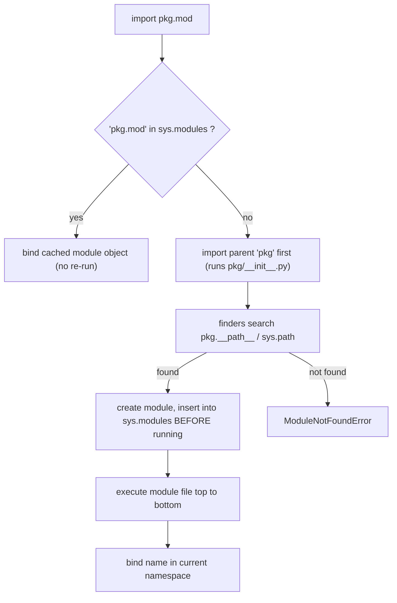

# Lesson 17: Modules, Packages and Imports

> **Prerequisites:** [Lesson 01: How Python Runs Your Code](../01-how-python-runs-your-code/README.md) · [Lesson 03: Scope](../03-functions-args-kwargs-closures-and-scope/README.md)  
> **Reading time:** ~20 minutes  
> **Audience:** Candidates asked "what happens on `import x`?", "why does importing run code?", "how do you fix a circular import?", "what is `if __name__ == '__main__'`?"

> [!NOTE]
> **In one line:** `import x` finds a module (via `sys.modules` cache, then `sys.path` finders), **executes its file once**, binds the resulting module object to a name, and caches it — so module-level code runs once per process and a module is effectively a singleton.

> [!TIP]
> **Golden rule:** Keep module top-level light (definitions only, no I/O or side effects), put runnable code under `if __name__ == "__main__":`, and break import cycles by moving shared code to a third module or importing inside the function that needs it.

> [!TIP]
> **Try it:** Run the section 3 file (it builds a throwaway package in a temp directory and deletes it at the end). Step 5 of its output is the circular-import error for `cyc_a`/`cyc_b`; step 3 shows the stale `from`-import. Then run the [import lab](#try-it--import-lab-runnable) — it launches real subprocesses to reproduce `no known parent package`, a file imported under two names, and a local `json.py` shadowing the standard library. Visualise the import graph in [LLD Studio](/tools/lld-studio/).

---

## 1. The smell: how this gets asked

- *"What happens when you `import foo`?"*
- *"Why did my import print something / run twice?"* (script vs module, `__main__`)
- *"`import x` vs `from x import y`?"*
- *"Circular imports — why and how do you fix them?"*
- *"Module vs package? What is `__init__.py`?"*
- *"Absolute vs relative imports? What does `ImportError: attempted relative import with no known parent package` mean?"*



Step F is why circular imports "half work": a partially-initialised module is already in `sys.modules`.

---

## 2. Reference

| Term | Meaning |
| :--- | :--- |
| **Module** | A single `.py` file → module object with a namespace |
| **Package** | A directory of modules (regular: has `__init__.py`; namespace: without) |
| `sys.modules` | Cache `{name: module}` — the import fast-path |
| `sys.path` | Where top-level imports are searched (script dir, `PYTHONPATH`, site-packages) |
| `__name__` | Module's name; `"__main__"` when run as a script/`-m` |
| `__file__`, `__package__` | Origin; package used to resolve relative imports |
| `__all__` | Names exported by `from m import *` |
| `importlib.reload(m)` | Re-execute a module (old references stay stale!) |

| Form | Effect |
| :--- | :--- |
| `import pkg.mod` | Binds `pkg`; use `pkg.mod.x` |
| `import pkg.mod as m` | Binds `m` |
| `from pkg.mod import x` | Binds `x` (a **reference to the object now**) |
| `from . import sibling` / `from .mod import x` | Relative (needs a package context) |
| `from m import *` | Everything in `__all__` (or every public name) — avoid |

---

## 3. Walkthrough: build a package and watch imports work

**Requirements:** show import-time execution and caching, `__main__`, `__all__`, relative imports, `from x import y` staleness, a circular import and its fixes — in one self-contained script that creates its own temporary package.

1. Write a tiny package `shop/` (`__init__`, `pricing`, `models`) into a temp dir and add it to `sys.path`.
2. Import it, observe that top-level code runs **once**.
3. Show `from x import y` binds an object at import time (stale after rebinding).
4. Create `a`/`b` with a cycle; show the failing and fixed variants.

````carousel
```python
import importlib
import shutil
import sys
import tempfile
import textwrap
from pathlib import Path

root = Path(tempfile.mkdtemp())


def write(rel: str, body: str) -> None:
    p = root / rel
    p.parent.mkdir(parents=True, exist_ok=True)
    p.write_text(textwrap.dedent(body), encoding="utf-8")


# --- a regular package with relative imports
write("shop/__init__.py", """
    print("  [shop/__init__] running")
    from .pricing import total          # re-export: shop.total
    __all__ = ["total"]
""")
write("shop/pricing.py", """
    print("  [shop.pricing] running (module-level code runs once)")
    TAX = 0.2
    def total(net: float) -> float:
        return round(net * (1 + TAX), 2)
    if __name__ == "__main__":
        print("run as a script")
""")

# --- circular import: a <-> b
write("cyc_a.py", """
    from cyc_b import B_NAME            # needs b ...
    A_NAME = "a"
""")
write("cyc_b.py", """
    from cyc_a import A_NAME            # ... which needs a  → cycle
    B_NAME = "b"
""")

# --- fix 1: import the module, use attribute later;  fix 2: import inside function
write("ok_a.py", """
    import ok_b
    A_NAME = "a"
    def describe(): return f"{A_NAME}+{ok_b.B_NAME}"
""")
write("ok_b.py", """
    import ok_a                          # module object only; attribute resolved at call time
    B_NAME = "b"
    def describe(): return f"{B_NAME}+{ok_a.A_NAME}"
""")

sys.path.insert(0, str(root))

print("1) first import runs the code:")
import shop
print("2) second import is a cache hit (no output):")
import shop.pricing
print("   cached:", "shop.pricing" in sys.modules, "| same object:", sys.modules["shop"] is shop)
print("   total(100) =", shop.total(100), "| __name__ =", shop.pricing.__name__)
print("   package attrs:", shop.__name__, "| has __path__:", hasattr(shop, "__path__"))

print("3) from-import binds the OBJECT at import time:")
from shop.pricing import TAX
import shop.pricing as pricing
pricing.TAX = 0.5
print("   TAX (copied name):", TAX, "| pricing.TAX:", pricing.TAX, "| total(100):", shop.total(100))

print("4) importlib.reload re-executes the module:")
importlib.reload(pricing)
print("   after reload TAX =", pricing.TAX, "| shop.total is still the OLD function object:",
      shop.total is not pricing.total)

print("5) circular import:")
try:
    import cyc_a
except ImportError as e:
    print("   ImportError:", str(e).split(" (")[0])
print("   failed module removed from sys.modules:", "cyc_a" not in sys.modules)

import ok_a
print("   fixed with 'import module' style:", ok_a.describe(), "|", ok_a.ok_b.describe())

print("6) name guard:")
print("   this file __name__ ==", __name__)

print("7) a module is a singleton object:")
import shop as shop2
print("   shop2 is shop:", shop2 is shop)

print("8) finder search path head:", sys.path[0] == str(root))

sys.path.remove(str(root))
shutil.rmtree(root, ignore_errors=True)               # clean up the throwaway package
```
<!-- slide -->
```csharp
// C#: no import-time execution. `using` is a compile-time namespace alias;
// assemblies are loaded lazily by the runtime. Circular *project* references are illegal at build time.
// Static initializers run once, lazily, on first use of the type (similar to "module code runs once").
Console.WriteLine(Config.Value);   // triggers Config's static constructor exactly once
Console.WriteLine(Config.Value);

static class Config
{
    public static readonly string Value = Init();
    static string Init() { Console.WriteLine("Config initialised"); return "x"; }
}
```
````

Expected output of the Python tab (the temp path never prints):

```text
1) first import runs the code:
  [shop/__init__] running
  [shop.pricing] running (module-level code runs once)
2) second import is a cache hit (no output):
   cached: True | same object: True
   total(100) = 120.0 | __name__ = shop.pricing
   package attrs: shop | has __path__: True
3) from-import binds the OBJECT at import time:
   TAX (copied name): 0.2 | pricing.TAX: 0.5 | total(100): 150.0
4) importlib.reload re-executes the module:
  [shop.pricing] running (module-level code runs once)
   after reload TAX = 0.2 | shop.total is still the OLD function object: True
5) circular import:
   ImportError: cannot import name 'A_NAME' from partially initialized module 'cyc_a'
   failed module removed from sys.modules: True
   fixed with 'import module' style: a+b | b+a
6) name guard:
   this file __name__ == __main__
7) a module is a singleton object:
   shop2 is shop: True
8) finder search path head: True
```

Step 3 has a subtle second lesson: `total(100)` returns `150.0` even though `TAX` the *imported name* still says `0.2`, because `total` reads the global of its own module (`pricing.TAX`), which was rebound.

---

## 4. Edges

- **Import = execute.** Heavy top-level code (network, DB connect, big file read) slows start-up and makes tests brittle. Defer to functions.
- **`from x import y` copies the reference**, not the name's future value. Rebinding `x.y` later is invisible to importers; mutating the object is visible.
- **Circular imports** fail as `ImportError: cannot import name ... (most likely due to a circular import)` or `AttributeError` on a half-initialised module. Fixes: extract shared code to a third module; `import module` instead of `from module import name`; import inside the function; restructure dependencies (dependency inversion).
- **Run as script vs module.** `python pkg/mod.py` puts `pkg/` on `sys.path[0]` and sets `__name__="__main__"` → relative imports fail ("no known parent package"). Use `python -m pkg.mod` from the project root.
- **`__init__.py` runs on first import of the package**; heavy re-exports there make `import pkg` slow. Namespace packages (no `__init__.py`) are allowed but behave differently (multi-directory).
- **`reload` is partial:** existing `from x import f` references and instances keep old code (lab probe 3). Avoid outside REPL/dev servers. Also: bytecode invalidation compares source mtime *and size*, so rewriting a file with a same-size edit within one mtime tick and then reloading can silently run the stale `.pyc` — the lab uses a different-length edit for exactly that reason.
- **A file imported by its own name runs twice.** Run as a script it is `__main__`; if anything then imports it by name, a second copy executes as a separate module with separate globals (probe 7).
- **A module in `sys.modules` is visible while half-built** — that is the mechanism behind circular-import errors (probe 1).
- **Shadowing stdlib:** a local `random.py`/`email.py`/`json.py` hijacks imports. Don't name files like stdlib modules.
- **`sys.path` hacks** (`sys.path.append`) are a smell; install the project (`pip install -e .`) or use proper packaging (`pyproject.toml`).
- **`import *`** pollutes the namespace and defeats linters; define `__all__` only for deliberate public APIs.
- **Absolute imports are preferred** (PEP 8); relative imports are fine inside a package.
- **Lazy imports** inside functions reduce start-up cost (CLI tools) or break cycles, at small per-call cost.
- **`__pycache__/*.pyc`** caches bytecode keyed by source mtime/hash; safe to delete.

### Try it — import lab (runnable)

The follow-ups interviewers use after "what happens on import?". Save as ``import_lab.py``; every probe is an ``assert``, so a wrong claim fails loudly. It writes a throwaway project to a temp directory, launches real ``python`` subprocesses, and deletes everything at the end.

```python
import importlib, os, shutil, subprocess, sys, tempfile, textwrap
from pathlib import Path

root = Path(tempfile.mkdtemp())
def write(rel, body):
    p = root / rel
    p.parent.mkdir(parents=True, exist_ok=True)
    p.write_text(textwrap.dedent(body), encoding="utf-8")
def run(*args):
    return subprocess.run([sys.executable, *args], cwd=root, capture_output=True, text=True,
                          env={**os.environ, "PYTHONPATH": ""})
sys.path.insert(0, str(root))
try:
    # 1) A module is in sys.modules BEFORE its body finishes: a re-entrant import sees it half-built
    write("early.py", """
        import sys
        STATE = "starting"
        snapshot = sys.modules[__name__].STATE      # we are already visible, partially built
        DONE = True
    """)
    import early
    assert early.snapshot == "starting" and early.DONE

    # 2) from-import: rebinding is invisible to importers, mutation is visible
    write("cfg.py", """
        LIMIT = 1
        ITEMS = []
    """)
    import cfg
    from cfg import LIMIT, ITEMS
    cfg.LIMIT = 2
    cfg.ITEMS.append("x")
    assert LIMIT == 1 and ITEMS == ["x"]            # stale int, shared list

    # 3) reload leaves old references pointing at old code
    write("rl.py", "def f(): return 'v1'\n")
    import rl
    old_f = rl.f
    write("rl.py", "def f(): return 'version-2'\n")
    importlib.invalidate_caches()
    importlib.reload(rl)
    assert rl.f() == "version-2" and old_f() == "v1"

    # 4) __all__ controls `import *`; underscore names are skipped without it
    write("exp.py", """
        __all__ = ["public"]
        public = 1
        other = 2
    """)
    write("exp2.py", """
        shown = 1
        _hidden = 2
    """)
    ns, ns2 = {}, {}
    exec("from exp import *", ns); exec("from exp2 import *", ns2)
    assert "public" in ns and "other" not in ns
    assert "shown" in ns2 and "_hidden" not in ns2

    # 5) Namespace package: a directory without __init__.py is importable
    write("nspkg/inner.py", "VALUE = 5\n")
    import nspkg.inner
    assert nspkg.inner.VALUE == 5 and not hasattr(nspkg, "__file__") or nspkg.__file__ is None

    # 6) Running a package file as a script breaks relative imports; -m fixes it
    write("pkg/__init__.py", "")
    write("pkg/helper.py", "NAME = 'helper'\n")
    write("pkg/tool.py", """
        from .helper import NAME
        print("tool sees", NAME, "| __name__ =", __name__)
    """)
    bad = run("pkg/tool.py")
    assert bad.returncode != 0 and "no known parent package" in bad.stderr
    good = run("-m", "pkg.tool")
    assert good.returncode == 0 and "__name__ = __main__" in good.stdout

    # 7) A file that is both run and imported executes TWICE under two names
    write("twice.py", """
        print("executing as", __name__)
        if __name__ == "__main__":
            import twice                            # imports a second copy of itself
    """)
    out = run("twice.py").stdout.split("\n")
    assert out[:2] == ["executing as __main__", "executing as twice"]

    # 8) Shadowing the stdlib: a local json.py wins because the script dir is first on sys.path
    write("json.py", "SHADOW = True\n")
    r = run("-c", "import json; print(hasattr(json, 'SHADOW'))")
    assert r.stdout.strip() == "True"
    (root / "json.py").unlink()

    # 9) TYPE_CHECKING + string annotations break an import cycle that exists only for hints
    write("t_a.py", """
        from __future__ import annotations
        from typing import TYPE_CHECKING
        if TYPE_CHECKING:
            from t_b import B                       # never executed at run time
        class A:
            def link(self, other: B) -> str: return "linked"
    """)
    write("t_b.py", """
        from t_a import A
        class B(A): pass
    """)
    import t_b
    assert t_b.B().link(None) == "linked"

    # 10) Import inside a function: deferred until the first call, then cached
    write("lazy_mod.py", "print('lazy_mod executed')\nVALUE = 9\n")
    write("uses_lazy.py", """
        def get():
            import lazy_mod
            return lazy_mod.VALUE
    """)
    import uses_lazy
    assert "lazy_mod" not in sys.modules
    assert uses_lazy.get() == 9 and "lazy_mod" in sys.modules

    # 11) Bytecode is cached in __pycache__ and is safe to delete
    cached = list((root / "__pycache__").glob("cfg*.pyc"))
    assert cached, "expected a .pyc for cfg"
    print("11: .pyc files were written to __pycache__")
finally:
    sys.path.remove(str(root))
    shutil.rmtree(root, ignore_errors=True)
print("import lab ok")
```

Expected output:

```text
lazy_mod executed
11: .pyc files were written to __pycache__
import lab ok
```

---

## 5. What you'd say in two minutes

> "`import x` first checks `sys.modules`; if it's not cached, Python runs the finders along `sys.path`, creates a module object, **inserts it into `sys.modules` before executing it**, runs the file top to bottom once, and binds the name. So module-level code runs once per process and modules behave like singletons. `from x import y` binds the object at that moment, so later rebinding in `x` isn't seen, which also explains most confusion after `reload`. Circular imports are the visible side effect of that early insertion: you get a half-initialised module. I fix them by extracting shared code into a third module, importing the module rather than its names, or importing lazily inside a function — but really it's a design smell about dependency direction. I keep top-level code free of side effects, guard scripts with `if __name__ == "__main__"`, run packages with `python -m`, and avoid `sys.path` hacks in favour of an installable project."

---

## 6. Anti-patterns

| Anti-pattern | Why it fails | Fix |
| :--- | :--- | :--- |
| I/O, DB connect or network at import time | Slow start, side effects in tests/CLI | Do it in functions/factories |
| `from m import *` | Namespace pollution, hidden collisions | Explicit imports |
| `sys.path.append("..")` everywhere | Fragile, env-dependent | Package + `pip install -e .`, `python -m` |
| Circular imports patched with try/except | Hides a design problem | Third module / dependency inversion |
| Naming a file `random.py`, `json.py` | Shadows stdlib | Unique names / package namespace |
| Relying on `reload` in production | Stale references | Restart/redeploy |
| God `__init__.py` full of re-exports | Slow imports, cycles | Keep `__init__` thin |

---

## 7. Interview questions

<details>
<summary><strong>1. What happens when you `import foo`? [BASIC]</strong></summary>

Check `sys.modules`; if missing, locate `foo` with the import finders on `sys.path`, create the module, put it in `sys.modules`, execute its code, bind the name. Later imports reuse the cached module.

</details>

<details>
<summary><strong>2. Why `if __name__ == "__main__":`? [BASIC]</strong></summary>

When a file is run as a script `__name__` is `"__main__"`; when imported it's the module name. The guard lets a file be both importable (no side effects) and runnable.

</details>

<details>
<summary><strong>3. `import x` vs `from x import y`? [TRICKY]</strong></summary>

`import x` binds the module; attribute lookup happens at use time, so you see rebinding. `from x import y` binds the current object to `y`; later rebinding of `x.y` isn't reflected. The latter is also more prone to circular-import failures.

</details>

<details>
<summary><strong>4. How do you fix a circular import? [SCENARIO]</strong></summary>

Preferably restructure: move shared definitions to a third module or invert the dependency (depend on an interface). Tactical fixes: `import module` and access attributes lazily; import inside the function; for type hints only, `if TYPE_CHECKING:` plus string annotations.

</details>

<details>
<summary><strong>5. Module vs package vs namespace package? [BASIC]</strong></summary>

Module: one file. Package: a directory importable as a unit (regular ones have `__init__.py`, executed on import). Namespace package: a directory without `__init__.py`, possibly spread over several `sys.path` entries.

</details>

<details>
<summary><strong>6. "attempted relative import with no known parent package"? [SCENARIO]</strong></summary>

You ran a file inside a package as a top-level script, so `__package__` is empty. Run it as `python -m package.module` from the root, or use absolute imports with an installed package.

</details>

<details>
<summary><strong>7. Is a module a singleton? [TRICKY]</strong></summary>

Effectively yes per process (`sys.modules`), so module-level state is shared — convenient for config/loggers, harmful for tests and multi-process servers (each process has its own copy).

</details>

<details>
<summary><strong>8. How does C# differ? [BASIC]</strong></summary>

`using` is compile-time; nothing runs on "import". Assemblies load on demand; static constructors run once lazily on first use; circular project references are rejected at build time.

</details>

---

## 8. One-page cheat sheet

```text
import x      sys.modules? -> else find (sys.path) -> create -> cache -> EXECUTE once -> bind
from x import y   binds the OBJECT now (rebinding x.y later not seen)
__name__ == "__main__"   script/-m;  guard runnable code
python -m pkg.mod        correct way to run a module inside a package
Circular import   cause: partially-initialised module in sys.modules
   fix: third module | import module (not names) | import inside function | TYPE_CHECKING | redesign
reload(m)    re-executes; old references stale     __all__  controls import *
Don't: side effects at import | import * | sys.path hacks | stdlib-named files
Do:    pyproject + pip install -e . | thin __init__ | absolute imports
```

---

## Further reading

- [The import system](https://docs.python.org/3/reference/import.html)
- [Modules tutorial](https://docs.python.org/3/tutorial/modules.html)
- [Python Packaging User Guide](https://packaging.python.org/)

Previous: [Metaclasses, Descriptors and @property](../16-metaclasses-descriptors-and-property/README.md) · Next: [Web Apps: app.run, WSGI, ASGI and FastAPI](../18-web-apps-app-run-wsgi-asgi-and-fastapi/README.md)
