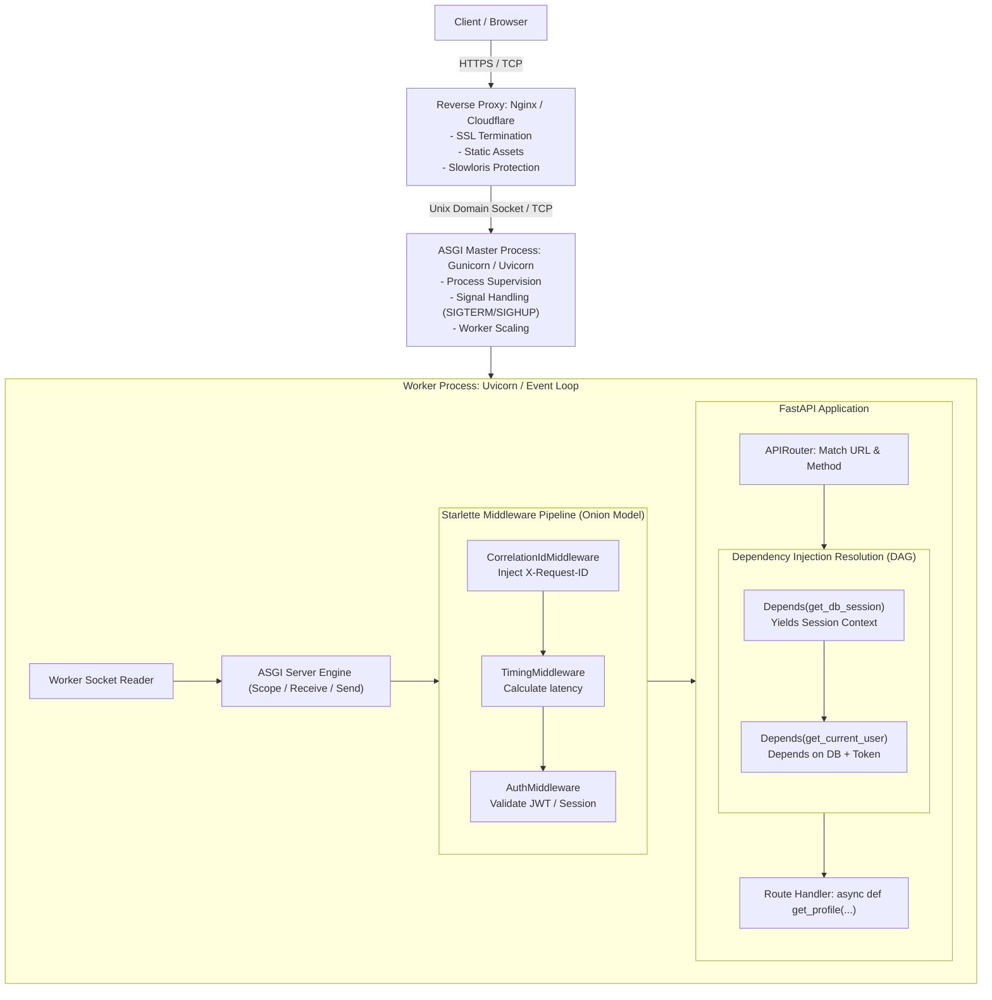

# Lesson 18: Web Apps: app.run, WSGI, ASGI, Middleware and FastAPI Depends

> **Prerequisites:** [Modules, Packages and Imports](../17-modules-packages-and-imports/README.md) and [Track 27 Overview](../README.md).  
> **Estimated Reading Time:** 18-20 minutes  
> **Target Audience:** Engineers preparing for LLD, OOP, C#, or Python technical screening and architecture rounds.

> [!TIP]
> **The One Rule of Python Web Architecture:** Production Python web applications separate OS socket and process management from application business logic through standardized calling conventions: **WSGI** (`environ, start_response`) for synchronous request-response lifecycles, and **ASGI** (`scope, receive, send`) for event-driven asynchronous pipelines. Never call `app.run()` in production; front your WSGI apps with a pre-fork server like **Gunicorn** and ASGI apps with **Uvicorn**, intercept cross-cutting concerns via onion-layered middleware (`call_next`), and isolate resource lifecycles through FastAPI's graph-resolved `Depends()`.

---

## 1. Why This Matters: The Interview Trap

"How does Python serve web requests, what does `app.run()` actually do, and why can't we run it in production?" is one of the most reliable filters between junior developers who only run tutorials locally and senior engineers who have operated services under real-world production load.

A typical junior candidate replies:
- *"Flask uses `app.run()` to start a web server on port 5000. In production, we don't use it because it's slow and single-threaded. We use Gunicorn because it adds workers, and FastAPI is faster because it uses ASGI."*

This answer is superficial. It fails to explain what `app.run()` does under the hood, why the Werkzeug development server fails under load, how the WSGI specification functions, why ASGI was invented, or how modern frameworks manage dependency lifetimes.

A senior engineer answers with **protocol mechanics and production failure modes**:
- **What `app.run()` does:** It invokes Werkzeug's embedded development server (`werkzeug.serving.run_simple`). It binds a single OS TCP socket, often enables the interactive in-browser debugger and auto-reloader, and runs in a single process. By default, it lacks worker process supervision, rate limiting, connection pooling, and resilient signal handling.
- **Why it is hazardous in production:**
  1. *Resource exhaustion & DoS:* It does not handle slow HTTP client attacks (Slowloris). A handful of stalled connections will exhaust the server socket backlog and starve incoming traffic.
  2. *Security vulnerability:* If `debug=True` is accidentally active, any 500 exception serves the Werkzeug interactive debugger directly to the user's browser, permitting arbitrary Python code execution on the production host through the web console.
  3. *Zero-downtime deployments:* It has no master-worker architecture to perform graceful restarts (`SIGHUP`), rolling worker recycles, or socket handover during deployments.
- **The Protocol Evolution (WSGI to ASGI):**
  - **WSGI (PEP 3333):** Designed in 2003 as a synchronous standard interface. A WSGI server receives an HTTP request and calls an application callable: `response_body = app(environ, start_response)`. Because WSGI assumes a single synchronous request-response turnaround, it cannot natively handle persistent bi-directional WebSockets, HTTP/2 multiplexing, server-sent events (SSE), or non-blocking async coroutines.
  - **ASGI (Asynchronous Server Gateway Interface):** Designed to succeed WSGI. An ASGI application is an asynchronous coroutine: `await app(scope, receive, send)`. The app communicates with the server via event dictionaries over two asynchronous message channels (`receive()` and `send()`), enabling high-concurrency async I/O, WebSockets, and background tasks within an event-driven loop.

---

## 2. Visual Mental Model / Taxonomic Comparison

### The Production Python Web Request Lifecycle



### Protocol & Architectural Comparison

| Dimension | WSGI (PEP 3333) | ASGI (Async Gateway) | ASP.NET Core Kestrel |
| :--- | :--- | :--- | :--- |
| **Interface Signature** | `app(environ, start_response)` | `async def app(scope, receive, send)` | `RequestDelegate(HttpContext context)` |
| **Execution Paradigm** | Synchronous, blocking per request | Asynchronous, event-driven coroutine | Asynchronous, task-based pipeline |
| **Concurrency Model** | Multi-process (pre-fork) or multi-threaded | Single-thread event loop per worker process | ThreadPool work-stealing multi-threading |
| **Supported Protocols** | HTTP/1.0, HTTP/1.1 (sync request/response) | HTTP/1.1, HTTP/2, WebSockets, Lifespan events | HTTP/1.1, HTTP/2, HTTP/3, WebSockets, gRPC |
| **Production Servers** | Gunicorn (sync workers), uWSGI, Waitress | Uvicorn, Hypercorn, Granian | Kestrel (Built-in high-performance web server) |
| **Middleware Pattern** | Nested callable decorators wrapping `environ` | `BaseHTTPMiddleware` wrapping `call_next(request)` | `app.Use(async (context, next) => { ... })` |
| **Dependency Injection** | Third-party or manual (Flask `g`, Injector) | Framework-native hierarchical DAG (`Depends`) | Framework-native `IServiceProvider` (Transient/Scoped/Singleton) |

---

## 3. Code Implementation

The carousel below demonstrates:
1. **Python:** A bare-metal ASGI app to demystify the protocol, followed by a production FastAPI app featuring custom latency middleware and a full `Depends` dependency graph with database transaction cleanup (`yield`).
2. **C#:** An equivalent ASP.NET Core Minimal API demonstrating raw middleware pipelines, scoped dependency injection, and automatic resource disposal.

````carousel
```python
import asyncio
import time
from typing import AsyncGenerator, Dict, Generator
from fastapi import Depends, FastAPI, HTTPException, Request, Response
from fastapi.responses import JSONResponse
from starlette.middleware.base import BaseHTTPMiddleware
from starlette.testclient import TestClient

# ============================================================================
# 1. UNDER THE HOOD: Raw Bare-Metal ASGI Application
# ============================================================================
async def raw_asgi_app(scope: Dict, receive, send):
  """Demonstrates the pure ASGI 3.0 specification without frameworks.

  An ASGI app is simply a callable taking (scope, receive, send).
  """
  if scope["type"] == "http":
    # Wait for the client request body event
    request_event = await receive()

    # Send response start header event
    await send({
        "type": "http.response.start",
        "status": 200,
        "headers": [[b"content-type", b"text/plain"]],
    })

    # Send response body event
    await send({
        "type": "http.response.body",
        "body": b"Hello from Bare Metal ASGI!",
    })


# ============================================================================
# 2. PRODUCTION ARCHITECTURE: FastAPI + Middleware + Depends
# ============================================================================
app = FastAPI(title="Production Web Engine")


# --- A. Custom Middleware (Onion Pattern) ---
class TimingAndCorrelationMiddleware(BaseHTTPMiddleware):
  """Wraps request execution: calculates latency and injects headers."""

  async def dispatch(self, request: Request, call_next) -> Response:
    start_time = time.perf_counter()

    # Pass request down the middleware chain to the route handler
    response: Response = await call_next(request)

    process_time = time.perf_counter() - start_time
    response.headers["X-Process-Time"] = f"{process_time:.6f}"
    response.headers["X-Correlation-ID"] = "corr-uuid-98765"
    return response


app.add_middleware(TimingAndCorrelationMiddleware)


# --- B. Dependency Injection: Database Session with Lifecycle Cleanup ---
class MockDbSession:

  def __init__(self):
    self.is_active = True
    print("[DB] Connection acquired from pool.")

  def query_user(self, user_id: str) -> dict:
    return {"id": user_id, "username": "ada_lovelace", "role": "admin"}

  def commit(self):
    print("[DB] Transaction committed.")

  def close(self):
    self.is_active = False
    print("[DB] Connection closed & returned to pool.")


def get_db() -> Generator[MockDbSession, None, None]:
  """FastAPI 'yield' dependency: code before yield runs on request arrival;

  code after yield guarantees resource disposal after response delivery.
  """
  db = MockDbSession()
  try:
    yield db
    db.commit()
  finally:
    db.close()


# --- C. Sub-Dependency: Authentication validating token & using DB ---
def get_current_user(
    request: Request, db: MockDbSession = Depends(get_db)
) -> dict:
  """Hierarchical dependency: resolves get_db first, then validates credentials."""
  auth_header = request.headers.get("Authorization")
  if not auth_header or not auth_header.startswith("Bearer "):
    raise HTTPException(status_code=401, detail="Missing or invalid token")

  token = auth_header.split(" ")[1]
  if token != "secret-token-123":
    raise HTTPException(status_code=403, detail="Forbidden: Bad token")

  # Use the injected DB session
  return db.query_user("user-001")


# --- D. Route Handlers Consuming Dependencies ---
@app.get("/users/me")
async def read_current_user(current_user: dict = Depends(get_current_user)):
  """Route handler has ZERO database or auth boilerplate; completely decoupled."""
  return {"user": current_user, "status": "authenticated"}


# ============================================================================
# 3. VERIFICATION RUN USING TEST CLIENT
# ============================================================================
if __name__ == "__main__":
  client = TestClient(app)

  print("--- 1. Request with Valid Token ---")
  resp = client.get(
      "/users/me", headers={"Authorization": "Bearer secret-token-123"}
  )
  print(f"Status: {resp.status_code}")
  print(f"Payload: {resp.json()}")
  print(f"Header X-Correlation-ID: {resp.headers.get('x-correlation-id')}")

  print("\n--- 2. Request with Missing Token (401 Trapped) ---")
  resp_fail = client.get("/users/me")
  print(f"Status: {resp_fail.status_code}")
  print(f"Payload: {resp_fail.json()}")
```
<!-- slide -->
```csharp
using System;
using System.Diagnostics;
using System.Security.Claims;
using System.Threading.Tasks;
using Microsoft.AspNetCore.Builder;
using Microsoft.AspNetCore.Http;
using Microsoft.Extensions.DependencyInjection;
using Microsoft.Extensions.Hosting;

public class Program
{
    // ========================================================================
    // 1. SCOPED DEPENDENCY: Database Session with IDisposable Cleanup
    // ========================================================================
    public interface IDbSession : IDisposable
    {
        object QueryUser(string userId);
        void Commit();
    }

    public class MockDbSession : IDbSession
    {
        public bool IsActive { get; private set; } = true;

        public MockDbSession()
        {
            Console.WriteLine("[DB] Connection acquired from pool.");
        }

        public object QueryUser(string userId)
        {
            return new { id = userId, username = "ada_lovelace", role = "admin" };
        }

        public void Commit()
        {
            Console.WriteLine("[DB] Transaction committed.");
        }

        public void Dispose()
        {
            IsActive = false;
            Console.WriteLine("[DB] Connection closed & returned to pool.");
        }
    }

    public static void Main(string[] args)
    {
        var builder = WebApplication.CreateBuilder(args);

        // Register Scoped Service: automatically disposed at end of HTTP request
        builder.Services.AddScoped<IDbSession, MockDbSession>();

        var app = builder.Build();

        // ====================================================================
        // 2. MIDDLEWARE PIPELINE (Onion Pattern equivalent to Starlette)
        // ====================================================================
        app.Use(async (context, next) =>
        {
            var sw = Stopwatch.StartNew();
            context.Response.OnStarting(() =>
            {
                sw.Stop();
                context.Response.Headers["X-Process-Time"] = sw.Elapsed.TotalSeconds.ToString("F6");
                context.Response.Headers["X-Correlation-ID"] = "corr-uuid-98765";
                return Task.CompletedTask;
            });

            await next(context);
        });

        // ====================================================================
        // 3. MINIMAL API ENDPOINT: Dependency Injection via [FromServices]
        // ====================================================================
        app.MapGet("/users/me", (HttpContext context, IDbSession db) =>
        {
            string? auth = context.Request.Headers["Authorization"];
            if (string.IsNullOrEmpty(auth) || !auth.StartsWith("Bearer secret-token-123"))
            {
                return Results.Json(new { detail = "Missing or invalid token" }, statusCode: 401);
            }

            var user = db.QueryUser("user-001");
            db.Commit();
            return Results.Ok(new { user, status = "authenticated" });
        });

        Console.WriteLine("ASP.NET Core Kestrel pipeline configured successfully.");
    }
}
```
````

**Expected Output (Both Languages):**

```text
--- 1. Request with Valid Token ---
[DB] Connection acquired from pool.
[DB] Transaction committed.
[DB] Connection closed & returned to pool.
Status: 200
Payload: {'user': {'id': 'user-001', 'username': 'ada_lovelace', 'role': 'admin'}, 'status': 'authenticated'}
Header X-Correlation-ID: corr-uuid-98765

--- 2. Request with Missing Token (401 Trapped) ---
Status: 401
Payload: {'detail': 'Missing or invalid token'}
```

---

## 4. Where You Already Use It

- **In Python:**
  - **`wsgiref` & `gunicorn`:** Gunicorn is the standard WSGI container for Django and Flask. It uses a master process to fork worker processes and bind listening sockets, managing worker signals like `SIGHUP` (graceful reload) and `SIGTERM` (graceful shutdown).
  - **`uvicorn` & `FastAPI` / `Starlette`:** Uvicorn acts as the ASGI HTTP server, handling TCP parsing, SSL, and WebSockets over `asyncio`. FastAPI sits on top as the ASGI routing and DI framework.
  - **`BaseHTTPMiddleware` & Starlette Middleware Stack:** Standard libraries for CORS (`CORSMiddleware`), GZip compression (`GZipMiddleware`), and Session cookies (`SessionMiddleware`) wrap the request in an onion model around `call_next`.
  - **`fastapi.Depends`:** Powers authentication, RBAC authorization, pagination parameters, and SQLAlchemy/AsyncPG database session pooling across enterprise microservices.

- **In .NET / C#:**
  - **`Microsoft.AspNetCore.Http.RequestDelegate`:** The core delegate `Task RequestDelegate(HttpContext context)` is the .NET direct equivalent of an ASGI callable.
  - **`app.UseRouting()` and `app.UseAuthentication()`:** Native middleware chain in ASP.NET Core matching Starlette's dispatch pipeline.
  - **`IServiceProvider` (Dependency Injection):** Scoped lifetime services (`builder.Services.AddScoped<MyDbContext>()`) mirror FastAPI's `Depends(get_db)` yield behavior, binding database context lifecycles strictly to the scope of a single incoming HTTP request.

---

## 5. Pitfalls and When Not to Use It

### 1. Blocking the Event Loop in ASGI Endpoints
In a synchronous Flask/Gunicorn app, a blocking call (`time.sleep(5)` or `requests.get(...)`) only blocks the single worker thread handling that request. Other worker processes continue serving clients.  
In an asynchronous FastAPI/Uvicorn app, if an engineer writes `async def` and places a blocking synchronous call inside it:
```python
@app.get("/slow")
async def slow_endpoint():
  time.sleep(5)  # DISASTER: Freezes the entire single-threaded event loop!
  return {"status": "done"}
```
Because the handler is marked `async def`, FastAPI executes it directly on the main event loop thread without offloading it. The entire worker freezes, stalling every other concurrent request.
- *Fix:* If you must call blocking synchronous functions, either define the route handler as standard `def` (FastAPI will automatically dispatch it to an external thread pool: `anyio.to_thread.run_sync`), or use `await asyncio.to_thread(...)`.

### 2. Leaking Resources in FastAPI `yield` Dependencies
When using `yield` for database transactions:
```python
def get_db():
  db = SessionLocal()
  try:
    yield db
    db.commit()
  except Exception:
    db.rollback()
    raise
  finally:
    db.close()
```
If an unhandled exception occurs inside a route handler or response streaming fails midway, execution must hit the `except` or `finally` block. If the developer forgets the `finally: db.close()`, connections remain checked out, resulting in database connection pool starvation under production traffic.

### 3. Misconfiguring Worker Sizing in Production
Running Gunicorn with 1 worker on an 8-core server wastes 87% of available CPU capacity. Conversely, configuring 64 workers on a 2-core 2 GB RAM virtual machine results in severe memory swapping, high OS context switching overhead, and kernel Out-Of-Memory (OOM) killer terminations.
- *The Golden Formula:*
  $$\text{Workers} = (2 \times \text{CPU Cores}) + 1$$
  For asynchronous ASGI workloads (`uvicorn`), a smaller worker count (often 1 worker per core) with an event loop handling high connection concurrency is standard practice.

### 4. Running Flask `debug=True` in Production
The Werkzeug debugger uses an algorithmic PIN printed in terminal logs to unlock execution. Exposing `debug=True` to the public internet allows attackers to inspect stack frames, view production environment secrets, and execute arbitrary shell commands via the interactive console.

---

## 6. Exercises & Practical Drills

### Exercise 1: Spot the Latency Killer
Identify the architectural flaw in this production FastAPI service:
```python
import requests  # synchronous library
from fastapi import FastAPI

app = FastAPI()


@app.get("/catalog/{item_id}")
async def get_catalog_item(item_id: str):
  # External HTTP call to inventory service
  response = requests.get(
      f"https://inventory.internal/items/{item_id}", timeout=2.0
  )
  return response.json()
```
Under a benchmark of 500 concurrent requests, response latency degrades from 50 milliseconds to 10+ seconds, and requests begin timing out. Why? How do you fix it without changing the third-party library?

<details>
<summary>Answer</summary>

**The Flaw:**
The endpoint is declared `async def`, which signals to FastAPI that the coroutine is non-blocking and safe to run directly on the single-threaded event loop. However, `requests.get()` is a synchronous, blocking socket call. During the 50ms to 2-second external HTTP call, the entire worker's event loop is completely blocked. No other concurrent coroutine can process packets, serialize JSON, or accept connections.

**Fix 1 (Non-blocking async client - Recommended):**
Replace `requests` with an asynchronous HTTP client like `httpx`:
```python
import httpx


@app.get("/catalog/{item_id}")
async def get_catalog_item(item_id: str):
  async with httpx.AsyncClient() as client:
    resp = await client.get(
        f"https://inventory.internal/items/{item_id}", timeout=2.0
    )
    return resp.json()
```

**Fix 2 (Threadpool dispatch - If keeping `requests`):**
Simply change `async def` to regular `def`:
```python
@app.get("/catalog/{item_id}")
def get_catalog_item(item_id: str):
  # FastAPI recognizes synchronous 'def' and automatically dispatches
  # it to a background thread pool, preventing event loop starvation!
  return requests.get(
      f"https://inventory.internal/items/{item_id}", timeout=2.0
  ).json()
```
</details>

### Exercise 2: Implementing a Scoped Transaction Dependency
Design a reusable FastAPI dependency `get_uow` (Unit of Work) that:
1. Instantiates a database transaction.
2. Yields the transaction to the route handler.
3. Automatically commits the transaction if the route completes with a 2xx status code.
4. Automatically rolls back the transaction if an unhandled exception is raised in the route.
5. Always closes and returns the connection to the pool in all circumstances.

<details>
<summary>Answer</summary>

```python
from typing import Generator
from fastapi import Depends, FastAPI, HTTPException


class UnitOfWork:

  def __init__(self):
    print("Beginning DB transaction...")

  def commit(self):
    print("Transaction committed.")

  def rollback(self):
    print("Transaction rolled back!")

  def close(self):
    print("Connection closed.")


def get_uow() -> Generator[UnitOfWork, None, None]:
  uow = UnitOfWork()
  try:
    yield uow
    uow.commit()  # Reached only if route handler does not raise an unhandled exception
  except Exception:
    uow.rollback()
    raise  # Re-raise so FastAPI's error handlers can generate the HTTP 500 response
  finally:
    uow.close()  # Guaranteed execution
```
</details>

---

## 7. Interview Questions & Model Answers

> [!interview]
> **Question 1: What does app.run do in Flask?**  
> **Strong Answer:**  
> "In Flask, `app.run()` launches a local development HTTP server built on top of Werkzeug (`werkzeug.serving.run_simple`).  
> 
> Internally, it resolves the configured host and port (defaulting to `127.0.0.1:5000`), binds a single TCP listening socket, and enters an event loop or basic thread-per-request listener that dispatches incoming HTTP connections to the Flask application's WSGI interface. If enabled, it also initializes Werkzeug's file-system reloader (which forks a child process to watch for Python code changes) and the interactive debugging middleware.  
> 
> It is designed exclusively for local development convenience, completely decoupled from production process management, reverse proxying, and high-concurrency connection pooling."

> [!interview]
> **Question 2: Why should you not use app.run in production?**  
> **Strong Answer:**  
> "You should never invoke `app.run()` in production for four critical operational reasons:  
> 
> 1. **Lack of Process Supervision and Concurrency:** The development server runs in a single operating system process. It lacks a master-worker process manager to scale across multiple CPU cores, recycle failing workers, or distribute load evenly.  
> 2. **Vulnerability to Resource Starvation (Slowloris):** It lacks connection buffering and request-timeout protections. A few slow or stalled network clients can occupy all available socket descriptors and starve legitimate traffic.  
> 3. **Critical Security Hazards:** If `debug=True` is accidentally active in production, any unhandled application exception renders the interactive Werkzeug console directly in the browser, allowing arbitrary remote code execution (RCE) on the server.  
> 4. **No Zero-Downtime Deployment Support:** It cannot handle POSIX signals like `SIGHUP` or `SIGTERM` for graceful socket handover and rolling code updates. Production deployments require a battle-tested WSGI/ASGI application server such as **Gunicorn** or **Uvicorn** fronted by a reverse proxy like **Nginx** or AWS ALB."

> [!interview]
> **Question 3: What is the difference between WSGI and ASGI?**  
> **Strong Answer:**  
> "The fundamental difference between WSGI and ASGI lies in their **calling convention, concurrency model, and protocol support**:  
> 
> - **WSGI (PEP 3333):** A synchronous, blocking standard. The application is a synchronous callable: `response_iterable = app(environ, start_response)`. The server parses HTTP headers into a dictionary (`environ`), and the application returns a response. Concurrency must be achieved by running multiple OS processes (e.g., Gunicorn workers) or OS threads. Because it assumes a strict, single request-response cycle, it cannot natively handle WebSockets, Server-Sent Events, or HTTP/2 multiplexing.  
> - **ASGI:** An asynchronous, event-driven successor. The application is an asynchronous coroutine: `await app(scope, receive, send)`. Instead of passing everything synchronously, ASGI models the connection lifetime through two asynchronous message queues (`receive` and `send`) operating within an `asyncio` event loop. This enables native support for persistent WebSockets, streaming responses, background tasks, and high-concurrency non-blocking network I/O on a single thread."

> [!interview]
> **Question 4: How does middleware work in FastAPI?**  
> **Strong Answer:**  
> "In FastAPI (built on top of Starlette), middleware operates on the **onion model** as an ASGI application wrapper.  
> 
> When using `BaseHTTPMiddleware`, you implement an async `dispatch(request, call_next)` method. When an HTTP request arrives:  
> 1. It enters the outermost middleware first, allowing pre-processing (such as parsing custom headers, initiating distributed tracing spans, or checking rate limits).  
> 2. The middleware yields execution to the inner application layer by calling `response = await call_next(request)`.  
> 3. Execution travels down through subsequent middlewares to the router and route handler.  
> 4. Once the route handler returns, the response bubbles back *up* through each middleware layer, enabling post-processing (such as injecting correlation ID headers, calculating wall-clock execution time, or compressing the payload).  
> 
> At the lowest ASGI level, middleware is simply an ASGI callable that intercepts the `scope`, `receive`, and `send` primitives, selectively rewriting events before passing them to the downstream application."

> [!interview]
> **Question 5: How does dependency injection work in FastAPI?**  
> **Strong Answer:**  
> "FastAPI's dependency injection system uses parameter type annotations declared with the `Depends()` marker to dynamically resolve and inject dependencies into route handlers and middleware.  
> 
> When an endpoint is invoked, FastAPI inspects its function signature via Python's `inspect` module:  
> 1. **DAG Resolution:** FastAPI constructs a Directed Acyclic Graph (DAG) of all declared dependencies. If Dependency B depends on Dependency A (e.g., `get_current_user` depends on `get_db`), FastAPI resolves Dependency A first and passes it to B.  
> 2. **Request-Scoped Caching:** By default (`use_cache=True`), if multiple sub-dependencies request `get_db` during the same HTTP request, FastAPI evaluates the dependency callable only once and shares the resulting instance across the entire request graph.  
> 3. **Resource Lifecycle Management via `yield`:** If a dependency is defined as a generator using `yield` (or an `async` generator), FastAPI executes the code prior to `yield` before entering the route handler, injects the yielded value, and guarantees that code after `yield` (e.g., closing database connections, rolling back transactions) executes immediately after the response is generated, even if an exception occurs."

---

## 8. Sources & Further Reading

- [PEP 3333 – Python Web Server Gateway Interface v1.0.1 (WSGI)](https://peps.python.org/pep-3333/)
- [ASGI Specification Documentation](https://asgi.readthedocs.io/en/latest/)
- [FastAPI Documentation: Dependencies](https://fastapi.tiangolo.com/tutorial/dependencies/)
- [FastAPI Documentation: Advanced Middleware](https://fastapi.tiangolo.com/tutorial/middleware/)
- [Flask Documentation: Deploying to Production](https://flask.palletsprojects.com/en/stable/deploying/)
- [Microsoft Learn: ASP.NET Core Middleware](https://learn.microsoft.com/en-us/aspnet/core/fundamentals/middleware/)
- [Microsoft Learn: Dependency injection in ASP.NET Core](https://learn.microsoft.com/en-us/aspnet/core/fundamentals/dependency-injection)

---

Previous: [Modules, Packages and Imports](../17-modules-packages-and-imports/README.md) · Next: [Testing: pytest, Fixtures and Mocking](../19-testing-pytest-fixtures-and-mocking/README.md)
