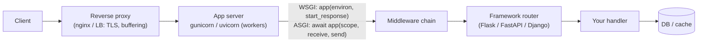
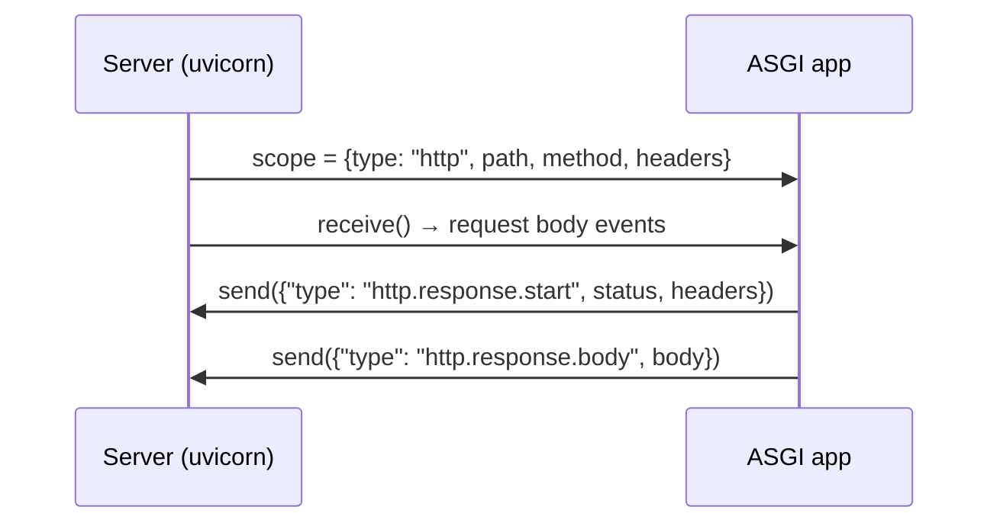

# Lesson 18: Web Apps — `app.run`, WSGI, ASGI and FastAPI

> **Prerequisites:** [Lesson 15: asyncio in Depth](../15-asyncio-in-depth/README.md) · [Lesson 17: Modules and Imports](../17-modules-packages-and-imports/README.md) · [Lesson 04: Decorators](../04-decorators/README.md)  
> **Reading time:** ~25 minutes  
> **Audience:** Candidates asked "what does `app.run()` do?", "WSGI vs ASGI?", "why not use the Flask dev server in production?", "how does FastAPI dependency injection work?"

> [!NOTE]
> **In one line:** A Python web framework is just a **callable** that follows a protocol — **WSGI** `app(environ, start_response)` (sync) or **ASGI** `async app(scope, receive, send)` (async) — and a **server** (gunicorn, uvicorn) calls it for every request; `app.run()` merely starts a *development* server around that callable.

> [!TIP]
> **Golden rule:** `app.run()` / `flask run` / `uvicorn --reload` are for development. In production run the app under a real server (gunicorn with workers, or uvicorn/gunicorn+uvicorn workers) behind a reverse proxy (nginx / cloud LB), with the `if __name__ == "__main__"` guard around any `app.run`.

> [!TIP]
> **Try it:** Run the section 3 file — sections 1–4 need only the standard library; section 5 needs `pip install fastapi httpx` (and `pydantic`, which FastAPI pulls in). Then run the [web lab](#try-it--web-lab-runnable) below: it serves a WSGI app with the stdlib's `wsgiref` (that is all `app.run()` is), writes an ASGI middleware, and **measures** a blocking call inside `async def` against a plain `def` on a real uvicorn server. Draw request flow through proxy → server → middleware → handler in [LLD Studio](/tools/lld-studio/).

---

## 1. The smell: how this gets asked

- *"What does `app.run()` do? Why `if __name__ == '__main__'`?"*
- *"What is WSGI? ASGI? Why did ASGI appear?"*
- *"Flask vs FastAPI vs Django?"*
- *"Why shouldn't you use `debug=True` in production?"*
- *"`def` vs `async def` endpoints in FastAPI?"*
- *"How does FastAPI's `Depends` work? How would you test it?"*
- *"How many workers? Where does the GIL fit?"*





---

## 2. Reference

| | **WSGI** (PEP 3333) | **ASGI** |
| :--- | :--- | :--- |
| Signature | `app(environ, start_response) → iterable[bytes]` | `async app(scope, receive, send)` |
| Concurrency | One request per worker thread/process | Many on one event loop |
| Protocols | HTTP only | HTTP, WebSocket, lifespan, SSE |
| Servers | gunicorn, uWSGI, waitress | uvicorn, hypercorn, daphne |
| Frameworks | Flask, Django (sync), Bottle | FastAPI, Starlette, Django (async), Quart |
| Blocking calls | Fine (that's the model) | Must not block the loop |

| Framework | Style | Notes |
| :--- | :--- | :--- |
| **Flask** | Micro, sync, decorators; `app.run()` dev server | Add extensions for ORM/auth |
| **FastAPI** | ASGI, type hints → validation (pydantic) + OpenAPI docs + `Depends` DI | `async def` on loop, `def` in a threadpool |
| **Django** | Batteries-included (ORM, admin, auth) | Sync-first, async support growing |

---

## 3. Walkthrough: the protocols with no framework, then FastAPI

**Requirements:** show what a WSGI app and an ASGI app really are, how middleware is function composition, how a `Depends`-style injector works, and how to test a FastAPI app without a server.

1. Write a WSGI app and call it with a fake `environ`/`start_response` (that *is* the server's job).
2. Wrap it with middleware (a callable that returns a callable).
3. Write an ASGI app and drive it with fake `receive`/`send`.
4. Build a 15-line `Depends` to see the idea.
5. Use FastAPI's `TestClient`, and override a dependency in tests.

````carousel
```python
import asyncio
import inspect
import json
from io import BytesIO


# ---------- 1) WSGI: a plain function
def wsgi_app(environ, start_response):
    name = environ["QUERY_STRING"].split("=")[-1] or "world"
    body = f"hello {name}".encode()
    start_response("200 OK", [("Content-Type", "text/plain"), ("Content-Length", str(len(body)))])
    return [body]


def call_wsgi(app, path="/", query=""):
    """What a WSGI server (gunicorn) does for each request."""
    captured = {}

    def start_response(status, headers):
        captured["status"], captured["headers"] = status, dict(headers)

    environ = {"REQUEST_METHOD": "GET", "PATH_INFO": path, "QUERY_STRING": query,
               "wsgi.input": BytesIO(b"")}
    body = b"".join(app(environ, start_response))
    return captured["status"], captured["headers"], body.decode()


# ---------- 2) middleware = callable wrapping a callable
def header_middleware(app):
    def wrapped(environ, start_response):
        def sr(status, headers, exc_info=None):
            return start_response(status, headers + [("X-Powered-By", "wsgi-demo")])
        return app(environ, sr)
    return wrapped


print("WSGI:", call_wsgi(wsgi_app, query="name=Ada"))
print("WSGI+middleware header:", call_wsgi(header_middleware(wsgi_app))[1]["X-Powered-By"])


# ---------- 3) ASGI: an async callable with scope/receive/send
async def asgi_app(scope, receive, send):
    assert scope["type"] == "http"
    body = json.dumps({"path": scope["path"], "method": scope["method"]}).encode()
    await send({"type": "http.response.start", "status": 200,
                "headers": [(b"content-type", b"application/json")]})
    await send({"type": "http.response.body", "body": body})


async def call_asgi(app, path="/"):
    """What uvicorn does for each request."""
    sent = []

    async def receive():
        return {"type": "http.request", "body": b"", "more_body": False}

    async def send(message):
        sent.append(message)

    await app({"type": "http", "path": path, "method": "GET", "headers": []}, receive, send)
    return sent[0]["status"], sent[1]["body"].decode()


print("ASGI:", asyncio.run(call_asgi(asgi_app, "/items")))


# ---------- 4) a mini Depends: inspect signature, resolve callables, call handler
class Depends:
    def __init__(self, dependency):
        self.dependency = dependency


def resolve(handler, overrides=None):
    overrides = overrides or {}
    kwargs = {}
    for name, param in inspect.signature(handler).parameters.items():
        dep = param.default
        if isinstance(dep, Depends):
            fn = overrides.get(dep.dependency, dep.dependency)
            kwargs[name] = resolve(fn, overrides)            # dependencies of dependencies
    return handler(**kwargs)


def get_settings():
    return {"db": "prod-db"}


def get_repo(settings=Depends(get_settings)):
    return f"repo@{settings['db']}"


def endpoint(repo=Depends(get_repo)):
    return f"using {repo}"


print("Depends:", resolve(endpoint))
print("Depends (test override):", resolve(endpoint, {get_settings: lambda: {"db": "test-db"}}))


# ---------- 5) FastAPI: real framework, tested in-process (no server)
from fastapi import Depends as FDepends, FastAPI
from fastapi.testclient import TestClient
from pydantic import BaseModel


class Item(BaseModel):
    name: str
    price: float


app = FastAPI()


def get_db() -> dict:
    return {"items": []}


@app.post("/items", status_code=201)
def create(item: Item, db: dict = FDepends(get_db)):          # sync def → runs in a threadpool
    db["items"].append(item.model_dump())
    return {"count": len(db["items"]), "item": item}


@app.get("/health")
async def health():                                           # async def → runs on the event loop
    return {"status": "ok"}


with TestClient(app) as client:
    print("health:", client.get("/health").json())
    r = client.post("/items", json={"name": "pen", "price": 1.5})
    print("create:", r.status_code, r.json())
    bad = client.post("/items", json={"name": "pen", "price": "free"})
    print("validation:", bad.status_code, bad.json()["detail"][0]["loc"])

    # swap a dependency for a test
    fake = {"items": ["seeded"]}
    app.dependency_overrides[get_db] = lambda: fake
    print("overridden db:", client.post("/items", json={"name": "x", "price": 1}).json()["count"])
    app.dependency_overrides.clear()

print("openapi paths:", sorted(app.openapi()["paths"]))


# ---------- the dev server idiom (snippet; not executed here)
# if __name__ == "__main__":
#     import uvicorn
#     uvicorn.run("app:app", host="127.0.0.1", port=8000, reload=True)   # dev only
# Flask:  app.run(debug=True)   # dev only; production: gunicorn -w 4 app:app
```
<!-- slide -->
```csharp
// ASP.NET Core is the same idea: a request delegate pipeline hosted by Kestrel.
// Middleware = Func<RequestDelegate, RequestDelegate>; DI container built in; minimal APIs ≈ FastAPI.
var builder = WebApplication.CreateBuilder(args);
builder.Services.AddSingleton<IClock, SystemClock>();           // ≈ Depends(get_clock)
var app = builder.Build();

app.Use(async (ctx, next) => { ctx.Response.Headers["X-Powered-By"] = "demo"; await next(); });  // middleware
app.MapGet("/health", () => Results.Ok(new { status = "ok" }));
app.MapGet("/time", (IClock clock) => clock.Now);               // injected parameter

// app.Run();   // ≈ uvicorn.run: starts Kestrel (production-grade, unlike Flask's dev server)

interface IClock { DateTime Now { get; } }
class SystemClock : IClock { public DateTime Now => DateTime.UtcNow; }
```
````

Expected output of the Python tab (FastAPI 0.141 / pydantic 2.13; the dict key order and `loc` shape are stable across 0.100+):

```text
WSGI: ('200 OK', {'Content-Type': 'text/plain', 'Content-Length': '9'}, 'hello Ada')
WSGI+middleware header: wsgi-demo
ASGI: (200, '{"path": "/items", "method": "GET"}')
Depends: using repo@prod-db
Depends (test override): using repo@test-db
health: {'status': 'ok'}
create: 201 {'count': 1, 'item': {'name': 'pen', 'price': 1.5}}
validation: 422 ['body', 'price']
overridden db: 2
openapi paths: ['/health', '/items']
```

Read `overridden db: 2` carefully: the override returned a dict that already held `"seeded"`, so appending one item gives a count of 2 — proof that the endpoint used the fake, not the real `get_db`.

---

## 4. Edges

- **`app.run()` is a dev server.** Single process (Flask's is threaded), no hardening, `debug=True` enables the interactive debugger = **remote code execution** if exposed. Never in production.
- **`if __name__ == "__main__": app.run()`** keeps imports (by gunicorn, tests, the reloader) from starting a server. With the reloader, the module is imported **twice** (parent and child).
- **Workers.** gunicorn spawns *processes* (`-w N`, ~`2×cores+1` for sync apps); each has its own memory (no shared globals/caches!) and its own GIL. Use Redis/DB for shared state.
- **`async def` in FastAPI + a blocking call** (sync DB driver, `requests`, `time.sleep`) freezes the loop for all clients. Use a plain `def` (threadpool), async drivers, or `await run_in_threadpool`. In the lab, four parallel requests that each block 0.2 s take about 0.8 s through `async def` and about 0.2 s through `def`.
- **`def` endpoints run in a limited threadpool** (default ~40 threads); saturation queues requests.
- **Middleware order matters** (outermost first on the way in, reversed on the way out). CORS/auth/timing placement bugs are common.
- **Lifespan events** (startup/shutdown) create/dispose pools: use FastAPI `lifespan`, not import-time connections.
- **`Depends` is cached per request** by default (same dependency evaluated once; opt out with `Depends(fn, use_cache=False)`); `dependency_overrides` swaps implementations in tests (lab probes 5 and 7).
- **Validation is automatic** (pydantic) → `422` with a structured `detail`; map domain errors to HTTP errors with exception handlers.
- **Sync WSGI with long I/O** needs many workers/threads; ASGI handles many idle connections cheaply. CPU-bound work still needs processes/queues either way.
- **Behind a proxy:** trust `X-Forwarded-*` headers deliberately (`--proxy-headers`, `ProxyFix`), set body-size and timeout limits.
- **Graceful shutdown:** servers send SIGTERM; finish in-flight requests, close pools.

### Try it — web lab (runnable)

The follow-ups interviewers use after "what is WSGI?". Save as ``web_lab.py`` (keep that name: the multiprocessing probe re-imports it). Probes 1-4 are stdlib-only; probes 5-8 need ``pip install fastapi httpx uvicorn`` and are skipped with a message if those are missing. Probe 8 starts a real uvicorn server on a free local port and stops it.

```python
import asyncio, importlib.util, json, socket, threading, time, urllib.request
from io import BytesIO
from wsgiref.simple_server import WSGIRequestHandler, make_server

HAVE_FASTAPI = all(importlib.util.find_spec(m) for m in ("fastapi", "httpx", "uvicorn"))

def wsgi_app(environ, start_response):
    body = f"hello {environ['PATH_INFO']}".encode()
    start_response("200 OK", [("Content-Type", "text/plain"), ("Content-Length", str(len(body)))])
    return [body]

class Quiet(WSGIRequestHandler):
    def log_message(self, *a): pass

def main():
    # 1) `app.run()` is just a server calling your callable: stdlib's wsgiref does the same job
    server = make_server("127.0.0.1", 0, wsgi_app, handler_class=Quiet)
    port = server.server_address[1]
    t = threading.Thread(target=server.serve_forever, daemon=True); t.start()
    with urllib.request.urlopen(f"http://127.0.0.1:{port}/ping") as r:
        assert r.status == 200 and r.read() == b"hello /ping"
    server.shutdown(); server.server_close(); t.join()

    # 2) WSGI middleware order: outermost runs first on the way in, last on the way out
    trail = []
    def mw(name):
        def deco(app):
            def wrapped(environ, start_response):
                trail.append(f"{name}:in")
                result = app(environ, start_response)
                trail.append(f"{name}:out")
                return result
            return wrapped
        return deco
    stacked = mw("auth")(mw("timing")(wsgi_app))
    stacked({"PATH_INFO": "/"}, lambda s, h: None)
    assert trail == ["auth:in", "timing:in", "timing:out", "auth:out"]

    # 3) ASGI middleware: wrap `send` to add a header
    async def asgi_app(scope, receive, send):
        await send({"type": "http.response.start", "status": 200, "headers": [(b"x-a", b"1")]})
        await send({"type": "http.response.body", "body": b"ok"})
    def add_header(app):
        async def wrapped(scope, receive, send):
            async def send2(message):
                if message["type"] == "http.response.start":
                    message = {**message, "headers": message["headers"] + [(b"x-powered-by", b"asgi-demo")]}
                await send(message)
            await app(scope, receive, send2)
        return wrapped
    sent = []
    async def collect(m): sent.append(m)
    async def rcv(): return {"type": "http.request", "body": b""}
    asyncio.run(add_header(asgi_app)({"type": "http"}, rcv, collect))
    assert (b"x-powered-by", b"asgi-demo") in sent[0]["headers"]

    # 4) Each worker PROCESS has its own memory: a "global cache" is not shared
    import multiprocessing as mp
    with mp.get_context("spawn").Pool(2) as pool:
        counts = pool.map(_bump_in_worker, [1, 1, 1, 1])
    assert sum(1 for _ in counts) == 4 and _counter == 0   # workers bumped THEIR copies; ours is untouched
    print("4: parent's counter is still", _counter, "- worker memory is separate")

    if not HAVE_FASTAPI:
        print("FastAPI probes skipped (pip install fastapi httpx uvicorn)")
        return
    from fastapi import Depends, FastAPI, HTTPException, Request
    from fastapi.responses import JSONResponse
    from fastapi.testclient import TestClient
    from pydantic import BaseModel
    import httpx, uvicorn

    app = FastAPI()
    calls = {"db": 0}

    def get_db():
        calls["db"] += 1
        return object()

    def svc_a(db=Depends(get_db)): return db
    def svc_b(db=Depends(get_db)): return db
    def svc_c(db=Depends(get_db, use_cache=False)): return db

    @app.get("/cached")
    def cached(a=Depends(svc_a), b=Depends(svc_b)):
        return {"same_db": a is b}

    @app.get("/uncached")
    def uncached(a=Depends(svc_a), c=Depends(svc_c)):
        return {"same_db": a is c}

    class DomainError(Exception): pass
    @app.exception_handler(DomainError)
    async def handle(request: Request, exc: DomainError):
        return JSONResponse(status_code=409, content={"detail": str(exc)})
    @app.get("/boom")
    def boom(): raise DomainError("conflict")

    class Item(BaseModel):
        qty: int
    @app.post("/items")
    def items(item: Item): return item

    @app.get("/block-async")
    async def block_async():
        time.sleep(0.2)                     # blocks the event loop
        return {"ok": True}
    @app.get("/block-sync")
    def block_sync():
        time.sleep(0.2)                     # runs in the threadpool
        return {"ok": True}

    with TestClient(app) as c:
        # 5) Depends is cached per request unless use_cache=False
        calls["db"] = 0
        assert c.get("/cached").json() == {"same_db": True} and calls["db"] == 1
        calls["db"] = 0
        assert c.get("/uncached").json() == {"same_db": False} and calls["db"] == 2
        # 6) validation -> 422 with structured detail; domain error -> your handler's status
        r = c.post("/items", json={"qty": "many"})
        assert r.status_code == 422 and r.json()["detail"][0]["loc"] == ["body", "qty"]
        assert c.get("/boom").status_code == 409
        # 7) dependency_overrides swaps a dependency without monkeypatching
        sentinel = object()
        app.dependency_overrides[get_db] = lambda: sentinel
        assert c.get("/cached").json() == {"same_db": True}
        app.dependency_overrides.clear()

    # 8) The key trap, measured on a real uvicorn server: 4 parallel requests, 0.2 s of blocking each
    sock = socket.socket(); sock.bind(("127.0.0.1", 0)); port = sock.getsockname()[1]; sock.close()
    srv = uvicorn.Server(uvicorn.Config(app, host="127.0.0.1", port=port, log_level="error"))
    th = threading.Thread(target=srv.run, daemon=True); th.start()
    while not srv.started: time.sleep(0.01)
    def burst(path):
        t0 = time.perf_counter()
        with httpx.Client(base_url=f"http://127.0.0.1:{port}", timeout=10) as cl:
            ts = [threading.Thread(target=cl.get, args=(path,)) for _ in range(4)]
            [x.start() for x in ts]; [x.join() for x in ts]
        return time.perf_counter() - t0
    t_async, t_sync = burst("/block-async"), burst("/block-sync")
    srv.should_exit = True; th.join(timeout=5)
    print(f"8: async def + blocking call is serial: {t_async > 0.7}; plain def overlaps: {t_sync < 0.6}")
    assert t_async > 0.7 and t_sync < 0.6
    print("web lab ok")

_counter = 0
def _bump_in_worker(_):
    global _counter
    _counter += 1
    return _counter

if __name__ == "__main__":
    main()
```

Expected output:

```text
4: parent's counter is still 0 - worker memory is separate
8: async def + blocking call is serial: True; plain def overlaps: True
web lab ok
```

---

## 5. What you'd say in two minutes

> "A Python web app is a callable that implements a protocol. WSGI is the synchronous one — `app(environ, start_response)` returning an iterable of bytes — and ASGI is its async successor, `await app(scope, receive, send)`, which also covers WebSockets and lifespan events. An application server such as gunicorn or uvicorn calls that callable for each request; middleware is just a callable wrapping another. `app.run()` in Flask, or `uvicorn.run`, only starts a convenience development server, which is why it sits under `if __name__ == "__main__"` and why `debug=True` must never reach production, since the debugger allows code execution. In production I run several worker processes behind nginx or a load balancer — each has its own GIL and memory, so shared state goes to Redis or the database. I'd pick FastAPI for typed APIs: pydantic validation, OpenAPI docs and `Depends` for dependency injection, which I override in tests with `dependency_overrides`. The key trap is a blocking call inside an `async def` endpoint; I either use async clients or write a plain `def` so FastAPI runs it in a threadpool."

---

## 6. Anti-patterns

| Anti-pattern | Why it fails | Fix |
| :--- | :--- | :--- |
| `app.run(debug=True)` in production | Debugger = RCE, single process | gunicorn/uvicorn workers + proxy |
| Blocking calls in `async def` handlers | Stalls every request | Async drivers / plain `def` / `to_thread` |
| In-process global state with many workers | Each worker has its own copy | Redis/DB, or externalise state |
| DB connection at import time | Side effects, forks share sockets | `lifespan` / per-request dependency |
| Business logic inside route functions | Untestable, duplicated | Service layer; routes are thin |
| Catch-all `except Exception: return 200` | Hides failures | Exception handlers with proper status codes |
| Hard-wiring dependencies in handlers | Can't swap in tests | `Depends` + `dependency_overrides` |
| No timeouts on outbound calls | Workers pinned forever | Client timeouts, circuit breakers |

---

## 7. Interview questions

<details>
<summary><strong>1. What does `app.run()` do? [BASIC]</strong></summary>

It starts the framework's built-in development server (Werkzeug for Flask) that calls the WSGI app for each request, optionally with a reloader and debugger. Production uses gunicorn/uvicorn; the call is guarded by `if __name__ == "__main__":` so importing the module doesn't start a server.

</details>

<details>
<summary><strong>2. WSGI vs ASGI? [BASIC]</strong></summary>

WSGI: synchronous `app(environ, start_response)`, one request per worker thread/process, HTTP only. ASGI: async `app(scope, receive, send)`, many concurrent requests per loop, plus WebSockets, SSE and lifespan events.

</details>

<details>
<summary><strong>3. `def` or `async def` for a FastAPI endpoint? [TRICKY]</strong></summary>

`async def` runs on the event loop — only use it when everything inside is awaited/non-blocking. Plain `def` runs in a threadpool, so blocking libraries are fine. Putting blocking code in `async def` is the classic performance bug.

</details>

<details>
<summary><strong>4. How would you deploy a Flask app? [SCENARIO]</strong></summary>

gunicorn with N sync (or gthread) workers behind nginx/LB, containerised, health endpoint, env-based config, structured logs to stdout, graceful shutdown, timeouts; scale horizontally; shared state in Redis/DB.

</details>

<details>
<summary><strong>5. How does `Depends` work and how do you test with it? [SCENARIO]</strong></summary>

FastAPI inspects the handler's signature, builds a dependency graph, resolves each per request (cached within the request) and injects results. Tests set `app.dependency_overrides[real] = fake` — no monkeypatching needed.

</details>

<details>
<summary><strong>6. Why is the dev server unsafe? [TRICKY]</strong></summary>

Not hardened/performance-tuned, handles limited concurrency, and with `debug=True` exposes the Werkzeug console that can execute arbitrary Python (PIN-protected, but still a major risk).

</details>

<details>
<summary><strong>7. How do workers relate to the GIL? [TRICKY]</strong></summary>

Each gunicorn/uvicorn worker is a separate process with its own interpreter and GIL, so multiple workers use multiple cores. Threads within a worker share one GIL; async shares one thread. Memory/cache isn't shared across workers.

</details>

<details>
<summary><strong>8. How is ASP.NET Core similar? [BASIC]</strong></summary>

Kestrel hosts a request-delegate pipeline of middleware; DI is built in; minimal APIs resemble FastAPI. Async is the default model, so "don't block the thread pool" mirrors "don't block the event loop".

</details>

---

## 8. One-page cheat sheet

```text
WSGI   app(environ, start_response) -> [bytes]      sync, HTTP only      gunicorn / uWSGI / waitress
ASGI   await app(scope, receive, send)              async, HTTP+WS+lifespan   uvicorn / hypercorn
app.run() / flask run / uvicorn --reload   = DEV server.  Guard with  if __name__ == "__main__".
Prod:  nginx/LB -> gunicorn (-w N processes) [+ uvicorn workers]; env config; logs to stdout; SIGTERM graceful
Workers = processes (own GIL & memory)  -> shared state in Redis/DB
FastAPI: type hints -> pydantic validation (422) + OpenAPI;  Depends (per-request cache);  dependency_overrides in tests
   async def -> event loop (never block)       def -> threadpool
Middleware = callable wrapping callable; order matters; lifespan for pools
Never: debug=True in prod | blocking in async def | global state across workers | work at import time
```

---

## Further reading

- [PEP 3333: WSGI](https://peps.python.org/pep-3333/) · [ASGI spec](https://asgi.readthedocs.io/en/latest/)
- [FastAPI: Dependencies](https://fastapi.tiangolo.com/tutorial/dependencies/) · [Concurrency and async/await](https://fastapi.tiangolo.com/async/)
- [Flask: Deploying to production](https://flask.palletsprojects.com/en/stable/deploying/)

Previous: [Modules, Packages and Imports](../17-modules-packages-and-imports/README.md) · Next: [Testing: pytest, Fixtures and Mocking](../19-testing-pytest-fixtures-and-mocking/README.md)
