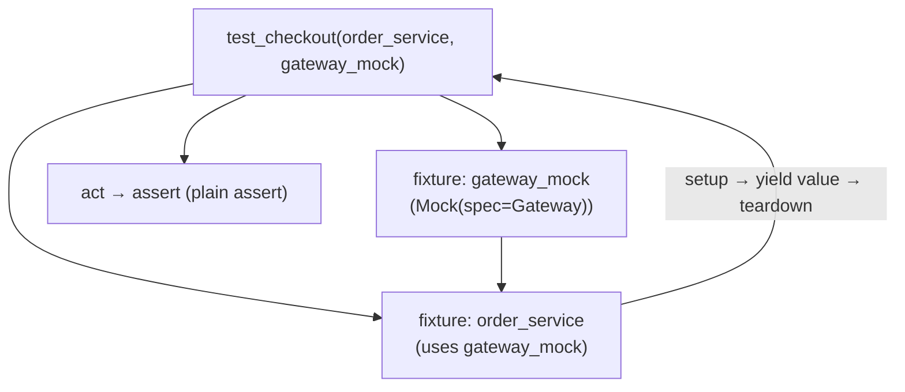
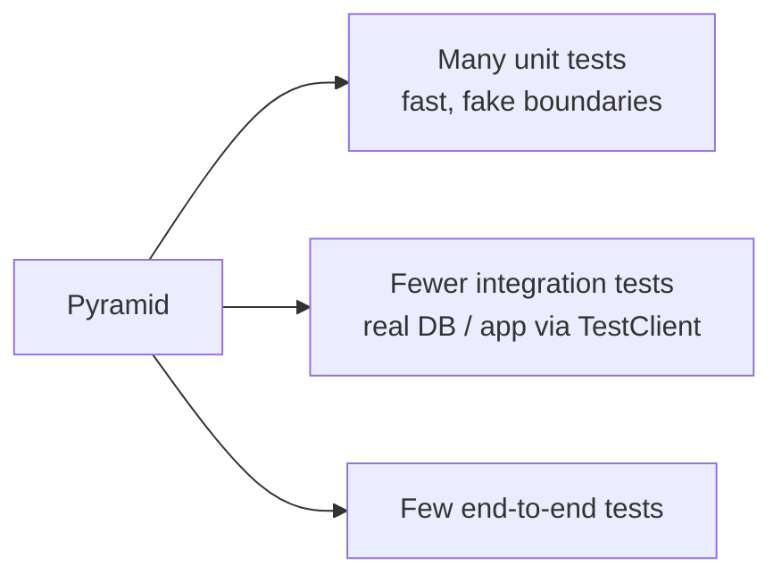

# Lesson 19: Testing — `pytest`, Fixtures and Mocking

> **Prerequisites:** [Lesson 04: Decorators](../04-decorators/README.md) · [Lesson 11: Context Managers](../11-context-managers/README.md) · [Lesson 12: Exceptions](../12-exceptions-done-right/README.md) · [Lesson 18: Web Apps](../18-web-apps-app-run-wsgi-asgi-and-fastapi/README.md)  
> **Reading time:** ~25 minutes  
> **Audience:** Candidates asked "how do pytest fixtures work?", "mock vs patch vs monkeypatch?", "where do you patch?", "how do you test code that calls the network/time/DB?"

> [!NOTE]
> **In one line:** `pytest` finds `test_*` functions, runs plain `assert`s with rich failure output, injects **fixtures** by parameter name (with setup/teardown via `yield`), multiplies cases with `@pytest.mark.parametrize`, and isolates collaborators with `Mock`/`monkeypatch` — **inject dependencies first, patch only what you can't inject.**

> [!TIP]
> **Golden rule:** Test behaviour through the public interface, fake only the *boundaries* (network, clock, filesystem, DB), and patch an object **where it is looked up**, not where it is defined. Use `Mock(spec=Real)` so typos fail.

> [!TIP]
> **Try it:** Save the section 3 file (needs `pip install pytest`) and run it — it executes its own tests via `pytest.main` and ends with `14 passed, 1 xfailed`. Break `apply_discount` (return `price`) and watch the assertion rewrite explain the diff, then remove `spec=` from the `gateway` fixture: `test_spec_catches_typos` now fails because the typo passes silently. Then run the [testing lab](#try-it--testing-lab-runnable), which runs real pytest sessions on throwaway test files to prove the fixture and patching claims. Compare with xUnit (C# tab) and sketch the test pyramid in [LLD Studio](/tools/lld-studio/).

---

## 1. The smell: how this gets asked

- *"Explain pytest fixtures — scope, `yield`, `conftest.py`."*
- *"`unittest.mock.patch` — where do you patch?"*
- *"Mock vs Stub vs Fake vs Spy?"*
- *"`monkeypatch` vs `patch`?"*
- *"How do you test code that calls an external API / uses `datetime.now()`?"*
- *"How do you test a FastAPI endpoint? Async code?"*
- *"Unit vs integration tests — what do you mock?"*





---

## 2. Reference

| Feature | Use |
| :--- | :--- |
| `assert x == y` | Plain assert; pytest rewrites it to show a diff |
| `pytest.raises(E, match=...)` | Assert an exception (and message regex) |
| `@pytest.mark.parametrize("a,b", [...])` | One test, many inputs |
| **Fixture** `@pytest.fixture` | Reusable setup, injected by argument name |
| `yield` in a fixture | Everything after `yield` is teardown |
| Fixture `scope` | `function` (default) · `class` · `module` · `package` · `session` |
| `conftest.py` | Shared fixtures, auto-discovered for that directory tree |
| `tmp_path`, `capsys`, `monkeypatch` | Built-in fixtures |
| `monkeypatch.setattr/setenv/delenv` | Temporary change, auto-undone |
| `unittest.mock.Mock/MagicMock` | Test doubles; `return_value`, `side_effect`, `assert_called_once_with` |
| `Mock(spec=Cls)` / `create_autospec` | Reject attributes/calls the real object lacks |
| `patch("pkg.mod.name")` | Replace `name` **in the namespace where it is looked up** |
| Markers | `skip`, `skipif`, `xfail`, custom (`@pytest.mark.slow`) |
| `pytest-asyncio` / `anyio` | Run `async def` tests |

| Double | Meaning |
| :--- | :--- |
| **Dummy** | Placeholder, never used |
| **Stub** | Returns canned answers |
| **Fake** | Working lightweight implementation (in-memory repo) |
| **Mock** | Records calls so you can verify interactions |
| **Spy** | Real object that also records calls |

---

## 3. Walkthrough: test a service with a fake boundary

**Requirements:** an `OrderService` that charges a gateway and translates a timeout into a domain error; prove: validation, discount maths, the interaction contract, the error translation (including the chained cause), env/time dependencies, files, and fixture teardown.

1. Inject the `Gateway` (constructor injection) → tests pass a `Mock(spec=Gateway)`; no patching needed.
2. Use `parametrize` for pure functions; `raises(match=)` for errors.
3. A `yield` fixture demonstrates teardown ordering.
4. `monkeypatch` handles what isn't injectable (env var, `time.time`).
5. `tmp_path` provides an isolated directory.

````carousel
```python
from __future__ import annotations

import os
import sys
import time
from dataclasses import dataclass
from unittest.mock import Mock

import pytest


# ============ code under test ============
class PaymentError(Exception):
    pass


class Gateway:
    def charge(self, amount_cents: int) -> str:
        raise NotImplementedError("real network call")


@dataclass
class OrderService:
    gateway: Gateway                                   # injected → easy to fake

    def checkout(self, amount_cents: int) -> str:
        if amount_cents <= 0:
            raise ValueError("amount must be positive")
        try:
            return self.gateway.charge(amount_cents)
        except TimeoutError as e:
            raise PaymentError("gateway timeout") from e


def apply_discount(price: float, pct: float) -> float:
    return round(price * (1 - pct / 100), 2)


def region() -> str:
    return os.environ.get("REGION", "eu")


def stamp() -> float:
    return time.time()


def save_report(folder, text: str):
    path = folder / "report.txt"
    path.write_text(text, encoding="utf-8")
    return path


# ============ fixtures ============
events: list[str] = []


@pytest.fixture
def gateway() -> Mock:
    g = Mock(spec=Gateway)                             # spec: typos raise AttributeError
    g.charge.return_value = "txn-1"                    # stub behaviour
    return g


@pytest.fixture
def service(gateway: Mock) -> OrderService:            # fixtures can depend on fixtures
    return OrderService(gateway)


@pytest.fixture
def resource():
    events.append("setup")
    yield "db-connection"                              # test runs here
    events.append("teardown")                          # always runs, even if the test failed


# ============ tests ============
@pytest.mark.parametrize(
    ("price", "pct", "expected"),
    [(100, 0, 100.0), (100, 25, 75.0), (19.99, 10, 17.99), (50, 100, 0.0)],
)
def test_apply_discount(price, pct, expected):
    assert apply_discount(price, pct) == expected


def test_checkout_calls_gateway_once(service, gateway):
    assert service.checkout(500) == "txn-1"
    gateway.charge.assert_called_once_with(500)        # verify the interaction contract


@pytest.mark.parametrize("bad", [0, -5])
def test_checkout_rejects_non_positive(service, gateway, bad):
    with pytest.raises(ValueError, match="positive"):
        service.checkout(bad)
    gateway.charge.assert_not_called()                 # failed fast, no side effect


def test_timeout_is_translated_and_chained(service, gateway):
    gateway.charge.side_effect = TimeoutError("slow")
    with pytest.raises(PaymentError, match="timeout") as info:
        service.checkout(100)
    assert isinstance(info.value.__cause__, TimeoutError)   # `raise ... from e` preserved


def test_spec_catches_typos(gateway):
    with pytest.raises(AttributeError):
        gateway.chrage(1)                              # a plain Mock() would accept this silently
    assert Mock().chrage(1) is not None                # ...and the typo "passes": why spec matters


def test_monkeypatch_env_and_clock(monkeypatch):
    monkeypatch.setenv("REGION", "us")
    monkeypatch.setattr(time, "time", lambda: 1234.0)  # patch where it is LOOKED UP (module attr)
    assert region() == "us"
    assert stamp() == 1234.0


def test_tmp_path_is_isolated(tmp_path):
    p = save_report(tmp_path, "hello")
    assert p.read_text(encoding="utf-8") == "hello"
    assert list(tmp_path.iterdir()) == [p]


def test_fixture_teardown_runs(resource):
    assert resource == "db-connection"
    assert events == ["setup"]                         # teardown happens after the test


def test_teardown_happened():
    assert events == ["setup", "teardown"]             # runs after the previous test (file order)


@pytest.mark.xfail(reason="known float quirk", strict=True)
def test_float_equality_is_a_trap():
    assert 0.1 + 0.2 == 0.3                            # use pytest.approx instead


def test_approx():
    assert 0.1 + 0.2 == pytest.approx(0.3)


if __name__ == "__main__":
    sys.exit(pytest.main([__file__, "-q", "-p", "no:cacheprovider", "--no-header"]))
```
<!-- slide -->
```csharp
// C# (xUnit + a hand-rolled fake; Moq/NSubstitute play the role of unittest.mock).
// [Theory]/[InlineData] ≈ @parametrize; constructor/IDisposable ≈ fixture setup/teardown; IClassFixture ≈ scoped fixture.
public interface IGateway { string Charge(int cents); }

public class OrderService(IGateway gateway)
{
    public string Checkout(int cents)
    {
        if (cents <= 0) throw new ArgumentOutOfRangeException(nameof(cents));
        try { return gateway.Charge(cents); }
        catch (TimeoutException e) { throw new InvalidOperationException("gateway timeout", e); }
    }
}

public class StubGateway : IGateway { public string Charge(int cents) => "txn-1"; }

// public class OrderServiceTests
// {
//     [Theory] [InlineData(0)] [InlineData(-5)]
//     public void Rejects_non_positive(int cents) =>
//         Assert.Throws<ArgumentOutOfRangeException>(() => new OrderService(new StubGateway()).Checkout(cents));
//     [Fact] public void Charges() => Assert.Equal("txn-1", new OrderService(new StubGateway()).Checkout(100));
// }
```
````

Expected output of the Python tab (the timing varies):

```text
.............x.                                                          [100%]
14 passed, 1 xfailed in 0.12s
```

Reading the dots: the `x` (second from the end) is the strict `xfail`, which *must* fail — if it ever passed, `strict=True` would turn that into a failure. Each `parametrize` case is its own result (4 discounts + 2 rejects), which is why 11 test functions produce 15 results.

---

## 4. Edges

- **Patch where it's looked up.** If `app.py` does `from time import time`, patch `app.time`, not `time.time`. If it does `import time`, patching the `time` module's attribute works for everyone. This is the #1 mocking trap.
- **Unspecced mocks hide bugs.** `Mock()` accepts any attribute/call; use `Mock(spec=...)`, `create_autospec(fn)` or `patch(..., autospec=True)`. Also `MagicMock` supports magic methods; `Mock` doesn't.
- **Over-mocking tests the mock.** Asserting every internal call couples tests to implementation. Verify outcomes; assert interactions only at real boundaries.
- **Fixture scope vs isolation.** Wider scope (session/module) saves time but shares state; prefer `function` scope unless setup is expensive and the resource is immutable or reset between tests.
- **Test order dependence** (like `test_teardown_happened` above) is a smell kept here for teaching — real tests must pass in any order (run with the `pytest-randomly` plugin, or `pytest-xdist` with `-n auto`, to flush out hidden coupling).
- **`yield` fixture teardown runs even on failure**; code after `yield` is not run if setup raised before it.
- **Mutable default state across tests** (module-level lists/dicts, caches, singletons, env vars) leaks; reset via fixtures or `monkeypatch`.
- **Floating point:** use `pytest.approx`, never `==`.
- **Time:** inject a clock (`now: Callable[[], datetime]`) instead of patching `datetime.now`, which can't be patched on the C type directly (needs `freezegun`/`time-machine` or a wrapper).
- **Async tests:** `pytest-asyncio` (`@pytest.mark.asyncio`) or `anyio`; don't call `asyncio.run` inside a running loop.
- **FastAPI:** `TestClient(app)` + `app.dependency_overrides` beats patching; for real DB use an ephemeral DB/transaction rollback fixture.
- **Flaky tests** come from time, randomness, ordering, network and shared state — remove the source, don't add retries.
- **Coverage ≠ quality:** 100% line coverage with no assertions proves nothing; consider mutation testing for critical logic.

### Try it — testing lab (runnable)

The follow-ups interviewers use after "how do fixtures work?". Save as ``testing_lab.py`` (not ``test_*.py``, so pytest will not collect it). Each probe writes throwaway test files into a temp directory, runs real ``pytest`` on them in a subprocess and asserts on the exit code and output; the temp directories are removed automatically. Needs ``pip install pytest``.

```python
import os, subprocess, sys, tempfile, textwrap, types, importlib.util
from datetime import datetime, timezone
from pathlib import Path
from unittest import mock
from unittest.mock import MagicMock, Mock, create_autospec, patch

def pytest_run(files, *args):
    """Write a throwaway test project and run real pytest on it."""
    with tempfile.TemporaryDirectory() as tmp:               # removed automatically
        d = Path(tmp)
        for name, body in files.items():
            (d / name).write_text(textwrap.dedent(body), encoding="utf-8")
        r = subprocess.run([sys.executable, "-m", "pytest", "-q", "-p", "no:cacheprovider", "--no-header", *args],
                           cwd=d, capture_output=True, text=True)
    return r.returncode, r.stdout

# 1) Patch where the name is LOOKED UP
payments = types.ModuleType("payments"); exec("def charge(): return 'real'", payments.__dict__)
orders = types.ModuleType("orders")
orders.__dict__["charge"] = payments.charge                      # what `from payments import charge` does
exec("def run(): return charge()", orders.__dict__)
sys.modules.update(payments=payments, orders=orders)
with patch("payments.charge", return_value="fake"):              # patched at the DEFINITION: no effect
    assert orders.run() == "real"
with patch("orders.charge", return_value="fake"):                # patched where it is USED
    assert orders.run() == "fake"
assert orders.run() == "real"                                    # patch undone on exit

# 2) spec vs autospec: only autospec checks call signatures
class Gateway:
    def charge(self, amount_cents: int) -> str: ...
loose = Mock(spec=Gateway)
loose.charge(1, 2, 3)                                            # wrong arity passes silently
strict = create_autospec(Gateway, instance=True)
try:
    strict.charge(1, 2, 3)
except TypeError as e:
    print("2:", str(e)[:48])

# 3) Mock cannot do magic methods; MagicMock can
try:
    len(Mock())
except TypeError:
    pass
mm = MagicMock(); mm.__len__.return_value = 3
assert len(mm) == 3

# 4) side_effect: exception, iterable (successive calls), or function
m = Mock(side_effect=[1, TimeoutError("second call fails"), 3])
assert m() == 1
try:
    m()
except TimeoutError:
    pass
assert m() == 3
assert Mock(side_effect=lambda x: x * 2)(4) == 8

# 5) datetime.datetime is a C type: cannot be patched in place; inject a clock instead
try:
    with patch("datetime.datetime.now"):
        pass
except TypeError as e:
    print("5:", e)
def greeting(now=lambda: datetime.now(timezone.utc)):
    return "morning" if now().hour < 12 else "afternoon"
assert greeting(now=lambda: datetime(2026, 1, 1, 9, tzinfo=timezone.utc)) == "morning"

# 6) Fixture teardown runs even when the test FAILS
code, out = pytest_run({"test_td.py": """
    import pytest
    log = []
    @pytest.fixture
    def res():
        log.append("setup"); yield 1; print("TEARDOWN-RAN")
    def test_fails(res):
        assert False
"""}, "-s")
assert code == 1 and "TEARDOWN-RAN" in out

# 7) ...but not if setup raised before the yield
code, out = pytest_run({"test_td2.py": """
    import pytest
    @pytest.fixture
    def res():
        raise RuntimeError("setup blew up")
        yield
    def test_x(res): pass
"""})
assert code == 1 and "error" in out.lower()

# 8) Fixture scope: function-scoped is rebuilt per test, session-scoped is shared (and so is its state)
code, out = pytest_run({"test_scope.py": """
    import pytest
    @pytest.fixture
    def fresh(): return []
    @pytest.fixture(scope="session")
    def shared(): return []
    def test_a(fresh, shared): fresh.append(1); shared.append(1); assert len(fresh) == 1
    def test_b(fresh, shared): fresh.append(1); shared.append(1); assert len(fresh) == 1 and len(shared) == 2
"""})
assert code == 0 and "2 passed" in out

# 9) conftest.py fixtures are discovered without any import
code, out = pytest_run({
    "conftest.py": "import pytest\n@pytest.fixture\ndef answer(): return 42\n",
    "test_c.py": "def test_uses_conftest(answer): assert answer == 42\n"})
assert code == 0 and "1 passed" in out

# 10) monkeypatch is undone after each test
code, out = pytest_run({"test_mp.py": """
    import os
    def test_sets(monkeypatch): monkeypatch.setenv("LAB_VAR", "x"); assert os.environ["LAB_VAR"] == "x"
    def test_gone(): assert "LAB_VAR" not in os.environ
"""})
assert code == 0 and "2 passed" in out

# 11) Assertion rewriting explains the failure; parametrize ids show which case broke
code, out = pytest_run({"test_diff.py": """
    import pytest
    @pytest.mark.parametrize("a,b", [(1, 1), (2, 3)])
    def test_eq(a, b): assert [a] == [b]
"""})
assert code == 1 and "test_eq[2-3]" in out and "At index 0 diff" in out

# 12) xfail(strict=True): an unexpected pass FAILS the run (so stale xfails get noticed)
code, out = pytest_run({"test_x.py": """
    import pytest
    @pytest.mark.xfail(strict=True, reason="should fail")
    def test_now_passes(): assert True
"""})
assert code == 1 and "XPASS(strict)" in out

# 13) Async tests need a plugin; without one pytest skips/fails them (plugin-free pattern: asyncio.run)
code, out = pytest_run({"test_async.py": """
    import asyncio
    async def work(): return 5
    def test_plugin_free(): assert asyncio.run(work()) == 5
"""})
assert code == 0
print("testing lab ok")
```

Expected output:

```text
2: too many positional arguments
5: cannot set 'now' attribute of immutable type 'datetime.datetime'
testing lab ok
```

---

## 5. What you'd say in two minutes

> "I use pytest because plain asserts, assertion rewriting, fixtures and parametrization remove boilerplate. A fixture is a function injected by parameter name; code after `yield` is teardown, `scope` controls how often it runs, and `conftest.py` shares fixtures across a folder. I design for testability first: pass collaborators in through the constructor so tests hand in a `Mock(spec=Gateway)` or an in-memory fake — then I rarely need `patch`. When I do patch — environment, the clock, a module-level client — I use `monkeypatch` or `patch` at the place the name is *looked up*, which is the classic trap with `from x import y`. I always add `spec`/autospec so a typo can't silently pass, verify behaviour more than call sequences, and keep the pyramid shaped: many fast unit tests, fewer integration tests using `TestClient` or a real database in a container, very few end-to-end. Flaky tests I fix at the source — time, order, shared state — instead of retrying."

---

## 6. Anti-patterns

| Anti-pattern | Why it fails | Fix |
| :--- | :--- | :--- |
| `Mock()` with no `spec` | Typos and wrong signatures pass | `spec=`/`autospec=True` |
| Patching where defined, not where used | Patch has no effect | Patch the importing module's name |
| Asserting every internal call | Brittle, refactor-hostile | Assert outputs/state; mock only boundaries |
| Tests that depend on order/shared globals | Flaky in parallel | Function-scoped fixtures, reset state |
| Real network/clock/randomness in unit tests | Slow, flaky | Inject/fake the boundary |
| Giant fixtures doing everything | Hidden coupling | Small, composable fixtures |
| One test with many unrelated asserts | Unclear failures | One behaviour per test; `parametrize` |
| `sleep()` to wait in tests | Slow, still flaky | Fake clock / wait on event/condition |
| Chasing coverage percentage | False confidence | Test behaviour & edge cases |

---

## 7. Interview questions

<details>
<summary><strong>1. What is a pytest fixture? [BASIC]</strong></summary>

A function marked `@pytest.fixture` that provides setup data/resources; tests request it by argument name. With `yield`, code after the yield is teardown. Scope (`function`…`session`) controls reuse and `conftest.py` shares fixtures.

</details>

<details>
<summary><strong>2. Where do you patch? [TRICKY]</strong></summary>

Where the name is looked up at call time. With `from payments import charge` in `orders.py`, patch `orders.charge`; patching `payments.charge` won't affect the already-imported reference.

</details>

<details>
<summary><strong>3. `monkeypatch` vs `unittest.mock.patch`? [BASIC]</strong></summary>

Both temporarily replace things and restore them. `monkeypatch` is a pytest fixture (setattr, setenv, chdir) with automatic undo at test end; `patch` is a context manager/decorator that also gives a `MagicMock` with call-assertion helpers. Pick whichever reads simply.

</details>

<details>
<summary><strong>4. Mock vs stub vs fake? [BASIC]</strong></summary>

Stub: canned return values. Mock: records and verifies interactions. Fake: functioning simplified implementation (in-memory DB). Prefer fakes/stubs and state assertions; use mocks for outgoing commands (e.g. "email was sent").

</details>

<details>
<summary><strong>5. How do you test code that uses `datetime.now()`? [SCENARIO]</strong></summary>

Inject a clock function or object (`now=lambda: datetime.now(timezone.utc)` as the default — `datetime.utcnow` is deprecated since 3.12) so tests pass a fixed one. Alternatively freeze time with `freezegun`/`time-machine`; avoid patching the C type.

</details>

<details>
<summary><strong>6. How do you test a FastAPI endpoint and its DB dependency? [SCENARIO]</strong></summary>

`TestClient(app)` for HTTP-level tests; override dependencies via `app.dependency_overrides[get_db] = fake_db`. For integration, use a real DB (container/SQLite) with a transaction-rollback fixture.

</details>

<details>
<summary><strong>7. Why does `Mock(spec=X)` matter? [TRICKY]</strong></summary>

A bare `Mock` fabricates any attribute, so `mock.chrage()` "works". With `spec`, accessing attributes the class lacks raises `AttributeError`; `create_autospec` also checks call signatures — keeps mocks honest as the real API evolves.

</details>

<details>
<summary><strong>8. How does this map to .NET? [BASIC]</strong></summary>

xUnit `[Fact]`/`[Theory]` ≈ test/`parametrize`; constructor and `IDisposable`/`IClassFixture` ≈ fixtures; Moq/NSubstitute ≈ `unittest.mock`; `WebApplicationFactory` ≈ `TestClient`; `ConfigureServices` overrides ≈ `dependency_overrides`.

</details>

---

## 8. One-page cheat sheet

```text
pytest            test_*.py / test_*() ; plain assert (rewritten) ; pytest -k name -x -q ; --lf
parametrize       @pytest.mark.parametrize(("a","b"), [...])
raises            with pytest.raises(E, match="regex") as info:   info.value.__cause__
fixture           @pytest.fixture(scope=...)  def f(): setup; yield value; teardown    -> conftest.py
builtins          tmp_path  capsys  monkeypatch  caplog
mock              Mock(spec=Cls)  .return_value  .side_effect=Exc  .assert_called_once_with(...)
patch rule        patch where the name is LOOKED UP ; prefer injection over patching
doubles           stub (answers)  mock (verifies)  fake (works, simple)  spy (real + records)
floats            pytest.approx          time  inject a clock
async             pytest-asyncio / anyio       fastapi  TestClient + dependency_overrides
Avoid             bare Mock()  order-dependent tests  sleep  over-asserting internals  chasing coverage %
```

---

## Further reading

- [pytest documentation](https://docs.pytest.org/) · [How to use fixtures](https://docs.pytest.org/en/stable/how-to/fixtures.html)
- [`unittest.mock`](https://docs.python.org/3/library/unittest.mock.html) · [Where to patch](https://docs.python.org/3/library/unittest.mock.html#where-to-patch)
- [FastAPI: Testing](https://fastapi.tiangolo.com/tutorial/testing/)

Previous: [Web Apps: app.run, WSGI, ASGI and FastAPI](../18-web-apps-app-run-wsgi-asgi-and-fastapi/README.md) · Next: [Rapid-Fire Python](../20-rapid-fire-python/README.md)
