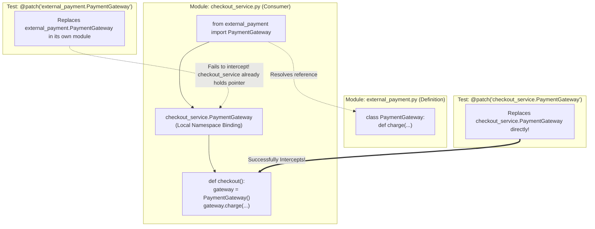

# Lesson 19: Testing: pytest, Fixtures and Mocking

> **Prerequisites:** [Web Apps: app.run, WSGI, ASGI, Middleware and FastAPI Depends](../18-web-apps-app-run-wsgi-asgi-and-fastapi/README.md) and [Track 27 Overview](../README.md).  
> **Estimated Reading Time:** 18-20 minutes  
> **Target Audience:** Engineers preparing for LLD, OOP, C#, or Python technical screening and architecture rounds.

> [!TIP]
> **The One Rule of Unit Testing & Mocking:** In pytest, fixtures are **dependency-injected resources with explicit lifecycle boundaries** (`yield` splits setup from teardown), completely replacing rigid class inheritance. When mocking, the cardinal rule is: **patch where an object is looked up (used), not where it is defined.** If `service.py` executes `from client import ApiClient`, you must patch `service.ApiClient`, because patching `client.ApiClient` leaves `service.py` holding its already-imported reference to the real object.

---

## 1. Why This Matters: The Interview Trap

"How do pytest fixtures work under the hood, why should you use `yield` inside a fixture, and where exactly should you point `unittest.mock.patch`?" is one of the most effective filters during backend technical screenings. It instantly separates developers who rely on trial-and-error patching from senior engineers who understand CPython namespaces, AST bytecode assertion rewriting, and dependency injection lifecycles.

A typical junior candidate replies:
- *"pytest is better than unittest because you don't have to write classes or `self.assertEqual`. A fixture is just a setup function you put `@pytest.fixture` on. You mock with `@patch('module.Class')` so you don't hit the database, and `MagicMock` is just a newer version of `Mock`."*

This response is superficial and reveals critical gaps:
1. **Fixture Lifecycle:** It misses how pytest discovers fixtures via dependency injection trees, how scopes (`function`, `module`, `session`) manage resource lifetime, or how generator `yield` separates setup from guaranteed post-test cleanup.
2. **The Patching Trap:** It fails to explain Python name binding: why patching the definition module (`@patch('requests.get')`) silently fails to intercept calls when the consuming code did `from requests import get`.
3. **`Mock` vs `MagicMock`:** It cannot explain Python's Data Model: that standard `Mock` instances do *not* support dunder methods (`__enter__`, `__iter__`, `__len__`, `__getitem__`), whereas `MagicMock` preconfigures magic methods to allow mocking context managers, iterables, and container protocols.
4. **Assert Rewriting:** It does not know how pytest avoids clumsy `assert*` methods: CPython's import hook intercepts and rewrites the Abstract Syntax Tree (AST) of test files to introspect intermediate sub-expressions upon assertion failure.

A senior engineer answers with **namespace binding mechanics and test architecture**:
- **Pytest Assert Rewriting:** pytest installs an import hook (`pytest.AssertionRewritingHook` in `sys.meta_path`). When importing `test_*.py`, it parses the AST, replaces standard `assert a == b` statements with custom inspection nodes, and compiles the modified AST to bytecode. When an assertion fails, pytest reconstructs the entire expression tree, displaying exact values for all sub-expressions without needing verbose assertions like `self.assertEqual(a, b)`.
- **Fixtures as a Dependency Graph:** A pytest fixture is a dependency provider. When a test function requests arguments matching fixture names, pytest builds a Directed Acyclic Graph (DAG) of dependencies. Fixtures can depend on other fixtures. Code preceding `yield` executes before the test; code following `yield` executes in a `finally` block after the test completes, guaranteeing resource cleanup (e.g. database rollback, file deletion, socket closure) even if the test fails.
- **The Golden Rule of Patching:** Python's `import` statements bind names within module namespaces. If `orders.py` executes `from gateway import StripeClient`, `orders.py` has a local variable named `StripeClient` pointing directly to that class in memory. If your test executes `@patch('gateway.StripeClient')`, you have modified `gateway.__dict__['StripeClient']`, but `orders.py` continues referencing the original class. You must patch `orders.StripeClient`—the namespace where the lookup actually occurs.
- **`Mock` vs `MagicMock`:** `MagicMock` is a subclass of `Mock` that provides default mock implementations for almost all dunder methods (e.g. `__str__`, `__iter__`, `__enter__`, `__exit__`, `__len__`, `__aenter__`). For example, attempting `with Mock():` raises `TypeError: __enter__`, whereas `with MagicMock():` succeeds as a valid context manager.

---

## 2. Visual Mental Model / Taxonomic Comparison

### The Golden Rule of Mocking: Where Lookups Happen



### Architectural Comparison: pytest vs unittest vs C# xUnit / Moq

| Dimension | `pytest` (Python) | `unittest` (Python Standard Library) | `xUnit` + `Moq` (C# / .NET) |
| :--- | :--- | :--- | :--- |
| **Test Discovery** | Function-based (`test_*()`) or classes | Class-based (`TestCase` inheritance) | Class-based with `[Fact]` / `[Theory]` attributes |
| **Assertion Mechanism** | Plain `assert a == b` (AST rewritten) | `self.assertEqual(a, b)`, `self.assertTrue()` | `Assert.Equal(expected, actual)`, FluentAssertions |
| **Setup & Teardown** | Dependency Injection via `@pytest.fixture` + `yield` | `setUp()` and `tearDown()` lifecycle methods | Constructor (setup) and `IDisposable.Dispose()` (teardown) |
| **Fixture Scopes** | `function`, `class`, `module`, `package`, `session` | Test-case level (`setUp`) or Class level (`setUpClass`) | Per-test (default), `IClassFixture<T>`, `ICollectionFixture<T>` |
| **Parametrization** | `@pytest.mark.parametrize("x, y", [(1, 2)])` | Subtests (`with self.subTest():`) or parameterized lib | `[Theory]` + `[InlineData(1, 2)]` / `[MemberData]` |
| **Mocking Engine** | `unittest.mock.MagicMock`, `pytest-mock` | `unittest.mock.Mock`, `patch` | `Mock<T>` (Moq, NSubstitute) |
| **Magic / Dunder Support** | Native in `MagicMock` (`__iter__`, `__enter__`, etc.) | Must manually assign dunders if using raw `Mock` | Handled via interface implementation and lambdas |
| **Async Testing** | `pytest-asyncio` (`@pytest.mark.asyncio`) | `unittest.IsolatedAsyncioTestCase` | Native `async Task TestMethod()` |

---

## 3. Code Implementation

The carousel below demonstrates:
1. **Python:** An `OrderCheckoutService` tested with pytest principles:
   - A reusable fixture demonstrating generator `yield` lifecycle semantics.
   - Parametrized discount calculations.
   - Mock verification using `unittest.mock.MagicMock` with `spec` type safety.
   - Asynchronous checkout execution and mock assertion (`assert_called_once_with`).
2. **C#:** An equivalent test harness demonstrating xUnit/Moq architecture:
   - `IDisposable` fixture lifecycle management.
   - Parametrized test execution matching `[Theory]` semantics.
   - Mock verification of arguments and invocation counts.
   - Asynchronous `Task`-based test execution.

Both implementations produce identical console output.

````carousel
```python
import asyncio
from typing import Generator
from unittest.mock import MagicMock

# ============================================================================
# Domain Under Test: OrderCheckoutService
# ============================================================================
class PaymentGatewayClient:
    """External payment client interface that must be mocked in tests."""
    def charge(self, card_token: str, amount: float) -> str:
        raise NotImplementedError("Real payment gateway called in unit test!")


class OrderCheckoutService:
    def __init__(self, gateway: PaymentGatewayClient) -> None:
        self.gateway = gateway

    def calculate_total(self, subtotal: float, discount_percent: float) -> float:
        discount = subtotal * (discount_percent / 100.0)
        return round(subtotal - discount, 2)

    async def checkout_async(
        self, order_id: str, card_token: str, subtotal: float, discount_percent: float
    ) -> dict:
        total = self.calculate_total(subtotal, discount_percent)
        # Call external payment dependency
        txn_id = self.gateway.charge(card_token, total)
        # Simulate non-blocking async persistence
        await asyncio.sleep(0.01)
        return {"order_id": order_id, "amount_charged": total, "transaction_id": txn_id}


# ============================================================================
# Test Harness Demonstrating Fixture Lifecycle, Parametrize & Mocking
# ============================================================================
def mock_gateway_fixture() -> Generator[MagicMock, None, None]:
    """Demonstrates a pytest fixture lifecycle: setup before yield, teardown after."""
    print("[FIXTURE SETUP] Initializing isolated mock gateway")
    # spec enforces that only methods present on PaymentGatewayClient can be called
    mock = MagicMock(spec=PaymentGatewayClient)
    mock.charge.return_value = "TXN_MOCK_SUCCESS_987"
    try:
        yield mock
    finally:
        print("[FIXTURE TEARDOWN] Cleaning up mock resources")


def test_calculate_total_parametrized():
    print("=== 1. Parametrized Discount Calculations ===")
    test_cases = [
        (100.0, 0.0, 100.0),
        (100.0, 15.0, 85.0),
        (250.0, 20.0, 200.0),
    ]
    dummy_gateway = MagicMock(spec=PaymentGatewayClient)
    service = OrderCheckoutService(dummy_gateway)

    for subtotal, discount, expected in test_cases:
        actual = service.calculate_total(subtotal, discount)
        assert actual == expected, f"Expected {expected}, got {actual}"
        print(f"PASS: Subtotal ${subtotal:.2f} with {discount:.0f}% discount = ${actual:.2f}")


def test_mocked_async_checkout():
    print("\n=== 2. Mock Verification & Async Execution ===")
    # 1. Acquire fixture (Setup)
    fixture_gen = mock_gateway_fixture()
    mock_gateway = next(fixture_gen)

    service = OrderCheckoutService(mock_gateway)

    # 2. Execute asynchronous service call
    result = asyncio.run(
        service.checkout_async("ORD-5501", "tok_visa_4242", 150.0, 10.0)
    )

    # 3. Assert state and verify mock interactions
    assert result["amount_charged"] == 135.0
    assert result["transaction_id"] == "TXN_MOCK_SUCCESS_987"
    mock_gateway.charge.assert_called_once_with("tok_visa_4242", 135.0)

    print("Mock Charge Verified: called once with card 'tok_visa_4242' for $135.00")
    print(f"Order Result: ID={result['order_id']}, Txn={result['transaction_id']}")

    # 4. Release fixture (Teardown)
    try:
        next(fixture_gen)
    except StopIteration:
        pass


def main():
    test_calculate_total_parametrized()
    test_mocked_async_checkout()


if __name__ == "__main__":
    main()
```
<!-- slide -->
```csharp
using System;
using System.Threading.Tasks;

namespace TestingAndMocking;

// ============================================================================
// Domain Under Test: OrderCheckoutService
// ============================================================================
public interface IPaymentGatewayClient
{
    string Charge(string cardToken, double amount);
}

public class OrderResult
{
    public string OrderId { get; set; } = string.Empty;
    public double AmountCharged { get; set; }
    public string TransactionId { get; set; } = string.Empty;
}

public class OrderCheckoutService
{
    private readonly IPaymentGatewayClient _gateway;

    public OrderCheckoutService(IPaymentGatewayClient gateway)
    {
        _gateway = gateway;
    }

    public double CalculateTotal(double subtotal, double discountPercent)
    {
        double discount = subtotal * (discountPercent / 100.0);
        return Math.Round(subtotal - discount, 2);
    }

    public async Task<OrderResult> CheckoutAsync(
        string orderId, string cardToken, double subtotal, double discountPercent)
    {
        double total = CalculateTotal(subtotal, discountPercent);
        string txnId = _gateway.Charge(cardToken, total);
        await Task.Delay(10); // Simulate async persistence
        return new OrderResult
        {
            OrderId = orderId,
            AmountCharged = total,
            TransactionId = txnId
        };
    }
}

// ============================================================================
// Test Harness Demonstrating Fixture Lifecycle, Parametrize & Mocking
// ============================================================================
public class MockPaymentGateway : IPaymentGatewayClient, IDisposable
{
    public int ChargeCallCount { get; private set; }
    public string LastCardToken { get; private set; } = string.Empty;
    public double LastAmount { get; private set; }
    public string ConfiguredResponse { get; set; } = "TXN_MOCK_SUCCESS_987";

    public MockPaymentGateway()
    {
        Console.WriteLine("[FIXTURE SETUP] Initializing isolated mock gateway");
    }

    public string Charge(string cardToken, double amount)
    {
        ChargeCallCount++;
        LastCardToken = cardToken;
        LastAmount = amount;
        return ConfiguredResponse;
    }

    public void VerifyChargeCalledOnce(string expectedToken, double expectedAmount)
    {
        if (ChargeCallCount != 1 || LastCardToken != expectedToken || Math.Abs(LastAmount - expectedAmount) > 0.001)
        {
            throw new InvalidOperationException(
                $"Mock verification failed: calls={ChargeCallCount}, token={LastCardToken}, amount={LastAmount}");
        }
    }

    public void Dispose()
    {
        Console.WriteLine("[FIXTURE TEARDOWN] Cleaning up mock resources");
    }
}

public class Program
{
    private static void TestCalculateTotalParametrized()
    {
        Console.WriteLine("=== 1. Parametrized Discount Calculations ===");
        var testCases = new (double subtotal, double discount, double expected)[]
        {
            (100.0, 0.0, 100.0),
            (100.0, 15.0, 85.0),
            (250.0, 20.0, 200.0)
        };

        var dummyGateway = new MockPaymentGatewayWithoutLogs();
        var service = new OrderCheckoutService(dummyGateway);

        foreach (var (subtotal, discount, expected) in testCases)
        {
            double actual = service.CalculateTotal(subtotal, discount);
            if (Math.Abs(actual - expected) > 0.001)
            {
                throw new Exception($"Expected {expected}, got {actual}");
            }
            Console.WriteLine($"PASS: Subtotal ${subtotal:F2} with {discount:F0}% discount = ${actual:F2}");
        }
    }

    private static async Task TestMockedAsyncCheckoutAsync()
    {
        Console.WriteLine("\n=== 2. Mock Verification & Async Execution ===");
        // Fixture setup and teardown managed via using block (IDisposable)
        using var mockGateway = new MockPaymentGateway();
        var service = new OrderCheckoutService(mockGateway);

        var result = await service.CheckoutAsync("ORD-5501", "tok_visa_4242", 150.0, 10.0);

        if (Math.Abs(result.AmountCharged - 135.0) > 0.001 || result.TransactionId != "TXN_MOCK_SUCCESS_987")
        {
            throw new Exception("Checkout result assertion failed");
        }

        mockGateway.VerifyChargeCalledOnce("tok_visa_4242", 135.0);
        Console.WriteLine("Mock Charge Verified: called once with card 'tok_visa_4242' for $135.00");
        Console.WriteLine($"Order Result: ID={result.OrderId}, Txn={result.TransactionId}");
    }

    public static async Task Main()
    {
        TestCalculateTotalParametrized();
        await TestMockedAsyncCheckoutAsync();
    }
}

public class MockPaymentGatewayWithoutLogs : IPaymentGatewayClient
{
    public string Charge(string cardToken, double amount) => "TXN_OK";
}
```
````

**Expected Output (Both Languages):**
```text
=== 1. Parametrized Discount Calculations ===
PASS: Subtotal $100.00 with 0% discount = $100.00
PASS: Subtotal $100.00 with 15% discount = $85.00
PASS: Subtotal $250.00 with 20% discount = $200.00

=== 2. Mock Verification & Async Execution ===
[FIXTURE SETUP] Initializing isolated mock gateway
Mock Charge Verified: called once with card 'tok_visa_4242' for $135.00
Order Result: ID=ORD-5501, Txn=TXN_MOCK_SUCCESS_987
[FIXTURE TEARDOWN] Cleaning up mock resources
```

---

## 4. Where You Already Use It

### Python Ecosystem
1. **`conftest.py` Hierarchical Sharing:** In pytest, fixtures declared in root `conftest.py` files are discovered automatically and injected across all subdirectories without requiring explicit imports.
2. **FastAPI `TestClient`:** Uses Starlette and `httpx` to test ASGI applications in-memory without spawning network sockets. Database connections are typically swapped out per test using `app.dependency_overrides[get_db] = override_db_fixture`.
3. **`pytest-asyncio`:** Decorating tests with `@pytest.mark.asyncio` automatically runs the test coroutine inside an isolated event loop, resolving asynchronous fixtures (`async_generator`) cleanly.
4. **`unittest.mock.patch`:** Used across test suites to intercept filesystem calls (`builtins.open`), OS time (`time.time`), or outbound HTTP requests (`httpx.AsyncClient.post`).

### .NET / C# Ecosystem
1. **xUnit Class Fixtures:** Implementing `IClassFixture<DatabaseFixture>` initializes a shared database container or in-memory server once per test class and runs teardown on `Dispose()`.
2. **Moq / NSubstitute:** Declaring `var mock = new Mock<IPaymentGateway>(); mock.Setup(...).Returns(...)` constructs a dynamic proxy implementing the interface at runtime, recording calls for assertion.
3. **`WebApplicationFactory<TProgram>`:** In ASP.NET Core integration tests, `WebApplicationFactory` boots the test server in-memory, allowing service registration overrides (`services.AddScoped<IPaymentGateway, MockGateway>()`).

---

## 5. Pitfalls and When Not to Use It

### 1. Patching the Definition Site Instead of the Call Site
The most prevalent mocking bug in Python:
```python
# In analytics/tracker.py:
from services.http_client import Client

def send_metric():
    c = Client()
    c.post("/events")

# IN TEST FILE (BROKEN):
@patch("services.http_client.Client")  # WRONG! Tracker already imported Client directly.
def test_send_metric(mock_client):
    send_metric()  # Real Client is still instantiated!
```
**Fix:** Always patch where the name is looked up: `@patch("analytics.tracker.Client")`.

### 2. Leaky Mocks Without `spec` (The Typo Trap)
By default, `MagicMock` dynamically creates a new mock attribute for *any* attribute you access:
```python
mock = MagicMock()
# Developer typo: misspelled assert_called_once
mock.asert_called_once()  # Silently creates a new mock! Test PASSES falsely!
```
**Fix:** Always pass `spec=RealClass` or `spec_set=RealClass` when instantiating mocks, or use `autospec=True` inside `@patch`. Accessing nonexistent methods will immediately raise `AttributeError`.

### 3. State Bleed with Mutable Session-Scoped Fixtures
Declaring a fixture with `scope="session"` or `scope="module"` caches the yielded instance across tests. If Test 1 mutates that fixture (e.g. adding records to an in-memory database or modifying a dictionary), Test 2 executes against contaminated state, causing brittle test order dependencies.  
**Rule:** Use `scope="function"` (default) for any stateful or mutable objects. Reserve `session` strictly for expensive, read-only resources (e.g., spinning up a Docker Testcontainer or compiling templates).

### 4. Over-Mocking Internal Implementation Details
Mocking every internal helper function turns tests into rigid reflections of code structure rather than behavioral specifications. Refactoring an internal helper method breaks over-mocked tests even when overall system behavior is completely preserved.  
**Rule:** Mock only boundary dependencies (outbound network calls, payment gateways, message brokers, system clocks). Test domain logic and business rules against real internal classes.

---

## 6. Exercises & Practical Drills

### Drill 1: The Context Manager Mocking Trap
Suppose you have a function that uses an external client as a context manager:
```python
def process_data(client):
    with client.connect() as conn:
        return conn.execute_query()
```
Why does testing this with a raw `Mock()` fail, whereas `MagicMock()` works out of the box?

<details>
<summary>Answer</summary>

A Python context manager requires the runtime methods `__enter__()` and `__exit__()`.
- A raw `Mock()` does not implement magic (dunder) methods by default. Calling `with client.connect():` attempts to look up `type(client.connect()).__enter__`, which raises `TypeError: __enter__`.
- A `MagicMock()` automatically preconfigures default implementations for magic dunder methods. When evaluated inside `with`, `__enter__` returns the mock itself (or a sub-mock), allowing `as conn:` to bind and `conn.execute_query()` to execute without raising exceptions.
</details>

---

### Drill 2: Asynchronous Fixtures with Cleanup
Write a pytest async fixture that yields a connected Redis mock client and ensures `await client.disconnect()` is always called after the test finishes, even if the test raises an unhandled assertion.

<details>
<summary>Answer</summary>

```python
import pytest
from unittest.mock import AsyncMock

@pytest.fixture
async def redis_client():
    # Setup
    client = AsyncMock()
    await client.connect()
    try:
        yield client  # Injected into the test function
    finally:
        # Guaranteed Teardown
        await client.disconnect()
```
**Why this works:** The generator `yield` pauses the fixture while the test runs. The `finally` block guarantees that `await client.disconnect()` executes during teardown regardless of whether the test passes, fails, or raises an unexpected exception.
</details>

---

## 7. Interview Questions & Model Answers

> [!interview]
> **Question 1: What is a pytest fixture?**  
> **Strong Answer:**  
> "A pytest fixture is a modular, dependency-injected resource provider used to establish a known baseline environment for tests.  
> 
> Unlike traditional xUnit `setUp()` and `tearDown()` methods that rely on class inheritance, pytest fixtures are decoupled functions decorated with `@pytest.fixture`:  
> 1. **Dependency Injection:** Tests declare fixtures as named function parameters. Pytest inspects parameter signatures at runtime, builds a Directed Acyclic Graph (DAG) of dependencies, and injects the resolved fixture values.  
> 2. **Lifecycle Management via `yield`:** A fixture uses a generator pattern where code prior to `yield` executes setup, the `yield` statement returns the test payload, and code after `yield` executes teardown inside a guaranteed `finally` context.  
> 3. **Configurable Scopes:** Fixtures can be scoped to `function` (isolated per test, default), `class`, `module`, `package`, or `session` (shared once across the entire test run), enabling an optimal balance between execution performance and test isolation."

---

> [!interview]
> **Question 2: Where should you `patch`?**  
> **Strong Answer:**  
> "The fundamental rule of Python mocking is: **patch where an object is looked up, not where it is defined.**  
> 
> When Python executes an import like `from payment_module import PaymentClient` inside `order_service.py`, CPython creates a reference in `order_service`'s local module namespace pointing directly to that class object.  
> 
> If your unit test executes `@patch('payment_module.PaymentClient')`, you have replaced the attribute inside `payment_module`, but `order_service` still retains its direct reference to the original class object. The test will run against the real, unmocked implementation.  
> 
> To correctly intercept the call, you must patch the namespace where the consumer resolves the symbol: `@patch('order_service.PaymentClient')`."

---

> [!interview]
> **Question 3: What is the difference between `Mock` and `MagicMock`?**  
> **Strong Answer:**  
> "Both `Mock` and `MagicMock` originate from `unittest.mock`, but they differ fundamentally in their support for Python's Data Model (magic dunder methods):  
> 
> - **`Mock`:** A general-purpose mock object. It does *not* provide default implementations for magic dunder methods. Attempting to use a standard `Mock` inside a context manager (`with mock:`), an iteration (`for x in mock:`), a length check (`len(mock)`), or container subscripting (`mock[key]`) will fail with a `TypeError` unless you explicitly assign each magic method manually.  
> - **`MagicMock`:** A subclass of `Mock` that comes preconfigured with default implementations for almost all Python magic dunder methods (such as `__enter__`, `__exit__`, `__iter__`, `__getitem__`, `__len__`, `__str__`, and `__bool__`).  
> 
> In 95% of unit tests, `MagicMock` is the preferred default because backend code frequently interacts with context managers (database transactions, file handles) and iterables."

---

## 8. Sources & Further Reading

- [Official pytest Documentation: Fixtures reference](https://docs.pytest.org/en/stable/explanation/fixtures.html)
- [Official pytest Documentation: How to use fixtures](https://docs.pytest.org/en/stable/how-to/fixtures.html)
- [Python Documentation: `unittest.mock` — Getting Started & Where to Patch](https://docs.python.org/3/library/unittest.mock.html#where-to-patch)
- [Python Documentation: `unittest.mock` — Mock vs MagicMock](https://docs.python.org/3/library/unittest.mock.html#magic-mock)
- [Microsoft Learn: Unit testing C# with xUnit and .NET](https://learn.microsoft.com/en-us/dotnet/core/testing/unit-testing-with-dotnet-test)
- [Moq Quickstart Documentation](https://github.com/devlooped/moq/wiki/Quickstart)

---

Previous: [Web Apps: app.run, WSGI, ASGI, Middleware and FastAPI Depends](../18-web-apps-app-run-wsgi-asgi-and-fastapi/README.md) · Next: [Rapid Fire: the Python Revision Sheet](../20-rapid-fire-python/README.md)
