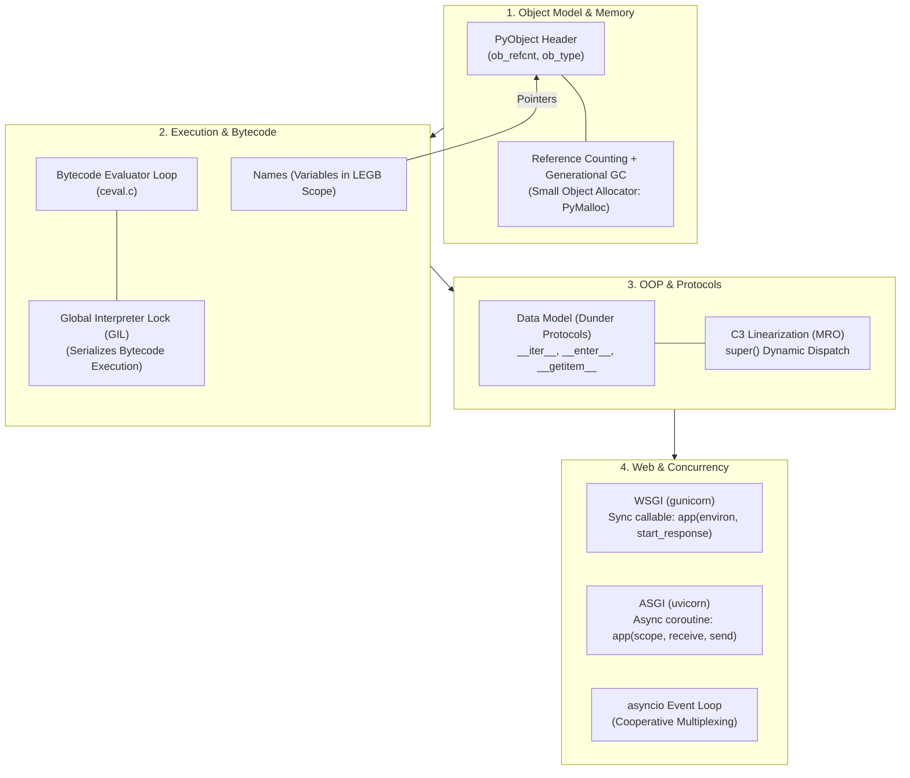

# Lesson 20: Rapid Fire: the Python Revision Sheet

> **Prerequisites:** [Testing: pytest, Fixtures and Mocking](../19-testing-pytest-fixtures-and-mocking/README.md) and [Track 27 Overview](../README.md).  
> **Estimated Reading Time:** 20-25 minutes  
> **Target Audience:** Engineers preparing for LLD, OOP, C#, or Python technical screening and architecture rounds.

> [!TIP]
> **The One Rule of Python Rapid Fire:** In Python, variables are pointer labels bound to heap-allocated objects; execution is dictionary-driven attribute resolution (`__dict__`) evaluated by the CPython bytecode loop under the GIL; and language protocols are realized through double-underscore (dunder) methods. In rapid-fire rounds, answer in two crisp sentences: state the underlying memory/runtime mechanism first, then state the invariant or production trade-off.

---

## 1. Why This Matters: The Interview Trap

The rapid-fire or technical screening round is designed to test your reflexes and depth under time pressure. Interviewers fire 15 to 20 foundational questions in rapid succession.

Junior candidates fall into two traps:
1. **The Rambling Narrative:** Taking three minutes to tell a story about a project bug instead of defining the concept. By question four, the 30-minute interview has elapsed.
2. **Textbook Vagueness:** Using imprecise colloquialisms like *"Python passes variables by reference"* or *"The GIL makes Python single-threaded."* These answers trigger immediate follow-up traps that expose superficial memorization.

A senior engineer answers with **speed, precision, and architectural vocabulary**:
- **Formula:** `[Exact Definition / CPython Mechanism] + [Direct Consequence / Edge Case]`.
- *Example:* "Is Python pass-by-value or pass-by-reference?"  
  *Senior response:* "Python is call-by-sharing (or pass-by-object-reference): the function receives a copy of the object reference pointer by value. Reassigning the parameter name inside the function leaves the caller's variable unchanged, but mutating a mutable object in-place directly alters the caller's object."

---

## 2. Visual Mental Model / Taxonomic Comparison

### The Unified CPython Runtime Mental Model



### High-Frequency Architectural Contrasts

| Concept A | Concept B | Core Technical Distinction |
| :--- | :--- | :--- |
| `is` | `==` | `is` checks memory identity (`id(a) == id(b)`); `==` invokes `__eq__` to check equality of value. |
| `__new__` | `__init__` | `__new__` is the static constructor that creates and returns the object instance; `__init__` is the initializer that configures attributes on the newly created instance. |
| `copy()` | `deepcopy()` | Shallow copy creates a new container holding references to original child objects; deep copy recursively copies the container and all nested objects. |
| `abc.ABC` | `typing.Protocol` | `ABC` requires nominal inheritance and checks abstract methods at instantiation; `Protocol` enables structural subtyping (static duck typing) verified by static type checkers. |
| `threading` | `multiprocessing` | `threading` uses OS threads constrained by a single GIL (ideal for I/O); `multiprocessing` spawns separate OS processes with independent GILs and memory spaces (ideal for CPU tasks). |
| WSGI | ASGI | WSGI is a synchronous request-response callable; ASGI is an asynchronous coroutine supporting WebSockets, HTTP/2, and persistent streaming. |
| EAFP | LBYL | "Easier to Ask for Forgiveness than Permission" relies on `try/except` (idiomatic Python); "Look Before You Leap" checks preconditions with `if` statements prior to execution. |
| List Comprehension | Generator Expression | List comprehension eagerly constructs the entire list in memory `[x for x in data]`; generator expression lazily yields items on demand `(x for x in data)`. |

---

## 3. Code Implementation

The carousel below demonstrates diagnostic test cases for the top five rapid-fire traps in both Python and C#:

````carousel
```python
import copy


def test_python_rapid_fire_traps():
  print("--- Python Rapid-Fire Traps & Diagnostics ---")

  # 1. Mutable Default Argument Trap
  def append_to_list(val, target=[]):
    target.append(val)
    return target

  print(
      f"Mutable Default Trap: {append_to_list(1)} -> {append_to_list(2)}"
  )  # Evaluated once at definition!

  # 2. Late Binding Closures in Loops
  funcs = [lambda: i for i in range(3)]
  print(
      f"Late-Binding Lambda: {[f() for f in funcs]}"
  )  # All return 2 because 'i' is looked up at call time

  # Fix: Default argument capture
  fixed_funcs = [lambda i=i: i for i in range(3)]
  print(f"Fixed Lambda Closure: {[f() for f in fixed_funcs]}")

  # 3. Tuple Containing Mutable List
  nested_tuple = ([1, 2], "immutable")
  nested_tuple[0].append(3)  # Mutating the contained list in-place succeeds!
  print(f"Tuple with Mutable Child: {nested_tuple}")

  # 4. Identity vs Equality & Small Integer Caching
  x = 256
  y = 256
  print(f"Cached Integers (256 is 256): {x is y}")  # True: CPython interns -5..256

  # 5. Overriding __eq__ without __hash__ breaks dict/set insertion
  class BadKey:

    def __init__(self, val):
      self.val = val

    def __eq__(self, other):
      return isinstance(other, BadKey) and self.val == other.val
    # Note: Defining __eq__ automatically sets __hash__ = None in Python 3!

  bk = BadKey(10)
  try:
    s = {bk}
  except TypeError as e:
    print(f"Unhashable Type Trap: {type(e).__name__}: {e}")


if __name__ == "__main__":
  test_python_rapid_fire_traps()
```
<!-- slide -->
```csharp
using System;
using System.Collections.Generic;
using System.Linq;

public class Program
{
    // 1. C# forbids non-constant default arguments at compile time!
    // void AppendToList(int val, List<int> target = new List<int>()) -> Compiler Error CS1736

    public static void Main()
    {
        Console.WriteLine("--- C# Rapid-Fire Diagnostics ---");

        // 2. Closure Variable Capture (Fixed in C# 5 for foreach, but still applies to for loops!)
        var funcs = new List<Func<int>>();
        for (int i = 0; i < 3; i++)
        {
            int captured = i; // Explicit local copy prevents loop capture bug
            funcs.Add(() => captured);
        }
        Console.WriteLine($"C# Closure Capture: [{string.Join(", ", funcs.Select(f => f()))}]");

        // 3. ReadOnly Struct / Value Tuple holding mutable reference
        var tuple = (List: new List<int> { 1, 2 }, Label: "immutable");
        tuple.List.Add(3); // Mutating inner reference succeeds
        Console.WriteLine($"Tuple with Mutable Child: ([{string.Join(", ", tuple.List)}], {tuple.Label})");

        // 4. ReferenceEquals vs Equals & String Interning
        string s1 = "hello";
        string s2 = string.Intern("hel" + "lo");
        Console.WriteLine($"String Interning (ReferenceEquals): {object.ReferenceEquals(s1, s2)}");

        // 5. Overriding Equals without GetHashCode emits compiler warning CS0659
        var badKey = new BadKey(10);
        var set = new HashSet<BadKey> { badKey };
        Console.WriteLine($"C# HashSet addition succeeded: {set.Contains(badKey)}");
    }

    public class BadKey
    {
        public int Val { get; }
        public BadKey(int val) => Val = val;
        public override bool Equals(object? obj) => obj is BadKey other && Val == other.Val;
        public override int GetHashCode() => Val.GetHashCode(); // Explicitly implemented
    }
}
```
````

**Expected Output (Both Languages):**

```text
--- Python Rapid-Fire Traps & Diagnostics ---
Mutable Default Trap: [1] -> [1, 2]
Late-Binding Lambda: [2, 2, 2]
Fixed Lambda Closure: [0, 1, 2]
Tuple with Mutable Child: ([1, 2, 3], 'immutable')
Cached Integers (256 is 256): True
Unhashable Type Trap: TypeError: unhashable type: 'BadKey'
```

---

## 4. Where You Already Use It

Every major framework and standard library module in Python relies on these underlying rules:
- **`collections.defaultdict` & `functools.partial`:** Leverage closures, first-class callables, and dynamic default factories.
- **`dataclasses` & `pydantic`:** Generate `__init__`, `__repr__`, `__eq__`, and `__hash__` automatically by inspecting class annotations via the data model.
- **`SQLAlchemy` & `Django ORM`:** Use descriptors, metaclasses, and `__getattr__` to intercept database column access and translate Python attribute lookups into SQL queries.
- **`pytest`:** Exploits Python's AST manipulation and bytecode inspection to provide rich assertion introspection without custom helper assertions.

---

## 5. Pitfalls and When Not to Use It

### Top 5 Rapid-Fire Traps Set by Interviewers
1. **"Is Python pass-by-value or pass-by-reference?"**  
   *The Trap:* Saying pass-by-reference.  
   *The Truth:* It is **call-by-sharing** (pass-by-object-reference). Function parameters receive a copy of the pointer address by value.
2. **"Does the GIL eliminate the need for thread synchronization locks?"**  
   *The Trap:* Saying yes because only one thread executes at a time.  
   *The Truth:* No. The GIL only guarantees atomic execution of individual CPython bytecode instructions. Multi-bytecode statements (like `counter += 1`) can be preempted mid-operation, causing race conditions.
3. **"Are tuples always immutable?"**  
   *The Trap:* Saying yes unconditionally.  
   *The Truth:* The tuple's internal pointer table is immutable, meaning you cannot add, remove, or replace references. However, if a tuple contains a mutable object (such as a `list` or `dict`), that nested object can be mutated in-place.
4. **"Does `__del__` guarantee that resources are cleaned up immediately?"**  
   *The Trap:* Relying on `__del__` like a C++ destructor.  
   *The Truth:* No. `__del__` is only executed when an object's reference count reaches zero. Circular references or delayed garbage collection mean `__del__` may be deferred indefinitely or skipped during interpreter shutdown. Always use context managers (`with`).
5. **"Are type hints checked at runtime by CPython?"**  
   *The Trap:* Assuming Python throws a `TypeError` if you pass a string to `def add(a: int, b: int)`.  
   *The Truth:* CPython completely ignores type hints at runtime; they are stored as metadata in `__annotations__` for static linters (Mypy) or runtime validation libraries (Pydantic).

---

## 6. Exercises & Practical Drills

### Exercise 1: Predict the Output
What does this snippet print, and why?
```python
a = [1, 2, 3]
b = a
b += [4]
c = a + [5]
print(a)
print(b)
print(c)
```
<details>
<summary>Answer</summary>

**Output:**
```text
[1, 2, 3, 4]
[1, 2, 3, 4]
[1, 2, 3, 4, 5]
```
**Explanation:**
`b = a` creates an alias pointing to the same list object in memory.
`b += [4]` invokes `b.__iadd__([4])`, which mutates the underlying list in-place and returns the same reference, updating both `a` and `b`.
`c = a + [5]` invokes `a.__add__([5])`, which constructs and returns a completely **new** list instance, leaving `a` and `b` unchanged.
</details>

### Exercise 2: Diagnose the Bug
A developer complains that their class cannot be stored in a Python `set`:
```python
class Customer:

  def __init__(self, cid: int, name: str):
    self.cid = cid
    self.name = name

  def __eq__(self, other):
    return isinstance(other, Customer) and self.cid == other.cid


customers = {Customer(1, "Alice"), Customer(1, "Alice")}
```
What error is raised, why does it happen, and what is the one-line fix?
<details>
<summary>Answer</summary>

**Error:** `TypeError: unhashable type: 'Customer'`.  
**Root Cause:** In Python 3, if a class explicitly overrides `__eq__` without providing `__hash__`, Python automatically sets `__hash__ = None`. This explicitly marks the class unhashable to prevent breaking the hash invariant (equal objects must produce equal hash codes).  
**Fix:** Implement `__hash__`:
```python
def __hash__(self):
  return hash(self.cid)
```
</details>

---

## 7. Interview Questions & Model Answers

### Group 1: Object Model, Mutability & Memory (Lessons 01, 02, 13)

> [!interview]
> **Question 1: Is Python interpreted or compiled?**  
> **Strong Answer:**  
> Python is both: source code is first compiled into intermediate bytecode (`.pyc` files), which is then interpreted by the CPython virtual machine's bytecode execution loop (`ceval.c`).

> [!interview]
> **Question 2: What does "everything is an object" mean?**  
> **Strong Answer:**  
> In Python, all entities—including primitive integers, strings, functions, modules, and classes—are first-class `PyObject` structures allocated on the heap, complete with an object type pointer (`ob_type`) and a reference count (`ob_refcnt`).

> [!interview]
> **Question 3: What happens when you write a = b?**  
> **Strong Answer:**  
> It binds the name `a` in the current namespace dictionary to the exact same heap memory object referenced by `b`, incrementing that object's reference count by one without copying any data.

> [!interview]
> **Question 4: What is the difference between is and ==?**  
> **Strong Answer:**  
> `is` evaluates pointer identity (`id(a) == id(b)`), verifying if two variables point to the exact same physical memory address, whereas `==` evaluates value equality by invoking the object's `__eq__` method.

> [!interview]
> **Question 5: Why is a list a bad default argument?**  
> **Strong Answer:**  
> Default argument expressions are evaluated once when the function definition is executed at module load time, not on each invocation; a mutable default list is therefore shared across every subsequent call that omits the argument.

> [!interview]
> **Question 6: What is the difference between copy and deepcopy?**  
> **Strong Answer:**  
> `copy.copy()` constructs a new outer container but inserts references to the original child objects, whereas `copy.deepcopy()` recursively constructs duplicates of the container and every nested object it contains.

> [!interview]
> **Question 7: Is Python pass by value or pass by reference?**  
> **Strong Answer:**  
> Python is call-by-sharing (pass-by-object-reference): the function receives a copy of the object reference pointer by value. Reassigning the parameter name rebinding leaves the caller unaffected, but in-place mutations of mutable objects directly modify the caller's instance.

> [!interview]
> **Question 8: Can a tuple be changed?**  
> **Strong Answer:**  
> The tuple's internal reference array is strictly immutable and cannot be resized or reassigned, but if a tuple holds a reference to a mutable object (like a list), the contents of that nested object can be mutated in-place.

> [!interview]
> **Question 9: How does Python manage memory?**  
> **Strong Answer:**  
> Python manages memory primarily through deterministic reference counting for immediate reclamation, supplemented by a generational cyclic garbage collector (Generations 0, 1, and 2) to detect and reclaim isolated reference cycles.

> [!interview]
> **Question 10: What is reference counting?**  
> **Strong Answer:**  
> Reference counting tracks the number of active pointers referencing each `PyObject` in its `ob_refcnt` header field, immediately deallocating the object and freeing its memory the moment that count drops to zero.

> [!interview]
> **Question 11: Why can two equal integers or strings sometimes be the same object and sometimes not?**  
> **Strong Answer:**  
> CPython optimizes memory via interning: it pre-allocates small integers between -5 and 256 and caches short compile-time string constants, causing `is` to evaluate to `True` for these cached instances but `False` for dynamically calculated values outside these ranges.

> [!interview]
> **Question 12: How do you find what is slow?**  
> **Strong Answer:**  
> Profile deterministically using standard library `cProfile` to measure call counts and cumulative execution time per function, analyze memory allocations using `tracemalloc`, and pinpoint line-by-line bottlenecks with `line_profiler`.

---

### Group 2: Functions, Closures, Scope & Decorators (Lessons 03, 04)

> [!interview]
> **Question 13: What are *args and **kwargs?**  
> **Strong Answer:**  
> `*args` packs excess positional arguments into a `tuple`, while `**kwargs` packs excess keyword arguments into a `dict`, enabling functions to accept arbitrary, dynamic parameter signatures.

> [!interview]
> **Question 14: What is a closure?**  
> **Strong Answer:**  
> A closure is an inner function that retains read and write access to variables from its enclosing lexical scope (`__closure__` holding `cell` objects) even after the outer function has completed execution and exited the call stack.

> [!interview]
> **Question 15: What is the LEGB rule?**  
> **Strong Answer:**  
> The LEGB rule defines Python's sequential scope resolution order when resolving variable names: **L**ocal first, then **E**nclosing functions, then **G**lobal (module level), and finally **B**uilt-in scope.

> [!interview]
> **Question 16: What does nonlocal do?**  
> **Strong Answer:**  
> `nonlocal` explicitly binds a variable name within an inner function to the nearest enclosing lexical scope, preventing Python from creating a new local variable when performing an assignment.

> [!interview]
> **Question 17: What is a decorator? Write one.**  
> **Strong Answer:**  
> A decorator is a callable that takes a function as input, extends or alters its behavior via a wrapper closure, and returns the replacement callable; written as:  
> `def dec(f): @functools.wraps(f) def wrapper(*a, **kw): return f(*a, **kw); return wrapper`.

> [!interview]
> **Question 18: Why use functools.wraps?**  
> **Strong Answer:**  
> `functools.wraps` copies original function metadata—including `__name__`, `__doc__`, `__annotations__`, and `__module__`—from the decorated target onto the wrapper function, preventing introspection and debugging tooling from breaking.

> [!interview]
> **Question 19: How do you write a decorator that takes arguments?**  
> **Strong Answer:**  
> You construct a three-tiered nested function: an outer decorator factory that accepts the configuration arguments, an intermediate decorator function that accepts the target callable, and an inner wrapper that intercepts runtime calls.

> [!interview]
> **Question 20: What does lru_cache do?**  
> **Strong Answer:**  
> `functools.lru_cache` wraps a pure function with a thread-safe Least Recently Used memoization dictionary, caching return values keyed by argument hashes up to a specified maximum capacity (`maxsize`).

---

### Group 3: Iterators, Generators & Comprehensions (Lesson 05)

> [!interview]
> **Question 21: What is the difference between an iterable and an iterator?**  
> **Strong Answer:**  
> An iterable is an object implementing `__iter__()` that returns an iterator; an iterator is an object implementing `__next__()` that returns successive values on demand and raises `StopIteration` when exhausted.

> [!interview]
> **Question 22: What is a generator?**  
> **Strong Answer:**  
> A generator is a special iterator produced either by a function containing the `yield` keyword or a generator expression, lazily producing values via a suspended stack frame without buffering the full sequence in memory.

> [!interview]
> **Question 23: What does yield do?**  
> **Strong Answer:**  
> `yield` suspends the execution state and local variables of a generator function, emits a value to the caller, and pauses until the caller invokes `next()` on the generator.

> [!interview]
> **Question 24: List comprehension or generator expression: when which?**  
> **Strong Answer:**  
> Use a list comprehension `[...]` when you need random access, repeated iteration, or sequence length; use a generator expression `(...)` for large or infinite streams to preserve $O(1)$ memory consumption.

---

### Group 4: Classes, `__init__`, `__new__`, `__slots__` & Dunder Methods (Lessons 06, 07, 16)

> [!interview]
> **Question 25: What is the difference between __new__ and __init__?**  
> **Strong Answer:**  
> `__new__` is the static constructor responsible for allocating and returning the raw object instance, whereas `__init__` is the initializer that receives that created instance to set initial attribute values.

> [!interview]
> **Question 26: What is self?**  
> **Strong Answer:**  
> `self` is an explicit reference to the current instance passed automatically as the first parameter to instance methods, bound dynamically at call time via Python's descriptor protocol on functions.

> [!interview]
> **Question 27: What is the difference between a class attribute and an instance attribute?**  
> **Strong Answer:**  
> A class attribute is defined on the class body and shared across all instances via `Class.__dict__`; an instance attribute is stored in a specific object's `instance.__dict__` and isolated to that single instance.

> [!interview]
> **Question 28: What does __slots__ do?**  
> **Strong Answer:**  
> `__slots__` replaces the dynamic per-instance `__dict__` with a fixed-size array of C-level descriptor pointers, drastically reducing memory footprint and preventing arbitrary attribute assignment.

> [!interview]
> **Question 29: What is the difference between __str__ and __repr__?**  
> **Strong Answer:**  
> `__str__` provides a human-readable string representation intended for end users (`print(obj)`), whereas `__repr__` provides an unambiguous, detailed representation intended for developers and debugging (`repr(obj)`).

> [!interview]
> **Question 30: What are dunder (magic) methods?**  
> **Strong Answer:**  
> Dunder methods are special double-underscore methods defined in Python's data model that allow user classes to hook into core language syntax, such as operators (`+`), indexing (`[]`), iteration, and context managers.

> [!interview]
> **Question 31: Why must __hash__ change when you define __eq__?**  
> **Strong Answer:**  
> Python requires that equal objects must have identical hash codes (`a == b` implies `hash(a) == hash(b)`); defining `__eq__` without maintaining `__hash__` violates hash-table invariants in sets and dictionaries.

> [!interview]
> **Question 32: How do you make an object callable?**  
> **Strong Answer:**  
> Implement the `__call__(self, *args, **kwargs)` dunder method on the class, allowing instances to be invoked with standard function-call syntax `instance()`.

> [!interview]
> **Question 33: What is a metaclass?**  
> **Strong Answer:**  
> A metaclass is the class of a class (`type` being the default), intercepting class creation at module load time (`__new__` and `__init__`) to validate, register, or rewrite class definitions.

> [!interview]
> **Question 34: What is a descriptor?**  
> **Strong Answer:**  
> A descriptor is an object attribute that customizes attribute access by implementing at least one of `__get__`, `__set__`, or `__delete__` in its class, serving as the engine behind `@property`, methods, and `@classmethod`.

> [!interview]
> **Question 35: How does @property work?**  
> **Strong Answer:**  
> `@property` is a built-in data descriptor that binds getter, setter, and deleter methods to an attribute name, executing custom logic transparently on standard dot-notation access (`obj.attr`).

> [!interview]
> **Question 36: What is __init_subclass__?**  
> **Strong Answer:**  
> Introduced in Python 3.6, `__init_subclass__` is a hook called on base classes whenever a child class is derived, providing a lightweight alternative to metaclasses for subclass validation and registration.

---

### Group 5: Inheritance, `super()` & MRO (Lesson 08)

> [!interview]
> **Question 37: What is the MRO?**  
> **Strong Answer:**  
> The Method Resolution Order (MRO) is the linear sequence computed via the C3 Linearization algorithm that Python traverses to look up methods and attributes in inheritance hierarchies.

> [!interview]
> **Question 38: How does super() work with multiple inheritance?**  
> **Strong Answer:**  
> `super()` delegates to the *next class in the MRO* of the calling instance, not necessarily the lexical parent class, ensuring cooperative multi-inheritance calls proceed deterministically.

> [!interview]
> **Question 39: How does Python solve the diamond problem?**  
> **Strong Answer:**  
> Python resolves the diamond problem through C3 Linearization, which guarantees local precedence order (subclasses before parents) and monotonicity (parent ordering preserved) without visiting any class twice.

> [!interview]
> **Question 40: What is a mixin?**  
> **Strong Answer:**  
> A mixin is a specialized class intended to provide reusable, modular method implementations across unrelated classes through multiple inheritance, without being instantiated directly.

---

### Group 6: Typing, Protocols & ABCs, Dataclasses & Context Managers (Lessons 09, 10, 11, 12)

> [!interview]
> **Question 41: Does Python have interfaces?**  
> **Strong Answer:**  
> Python has no native `interface` keyword, but implements them through Abstract Base Classes (`abc.ABC` with nominal inheritance) and Protocols (`typing.Protocol` with structural typing).

> [!interview]
> **Question 42: What is duck typing?**  
> **Strong Answer:**  
> Duck typing is Python's dynamic typing philosophy where an object's suitability is determined by the presence of required methods and properties at runtime, rather than its explicit inheritance hierarchy ("if it walks like a duck and quacks like a duck, it's a duck").

> [!interview]
> **Question 43: What is the difference between an ABC and a Protocol?**  
> **Strong Answer:**  
> An `ABC` enforces nominal subtyping requiring explicit subclassing checked at instantiation time, whereas a `Protocol` enables structural subtyping (static duck typing) verified by static type checkers without runtime inheritance.

> [!interview]
> **Question 44: Are type hints enforced at run time?**  
> **Strong Answer:**  
> No, standard CPython completely ignores type hints at runtime; they are stored as metadata in `__annotations__` for static linters (like Mypy) or runtime validation frameworks (like Pydantic).

> [!interview]
> **Question 45: What is a dataclass?**  
> **Strong Answer:**  
> Introduced in PEP 557, `@dataclass` is a class decorator that automatically generates boilerplate methods (`__init__`, `__repr__`, `__eq__`) by inspecting type-annotated class attributes.

> [!interview]
> **Question 46: What is the difference between a dataclass and a NamedTuple?**  
> **Strong Answer:**  
> A `dataclass` creates a standard mutable class instance with full method support, whereas a `NamedTuple` creates an immutable `tuple` subclass that supports tuple unpacking and indexed access.

> [!interview]
> **Question 47: When would you use pydantic instead of a dataclass?**  
> **Strong Answer:**  
> Use Pydantic when dealing with external boundary data (HTTP payloads, JSON, environment settings) requiring runtime data parsing, validation, and type coercion; use dataclasses for internal, trusted domain models.

> [!interview]
> **Question 48: What is a context manager?**  
> **Strong Answer:**  
> A context manager is an object that manages resource allocation and cleanup by implementing the `__enter__()` and `__exit__()` dunder methods for use with the `with` statement.

> [!interview]
> **Question 49: How do you write one?**  
> **Strong Answer:**  
> Either by implementing a class with `__enter__` and `__exit__` methods, or by decorating a generator function yielding a single resource with `@contextlib.contextmanager`.

> [!interview]
> **Question 50: What does the with statement guarantee?**  
> **Strong Answer:**  
> The `with` statement guarantees that the context manager's `__exit__()` method will be executed to release resources, even if an unhandled exception or early return occurs inside the block.

> [!interview]
> **Question 51: What is the difference between EAFP and LBYL?**  
> **Strong Answer:**  
> EAFP ("Easier to Ask for Forgiveness than Permission") executes the operation and handles exceptions with `try/except`, avoiding race conditions; LBYL ("Look Before You Leap") tests preconditions with `if` checks prior to execution.

> [!interview]
> **Question 52: What does the else clause of try do?**  
> **Strong Answer:**  
> The `else` clause in a `try/except/else/finally` block runs if and only if the `try` block completed successfully without raising any exceptions.

> [!interview]
> **Question 53: What does raise ... from do?**  
> **Strong Answer:**  
> `raise NewException from OriginalException` enables explicit exception chaining by assigning the original error to `__cause__`, preserving the original traceback for diagnostic visibility.

> [!interview]
> **Question 54: Why should you not catch a bare except?**  
> **Strong Answer:**  
> A bare `except:` catches `BaseException`, inadvertently suppressing system-exiting signals like `KeyboardInterrupt` (`Ctrl+C`) and `SystemExit`, making processes difficult to stop gracefully; always catch `Exception` instead.

---

### Group 7: Concurrency: GIL, Threading, Multiprocessing & asyncio (Lessons 14, 15)

> [!interview]
> **Question 55: What is the GIL?**  
> **Strong Answer:**  
> The Global Interpreter Lock (GIL) is a mutual-exclusion lock in CPython that restricts execution of Python bytecode to a single OS thread at a time within a single process to keep memory reference counting thread-safe.

> [!interview]
> **Question 56: Threading or multiprocessing: when which?**  
> **Strong Answer:**  
> Use `threading` for I/O-bound tasks where threads release the GIL during network and disk syscalls; use `multiprocessing` for CPU-bound tasks to bypass the GIL across multiple cores via separate process heaps.

> [!interview]
> **Question 57: When is asyncio the right choice?**  
> **Strong Answer:**  
> `asyncio` is the right choice for high-concurrency, network-bound I/O applications maintaining thousands of mostly-idle connections (like WebSockets or API gateways) on a lightweight, single-threaded event loop.

> [!interview]
> **Question 58: Does Python support true parallelism?**  
> **Strong Answer:**  
> Yes, via `multiprocessing`, native C/Rust extensions that drop the GIL (`Py_BEGIN_ALLOW_THREADS`), per-interpreter GILs in Python 3.12+, and official free-threaded builds in Python 3.13+ (PEP 703).

> [!interview]
> **Question 59: What is the event loop?**  
> **Strong Answer:**  
> The event loop is the central engine of `asyncio` that continuously polls OS I/O multiplexers (`epoll`/`kqueue`/IOCP) and schedules suspended coroutines for execution when their awaited events become ready.

> [!interview]
> **Question 60: What is the difference between a coroutine and a task?**  
> **Strong Answer:**  
> A coroutine is a suspended function object created by calling `async def`; a `Task` is an `asyncio.Task` wrapper that schedules the coroutine on the event loop for concurrent background execution.

> [!interview]
> **Question 61: What happens if you call a blocking function inside async code?**  
> **Strong Answer:**  
> Calling a synchronous blocking function (e.g., `time.sleep` or `requests.get`) stalls the entire event loop thread, completely freezing all other concurrent coroutines until the blocking call returns.

---

### Group 8: Web Architecture, Testing & Modules (Lessons 17, 18, 19)

> [!interview]
> **Question 62: What does if __name__ == "__main__" do?**  
> **Strong Answer:**  
> It checks whether the Python file is being run directly as a top-level script (`__name__ == "__main__"`) versus being imported as a module into another file, preventing execution of entrypoint code upon import.

> [!interview]
> **Question 63: What is the difference between a module and a package?**  
> **Strong Answer:**  
> A module is a single Python source file (`.py`); a package is a directory containing modules, traditionally signaled by the presence of an `__init__.py` file (or namespace packages via PEP 420).

> [!interview]
> **Question 64: How do you fix a circular import?**  
> **Strong Answer:**  
> Refactor shared dependencies into a separate third module, move imports inside function scopes (deferred imports), or use `typing.TYPE_CHECKING` guards for type hints.

> [!interview]
> **Question 65: Why use a virtual environment?**  
> **Strong Answer:**  
> Virtual environments isolate Python package dependencies per project, preventing version conflicts with the host system Python or between unrelated applications.

> [!interview]
> **Question 66: What does app.run do in Flask?**  
> **Strong Answer:**  
> It starts Werkzeug's embedded single-process development HTTP server with an auto-reloader and interactive debugger for local debugging.

> [!interview]
> **Question 67: Why should you not use app.run in production?**  
> **Strong Answer:**  
> It lacks worker process pooling, cannot handle slowloris/DoS attacks, exposes remote code execution risks if `debug=True`, and cannot handle zero-downtime rolling restarts.

> [!interview]
> **Question 68: What is the difference between WSGI and ASGI?**  
> **Strong Answer:**  
> WSGI is a synchronous calling convention (`app(environ, start_response)`) for standard HTTP request-response cycles, while ASGI is an asynchronous protocol (`app(scope, receive, send)`) supporting async I/O, WebSockets, and HTTP/2.

> [!interview]
> **Question 69: How does middleware work in FastAPI?**  
> **Strong Answer:**  
> Middleware implements an onion wrapper (`dispatch(request, call_next)`) around the ASGI pipeline, allowing pre-processing of incoming requests and post-processing of outgoing responses.

> [!interview]
> **Question 70: How does dependency injection work in FastAPI?**  
> **Strong Answer:**  
> It uses `Depends()` parameter markers to build and resolve a Directed Acyclic Graph (DAG) of shared resources per request, supporting scoped cleanup via `yield`.

> [!interview]
> **Question 71: What is a pytest fixture?**  
> **Strong Answer:**  
> A pytest fixture is a modular, reusable dependency declared with `@pytest.fixture` that prepares test context, injects state into test functions, and performs cleanup via `yield`.

> [!interview]
> **Question 72: Where should you patch?**  
> **Strong Answer:**  
> Always patch an object *where it is looked up*, not where it is defined (e.g., if `app.py` has `from os import remove`, patch `'app.remove'`, not `'os.remove'`).

> [!interview]
> **Question 73: What is the difference between Mock and MagicMock?**  
> **Strong Answer:**  
> `MagicMock` is a subclass of `Mock` that comes pre-configured with default implementations for Python dunder methods (`__iter__`, `__enter__`, `__len__`, `__str__`), whereas standard `Mock` does not.

---

## 8. Sources & Further Reading

- [Python Documentation: The Python Standard Library & Language Reference](https://docs.python.org/3/)
- [PEP 8 – Style Guide for Python Code](https://peps.python.org/pep-0008/)
- [PEP 703 – Making the Global Interpreter Lock Optional in CPython](https://peps.python.org/pep-0703/)
- [PEP 3333 – Python Web Server Gateway Interface v1.0.1](https://peps.python.org/pep-3333/)
- [FastAPI Documentation](https://fastapi.tiangolo.com/)
- [Pytest Documentation](https://docs.pytest.org/en/stable/)
- [Microsoft Learn: .NET for Python Developers](https://learn.microsoft.com/en-us/dotnet/csharp/)

---

Previous: [Testing: pytest, Fixtures and Mocking](../19-testing-pytest-fixtures-and-mocking/README.md) · Next: [Track 27 Overview](../README.md)
