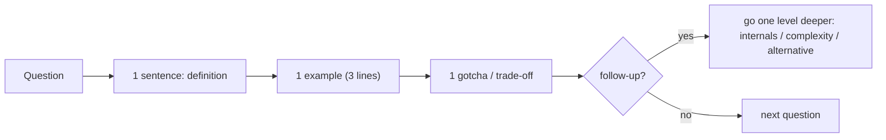

# Lesson 20: Rapid-Fire Python

> **Prerequisites:** Lessons [01](../01-how-python-runs-your-code/README.md)–[19](../19-testing-pytest-fixtures-and-mocking/README.md) of this track (this is the revision sheet)  
> **Reading time:** ~30 minutes (then re-read the tables the night before)  
> **Audience:** Candidates facing a phone screen full of one-liner questions: "`is` vs `==`?", "list vs tuple?", "what does `*args` do?", "what's printed here?"

> [!NOTE]
> **In one line:** Rapid-fire rounds reward a **short, correct, one-sentence answer plus one example or caveat** — this lesson condenses the whole track into ~80 such answers, plus the "what does this print?" traps interviewers love.

> [!TIP]
> **Golden rule:** Answer in the shape **definition → tiny example → the gotcha** (15 seconds). Interviewers follow up on the gotcha, so volunteer it. Say "it depends" only when followed by *on what*.

> [!TIP]
> **Try it:** Cover the right-hand column of each table and answer aloud, then run the section 3 "prove it" block (it prints `every trick confirmed` or fails with the line that disproves you) and the [rapid-fire lab](#try-it--rapid-fire-lab-runnable) that checks the table claims the block does not cover. Time yourself — 80 answers in 20 minutes is the target.

---

## 1. The smell: how this gets asked

- Machine-gun rounds: *"list vs tuple? dict ordering? `is` vs `==`? mutable default? GIL? decorators? generators?"*
- "What does this print?" snippets (aliasing, late binding, `finally`, `+=` on tuples).
- "Explain like I'm a Java/C# dev" — contrast with value types, interfaces, checked exceptions.
- Follow-ups that test depth: *"…and why?"*, *"…what's the complexity?"*, *"…how would you change it?"*



---

## 2. Reference: one-liners by area

### Language basics

| Q | A |
| :--- | :--- |
| Mutable vs immutable? | Mutable can change in place (`list`, `dict`, `set`, most classes); immutable can't (`int`, `float`, `str`, `tuple`, `frozenset`, `bytes`). |
| `is` vs `==`? | `is` = same object (identity); `==` = equal value (`__eq__`). Use `is` for `None`/singletons only. |
| What is `None`? | The single `NoneType` instance meaning "no value"; functions without `return` give `None`. |
| Truthy/falsy values? | Falsy: `None`, `False`, `0`, `0.0`, `""`, `[]`, `()`, `{}`, `set()`, `range(0)`, objects with `__bool__`→False or `__len__`→0. |
| `bool` and `int`? | `bool` subclasses `int`: `True + True == 2`. |
| Integer size? | Arbitrary precision; no overflow. |
| `//` and `%` with negatives? | Floor division: `-7 // 2 == -4`, `-7 % 2 == 1` (sign follows divisor). |
| `round(2.5)`? | `2` — banker's rounding (half to even). |
| Float equality? | `0.1 + 0.2 != 0.3`; use `math.isclose` / `Decimal`. `nan != nan`. |
| Is Python compiled or interpreted? | Compiled to bytecode, run by a VM (CPython); `.pyc` caches it. |
| Dynamic vs strong typing? | Dynamic (types on objects) and strong (no silent `"1" + 1`). |
| Type hints enforced? | No — only by tools (mypy/pyright); pydantic validates at runtime. |
| `pass`, `...`, `NotImplemented`? | No-op statement; Ellipsis placeholder; sentinel returned by binary dunders to say "try the other operand". |
| Ternary? | `a if cond else b`. |
| Walrus? | `if (n := len(x)) > 3:` assigns inside an expression (3.8+). |
| `for … else`? | `else` runs when the loop finished **without** `break`. |

### Strings, numbers, sequences

| Q | A |
| :--- | :--- |
| Are strings mutable? | No; concatenation in a loop is O(n²) — use `"".join(parts)`. |
| f-string vs `format` vs `%`? | f-strings are fastest/clearest (3.6+); `format` for templates; `%` legacy. |
| Slicing? | `s[start:stop:step]`, stop exclusive, never raises on out-of-range; `s[::-1]` reverses; makes a copy. |
| list vs tuple? | list mutable, variable-length; tuple immutable, hashable if elements are, lighter, good for fixed records / dict keys. |
| list vs array vs deque? | `list` dynamic array (O(1) append, O(n) insert-front); `array` typed compact; `deque` O(1) both ends. |
| Complexity of list ops? | index O(1), append O(1) amortised, insert/pop(0)/`in` O(n), sort O(n log n). |
| `sort()` vs `sorted()`? | `sort` in place returns `None`; `sorted` returns a new list; both stable (Timsort), accept `key=`. |
| Unpacking? | `a, b = b, a`; `first, *rest = xs`; `{**d1, **d2}`; `f(*args, **kwargs)`. |
| `range` memory? | Lazy sequence: `len(range(10**12))` is instant. |
| `enumerate` / `zip`? | Index+item pairs; parallel iteration (stops at shortest; `strict=True` raises, 3.10+). |
| List comprehension vs generator expression? | `[...]` builds the list now; `(...)` is lazy, single-use, constant memory. |
| `any([])` / `all([])`? | `False` / `True`. |
| Shallow vs deep copy? | `copy.copy` copies the container only; `deepcopy` recursively copies elements. `[:]`, `list()`, `.copy()` are shallow. |
| `[[0]*3]*3` trap? | Three references to **one** inner list; use `[[0]*3 for _ in range(3)]`. |

### Dicts and sets

| Q | A |
| :--- | :--- |
| How does a dict work? | Hash table with open addressing; average O(1) get/set; keys must be hashable. |
| Dict ordering? | Insertion-ordered (guaranteed since 3.7). |
| Hashable? | Has stable `__hash__` consistent with `__eq__`; immutable built-ins are, list/dict/set aren't. |
| `d[k]` vs `d.get(k)`? | `KeyError` vs `None`/default. |
| `setdefault` / `defaultdict` / `Counter`? | Insert-if-missing; auto-create values via factory; multiset counter with `most_common`. |
| Merge dicts? | `a \| b` (3.9+), `{**a, **b}`; later keys win. |
| Delete while iterating? | `RuntimeError: dictionary changed size`; iterate over `list(d)` or build a new dict. |
| set operations? | `\|`, `&`, `-`, `^`; membership O(1); no order, no duplicates. |
| `1`, `1.0`, `True` as keys? | They are equal and hash equally → one key. |
| `frozenset`? | Immutable, hashable set (usable as dict key). |

### Functions and scope

| Q | A |
| :--- | :--- |
| `*args` / `**kwargs`? | Collect extra positional args into a tuple / keyword args into a dict. |
| Mutable default argument? | `def f(x=[])` evaluates once at definition → shared across calls; use `None` and create inside. |
| Positional-only / keyword-only? | `def f(a, /, b, *, c)`: `a` positional-only, `c` keyword-only. |
| LEGB? | Local → Enclosing → Global → Built-in name lookup. |
| `global` vs `nonlocal`? | Rebind a module-level / enclosing-function variable. |
| Closure? | Inner function capturing enclosing variables (by cell, not value) → late binding in loops. |
| Lambda? | Anonymous single-expression function; no statements. |
| First-class functions? | Functions are objects: pass, return, store, attach attributes. |
| `map`/`filter`/`reduce`? | Lazy iterators (3.x) / `functools.reduce`; comprehensions usually clearer. |
| Pass-by-what? | Pass by object reference (assignment): rebinding the parameter doesn't affect the caller; mutating the object does. |
| `functools` favourites? | `lru_cache`/`cache`, `partial`, `wraps`, `reduce`, `cached_property`, `singledispatch`. |

### OOP and the data model

| Q | A |
| :--- | :--- |
| `__init__` vs `__new__`? | `__new__` creates the instance (static, returns it); `__init__` initialises it. |
| `@staticmethod` / `@classmethod` / instance method? | No implicit arg / gets `cls` (alternative constructors) / gets `self`. |
| `__str__` vs `__repr__`? | Readable for users vs unambiguous for developers (fallback for `str`). |
| `__eq__` and `__hash__`? | Defining `__eq__` sets `__hash__` to `None` unless you define it; equal objects must hash equally. |
| Private attributes? | Convention `_x`; `__x` is name-mangled to `_Class__x` (avoid clashes, not security). |
| Properties? | `@property` exposes computed/validated attributes with attribute syntax (a descriptor). |
| MRO? | C3 linearisation order for attribute lookup; `Class.__mro__`; `super()` follows it. |
| Multiple inheritance? | Supported; use cooperative `super()` and mixins; diamond resolved by MRO. |
| ABC vs Protocol? | Nominal (must inherit, `@abstractmethod` enforced) vs structural (shape-compatible, checked by type checkers). |
| `__slots__`? | Fixed attribute set, no per-instance `__dict__` → less memory, no dynamic attributes. |
| dataclass? | Generates `__init__`/`__repr__`/`__eq__` from annotations; `frozen=True`, `slots=True`, `order=True`. |
| Duck typing? | "If it quacks": use objects by behaviour, not class (EAFP). |
| Metaclass? | The class of a class (`type`); customises class creation — rarely needed. |
| Operator overloading? | Implement dunders (`__add__`, `__lt__`, `__len__`, `__getitem__`, `__iter__`, `__enter__`…). |

### Iterators, generators, context managers, decorators

| Q | A |
| :--- | :--- |
| Iterable vs iterator? | Iterable has `__iter__` (returns an iterator); iterator also has `__next__` and is exhausted once. |
| Generator? | Function with `yield`; lazy, resumable, keeps local state; `yield from` delegates. |
| `return` in a generator? | Ends iteration (`StopIteration(value)`). |
| Decorator? | A callable that takes a function and returns a replacement; `@d` is `f = d(f)`; use `functools.wraps`. |
| Context manager? | `with` uses `__enter__`/`__exit__` (or `@contextmanager`) for guaranteed cleanup. |
| EAFP vs LBYL? | Try/except (ask forgiveness) vs check first; Python prefers EAFP. |
| `try/except/else/finally`? | `else` runs if no exception; `finally` always; a `return` in `finally` overrides. |
| Exception chaining? | `raise X from e` sets `__cause__`; implicit `__context__`; `from None` hides. |
| Custom exceptions? | Subclass `Exception` (not `BaseException`); build a hierarchy per library. |

### Concurrency, memory, tooling

| Q | A |
| :--- | :--- |
| GIL? | CPython lock allowing one thread to run Python bytecode at a time; hurts CPU-bound threads, not I/O-bound ones. |
| Threads vs processes vs asyncio? | Threads/async for I/O, `multiprocessing`/`ProcessPoolExecutor` for CPU; asyncio is single-threaded cooperative. |
| Is `+=` on an int thread-safe? | No — read-modify-write; use a `Lock`. |
| Memory management? | Reference counting + cyclic garbage collector; `weakref` for non-owning refs. |
| `del x`? | Removes the name binding; the object dies when its refcount hits 0. |
| Recursion limit? | Default ~1000 (`sys.setrecursionlimit`); no tail-call optimisation. |
| venv / pip / poetry / uv? | Isolated environments / installer / dependency + build managers (uv is the fast modern one). |
| `if __name__ == "__main__"`? | Run-only guard: code skipped when imported. |
| `__init__.py`? | Marks a regular package; runs on first import of the package. |
| Testing? | pytest (fixtures, parametrize), `unittest.mock`; patch where looked up. |
| Profiling? | `timeit`, `cProfile`, `tracemalloc`, `py-spy`. |
| Style tools? | `ruff`/`black` format+lint, `mypy`/`pyright` types, PEP 8. |

---

## 3. Walkthrough: prove the trick questions

**Requirements:** every "what does this print?" classic in one runnable block, with the answer asserted so you can't fool yourself.

1. Aliasing and mutable defaults.
2. Late-binding closures.
3. `finally` overriding `return`.
4. The tuple `+=` paradox.
5. Dict-key equality and float traps.

````carousel
```python
import copy
from collections import Counter, defaultdict
from decimal import Decimal


# 1) aliasing and mutable default
a = b = []
a.append(1)
assert b == [1]                                   # same object
grid = [[0] * 2] * 2
grid[0][0] = 9
assert grid == [[9, 0], [9, 0]]                   # rows alias
good = [[0] * 2 for _ in range(2)]
good[0][0] = 9
assert good == [[9, 0], [0, 0]]


def bad_default(x, acc=[]):
    acc.append(x)
    return acc


bad_default(1)
assert bad_default(2) == [1, 2]                   # state leaked between calls


def good_default(x, acc=None):
    acc = [] if acc is None else acc
    acc.append(x)
    return acc


good_default(1)
assert good_default(2) == [2]

# 2) late binding
fs = [lambda: i for i in range(3)]
assert [f() for f in fs] == [2, 2, 2]             # all see the final i
fixed = [lambda i=i: i for i in range(3)]
assert [f() for f in fixed] == [0, 1, 2]          # default arg captures now


# 3) finally wins
def f():
    try:
        return "try"
    finally:
        return "finally"                          # swallows the earlier return (and exceptions!)


assert f() == "finally"

# 4) tuple += paradox: raises TypeError AND mutates
t = ([1],)
try:
    t[0] += [2]
except TypeError:
    pass
assert t == ([1, 2],)

# 5) numbers and keys
assert 0.1 + 0.2 != 0.3 and Decimal("0.1") + Decimal("0.2") == Decimal("0.3")
nan = float("nan")
assert nan != nan
assert {1: "a", 1.0: "b", True: "c"} == {1: "c"}  # one key (value of the last write)
assert -7 // 2 == -4 and -7 % 2 == 1
assert round(2.5) == 2 and round(3.5) == 4        # banker's rounding
assert True + True == 2 and isinstance(True, int)
assert any([]) is False and all([]) is True
assert len(range(10**12)) == 10**12               # lazy

# 6) copies
orig = [[1], [2]]
shallow, deep = copy.copy(orig), copy.deepcopy(orig)
orig[0].append(99)
assert shallow[0] == [1, 99] and deep[0] == [1]

# 7) sorting and stability
people = [("bob", 25), ("amy", 30), ("cat", 25)]
assert sorted(people, key=lambda p: p[1]) == [("bob", 25), ("cat", 25), ("amy", 30)]   # stable
assert [3, 1, 2].sort() is None

# 8) dict/set helpers
assert Counter("banana").most_common(1) == [("a", 3)]
dd = defaultdict(list)
dd["x"].append(1)
assert dict(dd) == {"x": [1]}
assert {"a": 1} | {"a": 2, "b": 3} == {"a": 2, "b": 3}

# 9) for/else, walrus, unpacking
for n in range(3):
    if n == 5:
        break
else:
    found = False                                 # no break → else runs
assert found is False
first, *rest = [1, 2, 3]
assert (first, rest) == (1, [2, 3])
assert (m := 5) == 5

# 10) strings
assert "abc"[::-1] == "cba" and "abc"[10:] == ""
assert "".join(["a", "b"]) == "ab"

# 11) generator is single-use
g = (x for x in range(3))
assert list(g) == [0, 1, 2] and list(g) == []

print("every trick confirmed")
```
<!-- slide -->
```csharp
// C# contrasts interviewers like to probe (explain the difference, not the syntax):
// - value types (struct) copy on assignment; classes alias. Python: names always alias objects.
// - no mutable-default trap: defaults are compile-time constants.
// - `==` on strings compares values; Python `==` also values, `is` identity.
// - closures capture variables: foreach captures a fresh variable per iteration (since C# 5);
//   Python's closures capture the variable itself (late binding).
var fs = new List<Func<int>>();
for (int i = 0; i < 3; i++) fs.Add(() => i);          // for-loop shares ONE i → 3,3,3 (same trap as Python)
Console.WriteLine(string.Join(",", fs.Select(f => f())));
var gs = new List<Func<int>>();
foreach (var j in Enumerable.Range(0, 3)) gs.Add(() => j);   // fresh variable per iteration → 0,1,2
Console.WriteLine(string.Join(",", gs.Select(f => f())));
```
````

Expected output of the Python tab: the single line `every trick confirmed` (everything else is an `assert`). Two version notes: Python 3.14 compiles the `return` inside `finally` with a `SyntaxWarning` (PEP 765) — the behaviour is unchanged, which is the point of the trap — and the C# tab prints `3,3,3` then `0,1,2`.

---

## 4. Edges

- **Don't memorise syntax — memorise the *why*.** "`__hash__` is `None` once you define `__eq__`" is a better answer than "use `@dataclass(frozen=True)`" — then mention the fix.
- **Version-specific answers:** `dict` order guaranteed 3.7+, walrus 3.8, positional-only 3.8, `|` merge 3.9, `match` 3.10, `ExceptionGroup`/`TaskGroup`/`tomllib` 3.11, free-threaded build optional in 3.13. Say which version you assume.
- **CPython vs the language:** small-int/string interning, refcount GC and the GIL are CPython implementation details — say so.
- **"It depends" must be followed by the axis** (CPU vs I/O, read vs write, memory vs latency).
- **Complexity follow-ups:** `x in list` O(n) vs `x in set` O(1) average; `list.insert(0)` O(n); `str +=` in loop O(n²) (CPython sometimes optimises); `sorted` O(n log n).
- **Admit and reason:** if you don't know, state what you'd check (`dis`, `sys.getsizeof`, docs, a quick REPL test) — interviewers value that.
- **Code-reading questions:** trace names → objects, not values. Draw boxes and arrows for aliasing questions.
- **Avoid absolutes** ("Python is slow", "never use global"): quantify or qualify.
- **Don't recite the GIL as "Python can't do threads"** — I/O threads work; CPU needs processes (or C extensions releasing the GIL).

### Try it — rapid-fire lab (runnable)

The table answers above are one-liners, so most were never executed. This lab asserts the ones the "prove it" block does not cover. Save as ``rapid_fire_lab.py``; a wrong claim fails loudly. One probe is a timing comparison and asserts direction only.

```python
import math, sys, time
from collections import deque, Counter
from decimal import Decimal
from functools import lru_cache

# 1) Deleting from a dict while iterating raises; iterate over a snapshot instead
d = {"a": 1, "b": 2, "c": 3}
try:
    for k in d:
        if d[k] == 2:
            del d[k]
except RuntimeError as e:
    print("1:", e)
for k in list(d):
    if d[k] == 2:
        del d[k]
assert d == {"a": 1, "c": 3}

# 2) zip stops at the shortest silently; strict=True makes the mismatch loud (3.10+)
assert list(zip([1, 2, 3], "ab")) == [(1, "a"), (2, "b")]
try:
    list(zip([1, 2, 3], "ab", strict=True))
except ValueError as e:
    print("2:", e)

# 3) A tuple is hashable only if all its elements are
assert hash((1, "a")) is not None
try:
    hash((1, [2]))
except TypeError as e:
    print("3:", e)

# 4) Slicing never raises on out-of-range bounds; indexing does
s = [1, 2, 3]
assert s[10:] == [] and s[-100:2] == [1, 2]
try:
    s[10]
except IndexError:
    pass

# 5) Defining __eq__ sets __hash__ to None; name mangling renames, it does not hide
class P:
    def __eq__(self, o): return True
assert P.__hash__ is None
class V:
    def __init__(self): self.__x = 1
assert V()._V__x == 1 and "_V__x" in vars(V())

# 6) Pass by object reference: rebinding a parameter is invisible, mutation is visible
def rebind(lst): lst = [99]
def mutate(lst): lst.append(99)
data = [1]
rebind(data); assert data == [1]
mutate(data); assert data == [1, 99]

# 7) Truthiness and `bool` as int
assert not any([None, False, 0, 0.0, "", [], (), {}, set(), range(0)])
assert bool("False") is True and bool([0]) is True
assert sum([True, True, False]) == 2

# 8) Chained comparisons and int/float equality
assert 1 < 2 < 3 and not (1 < 3 < 2)
assert 1 == 1.0 and hash(1) == hash(1.0) and "1" != 1

# 9) Decimal from a float inherits the float's error; from a string it is exact
assert Decimal(0.1) != Decimal("0.1")
total = 0.0
for _ in range(10): total += 0.1                 # (3.12+ made sum() itself compensated, so loop by hand)
assert math.isclose(0.1 + 0.2, 0.3) and total != 1.0 and math.fsum([0.1] * 10) == 1.0

# 10) sorted(): stable, reverse=True keeps the original order of equal items
rows = [("a", 1), ("b", 1), ("c", 2)]
assert sorted(rows, key=lambda r: r[1], reverse=True) == [("c", 2), ("a", 1), ("b", 1)]

# 11) Dict order: re-inserting a deleted key moves it to the end; updating keeps the position
od = {"x": 1, "y": 2}
od["x"] = 10
assert list(od) == ["x", "y"]
del od["x"]; od["x"] = 1
assert list(od) == ["y", "x"]

# 12) Complexity, measured by direction only: list.insert(0) vs deque.appendleft
N = 20_000
t0 = time.perf_counter(); l = []
for i in range(N): l.insert(0, i)
t_list = time.perf_counter() - t0
t0 = time.perf_counter(); dq = deque()
for i in range(N): dq.appendleft(i)
t_deque = time.perf_counter() - t0
assert t_deque < t_list

# 13) Positional-only / keyword-only markers
def f(a, /, b, *, c): return (a, b, c)
assert f(1, 2, c=3) == f(1, b=2, c=3)
for bad in (lambda: f(a=1, b=2, c=3), lambda: f(1, 2, 3)):
    try:
        bad()
    except TypeError:
        pass

# 14) lru_cache memoises and exposes statistics
@lru_cache(maxsize=None)
def fib(n): return n if n < 2 else fib(n - 1) + fib(n - 2)
assert fib(80) == 23416728348467685 and fib.cache_info().hits > 0

# 15) Counter arithmetic and most_common ties keep first-seen order
c = Counter("aabbc")
assert c.most_common(2) == [("a", 2), ("b", 2)]
assert (Counter("aab") + Counter("bc")) == Counter({"a": 2, "b": 2, "c": 1})

# 16) Recursion limit and big integers
assert sys.getrecursionlimit() >= 1000 and 2 ** 200 > 10 ** 60
assert (-7) // 2 == -4 and (-7) % 2 == 1 and int(-7 / 2) == -3

# 17) Dedupe preserving order
assert list(dict.fromkeys([3, 1, 3, 2, 1])) == [3, 1, 2]
print("rapid-fire lab ok")
```

Expected output:

```text
1: dictionary changed size during iteration
2: zip() argument 2 is shorter than argument 1
3: unhashable type: 'list'
rapid-fire lab ok
```

---

## 5. What you'd say in two minutes

> "If you asked me to sum up Python in a minute: everything is an object and names are references, so assignment aliases and mutable defaults or `[[0]*3]*3` bite; `is` is identity, `==` is value. Built-ins are chosen by complexity — list for ordered data, dict and set for O(1) lookups, tuple for fixed records, deque for queues. Functions are first-class, closures capture variables late, decorators are functions that return functions, and generators give lazy, constant-memory pipelines. The data model — `__init__`, `__repr__`, `__eq__`/`__hash__`, `__iter__`, `__enter__` — is how my classes join the language, with dataclasses for boilerplate and Protocols for structural typing. Errors are handled EAFP with specific exceptions, chained with `from`. Under the hood CPython compiles to bytecode, frees memory by reference counting plus a cycle collector, and the GIL means CPU-bound parallelism needs processes while I/O concurrency works with threads or asyncio. In production I use pytest, type hints with mypy or pyright, ruff for linting, and run apps under gunicorn or uvicorn behind a proxy."

---

## 6. Anti-patterns (in the interview itself)

| Anti-pattern | Why it fails | Fix |
| :--- | :--- | :--- |
| Reciting a definition with no example | Sounds memorised | Add a 3-line example |
| Claiming "Python passes by reference/value" flatly | Both are wrong | "By object reference (assignment)" + show mutate vs rebind |
| Saying "tuples are faster lists" | Misses semantics | Immutability, hashability, fixed shape |
| "Use threads for CPU speed-up" | GIL | Processes / C extensions / vectorise |
| Guessing outputs without tracing | Falls to the trap | Walk names → objects line by line |
| "Never use X" absolutes | Easy to counter | State trade-offs |
| Over-long answers to simple questions | Loses the thread | 15-second shape, then offer to go deeper |
| Not mentioning the version | Ambiguous | "In 3.11+, …" |

---

## 7. Interview questions (the tricky ones to rehearse)

<details>
<summary><strong>1. What does this print? `a = [1]; b = a; b += [2]; print(a)` [TRICKY]</strong></summary>

`[1, 2]`. `+=` on a list calls `__iadd__`, which extends in place, so `a` and `b` (same object) both see it. With a tuple (`b = b + (2,)`) or an int, `+=` would rebind instead.

</details>

<details>
<summary><strong>2. Why can `t = ([1],); t[0] += [2]` raise and still change `t`? [TRICKY]</strong></summary>

The statement runs `t[0].__iadd__([2])` (mutates the inner list), then tries `t[0] = result` (a `__setitem__` on an immutable tuple) → `TypeError`. The mutation already happened.

</details>

<details>
<summary><strong>3. What is the output of `[f() for f in [lambda: i for i in range(3)]]`? [TRICKY]</strong></summary>

`[2, 2, 2]` — closures capture the variable `i`, not its value; by the time they run `i == 2`. Fix with a default argument (`lambda i=i: i`) or `functools.partial`.

</details>

<details>
<summary><strong>4. Why is `def f(x, acc=[])` dangerous and how do you fix it? [BASIC]</strong></summary>

The default object is created once at function definition and shared between calls. Use `acc=None` and create the list inside.

</details>

<details>
<summary><strong>5. Explain `is` vs `==` with an example that surprises. [TRICKY]</strong></summary>

`a = [1]; b = [1]` → `a == b` is `True`, `a is b` is `False`. Small ints and some strings may be interned so `x is y` can be `True` for equal values — an implementation detail; never rely on it, use `==` and `is None`.

</details>

<details>
<summary><strong>6. How would you remove duplicates from a list preserving order? [SCENARIO]</strong></summary>

`list(dict.fromkeys(items))` — dicts keep insertion order and keys are unique (needs hashable items; otherwise do an O(n²) scan or key by a hashable projection).

</details>

<details>
<summary><strong>7. Count word frequencies in a large file without loading it all. [SCENARIO]</strong></summary>

Iterate the file lazily and update a `Counter`: `with open(p) as f: c = Counter(w for line in f for w in line.split())`; use `c.most_common(10)`. Memory scales with distinct words, not file size.

</details>

<details>
<summary><strong>8. When is Python the wrong tool, and what do you do? [SCENARIO]</strong></summary>

Tight CPU-bound loops, hard real-time, tiny-footprint targets. Mitigate: vectorise with NumPy, move hot paths to C/Cython/Rust (PyO3), use `multiprocessing`, or put the hot path in another service — keep Python for orchestration and I/O-bound glue.

</details>

---

## 8. One-page cheat sheet

```text
Identity   is vs ==         names are references     assignment aliases      copy.copy / deepcopy
Traps      mutable default   [[0]*n]*m   late-binding lambdas   finally overrides return   tuple[0] += x
Numbers    big ints   // floors   round half-even   0.1+0.2!=0.3 (Decimal / isclose)   nan!=nan   bool is int
Seq        list O(1) append, O(n) insert/in | tuple fixed+hashable | deque both ends | set/dict O(1) | sort stable
Functions  *args tuple  **kwargs dict  / and * markers  LEGB  nonlocal  closures capture variables
OOP        __new__ makes, __init__ inits | __eq__ => no __hash__ | MRO C3 | dataclass | Protocol | __slots__
Lazy       iterator (__next__) | generator (yield) | genexp | range | single-use
Errors     EAFP | else/finally | raise X from e | specific exceptions | ExceptionGroup 3.11
Runtime    bytecode VM | refcount + cycle GC | GIL: threads/async=I/O, processes=CPU | recursion limit ~1000
Web/test   WSGI sync, ASGI async | gunicorn/uvicorn | pytest fixtures | patch where LOOKED UP
Answer     definition -> example -> gotcha (15 s) ; state the Python version ; trace names not values
```

---

## Further reading

- [Python docs: Data model](https://docs.python.org/3/reference/datamodel.html) · [FAQ](https://docs.python.org/3/faq/programming.html)
- [Python Gotchas: Hitchhiker's Guide](https://docs.python-guide.org/writing/gotchas/)
- Practice set for this track: [PRACTICE.md](../PRACTICE.md)

Previous: [Testing: pytest, Fixtures and Mocking](../19-testing-pytest-fixtures-and-mocking/README.md) · Back to: [Python Interview Track](../README.md)
