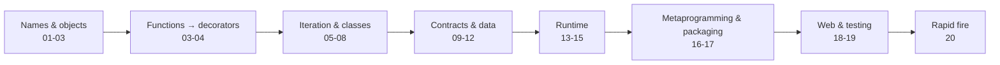

# Track 27: Python Interview Questions

> **Prerequisites:** [Python Refresher](../../learn/00-python-refresher/README.md) (strings, collections, functions, references), [01 · Classes & Objects](../01-classes-objects-and-oop-building-blocks/README.md)  
> **Reading time:** ~15 minutes for this overview; ~20–25 minutes per lesson  
> **Audience:** Backend and data candidates with a Python round coming — language internals, OOP in Python, concurrency, and web frameworks (Flask / FastAPI)

> [!NOTE]
> **In one line:** The Python questions interviewers actually ask — mutability and the mutable default argument, decorators, generators, dunder methods, the MRO, the GIL and `asyncio`, `app.run` / WSGI / ASGI / FastAPI `Depends` — each as a short spoken answer with code you can run.

> [!TIP]
> **Golden rule:** In Python, answer with **objects and names**, not variables. Almost every classic trap — the mutable default, late-binding closures, `is` vs `==`, shared class attributes — is the same fact seen from a different angle: *a name is a label bound to an object, and objects can be shared and mutated.*

> [!TIP]
> **Try it:** Run the seven-trap program in section 2 *before* reading any lesson. Predict each output first. Whatever you got wrong tells you which lesson to read first.

---

## 1. The smell: how Python interviews are structured

A typical Python backend loop has four beats:

1. **Warm-up traps (5–10 min):** `is` vs `==`, mutable default, `list` vs `tuple`, what `*args/**kwargs` do.
2. **Language depth (15–20 min):** decorators, generators, context managers, dunder methods, MRO, descriptors, memory model.
3. **Concurrency (10 min):** *"Does the GIL make threads useless?"* — choose threads / processes / asyncio for a workload.
4. **Framework / design (15 min):** Flask vs FastAPI, WSGI vs ASGI, dependency injection, testing with pytest, plus a small coding task.



Each box builds on the previous one; lesson 20 is the revision sheet.

---

## 2. Seven traps in one runnable file

````carousel
```python
import functools


def add_item(item, bucket=[]):          # TRAP 1: default is created once
    bucket.append(item)
    return bucket


def make_multipliers():
    return [lambda x: x * i for i in range(3)]       # TRAP 2: late binding


def logged(fn):                                       # TRAP 3: forgot functools.wraps
    def wrapper(*a, **k):
        return fn(*a, **k)
    return wrapper


@logged
def compute():
    """Docstring lives here."""


class Counter:
    total = 0                                         # TRAP 4: class attribute is shared

    def bump(self):
        self.total += 1                               # creates an instance attribute!


class A:
    def hello(self):
        return "A"


class B(A):
    def hello(self):
        return "B>" + super().hello()


class C(A):
    def hello(self):
        return "C>" + super().hello()


class D(B, C):                                        # TRAP 7: super() follows the MRO
    def hello(self):
        return "D>" + super().hello()


if __name__ == "__main__":
    print(add_item(1), add_item(2))                    # [1, 2] [1, 2]   same list!
    print([m(10) for m in make_multipliers()])         # [20, 20, 20]    all see i == 2
    print(compute.__name__, repr(compute.__doc__))     # wrapper None
    c1, c2 = Counter(), Counter()
    c1.bump(); c1.bump()
    print(c1.total, c2.total, Counter.total)           # 2 0 0
    a = [1, 2, 3]
    b = a                                              # TRAP 5: aliasing
    b.append(4)
    print(a is b, a == [1, 2, 3, 4])                   # True True
    print((1,) + (2,), (1) + (2))                      # (1, 2) 3   TRAP 6: comma makes the tuple
    print(D().hello(), [k.__name__ for k in D.__mro__])  # D>B>C>A [...]
```
<!-- slide -->
```csharp
// The C# versions of the same ideas, for contrast
var list = new List<int> { 1, 2, 3 };
var alias = list;            // reference copy: both names, one list
alias.Add(4);
Console.WriteLine(ReferenceEquals(list, alias)); // True

// Closures over a loop variable: C# `for` shares one variable; `foreach` makes a new one per iteration
var fs = new List<Func<int, int>>();
for (int i = 0; i < 3; i++) fs.Add(x => x * i);
Console.WriteLine(string.Join(",", fs.Select(f => f(10)))); // 30,30,30  (same trap!)
```
````

Expected output, line by line:

```text
[1, 2] [1, 2]
[20, 20, 20]
wrapper None
2 0 0
True True
(1, 2) 3
D>B>C>A ['D', 'B', 'C', 'A', 'object']
```

Traps → lessons: 1 → [02](02-mutability-identity-and-copying/README.md) · 2 → [03](03-functions-args-kwargs-closures-and-scope/README.md) · 3 → [04](04-decorators/README.md) · 4 → [06](06-classes-init-new-and-slots/README.md) · 5 → [01](01-how-python-runs-your-code/README.md)/[02](02-mutability-identity-and-copying/README.md) · 6 → [02](02-mutability-identity-and-copying/README.md) (tuples) · 7 → [08](08-inheritance-super-and-the-mro/README.md).

**Score yourself.** Write your prediction for each of the seven printed lines *before* running the file, then count matches:

| Correct | Read first | Why |
| :--- | :--- | :--- |
| 7 of 7 | 14, 15, 18, 19 | Your language basics are fine; the rounds that bite are concurrency and frameworks |
| 4–6 | The lessons for the traps you missed (table above), then 04–08 | Gaps are in the object model, which every later lesson assumes |
| 0–3 | 01 → 02 → 03 in order, slowly, with the runnable demos | Everything else builds on names and objects |

**Why trap 4 prints `2 0 0`:** `self.total += 1` reads `Counter.total` (0), adds 1, and assigns the result as a *new instance attribute* `c1.total`; the class attribute is never touched. `c2` still sees the class value. Replace it with `Counter.total += 1` (or `type(self).total += 1`) and all three change.

**Why trap 7 prints `D>B>C>A`:** `super()` in `B` does not mean "A"; it means "the next class after `B` in the MRO of `type(self)`", and for a `D` instance that is `C`. `[D, B, C, A, object]` is that order (C3 linearisation).

---

## 3. How this track works

- Lessons 01 to 17 are the language; lesson 18 is web apps (Flask, FastAPI, WSGI and ASGI); lesson 19 is testing; lesson 20 is the revision sheet.
- Every code sample runs on current CPython with the standard library, unless the lesson says otherwise.
- If you have an interview this week: lessons 02, 04, 05, 06, 07, 14 and 20 first.
- The examples are in Python. Where C# does the same thing differently and the comparison helps, a second tab shows the C# way.
- The track has twenty lessons. Lessons whose text is not ready yet are marked *Soon* in the sidebar; their page already lists what they will cover and the questions they will answer.
- Extra practice: the [20-drill practice arena](PRACTICE.md).

### Suggested plans

| Time you have | Do this |
| :--- | :--- |
| **Night before** | 20 (rapid fire), then 02, 04, 14 |
| **One week** | 01–04 (days 1–2), 05–08 (days 3–4), 09–13 (day 5), 14–15 (day 6), 16–19 + 20 (day 7) |
| **Backend/web role** | Add 14, 15, 18, 19 early; they are the framework-round lessons |

---

## 4. Lessons

| # | Lesson | What you'll be able to do |
|---|--------|---------------------------|
| 01 | [How Python Runs Your Code: Objects, Names and Bytecode](01-how-python-runs-your-code/README.md) | Explain that everything is an object, that variables are names bound to objects, and what CPython does with your file |
| 02 | [Mutability, Identity and Copying](02-mutability-identity-and-copying/README.md) | Predict what changes when you mutate a shared object, and avoid the mutable default argument trap |
| 03 | [Functions: *args, **kwargs, Closures and Scope](03-functions-args-kwargs-closures-and-scope/README.md) | Use every kind of parameter, explain LEGB scope, and write a closure |
| 04 | [Decorators](04-decorators/README.md) | Write a decorator from scratch, with arguments, keeping the wrapped function's name with `functools.wraps` |
| 05 | [Iterators, Generators and yield](05-iterators-generators-and-yield/README.md) | Explain the iterator protocol, write generators, and choose a generator expression over a list comprehension |
| 06 | [Classes: How an Object Is Made, Class Attributes and Slots](06-classes-init-new-and-slots/README.md) | Explain how an instance is created, class versus instance attributes, `@classmethod` constructors and `__slots__` |
| 07 | [Dunder Methods and the Data Model](07-dunder-methods-and-the-data-model/README.md) | Make your own classes work with `print`, `==`, `len`, `[]`, `with` and `+`, by implementing the right dunder methods |
| 08 | [Inheritance, super() and the MRO](08-inheritance-super-and-the-mro/README.md) | Explain multiple inheritance, the MRO (C3 linearisation) and what `super()` really calls |
| 09 | [ABCs, Protocols, Duck Typing and Type Hints](09-abcs-protocols-duck-typing-and-type-hints/README.md) | Define contracts with `abc.ABC` or `typing.Protocol`, and explain what type hints do and do not do at run time |
| 10 | [dataclasses, NamedTuple, Enum and pydantic](10-dataclasses-namedtuples-enums-and-pydantic/README.md) | Pick the right tool for a data-holding class: dataclass, `NamedTuple`, Enum or a pydantic model |
| 11 | [Context Managers and with](11-context-managers/README.md) | Write a context manager as a class and with contextlib, and explain what `with` guarantees |
| 12 | [Exceptions Done Right](12-exceptions-done-right/README.md) | Raise, chain and catch exceptions properly, and explain EAFP versus LBYL |
| 13 | [Memory, Garbage Collection and Performance](13-memory-garbage-collection-and-performance/README.md) | Explain reference counting and the cycle collector, and find what is slow before optimising it |
| 14 | [The GIL, Threads, Processes and asyncio](14-the-gil-threads-processes-and-asyncio/README.md) | Explain the GIL, and choose `threading`, `multiprocessing` or asyncio for a given workload |
| 15 | [asyncio in Depth](15-asyncio-in-depth/README.md) | Write correct async code: the event loop, tasks, `gather`, timeouts, and never blocking the loop |
| 16 | [Metaclasses, Descriptors and How @property Works](16-metaclasses-descriptors-and-property/README.md) | Explain descriptors and metaclasses well enough to answer the senior-level questions |
| 17 | [Modules, Packages and Imports](17-modules-packages-and-imports/README.md) | Explain how imports work, why `if __name__ == "__main__"` exists, and how to break a circular import |
| 18 | [Web Apps: app.run, WSGI, ASGI, Middleware and FastAPI Depends](18-web-apps-app-run-wsgi-asgi-and-fastapi/README.md) | Explain what `app.run` does in Flask, why production uses `gunicorn` or `uvicorn`, WSGI versus ASGI, middleware, and FastAPI dependency injection |
| 19 | [Testing: pytest, Fixtures and Mocking](19-testing-pytest-fixtures-and-mocking/README.md) | Test Python code with pytest fixtures and parametrize, and mock in the right place |
| 20 | [Rapid Fire: the Python Revision Sheet](20-rapid-fire-python/README.md) | Answer about eighty Python questions in one or two sentences each |

---

## 5. Edges: what Python interviews quietly test

- **Version awareness.** Know what changed: 3.8 walrus and positional-only `/`; 3.9 `dict |`, `functools.cache`; 3.10 `match`, `X | Y` types; 3.11 `TaskGroup`, `ExceptionGroup`, faster CPython; 3.12 per-interpreter GIL work and f-string grammar; 3.13 experimental free-threaded build (PEP 703). Don't claim "the GIL is gone" — say "optional in the free-threaded build."
- **Implementation vs language.** Reference counting, the GIL and `id()` as an address are *CPython* details; PyPy and Jython differ.
- **Type hints don't enforce.** They are metadata for tools; runtime checks need pydantic, `beartype` or `isinstance`.
- **Mutation vs rebinding.** `x += y` mutates for lists, rebinds for ints and tuples — a favourite trap.
- **Concurrency choice** is judged on reasoning: I/O-bound → threads or asyncio; CPU-bound → processes (or native extensions that release the GIL).
- **Say what you'd measure.** For "make it faster", the right first answer is "profile it" (`cProfile`, `timeit`) before any rewrite.

---

## 6. What you'd say in two minutes (the meta-answer)

> "In Python I think in terms of names and objects: a variable is a label bound to an object, objects can be shared, and some are mutable. That explains the mutable-default trap, why `b = a` aliases a list, and why a closure sees the *latest* loop variable. From there the rest is protocols: iterators and generators (`__iter__`/`__next__`), context managers (`__enter__`/`__exit__`), descriptors behind `@property`, and the MRO that `super()` follows. For concurrency I'd pick by workload — threads or asyncio for I/O, multiprocessing for CPU — because the GIL serialises bytecode in one process. And I'd measure before optimising."

---

## 7. Anti-patterns when answering

| Weak answer | Why it scores low | Better |
| :--- | :--- | :--- |
| "Python is slow because it's interpreted" | Vague and half-wrong | "CPython compiles to bytecode run by a VM; dynamic dispatch and the GIL limit CPU-bound speed; I/O-bound code is fine" |
| "Python passes by reference" | Misleading | "Pass by *object reference* (assignment): rebinding doesn't affect the caller, mutation does" |
| "Use `is` to compare values" | Works by accident for small ints | `==` for equality, `is` for identity / `None` |
| "The GIL means no threading" | Ignores I/O | "Threads help I/O-bound; the GIL is released during blocking I/O" |
| "Decorators are just `@`" | Syntax only | "`f = dec(f)` at definition time, closures, `functools.wraps`" |

---

## 8. Interview questions

<details>
<summary><strong>1. Is Python pass-by-value or pass-by-reference? [BASIC]</strong></summary>

Neither exactly: **pass by object reference** (call by sharing). The parameter is a new name bound to the *same* object. Mutating that object is visible to the caller; rebinding the parameter is not.

</details>

<details>
<summary><strong>2. What's the mutable default argument bug? [BASIC]</strong></summary>

Defaults are evaluated once, when `def` runs. A `[]` default is one list shared by every call that omits it. Use `None` and create the list inside.

</details>

<details>
<summary><strong>3. `is` vs `==`? [BASIC]</strong></summary>

`==` compares values via `__eq__`; `is` compares identity (same object). Use `is` for `None`/singletons, `==` for everything else.

</details>

<details>
<summary><strong>4. Does the GIL make Python threads useless? [TRICKY]</strong></summary>

For CPU-bound pure-Python code, yes — only one thread runs bytecode at a time. For I/O-bound work they're useful because the GIL is released while waiting. For CPU-bound parallelism use `multiprocessing` or native extensions; PEP 703 adds an optional free-threaded build.

</details>

<details>
<summary><strong>5. Why does `[lambda: i for i in range(3)]` return 2 three times? [TRICKY]</strong></summary>

Closures capture the *variable*, not its value, and all three share one `i` that ends at 2. Bind it early: `lambda i=i: i`, or use `functools.partial`.

</details>

<details>
<summary><strong>6. A service does 200 outbound HTTP calls per request. Threads, processes or asyncio? [SCENARIO]</strong></summary>

I/O-bound and highly concurrent → `asyncio` with an async HTTP client (`httpx`, `aiohttp`) and bounded concurrency (`Semaphore`), or a thread pool if the libraries are blocking. Processes would add overhead for no gain.

</details>

<details>
<summary><strong>7. Your endpoint is slow. What do you do first? [SCENARIO]</strong></summary>

Measure: reproduce, profile (`cProfile`/`py-spy`), look at I/O and queries before CPU. Fix the biggest cost (N+1 queries, missing index, blocking call in async code), then re-measure.

</details>

<details>
<summary><strong>8. `t = (1, 2); t += (3,)` works, but `t = ([1], 2); t[0] += [4]` raises. Why? [TRICKY]</strong></summary>

`t += (3,)` means `t = t.__iadd__((3,))`, and tuples have no `__iadd__`, so Python falls back to `t = t + (3,)`: a **new** tuple, **rebinding the name** `t`. `t[0] += [4]` means: fetch `t[0]`, call `list.__iadd__` (which mutates the list in place), then **assign** the result back with `t[0] = ...` — and item assignment on a tuple raises `TypeError`. So the list has already changed when the error fires: `t` ends as `([1, 4], 2)`.

</details>

---

## 9. One-page cheat sheet

```text
Model      names -> objects; mutable (list dict set) vs immutable (int str tuple frozenset)
Calls      pass by object reference; defaults evaluated once; use None sentinel
Compare    == value, is identity (None); __eq__ + __hash__ together
Closures   capture variables (late binding): lambda i=i: ...
Decorator  f = dec(f) at def time; use functools.wraps; with args = factory (3 levels)
Iteration  iterable -> iter() -> iterator -> next(); generator = yield, lazy, one-shot
Classes    __new__ makes, __init__ initialises; class vs instance attrs; __slots__ saves memory
MRO        C3 order; super() = next in MRO of type(self), not "parent"
Contracts  ABC (nominal), Protocol (structural), hints are not enforced
Resources  with = __enter__/__exit__ (contextlib.contextmanager)
Concurrency GIL: threads for I/O, processes for CPU, asyncio for many I/O waits
Web        WSGI sync, ASGI async; app.run is dev only; FastAPI Depends = DI
Test       pytest fixtures + parametrize; patch where it's USED

Night-before: lesson 20. Always: measure before optimising.
```

---

## Sources

- [Python documentation: the data model](https://docs.python.org/3/reference/datamodel.html)
- [Python documentation: Descriptor HowTo Guide](https://docs.python.org/3/howto/descriptor.html)
- [Python documentation: the method resolution order](https://docs.python.org/3/howto/mro.html)
- [Python documentation: functools](https://docs.python.org/3/library/functools.html)
- [Python documentation: contextlib](https://docs.python.org/3/library/contextlib.html)
- [Python documentation: asyncio](https://docs.python.org/3/library/asyncio.html)
- [PEP 557: Data Classes](https://peps.python.org/pep-0557/)
- [PEP 703: Making the Global Interpreter Lock Optional](https://peps.python.org/pep-0703/)
- [PEP 3333: the WSGI specification](https://peps.python.org/pep-3333/)
- [FastAPI: dependencies](https://fastapi.tiangolo.com/tutorial/dependencies/)
- [Flask: deploying to production](https://flask.palletsprojects.com/en/stable/deploying/)

Start here → [01-how-python-runs-your-code/README.md](01-how-python-runs-your-code/README.md)

Back to the course index: [../README.md](../README.md)
