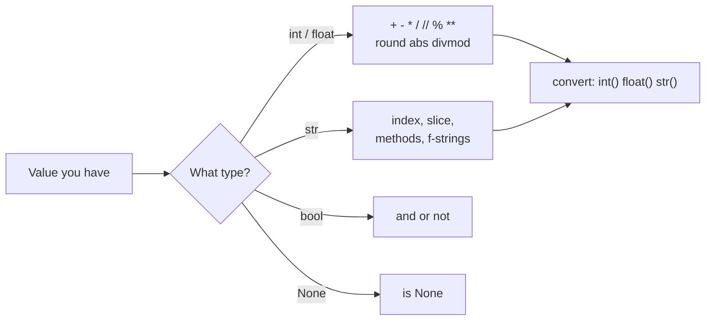

# 01 · Values, Numbers and Text

> **Prerequisites:** none. You only need Python 3.10+ installed (or the Run button on this site).  
> **Reading time:** ~35 minutes  
> **Audience:** a complete beginner who has never written a program

> [!NOTE]
> **In one line:** A program is values (numbers, text, true/false) stored under names. Learn the few kinds of value and the operations on each, and everything later is built from them.

> [!TIP]
> **Golden rule:** Every value has a **type**, and the type decides which operations work. When something behaves strangely, print the value and its `type()` first.

> [!TIP]
> **Try it:** Open a terminal, type `python`, and press Enter. You get a `>>>` prompt. Type `2 + 3` and press Enter. Python answers `5`. Everything in this module can be tried that way.

---

## 1. Roadmap

You are at the very start. After this module you can:

- store values under names (variables);
- do arithmetic with every operator Python has;
- compare values and combine yes/no answers;
- convert between numbers and text;
- slice, search, clean and format strings;
- read a line from the user and print nicely.

Next module: making decisions and repeating work. For that you need what is here.

> [!key]
> A **value** is a piece of data. A **variable** is a name stuck on a value. A **type** says what kind of value it is (`int`, `float`, `str`, `bool`, `None`).

---

## 2. Variables and names

A variable is a label you attach to a value. Use `=` to attach it. The `=` sign here means "give this name to that value". It is not a maths equation.

```python
age = 30
name = "Asha"
price = 19.99
is_member = True

print(age)        # 30
print(name)       # Asha
print(price)      # 19.99
print(is_member)  # True
```

You can re-attach a name to a new value at any time:

```python
score = 10
score = score + 5   # take the old value, add 5, stick the name on the result
print(score)        # 15
score += 1          # short form of score = score + 1
print(score)        # 16
```

Name rules and habits:

- Letters, digits and underscores only. It cannot start with a digit.
- Names are case sensitive: `Age` and `age` are different.
- Use `snake_case` for variables: `total_price`, not `TotalPrice`.
- Pick names that say what the value is: `seconds_left`, not `x`.
- You cannot use Python keywords such as `if`, `for`, `class`, `None` as names.

You can assign several names at once, or swap two values:

```python
a, b = 1, 2
print(a, b)   # 1 2
a, b = b, a   # swap, no temporary needed
print(a, b)   # 2 1

x = y = 0     # both names point to 0
print(x, y)   # 0 0
```

C# is **statically typed**: you say the type when you create a variable. Python works out the type from the value.

````carousel
```python
count = 5            # Python decides: int
price = 9.5          # float
title = "Hello"      # str
done = False         # bool
print(count, price, title, done)  # 5 9.5 Hello False
```

<!-- slide -->

```csharp
int count = 5;
double price = 9.5;
string title = "Hello";
bool done = false;
var inferred = 42;   // var: the compiler infers int
Console.WriteLine($"{count} {price} {title} {done}");  // 5 9.5 Hello False
```
````

> [!pitfall]
> Using a name before it has a value gives `NameError: name 'total' is not defined`. Python reads top to bottom. Assign first, use later.

---

## 3. The basic types

| Type | Example | Meaning |
| :--- | :--- | :--- |
| `int` | `7`, `-3`, `1_000_000` | whole numbers, any size |
| `float` | `3.14`, `-0.5`, `2e3` | numbers with a decimal point |
| `bool` | `True`, `False` | yes or no |
| `str` | `"hi"`, `'hi'` | text |
| `NoneType` | `None` | "no value here" |

Use `type()` to ask Python what something is:

```python
print(type(7))        # <class 'int'>
print(type(7.0))      # <class 'float'>
print(type("7"))      # <class 'str'>
print(type(True))     # <class 'bool'>
print(type(None))     # <class 'NoneType'>
print(1_000_000)      # 1000000   (underscores are only for humans)
print(2e3)            # 2000.0    (2 times 10 to the power 3)
print(2 ** 100)       # 1267650600228229401496703205376  (ints never overflow)
```

`None` is how you say "nothing yet". You check it with `is`:

```python
result = None
print(result is None)      # True
print(result is not None)  # False
```

C# types are fixed-size. An `int` holds about plus or minus 2.1 billion. For bigger values use `long`.

````carousel
```python
big = 2 ** 100
print(big)  # 1267650600228229401496703205376
nothing = None
print(nothing is None)  # True
```

<!-- slide -->

```csharp
using System.Numerics;

long maxLong = long.MaxValue;
Console.WriteLine(maxLong);  // 9223372036854775807
BigInteger big = BigInteger.Pow(2, 100);
Console.WriteLine(big);      // 1267650600228229401496703205376
string? nothing = null;      // C# uses null where Python uses None
Console.WriteLine(nothing is null);  // True
```
````

---

## 4. Arithmetic: every operator

| Operator | Name | Example | Result |
| :--- | :--- | :--- | :--- |
| `+` | add | `7 + 2` | `9` |
| `-` | subtract | `7 - 2` | `5` |
| `*` | multiply | `7 * 2` | `14` |
| `/` | true division | `7 / 2` | `3.5` |
| `//` | floor division | `7 // 2` | `3` |
| `%` | remainder (modulo) | `7 % 2` | `1` |
| `**` | power | `7 ** 2` | `49` |

```python
print(7 + 2)    # 9
print(7 - 2)    # 5
print(7 * 2)    # 14
print(7 / 2)    # 3.5
print(8 / 2)    # 4.0   (/ always gives a float)
print(7 // 2)   # 3     (rounds down to a whole number)
print(7 % 2)    # 1     (what is left over)
print(7 ** 2)   # 49
print(2 ** -1)  # 0.5
print(9 ** 0.5) # 3.0   (power of one half is the square root)
```

Floor division rounds **down**, which matters for negative numbers:

```python
print(-7 // 2)   # -4   (down, not toward zero)
print(-7 % 3)    # 2    (result takes the sign of the right side)
print(7 // -2)   # -4
```

Order of operations is like school maths: `**` first, then `* / // %`, then `+ -`. Use brackets when in doubt.

```python
print(2 + 3 * 4)     # 14
print((2 + 3) * 4)   # 20
print(2 ** 3 ** 2)   # 512   (** goes right to left: 2 ** 9)
print(-2 ** 2)       # -4    (the minus is applied after **)
```

### Useful number functions

```python
print(divmod(17, 5))      # (3, 2)   quotient and remainder together
print(abs(-12))           # 12
print(abs(-2.5))          # 2.5
print(round(3.14159, 2))  # 3.14
print(round(7.6))         # 8
print(round(2.5))         # 2   (ties go to the even number!)
print(round(3.5))         # 4
print(min(4, 9, 1))       # 1
print(max(4, 9, 1))       # 9
print(pow(2, 10))         # 1024
print(sum([1, 2, 3]))     # 6
```

Short forms update a variable in place:

```python
n = 10
n += 3    # 13
n -= 1    # 12
n *= 2    # 24
n //= 5   # 4
n **= 2   # 16
n %= 5    # 1
n /= 2    # 0.5
print(n)  # 0.5
```

The big difference with C#: integer `/` in C# truncates. In Python `/` always gives a float.

````carousel
```python
print(7 / 2)    # 3.5
print(7 // 2)   # 3
print(-7 // 2)  # -4
print(-7 % 3)   # 2
print(2 ** 10)  # 1024
```

<!-- slide -->

```csharp
Console.WriteLine(7 / 2);              // 3     (int / int truncates)
Console.WriteLine(7 / 2.0);            // 3.5
Console.WriteLine(-7 / 2);             // -3    (toward zero, not down)
Console.WriteLine(-7 % 3);             // -1    (sign of the left side)
Console.WriteLine(Math.Pow(2, 10));    // 1024
Console.WriteLine(Math.Round(2.5));    // 2     (banker's rounding, like Python)
Console.WriteLine(Math.Abs(-12));      // 12
Console.WriteLine(Math.Max(4, 9));     // 9
```
````

> [!pitfall]
> `-7 // 2` is `-4` in Python but `-7 / 2` is `-3` in C#. If you port code between the two languages, check every division and modulo of negative numbers.

---

## 5. Comparisons, `and` / `or` / `not`, `in`

Comparisons give a `bool`:

```python
print(5 == 5)    # True    (== asks "equal?")
print(5 != 4)    # True    (not equal)
print(5 > 7)     # False
print(5 <= 5)    # True
print("a" < "b") # True    (text compares in dictionary order)
print(1 < 5 < 10)  # True  (a chain: 1 < 5 and 5 < 10)
```

> [!pitfall]
> `=` stores a value. `==` compares. Writing `if x = 5` is an error, which is a kind favour.

Combine yes/no answers with `and`, `or`, `not`:

```python
age = 25
has_ticket = True
print(age >= 18 and has_ticket)   # True
print(age < 18 or has_ticket)     # True
print(not has_ticket)             # False
print(not (age > 30))             # True
```

`and` stops early if the left side is `False`. `or` stops early if the left side is `True`. This is called short-circuit evaluation.

```python
print(False and (1 / 0))  # False   (the 1 / 0 never runs)
print(True or (1 / 0))    # True
```

Test membership with `in`:

```python
print("a" in "banana")      # True
print("z" in "banana")      # False
print("nan" in "banana")    # True
print("z" not in "banana")  # True
```

C# uses `&&`, `||`, `!` for these. It has no `in` for strings; use `Contains`.

````carousel
```python
a, b = True, False
print(a and b)  # False
print(a or b)   # True
print(not a)    # False
print("an" in "banana")  # True
```

<!-- slide -->

```csharp
bool a = true, b = false;
Console.WriteLine(a && b);  // False
Console.WriteLine(a || b);  // True
Console.WriteLine(!a);      // False
Console.WriteLine("banana".Contains("an"));  // True
```
````

---

## 6. Converting between types

Functions named after the type convert values: `int()`, `float()`, `str()`, `bool()`.

```python
print(int("42") + 1)   # 43
print(int(3.9))        # 3     (cuts off the decimals, no rounding)
print(int(-3.9))       # -3
print(float("2.5"))    # 2.5
print(float(3))        # 3.0
print(str(99) + " items")  # 99 items
print(bool(0))         # False
print(bool(7))         # True
print(bool(""))        # False
print(bool("False"))   # True  (any non-empty text is True)
print(int("101", 2))   # 5     (read text as base 2)
```

Bad input raises an error:

```python
try:
    int("12abc")
except ValueError as e:
    print(e)  # invalid literal for int() with base 10: '12abc'
```

Python never joins a number to text silently:

```python
# print("Age: " + 30)      # TypeError: can only concatenate str (not "int") to str
print("Age: " + str(30))   # Age: 30
print("Age:", 30)          # Age: 30
```

````carousel
```python
print(int("42") + 1)   # 43
print(float("2.5"))    # 2.5
print(str(99) + "!")   # 99!
```

<!-- slide -->

```csharp
Console.WriteLine(int.Parse("42") + 1);      // 43
Console.WriteLine(double.Parse("2.5"));      // 2.5
Console.WriteLine(99.ToString() + "!");      // 99!
bool ok = int.TryParse("12abc", out int n);  // no exception, ok is false
Console.WriteLine(ok);                       // False
Console.WriteLine((int)3.9);                 // 3  (a cast truncates)
```
````

---

## 7. The floating point surprise

Computers store `float` in binary. Some decimals cannot be stored exactly.

```python
print(0.1 + 0.2)          # 0.30000000000000004
print(0.1 + 0.2 == 0.3)   # False
print(round(0.1 + 0.2, 2) == 0.3)  # True
```

Two fixes. For comparison use `math.isclose`. For money use `Decimal`, built from **strings**:

```python
import math
from decimal import Decimal

print(math.isclose(0.1 + 0.2, 0.3))             # True
print(Decimal("0.1") + Decimal("0.2"))          # 0.3
print(Decimal("0.1") + Decimal("0.2") == Decimal("0.3"))  # True
print(Decimal("19.99") * 3)                     # 59.97
```

````carousel
```python
from decimal import Decimal
print(0.1 + 0.2)                        # 0.30000000000000004
print(Decimal("0.1") + Decimal("0.2"))  # 0.3
```

<!-- slide -->

```csharp
Console.WriteLine(0.1 + 0.2);    // 0.30000000000000004  (double)
Console.WriteLine(0.1m + 0.2m);  // 0.3                  (decimal, note the m)
```
````

> [!key]
> Use `float` for measurements and science. Use `Decimal` (Python) or `decimal` (C#) for money.

---

## 8. Strings: text values

A string is text in quotes. Single or double quotes both work.

```python
a = "He said hi"
b = 'She said "hello"'      # double quotes inside single quotes: no escape needed
c = "It's fine"
print(a)  # He said hi
print(b)  # She said "hello"
print(c)  # It's fine
print(len("banana"))  # 6
print("ha" * 3)       # hahaha
print("Hello, " + "world")  # Hello, world
```

### Escape sequences

A backslash starts a special character.

| Escape | Meaning |
| :--- | :--- |
| `\n` | new line |
| `\t` | tab |
| `\\` | one backslash |
| `\"` | a double quote |
| `\'` | a single quote |

```python
print("line one\nline two")
# line one
# line two
print("a\tb")          # a	b
print("C:\\temp\\file") # C:\temp\file
print(r"C:\temp\file")  # C:\temp\file   (r"..." is a raw string: no escapes)
```

### Multi-line strings

Triple quotes keep line breaks:

```python
poem = """Roses are red,
Violets are blue."""
print(poem)
# Roses are red,
# Violets are blue.
print(len(poem))  # 32
```

### Indexing: one character

Positions start at **0**. Negative positions count from the end.

```
 text:     p   y   t   h   o   n
 index:    0   1   2   3   4   5
 negative: -6  -5  -4  -3  -2  -1
```

```python
word = "python"
print(word[0])    # p
print(word[3])    # h
print(word[-1])   # n
print(word[-2])   # o
# print(word[6])  # IndexError: string index out of range
```

### Slicing: a piece

`text[start:stop]` gives characters from `start` up to but **not including** `stop`. A third number is the step.

```python
word = "python"
print(word[0:2])    # py
print(word[2:])     # thon
print(word[:3])     # pyt
print(word[-3:])    # hon
print(word[:])      # python
print(word[::2])    # pto   (every second letter)
print(word[::-1])   # nohtyp (reversed)
print(word[1:-1])   # ytho
print(word[10:20])  # (empty string, slices never raise errors)
```

> [!key]
> A slice `[a:b]` has length `b - a`. The stop is excluded, so `word[:3] + word[3:]` is always the whole word.

### Strings are immutable

You cannot change a character in place. You build a new string instead.

```python
word = "python"
# word[0] = "P"        # TypeError: 'str' object does not support item assignment
word = "P" + word[1:]
print(word)            # Python
```

### Methods that change case and spacing

Methods are functions attached to a value. Call them with a dot. They return a **new** string and leave the original alone.

```python
s = "  Hello, World  "
print(s.upper())      #   HELLO, WORLD
print(s.lower())      #   hello, world
print(s.strip())      # Hello, World
print(s.lstrip())     # Hello, World  (spaces removed from the left only)
print(s.rstrip())     #   Hello, World
print("hello world".title())       # Hello World
print("hello world".capitalize())  # Hello world
print("Hello".swapcase())          # hELLO
print(s)              #   Hello, World   (unchanged)
```

### Methods that search

```python
t = "banana"
print(t.find("an"))        # 1     (first position, or -1 if missing)
print(t.find("z"))         # -1
print(t.rfind("an"))       # 3     (search from the right)
print(t.index("n"))        # 2     (like find, but raises ValueError if missing)
print(t.count("a"))        # 3
print(t.startswith("ban")) # True
print(t.endswith("na"))    # True
print(t.replace("a", "o")) # bonono
print(t.replace("a", "o", 1))  # bonana  (only the first)
```

### Methods that test what the text is

```python
print("123".isdigit())     # True
print("12a".isdigit())     # False
print("abc".isalpha())     # True
print("abc123".isalnum())  # True
print("   ".isspace())     # True
print("abc".islower())     # True
print("ABC".isupper())     # True
print("".isdigit())        # False   (empty text is not digits)
```

### Splitting and joining

```python
print("a,b,c".split(","))          # ['a', 'b', 'c']
print("one two  three".split())    # ['one', 'two', 'three']  (any spaces)
print("a-b-c".split("-", 1))       # ['a', 'b-c']
print("-".join(["a", "b", "c"]))   # a-b-c
print(" ".join(["Hello", "world"]))  # Hello world
print("one\ntwo\nthree".splitlines())  # ['one', 'two', 'three']
print("key=value".partition("="))  # ('key', '=', 'value')
print("no equals".partition("="))  # ('no equals', '', '')
```

### Padding and aligning

```python
print("7".zfill(3))         # 007
print("-5".zfill(4))        # -005
print("hi".center(10, "*")) # ****hi****
print("hi".ljust(6, ".") + "|")  # hi....|
print("hi".rjust(6, ".") + "|")  # ....hi|
```

### Putting values into text: f-strings

An f-string starts with `f` and puts values inside `{ }`. This is the style to use.

```python
name = "Asha"
age = 30
price = 1234.5678
print(f"{name} is {age}")             # Asha is 30
print(f"Next year: {age + 1}")        # Next year: 31
print(f"Price: {price:.2f}")          # Price: 1234.57
print(f"Price: {price:,.2f}")         # Price: 1,234.57
print(f"{age:05d}")                   # 00030
print(f"[{name:>8}]")                 # [    Asha]
print(f"[{name:<8}]")                 # [Asha    ]
print(f"[{name:^8}]")                 # [  Asha  ]
print(f"{0.256:.1%}")                 # 25.6%
print(f"{name!r}")                    # 'Asha'
print(f"{age=}")                      # age=30  (handy for debugging)
print("{} is {}".format(name, age))   # Asha is 30  (older style, still common)
```

The part after `:` is a format spec: `.2f` is "2 decimals", `,` is thousands separators, `>8` is "right-align in 8 characters".

````carousel
```python
name = "Asha"
price = 1234.5678
print(f"{name} pays {price:.2f}")   # Asha pays 1234.57
print("banana".upper())             # BANANA
print("banana"[1:4])                # ana
print("a,b".split(","))             # ['a', 'b']
print("  hi ".strip())              # hi
print("banana".replace("a", "o"))   # bonono
```

<!-- slide -->

```csharp
string name = "Asha";
double price = 1234.5678;
Console.WriteLine($"{name} pays {price:F2}");   // Asha pays 1234.57
Console.WriteLine("banana".ToUpper());          // BANANA
Console.WriteLine("banana".Substring(1, 3));    // ana  (start, LENGTH)
Console.WriteLine(string.Join(",", "a,b".Split(',')));  // a,b
Console.WriteLine("  hi ".Trim());              // hi
Console.WriteLine("banana".Replace("a", "o"));  // bonono
Console.WriteLine("banana".IndexOf("an"));      // 1
Console.WriteLine("banana".StartsWith("ban"));  // True
Console.WriteLine("7".PadLeft(3, '0'));         // 007
Console.WriteLine("banana"[0]);                 // b   (a char, not a string)
```
````

> [!pitfall]
> C# `Substring(start, length)` takes a **length**. Python `[start:stop]` takes an **end position**. Same idea, different second number.

---

## 9. Talking to the user: `print` and `input`

`print` can take several values. `sep` is what goes between them. `end` is what goes after the last one (default is a new line).

```python
print("a", "b", "c")             # a b c
print("a", "b", "c", sep="-")    # a-b-c
print("loading", end="...")
print("done")                    # loading...done
print()                          # prints an empty line
```

`input` shows a message, waits for the user to type and press Enter, and returns **text**. Always convert if you need a number.

```python
name = input("Your name? ")
age_text = input("Your age? ")
age = int(age_text)
print(f"Hi {name}, next year you will be {age + 1}")
# If you typed Asha and 30:  Hi Asha, next year you will be 31
```

> [!pitfall]
> `input()` always returns a `str`. `input("5") + input("6")` gives `"56"`, not `11`. Convert with `int()` first.

````carousel
```python
a = int(input("First: "))
b = int(input("Second: "))
print(f"Sum is {a + b}")   # with 5 and 6: Sum is 11
```

<!-- slide -->

```csharp
Console.Write("First: ");
int a = int.Parse(Console.ReadLine()!);
Console.Write("Second: ");
int b = int.Parse(Console.ReadLine()!);
Console.WriteLine($"Sum is {a + b}");   // with 5 and 6: Sum is 11
```
````

---

## 10. Visual summary



```text
 "  Hello, World  "
   |
   +-- .strip()  --> "Hello, World"
   |                    |
   |                    +-- .upper()    --> "HELLO, WORLD"
   |                    +-- .split(",") --> ["Hello", " World"]
   |                    +-- [0:5]       --> "Hello"
```

---

## 11. Practice

Do these in order. Try first, then open the answer.

**1. Rectangle.** A rectangle is 12 wide and 7 tall. Print its area and perimeter.

<details><summary>Answer</summary>

```python
w, h = 12, 7
print(w * h)        # 84
print(2 * (w + h))  # 38
```
</details>

**2. Minutes and seconds.** Turn 3725 seconds into hours, minutes and seconds.

<details><summary>Answer</summary>

```python
total = 3725
hours, rest = divmod(total, 3600)
minutes, seconds = divmod(rest, 60)
print(hours, minutes, seconds)  # 1 2 5
```
</details>

**3. Last digit.** Print the last digit of 48271 using one operator. Then print the number without its last digit.

<details><summary>Answer</summary>

```python
n = 48271
print(n % 10)   # 1
print(n // 10)  # 4827
```
</details>

**4. Celsius.** Convert 98.6 Fahrenheit to Celsius, shown with 1 decimal. Formula: `(f - 32) * 5 / 9`.

<details><summary>Answer</summary>

```python
f = 98.6
c = (f - 32) * 5 / 9
print(f"{c:.1f}")  # 37.0
```
</details>

**5. Clean a name.** Given `"   aDA lOvelace "`, produce `"Ada Lovelace"`.

<details><summary>Answer</summary>

```python
raw = "   aDA lOvelace "
print(raw.strip().title())  # Ada Lovelace
```
</details>

**6. Initials.** From `"grace brewster hopper"` print `G.B.H.`.

<details><summary>Answer</summary>

```python
name = "grace brewster hopper"
parts = name.split()
initials = ""
for p in parts:
    initials += p[0].upper() + "."
print(initials)  # G.B.H.
```
</details>

**7. Email parts.** Split `"asha@example.com"` into the user and the domain.

<details><summary>Answer</summary>

```python
email = "asha@example.com"
user, at, domain = email.partition("@")
print(user)    # asha
print(domain)  # example.com
```
</details>

**8. Is it a palindrome?** Print `True` if `"racecar"` reads the same backwards.

<details><summary>Answer</summary>

```python
word = "racecar"
print(word == word[::-1])  # True
```
</details>

**9. Money without surprises.** Add 0.10 and 0.20 so that the answer equals 0.30 exactly.

<details><summary>Answer</summary>

```python
from decimal import Decimal
total = Decimal("0.10") + Decimal("0.20")
print(total == Decimal("0.30"))  # True
print(total)                     # 0.30
```
</details>

---

## 12. Mini project: receipt printer

Build a receipt for three items. Ask for the price and quantity, add 18 percent tax and print an aligned table.

```python
items = [("Tea", 2.5, 4), ("Bread", 1.2, 3), ("Jam", 3.75, 2)]
tax_rate = 0.18

print("ITEM".ljust(8) + "QTY".rjust(4) + "PRICE".rjust(9) + "TOTAL".rjust(9))
print("-" * 30)
subtotal = 0.0
for name, price, qty in items:
    line = price * qty
    subtotal += line
    print(f"{name:<8}{qty:>4}{price:>9.2f}{line:>9.2f}")
tax = subtotal * tax_rate
print("-" * 30)
print(f"{'Subtotal':<21}{subtotal:>9.2f}")   # Subtotal                 21.10
print(f"{'Tax 18%':<21}{tax:>9.2f}")         # Tax 18%                   3.80
print(f"{'Total':<21}{subtotal + tax:>9.2f}") # Total                    24.90
```

Stretch goals: read the items with `input()`; use `Decimal`; center the shop name with `.center(30, "=")`.

---

## 13. Interview questions

<details>
<summary><strong>Q1.</strong> What is the difference between <code>/</code> and <code>//</code> in Python?</summary>

`/` is true division and always returns a `float` (`7 / 2` is `3.5`). `//` is floor division: it divides and rounds **down** to a whole number (`7 // 2` is `3`, `-7 // 2` is `-4`).
</details>

<details>
<summary><strong>Q2.</strong> Why does <code>0.1 + 0.2 == 0.3</code> give <code>False</code>?</summary>

Floats are stored in binary and 0.1 and 0.2 have no exact binary form. The sum is `0.30000000000000004`. Use `math.isclose` to compare, or `Decimal` for money.
</details>

<details>
<summary><strong>Q3.</strong> Are strings mutable? How do you "change" one?</summary>

No. Strings are immutable. Every method such as `upper()` or `replace()` returns a new string. You re-assign the name to the new string.
</details>

<details>
<summary><strong>Q4.</strong> What does <code>"hello"[1:4]</code> return, and why not 5 characters?</summary>

`"ell"`. The start is included and the stop is excluded, so the length is `4 - 1 = 3`.
</details>

<details>
<summary><strong>Q5.</strong> What does <code>input()</code> return?</summary>

Always a string. Convert with `int()` or `float()` for numbers, and be ready for `ValueError` on bad input.
</details>

<details>
<summary><strong>Q6.</strong> What is the difference between <code>==</code> and <code>is</code>?</summary>

`==` asks whether two values are equal. `is` asks whether they are the very same object in memory. Use `is` only for `None` (`x is None`).
</details>

<details>
<summary><strong>Q7.</strong> How does Python integer division of negative numbers differ from C#?</summary>

Python floors: `-7 // 2 == -4`, and `%` takes the sign of the right operand (`-7 % 3 == 2`). C# truncates toward zero: `-7 / 2 == -3`, and `%` takes the sign of the left operand (`-7 % 3 == -1`).
</details>

---

## Further reading

- [The Python Tutorial: An Informal Introduction (numbers and text)](https://docs.python.org/3/tutorial/introduction.html)
- [Python docs: built-in types, numeric and string methods](https://docs.python.org/3/library/stdtypes.html)
- [Python docs: format string syntax](https://docs.python.org/3/library/string.html#format-string-syntax)
- [Python docs: the decimal module](https://docs.python.org/3/library/decimal.html)
- [Python docs: floating point arithmetic, issues and limitations](https://docs.python.org/3/tutorial/floatingpoint.html)
- [Real Python: Basic data types in Python](https://realpython.com/python-data-types/)
- [Real Python: Python f-strings](https://realpython.com/python-f-strings/)
- [Microsoft Learn: C# built-in types](https://learn.microsoft.com/en-us/dotnet/csharp/language-reference/builtin-types/built-in-types)
- [Microsoft Learn: string interpolation in C#](https://learn.microsoft.com/en-us/dotnet/csharp/tutorials/string-interpolation)

## Next

[02 · Making decisions and loops](../02-making-decisions-and-loops/README.md). Back to the [track overview](../README.md).
