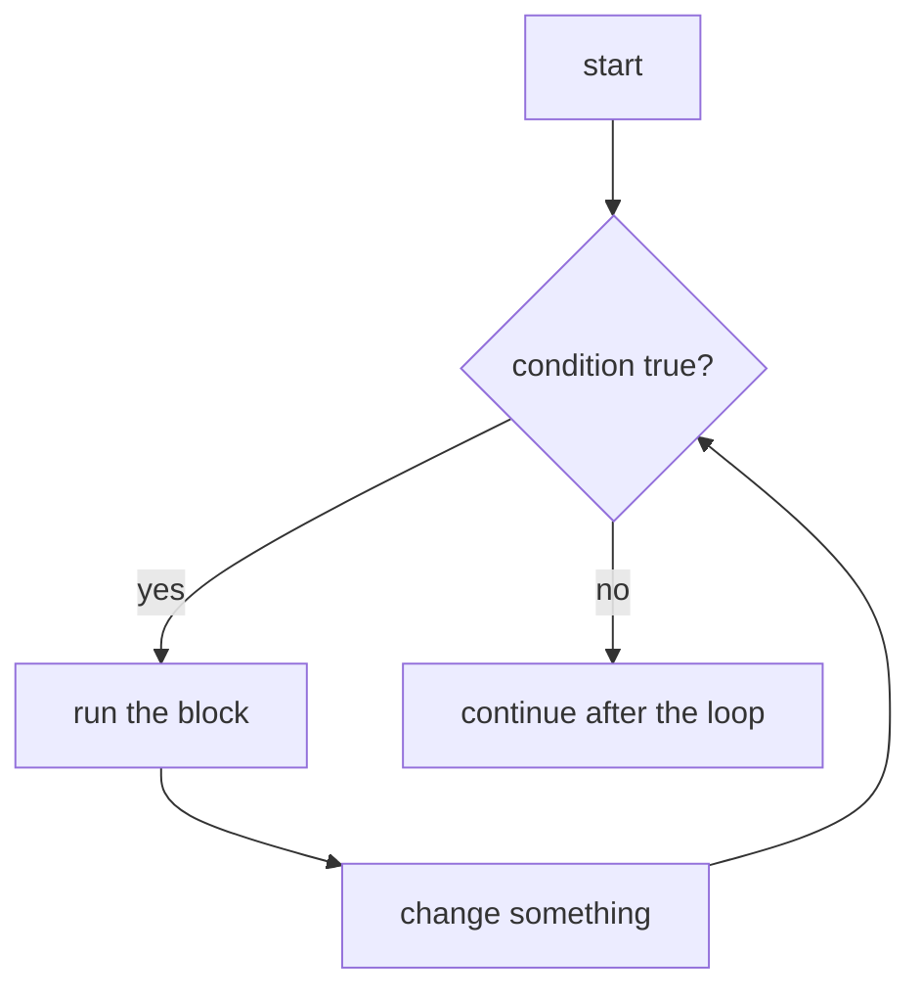
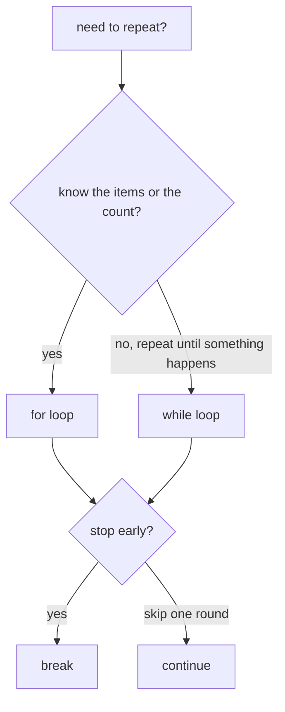

# 02 · Making Decisions and Loops

> **Prerequisites:** [01 · Values, numbers and text](../01-values-numbers-and-text/README.md): variables, comparisons, `and`/`or`/`not`.  
> **Reading time:** ~35 minutes  
> **Audience:** a beginner who can store values and now wants programs that choose and repeat

> [!NOTE]
> **In one line:** `if` lets a program choose between paths, and loops let it repeat work. With those two you can solve most beginner problems.

> [!TIP]
> **Golden rule:** Before you write a loop, say in plain words: what do I repeat, what changes each time, and when do I stop? If you cannot answer the third question, you will write an infinite loop.

> [!TIP]
> **Try it:** Write the guessing game in section 11 and play it. Then change it so the secret number changes every run.

---

## 1. Roadmap

After module 01 you can hold values and compute with them. Now your programs get a brain:

- run code only when a condition is true (`if`);
- pick one of many branches (`elif`, `match`);
- repeat code (`while`, `for`);
- leave a loop early (`break`) or skip a round (`continue`);
- count, add up, and find the biggest value by hand.

Next module: put code into reusable functions.

> [!key]
> **Decisions** use a condition that is `True` or `False`. **Loops** run a block again and again while a condition holds, or once per item in a collection.

---

## 2. Indentation is the syntax

Python groups code by **indentation** (4 spaces). A line ending in `:` opens a block. The indented lines below it belong to the block.

```python
temperature = 31
if temperature > 30:
    print("It is hot")      # inside the block
    print("Drink water")    # still inside
print("Done")               # outside: always runs
# It is hot
# Drink water
# Done
```

> [!pitfall]
> Mixing tabs and spaces, or indenting one line by 3 spaces and the next by 4, gives `IndentationError`. Configure your editor to insert 4 spaces when you press Tab.

C# uses braces `{ }` instead. Indentation is only for looks there.

---

## 3. `if`, `elif`, `else`

```python
age = 16

if age >= 18:
    print("adult")
elif age >= 13:
    print("teenager")   # teenager
else:
    print("child")
```

Rules:

- `if` is required. `elif` (else if) and `else` are optional.
- You can have many `elif`s. Python checks from the top and runs **only the first** branch whose condition is true.
- `else` has no condition. It catches everything left.

```python
score = 85
if score >= 90:
    grade = "A"
elif score >= 80:
    grade = "B"
elif score >= 70:
    grade = "C"
else:
    grade = "F"
print(grade)  # B
```

Several `if`s in a row are **not** the same as `if/elif`. Each `if` is checked on its own:

```python
n = 15
if n % 3 == 0:
    print("divisible by 3")   # divisible by 3
if n % 5 == 0:
    print("divisible by 5")   # divisible by 5
```

Nested `if`, and combined conditions:

```python
age = 25
has_id = True
if age >= 18:
    if has_id:
        print("entry allowed")   # entry allowed

# the same, flatter and clearer
if age >= 18 and has_id:
    print("entry allowed")       # entry allowed
```

````carousel
```python
score = 85
if score >= 90:
    print("A")
elif score >= 80:
    print("B")   # B
else:
    print("C or lower")
```

<!-- slide -->

```csharp
int score = 85;
if (score >= 90)
{
    Console.WriteLine("A");
}
else if (score >= 80)
{
    Console.WriteLine("B");   // B
}
else
{
    Console.WriteLine("C or lower");
}
```
````

---

## 4. Comparison chains and truthy / falsy

Python lets you chain comparisons the way maths does:

```python
x = 15
print(10 < x < 20)      # True
print(10 < x < 12)      # False
print(0 <= x <= 100)    # True
print(1 == 1 == 1)      # True
```

Any value can be used as a condition. These are **falsy** (count as `False`):

| Falsy | Example |
| :--- | :--- |
| the number zero | `0`, `0.0` |
| empty text | `""` |
| empty collections | `[]`, `()`, `{}`, `set()` |
| `None` | `None` |
| `False` | `False` |

Everything else is **truthy**.

```python
for value in [0, 1, "", "hi", [], [0], None, -5]:
    print(repr(value), "->", bool(value))
# 0 -> False
# 1 -> True
# '' -> False
# 'hi' -> True
# [] -> False
# [0] -> True
# None -> False
# -5 -> True
```

This makes common checks short:

```python
name = ""
if not name:
    print("name is empty")   # name is empty

items = [3, 4]
if items:
    print("we have", len(items), "items")   # we have 2 items
```

`or` and `and` return one of their operands, not just `True`/`False`. This gives a handy default trick:

```python
nickname = ""
display = nickname or "Anonymous"
print(display)   # Anonymous
print(0 or 5)    # 5
print(3 and 7)   # 7
```

> [!pitfall]
> `if x == True:` is a smell. Write `if x:`. And do not write `if x == None`. Write `if x is None`.

---

## 5. The ternary expression

An `if/else` that picks a value fits on one line:

```python
age = 20
status = "adult" if age >= 18 else "minor"
print(status)   # adult

n = 7
print("even" if n % 2 == 0 else "odd")   # odd
```

The shape is `value_if_true if condition else value_if_false`. Use it for simple choices only. If it gets hard to read, use a normal `if`.

````carousel
```python
age = 20
status = "adult" if age >= 18 else "minor"
print(status)  # adult
```

<!-- slide -->

```csharp
int age = 20;
string status = age >= 18 ? "adult" : "minor";
Console.WriteLine(status);  // adult
```
````

---

## 6. `match` / `case` (Python 3.10+)

When you compare one value against many fixed options, `match` reads better than a long `elif` ladder.

```python
def describe(day):
    match day:
        case "sat" | "sun":
            return "weekend"
        case "mon":
            return "ugh, Monday"
        case "tue" | "wed" | "thu" | "fri":
            return "weekday"
        case _:
            return "unknown day"

print(describe("sun"))   # weekend
print(describe("mon"))   # ugh, Monday
print(describe("fri"))   # weekday
print(describe("xyz"))   # unknown day
```

- `|` means "or".
- `_` is the catch-all, like `else`.
- `match` can also take apart lists and objects. We stay with simple values here.

```python
point = (0, 5)
match point:
    case (0, 0):
        print("origin")
    case (0, y):
        print(f"on the y axis at {y}")   # on the y axis at 5
    case (x, 0):
        print(f"on the x axis at {x}")
    case _:
        print("somewhere else")
```

C# uses `switch`. Modern C# also has switch expressions.

````carousel
```python
code = 404
match code:
    case 200:
        print("OK")
    case 404:
        print("Not found")   # Not found
    case _:
        print("Other")
```

<!-- slide -->

```csharp
int code = 404;
switch (code)
{
    case 200:
        Console.WriteLine("OK");
        break;
    case 404:
        Console.WriteLine("Not found");   // Not found
        break;
    default:
        Console.WriteLine("Other");
        break;
}

string text = code switch
{
    200 => "OK",
    404 => "Not found",
    _ => "Other"
};
Console.WriteLine(text);   // Not found
```
````

---

## 7. `while` loops

A `while` loop repeats its block **as long as** the condition is true. The condition is checked before every round.

```python
n = 3
while n > 0:
    print(n)
    n -= 1
print("liftoff")
# 3
# 2
# 1
# liftoff
```

Every `while` loop needs three things: a start value, a condition, and something inside that moves toward stopping.

```python
total = 0
i = 1                  # 1. start
while i <= 5:          # 2. condition
    total += i
    i += 1             # 3. step toward the end
print(total)           # 15
```

Use `while` when you do not know how many rounds you need:

```python
number = 27
steps = 0
while number != 1:
    if number % 2 == 0:
        number //= 2
    else:
        number = 3 * number + 1
    steps += 1
print(steps)   # 111
```

### `while True` with `break`

A loop that runs "forever" and stops itself:

```python
attempts = ["abc", "12", "42"]
index = 0
while True:
    text = attempts[index]
    index += 1
    if text.isdigit() and int(text) > 20:
        print("accepted", text)   # accepted 42
        break
```

> [!pitfall]
> **Infinite loop:** forgetting the step (`i += 1`) means the condition never turns false and the program hangs. Stop it with Ctrl+C.

````carousel
```python
n = 3
while n > 0:
    print(n)   # 3, then 2, then 1
    n -= 1
```

<!-- slide -->

```csharp
int n = 3;
while (n > 0)
{
    Console.WriteLine(n);   // 3, then 2, then 1
    n--;
}
// do { ... } while (cond);  also exists in C#; Python has no do-while
```
````

---

## 8. `for` loops

A `for` loop takes the items of something one by one. You use it when you have a collection or a known count.

### `range()`

`range` makes a sequence of whole numbers. The stop is **excluded**, as in slices.

```python
print(list(range(5)))          # [0, 1, 2, 3, 4]
print(list(range(2, 6)))       # [2, 3, 4, 5]
print(list(range(0, 10, 3)))   # [0, 3, 6, 9]
print(list(range(5, 0, -1)))   # [5, 4, 3, 2, 1]
print(list(range(0)))          # []

for i in range(3):
    print("round", i)
# round 0
# round 1
# round 2
```

### Over text and lists

```python
for letter in "cat":
    print(letter)
# c
# a
# t

colors = ["red", "green", "blue"]
for color in colors:
    print(color.upper())
# RED
# GREEN
# BLUE
```

Loop over positions only when you need them:

```python
colors = ["red", "green", "blue"]
for i in range(len(colors)):
    print(i, colors[i])
# 0 red
# 1 green
# 2 blue
```

### `enumerate`: position and item together

This is the clean way to get both.

```python
colors = ["red", "green", "blue"]
for i, color in enumerate(colors):
    print(i, color)
# 0 red
# 1 green
# 2 blue

for i, color in enumerate(colors, start=1):
    print(f"{i}. {color}")
# 1. red
# 2. green
# 3. blue
```

### `zip`: two lists side by side

```python
names = ["Asha", "Ben", "Chen"]
scores = [90, 72, 85]
for name, score in zip(names, scores):
    print(name, score)
# Asha 90
# Ben 72
# Chen 85
```

`zip` stops at the shorter list.

```python
print(list(zip([1, 2, 3], ["a", "b"])))   # [(1, 'a'), (2, 'b')]
```

### Going backwards and sorted

```python
for n in reversed([1, 2, 3]):
    print(n)          # 3, then 2, then 1
for n in sorted([3, 1, 2]):
    print(n)          # 1, then 2, then 3
```

````carousel
```python
for i in range(3):
    print(i)          # 0, 1, 2
for color in ["red", "green"]:
    print(color)      # red, green
for i, color in enumerate(["red", "green"]):
    print(i, color)   # 0 red, 1 green
```

<!-- slide -->

```csharp
for (int i = 0; i < 3; i++)
{
    Console.WriteLine(i);          // 0, 1, 2
}
foreach (string color in new[] { "red", "green" })
{
    Console.WriteLine(color);      // red, green
}
var list = new List<string> { "red", "green" };
for (int i = 0; i < list.Count; i++)
{
    Console.WriteLine($"{i} {list[i]}");   // 0 red, 1 green
}
```
````

---

## 9. `break`, `continue`, and loop `else`

`break` leaves the loop now. `continue` skips to the next round.

```python
for n in range(1, 10):
    if n == 4:
        break
    print(n)
# 1
# 2
# 3

for n in range(1, 6):
    if n % 2 == 0:
        continue          # skip even numbers
    print(n)
# 1
# 3
# 5
```

A Python loop can have an `else`. It runs **only if the loop finished without a `break`**. This is perfect for searching.

```python
numbers = [4, 8, 15, 16]
for n in numbers:
    if n == 23:
        print("found")
        break
else:
    print("not found")   # not found
```

Prime check using the loop `else`:

```python
def is_prime(n):
    if n < 2:
        return False
    for d in range(2, int(n ** 0.5) + 1):
        if n % d == 0:
            return False
    return True

print([n for n in range(2, 20) if is_prime(n)])   # [2, 3, 5, 7, 11, 13, 17, 19]
```

(The `[... for ...]` line is a list comprehension, covered in module 08. Read it as "all n in range 2 to 19 where is_prime(n) is true".)

---

## 10. Nested loops

A loop inside a loop. The inner loop runs fully for each round of the outer loop.

```python
for row in range(1, 4):
    for col in range(1, 4):
        print(row * col, end=" ")
    print()
# 1 2 3
# 2 4 6
# 3 6 9
```

A triangle of stars:

```python
for n in range(1, 5):
    print("*" * n)
# *
# **
# ***
# ****
```

`break` only leaves the **innermost** loop. To stop both, put the loops in a function and `return`:

```python
def find_pair(target):
    for a in range(1, 10):
        for b in range(1, 10):
            if a * b == target:
                return a, b
    return None

print(find_pair(42))   # (6, 7)
print(find_pair(97))   # None
```

```text
 outer: row = 1 ----> inner: col 1, 2, 3
 outer: row = 2 ----> inner: col 1, 2, 3
 outer: row = 3 ----> inner: col 1, 2, 3
 total rounds = 3 x 3 = 9
```

---

## 11. Accumulating patterns

Most loops build up a result. Start with a neutral value, then update it each round.

```python
numbers = [4, 9, 2, 7]

# sum
total = 0
for n in numbers:
    total += n
print(total)   # 22

# count how many are bigger than 3
count = 0
for n in numbers:
    if n > 3:
        count += 1
print(count)   # 3

# largest, by hand
biggest = numbers[0]
for n in numbers:
    if n > biggest:
        biggest = n
print(biggest)   # 9

# smallest, by hand
smallest = numbers[0]
for n in numbers[1:]:
    if n < smallest:
        smallest = n
print(smallest)   # 2

# average
print(total / len(numbers))   # 5.5

# build a new list
doubled = []
for n in numbers:
    doubled.append(n * 2)
print(doubled)   # [8, 18, 4, 14]

# build a string
word = ""
for ch in "abc":
    word = ch + word
print(word)   # cba
```

| Pattern | Start value | Each round |
| :--- | :--- | :--- |
| sum | `0` | `total += n` |
| product | `1` | `product *= n` |
| count | `0` | `count += 1` when it matches |
| max | first item | replace if bigger |
| collect | `[]` | `result.append(x)` |

### FizzBuzz

Print 1 to 15. Multiples of 3 give `Fizz`, of 5 give `Buzz`, of both give `FizzBuzz`.

```python
for n in range(1, 16):
    if n % 15 == 0:
        print("FizzBuzz")
    elif n % 3 == 0:
        print("Fizz")
    elif n % 5 == 0:
        print("Buzz")
    else:
        print(n)
# 1, 2, Fizz, 4, Buzz, Fizz, 7, 8, Fizz, Buzz, 11, Fizz, 13, 14, FizzBuzz
```

The `n % 15` check comes first. If you test 3 first, 15 prints `Fizz` and never reaches `FizzBuzz`. Order matters in an `elif` ladder.

### Guessing game

```python
secret = 7
guesses = [3, 9, 7]      # pretend the user typed these
tries = 0
for guess in guesses:
    tries += 1
    if guess < secret:
        print(guess, "too low")      # 3 too low
    elif guess > secret:
        print(guess, "too high")     # 9 too high
    else:
        print(f"correct in {tries} tries")   # correct in 3 tries
        break
```

To play for real, replace the list with a `while` loop and `int(input("Guess: "))`.

````carousel
```python
numbers = [4, 9, 2, 7]
biggest = numbers[0]
for n in numbers:
    if n > biggest:
        biggest = n
print(biggest)   # 9
```

<!-- slide -->

```csharp
int[] numbers = { 4, 9, 2, 7 };
int biggest = numbers[0];
foreach (int n in numbers)
{
    if (n > biggest) biggest = n;
}
Console.WriteLine(biggest);   // 9
```
````

---

## 12. Loop pitfalls

**Off-by-one.** `range(5)` is `0..4`, not `1..5`. For 1 to 5 write `range(1, 6)`.

```python
print(list(range(1, 6)))   # [1, 2, 3, 4, 5]
```

**Wrong stop condition.** `while i <= 5` runs 5 times when `i` starts at 1, but `while i < 5` runs 4 times.

**Infinite loop.** The condition never becomes false. Always check the step moves toward the stop.

**Changing a list while looping over it.** The loop gets confused because positions shift.

```python
nums = [1, 2, 3, 4, 5, 6]
for n in nums:
    if n % 2 == 0:
        nums.remove(n)
print(nums)   # [1, 3, 5]   looks fine here, but...

nums = [2, 4, 6, 8]
for n in nums:
    if n % 2 == 0:
        nums.remove(n)
print(nums)   # [4, 8]   wrong! half of them were skipped
```

Fix: build a new list, or loop over a copy.

```python
nums = [2, 4, 6, 8]
odds = [n for n in nums if n % 2 != 0]
print(odds)   # []

for n in nums[:]:        # nums[:] is a copy
    if n % 2 == 0:
        nums.remove(n)
print(nums)   # []
```

**Using the loop variable after the loop.** It keeps its last value, which surprises people.

```python
for i in range(3):
    pass
print(i)   # 2
```

---

## 13. Visual summary





---

## 14. Practice

**1. Even or odd.** Ask for a number and print whether it is even or odd.

<details><summary>Answer</summary>

```python
n = int(input("Number: "))
if n % 2 == 0:
    print("even")
else:
    print("odd")
```
</details>

**2. Grade ladder.** Turn a score into `A` (90+), `B` (75-89), `C` (50-74) or `F`. Test with 92, 75, 74, 10.

<details><summary>Answer</summary>

```python
def grade(score):
    if score >= 90:
        return "A"
    elif score >= 75:
        return "B"
    elif score >= 50:
        return "C"
    return "F"

for s in [92, 75, 74, 10]:
    print(s, grade(s))
# 92 A
# 75 B
# 74 C
# 10 F
```
</details>

**3. Leap year.** A year is a leap year if divisible by 4, except centuries, unless divisible by 400.

<details><summary>Answer</summary>

```python
def is_leap(y):
    return y % 4 == 0 and (y % 100 != 0 or y % 400 == 0)

print(is_leap(2024))  # True
print(is_leap(1900))  # False
print(is_leap(2000))  # True
```
</details>

**4. Sum of 1 to 100.** Use a loop, then check with the formula `n * (n + 1) // 2`.

<details><summary>Answer</summary>

```python
total = 0
for i in range(1, 101):
    total += i
print(total)              # 5050
print(100 * 101 // 2)     # 5050
```
</details>

**5. Count vowels.** Count the vowels in `"programming language"`.

<details><summary>Answer</summary>

```python
count = 0
for ch in "programming language":
    if ch in "aeiou":
        count += 1
print(count)   # 7
```
</details>

**6. Times table.** Print the 7 times table up to 7 x 5.

<details><summary>Answer</summary>

```python
for i in range(1, 6):
    print(f"7 x {i} = {7 * i}")
# 7 x 1 = 7
# 7 x 2 = 14
# 7 x 3 = 21
# 7 x 4 = 28
# 7 x 5 = 35
```
</details>

**7. First negative.** Find the first negative number in `[5, 3, -2, 8, -9]`. Print `none` if there is no negative number. Use loop `else`.

<details><summary>Answer</summary>

```python
for n in [5, 3, -2, 8, -9]:
    if n < 0:
        print(n)   # -2
        break
else:
    print("none")
```
</details>

**8. Digit sum.** Add up the digits of 9045 with a `while` loop and `%` / `//`.

<details><summary>Answer</summary>

```python
n = 9045
total = 0
while n > 0:
    total += n % 10
    n //= 10
print(total)   # 18
```
</details>

**9. Pyramid.** Print a centered pyramid with 4 rows.

<details><summary>Answer</summary>

```python
rows = 4
for i in range(1, rows + 1):
    print(" " * (rows - i) + "*" * (2 * i - 1))
#    *
#   ***
#  *****
# *******
```
</details>

---

## 15. Mini project: number guessing game with hints

Play a real game. The computer picks a number from 1 to 100. You have 7 tries.

```python
import random

secret = random.randint(1, 100)
max_tries = 7

print("I am thinking of a number from 1 to 100.")
for attempt in range(1, max_tries + 1):
    text = input(f"Guess {attempt}/{max_tries}: ")
    if not text.isdigit():
        print("Please type a whole number.")
        continue
    guess = int(text)
    if guess < secret:
        print("Too low")
    elif guess > secret:
        print("Too high")
    else:
        print(f"You got it in {attempt} tries!")
        break
else:
    print(f"Out of tries. The number was {secret}.")
```

Notice the pieces: a `for` with `range`, `continue` for bad input, `break` on success, and the loop `else` for "never guessed". Stretch goals: tell the player how many tries are left; let them play again with an outer `while`.

---

## 16. Interview questions

<details>
<summary><strong>Q1.</strong> What values are falsy in Python?</summary>

`False`, `None`, zero (`0`, `0.0`), and empty containers (`""`, `[]`, `()`, `{}`, `set()`). Everything else is truthy.
</details>

<details>
<summary><strong>Q2.</strong> What does the <code>else</code> on a loop do?</summary>

It runs only when the loop ends normally, that is, without hitting `break`. It is useful in search loops for the "not found" case.
</details>

<details>
<summary><strong>Q3.</strong> When would you pick <code>while</code> over <code>for</code>?</summary>

`for` when you iterate over known items or a known count. `while` when you repeat until a condition changes and you do not know in advance how many rounds that takes (reading input, retrying, converging).
</details>

<details>
<summary><strong>Q4.</strong> Why is removing items from a list while looping over it a bug?</summary>

Removing shifts the later items left, but the loop index moves on, so it skips items. Build a new list or iterate over a copy.
</details>

<details>
<summary><strong>Q5.</strong> What is the difference between <code>break</code> and <code>continue</code>?</summary>

`break` ends the loop entirely. `continue` ends only the current round and goes to the next one.
</details>

<details>
<summary><strong>Q6.</strong> What is the difference between <code>range(5)</code> and <code>range(1, 5)</code>?</summary>

`range(5)` gives `0, 1, 2, 3, 4`. `range(1, 5)` gives `1, 2, 3, 4`. The stop value is never included.
</details>

<details>
<summary><strong>Q7.</strong> In FizzBuzz, why must the "divisible by 15" check come first?</summary>

Because `elif` runs the first matching branch only. A number divisible by 15 is also divisible by 3, so checking 3 first would print `Fizz` and never `FizzBuzz`.
</details>

## Cheat sheet

```text
if / elif / else   (indentation IS the block)   ternary: a if cond else b
Falsy: 0  0.0  ""  []  {}  ()  set()  None  False    everything else truthy
chain: 0 < x < 10     match/case (3.10+) for shapes of data
while cond: ...   for x in iterable: ...   range(start, stop, step)
enumerate(xs, start=1)   zip(a, b)   reversed(xs)   sorted(xs)
break (leave loop)  continue (next round)  for/while ... else: runs if NO break
Never change a list while looping over it; loop over a copy
Accumulate: total = 0; total += x    build list: out.append(x)
Infinite loop? make sure the condition can become False
```

---

## Further reading

- [Python Tutorial: More control flow tools (if, for, range, break, match)](https://docs.python.org/3/tutorial/controlflow.html)
- [Python docs: the `if`, `while` and `for` statements](https://docs.python.org/3/reference/compound_stmts.html)
- [Python docs: truth value testing](https://docs.python.org/3/library/stdtypes.html#truth-value-testing)
- [PEP 636: structural pattern matching tutorial](https://peps.python.org/pep-0636/)
- [Real Python: Python `for` loops](https://realpython.com/python-for-loop/)
- [Real Python: Python `while` loops](https://realpython.com/python-while-loop/)
- [Real Python: conditional statements in Python](https://realpython.com/python-conditional-statements/)
- [Microsoft Learn: C# selection statements (if, switch)](https://learn.microsoft.com/en-us/dotnet/csharp/language-reference/statements/selection-statements)
- [Microsoft Learn: C# iteration statements (for, foreach, while)](https://learn.microsoft.com/en-us/dotnet/csharp/language-reference/statements/iteration-statements)

## Next

[03 · Functions from scratch](../03-functions-from-scratch/README.md). Back to the [track overview](../README.md).
