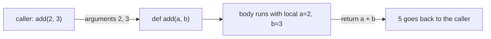

# 03 · Functions from Scratch

> **Prerequisites:** [02 · Making decisions and loops](../02-making-decisions-and-loops/README.md): `if`, `for`, `while`.  
> **Reading time:** ~40 minutes  
> **Audience:** a beginner who can write loops and now wants to stop copy-pasting code

> [!NOTE]
> **In one line:** A function is a named, reusable recipe. You give it inputs (parameters), it does work, and it hands back an output (the return value).

> [!TIP]
> **Golden rule:** One function, one job. If you need the word "and" to describe what it does, split it into two functions. Prefer functions that **return** a result over functions that **print** it.

> [!TIP]
> **Try it:** Take any loop you wrote in module 02 (the vowel counter, the digit sum) and wrap it in a function with a parameter. Call it with three different inputs.

---

## 1. Roadmap

So far all your code runs top to bottom once. Functions let you:

- give a piece of code a name and run it many times;
- pass different data in each time;
- get a result back and use it in more code;
- test one small piece on its own.

After this module you can write and test your own functions, read other people's function signatures, and understand scope. The LLD classes later are just functions grouped with data, so this is the base of everything.

> [!key]
> `def name(parameters):` defines a function. `name(arguments)` calls it. `return value` sends a result back to the caller.

---

## 2. Your first function

```python
def greet():
    print("Hello!")

greet()   # Hello!
greet()   # Hello!
```

- `def` starts the definition. `greet` is the name. `()` holds the parameters (none here). `:` opens the body.
- The body is indented.
- Defining a function does **not** run it. Calling it (`greet()`) does.

### Parameters and arguments

A **parameter** is the name in the definition. An **argument** is the value you pass when calling.

```python
def greet(name):          # name is a parameter
    print("Hello,", name)

greet("Asha")             # "Asha" is the argument
# Hello, Asha
greet("Ben")
# Hello, Ben
```

Several parameters, matched by position:

```python
def rectangle_area(width, height):
    print(width * height)

rectangle_area(3, 4)   # 12
```

Passing the wrong number of arguments is an error:

```python
def add(a, b):
    return a + b

try:
    add(1)
except TypeError as e:
    print(e)   # add() missing 1 required positional argument: 'b'
```

````carousel
```python
def greet(name):
    print("Hello,", name)

greet("Asha")   # Hello, Asha
```

<!-- slide -->

```csharp
static void Greet(string name)
{
    Console.WriteLine("Hello, " + name);
}

Greet("Asha");   // Hello, Asha
```
````

In C# you must also write the **type** of every parameter and of the return value. `void` means "returns nothing".

---

## 3. Return values

`return` ends the function and sends a value back.

```python
def add(a, b):
    return a + b

result = add(2, 3)
print(result)            # 5
print(add(10, 20) * 2)   # 60
```

Printing is not returning. Compare:

```python
def add_print(a, b):
    print(a + b)

def add_return(a, b):
    return a + b

x = add_print(1, 2)   # prints 3
y = add_return(1, 2)  # prints nothing
print(x)              # None
print(y)              # 3
```

A function with no `return` gives back `None`. A bare `return` also gives `None` and exits early.

```python
def check_age(age):
    if age < 0:
        return          # leave early, returns None
    print("valid age")

print(check_age(-1))    # None
check_age(5)            # valid age
```

Code after `return` never runs:

```python
def f():
    return 1
    print("never printed")

print(f())   # 1
```

### Returning several values

Python packs them in a **tuple**. You unpack on the left.

```python
def min_max(numbers):
    return min(numbers), max(numbers)

lo, hi = min_max([4, 9, 2, 7])
print(lo, hi)           # 2 9
print(min_max([1, 5]))  # (1, 5)
```

````carousel
```python
def min_max(numbers):
    return min(numbers), max(numbers)

lo, hi = min_max([4, 9, 2, 7])
print(lo, hi)   # 2 9
```

<!-- slide -->

```csharp
static (int Lo, int Hi) MinMax(int[] numbers)
{
    return (numbers.Min(), numbers.Max());
}

var (lo, hi) = MinMax(new[] { 4, 9, 2, 7 });
Console.WriteLine($"{lo} {hi}");   // 2 9
```
````

> [!pitfall]
> Forgetting `return` is the most common beginner bug. If a result prints as `None`, check that the function actually returns it.

---

## 4. Default arguments

Give a parameter a default and callers may leave it out.

```python
def greet(name, greeting="Hello"):
    return f"{greeting}, {name}!"

print(greet("Asha"))             # Hello, Asha!
print(greet("Asha", "Hi"))       # Hi, Asha!
print(greet("Asha", greeting="Welcome"))   # Welcome, Asha!
```

Parameters with defaults must come **after** those without:

```python
def power(base, exponent=2):
    return base ** exponent

print(power(5))      # 25
print(power(2, 10))  # 1024
```

### The mutable default trap

A default value is created **once**, when the function is defined, not on each call. If it is a list or dict, every call shares it.

```python
def add_item(item, basket=[]):     # BAD
    basket.append(item)
    return basket

print(add_item("apple"))   # ['apple']
print(add_item("pear"))    # ['apple', 'pear']   surprise!
```

The fix: default to `None` and make a fresh list inside.

```python
def add_item(item, basket=None):   # GOOD
    if basket is None:
        basket = []
    basket.append(item)
    return basket

print(add_item("apple"))   # ['apple']
print(add_item("pear"))    # ['pear']
```

> [!pitfall]
> Never use `[]`, `{}` or `set()` as a default value. Use `None` and create the object inside the function.

````carousel
```python
def power(base, exponent=2):
    return base ** exponent

print(power(5))      # 25
print(power(2, 10))  # 1024
```

<!-- slide -->

```csharp
static double Power(double b, int exponent = 2)
{
    return Math.Pow(b, exponent);
}

Console.WriteLine(Power(5));      // 25
Console.WriteLine(Power(2, 10));  // 1024
Console.WriteLine(Power(2, exponent: 3));  // 8  (named argument)
```
````

---

## 5. Keyword arguments

At the call site, you can name the arguments. Then order does not matter, and the call explains itself.

```python
def create_user(name, age, city):
    return f"{name}, {age}, {city}"

print(create_user("Asha", 30, "Pune"))              # Asha, 30, Pune
print(create_user(city="Pune", name="Asha", age=30)) # Asha, 30, Pune
print(create_user("Asha", city="Pune", age=30))      # Asha, 30, Pune
```

Rule: positional arguments first, then keyword arguments. `create_user(name="Asha", 30, "Pune")` is a syntax error.

---

## 6. `*args` and `**kwargs`

Sometimes you do not know how many arguments will come.

`*args` collects extra **positional** arguments into a tuple:

```python
def total(*numbers):
    print(numbers)
    return sum(numbers)

print(total(1, 2, 3))      # prints (1, 2, 3), then 6
print(total())             # prints (), then 0
```

`**kwargs` collects extra **keyword** arguments into a dict:

```python
def show(**info):
    for key, value in info.items():
        print(key, "=", value)

show(name="Asha", age=30)
# name = Asha
# age = 30
```

Use both, together with normal parameters:

```python
def log(level, *messages, **extra):
    print(level, messages, extra)

log("INFO", "started", "ok", user="asha", retry=3)
# INFO ('started', 'ok') {'user': 'asha', 'retry': 3}
```

The same stars work in the **call** to spread a list or dict into arguments:

```python
def add3(a, b, c):
    return a + b + c

nums = [1, 2, 3]
print(add3(*nums))     # 6
opts = {"a": 1, "b": 2, "c": 3}
print(add3(**opts))    # 6
```

````carousel
```python
def total(*numbers):
    return sum(numbers)

print(total(1, 2, 3))   # 6
```

<!-- slide -->

```csharp
static int Total(params int[] numbers)
{
    return numbers.Sum();
}

Console.WriteLine(Total(1, 2, 3));   // 6
Console.WriteLine(Total());          // 0
```
````

C# `params` is the same idea as `*args`. C# has nothing built in for `**kwargs`. You would pass a `Dictionary<string, object>`.

---

## 7. Positional-only and keyword-only parameters

You can control **how** callers pass arguments:

- A `/` in the list: everything **before** it must be positional.
- A `*` in the list: everything **after** it must be passed by keyword.

```python
def divide(a, b, /):
    return a / b

print(divide(10, 4))    # 2.5
# divide(a=10, b=4)     # TypeError: positional-only

def connect(host, *, port=80, secure=False):
    return f"{host}:{port} secure={secure}"

print(connect("example.com", port=443, secure=True))
# example.com:443 secure=True
# connect("example.com", 443)   # TypeError: takes 1 positional argument
```

Use keyword-only for flags: `connect(host, secure=True)` is clearer than `connect(host, True)`.

---

## 8. Docstrings and good naming

A string right under `def` documents the function. Tools and `help()` read it.

```python
def circle_area(radius):
    """Return the area of a circle with the given radius.

    radius must not be negative.
    """
    return 3.14159 * radius ** 2

print(circle_area(2))              # 12.56636
print(circle_area.__doc__.splitlines()[0])
# Return the area of a circle with the given radius.
```

Naming habits:

- Verb for actions: `calculate_tax`, `send_email`.
- Question for booleans: `is_valid`, `has_items`.
- `snake_case`.
- Keep functions short, ideally under about 20 lines.

---

## 9. Scope: where names live

A name made inside a function is **local**. It exists only during the call.

```python
def f():
    secret = 42
    return secret

print(f())   # 42
try:
    print(secret)
except NameError as e:
    print(e)  # name 'secret' is not defined
```

A function can **read** names from outside:

```python
rate = 0.18

def with_tax(price):
    return price * (1 + rate)

print(round(with_tax(100), 2))   # 118.0
```

But assigning to a name inside a function makes a **new local** name. It does not change the outside one:

```python
counter = 0

def bump():
    counter = 99      # a new local variable
    return counter

print(bump())    # 99
print(counter)   # 0
```

To really change a global you need the `global` keyword. Avoid it where you can.

```python
counter = 0

def bump():
    global counter
    counter += 1

bump()
bump()
print(counter)   # 2
```

`nonlocal` is for a function inside a function, to change the outer function's variable:

```python
def make_counter():
    count = 0
    def step():
        nonlocal count
        count += 1
        return count
    return step

c = make_counter()
print(c())   # 1
print(c())   # 2
print(c())   # 3
```

The name lookup order is called **LEGB**: Local, Enclosing function, Global, Built-in.

```text
 Built-in  (print, len, ...)
   Global  (names at the top of the file)
     Enclosing  (names in an outer def)
       Local  (names in this def)   <- Python looks here first
```

> [!key]
> Prefer passing values **in** as parameters and getting results **out** with `return`. Code that does this has no hidden connections, so it is easy to test.

---

## 10. Functions are values

In Python a function is an object like any other. You can store it in a variable, put it in a list, pass it to another function, or return it.

```python
def shout(text):
    return text.upper() + "!"

yell = shout          # no brackets: refer to the function, do not call it
print(yell("hi"))     # HI!

def apply(func, value):
    return func(value)

print(apply(shout, "hello"))   # HELLO!
print(apply(len, "hello"))     # 5
print(apply(abs, -4))          # 4

operations = [str.upper, str.lower, str.title]
for op in operations:
    print(op("hELLo"))
# HELLO
# hello
# Hello
```

### `lambda`: a tiny unnamed function

`lambda parameters: expression` makes a one-line function that returns the expression.

```python
square = lambda x: x * x
print(square(5))   # 25

add = lambda a, b: a + b
print(add(2, 3))   # 5
```

Lambdas are mainly used for short throwaway functions, especially as `key=`.

### `key=` for sorting and searching

`sorted`, `min` and `max` accept `key=function`. Python calls it on each item and compares the results.

```python
words = ["banana", "kiwi", "apple", "fig"]
print(sorted(words))                  # ['apple', 'banana', 'fig', 'kiwi']
print(sorted(words, key=len))         # ['fig', 'kiwi', 'apple', 'banana']
print(sorted(words, key=lambda w: w[-1]))   # ['banana', 'apple', 'fig', 'kiwi']
print(max(words, key=len))            # banana
print(min(words, key=len))            # fig

people = [("Asha", 30), ("Ben", 25), ("Chen", 35)]
print(sorted(people, key=lambda p: p[1]))
# [('Ben', 25), ('Asha', 30), ('Chen', 35)]
print(sorted(people, key=lambda p: p[1], reverse=True))
# [('Chen', 35), ('Asha', 30), ('Ben', 25)]
```

Two other handy built-ins that take a function:

```python
print(list(map(lambda x: x * 2, [1, 2, 3])))        # [2, 4, 6]
print(list(filter(lambda x: x > 1, [1, 2, 3])))     # [2, 3]
```

(List comprehensions, covered in module 08, are usually nicer than `map` and `filter`.)

````carousel
```python
words = ["banana", "kiwi", "apple", "fig"]
print(sorted(words, key=len))          # ['fig', 'kiwi', 'apple', 'banana']
square = lambda x: x * x
print(square(5))                       # 25
```

<!-- slide -->

```csharp
using System.Linq;

var words = new List<string> { "banana", "kiwi", "apple", "fig" };
var sorted = words.OrderBy(w => w.Length).ToList();
Console.WriteLine(string.Join(", ", sorted));   // fig, kiwi, apple, banana

Func<int, int> square = x => x * x;
Console.WriteLine(square(5));                   // 25

Func<int, int, int> add = (a, b) => a + b;
Console.WriteLine(add(2, 3));                   // 5
Action<string> say = text => Console.WriteLine(text);
say("hi");                                      // hi
```
````

`Func<int, int>` means "takes an `int`, returns an `int`". The **last** type in `Func<...>` is the return type. `Action<...>` is a function that returns nothing.

---

## 11. Recursion

A function can call itself. Every recursive function needs:

1. a **base case**: an input so simple you can answer directly (this stops the calls);
2. a **recursive case** that moves closer to the base case.

```python
def factorial(n):
    if n <= 1:              # base case
        return 1
    return n * factorial(n - 1)   # smaller problem

print(factorial(5))   # 120
```

How `factorial(3)` unfolds:

```text
factorial(3)
 = 3 * factorial(2)
 = 3 * (2 * factorial(1))
 = 3 * (2 * 1)
 = 6
```

More examples:

```python
def countdown(n):
    if n == 0:
        print("liftoff")
        return
    print(n)
    countdown(n - 1)

countdown(3)
# 3
# 2
# 1
# liftoff

def sum_digits(n):
    if n < 10:
        return n
    return n % 10 + sum_digits(n // 10)

print(sum_digits(9045))   # 18

def fib(n):
    if n < 2:
        return n
    return fib(n - 1) + fib(n - 2)

print([fib(i) for i in range(10)])   # [0, 1, 1, 2, 3, 5, 8, 13, 21, 34]
```

Forgetting the base case gives `RecursionError: maximum recursion depth exceeded`. Python stops at about 1000 nested calls. Anything a loop can do easily (like factorial) is often better as a loop. Recursion shines for trees and nested data.

---

## 12. Pure functions and side effects

A **pure** function depends only on its inputs and changes nothing outside. Same input, same output.

A **side effect** is anything else: printing, changing a global, changing an argument, reading a file.

```python
def add_pure(a, b):
    return a + b                 # pure

total = 0
def add_impure(n):
    global total
    total += n                   # side effect: changes outside state

def append_bad(items):
    items.append(99)             # side effect: changes the caller's list

def append_good(items):
    return items + [99]          # returns a new list

nums = [1, 2]
append_bad(nums)
print(nums)                # [1, 2, 99]   the caller's list changed!
nums2 = [1, 2]
print(append_good(nums2))  # [1, 2, 99]
print(nums2)               # [1, 2]       unchanged
```

Pure functions are easy to test and to reason about. Keep the side effects (printing, files, network) in a thin outer layer and the logic in pure functions.

---

## 13. Type hints (basic)

Hints say what types you expect. Python does **not** enforce them at run time, but editors and tools like `mypy` use them, and they document intent.

```python
def add(a: int, b: int) -> int:
    return a + b

def greet(name: str, excited: bool = False) -> str:
    return f"Hello, {name}" + ("!" if excited else ".")

def average(numbers: list[float]) -> float:
    return sum(numbers) / len(numbers)

def find(items: list[str], target: str) -> int | None:
    for i, item in enumerate(items):
        if item == target:
            return i
    return None

print(add(2, 3))                     # 5
print(greet("Asha", excited=True))   # Hello, Asha!
print(average([1.0, 2.0, 4.5]))      # 2.5
print(find(["a", "b"], "b"))         # 1
print(find(["a", "b"], "z"))         # None
print(add("x", "y"))                 # xy   (hints are not enforced!)
```

Pattern: `parameter: type`, return type after `->`. `int | None` means "an int or None".

---

## 14. Writing a function and testing it with `assert`

`assert condition` does nothing if the condition is true and raises `AssertionError` if it is false. It is the smallest possible test.

```python
def is_even(n):
    return n % 2 == 0

assert is_even(4) is True
assert is_even(7) is False
assert is_even(0) is True
assert is_even(-2) is True
print("all tests passed")   # all tests passed
```

Add a message to explain a failure:

```python
def clamp(value, low, high):
    """Keep value between low and high."""
    return max(low, min(value, high))

assert clamp(5, 0, 10) == 5, "inside the range stays the same"
assert clamp(-3, 0, 10) == 0, "below goes up to low"
assert clamp(99, 0, 10) == 10, "above comes down to high"
print("clamp ok")   # clamp ok
```

A good workflow ("test first"):

1. Write down 3 to 5 `assert` lines for the function you want. Include an edge case (empty list, zero, negative).
2. Write the function until all asserts pass.
3. Add one more assert each time you find a bug.

```python
def count_words(text):
    return len(text.split())

assert count_words("hello world") == 2
assert count_words("") == 0
assert count_words("  spaced   out  ") == 2
print("count_words ok")   # count_words ok
```

Later modules and the LLD course use the `pytest` library for the same idea at scale.

---

## 15. Visual summary



```text
 def  power( base , exponent=2 ) -> float :
      |       |        |                |
      |       |        |                +-- return type hint (optional)
      |       |        +------------------- parameter with default
      |       +---------------------------- parameter
      +------------------------------------ function name
```

---

## 16. Practice

**1. Square.** Write `square(n)` that returns `n * n`. Test it with `assert`.

<details><summary>Answer</summary>

```python
def square(n):
    return n * n

assert square(4) == 16
assert square(-3) == 9
assert square(0) == 0
print("ok")   # ok
```
</details>

**2. Temperature.** Write `to_celsius(f)` and `to_fahrenheit(c)`. Check they undo each other.

<details><summary>Answer</summary>

```python
def to_celsius(f):
    return (f - 32) * 5 / 9

def to_fahrenheit(c):
    return c * 9 / 5 + 32

print(to_celsius(212))     # 100.0
print(to_fahrenheit(100))  # 212.0
assert to_celsius(to_fahrenheit(37)) == 37
```
</details>

**3. Default greeting.** Write `greet(name, greeting="Hello")`. Call it three ways.

<details><summary>Answer</summary>

```python
def greet(name, greeting="Hello"):
    return f"{greeting}, {name}"

print(greet("Asha"))                    # Hello, Asha
print(greet("Asha", "Hi"))              # Hi, Asha
print(greet(greeting="Yo", name="Ben")) # Yo, Ben
```
</details>

**4. Longest word.** Write `longest(words)` that returns the longest word, or `None` for an empty list.

<details><summary>Answer</summary>

```python
def longest(words):
    if not words:
        return None
    best = words[0]
    for w in words:
        if len(w) > len(best):
            best = w
    return best

print(longest(["fig", "banana", "kiwi"]))   # banana
print(longest([]))                          # None
```
</details>

**5. Any number of arguments.** Write `average(*numbers)`. What should `average()` do?

<details><summary>Answer</summary>

```python
def average(*numbers):
    if not numbers:
        return 0.0
    return sum(numbers) / len(numbers)

print(average(2, 4, 9))   # 5.0
print(average())          # 0.0
```
</details>

**6. Fix the trap.** This function has a bug. Fix it.

```python
def add_tag(tag, tags=[]):
    tags.append(tag)
    return tags
```

<details><summary>Answer</summary>

```python
def add_tag(tag, tags=None):
    if tags is None:
        tags = []
    tags.append(tag)
    return tags

print(add_tag("a"))   # ['a']
print(add_tag("b"))   # ['b']
```
</details>

**7. Sort by last letter.** Sort `["pear", "fig", "banana"]` by the last letter using `key=`.

<details><summary>Answer</summary>

```python
words = ["pear", "fig", "banana"]
print(sorted(words, key=lambda w: w[-1]))   # ['banana', 'fig', 'pear']
```
</details>

**8. Recursive power.** Write `power(base, exp)` for whole `exp >= 0` using recursion.

<details><summary>Answer</summary>

```python
def power(base, exp):
    if exp == 0:
        return 1
    return base * power(base, exp - 1)

assert power(2, 10) == 1024
assert power(5, 0) == 1
print(power(3, 4))   # 81
```
</details>

**9. Make a counter.** Write `make_counter(start)` that returns a function. Each call to that function returns the next number.

<details><summary>Answer</summary>

```python
def make_counter(start=0):
    value = start
    def next_number():
        nonlocal value
        value += 1
        return value
    return next_number

c = make_counter(10)
print(c())   # 11
print(c())   # 12
```
</details>

---

## 17. Mini project: a tiny tested toolkit

Build a file `toolkit.py` of small pure functions, with asserts as tests.

```python
def is_palindrome(text: str) -> bool:
    """True if text reads the same both ways, ignoring case and spaces."""
    cleaned = text.replace(" ", "").lower()
    return cleaned == cleaned[::-1]


def fizzbuzz(n: int) -> str:
    """Return the FizzBuzz word for one number."""
    if n % 15 == 0:
        return "FizzBuzz"
    if n % 3 == 0:
        return "Fizz"
    if n % 5 == 0:
        return "Buzz"
    return str(n)


def word_frequencies(text: str) -> dict[str, int]:
    """Count how many times each word appears, ignoring case."""
    counts: dict[str, int] = {}
    for word in text.lower().split():
        counts[word] = counts.get(word, 0) + 1
    return counts


def clamp(value: float, low: float, high: float) -> float:
    """Keep value between low and high."""
    return max(low, min(value, high))


# tests
assert is_palindrome("Never odd or even")
assert not is_palindrome("hello")
assert fizzbuzz(15) == "FizzBuzz"
assert fizzbuzz(9) == "Fizz"
assert fizzbuzz(10) == "Buzz"
assert fizzbuzz(7) == "7"
assert word_frequencies("the cat and The dog") == {"the": 2, "cat": 1, "and": 1, "dog": 1}
assert clamp(15, 0, 10) == 10
print("toolkit: all tests passed")   # toolkit: all tests passed
```

Stretch goals: add `median(numbers)`; add a test for the empty-list case; make each function return the same answer for a list of inputs using a `for` loop of asserts.

---

## 18. Interview questions

<details>
<summary><strong>Q1.</strong> What is the difference between a parameter and an argument?</summary>

A parameter is the variable name in the function definition. An argument is the actual value passed in the call.
</details>

<details>
<summary><strong>Q2.</strong> What does a function return if it has no <code>return</code> statement?</summary>

`None`.
</details>

<details>
<summary><strong>Q3.</strong> Why is <code>def f(x, items=[])</code> dangerous? How do you fix it?</summary>

The default list is created once when the function is defined and shared by all calls, so changes persist between calls. Use `items=None` and create `items = []` inside when it is `None`.
</details>

<details>
<summary><strong>Q4.</strong> What do <code>*args</code> and <code>**kwargs</code> do?</summary>

`*args` gathers extra positional arguments into a tuple. `**kwargs` gathers extra keyword arguments into a dict. In a call, `*` and `**` spread a sequence or dict into arguments.
</details>

<details>
<summary><strong>Q5.</strong> Explain Python's scope rule (LEGB).</summary>

Python looks up a name in this order: Local, Enclosing functions, Global, Built-in. Assigning to a name in a function makes it local unless you declare it `global` or `nonlocal`.
</details>

<details>
<summary><strong>Q6.</strong> What is a pure function and why do we like them?</summary>

A function whose output depends only on its inputs and which changes nothing outside itself. They are easy to test, repeat and combine.
</details>

<details>
<summary><strong>Q7.</strong> What two parts does every recursive function need?</summary>

A base case that stops the recursion, and a recursive case that moves toward the base case. Without the base case you get `RecursionError`.
</details>

<details>
<summary><strong>Q8.</strong> What does <code>sorted(items, key=len)</code> do?</summary>

It calls `len` on each item and sorts by those results instead of the items themselves. `key` takes any function, including a `lambda`.
</details>

---

## Further reading

- [Python Tutorial: defining functions](https://docs.python.org/3/tutorial/controlflow.html#defining-functions)
- [Python Tutorial: more on defining functions (defaults, keywords, `*args`, lambda)](https://docs.python.org/3/tutorial/controlflow.html#more-on-defining-functions)
- [Python Tutorial: Python scopes and namespaces](https://docs.python.org/3/tutorial/classes.html#python-scopes-and-namespaces)
- [Python docs: `typing`, support for type hints](https://docs.python.org/3/library/typing.html)
- [Python docs: sorting techniques and `key` functions](https://docs.python.org/3/howto/sorting.html)
- [Real Python: defining your own Python function](https://realpython.com/defining-your-own-python-function/)
- [Real Python: Python `args` and `kwargs` demystified](https://realpython.com/python-kwargs-and-args/)
- [Real Python: Python lambda functions](https://realpython.com/python-lambda/)
- [Microsoft Learn: C# methods](https://learn.microsoft.com/en-us/dotnet/csharp/programming-guide/classes-and-structs/methods)
- [Microsoft Learn: C# lambda expressions](https://learn.microsoft.com/en-us/dotnet/csharp/language-reference/operators/lambda-expressions)

## Next

[04 · Lists, every operation](../04-lists-every-operation/README.md). Back to the [track overview](../README.md).
