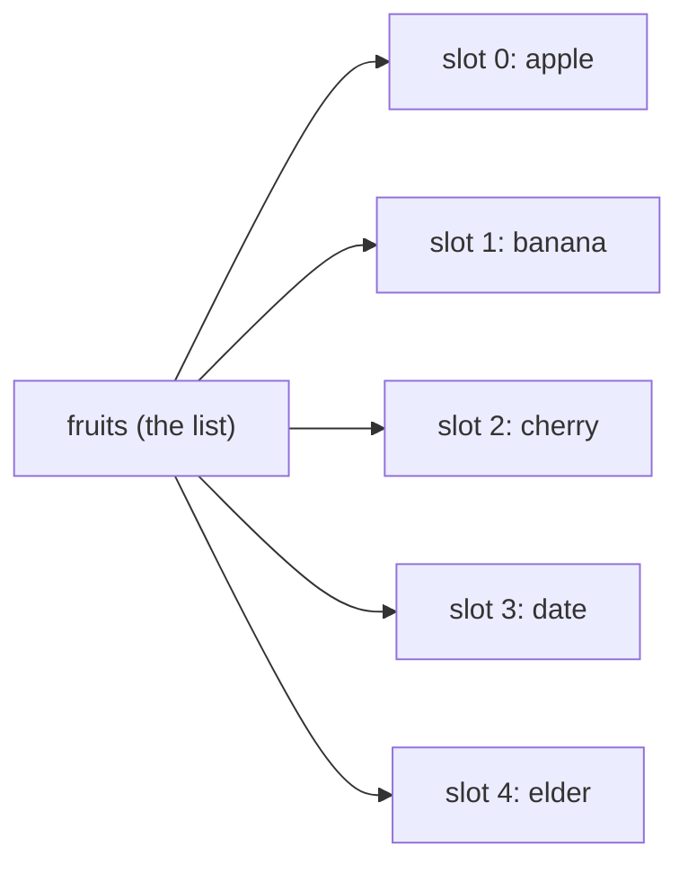

# 04 · Lists: Every Operation

> **Prerequisites:** [03 · Functions from scratch](../03-functions-from-scratch/README.md) - you can write and call a function.  
> **Reading time:** ~45 minutes (with the exercises)  
> **Audience:** Complete beginners who want to know a list inside out, not just "enough to get by"

> [!NOTE]
> **In one line:** A list is an ordered, changeable row of items. You can read any item by its position, and you can add, remove, sort and slice it. It is the data structure you will use most.

> [!TIP]
> **Golden rule:** Reading by position is fast. Searching for a value, or adding and removing at the front, is slow. Pick a list when order matters and you mostly add at the end.

> [!TIP]
> **Try it:** Open the [Python playground](/practice/) (or any Python prompt), type each example, and change one value. Seeing the result change is how this sticks.

---

## 1. Roadmap: where lists sit

You can already store one value in a variable and write a function. Real programs hold **many** values: ten prices, a hundred usernames, a grid of cells. Python has four built-in "containers" for that. This module is the first one.

| Module | Container | One-line idea |
| :--- | :--- | :--- |
| **04 (you are here)** | `list` | Ordered, changeable row |
| [05](../05-tuples-and-unpacking/README.md) | `tuple` | Ordered, fixed row |
| [06](../06-sets-every-operation/README.md) | `set` | Unordered, no duplicates |
| [07](../07-dictionaries-every-operation/README.md) | `dict` | Look up a value by a key |

**After this module you can:**

- Create a list in every common way.
- Read one item, a range of items, or every second item.
- Add, remove, sort, reverse, copy and search a list.
- Explain why `[[0] * 3] * 3` is a bug.
- Tell the speed (O(1), O(n)) of each operation, and use a `deque` when a list is the wrong tool.
- Write the same code with C# `List<T>`.

---

## 2. Concept

> [!key]
> **A list is an ordered sequence of items you can change.** *Ordered* means every item has a fixed position (an **index**) that starts at **0**. *Changeable* (the word is **mutable**) means you can add, remove and replace items after the list is made. Items can be of any type, and they can be mixed.

**Real-life analogy.** A list is a **shopping list on paper**. Line 1 is the first item. You can cross a line out, add a line at the bottom, squeeze a line in the middle, or re-write the whole list in alphabetical order. The paper is still the same paper.

**C# beside it.** C# has two things for this: the fixed-size array `int[]` and the growable `List<int>`. A Python `list` behaves like `List<T>`: it grows as you add. The big difference is that a Python list can hold mixed types, while `List<int>` holds only `int`.

### The picture: indexes go two ways

```text
 index      0        1        2        3        4
          +--------+--------+--------+--------+--------+
 fruits = | "apple"|"banana"|"cherry"| "date" | "elder"|
          +--------+--------+--------+--------+--------+
 negative   -5       -4       -3       -2       -1

 fruits[0]  -> "apple"      fruits[-1] -> "elder"
 fruits[2]  -> "cherry"     fruits[-2] -> "date"
 len(fruits) is 5, valid indexes are 0..4 and -5..-1
```

Positive indexes count from the left, starting at 0. Negative indexes count from the right, starting at -1. The index `5` (or `-6`) does not exist and raises `IndexError`.



---

## 3. Creating a list (every way)

### 3.1 Literal, list(), range, repeat

```python
empty = []                                   # a list literal with nothing in it
nums = [10, 20, 30]
mixed = [1, "two", 3.0, True, None]          # any types, mixed
print(nums)  # [10, 20, 30]
print(mixed)  # [1, 'two', 3.0, True, None]
print(len(empty))  # 0

from_text = list("hey")                      # list() turns any iterable into a list
print(from_text)  # ['h', 'e', 'y']
from_tuple = list((1, 2, 3))
print(from_tuple)  # [1, 2, 3]
from_range = list(range(5))                  # 0 up to but not including 5
print(from_range)  # [0, 1, 2, 3, 4]
print(list(range(2, 10, 3)))  # [2, 5, 8]
print(list(range(5, 0, -1)))  # [5, 4, 3, 2, 1]

zeros = [0] * 4                              # repeat with *
print(zeros)  # [0, 0, 0, 0]
print(["ab"] * 3)  # ['ab', 'ab', 'ab']

print(list())  # []
```

`range(start, stop, step)` never includes `stop`. `range(5)` is the same as `range(0, 5, 1)`.

### 3.2 Comprehension teaser

A **list comprehension** builds a list from a rule, in one line. Module [08](../08-comprehensions-and-iteration/README.md) teaches it fully. For now, read it as "make a list of `x * x` for every `x` in this range".

```python
squares = [x * x for x in range(1, 6)]
print(squares)  # [1, 4, 9, 16, 25]
evens = [x for x in range(10) if x % 2 == 0]
print(evens)  # [0, 2, 4, 6, 8]
```

### 3.3 The same in C#

````carousel
```python
nums = [10, 20, 30]
empty = []
zeros = [0] * 4
squares = [x * x for x in range(1, 6)]
print(nums, empty, zeros, squares)  # [10, 20, 30] [] [0, 0, 0, 0] [1, 4, 9, 16, 25]
```
<!-- slide -->
```csharp
using System.Collections.Generic;
using System.Linq;

var nums = new List<int> { 10, 20, 30 };
var empty = new List<int>();
var zeros = Enumerable.Repeat(0, 4).ToList();           // 0 0 0 0
var squares = Enumerable.Range(1, 5)                      // start, COUNT (not stop)
                        .Select(x => x * x).ToList();     // 1 4 9 16 25
```
````

> [!pitfall]
> C# `Enumerable.Range(start, count)` takes a **count**, Python `range(start, stop)` takes a **stop**. They look alike and are different.

---

## 4. Reading items: indexing

```python
fruits = ["apple", "banana", "cherry", "date", "elder"]
print(fruits[0])  # apple
print(fruits[2])  # cherry
print(fruits[-1])  # elder
print(fruits[-2])  # date
print(len(fruits))  # 5
print(fruits[len(fruits) - 1])  # elder

try:
    fruits[5]
except IndexError as e:
    print(e)  # list index out of range
```

Use `fruits[-1]` for "the last one". It is shorter and safer than `fruits[len(fruits) - 1]`.

**Changing one item** is just assignment to an index:

```python
fruits = ["apple", "banana", "cherry"]
fruits[1] = "blueberry"
print(fruits)  # ['apple', 'blueberry', 'cherry']
fruits[-1] = "cranberry"
print(fruits)  # ['apple', 'blueberry', 'cranberry']
```

You can only assign to an index that **already exists**. `fruits[3] = "x"` on a 3-item list raises `IndexError`. To add at the end use `append` (section 7).

---

## 5. Slicing in full

A slice copies a **range** of items into a **new list**. The form is `list[start:stop:step]`.

- `start` is included. `stop` is **not** included.
- Leave one out and Python fills it in: `start` defaults to the beginning, `stop` to the end, `step` to 1.

```text
          0      1      2      3      4      5
        +------+------+------+------+------+------+
 L =    |  a   |  b   |  c   |  d   |  e   |  f   |
        +------+------+------+------+------+------+
        ^      ^                    ^             ^
        0      1                    4             6   <- cut points
 L[1:4] is the items between cut 1 and cut 4  ->  b c d
```

Think of the numbers as **cut points between items**, not as the items. `L[1:4]` is "from cut 1 to cut 4". That is why the length of `L[a:b]` is simply `b - a`.

```python
L = ["a", "b", "c", "d", "e", "f"]
print(L[1:4])  # ['b', 'c', 'd']
print(L[:3])  # ['a', 'b', 'c']
print(L[3:])  # ['d', 'e', 'f']
print(L[:])  # ['a', 'b', 'c', 'd', 'e', 'f']
print(L[-2:])  # ['e', 'f']
print(L[:-2])  # ['a', 'b', 'c', 'd']
print(L[-4:-1])  # ['c', 'd', 'e']

print(L[::2])  # ['a', 'c', 'e']
print(L[1::2])  # ['b', 'd', 'f']
print(L[::-1])  # ['f', 'e', 'd', 'c', 'b', 'a']
print(L[4:1:-1])  # ['e', 'd', 'c']
print(L[::-2])  # ['f', 'd', 'b']

print(L[2:100])  # ['c', 'd', 'e', 'f']
print(L[10:20])  # []
```

Slices are **forgiving**: an out-of-range slice gives a shorter or empty list, never an error. Only a single index like `L[10]` raises `IndexError`.

### Slice assignment and deletion

A slice on the **left** of `=` replaces that part. The new part can be a different length.

```python
L = [1, 2, 3, 4, 5]
L[1:3] = [20, 30]
print(L)  # [1, 20, 30, 4, 5]
L[1:3] = [99]
print(L)  # [1, 99, 4, 5]
L[1:1] = ["x", "y"]
print(L)  # [1, 'x', 'y', 99, 4, 5]
del L[1:3]
print(L)  # [1, 99, 4, 5]
L[::2] = [0, 0]
print(L)  # [0, 99, 0, 5]
```

An **extended** slice (one with a step) must be replaced with a list of exactly the same length.

### The three ways to copy (preview)

`L[:]`, `L.copy()` and `list(L)` all make a shallow copy. Section 14 explains what "shallow" means.

### C# beside it

````carousel
```python
L = ["a", "b", "c", "d", "e", "f"]
print(L[1:4])  # ['b', 'c', 'd']
print(L[-2:])  # ['e', 'f']
print(L[::-1])  # ['f', 'e', 'd', 'c', 'b', 'a']
```
<!-- slide -->
```csharp
var L = new List<string> { "a", "b", "c", "d", "e", "f" };
var mid = L.GetRange(1, 3);              // start, COUNT -> b c d
var last2 = L.GetRange(L.Count - 2, 2);  // e f
// C# 8+ ranges work on arrays and spans:
string[] arr = L.ToArray();
var sub = arr[1..4];                     // b c d   (end is exclusive, like Python)
var tail = arr[^2..];                    // e f     (^1 is the last item, like -1)
var rev = Enumerable.Reverse(L).ToList();
```
````

---

## 6. Asking questions about a list

| Operation | Meaning | Example | Result |
| :--- | :--- | :--- | :--- |
| `len(L)` | How many items | `len([4, 5, 6])` | `3` |
| `x in L` | Is `x` somewhere in it? | `5 in [4, 5, 6]` | `True` |
| `x not in L` | Is `x` missing? | `9 not in [4, 5, 6]` | `True` |
| `L.count(x)` | How many times does `x` appear | `[1, 2, 1].count(1)` | `2` |
| `L.index(x)` | Position of the first `x` | `[4, 5, 6].index(6)` | `2` |
| `L.index(x, start, stop)` | Search only that range | see below | |

```python
L = [3, 1, 4, 1, 5, 9, 1]
print(len(L))  # 7
print(4 in L)  # True
print(8 in L)  # False
print(8 not in L)  # True
print(L.count(1))  # 3
print(L.count(8))  # 0
print(L.index(1))  # 1
print(L.index(1, 2))  # 3
print(L.index(1, 4))  # 6

try:
    L.index(8)
except ValueError as e:
    print(e)  # 8 is not in list
```

`index` raises `ValueError` when the value is missing. The safe pattern is to check first:

```python
L = [3, 1, 4]
if 8 in L:
    print(L.index(8))
else:
    print("not found")  # not found
```

---

## 7. Adding items

| Method | What it does | Returns | Speed |
| :--- | :--- | :--- | :--- |
| `append(x)` | Put `x` at the end | `None` | O(1) |
| `extend(iterable)` | Put every item of the iterable at the end | `None` | O(k) for k new items |
| `insert(i, x)` | Put `x` before position `i` | `None` | O(n) |

```python
L = [1, 2, 3]
L.append(4)
print(L)  # [1, 2, 3, 4]
L.append([5, 6])               # appends ONE item: a list
print(L)  # [1, 2, 3, 4, [5, 6]]

M = [1, 2, 3]
M.extend([4, 5])               # appends each item
print(M)  # [1, 2, 3, 4, 5]
M.extend("hi")                 # any iterable works
print(M)  # [1, 2, 3, 4, 5, 'h', 'i']
M.extend(range(2))
print(M)  # [1, 2, 3, 4, 5, 'h', 'i', 0, 1]

N = ["a", "c"]
N.insert(1, "b")               # before position 1
print(N)  # ['a', 'b', 'c']
N.insert(0, "start")           # at the front
print(N)  # ['start', 'a', 'b', 'c']
N.insert(100, "end")           # past the end: goes to the end
print(N)  # ['start', 'a', 'b', 'c', 'end']
```

> [!pitfall]
> **`append` vs `extend`.** `append([5, 6])` adds one item that is itself a list. `extend([5, 6])` adds two items. Beginners mix these up all the time.

> [!pitfall]
> **These methods return `None`.** `L = L.append(4)` makes `L` equal to `None`. The method changes the list in place and returns nothing. Never assign its result.

```python
L = [1, 2]
result = L.append(3)
print(result)  # None
print(L)  # [1, 2, 3]
```

---

## 8. Removing items

| Method | What it does | Returns | Speed |
| :--- | :--- | :--- | :--- |
| `remove(x)` | Delete the **first** item equal to `x` | `None` | O(n) |
| `pop()` | Delete and return the **last** item | the item | O(1) |
| `pop(i)` | Delete and return the item at `i` | the item | O(n) |
| `del L[i]` | Delete the item at `i` (statement) | nothing | O(n) |
| `del L[a:b]` | Delete a slice | nothing | O(n) |
| `clear()` | Remove everything | `None` | O(n) |

```python
L = ["a", "b", "c", "b", "d"]
L.remove("b")                  # only the FIRST "b"
print(L)  # ['a', 'c', 'b', 'd']

last = L.pop()
print(last)  # d
print(L)  # ['a', 'c', 'b']

first = L.pop(0)
print(first)  # a
print(L)  # ['c', 'b']

M = [10, 20, 30, 40, 50]
del M[1]
print(M)  # [10, 30, 40, 50]
del M[1:3]
print(M)  # [10, 50]
M.clear()
print(M)  # []

try:
    [].pop()
except IndexError as e:
    print(e)  # pop from empty list

try:
    ["a"].remove("z")
except ValueError as e:
    print(e)  # list.remove(x): x not in list
```

`pop` is the only method that gives you the removed item back. Use it when you need the value.

### C# beside it

````carousel
```python
L = ["a", "b", "c", "b", "d"]
L.remove("b")        # first match
L.pop()              # last item, returns it
L.pop(0)             # first item, returns it
L.insert(1, "x")
L.extend(["p", "q"])
L.append("z")
print(L)  # ['c', 'x', 'b', 'p', 'q', 'z']
```
<!-- slide -->
```csharp
var L = new List<string> { "a", "b", "c", "b", "d" };
L.Remove("b");               // first match; returns bool (true if removed)
string last = L[^1];         // C# has no Pop: read the last item...
L.RemoveAt(L.Count - 1);     // ...then remove it
string first = L[0];
L.RemoveAt(0);               // remove by index
L.Insert(1, "x");
L.AddRange(new[] { "p", "q" });   // like extend
L.Add("z");                       // like append
// L.Clear();  like clear()
```
````

> [!pitfall]
> C# `Remove(x)` returns `true` or `false`. Python `remove(x)` raises `ValueError` if the item is missing. Python `pop()` removes and returns; C# makes you do two steps.

---

## 9. Joining and repeating: `+`, `*`, `+=`

```python
a = [1, 2]
b = [3, 4]
c = a + b                      # a NEW list; a and b are unchanged
print(c)  # [1, 2, 3, 4]
print(a)  # [1, 2]
print(a * 3)  # [1, 2, 1, 2, 1, 2]

a += b                         # same as a.extend(b): changes a in place
print(a)  # [1, 2, 3, 4]
a *= 2
print(a)  # [1, 2, 3, 4, 1, 2, 3, 4]
```

`a + b` builds a brand new list, so it costs O(n + m). `a += b` extends the existing list, which is cheaper in a loop. Never build a big list with `result = result + [x]` in a loop. Use `append`.

```python
try:
    [1, 2] + (3, 4)
except TypeError as e:
    print(e)  # can only concatenate list (not "tuple") to list
print([1, 2] + list((3, 4)))  # [1, 2, 3, 4]
```

---

## 10. Sorting and reversing

### 10.1 `sort()` vs `sorted()`

| | `L.sort()` | `sorted(L)` |
| :--- | :--- | :--- |
| Changes `L` | Yes, in place | No |
| Returns | `None` | A new sorted list |
| Works on | Lists only | Any iterable (tuple, set, string, dict) |

```python
L = [3, 1, 2]
result = L.sort()
print(result)  # None
print(L)  # [1, 2, 3]

T = (3, 1, 2)
print(sorted(T))  # [1, 2, 3]
print(sorted("banana"))  # ['a', 'a', 'a', 'b', 'n', 'n']
print(sorted({3: "x", 1: "y"}))  # [1, 3]
```

### 10.2 `reverse=True` and `key=`

`key` is a function that turns each item into the value to compare. Python calls it once per item.

```python
words = ["pear", "fig", "banana", "kiwi"]
print(sorted(words))  # ['banana', 'fig', 'kiwi', 'pear']
print(sorted(words, reverse=True))  # ['pear', 'kiwi', 'fig', 'banana']
print(sorted(words, key=len))  # ['fig', 'pear', 'kiwi', 'banana']
print(sorted(words, key=lambda w: w[-1]))  # ['banana', 'fig', 'kiwi', 'pear']

mixed_case = ["b", "A", "c", "B"]
print(sorted(mixed_case))  # ['A', 'B', 'b', 'c']
print(sorted(mixed_case, key=str.lower))  # ['A', 'b', 'B', 'c']

people = [("Ann", 31), ("Bob", 25), ("Cy", 31)]
print(sorted(people, key=lambda p: p[1]))  # [('Bob', 25), ('Ann', 31), ('Cy', 31)]
print(sorted(people, key=lambda p: (-p[1], p[0])))  # [('Ann', 31), ('Cy', 31), ('Bob', 25)]
```

The last line sorts by age descending (the minus sign) and then by name. A **tuple key** is the standard way to sort by several fields.

### 10.3 Stability

Python's sort is **stable**: items that compare equal keep their original relative order. That is why sorting by age above kept `Ann` before `Cy`. You can use this to sort by two fields in two passes: sort by the minor field first, then by the major field.

```python
people = [("Ann", 31), ("Bob", 25), ("Cy", 31), ("Di", 25)]
people.sort(key=lambda p: p[0])
people.sort(key=lambda p: p[1])
print(people)  # [('Bob', 25), ('Di', 25), ('Ann', 31), ('Cy', 31)]
```

### 10.4 Things you cannot sort

```python
try:
    sorted([3, "a", 1])
except TypeError as e:
    print(e)  # '<' not supported between instances of 'str' and 'int'
```

### 10.5 `reverse()` vs `reversed()` vs `[::-1]`

```python
L = [1, 2, 3]
L.reverse()                    # in place, returns None
print(L)  # [3, 2, 1]

M = [1, 2, 3]
print(list(reversed(M)))  # [3, 2, 1]
print(M[::-1])  # [3, 2, 1]
print(M)  # [1, 2, 3]
for x in reversed(M):          # reversed() is lazy: no copy made
    print(x)                   # 3, then 2, then 1
```

`reversed()` returns an **iterator** (a lazy object), not a list. Wrap it in `list()` to see the items.

### C# beside it

````carousel
```python
words = ["pear", "fig", "banana", "kiwi"]
words.sort()
words.sort(key=len)
words.reverse()
print(sorted(words, reverse=True))  # ['pear', 'kiwi', 'fig', 'banana']
```
<!-- slide -->
```csharp
var words = new List<string> { "pear", "fig", "banana", "kiwi" };
words.Sort();                                   // in place, like L.sort()
words.Sort((a, b) => a.Length.CompareTo(b.Length));   // custom compare
words.Reverse();                                // in place, like L.reverse()
var sorted = words.OrderBy(w => w).ToList();    // new list, like sorted()
var desc = words.OrderByDescending(w => w.Length).ToList();
```
````

> [!pitfall]
> C# `List<T>.Sort` is **not stable**. LINQ `OrderBy` **is** stable. If you need ties to keep their order, use `OrderBy` / `ThenBy`.

---

## 11. Summaries: min, max, sum, any, all

```python
nums = [4, 8, 1, 9, 3]
print(min(nums))  # 1
print(max(nums))  # 9
print(sum(nums))  # 25
print(sum(nums) / len(nums))  # 5.0
print(sum(nums, 100))  # 125
print(max(["pear", "fig", "banana"]))  # pear
print(max(["pear", "fig", "banana"], key=len))  # banana
print(min([], default=0))  # 0

flags = [True, True, False]
print(any(flags))  # True
print(all(flags))  # False
print(any([]))  # False
print(all([]))  # True

print(any(n > 8 for n in nums))  # True
print(all(n > 0 for n in nums))  # True
```

- `any(items)` is `True` if **at least one** item is truthy.
- `all(items)` is `True` if **every** item is truthy. On an empty list it is `True` (nothing breaks the rule).
- `min([])` and `max([])` raise `ValueError`. Pass `default=` to avoid that.

````carousel
```python
nums = [4, 8, 1, 9, 3]
print(sum(nums), max(nums), min(nums))  # 25 9 1
print(any(n > 8 for n in nums), all(n > 0 for n in nums))  # True True
```
<!-- slide -->
```csharp
using System.Linq;
var nums = new List<int> { 4, 8, 1, 9, 3 };
int total = nums.Sum();            // 25
int hi = nums.Max();               // 9
int lo = nums.Min();               // 1
double avg = nums.Average();       // 5
bool anyBig = nums.Any(n => n > 8);   // true
bool allPos = nums.All(n => n > 0);   // true
```
````

---

## 12. Looping: `for`, `enumerate`, `zip`

```python
colors = ["red", "green", "blue"]
for c in colors:
    print(c)                   # red, green, blue (one per line)

for i, c in enumerate(colors):
    print(i, c)                # 0 red / 1 green / 2 blue
for i, c in enumerate(colors, start=1):
    print(i, c)                # 1 red / 2 green / 3 blue

names = ["Ann", "Bob", "Cy"]
ages = [31, 25, 40]
for n, a in zip(names, ages):
    print(n, a)                # Ann 31 / Bob 25 / Cy 40
print(list(zip(names, ages)))  # [('Ann', 31), ('Bob', 25), ('Cy', 40)]
print(list(zip([1, 2, 3], ["a", "b"])))  # [(1, 'a'), (2, 'b')]
```

`zip` stops at the **shortest** list. `enumerate` hands you the index **and** the item, so you never need `for i in range(len(colors))`.

Unzipping: `zip(*pairs)` turns a list of pairs into two sequences.

```python
pairs = [("Ann", 31), ("Bob", 25)]
names, ages = zip(*pairs)
print(names)  # ('Ann', 'Bob')
print(ages)  # (31, 25)
```

---

## 13. Mutation while iterating (a classic bug)

Never add or remove items from a list **while looping over it**. Python moves its hidden counter forward, and the list shifts under it.

```python
nums = [1, 2, 3, 4, 5, 6]
for n in nums:
    if n % 2 == 0:
        nums.remove(n)
print(nums)  # [1, 3, 5]
```

That looks fine, but try consecutive evens:

```python
nums = [2, 4, 6, 8, 1]
for n in nums:
    if n % 2 == 0:
        nums.remove(n)
print(nums)  # [4, 8, 1]
```

Two evens were **skipped**: after removing `2`, the `4` slid into position 0, but the loop moved on to position 1. The right ways:

```python
nums = [2, 4, 6, 8, 1]
kept = [n for n in nums if n % 2 != 0]        # build a new list
print(kept)  # [1]

nums = [2, 4, 6, 8, 1]
nums[:] = [n for n in nums if n % 2 != 0]     # new content, SAME list object
print(nums)  # [1]

nums = [2, 4, 6, 8, 1]
for n in nums[:]:                              # loop over a COPY
    if n % 2 == 0:
        nums.remove(n)
print(nums)  # [1]
```

> [!pitfall]
> C# is stricter: changing a `List<T>` inside `foreach` throws `InvalidOperationException` ("Collection was modified"). Use `list.RemoveAll(x => x % 2 == 0)` or loop backwards with an index.

---

## 14. Copying: alias, shallow copy, deep copy

### 14.1 Alias: not a copy at all

```python
a = [1, 2, 3]
b = a                          # b is another NAME for the same list
b.append(4)
print(a)  # [1, 2, 3, 4]
print(a is b)  # True
```

```text
 a ----+
       +--->  [1, 2, 3, 4]      one list, two names
 b ----+
```

### 14.2 Shallow copy: a new outer list

```python
a = [1, 2, 3]
b = a.copy()                   # also: a[:]  or  list(a)
b.append(4)
print(a)  # [1, 2, 3]
print(b)  # [1, 2, 3, 4]
print(a is b)  # False
print(a == [1, 2, 3])  # True
```

`is` asks "same object?". `==` asks "same contents?".

### 14.3 Shallow is not enough for nested lists

```python
a = [[1, 2], [3, 4]]
b = a.copy()
b[0].append(99)                # changes the inner list, which both share
print(a)  # [[1, 2, 99], [3, 4]]
print(b)  # [[1, 2, 99], [3, 4]]
```

```text
 a --> [ * , * ]            b --> [ * , * ]       two outer lists...
         |   |                      |   |
         v   v                      v   v
       [1,2,99] [3,4]  <------ the SAME two inner lists
```

### 14.4 Deep copy: copy everything

```python
import copy

a = [[1, 2], [3, 4]]
b = copy.deepcopy(a)
b[0].append(99)
print(a)  # [[1, 2], [3, 4]]
print(b)  # [[1, 2, 99], [3, 4]]
```

| Kind | How | New outer list | New inner objects |
| :--- | :--- | :--- | :--- |
| Alias | `b = a` | No | No |
| Shallow | `a.copy()`, `a[:]`, `list(a)` | Yes | No (shared) |
| Deep | `copy.deepcopy(a)` | Yes | Yes |

For a flat list of numbers or strings, shallow is enough, because numbers and strings cannot be changed in place.

````carousel
```python
a = [1, 2, 3]
b = a.copy()           # shallow copy
b.append(4)
print(a, b)  # [1, 2, 3] [1, 2, 3, 4]
```
<!-- slide -->
```csharp
var a = new List<int> { 1, 2, 3 };
var b = new List<int>(a);        // shallow copy (also a.ToList())
b.Add(4);
// a: 1 2 3     b: 1 2 3 4
// There is no built-in deep copy: clone each element yourself,
// or use records with "with" expressions.
```
````

---

## 15. Nested lists, 2D grids, and the `[[0] * 3] * 3` trap

A list can hold lists. This is how you model a grid, a spreadsheet or a game board.

```python
grid = [
    [1, 2, 3],
    [4, 5, 6],
    [7, 8, 9],
]
print(grid[0])  # [1, 2, 3]
print(grid[1][2])  # 6
grid[2][0] = 70
print(grid[2])  # [70, 8, 9]
print(len(grid), len(grid[0]))  # 3 3
```

```text
            col 0  col 1  col 2
 row 0  ->  [ 1,     2,     3 ]
 row 1  ->  [ 4,     5,     6 ]
 row 2  ->  [ 7,     8,     9 ]        grid[row][col]
```

### The trap

```python
bad = [[0] * 3] * 3
bad[0][0] = 1
print(bad)  # [[1, 0, 0], [1, 0, 0], [1, 0, 0]]
```

`[[0] * 3] * 3` repeats **the same inner list three times**. All three rows are one object.

```text
 bad --> [ * , * , * ]
           \   |   /
            v  v  v
           [1, 0, 0]       ONE list, three references
```

The fix is to build each row separately, with a comprehension:

```python
good = [[0] * 3 for _ in range(3)]
good[0][0] = 1
print(good)  # [[1, 0, 0], [0, 0, 0], [0, 0, 0]]
```

`[0] * 3` is fine for the inner list, because numbers cannot be changed in place. The trap appears only when the repeated item is itself a changeable object (a list, a dict, a set).

### Walking a grid

```python
grid = [[1, 2, 3], [4, 5, 6], [7, 8, 9]]
for row in grid:
    print(row)                 # [1, 2, 3] / [4, 5, 6] / [7, 8, 9]

total = 0
for r in range(len(grid)):
    for c in range(len(grid[r])):
        total += grid[r][c]
print(total)  # 45

print([row[1] for row in grid])  # [2, 5, 8]
print([list(col) for col in zip(*grid)])  # [[1, 4, 7], [2, 5, 8], [3, 6, 9]]
print(sum(sum(row) for row in grid))  # 45
```

`zip(*grid)` is the classic way to **transpose** (swap rows and columns).

````carousel
```python
grid = [[0] * 3 for _ in range(2)]
grid[1][2] = 5
print(grid)  # [[0, 0, 0], [0, 0, 5]]
```
<!-- slide -->
```csharp
int[,] grid = new int[2, 3];        // rectangular 2D array, all zeros
grid[1, 2] = 5;

var jag = new List<List<int>>();    // list of lists (like Python)
for (int r = 0; r < 2; r++)
    jag.Add(new List<int>(new int[3]));   // a NEW row each time
jag[1][2] = 5;
```
````

---

## 16. Lists as a stack and a queue

### Stack: last in, first out

A stack is a pile of plates. You add to the top and take from the top. A list does this well: `append` pushes, `pop()` pops. Both are O(1).

```python
stack = []
stack.append("a")              # push
stack.append("b")
stack.append("c")
print(stack[-1])  # c   (peek: look without removing)
print(stack.pop())  # c
print(stack.pop())  # b
print(stack)  # ['a']
print(len(stack) == 0)  # False
```

### Queue: first in, first out

A queue is a line at a shop. You join at the back and leave from the front. With a list, `append` joins and `pop(0)` leaves, but **`pop(0)` is O(n)**: every other item must shift one slot left.

```text
 pop(0) on [a, b, c, d]:   remove a, then slide b, c, d left   -> n steps
```

For a queue use `collections.deque`, which is O(1) at **both** ends:

```python
from collections import deque

q = deque()
q.append("a")                  # join at the back
q.append("b")
q.append("c")
print(q.popleft())  # a       (leave from the front, O(1))
print(q)  # deque(['b', 'c'])
q.appendleft("z")              # O(1) at the front too
print(list(q))  # ['z', 'b', 'c']
```

> [!key]
> **Rule:** if you take from the **front** of a big list often, switch to `deque`. For a stack (end only), a plain list is perfect.

C# has `Stack<T>` (`Push`, `Pop`, `Peek`) and `Queue<T>` (`Enqueue`, `Dequeue`) for exactly these jobs.

---

## 17. List vs array

| | `list` | `array.array` | C# `int[]` |
| :--- | :--- | :--- | :--- |
| Item types | Any, mixed | One numeric type | One type |
| Size | Grows and shrinks | Grows and shrinks | Fixed |
| Memory | Stores references (more memory) | Stores raw numbers (compact) | Raw values |
| Use | Everything, by default | Millions of numbers, low memory | Fixed-size data |

```python
from array import array

a = array("i", [1, 2, 3])      # "i" means signed int
a.append(4)
print(a)  # array('i', [1, 2, 3, 4])
print(a[1])  # 2
```

You will rarely need `array`. For heavy numeric work people use NumPy. Start with `list`.

---

## 18. Speed of every operation (complexity table)

**n** is the number of items in the list. **O(1)** means "the same time no matter how big". **O(n)** means "time grows with the size".

| Operation | Example | Speed | Why |
| :--- | :--- | :--- | :--- |
| Read by index | `L[i]` | O(1) | Jump straight to the slot |
| Assign by index | `L[i] = x` | O(1) | Same |
| `len` | `len(L)` | O(1) | Size is stored |
| `append` | `L.append(x)` | O(1) amortized | Occasionally the list grows, but averaged it is constant |
| `pop()` (end) | `L.pop()` | O(1) | Nothing shifts |
| `pop(i)`, `pop(0)` | `L.pop(0)` | O(n) | Items after `i` shift left |
| `insert(i, x)` | `L.insert(0, x)` | O(n) | Items after `i` shift right |
| `remove(x)` | `L.remove(x)` | O(n) | Search, then shift |
| `del L[i]` | | O(n) | Shift |
| `x in L` | `5 in L` | O(n) | Checks one by one |
| `index`, `count` | | O(n) | Scan |
| `extend(k items)` | | O(k) | Copies k items |
| `L + M` | | O(n + m) | New list |
| Slice `L[a:b]` | | O(b - a) | Copies that range |
| `copy()` | | O(n) | Copies all |
| `sort()` | | O(n log n) | Timsort |
| `min`, `max`, `sum` | | O(n) | Visits every item |
| `reverse()` | | O(n) | Swaps pairs |
| `clear()` | | O(n) | Drops references |

**Amortized** means "averaged over many calls". One `append` may be slow when the list must grow, but most are instant.

> [!key]
> The big surprise is `x in L`: it is O(n). If you test membership many times, put the items in a [set](../06-sets-every-operation/README.md) first. A set answers in O(1).

---

## 19. Common mistakes (a checklist)

1. **Assigning a method result.** `L = L.sort()` gives `None`. Write `L.sort()` or `L = sorted(L)`.
2. **`append` when you meant `extend`** (and the other way round).
3. **`b = a` thinking it copies.** Use `a.copy()`.
4. **`[[0] * 3] * 3`** shares one row. Use a comprehension.
5. **Removing while looping.** Build a new list instead.
6. **Off by one with slices.** `L[1:3]` has 2 items, not 3.
7. **Using `index` on a missing value.** Check `in` first or catch `ValueError`.
8. **Using `pop(0)` on a huge list in a loop.** Use `deque`.
9. **Mutable default argument:** `def f(x, items=[])` shares one list between calls. Use `items=None` and create the list inside.
10. **Sorting mixed types.** `[3, "a"]` cannot be compared.

```python
def add_item(x, items=[]):     # BUG: one shared list
    items.append(x)
    return items
print(add_item(1))  # [1]
print(add_item(2))  # [1, 2]

def add_item_ok(x, items=None):
    if items is None:
        items = []
    items.append(x)
    return items
print(add_item_ok(1))  # [1]
print(add_item_ok(2))  # [2]
```

---

## 20. When to choose a list

| You need | Use |
| :--- | :--- |
| Keep order, change contents, allow duplicates | **list** |
| A fixed record that must not change | [tuple](../05-tuples-and-unpacking/README.md) |
| Fast "is it in there?" and no duplicates | [set](../06-sets-every-operation/README.md) |
| Look up by name or id | [dict](../07-dictionaries-every-operation/README.md) |
| Add and remove at both ends quickly | `deque` |
| Millions of plain numbers | `array` or NumPy |

---

## 21. Practice

Try each one before opening the answer.

**1. Last and first.** Given `L = [5, 6, 7, 8]`, print the first item, the last item, and the first two items.

<details><summary>Answer</summary>

```python
L = [5, 6, 7, 8]
print(L[0])  # 5
print(L[-1])  # 8
print(L[:2])  # [5, 6]
```
</details>

**2. Every other item.** From `list(range(10))` print the items at positions 0, 2, 4, 6, 8, and then the same list reversed.

<details><summary>Answer</summary>

```python
L = list(range(10))
print(L[::2])  # [0, 2, 4, 6, 8]
print(L[::-1])  # [9, 8, 7, 6, 5, 4, 3, 2, 1, 0]
```
</details>

**3. Predict.** What does this print? `L = [1, 2, 3]; L.append([4]); print(len(L))`

<details><summary>Answer</summary>

`4`. `append` adds the whole list `[4]` as one item, so `L` is `[1, 2, 3, [4]]`.

```python
L = [1, 2, 3]
L.append([4])
print(len(L))  # 4
```
</details>

**4. Remove all.** `remove` deletes only the first match. Write code that removes **every** `1` from `[1, 2, 1, 3, 1]`.

<details><summary>Answer</summary>

```python
L = [1, 2, 1, 3, 1]
L = [x for x in L if x != 1]
print(L)  # [2, 3]
```
</details>

**5. Sort by length, then alphabet.** Sort `["bb", "a", "ccc", "aa", "b"]` by length first and alphabetically for ties.

<details><summary>Answer</summary>

```python
words = ["bb", "a", "ccc", "aa", "b"]
print(sorted(words, key=lambda w: (len(w), w)))  # ['a', 'b', 'aa', 'bb', 'ccc']
```
</details>

**6. Second largest.** Find the second largest number in `[4, 9, 1, 9, 7]` ignoring duplicates (the answer is 7).

<details><summary>Answer</summary>

```python
nums = [4, 9, 1, 9, 7]
unique_sorted = sorted(set(nums))
print(unique_sorted[-2])  # 7
```
`set` removes the duplicate 9, `sorted` puts them in order, `[-2]` is the second from the end.
</details>

**7. Fix the grid.** This builds a 2x2 board but placing an X changes both rows. Fix it.

```python
board = [["."] * 2] * 2
board[0][0] = "X"
```

<details><summary>Answer</summary>

```python
board = [["."] * 2 for _ in range(2)]
board[0][0] = "X"
print(board)  # [['X', '.'], ['.', '.']]
```
</details>

**8. Rotate.** Move the first item of `[1, 2, 3, 4]` to the end, giving `[2, 3, 4, 1]`.

<details><summary>Answer</summary>

```python
L = [1, 2, 3, 4]
L.append(L.pop(0))
print(L)  # [2, 3, 4, 1]
print([1, 2, 3, 4][1:] + [1, 2, 3, 4][:1])  # [2, 3, 4, 1]
```
</details>

**9. Pair up.** Given `names = ["Ann", "Bob"]` and `scores = [90, 80]`, print `Ann: 90` and `Bob: 80`.

<details><summary>Answer</summary>

```python
names = ["Ann", "Bob"]
scores = [90, 80]
for n, s in zip(names, scores):
    print(f"{n}: {s}")  # Ann: 90 / Bob: 80
```
</details>

**10. Safe copy.** After `a = [[1], [2]]; b = a.copy(); b[0].append(5)`, what is `a`? How do you make `a` stay unchanged?

<details><summary>Answer</summary>

`a` becomes `[[1, 5], [2]]` because the inner lists are shared. Use `copy.deepcopy`:

```python
import copy
a = [[1], [2]]
b = copy.deepcopy(a)
b[0].append(5)
print(a)  # [[1], [2]]
```
</details>

**11. Matching brackets.** Use a list as a stack to check whether `"(()())"` is balanced.

<details><summary>Answer</summary>

```python
def balanced(text):
    stack = []
    for ch in text:
        if ch == "(":
            stack.append(ch)
        elif ch == ")":
            if not stack:
                return False
            stack.pop()
    return len(stack) == 0

print(balanced("(()())"))  # True
print(balanced("(()"))  # False
```
</details>

---

## 22. Mini project: a to-do list manager

Build a tiny command-style to-do list using only a list and functions. Each task is a string. Then extend it.

```python
todos = []

def add(task):
    todos.append(task)

def done(task):
    if task in todos:
        todos.remove(task)
        return True
    return False

def show():
    if not todos:
        print("Nothing to do!")
    for i, t in enumerate(todos, start=1):
        print(f"{i}. {t}")

add("buy milk")
add("write code")
add("call mum")
show()                         # 1. buy milk / 2. write code / 3. call mum
print(done("write code"))  # True
print(done("fly to moon"))  # False
show()                         # 1. buy milk / 2. call mum
todos.sort()
show()                         # 1. buy milk / 2. call mum  (alphabetical)
```

**Extensions:**

1. Add `move_to_top(task)` using `remove` and `insert(0, ...)`.
2. Store each task as a tuple `(priority, text)` and sort by priority.
3. Add `undo()` that restores the last removed task, using a second list as a stack.

---

## 23. Interview questions

<details>
<summary><b>Q1. What is the difference between a list and a tuple?</b></summary>

A list is mutable (you can change it), a tuple is not. Because a tuple cannot change it is hashable, so it can be a dict key or set member. See [module 05](../05-tuples-and-unpacking/README.md).
</details>

<details>
<summary><b>Q2. What is the time complexity of <code>append</code>, <code>insert(0, x)</code> and <code>x in L</code>?</b></summary>

`append` is O(1) amortized. `insert(0, x)` is O(n) because every item shifts. `x in L` is O(n) because it scans. Use a `deque` for front inserts and a `set` for membership.
</details>

<details>
<summary><b>Q3. What is the difference between <code>sort()</code> and <code>sorted()</code>?</b></summary>

`sort()` sorts in place and returns `None`; it exists only on lists. `sorted()` returns a new list and accepts any iterable. Both are stable and take `key=` and `reverse=`.
</details>

<details>
<summary><b>Q4. Explain a shallow copy versus a deep copy.</b></summary>

A shallow copy makes a new outer list but shares the inner objects. Changing a nested list through the copy changes the original. A deep copy (`copy.deepcopy`) copies the inner objects too.
</details>

<details>
<summary><b>Q5. Why is <code>[[0] * 3] * 3</code> a bug?</b></summary>

The `* 3` repeats a reference to the same inner list, so all three rows are one object. Build rows with `[[0] * 3 for _ in range(3)]`.
</details>

<details>
<summary><b>Q6. How would you remove duplicates from a list and keep the order?</b></summary>

`list(dict.fromkeys(L))`. Dict keys are unique and remember insertion order. A plain `set(L)` loses the order.
</details>

<details>
<summary><b>Q7. Why can you not safely remove items while looping over a list?</b></summary>

The loop's hidden position moves forward while the list shifts left, so items get skipped. Build a new list with a comprehension, or loop over a copy.
</details>

<details>
<summary><b>Q8. What does <code>L[::-1]</code> do and what does it cost?</b></summary>

It returns a new reversed list. It copies every item, so it is O(n) time and O(n) extra memory. `L.reverse()` is in place and uses no extra memory.
</details>

<details>
<summary><b>Q9. How do Python lists compare to C# <code>List&lt;T&gt;</code>?</b></summary>

Both are growable arrays with O(1) index and amortized O(1) add. Python lists hold mixed types and have slicing; `List<T>` is typed, uses `Add`, `RemoveAt`, `GetRange`, and its `Sort` is not stable.
</details>

## Cheat sheet

```text
Create  []  list(x)  [0]*3  [x for x in xs]       Index xs[0] xs[-1]  Slice xs[a:b:c]
Add     append(x) O(1) | insert(i, x) O(n) | extend(ys) | xs + ys
Remove  pop() O(1) | pop(i) O(n) | remove(x) first match | del xs[i] | clear()
Find    x in xs O(n) | index(x) | count(x)
Sort    xs.sort() in place -> None | sorted(xs) new list | key=, reverse=True
min max sum len any all   enumerate  zip   reversed
Copy    xs[:] / xs.copy() shallow | copy.deepcopy(xs) deep | b = a is an ALIAS
[[0]*3]*3 shares rows!  use [[0]*3 for _ in range(3)]
Don't remove while iterating | Stack: append/pop | Queue: collections.deque
```

---

## Further reading

- [Python tutorial: More on lists](https://docs.python.org/3/tutorial/datastructures.html#more-on-lists) - every list method, official.
- [Python docs: Sequence types (list, tuple, range)](https://docs.python.org/3/library/stdtypes.html#sequence-types-list-tuple-range) - the full operation tables.
- [Python HOWTO: Sorting](https://docs.python.org/3/howto/sorting.html) - `key=`, stability and more.
- [Real Python: Python lists and tuples](https://realpython.com/python-lists-tuples/) - a friendly walkthrough.
- [Python docs: collections.deque](https://docs.python.org/3/library/collections.html#collections.deque) - the fast queue.
- [Microsoft Learn: List&lt;T&gt; class](https://learn.microsoft.com/en-us/dotnet/api/system.collections.generic.list-1) - the C# equivalent, every member.
- [Python docs: copy module](https://docs.python.org/3/library/copy.html) - shallow and deep copy.

## Next

Continue to [05 · Tuples and unpacking](../05-tuples-and-unpacking/README.md), the fixed cousin of the list. Back to the [overview](../README.md).
