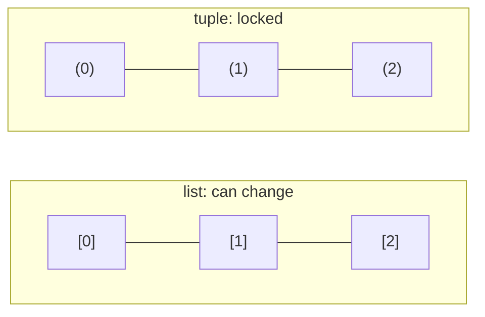

# 05 · Tuples and Unpacking

> **Prerequisites:** [04 · Lists: every operation](../04-lists-every-operation/README.md) - indexing, slicing and `len` work the same way here.  
> **Reading time:** ~35 minutes (with the exercises)  
> **Audience:** Complete beginners who want to know exactly what a tuple is, what it can do, and why Python bothers to have it

> [!NOTE]
> **In one line:** A tuple is a list that cannot change after you make it. That one restriction makes it safe to use as a dictionary key, a set member, and a small "record" that holds several related values.

> [!TIP]
> **Golden rule:** Use a **list** for a collection of similar things that grows or shrinks (many prices). Use a **tuple** for a fixed group of different things that belong together (one point: x and y).

> [!TIP]
> **Try it:** Type `t = (1, 2, 3)` and then `t[0] = 99`. Read the error. Then type `a, b, c = t` and print the three names. Both lessons are in this module.

---

## 1. Roadmap: where tuples sit

You met the [list](../04-lists-every-operation/README.md): ordered and changeable. A tuple is ordered and **not** changeable. Almost everything you learned for lists (indexing, slicing, `len`, `in`, looping) works unchanged. What disappears is every operation that changes the container.

**After this module you can:**

- Create tuples correctly, including the one-item trap.
- Use every operation a tuple has (there are only two methods).
- Explain exactly what "immutable" does and does not promise.
- **Unpack** a tuple into names, swap two variables, and collect the rest with `*`.
- Return several values from a function.
- Use a tuple as a dictionary key or set member.
- Pick between a tuple, `namedtuple`, `dataclass` and a list.
- Write the same code in C# with tuples, named elements, deconstruction and records.

---

## 2. Concept

> [!key]
> **A tuple is an ordered sequence of items that cannot be changed after creation.** The word for "cannot be changed" is **immutable**. You can read items, count them, slice them and loop over them. You cannot add, remove or replace an item.

**Real-life analogy.** A list is a whiteboard: you rub out and rewrite. A tuple is **a printed ticket**: it says `Seat 14, Row C, Screen 3`. The three facts belong together, their order has meaning, and nobody should scribble on it.

### Why does Python have it, when a list exists?

1. **Safety.** If a function hands you a tuple, you know nobody can change it behind your back.
2. **Dictionary keys and set members.** Only **hashable** (never-changing) objects may be keys. A tuple of numbers is hashable. A list is not.
3. **Meaning.** `(52.5, 13.4)` says "this is one latitude/longitude pair". A list `[52.5, 13.4]` says "a collection of numbers".
4. **Speed and memory.** Tuples are slightly smaller and faster to create than lists.

### The picture

```text
 index      0       1         2
          +------+---------+--------+
 t =      |  7   | "seven" |  7.0   |        a tuple of 3 items
          +------+---------+--------+
 negative   -3      -2        -1

 t[0]  -> 7        t[-1] -> 7.0
 t[0] = 1  -> TypeError   (the slots are locked)
```

Same index numbers as a list, but the padlock is closed.



---

## 3. Creating a tuple (every way)

```python
point = (3, 4)                       # round brackets and commas
colors = ("red", "green", "blue")
mixed = (1, "two", 3.0, None)
empty = ()
print(point)  # (3, 4)
print(len(empty))  # 0
print(type(point))  # <class 'tuple'>

no_brackets = 1, 2, 3                # the COMMA makes the tuple, not the brackets
print(no_brackets)  # (1, 2, 3)

print(tuple([1, 2, 3]))  # (1, 2, 3)
print(tuple("abc"))  # ('a', 'b', 'c')
print(tuple(range(4)))  # (0, 1, 2, 3)
print(tuple({"x": 1, "y": 2}))  # ('x', 'y')
print(tuple())  # ()
print((0,) * 3)  # (0, 0, 0)
print((1, 2) + (3,))  # (1, 2, 3)
```

> [!key]
> **The comma makes the tuple.** Round brackets are mostly there to group it so it is readable (and required for the empty tuple).

### 3.1 The one-element trap

```python
a = (5)                              # NOT a tuple: just the number 5 in brackets
b = (5,)                             # a tuple with one item
c = 5,                               # also a tuple with one item
print(type(a))  # <class 'int'>
print(type(b))  # <class 'tuple'>
print(type(c))  # <class 'tuple'>
print(b)  # (5,)
print(len(b))  # 1
```

`(5)` is just `5`, because brackets are also used for maths: `(2 + 3) * 4`. The trailing comma is what tells Python "this is a tuple". Python prints a one-item tuple as `(5,)` for the same reason.

### 3.2 Tuples in C#

````carousel
```python
point = (3, 4)
person = ("Ann", 31)
single = (5,)
print(point, person, single)  # (3, 4) ('Ann', 31) (5,)
```
<!-- slide -->
```csharp
var point = (3, 4);                       // ValueTuple<int, int>
(string, int) person = ("Ann", 31);       // explicit type
var named = (Name: "Ann", Age: 31);       // named elements
Console.WriteLine(point.Item1);           // 3   (Item1, Item2, ...)
Console.WriteLine(named.Name);            // Ann
// There is no "one-item tuple" trap in everyday C#: use a plain value.
```
````

A C# tuple `(int, int)` is a **value type** (`ValueTuple`). Its fields are **mutable** (you can write `point.Item1 = 9`), unlike a Python tuple. If you need true immutability in C#, use a `record` (section 12).

---

## 4. Reading items: indexing and slicing

Exactly the same rules as a list. Slices return a **new tuple**.

```python
t = ("a", "b", "c", "d", "e")
print(t[0])  # a
print(t[-1])  # e
print(t[1:3])  # ('b', 'c')
print(t[:2])  # ('a', 'b')
print(t[2:])  # ('c', 'd', 'e')
print(t[::2])  # ('a', 'c', 'e')
print(t[::-1])  # ('e', 'd', 'c', 'b', 'a')
print(t[10:])  # ()

try:
    t[5]
except IndexError as e:
    print(e)  # tuple index out of range
```

Revisit the [slicing section of module 04](../04-lists-every-operation/README.md) if `[1:3]` still feels odd. The rule is identical: `start` included, `stop` not included.

---

## 5. Every operation a tuple has

A tuple has **two methods** (`count` and `index`) and a handful of built-in functions and operators. That is the full list.

| Operation | Meaning | Example | Result |
| :--- | :--- | :--- | :--- |
| `len(t)` | Number of items | `len((1, 2, 3))` | `3` |
| `x in t` | Is `x` in it? | `2 in (1, 2, 3)` | `True` |
| `x not in t` | Is `x` missing? | `9 not in (1, 2, 3)` | `True` |
| `t.count(x)` | How many times `x` appears | `(1, 2, 1).count(1)` | `2` |
| `t.index(x)` | Position of first `x` | `(5, 6, 7).index(7)` | `2` |
| `t + u` | Join into a new tuple | `(1,) + (2,)` | `(1, 2)` |
| `t * n` | Repeat into a new tuple | `(0,) * 3` | `(0, 0, 0)` |
| `t == u` | Same items in the same order? | `(1, 2) == (1, 2)` | `True` |
| `t < u` | Compare item by item | `(1, 2) < (1, 3)` | `True` |
| `min(t)`, `max(t)` | Smallest, largest | `max((3, 9, 4))` | `9` |
| `sum(t)` | Add all (numbers) | `sum((1, 2, 3))` | `6` |
| `sorted(t)` | A new **list**, sorted | `sorted((3, 1, 2))` | `[1, 2, 3]` |
| `reversed(t)` | Lazy backwards iterator | `tuple(reversed((1, 2)))` | `(2, 1)` |
| `any(t)`, `all(t)` | Is any / every item truthy | `all((1, 2, 0))` | `False` |
| `hash(t)` | A number identifying it | `hash((1, 2))` | an integer |

```python
t = (3, 1, 4, 1, 5, 9, 1)
print(len(t))  # 7
print(4 in t)  # True
print(8 not in t)  # True
print(t.count(1))  # 3
print(t.index(1))  # 1
print(t.index(1, 2))  # 3
print(t + (2, 6))  # (3, 1, 4, 1, 5, 9, 1, 2, 6)
print((7, 8) * 2)  # (7, 8, 7, 8)
print(min(t), max(t), sum(t))  # 1 9 24
print(sorted(t))  # [1, 1, 1, 3, 4, 5, 9]
print(tuple(sorted(t)))  # (1, 1, 1, 3, 4, 5, 9)
print(tuple(reversed(t)))  # (1, 9, 5, 1, 4, 1, 3)
print(any((0, 0, 3)))  # True
print(all((1, 2, 0)))  # False

try:
    t.index(100)
except ValueError as e:
    print(e)  # tuple.index(x): x not in tuple
```

> [!pitfall]
> `sorted(t)` returns a **list**, not a tuple. A tuple has no `.sort()` method, because sorting changes the container. Wrap it with `tuple(...)` if you need a tuple back.

### 5.1 Comparing tuples

Python compares tuples **left to right**, item by item, like comparing words in a dictionary. The first difference decides.

```python
print((1, 2, 3) < (1, 2, 4))  # True
print((1, 9) < (2, 0))  # True
print((1, 2) < (1, 2, 0))  # True
print((1, 2) == (1, 2))  # True
print((1, 2) == (2, 1))  # False
print(("Ann", 31) < ("Ann", 40))  # True
print(max([("b", 2), ("a", 9), ("b", 5)]))  # ('b', 5)
```

This is why tuples are perfect as sort keys: `sorted(people, key=lambda p: (p.age, p.name))`.

### 5.2 Looping

```python
t = ("red", "green", "blue")
for color in t:
    print(color)               # red / green / blue
for i, color in enumerate(t):
    print(i, color)            # 0 red / 1 green / 2 blue
for a, b in zip(t, (1, 2, 3)):
    print(a, b)                # red 1 / green 2 / blue 3
```

### 5.3 In C#

````carousel
```python
t = (3, 1, 4, 1, 5)
print(len(t), t.count(1), t.index(4))  # 5 2 2
print(max(t), min(t), sum(t))  # 5 1 14
print(t[1:3])  # (1, 4)
```
<!-- slide -->
```csharp
using System.Linq;
int[] t = { 3, 1, 4, 1, 5 };      // use an array when you need LINQ-style ops
int len = t.Length;               // 5
int count = t.Count(x => x == 1); // 2
int idx = Array.IndexOf(t, 4);    // 2
int hi = t.Max(), lo = t.Min(), sum = t.Sum();
var slice = t[1..3];              // 1 4
// C# ValueTuple (int,int,int) has no Count/IndexOf: it is a fixed record of fields,
// not a sequence. For "a row of same-type items" use an array or ImmutableArray.
```
````

> [!pitfall]
> A C# `(int, int, int)` is **not** a sequence. You cannot loop over it or index it with a variable. A Python tuple is a real sequence. If you want "a fixed list" in C#, use `ImmutableArray<T>` or `IReadOnlyList<T>`.

---

## 6. What you cannot do (immutability)

```python
t = (1, 2, 3)

try:
    t[0] = 99
except TypeError as e:
    print(e)  # 'tuple' object does not support item assignment

try:
    t.append(4)
except AttributeError as e:
    print(e)  # 'tuple' object has no attribute 'append'

try:
    del t[0]
except TypeError as e:
    print(e)  # 'tuple' object doesn't support item deletion

try:
    t.sort()
except AttributeError as e:
    print(e)  # 'tuple' object has no attribute 'sort'
```

Not allowed: item assignment, `append`, `extend`, `insert`, `remove`, `pop`, `clear`, `sort`, `reverse`, `del t[i]`.

### 6.1 The "change" that is really a replacement

Need a different tuple? **Build a new one.** The old one is untouched.

```python
t = (1, 2, 3)
t2 = t + (4,)
print(t)  # (1, 2, 3)
print(t2)  # (1, 2, 3, 4)

t3 = t[:1] + (99,) + t[2:]           # "replace" item 1
print(t3)  # (1, 99, 3)

t = t + (4,)                         # rebinding the NAME t to a new tuple
print(t)  # (1, 2, 3, 4)
```

The last line is not a mutation. The name `t` now points at a new tuple. The old one is thrown away.

### 6.2 The trick: a tuple can hold a mutable list

Immutable means **the tuple's own slots never change**, i.e. each slot always points at the same object. It does **not** mean the objects inside are frozen.

```python
t = ("name", [1, 2])
t[1].append(3)                       # allowed: we changed the LIST, not the tuple
print(t)  # ('name', [1, 2, 3])

try:
    t[1] = [9]                       # not allowed: that would re-point the slot
except TypeError as e:
    print(e)  # 'tuple' object does not support item assignment
```

```text
 t --> ( slot0 , slot1 )
          |        |            the slots are locked to these two objects
          v        v
       "name"   [1, 2, 3]       but the list itself can still change
```

> [!pitfall]
> A tuple that contains a list is **not hashable**, so it cannot be a dict key. Hashability is checked deeply.

```python
print(hash((1, 2)) == hash((1, 2)))  # True
try:
    hash((1, [2]))
except TypeError as e:
    print(e)  # unhashable type: 'list'
```

Another gotcha with `+=` on a tuple that holds a list:

```python
t = ("x", [1])
try:
    t[1] += [2]                      # list is extended, THEN the slot assignment fails
except TypeError as e:
    print(e)  # 'tuple' object does not support item assignment
print(t)  # ('x', [1, 2])
```

The error is raised, yet the list changed. Avoid putting lists inside tuples unless you know why.

---

## 7. Unpacking

**Unpacking** means copying the items of a tuple (or any sequence) into separate names in one line. It is one of the most loved features in Python.

### 7.1 Basic unpacking

```python
point = (3, 4)
x, y = point                         # x gets 3, y gets 4
print(x)  # 3
print(y)  # 4

name, age, city = ("Ann", 31, "Oslo")
print(name, age, city)  # Ann 31 Oslo

a, b, c = [10, 20, 30]               # works on lists too
print(a, b, c)  # 10 20 30
d, e, f = "xyz"                      # and strings
print(d, e, f)  # x y z
```

The number of names must **match** the number of items, or you get an error.

```python
try:
    a, b = (1, 2, 3)
except ValueError as e:
    print(e)  # too many values to unpack (expected 2)

try:
    a, b, c = (1, 2)
except ValueError as e:
    print(e)  # not enough values to unpack (expected 3, got 2)
```

### 7.2 Swapping two variables

Because the right side `(b, a)` is built **first**, then unpacked, no temporary variable is needed.

```python
a, b = 1, 2
a, b = b, a
print(a, b)  # 2 1

x, y, z = 1, 2, 3
x, y, z = z, x, y                    # rotate three
print(x, y, z)  # 3 1 2
```

```text
 a, b = b, a      step 1: build the tuple (b, a)  = (2, 1)
                  step 2: assign a = 2, b = 1
```

### 7.3 Star unpacking: `*rest`

One name with a `*` in front collects **everything left over** into a **list**.

```python
first, *rest = (1, 2, 3, 4, 5)
print(first)  # 1
print(rest)  # [2, 3, 4, 5]

*start, last = (1, 2, 3, 4, 5)
print(start)  # [1, 2, 3, 4]
print(last)  # 5

head, *middle, tail = (1, 2, 3, 4, 5)
print(head, middle, tail)  # 1 [2, 3, 4] 5

a, *b = (7,)
print(a, b)  # 7 []

first, second, *others = "hello"
print(first, second, others)  # h e ['l', 'l', 'o']
```

Only **one** starred name is allowed per unpacking. The starred name is always a `list`, even when you unpack a tuple.

The `*` also works the other way, to **spread** items into a new tuple or list:

```python
a = (1, 2)
b = (3, 4)
print((*a, *b))  # (1, 2, 3, 4)
print([*a, 99, *b])  # [1, 2, 99, 3, 4]
def add(x, y):
    return x + y
print(add(*a))  # 3
```

### 7.4 Ignoring values with `_`

By convention, `_` means "I do not care about this one". It is an ordinary variable name.

```python
name, _, city = ("Ann", 31, "Oslo")
print(name, city)  # Ann Oslo

first, *_ = (1, 2, 3, 4)
print(first)  # 1

_, _, third = (1, 2, 3)
print(third)  # 3
```

### 7.5 Nested unpacking

Brackets in the target pattern mirror the shape of the data.

```python
person = ("Ann", (31, "Oslo"))
name, (age, city) = person
print(name, age, city)  # Ann 31 Oslo

line = ((0, 0), (3, 4))
(x1, y1), (x2, y2) = line
print(x2 - x1, y2 - y1)  # 3 4

data = [("a", 1), ("b", 2), ("c", 3)]
for letter, number in data:          # unpack in the for line
    print(letter, number)            # a 1 / b 2 / c 3

for i, (letter, number) in enumerate(data):
    print(i, letter, number)         # 0 a 1 / 1 b 2 / 2 c 3
```

### 7.6 Unpacking in C#

C# calls it **deconstruction**.

````carousel
```python
point = (3, 4)
x, y = point
a, b = 1, 2
a, b = b, a
first, *rest = (1, 2, 3, 4)
name, _, city = ("Ann", 31, "Oslo")
print(x, y, a, b, first, rest, name, city)  # 3 4 2 1 1 [2, 3, 4] Ann Oslo
```
<!-- slide -->
```csharp
var point = (3, 4);
var (x, y) = point;                      // deconstruction
int a = 1, b = 2;
(a, b) = (b, a);                         // swap, no temp variable
string name, city;
(name, _, city) = ("Ann", 31, "Oslo");   // _ is a discard
// C# 12 has no "*rest" for tuples. For lists, use list patterns (C# 11):
int[] arr = { 1, 2, 3, 4 };
if (arr is [var first, .. var rest]) { }  // first = 1, rest = { 2, 3, 4 }
```
````

---

## 8. Returning several values from a function

A function can only `return` one thing. Return **one tuple** that holds several values, and unpack it at the call.

```python
def min_max(numbers):
    return min(numbers), max(numbers)    # a tuple, brackets optional

result = min_max([4, 8, 1, 9])
print(result)  # (1, 9)
print(type(result))  # <class 'tuple'>

low, high = min_max([4, 8, 1, 9])        # unpack at once
print(low, high)  # 1 9

def divide(a, b):
    if b == 0:
        return None, "cannot divide by zero"
    return a / b, None

value, error = divide(10, 4)
print(value, error)  # 2.5 None
value, error = divide(1, 0)
print(value, error)  # None cannot divide by zero

q, r = divmod(17, 5)                     # built-in that returns a tuple
print(q, r)  # 3 2
```

````carousel
```python
def stats(nums):
    return min(nums), max(nums), sum(nums) / len(nums)

lo, hi, avg = stats([2, 4, 6])
print(lo, hi, avg)  # 2 6 4.0
```
<!-- slide -->
```csharp
static (int Min, int Max, double Avg) Stats(int[] nums)
    => (nums.Min(), nums.Max(), nums.Average());

var (lo, hi, avg) = Stats(new[] { 2, 4, 6 });
Console.WriteLine($"{lo} {hi} {avg}");     // 2 6 4
var r = Stats(new[] { 2, 4, 6 });
Console.WriteLine(r.Max);                  // 6   (named element)
```
````

---

## 9. Tuples as dictionary keys and set members

Only hashable objects can be keys or set members. A tuple of hashable items is hashable. This makes tuples the natural way to express a **compound key**, such as grid coordinates.

```python
grid = {}
grid[(0, 0)] = "start"
grid[(2, 3)] = "treasure"
print(grid[(2, 3)])  # treasure
print((0, 0) in grid)  # True
print(grid.get((9, 9), "empty"))  # empty

visited = set()
visited.add((1, 2))
visited.add((1, 2))                      # duplicate ignored
visited.add((2, 1))
print(len(visited))  # 2
print((1, 2) in visited)  # True

try:
    bad = {[1, 2]: "x"}                  # a list cannot be a key
except TypeError as e:
    print(e)  # unhashable type: 'list'

distances = {("Oslo", "Bergen"): 463, ("Oslo", "Tromso"): 1150}
print(distances[("Oslo", "Bergen")])  # 463
```

Dictionaries are covered in [module 07](../07-dictionaries-every-operation/README.md) and sets in [module 06](../06-sets-every-operation/README.md).

In C#, `ValueTuple` also implements equality and hashing, so `Dictionary<(int, int), string>` works the same way:

````carousel
```python
grid = {(0, 0): "start", (2, 3): "treasure"}
print(grid[(2, 3)])  # treasure
```
<!-- slide -->
```csharp
var grid = new Dictionary<(int X, int Y), string>
{
    [(0, 0)] = "start",
    [(2, 3)] = "treasure",
};
Console.WriteLine(grid[(2, 3)]);   // treasure
var visited = new HashSet<(int, int)> { (1, 2), (1, 2), (2, 1) };
Console.WriteLine(visited.Count);  // 2
```
````

---

## 10. Named tuples: readable records

`point[0]` is hard to read. A **namedtuple** is a tuple whose positions also have names.

```python
from collections import namedtuple

Point = namedtuple("Point", ["x", "y"])
p = Point(3, 4)
print(p)  # Point(x=3, y=4)
print(p.x, p.y)  # 3 4
print(p[0], p[1])  # 3 4
x, y = p                                 # still unpackable
print(x + y)  # 7
print(p == (3, 4))  # True
print(p._asdict())  # {'x': 3, 'y': 4}
print(p._replace(x=10))  # Point(x=10, y=4)
print(Point._fields)  # ('x', 'y')

try:
    p.x = 9
except AttributeError as e:
    print("immutable")  # immutable
```

`_replace` returns a **new** namedtuple; the original is untouched (it is still a tuple).

### 10.1 `typing.NamedTuple`: the class style

```python
from typing import NamedTuple

class Employee(NamedTuple):
    name: str
    age: int
    city: str = "Oslo"                   # default value

e = Employee("Ann", 31)
print(e)  # Employee(name='Ann', age=31, city='Oslo')
print(e.name, e.city)  # Ann Oslo
```

### 10.2 `dataclass(frozen=True)`: a small class that cannot change

A frozen dataclass is not a tuple (you cannot index it or unpack it by default), but it gives you named fields, type hints, methods, and immutability.

```python
from dataclasses import dataclass

@dataclass(frozen=True)
class Point3:
    x: int
    y: int

    def dist2(self):
        return self.x ** 2 + self.y ** 2

p = Point3(3, 4)
print(p)  # Point3(x=3, y=4)
print(p.dist2())  # 25
print(p == Point3(3, 4))  # True
print(hash(p) == hash(Point3(3, 4)))  # True

try:
    p.x = 1
except Exception as e:
    print(type(e).__name__)  # FrozenInstanceError
```

### 10.3 Which one?

| Need | Use |
| :--- | :--- |
| Quick, 2-3 related values, returned from a function | plain `tuple` |
| Same, but you want `p.x` readability and unpacking still works | `namedtuple` / `NamedTuple` |
| Fields with types, defaults, methods, and you want safety | `@dataclass(frozen=True)` |
| Fields that change over time | `@dataclass` (not frozen) or a normal class |
| A collection of like items | `list` |

### 10.4 The C# equivalents

````carousel
```python
from typing import NamedTuple

class Point(NamedTuple):
    x: int
    y: int

p = Point(3, 4)
print(p.x, p.y, p)  # 3 4 Point(x=3, y=4)
```
<!-- slide -->
```csharp
// A record is immutable by default, has named fields, value equality, and "with".
public record Point(int X, int Y);

var p = new Point(3, 4);
Console.WriteLine(p);                 // Point { X = 3, Y = 4 }
var q = p with { X = 10 };            // like _replace: a NEW record
Console.WriteLine(p == new Point(3, 4));  // True   (value equality)
var (x, y) = p;                       // records deconstruct too
// A record struct is the value-type version: public readonly record struct Pt(int X, int Y);
```
````

---

## 11. Tuple vs list: the decision table

| Question | Tuple | List |
| :--- | :--- | :--- |
| Can it change after creation? | No | Yes |
| Methods | 2 (`count`, `index`) | 11 (`append`, `sort`, ...) |
| Hashable (key / set member)? | Yes, if every item is | No |
| Typical content | A few **different** things that form one record | Many **similar** things |
| Typical size | Fixed and small | Grows and shrinks |
| Created with | `(1, 2)` or `1, 2` | `[1, 2]` |
| Slightly faster and smaller | Yes | No |
| Example | `(lat, lon)`, `(r, g, b)`, a DB row | usernames, prices, tasks |

**A good mental test:** if you could name each position ("the first is x, the second is y"), it is a tuple. If every item plays the same role ("a user", "another user"), it is a list.

Speed of the operations (n is the number of items):

| Operation | Speed |
| :--- | :--- |
| `t[i]` | O(1) |
| `len(t)` | O(1) |
| `x in t`, `count`, `index` | O(n) |
| `t + u` | O(n + m), builds a new tuple |
| Slice `t[a:b]` | O(b - a) |
| `hash(t)` | O(n), every item is hashed |
| `sorted(t)` | O(n log n) |
| `min`, `max`, `sum` | O(n) |

---

## 12. Common mistakes

1. **`(5)` instead of `(5,)`.** One-item tuples need the comma.
2. **Trying to change a tuple.** Build a new one instead.
3. **Expecting `sorted(t)` to give a tuple.** It gives a list.
4. **A list inside a tuple used as a dict key.** Not hashable. Convert the list to a tuple first.
5. **Wrong number of names when unpacking.** Use `*rest` to be flexible.
6. **Thinking `t += (x,)` mutates.** It rebinds the name to a new tuple.
7. **Using a long tuple where a record is meant.** `row[7]` is unreadable. Use `namedtuple` or `dataclass`.
8. **Two `*` in one unpacking.** `a, *b, *c = x` is a syntax error.

```python
a = (5)
print(type(a).__name__)  # int

key = tuple([1, 2])                  # fix 4: convert the list
d = {key: "ok"}
print(d[(1, 2)])  # ok
```

---

## 13. Practice

**1. Spot the type.** What type is each: `(1)`, `(1,)`, `1,`, `()`, `(1, 2)`?

<details><summary>Answer</summary>

`int`, `tuple`, `tuple`, `tuple`, `tuple`.

```python
trailing = 1,
for v in [(1), (1,), trailing, (), (1, 2)]:
    print(type(v).__name__)        # int / tuple / tuple / tuple / tuple
```
</details>

**2. Read it.** For `t = (10, 20, 30, 40, 50)` print the last item, the middle three, and the tuple reversed.

<details><summary>Answer</summary>

```python
t = (10, 20, 30, 40, 50)
print(t[-1])  # 50
print(t[1:4])  # (20, 30, 40)
print(t[::-1])  # (50, 40, 30, 20, 10)
```
</details>

**3. "Replace" an item.** Make a new tuple from `(1, 2, 3)` where the middle item is `99`.

<details><summary>Answer</summary>

```python
t = (1, 2, 3)
new = t[:1] + (99,) + t[2:]
print(new)  # (1, 99, 3)
```
</details>

**4. Swap.** Swap `a = "left"` and `b = "right"` without a third variable.

<details><summary>Answer</summary>

```python
a, b = "left", "right"
a, b = b, a
print(a, b)  # right left
```
</details>

**5. Star.** From `scores = (90, 85, 70, 60, 55)` get the best score, the worst score, and the middle ones in separate names using one unpacking line.

<details><summary>Answer</summary>

```python
scores = (90, 85, 70, 60, 55)
best, *middle, worst = scores
print(best, middle, worst)  # 90 [85, 70, 60] 55
```
</details>

**6. Predict.** What does this print?

```python
t = ("a", [1, 2])
t[1].append(3)
print(t)
```

<details><summary>Answer</summary>

`('a', [1, 2, 3])`. The tuple still points at the same list, and the list was allowed to change.

```python
t = ("a", [1, 2])
t[1].append(3)
print(t)  # ('a', [1, 2, 3])
```
</details>

**7. Two results.** Write `first_and_last(items)` that returns the first and last item, and call it with unpacking.

<details><summary>Answer</summary>

```python
def first_and_last(items):
    return items[0], items[-1]

f, l = first_and_last([5, 6, 7, 8])
print(f, l)  # 5 8
```
</details>

**8. Sort by two fields.** Sort `[("Cy", 25), ("Ann", 31), ("Bob", 25)]` by age, then by name.

<details><summary>Answer</summary>

```python
people = [("Cy", 25), ("Ann", 31), ("Bob", 25)]
print(sorted(people, key=lambda p: (p[1], p[0])))  # [('Bob', 25), ('Cy', 25), ('Ann', 31)]
```
</details>

**9. Coordinates as keys.** Count how many times each `(x, y)` appears in `[(0, 0), (1, 1), (0, 0), (2, 2), (1, 1), (0, 0)]`.

<details><summary>Answer</summary>

```python
points = [(0, 0), (1, 1), (0, 0), (2, 2), (1, 1), (0, 0)]
counts = {}
for p in points:
    counts[p] = counts.get(p, 0) + 1
print(counts)  # {(0, 0): 3, (1, 1): 2, (2, 2): 1}
```
</details>

**10. Namedtuple.** Make a `Card` namedtuple with `rank` and `suit`, build `Card("A", "spades")` and print only the suit.

<details><summary>Answer</summary>

```python
from collections import namedtuple
Card = namedtuple("Card", ["rank", "suit"])
c = Card("A", "spades")
print(c.suit)  # spades
```
</details>

**11. Fix it.** This crashes. Why, and how do you fix it? `x, y = (1, 2, 3)`

<details><summary>Answer</summary>

Two names, three items: `ValueError: too many values to unpack`. Fix with a star or a third name:

```python
x, y, *_ = (1, 2, 3)
print(x, y)  # 1 2
```
</details>

---

## 14. Mini project: a tiny contact book of records

Store each contact as a **namedtuple**, keep them in a list, look them up through a dict keyed by a tuple, and sort them.

```python
from collections import namedtuple

Contact = namedtuple("Contact", ["name", "city", "age"])

book = [
    Contact("Ann", "Oslo", 31),
    Contact("Bob", "Bergen", 25),
    Contact("Cy", "Oslo", 40),
]

def oldest(contacts):
    return max(contacts, key=lambda c: c.age)

def by_city(contacts):
    result = {}
    for c in contacts:
        result.setdefault(c.city, []).append(c.name)
    return result

print(oldest(book))  # Contact(name='Cy', city='Oslo', age=40)
print(by_city(book))  # {'Oslo': ['Ann', 'Cy'], 'Bergen': ['Bob']}

lookup = {(c.name, c.city): c for c in book}
print(lookup[("Bob", "Bergen")].age)  # 25

for name, city, age in sorted(book, key=lambda c: (c.city, c.name)):
    print(f"{name} ({city}) {age}")
# Bob (Bergen) 25
# Ann (Oslo) 31
# Cy (Oslo) 40
```

**Extensions:**

1. Change `Contact` to a `@dataclass(frozen=True)` and fix whatever breaks (unpacking in the last loop).
2. Add `average_age(contacts)` returning one number.
3. Write `split_by_age(contacts, limit)` that returns **two lists** (young, old) as a tuple.

---

## 15. Interview questions

<details>
<summary><b>Q1. What is the difference between a list and a tuple?</b></summary>

A tuple is immutable and a list is mutable. Tuples are hashable (if their items are), so they can be dict keys and set members. Tuples hold a fixed record of related values; lists hold a growing collection of similar values.
</details>

<details>
<summary><b>Q2. How do you create a tuple with one item?</b></summary>

Use a trailing comma: <code>(5,)</code> or <code>5,</code>. <code>(5)</code> is just the integer 5.
</details>

<details>
<summary><b>Q3. A tuple is immutable. Why does <code>t = ("a", [1]); t[1].append(2)</code> work?</b></summary>

The tuple's slots cannot be re-pointed, but the list in slot 1 is a separate mutable object. Immutability is shallow. Such a tuple is also not hashable.
</details>

<details>
<summary><b>Q4. How does the swap <code>a, b = b, a</code> work?</b></summary>

The right side builds the tuple <code>(b, a)</code> first, using the current values. Then it is unpacked into <code>a</code> and <code>b</code>. No temporary variable is needed.
</details>

<details>
<summary><b>Q5. What does <code>first, *rest = items</code> do? What type is <code>rest</code>?</b></summary>

`first` gets the first item and `rest` gets a **list** of everything else (an empty list if there is nothing else). Only one starred name is allowed.
</details>

<details>
<summary><b>Q6. Why can a tuple be a dict key but a list cannot?</b></summary>

A dict needs a stable hash for each key. A list can change, so its hash could change and the dict would lose the entry. A tuple of hashable items never changes, so its hash is stable.
</details>

<details>
<summary><b>Q7. When would you pick <code>namedtuple</code> or <code>dataclass(frozen=True)</code> over a plain tuple?</b></summary>

When a record has more than two or three fields, or is passed around the code. Named fields are readable (`p.age` instead of `p[2]`). A frozen dataclass adds types, defaults and methods.
</details>

<details>
<summary><b>Q8. How do Python tuples differ from C# <code>ValueTuple</code>?</b></summary>

A Python tuple is an immutable reference object and a real sequence (indexable, iterable, any length). A C# `ValueTuple` is a mutable value type with a fixed number of typed fields, not a sequence. For immutable records in C#, use `record` or `readonly record struct`.
</details>

---

## Further reading

- [Python tutorial: Tuples and sequences](https://docs.python.org/3/tutorial/datastructures.html#tuples-and-sequences) - the official introduction, including unpacking.
- [Python docs: Sequence types - tuple](https://docs.python.org/3/library/stdtypes.html#tuples) - every tuple rule.
- [Python docs: collections.namedtuple](https://docs.python.org/3/library/collections.html#collections.namedtuple) - fields, `_replace`, `_asdict`.
- [Python docs: dataclasses](https://docs.python.org/3/library/dataclasses.html) - `frozen=True` and more.
- [Real Python: Python lists and tuples](https://realpython.com/python-lists-tuples/) - side-by-side explanation.
- [Real Python: Python namedtuple](https://realpython.com/python-namedtuple/) - when and how to use them.
- [Microsoft Learn: Tuple types in C#](https://learn.microsoft.com/en-us/dotnet/csharp/language-reference/builtin-types/value-tuples) - named elements and deconstruction.
- [Microsoft Learn: Records in C#](https://learn.microsoft.com/en-us/dotnet/csharp/language-reference/builtin-types/record) - the immutable record type.

## Next

Continue to [06 · Sets: every operation](../06-sets-every-operation/README.md). Back to the [overview](../README.md).
