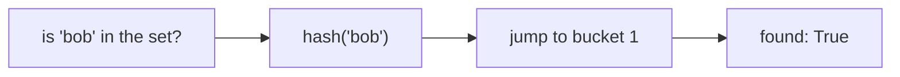
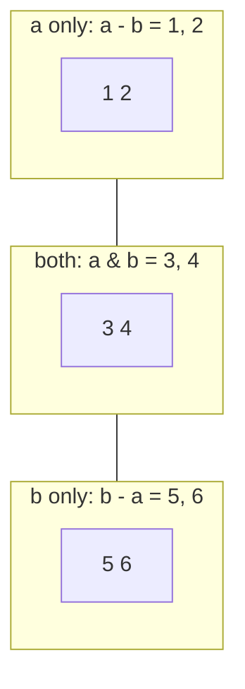

# 06 · Sets: Every Operation

> **Prerequisites:** [05 · Tuples and unpacking](../05-tuples-and-unpacking/README.md) - you know what "hashable" means and why a tuple can be one.  
> **Reading time:** ~35 minutes (with the exercises)  
> **Audience:** Complete beginners who want to master sets: what they are, every method, and when they beat a list

> [!NOTE]
> **In one line:** A set is a bag of **unique** items with **no order**. Asking "is this in the bag?" is very fast, and Python gives you maths-style operations to combine bags: union, intersection, difference.

> [!TIP]
> **Golden rule:** Reach for a set when you care about **membership** ("have I seen this?") or **uniqueness** ("remove duplicates"), and you do not care about order.

> [!TIP]
> **Try it:** Type `set("mississippi")` and look at the result. Then type `len(set("mississippi"))`. You just counted the distinct letters.

---

## 1. Roadmap: where sets sit

| Module | Container | One-line idea |
| :--- | :--- | :--- |
| [04](../04-lists-every-operation/README.md) | `list` | Ordered, changeable row |
| [05](../05-tuples-and-unpacking/README.md) | `tuple` | Ordered, fixed row |
| **06 (you are here)** | `set` | Unordered, no duplicates |
| [07](../07-dictionaries-every-operation/README.md) | `dict` | Look up a value by a key |

**After this module you can:**

- Create a set (and avoid the `{}` trap).
- Add, remove and test items, and say how fast each is.
- Combine sets with `|`, `&`, `-`, `^` and the matching methods.
- Test "is subset", "is superset", "share anything?".
- Remove duplicates from a list, with or without keeping the order.
- Say which things may and may not be set members.
- Write the same code with C# `HashSet<T>`.

---

## 2. Concept

> [!key]
> **A set is an unordered collection of unique, hashable items.** *Unique* means each value appears at most once; adding it again does nothing. *Unordered* means there is no position: no index, no "first item". *Hashable* means each item has a never-changing fingerprint (a **hash**) so Python can find it instantly.

**Real-life analogy.** A set is a **guest list at a door with a bouncer**. Either your name is on it or it is not. Writing the same name twice makes no difference. The list has no "first guest". And the bouncer checks you in one glance, without reading the list top to bottom.

**Why is the check so fast?** A set stores items in a table of "buckets". The hash of an item says which bucket to look in. Python goes straight to that bucket instead of scanning everything. That is **O(1)** on average, versus **O(n)** for `x in some_list`.

```text
   item           hash(item)       bucket
  "ann"   --->    ...4172    --->  [3]  "ann"
  "bob"   --->    ...9031    --->  [1]  "bob"
  "cy"    --->    ...2268    --->  [6]  "cy"

  Is "bob" in the set?   hash it -> bucket [1] -> found.  One step.
```



### Set versus list in one picture

```text
 list  [3, 1, 3, 2]      ordered, duplicates kept, position matters
 set   {1, 2, 3}         unordered, duplicates gone, only membership matters
```

---

## 3. Creating a set (every way)

```python
fruits = {"apple", "banana", "cherry"}
print(len(fruits))  # 3
print(type(fruits))  # <class 'set'>

dupes = {1, 2, 2, 3, 3, 3}
print(dupes)  # {1, 2, 3}

print(set([3, 1, 3, 2]))  # {1, 2, 3}
print(set("hello") == {"h", "e", "l", "o"})  # True
print(set(range(3)))  # {0, 1, 2}
print(set((1, 2, 2)))  # {1, 2}
print(set({"a": 1, "b": 2}) == {"a", "b"})  # True
print(set())  # set()
```

> [!pitfall]
> **`{}` is an empty dictionary, not an empty set.** Python used the curly brackets for dicts first. To make an empty set write `set()`.

```python
a = {}
b = set()
print(type(a))  # <class 'dict'>
print(type(b))  # <class 'set'>
print(type({1}))  # <class 'set'>
print(type({1: "x"}))  # <class 'dict'>
```

When you print a set, the order you see is **not** a promise. It may differ between runs for strings, and between Python versions. Never write code that depends on it. If you need sorted output, use `sorted(s)`.

```python
s = {"pear", "fig", "kiwi"}
print(sorted(s))  # ['fig', 'kiwi', 'pear']
print(sorted({3, 1, 2}, reverse=True))  # [3, 2, 1]
```

### 3.1 Set comprehension

Like a list comprehension, with curly brackets. See [module 08](../08-comprehensions-and-iteration/README.md) for more.

```python
squares = {x * x for x in range(-3, 4)}
print(sorted(squares))  # [0, 1, 4, 9]
initials = {name[0] for name in ["Ann", "Alex", "Bob", "Cy"]}
print(sorted(initials))  # ['A', 'B', 'C']
```

### 3.2 Frozenset: the immutable set

`frozenset` is a set that can never change. Because it cannot change, it is **hashable**, so it can be a dict key or a member of another set.

```python
f = frozenset([1, 2, 3, 2])
print(f)  # frozenset({1, 2, 3})
print(2 in f)  # True
print(f | {9} == frozenset({1, 2, 3, 9}))  # True
try:
    f.add(4)
except AttributeError as e:
    print(e)  # 'frozenset' object has no attribute 'add'

team = {frozenset({"ann", "bob"}): "alpha"}
print(team[frozenset({"bob", "ann"})])  # alpha
```

`frozenset` is to `set` what `tuple` is to `list`.

### 3.3 In C#

````carousel
```python
fruits = {"apple", "banana", "cherry"}
empty = set()
from_list = set([3, 1, 3, 2])
print(len(fruits), len(empty), sorted(from_list))  # 3 0 [1, 2, 3]
```
<!-- slide -->
```csharp
using System.Collections.Generic;

var fruits = new HashSet<string> { "apple", "banana", "cherry" };
var empty = new HashSet<string>();
var fromList = new HashSet<int>(new[] { 3, 1, 3, 2 });   // duplicates dropped
Console.WriteLine($"{fruits.Count} {empty.Count} {fromList.Count}");   // 3 0 3
// SortedSet<T> keeps items ordered; ImmutableHashSet<T> is like frozenset.
```
````

---

## 4. Adding, removing, testing

### 4.1 Methods at a glance

| Operation | Meaning | Returns | Speed |
| :--- | :--- | :--- | :--- |
| `s.add(x)` | Put `x` in (no-op if already there) | `None` | O(1) |
| `s.update(iterable)` | Add every item of the iterable | `None` | O(k) |
| `s.remove(x)` | Take `x` out; **error** if missing | `None` | O(1) |
| `s.discard(x)` | Take `x` out; **silent** if missing | `None` | O(1) |
| `s.pop()` | Remove and return **some** item | the item | O(1) |
| `s.clear()` | Remove everything | `None` | O(n) |
| `x in s` | Is `x` a member? | `bool` | O(1) |
| `x not in s` | Is `x` not a member? | `bool` | O(1) |
| `len(s)` | How many items | `int` | O(1) |
| `s.copy()` | A shallow copy | new set | O(n) |

### 4.2 Examples

```python
s = {1, 2}
s.add(3)
print(sorted(s))  # [1, 2, 3]
s.add(3)                       # already there: nothing happens
print(len(s))  # 3

s.update([3, 4, 5])
print(sorted(s))  # [1, 2, 3, 4, 5]
s.update({10}, (20, 30))       # several iterables at once
print(sorted(s))  # [1, 2, 3, 4, 5, 10, 20, 30]

s.remove(10)
print(10 in s)  # False
s.discard(20)                  # fine
s.discard(999)                 # fine: missing is okay
print(sorted(s))  # [1, 2, 3, 4, 5, 30]

try:
    s.remove(999)              # remove complains when missing
except KeyError as e:
    print("KeyError", e)  # KeyError 999

item = s.pop()                 # removes SOME item: you cannot choose which
print(item in s)  # False
s.clear()
print(s)  # set()

try:
    set().pop()
except KeyError as e:
    print(e)  # 'pop from an empty set'
```

> [!pitfall]
> **`pop()` on a set does not remove "the last" or "the first" item.** A set has no order, so the item is arbitrary. Never rely on which one you get.

> [!pitfall]
> **Sets cannot be indexed.** `s[0]` raises `TypeError: 'set' object is not subscriptable`. Convert to a list first (`list(s)[0]`), or sort it.

### 4.3 Looping and membership

```python
tags = {"python", "csharp", "sql"}
print("sql" in tags)  # True
print("go" in tags)  # False

for tag in sorted(tags):       # sorted gives a predictable order
    print(tag)                 # csharp / python / sql
```

### 4.4 Copies and aliases

```python
a = {1, 2}
b = a                          # alias: same set
c = a.copy()                   # new set
b.add(3)
print(sorted(a))  # [1, 2, 3]
print(sorted(c))  # [1, 2]
```

### 4.5 In C#

````carousel
```python
s = {1, 2}
s.add(3)                       # add
s.add(3)                       # no effect
s.update([4, 5])               # add many
s.discard(1)                   # remove if present
s.remove(2)                    # remove, error if missing
print(sorted(s), 3 in s)  # [3, 4, 5] True
```
<!-- slide -->
```csharp
var s = new HashSet<int> { 1, 2 };
bool added  = s.Add(3);        // true: it was new
bool again  = s.Add(3);        // false: already there (no exception)
s.UnionWith(new[] { 4, 5 });   // add many
bool removed = s.Remove(1);    // true if it was removed; never throws for missing
s.Remove(2);
Console.WriteLine(s.Contains(3));   // True
// HashSet<T>.Add and Remove RETURN a bool, which is handy:
// if (!seen.Add(x)) { /* duplicate found */ }
```
````

> [!key]
> In C#, `Add` returns `false` when the item was already there. That is a neat way to detect duplicates in one line. In Python, check with `if x in s` first.

---

## 5. Set algebra (the heart of sets)

Two example sets used throughout this section:

```python
a = {1, 2, 3, 4}
b = {3, 4, 5, 6}
```

### 5.1 The picture (a Venn diagram)

```text
          a                          b
   +-------------+            +-------------+
   |             |            |             |
   |    1   2  +-+------------+-+  5   6    |
   |           | |   3    4   | |           |
   |           +-+------------+-+           |
   |             |            |             |
   +-------------+            +-------------+
                  the overlap = {3, 4}

   a | b   union          everything in either   {1,2,3,4,5,6}
   a & b   intersection   in BOTH                {3,4}
   a - b   difference     in a, NOT in b         {1,2}
   b - a   difference     in b, NOT in a         {5,6}
   a ^ b   symmetric diff in exactly ONE         {1,2,5,6}
```



### 5.2 Every operation, operator and method

| Maths idea | Operator | Method (new set) | In-place method | In-place operator |
| :--- | :--- | :--- | :--- | :--- |
| Union (either) | `a \| b` | `a.union(b)` | `a.update(b)` | `a \|= b` |
| Intersection (both) | `a & b` | `a.intersection(b)` | `a.intersection_update(b)` | `a &= b` |
| Difference (a not b) | `a - b` | `a.difference(b)` | `a.difference_update(b)` | `a -= b` |
| Symmetric difference (one only) | `a ^ b` | `a.symmetric_difference(b)` | `a.symmetric_difference_update(b)` | `a ^= b` |

```python
a = {1, 2, 3, 4}
b = {3, 4, 5, 6}

print(sorted(a | b))  # [1, 2, 3, 4, 5, 6]
print(sorted(a & b))  # [3, 4]
print(sorted(a - b))  # [1, 2]
print(sorted(b - a))  # [5, 6]
print(sorted(a ^ b))  # [1, 2, 5, 6]

print(sorted(a.union(b)))  # [1, 2, 3, 4, 5, 6]
print(sorted(a.intersection(b)))  # [3, 4]
print(sorted(a.difference(b)))  # [1, 2]
print(sorted(a.symmetric_difference(b)))  # [1, 2, 5, 6]
print(sorted(a))  # [1, 2, 3, 4]
```

The first five operators and the four methods all produce a **new** set and leave `a` and `b` alone (the last line proves `a` is unchanged).

### 5.3 Operator vs method: what is the difference?

The **operators** need both sides to be sets. The **methods** accept **any iterable** (a list, a tuple, a string, ...).

```python
a = {1, 2, 3}
print(sorted(a.union([3, 4, 5])))  # [1, 2, 3, 4, 5]
print(sorted(a.intersection([2, 3, 99])))  # [2, 3]
print(sorted(a.union([7], (8,), {9})))  # [1, 2, 3, 7, 8, 9]

try:
    a | [4, 5]
except TypeError as e:
    print(e)  # unsupported operand type(s) for |: 'set' and 'list'
```

Operators chain: `a | b | c`. Methods can take several arguments: `a.union(b, c)`.

### 5.4 In-place versions: change `a` itself

```python
a = {1, 2, 3, 4}
a |= {10}                      # same as a.update({10})
print(sorted(a))  # [1, 2, 3, 4, 10]
a &= {1, 2, 10, 11}            # keep only what is also in the other set
print(sorted(a))  # [1, 2, 10]
a -= {10}
print(sorted(a))  # [1, 2]
a ^= {2, 3}                    # toggle membership: 2 leaves, 3 arrives
print(sorted(a))  # [1, 3]
```

### 5.5 Relationship tests

| Question | Operator | Method | Meaning |
| :--- | :--- | :--- | :--- |
| Is `a` inside `b` (or equal)? | `a <= b` | `a.issubset(b)` | Every item of `a` is in `b` |
| Is `a` strictly inside `b`? | `a < b` | - | Subset and not equal |
| Does `a` contain all of `b`? | `a >= b` | `a.issuperset(b)` | Every item of `b` is in `a` |
| Strictly contains? | `a > b` | - | Superset and not equal |
| Do they have nothing in common? | - | `a.isdisjoint(b)` | The intersection is empty |
| Same items? | `a == b` | - | Order never matters |

```python
small = {1, 2}
big = {1, 2, 3, 4}
other = {8, 9}

print(small <= big)  # True
print(small.issubset(big))  # True
print(small < small)  # False
print(small <= small)  # True
print(big >= small)  # True
print(big.issuperset(small))  # True
print(big > small)  # True
print(big.isdisjoint(other))  # True
print(big.isdisjoint(small))  # False
print({1, 2} == {2, 1})  # True
print(set() <= big)  # True
```

The empty set is a subset of every set.

### 5.6 In C#

````carousel
```python
a = {1, 2, 3, 4}
b = {3, 4, 5, 6}
print(sorted(a | b), sorted(a & b), sorted(a - b), sorted(a ^ b))  # [1, 2, 3, 4, 5, 6] [3, 4] [1, 2] [1, 2, 5, 6]
print({1, 2}.issubset(a), a.isdisjoint({9}))  # True True
```
<!-- slide -->
```csharp
var a = new HashSet<int> { 1, 2, 3, 4 };
var b = new HashSet<int> { 3, 4, 5, 6 };

// The C# methods all CHANGE the set they are called on (in place):
var union = new HashSet<int>(a); union.UnionWith(b);                 // 1..6
var inter = new HashSet<int>(a); inter.IntersectWith(b);             // 3 4
var diff  = new HashSet<int>(a); diff.ExceptWith(b);                 // 1 2
var sym   = new HashSet<int>(a); sym.SymmetricExceptWith(b);         // 1 2 5 6

bool sub  = new HashSet<int> { 1, 2 }.IsSubsetOf(a);                 // true
bool sup  = a.IsSupersetOf(new[] { 1, 2 });                          // true
bool over = a.Overlaps(b);                                           // true  (not disjoint)
bool same = a.SetEquals(b);                                          // false
// LINQ versions return new sequences: a.Union(b), a.Intersect(b), a.Except(b)
```
````

> [!pitfall]
> The C# `UnionWith`, `IntersectWith`, `ExceptWith` and `SymmetricExceptWith` change the set. They are the Python **in-place** forms (`|=`, `&=`, `-=`, `^=`). To get a new set, copy first, or use LINQ `Union`, `Intersect`, `Except`. C# `Overlaps` is the opposite of Python `isdisjoint`.

---

## 6. What can and cannot be a member

A member must be **hashable**: its value must never change. A good rule is that **immutable** types are hashable and **mutable** types are not.

| Type | Hashable? | Can be a set member? |
| :--- | :--- | :--- |
| `int`, `float`, `bool` | Yes | Yes |
| `str` | Yes | Yes |
| `None` | Yes | Yes |
| `tuple` of hashables | Yes | Yes |
| `frozenset` | Yes | Yes |
| `list` | No | **No** |
| `dict` | No | **No** |
| `set` | No | **No** |
| `tuple` containing a list | No | **No** |

```python
ok = {1, "a", (1, 2), None, 3.5, frozenset({1})}
print(len(ok))  # 6

for bad in ([1, 2], {"k": 1}, {1, 2}):
    try:
        {bad}
    except TypeError as e:
        print(e)
# unhashable type: 'list'
# unhashable type: 'dict'
# unhashable type: 'set'
```

> [!pitfall]
> **1 and True are the same member.** In Python `1 == True` and their hashes match, so a set treats them as one. `{1, True, 1.0}` has just one item.

```python
print({1, True, 1.0})  # {1}
print(len({0, False, 0.0}))  # 1
```

Also `float("nan")` is a famous oddity: it is not equal to itself. Avoid putting NaN in sets.

**Sets of sets** need `frozenset`:

```python
groups = {frozenset({1, 2}), frozenset({2, 1}), frozenset({3})}
print(len(groups))  # 2
```

---

## 7. Removing duplicates

### 7.1 When order does not matter

```python
nums = [3, 1, 3, 2, 1, 3]
unique = set(nums)
print(sorted(unique))  # [1, 2, 3]
print(len(nums) - len(unique))  # 3
print(len(nums) != len(unique))  # True
```

`len(nums) != len(set(nums))` is a one-line "does this list have any duplicate?" check.

### 7.2 When order matters: keep the first occurrence

A `set` forgets the order. A **dict** remembers insertion order and also has unique keys. So `dict.fromkeys` removes duplicates and keeps order.

```python
nums = [3, 1, 3, 2, 1, 3]
print(list(dict.fromkeys(nums)))  # [3, 1, 2]
print(list(dict.fromkeys("mississippi")))  # ['m', 'i', 's', 'p']
```

The long hand form, which also works for unhashable items:

```python
def unique_in_order(items):
    seen = set()
    result = []
    for x in items:
        if x not in seen:
            seen.add(x)
            result.append(x)
    return result

print(unique_in_order([3, 1, 3, 2, 1, 3]))  # [3, 1, 2]
```

### 7.3 In C#

````carousel
```python
nums = [3, 1, 3, 2, 1, 3]
print(sorted(set(nums)))  # [1, 2, 3]
print(list(dict.fromkeys(nums)))  # [3, 1, 2]
```
<!-- slide -->
```csharp
using System.Linq;
var nums = new List<int> { 3, 1, 3, 2, 1, 3 };
var unique = new HashSet<int>(nums);       // order NOT guaranteed
var ordered = nums.Distinct().ToList();    // keeps first-seen order: 3 1 2
```
````

---

## 8. Sets are fast: membership speed

The reason sets exist is `x in s`.

```python
import time

big_list = list(range(200_000))
big_set = set(big_list)
target = 199_999

t0 = time.perf_counter()
for _ in range(200):
    target in big_list
list_time = time.perf_counter() - t0

t0 = time.perf_counter()
for _ in range(200):
    target in big_set
set_time = time.perf_counter() - t0

print(set_time < list_time)  # True
# On a typical machine the set is thousands of times faster here.
```

| Container | `x in c` |
| :--- | :--- |
| `list` | O(n): checks one by one |
| `tuple` | O(n) |
| `set` | O(1) average |
| `dict` (keys) | O(1) average |

> [!key]
> If you are about to write `if x in some_big_list` inside a loop, convert the list to a set **once**, outside the loop. A loop of n checks goes from O(n x n) to O(n).

---

## 9. Complexity table (n = items in the set)

| Operation | Example | Speed |
| :--- | :--- | :--- |
| Membership | `x in s` | O(1) average, O(n) worst case |
| Add | `s.add(x)` | O(1) average |
| Remove, discard | `s.remove(x)` | O(1) average |
| `pop` | `s.pop()` | O(1) |
| `len` | `len(s)` | O(1) |
| Union | `a \| b` | O(len(a) + len(b)) |
| Intersection | `a & b` | O(min(len(a), len(b))) |
| Difference | `a - b` | O(len(a)) |
| Symmetric difference | `a ^ b` | O(len(a) + len(b)) |
| Subset test | `a <= b` | O(len(a)) |
| `isdisjoint` | `a.isdisjoint(b)` | O(min(len(a), len(b))) |
| Copy | `s.copy()` | O(n) |
| Iterate | `for x in s` | O(n) |
| Build from list | `set(lst)` | O(n) |

"Worst case" is the rare situation where many items land in the same bucket. You can ignore it for ordinary data.

Memory: a set uses more memory per item than a list, because of the bucket table. That is the price for speed.

---

## 10. Real examples

### 10.1 Unique visitors

```python
visits = ["ann", "bob", "ann", "cy", "bob", "ann"]
unique_visitors = set(visits)
print(len(visits), len(unique_visitors))  # 6 3
print(sorted(unique_visitors))  # ['ann', 'bob', 'cy']
```

### 10.2 Common friends

```python
ann_friends = {"bob", "cy", "di", "eve"}
bob_friends = {"ann", "cy", "eve", "fay"}

print(sorted(ann_friends & bob_friends))  # ['cy', 'eve']
print(sorted(ann_friends - bob_friends))  # ['bob', 'di']
print(sorted(ann_friends | bob_friends))  # ['ann', 'bob', 'cy', 'di', 'eve', 'fay']
print(sorted(ann_friends ^ bob_friends))  # ['ann', 'bob', 'di', 'fay']
```

### 10.3 Permission check

```python
required = {"read", "write"}
user_perms = {"read", "write", "delete"}
guest_perms = {"read"}

print(required <= user_perms)  # True
print(required <= guest_perms)  # False
print(sorted(required - guest_perms))  # ['write']
print(sorted(user_perms - required))  # ['delete']
```

`required <= granted` reads like English: "required is a subset of granted".

### 10.4 Find the duplicate

```python
def first_duplicate(items):
    seen = set()
    for x in items:
        if x in seen:
            return x
        seen.add(x)
    return None

print(first_duplicate([4, 7, 1, 7, 4]))  # 7
print(first_duplicate([1, 2, 3]))  # None
```

### 10.5 Visited cells (tuples inside a set)

```python
visited = set()
for step in [(0, 0), (0, 1), (1, 1), (0, 1)]:
    if step in visited:
        print("already been at", step)  # already been at (0, 1)
    visited.add(step)
print(len(visited))  # 3
```

### 10.6 Letters two words share

```python
w1, w2 = "apple", "pear"
print(sorted(set(w1) & set(w2)))  # ['a', 'e', 'p']
```

---

## 11. Common mistakes

1. **`x = {}` for an empty set.** That is a dict. Use `set()`.
2. **Expecting order.** Do not index or rely on the printed order; use `sorted()`.
3. **`remove` on a missing item.** Use `discard` if "not there" is fine.
4. **Putting a list or dict in a set.** Convert the list to a tuple first.
5. **`s = s.add(x)`.** `add` returns `None`.
6. **Using `|` with a list.** Use `.union(list)` or `set(list)`.
7. **Thinking `a - b` equals `b - a`.** Difference is not symmetric.
8. **Using `set(lst)` and expecting the original order.**
9. **Modifying a set while looping over it.** This raises `RuntimeError: Set changed size during iteration`. Loop over a copy.

```python
s = {1, 2, 3, 4}
try:
    for x in s:
        if x % 2 == 0:
            s.remove(x)
except RuntimeError as e:
    print(e)  # Set changed size during iteration

s = {1, 2, 3, 4}
s = {x for x in s if x % 2 != 0}       # the safe way
print(sorted(s))  # [1, 3]
```

---

## 12. When to choose a set

| You need | Use |
| :--- | :--- |
| Order, duplicates, positions | [list](../04-lists-every-operation/README.md) |
| A fixed record | [tuple](../05-tuples-and-unpacking/README.md) |
| Unique items, fast membership, union/intersection | **set** |
| Unique items that must stay in order | `dict.fromkeys(...)` |
| Unique items and a value for each | [dict](../07-dictionaries-every-operation/README.md) |
| Unique items that must stay sorted | `SortedSet` (C#) / sort when needed (Python) |

---

## 13. Practice

**1. Create.** Make an empty set, a set of three colours, and a set from the string `"banana"`. Print the length of each.

<details><summary>Answer</summary>

```python
empty = set()
colors = {"red", "green", "blue"}
letters = set("banana")
print(len(empty), len(colors), len(letters))  # 0 3 3
```
</details>

**2. Predict.** What does `len({1, 1.0, True, "1"})` print?

<details><summary>Answer</summary>

`2`. `1`, `1.0` and `True` are all equal and count as one member. The string `"1"` is different.

```python
print(len({1, 1.0, True, "1"}))  # 2
```
</details>

**3. Add and remove.** Start with `{1, 2, 3}`. Add 4, remove 1 (safely), and try to discard 99. Print the sorted result.

<details><summary>Answer</summary>

```python
s = {1, 2, 3}
s.add(4)
s.discard(1)
s.discard(99)
print(sorted(s))  # [2, 3, 4]
```
</details>

**4. The four operators.** For `a = {1, 2, 3}` and `b = {2, 3, 4}` print union, intersection, `a - b` and symmetric difference (sorted).

<details><summary>Answer</summary>

```python
a = {1, 2, 3}
b = {2, 3, 4}
print(sorted(a | b))  # [1, 2, 3, 4]
print(sorted(a & b))  # [2, 3]
print(sorted(a - b))  # [1]
print(sorted(a ^ b))  # [1, 4]
```
</details>

**5. Dedupe, keep order.** Remove duplicates from `["b", "a", "b", "c", "a"]` and keep the first-seen order.

<details><summary>Answer</summary>

```python
print(list(dict.fromkeys(["b", "a", "b", "c", "a"])))  # ['b', 'a', 'c']
```
</details>

**6. Any duplicates?** Write `has_duplicates(items)` using a set.

<details><summary>Answer</summary>

```python
def has_duplicates(items):
    return len(items) != len(set(items))

print(has_duplicates([1, 2, 3, 1]))  # True
print(has_duplicates([1, 2, 3]))  # False
```
</details>

**7. Vowels.** Count the distinct vowels in `"education"`.

<details><summary>Answer</summary>

```python
print(len(set("education") & set("aeiou")))  # 5
```
`e`, `u`, `a`, `i`, `o`: all five.
</details>

**8. Missing numbers.** Given `nums = [1, 2, 4, 6]`, find which numbers from 1 to 6 are missing.

<details><summary>Answer</summary>

```python
nums = [1, 2, 4, 6]
print(sorted(set(range(1, 7)) - set(nums)))  # [3, 5]
```
</details>

**9. Fix it.** Why does `x = {}; x.add(1)` fail, and what is the fix?

<details><summary>Answer</summary>

`{}` is an empty **dict**, which has no `add`. The error is `AttributeError: 'dict' object has no attribute 'add'`. Use `x = set()`.

```python
x = set()
x.add(1)
print(x)  # {1}
```
</details>

**10. Subset.** Is `{"a", "b"}` a subset of `"abc"` split into letters? Write it two ways.

<details><summary>Answer</summary>

```python
print({"a", "b"} <= set("abc"))  # True
print({"a", "b"}.issubset("abc"))  # True
```
The method accepts any iterable, so the string works directly.
</details>

**11. Sets of sets.** Count the distinct groups in `[{1, 2}, {2, 1}, {3}]`. Why can you not put them straight into a set?

<details><summary>Answer</summary>

A `set` is not hashable, so convert each to a `frozenset`.

```python
groups = [{1, 2}, {2, 1}, {3}]
print(len({frozenset(g) for g in groups}))  # 2
```
</details>

---

## 14. Mini project: a tag recommender

Two people list the topics they like. Print what they share, what only one likes, and which topics to recommend to each.

```python
ann = {"python", "sql", "docker", "linux"}
bob = {"python", "csharp", "sql", "azure"}

print("Both like:", sorted(ann & bob))  # Both like: ['python', 'sql']
print("Only Ann:", sorted(ann - bob))  # Only Ann: ['docker', 'linux']
print("Only Bob:", sorted(bob - ann))  # Only Bob: ['azure', 'csharp']

def recommend(me, other):
    return sorted(other - me)

print("Ann could try:", recommend(ann, bob))  # Ann could try: ['azure', 'csharp']
print("Bob could try:", recommend(bob, ann))  # Bob could try: ['docker', 'linux']

similarity = len(ann & bob) / len(ann | bob)
print(round(similarity, 2))  # 0.33
```

`len(a & b) / len(a | b)` is called the **Jaccard similarity**, a real measure used by recommender systems.

**Extensions:**

1. Read a list of three people and print the topics **all three** share (`a & b & c`).
2. Write `suggest_friends(me, everyone)` that ranks other people by how many topics they share with you.
3. Make a version that keeps a set of topics each person has already tried, and never recommends those.

---

## 15. Interview questions

<details>
<summary><b>Q1. What is a set, and how is it different from a list?</b></summary>

A set is an unordered collection of unique, hashable items. A list is ordered and allows duplicates. Sets answer membership in O(1) on average; lists need O(n).
</details>

<details>
<summary><b>Q2. Why is <code>x in s</code> fast for a set?</b></summary>

A set is a hash table. Python hashes `x`, jumps to a bucket, and compares there. It does not scan the whole collection.
</details>

<details>
<summary><b>Q3. How do you create an empty set?</b></summary>

`set()`. The literal `{}` creates an empty dictionary.
</details>

<details>
<summary><b>Q4. What is the difference between <code>remove</code> and <code>discard</code>?</b></summary>

`remove(x)` raises `KeyError` if `x` is absent. `discard(x)` does nothing in that case.
</details>

<details>
<summary><b>Q5. Remove duplicates from a list while keeping the order.</b></summary>

`list(dict.fromkeys(items))`, or a loop with a `seen` set. `set(items)` loses the order.
</details>

<details>
<summary><b>Q6. What can be an element of a set?</b></summary>

Only hashable (immutable) objects: numbers, strings, tuples of hashables, frozensets, `None`. Not lists, dicts or sets. Use a tuple or a frozenset instead.
</details>

<details>
<summary><b>Q7. Explain union, intersection, difference and symmetric difference.</b></summary>

Union: in either. Intersection: in both. Difference `a - b`: in `a` but not `b`. Symmetric difference: in exactly one of them. Each has an operator (`|`, `&`, `-`, `^`) and a method.
</details>

<details>
<summary><b>Q8. What is the C# equivalent, and how do its set methods differ?</b></summary>

`HashSet<T>`. Methods like `UnionWith` and `IntersectWith` modify the set in place (Python's `|=` and `&=`). `Add` and `Remove` return a bool. `Overlaps` is the opposite of `isdisjoint`.
</details>

<details>
<summary><b>Q9. Find the first duplicate in an array in O(n).</b></summary>

Walk the items and keep a set of those seen. The first item already in the set is the answer. Time O(n), extra space O(n).
</details>

## Cheat sheet

```text
Create  {1, 2}  set(xs)  set()  <- {} is an EMPTY DICT, not a set
add(x)  update(xs)  remove(x) KeyError | discard(x) quiet | pop() arbitrary | clear()
a | b union   a & b intersection   a - b difference   a ^ b symmetric diff
a <= b subset   a >= b superset   a.isdisjoint(b)
Members must be hashable: no list/dict/set inside; use tuple / frozenset
Unordered, no duplicates, no indexing
x in s is O(1) average (list is O(n))   dedupe: list(set(xs)) loses order
Keep order: list(dict.fromkeys(xs))
Use for: membership, dedupe, "what's in A but not B?"
```

---

## Further reading

- [Python tutorial: Sets](https://docs.python.org/3/tutorial/datastructures.html#sets) - the official introduction.
- [Python docs: Set types (set, frozenset)](https://docs.python.org/3/library/stdtypes.html#set-types-set-frozenset) - every method and operator.
- [Python wiki: TimeComplexity](https://wiki.python.org/moin/TimeComplexity) - the speed of each set operation.
- [Real Python: Sets in Python](https://realpython.com/python-sets/) - a long, friendly tutorial.
- [Microsoft Learn: HashSet&lt;T&gt; class](https://learn.microsoft.com/en-us/dotnet/api/system.collections.generic.hashset-1) - the C# equivalent.
- [Microsoft Learn: Set operations in LINQ](https://learn.microsoft.com/en-us/dotnet/csharp/linq/standard-query-operators/set-operations) - `Union`, `Intersect`, `Except`, `Distinct`.

## Next

Continue to [07 · Dictionaries: every operation](../07-dictionaries-every-operation/README.md). Back to the [overview](../README.md).
