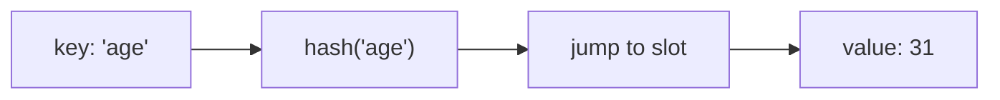

# 07 · Dictionaries: Every Operation

> **Prerequisites:** [06 · Sets: every operation](../06-sets-every-operation/README.md) - dict keys follow the same "hashable" rule as set members.  
> **Reading time:** ~45 minutes (with the exercises)  
> **Audience:** Complete beginners who want to master the dictionary, the most useful container in Python

> [!NOTE]
> **In one line:** A dictionary stores **key -> value** pairs. You give it a key and it hands back the value almost instantly, no matter how many pairs it holds.

> [!TIP]
> **Golden rule:** Use a dict whenever you would say "look up X by its name/id". Use `d.get(key, default)` when the key might be missing, and `d[key]` only when it must be there.

> [!TIP]
> **Try it:** Type `d = {"a": 1}`, then `d["b"] = 2`, then `d`. Then try `d["zzz"]` and read the `KeyError`. That error is the most common dictionary bug, and this module shows five ways to avoid it.

---

## 1. Roadmap: where dictionaries sit

| Module | Container | One-line idea |
| :--- | :--- | :--- |
| [04](../04-lists-every-operation/README.md) | `list` | Ordered, changeable row |
| [05](../05-tuples-and-unpacking/README.md) | `tuple` | Ordered, fixed row |
| [06](../06-sets-every-operation/README.md) | `set` | Unordered, no duplicates |
| **07 (you are here)** | `dict` | Look up a value by a key |

A dict is the last of the four built-in containers. Almost every real program uses one: a user profile, a settings file, a word count, a cache, a JSON response.

**After this module you can:**

- Create a dict in every common way.
- Read, add, change, merge and delete entries, and avoid `KeyError`.
- Loop over keys, values and pairs.
- Build nested dicts and dicts of lists.
- Count and group with plain dicts, `Counter` and `defaultdict`.
- Sort a dict by value.
- Say which things can be keys, and how fast each operation is.
- Write the same code with C# `Dictionary<TKey, TValue>`.

---

## 2. Concept

> [!key]
> **A dict maps unique keys to values.** Each key appears once and points to one value. Keys must be **hashable** (never change); values can be anything. Since Python 3.7 a dict also **remembers the order in which keys were added**.

**Real-life analogy.** A dict is a **phone book**. You do not read it from page one. You look up a **name** (the key) and get a **number** (the value). Two people cannot share one entry (keys are unique), but two names may share the same number (values may repeat).

**Why is it fast?** Like a set, a dict is a hash table. Python hashes the key and jumps straight to the slot. Looking up one key in a dict of ten items or ten million items takes about the same time: **O(1)**.

### The picture

```text
   key        value
  +--------+----------------+
  | "name" |  "Ann"         |
  +--------+----------------+
  | "age"  |  31            |
  +--------+----------------+
  | "tags" |  ["a", "b"]    |        person = {"name": "Ann", "age": 31, "tags": ["a", "b"]}
  +--------+----------------+
   unique,                     any type
   hashable
```



---

## 3. Creating a dict (every way)

```python
empty = {}
person = {"name": "Ann", "age": 31}
print(person)  # {'name': 'Ann', 'age': 31}
print(len(person))  # 2
print(type(empty))  # <class 'dict'>

# dict() with keyword arguments: keys must be simple names, become strings
p2 = dict(name="Bob", age=25)
print(p2)  # {'name': 'Bob', 'age': 25}

# dict() from a list of pairs
p3 = dict([("a", 1), ("b", 2)])
print(p3)  # {'a': 1, 'b': 2}

# zip two lists into a dict
keys = ["x", "y", "z"]
values = [10, 20, 30]
print(dict(zip(keys, values)))  # {'x': 10, 'y': 20, 'z': 30}

# fromkeys: same starting value for every key
print(dict.fromkeys(["a", "b", "c"], 0))  # {'a': 0, 'b': 0, 'c': 0}
print(dict.fromkeys(["a", "b"]))  # {'a': None, 'b': None}

# comprehension
print({n: n * n for n in range(1, 5)})  # {1: 1, 2: 4, 3: 9, 4: 16}
words = ["apple", "fig", "kiwi"]
print({w: len(w) for w in words})  # {'apple': 5, 'fig': 3, 'kiwi': 4}

# copy of another dict
print(dict(person) == person)  # True
```

> [!pitfall]
> `dict.fromkeys(keys, [])` puts **the same list** under every key. Changing one changes them all. This is the same trap as `[[0] * 3] * 3` in [module 04](../04-lists-every-operation/README.md).

```python
d = dict.fromkeys(["a", "b"], [])
d["a"].append(1)
print(d)  # {'a': [1], 'b': [1]}

d = {k: [] for k in ["a", "b"]}        # fix: a new list for each key
d["a"].append(1)
print(d)  # {'a': [1], 'b': []}
```

If a key is repeated while building a dict, the **last one wins**:

```python
print({"a": 1, "a": 2})  # {'a': 2}
```

### 3.1 In C#

````carousel
```python
ages = {"Ann": 31, "Bob": 25}
empty = {}
squares = {n: n * n for n in range(1, 4)}
print(ages, empty, squares)  # {'Ann': 31, 'Bob': 25} {} {1: 1, 2: 4, 3: 9}
```
<!-- slide -->
```csharp
using System.Collections.Generic;
using System.Linq;

var ages = new Dictionary<string, int>
{
    ["Ann"] = 31,
    ["Bob"] = 25,
};
var empty = new Dictionary<string, int>();
var squares = Enumerable.Range(1, 3).ToDictionary(n => n, n => n * n);
// {1: 1, 2: 4, 3: 9}
var paired = new[] { "x", "y" }.Zip(new[] { 10, 20 })      // like zip(keys, values)
                               .ToDictionary(p => p.First, p => p.Second);
```
````

> [!pitfall]
> In a C# collection initializer `{ { "Ann", 31 }, { "Ann", 40 } }` a repeated key throws `ArgumentException`. The indexer form `["Ann"] = 40` silently overwrites, like Python.

---

## 4. Reading values

| Way | If the key exists | If the key is missing | Changes the dict? |
| :--- | :--- | :--- | :--- |
| `d[k]` | the value | **`KeyError`** | no |
| `d.get(k)` | the value | `None` | no |
| `d.get(k, default)` | the value | `default` | no |
| `d.setdefault(k, default)` | the value | stores `default` and returns it | **yes, if missing** |
| `k in d` | `True` | `False` | no |

```python
d = {"name": "Ann", "age": 31}
print(d["name"])  # Ann
print(d.get("age"))  # 31
print(d.get("city"))  # None
print(d.get("city", "unknown"))  # unknown
print("name" in d)  # True
print("city" in d)  # False
print("city" not in d)  # True
print("Ann" in d)  # False

try:
    d["city"]
except KeyError as e:
    print("KeyError:", e)  # KeyError: 'city'
```

> [!key]
> `in` checks the **keys**, not the values. `"Ann" in d` is `False` because `"Ann"` is a value. To test values use `"Ann" in d.values()` (a slow O(n) scan).

### 4.1 `setdefault`: "read it, and create it if missing"

```python
d = {"a": 1}
print(d.setdefault("a", 99))  # 1
print(d.setdefault("b", 2))  # 2
print(d)  # {'a': 1, 'b': 2}

groups = {}
groups.setdefault("fruit", []).append("apple")
groups.setdefault("fruit", []).append("pear")
groups.setdefault("veg", []).append("leek")
print(groups)  # {'fruit': ['apple', 'pear'], 'veg': ['leek']}
```

### 4.2 Five ways to avoid `KeyError`

```python
d = {"a": 1}

# 1. get with a default
print(d.get("z", 0))  # 0

# 2. check first
if "z" in d:
    print(d["z"])
else:
    print("missing")  # missing

# 3. try / except
try:
    value = d["z"]
except KeyError:
    value = 0
print(value)  # 0

# 4. setdefault (also stores the default)
print(d.setdefault("z", 0))  # 0

# 5. defaultdict (see section 11)
from collections import defaultdict
dd = defaultdict(int)
print(dd["z"])  # 0
```

### 4.3 In C#

````carousel
```python
d = {"Ann": 31}
print(d["Ann"])  # 31
print(d.get("Bob", -1))  # -1
print("Ann" in d)  # True
```
<!-- slide -->
```csharp
var d = new Dictionary<string, int> { ["Ann"] = 31 };
Console.WriteLine(d["Ann"]);                       // 31
// d["Bob"] would throw KeyNotFoundException, just like Python's KeyError
if (d.TryGetValue("Bob", out int age))             // the safe, idiomatic way
    Console.WriteLine(age);
else
    Console.WriteLine("missing");                  // missing
Console.WriteLine(d.GetValueOrDefault("Bob", -1)); // -1   (like d.get("Bob", -1))
Console.WriteLine(d.ContainsKey("Ann"));           // True  (like "Ann" in d)
```
````

---

## 5. Adding, updating, merging

### 5.1 Add or change one entry

Assignment does both: it **adds** a new key or **replaces** an existing one.

```python
d = {"a": 1}
d["b"] = 2                         # add
d["a"] = 100                       # change
print(d)  # {'a': 100, 'b': 2}

d["count"] = d.get("count", 0) + 1
d["count"] = d.get("count", 0) + 1
print(d["count"])  # 2

d["a"] += 5                        # read-modify-write works when the key exists
print(d["a"])  # 105
```

### 5.2 `update`: add many at once

```python
d = {"a": 1, "b": 2}
d.update({"b": 20, "c": 30})       # existing keys are overwritten
print(d)  # {'a': 1, 'b': 20, 'c': 30}
d.update(d=4, e=5)                 # keyword form
print(d)  # {'a': 1, 'b': 20, 'c': 30, 'd': 4, 'e': 5}
d.update([("f", 6), ("g", 7)])     # list of pairs
print(len(d))  # 7
```

### 5.3 Merge into a NEW dict: `|` and `**`

```python
defaults = {"theme": "light", "size": 12}
user = {"size": 16, "lang": "en"}

merged = defaults | user               # Python 3.9+: right side wins on clashes
print(merged)  # {'theme': 'light', 'size': 16, 'lang': 'en'}
print(defaults)  # {'theme': 'light', 'size': 12}

merged2 = {**defaults, **user}         # works in all Python 3 versions
print(merged2 == merged)  # True

merged3 = {**defaults, "size": 99}     # override inline
print(merged3)  # {'theme': 'light', 'size': 99}

defaults |= user                       # Python 3.9+: in-place, same as update
print(defaults)  # {'theme': 'light', 'size': 16, 'lang': 'en'}
```

| Goal | Code | New dict? |
| :--- | :--- | :--- |
| Set one key | `d[k] = v` | no, changes `d` |
| Merge another dict in | `d.update(other)` or `d \|= other` | no, changes `d` |
| Make a merged copy | `a \| b` or `{**a, **b}` | yes |
| Set only if missing | `d.setdefault(k, v)` | no |

When both dicts have the same key, **the right-hand one wins**.

### 5.4 In C#

````carousel
```python
d = {"a": 1}
d["b"] = 2
d["a"] = 100
d.update({"c": 3})
merged = d | {"a": 0}
print(d, merged)  # {'a': 100, 'b': 2, 'c': 3} {'a': 0, 'b': 2, 'c': 3}
```
<!-- slide -->
```csharp
var d = new Dictionary<string, int> { ["a"] = 1 };
d["b"] = 2;                         // add (indexer: add or overwrite)
d["a"] = 100;                       // overwrite
d.Add("c", 3);                      // Add THROWS if the key exists
bool ok = d.TryAdd("c", 99);        // false: key exists, nothing changes
foreach (var kv in new Dictionary<string, int> { ["a"] = 0 })
    d[kv.Key] = kv.Value;           // C# has no built-in "update": loop
// A merged copy:
var merged = new Dictionary<string, int>(d);
merged["a"] = 0;
```
````

---

## 6. Deleting

| Way | What it does | If the key is missing |
| :--- | :--- | :--- |
| `del d[k]` | Remove the pair | `KeyError` |
| `d.pop(k)` | Remove and **return** the value | `KeyError` |
| `d.pop(k, default)` | Remove and return, or `default` | returns `default` |
| `d.popitem()` | Remove and return the **last-added** pair | `KeyError` if empty |
| `d.clear()` | Remove everything | - |

```python
d = {"a": 1, "b": 2, "c": 3, "d": 4}
del d["a"]
print(d)  # {'b': 2, 'c': 3, 'd': 4}

print(d.pop("b"))  # 2
print(d.pop("zzz", "none"))  # none
print(d)  # {'c': 3, 'd': 4}

print(d.popitem())  # ('d', 4)
print(d)  # {'c': 3}

d.clear()
print(d)  # {}

try:
    del d["x"]
except KeyError as e:
    print("KeyError:", e)  # KeyError: 'x'

try:
    {}.popitem()
except KeyError as e:
    print(e)  # 'popitem(): dictionary is empty'
```

`popitem()` removes in **LIFO** order (last in, first out), so you can use a dict as a stack of pairs.

**Removing several keys safely** (never delete while looping over the dict itself):

```python
d = {"a": 1, "b": 2, "c": 3, "d": 4}
for k in list(d):                  # list(d) is a COPY of the keys
    if d[k] % 2 == 0:
        del d[k]
print(d)  # {'a': 1, 'c': 3}

d = {"a": 1, "b": 2, "c": 3, "d": 4}
d = {k: v for k, v in d.items() if v % 2 != 0}   # or build a new dict
print(d)  # {'a': 1, 'c': 3}
```

````carousel
```python
d = {"a": 1, "b": 2}
d.pop("a")
d.pop("zzz", None)
del d["b"]
print(d)  # {}
```
<!-- slide -->
```csharp
var d = new Dictionary<string, int> { ["a"] = 1, ["b"] = 2 };
bool removed = d.Remove("a");                // true; false if missing, never throws
d.Remove("zzz");                              // false
if (d.Remove("b", out int old))               // remove AND get the value (like pop)
    Console.WriteLine(old);                   // 2
d.Clear();
```
````

---

## 7. Views: keys, values, items; and looping

`keys()`, `values()` and `items()` return **views**: live windows onto the dict. They are not copies and they stay up to date.

```python
d = {"a": 1, "b": 2, "c": 3}
print(d.keys())  # dict_keys(['a', 'b', 'c'])
print(d.values())  # dict_values([1, 2, 3])
print(d.items())  # dict_items([('a', 1), ('b', 2), ('c', 3)])
print(list(d.keys()))  # ['a', 'b', 'c']
print(sum(d.values()))  # 6
print(len(d.keys()))  # 3

view = d.keys()
d["z"] = 26
print(list(view))  # ['a', 'b', 'c', 'z']
```

### 7.1 Looping (four ways)

```python
d = {"a": 1, "b": 2, "c": 3}

for k in d:                        # keys (same as d.keys())
    print(k)                       # a / b / c
for v in d.values():
    print(v)                       # 1 / 2 / 3
for k, v in d.items():             # pairs: tuple unpacking from module 05
    print(k, v)                    # a 1 / b 2 / c 3
for i, (k, v) in enumerate(d.items()):
    print(i, k, v)                 # 0 a 1 / 1 b 2 / 2 c 3
```

Never add or delete keys while looping over a dict. Python raises `RuntimeError: dictionary changed size during iteration`. Changing the **value** of an existing key is fine.

```python
d = {"a": 1, "b": 2}
for k in d:
    d[k] *= 10                     # fine: no new keys
print(d)  # {'a': 10, 'b': 20}

try:
    for k in d:
        d[k + "x"] = 0             # adds keys while iterating
except RuntimeError as e:
    print(e)  # dictionary changed size during iteration
```

### 7.2 Keys and items behave like sets

`keys()` and `items()` views support set operations (from [module 06](../06-sets-every-operation/README.md)).

```python
a = {"x": 1, "y": 2, "z": 3}
b = {"y": 2, "z": 99, "w": 4}
print(sorted(a.keys() & b.keys()))  # ['y', 'z']
print(sorted(a.keys() - b.keys()))  # ['x']
print(sorted(a.keys() | b.keys()))  # ['w', 'x', 'y', 'z']
print(a.items() & b.items())  # {('y', 2)}
```

### 7.3 Order

Since Python 3.7 a dict keeps **insertion order**. Re-assigning an existing key keeps its place. Deleting a key and adding it again puts it at the end. Two dicts are equal if they hold the same pairs, **regardless of order**.

```python
d = {}
d["first"] = 1
d["second"] = 2
d["third"] = 3
print(list(d))  # ['first', 'second', 'third']
d["first"] = 100
print(list(d))  # ['first', 'second', 'third']
del d["first"]
d["first"] = 1
print(list(d))  # ['second', 'third', 'first']
print({"a": 1, "b": 2} == {"b": 2, "a": 1})  # True
print(list(reversed(d)))  # ['first', 'third', 'second']
```

### 7.4 In C#

````carousel
```python
d = {"a": 1, "b": 2}
for k, v in d.items():
    print(k, v)
print(list(d.keys()), list(d.values()))  # ['a', 'b'] [1, 2]
```
<!-- slide -->
```csharp
var d = new Dictionary<string, int> { ["a"] = 1, ["b"] = 2 };
foreach (KeyValuePair<string, int> kv in d)
    Console.WriteLine($"{kv.Key} {kv.Value}");
foreach (var (k, v) in d)                    // deconstruction works in modern C#
    Console.WriteLine($"{k} {v}");
var keys = d.Keys.ToList();                  // a, b
var values = d.Values.ToList();              // 1, 2
// Order: Dictionary<K,V> does NOT promise insertion order.
// Use SortedDictionary<K,V> (sorted by key) when order matters.
```
````

> [!pitfall]
> Python guarantees insertion order for dicts. C# `Dictionary` does **not**. Do not port code that depends on ordering without `SortedDictionary` or an explicit sort.

---

## 8. What can be a key

A key must be **hashable**, the same rule as set members in [module 06](../06-sets-every-operation/README.md).

| Key type | Allowed? |
| :--- | :--- |
| `str`, `int`, `float`, `bool`, `None` | Yes |
| `tuple` of hashables | Yes |
| `frozenset` | Yes |
| `list`, `dict`, `set` | **No** (`TypeError: unhashable type`) |

```python
d = {
    "name": 1,
    42: "answer",
    (1, 2): "point",
    None: "nothing",
    True: "yes",
}
print(d[(1, 2)])  # point
print(d[None])  # nothing

try:
    d[[1, 2]] = "x"
except TypeError as e:
    print(e)  # unhashable type: 'list'

print({1: "a", 1.0: "b", True: "c"})  # {1: 'c'}
```

The last line shows the same quirk as sets: `1`, `1.0` and `True` are one key, and the last value wins (the key keeps its first spelling, `1`).

Values can be **anything**, including lists, dicts and functions.

---

## 9. Nested dicts and dicts of lists

### 9.1 Dict of dicts

```python
users = {
    "ann": {"age": 31, "city": "Oslo"},
    "bob": {"age": 25, "city": "Bergen"},
}
print(users["ann"]["city"])  # Oslo
users["bob"]["age"] = 26
users["cy"] = {"age": 40, "city": "Oslo"}
print(sorted(users))  # ['ann', 'bob', 'cy']

print(users.get("zed", {}).get("city", "?"))  # ?

for name, info in users.items():
    print(name, info["city"])      # ann Oslo / bob Bergen / cy Oslo
```

`users["zed"]["city"]` would crash with `KeyError` at the first level. Chained `.get(..., {})` is the safe way to dig.

### 9.2 Dict of lists

```python
by_city = {"Oslo": ["ann", "cy"], "Bergen": ["bob"]}
by_city["Oslo"].append("di")
by_city.setdefault("Tromso", []).append("eve")
print(by_city)  # {'Oslo': ['ann', 'cy', 'di'], 'Bergen': ['bob'], 'Tromso': ['eve']}
print(len(by_city["Oslo"]))  # 3
```

### 9.3 JSON-like data

Python dicts and lists map directly to JSON objects and arrays.

```python
import json

order = {
    "id": 17,
    "customer": {"name": "Ann", "vip": True},
    "items": [
        {"sku": "A1", "qty": 2},
        {"sku": "B2", "qty": 1},
    ],
    "note": None,
}
text = json.dumps(order)
print(text)  # {"id": 17, "customer": {"name": "Ann", "vip": true}, "items": [{"sku": "A1", "qty": 2}, {"sku": "B2", "qty": 1}], "note": null}
back = json.loads(text)
print(back == order)  # True
print(sum(item["qty"] for item in order["items"]))  # 3
print(order["customer"]["vip"])  # True
```

Python `True`/`None` become JSON `true`/`null`. Module [10](../10-files-modules-and-the-standard-library/README.md) shows reading and writing JSON files.

---

## 10. Copying: shallow vs deep

The same story as lists ([module 04, section 14](../04-lists-every-operation/README.md)).

```python
import copy

a = {"name": "Ann", "tags": ["x"]}
alias = a
shallow = a.copy()                     # also dict(a) or {**a}
deep = copy.deepcopy(a)

a["name"] = "Zed"
a["tags"].append("y")
print(alias["name"])  # Zed
print(shallow["name"])  # Ann
print(shallow["tags"])  # ['x', 'y']
print(deep["tags"])  # ['x']
```

| Kind | How | New outer dict | New inner objects |
| :--- | :--- | :--- | :--- |
| Alias | `b = a` | No | No |
| Shallow | `a.copy()`, `dict(a)`, `{**a}` | Yes | No (shared) |
| Deep | `copy.deepcopy(a)` | Yes | Yes |

---

## 11. Counting and grouping patterns

### 11.1 The hand-made counter

```python
text = "banana"
counts = {}
for ch in text:
    counts[ch] = counts.get(ch, 0) + 1
print(counts)  # {'b': 1, 'a': 3, 'n': 2}
```

### 11.2 `collections.Counter`

`Counter` is a dict built for counting.

```python
from collections import Counter

c = Counter("banana")
print(c)  # Counter({'a': 3, 'n': 2, 'b': 1})
print(c["a"])  # 3
print(c["zzz"])  # 0
print(c.most_common(2))  # [('a', 3), ('n', 2)]
print(sum(c.values()))  # 6
c.update("band")
print(c["a"])  # 4
print(Counter(["x", "y", "x"]))  # Counter({'x': 2, 'y': 1})
print(Counter("aab") + Counter("abc"))  # Counter({'a': 3, 'b': 2, 'c': 1})
print(Counter("aab") - Counter("abc"))  # Counter({'a': 1})
```

A missing key returns `0` instead of raising `KeyError`.

### 11.3 `collections.defaultdict`

`defaultdict(factory)` creates the missing value for you, by calling `factory()`.

```python
from collections import defaultdict

counts = defaultdict(int)              # int() is 0
for ch in "banana":
    counts[ch] += 1
print(dict(counts))  # {'b': 1, 'a': 3, 'n': 2}

groups = defaultdict(list)             # list() is []
for word in ["apple", "avocado", "banana", "blueberry", "cherry"]:
    groups[word[0]].append(word)
print(dict(groups))  # {'a': ['apple', 'avocado'], 'b': ['banana', 'blueberry'], 'c': ['cherry']}

sets = defaultdict(set)
sets["x"].add(1)
sets["x"].add(1)
sets["y"].add(2)
print(dict(sets))  # {'x': {1}, 'y': {2}}
```

Reading a missing key from a `defaultdict` **creates** it. Use `in` or `.get()` if you only want to look.

### 11.4 Grouping with a plain dict

```python
words = ["apple", "avocado", "banana", "blueberry", "cherry"]
groups = {}
for w in words:
    groups.setdefault(w[0], []).append(w)
print(groups)  # {'a': ['apple', 'avocado'], 'b': ['banana', 'blueberry'], 'c': ['cherry']}
```

### 11.5 In C#

````carousel
```python
from collections import defaultdict
groups = defaultdict(list)
for w in ["apple", "avocado", "banana"]:
    groups[w[0]].append(w)
print(dict(groups))  # {'a': ['apple', 'avocado'], 'b': ['banana']}
```
<!-- slide -->
```csharp
var words = new[] { "apple", "avocado", "banana" };

// Counting by hand
var counts = new Dictionary<char, int>();
foreach (char ch in "banana")
    counts[ch] = counts.GetValueOrDefault(ch) + 1;

// Grouping: C# has no defaultdict, so use GroupBy or TryGetValue
var groups = words.GroupBy(w => w[0])
                  .ToDictionary(g => g.Key, g => g.ToList());
var manual = new Dictionary<char, List<string>>();
foreach (var w in words)
{
    if (!manual.TryGetValue(w[0], out var list))
        manual[w[0]] = list = new List<string>();
    list.Add(w);
}
```
````

---

## 12. Sorting a dict

A dict cannot be sorted in place, but you can build a **sorted list of pairs** or a **new dict in sorted order**.

```python
scores = {"ann": 90, "bob": 72, "cy": 85, "di": 72}

print(sorted(scores))  # ['ann', 'bob', 'cy', 'di']
print(sorted(scores.items()))  # [('ann', 90), ('bob', 72), ('cy', 85), ('di', 72)]

by_value = sorted(scores.items(), key=lambda kv: kv[1])
print(by_value)  # [('bob', 72), ('di', 72), ('cy', 85), ('ann', 90)]

best_first = sorted(scores.items(), key=lambda kv: kv[1], reverse=True)
print(best_first)  # [('ann', 90), ('cy', 85), ('bob', 72), ('di', 72)]

print(dict(by_value))  # {'bob': 72, 'di': 72, 'cy': 85, 'ann': 90}
print(max(scores, key=scores.get))  # ann
print(min(scores.values()))  # 72

print(sorted(scores.items(), key=lambda kv: (-kv[1], kv[0])))  # [('ann', 90), ('cy', 85), ('bob', 72), ('di', 72)]
```

`max(scores, key=scores.get)` returns the **key** with the largest value. Ties keep the first found.

````carousel
```python
scores = {"ann": 90, "bob": 72, "cy": 85}
top = sorted(scores.items(), key=lambda kv: kv[1], reverse=True)
print(top)  # [('ann', 90), ('cy', 85), ('bob', 72)]
```
<!-- slide -->
```csharp
var scores = new Dictionary<string, int> { ["ann"] = 90, ["bob"] = 72, ["cy"] = 85 };
var top = scores.OrderByDescending(kv => kv.Value).ToList();   // a sorted list of pairs
var topDict = top.ToDictionary(kv => kv.Key, kv => kv.Value);  // order not guaranteed!
var sorted = new SortedDictionary<string, int>(scores);        // sorted by KEY
string best = scores.MaxBy(kv => kv.Value).Key;                // "ann"
```
````

---

## 13. Every operation in one table (with speed)

**n** = number of entries.

| Operation | Example | Speed |
| :--- | :--- | :--- |
| Read | `d[k]`, `d.get(k)` | O(1) average |
| Add / change | `d[k] = v` | O(1) average (amortized) |
| Membership of a key | `k in d` | O(1) average |
| Membership of a value | `v in d.values()` | **O(n)** |
| Delete | `del d[k]`, `d.pop(k)` | O(1) average |
| `popitem()` | | O(1) |
| `setdefault` | | O(1) average |
| `len(d)` | | O(1) |
| `update(other)` | | O(len(other)) |
| `a \| b` | | O(len(a) + len(b)) |
| `keys()`, `values()`, `items()` | | O(1) to create a view |
| Loop over all | `for k, v in d.items()` | O(n) |
| `copy()` | | O(n) |
| `sorted(d.items())` | | O(n log n) |
| `clear()` | | O(n) |

Dict operations are fast because of hashing. The only slow habit is searching **values** (`v in d.values()`), which scans.

---

## 14. Real examples

### 14.1 Word count

```python
text = "the cat saw the dog and the cat ran"
counts = {}
for word in text.split():
    counts[word] = counts.get(word, 0) + 1
print(counts)  # {'the': 3, 'cat': 2, 'saw': 1, 'dog': 1, 'and': 1, 'ran': 1}

top = sorted(counts.items(), key=lambda kv: (-kv[1], kv[0]))[:2]
print(top)  # [('the', 3), ('cat', 2)]
```

### 14.2 Inventory

```python
stock = {"apple": 10, "pear": 4}

def sell(item, qty):
    if stock.get(item, 0) < qty:
        return False
    stock[item] -= qty
    return True

def restock(item, qty):
    stock[item] = stock.get(item, 0) + qty

print(sell("apple", 3))  # True
print(sell("pear", 9))  # False
restock("kiwi", 5)
print(stock)  # {'apple': 7, 'pear': 4, 'kiwi': 5}
print(sum(stock.values()))  # 16
```

### 14.3 Caching (memoization)

A dict can remember results so you never compute them twice.

```python
cache = {}
calls = 0

def slow_square(n):
    global calls
    if n in cache:
        return cache[n]
    calls += 1
    cache[n] = n * n
    return cache[n]

print(slow_square(9))  # 81
print(slow_square(9))  # 81
print(calls)  # 1

memo = {0: 0, 1: 1}
def fib(n):
    if n not in memo:
        memo[n] = fib(n - 1) + fib(n - 2)
    return memo[n]
print(fib(50))  # 12586269025
```

### 14.4 Two-sum with a dict

```python
def two_sum(nums, target):
    seen = {}                          # value -> index
    for i, n in enumerate(nums):
        need = target - n
        if need in seen:
            return seen[need], i
        seen[n] = i
    return None

print(two_sum([2, 7, 11, 15], 9))  # (0, 1)
print(two_sum([1, 2], 99))  # None
```

### 14.5 Invert a dict

```python
colors = {"red": 1, "green": 2, "blue": 3}
inverted = {v: k for k, v in colors.items()}
print(inverted)  # {1: 'red', 2: 'green', 3: 'blue'}
```

Inverting only works cleanly when the values are unique and hashable.

---

## 15. Common mistakes

1. **`d[k]` on a missing key.** Use `get`, `in`, or `defaultdict`.
2. **`"Ann" in d` to check a value.** `in` checks keys.
3. **Adding or deleting keys while looping.** Loop over `list(d)` or build a new dict.
4. **`dict.fromkeys(keys, [])`.** One shared list. Use a comprehension.
5. **A list as a key.** Use a tuple.
6. **Expecting `d.update(...)` to return the dict.** It returns `None`.
7. **Confusing `d.keys()` with a list.** It is a view: no indexing. Use `list(d)`.
8. **Relying on order in C# `Dictionary`.** Python promises it; C# does not.
9. **Using a dict `{}` when you wanted an empty set.** `{}` is a dict.
10. **Forgetting that `get` returns `None`** and then calling a method on `None`.

```python
d = {"a": 1}
result = d.update({"b": 2})
print(result)  # None

keys = d.keys()
try:
    keys[0]
except TypeError as e:
    print(e)  # 'dict_keys' object is not subscriptable
print(list(d)[0])  # a
```

---

## 16. When to choose a dict

| You need | Use |
| :--- | :--- |
| Look up by a name or id | **dict** |
| Count things | `Counter` or `defaultdict(int)` |
| Group things | `defaultdict(list)` |
| A small fixed record with named fields | `namedtuple` / `dataclass` ([module 05](../05-tuples-and-unpacking/README.md)) |
| Just "is it present?" | [set](../06-sets-every-operation/README.md) |
| Many same-kind items, order and position | [list](../04-lists-every-operation/README.md) |

---

## 17. Practice

**1. Build.** Create a dict of three countries and their capitals. Print the capital of one, then add a fourth country.

<details><summary>Answer</summary>

```python
capitals = {"France": "Paris", "Japan": "Tokyo", "Peru": "Lima"}
print(capitals["Japan"])  # Tokyo
capitals["Kenya"] = "Nairobi"
print(len(capitals))  # 4
```
</details>

**2. Safe read.** `d = {"a": 1}`. Print the value of `"b"`, or `0` if missing, in two different ways.

<details><summary>Answer</summary>

```python
d = {"a": 1}
print(d.get("b", 0))  # 0
print(d["b"] if "b" in d else 0)  # 0
```
</details>

**3. zip.** Turn `names = ["x", "y"]` and `vals = [1, 2]` into a dict.

<details><summary>Answer</summary>

```python
print(dict(zip(["x", "y"], [1, 2])))  # {'x': 1, 'y': 2}
```
</details>

**4. Predict.** What does this print?

```python
d = {"a": 1, "b": 2}
d["a"] = 9
d.update({"c": 3})
del d["b"]
print(d)
```

<details><summary>Answer</summary>

```python
d = {"a": 1, "b": 2}
d["a"] = 9
d.update({"c": 3})
del d["b"]
print(d)  # {'a': 9, 'c': 3}
```
</details>

**5. Count letters.** Count how many times each letter appears in `"hello"` without using `Counter`.

<details><summary>Answer</summary>

```python
counts = {}
for ch in "hello":
    counts[ch] = counts.get(ch, 0) + 1
print(counts)  # {'h': 1, 'e': 1, 'l': 2, 'o': 1}
```
</details>

**6. Merge.** Merge `{"a": 1, "b": 2}` and `{"b": 20, "c": 30}` into a new dict, with the second winning.

<details><summary>Answer</summary>

```python
print({"a": 1, "b": 2} | {"b": 20, "c": 30})  # {'a': 1, 'b': 20, 'c': 30}
```
</details>

**7. Most common.** Find the word that appears most in `"a b a c b a"`.

<details><summary>Answer</summary>

```python
from collections import Counter
print(Counter("a b a c b a".split()).most_common(1))  # [('a', 3)]
```
</details>

**8. Group.** Group `[1, 2, 3, 4, 5, 6]` into `{"even": [...], "odd": [...]}`.

<details><summary>Answer</summary>

```python
groups = {"even": [], "odd": []}
for n in [1, 2, 3, 4, 5, 6]:
    groups["even" if n % 2 == 0 else "odd"].append(n)
print(groups)  # {'even': [2, 4, 6], 'odd': [1, 3, 5]}
```
</details>

**9. Sort by value.** Sort `{"a": 3, "b": 1, "c": 2}` by value, smallest first, as a dict.

<details><summary>Answer</summary>

```python
d = {"a": 3, "b": 1, "c": 2}
print(dict(sorted(d.items(), key=lambda kv: kv[1])))  # {'b': 1, 'c': 2, 'a': 3}
```
</details>

**10. Fix the crash.** `for k in d: if d[k] < 0: del d[k]` crashes. Fix it.

<details><summary>Answer</summary>

It changes the dict while looping. Loop over a copy of the keys, or rebuild.

```python
d = {"a": 1, "b": -2, "c": 3, "d": -4}
d = {k: v for k, v in d.items() if v >= 0}
print(d)  # {'a': 1, 'c': 3}
```
</details>

**11. Two keys, same value.** Given `{"a": 1, "b": 1, "c": 2}`, list the keys whose value is 1.

<details><summary>Answer</summary>

```python
d = {"a": 1, "b": 1, "c": 2}
print([k for k, v in d.items() if v == 1])  # ['a', 'b']
```
</details>

**12. Fix the shared list.** Why does `d = dict.fromkeys("ab", []); d["a"].append(1)` change both keys? Fix it.

<details><summary>Answer</summary>

Both keys point at the same list. Use a comprehension so each key gets its own list.

```python
d = {k: [] for k in "ab"}
d["a"].append(1)
print(d)  # {'a': [1], 'b': []}
```
</details>

---

## 18. Mini project: a contact book and a word-frequency report

**Part 1: contact book.** A dict maps a name to a small dict of details. Write functions to add, find and delete.

```python
book = {}

def add_contact(name, phone, city):
    book[name] = {"phone": phone, "city": city}

def find(name):
    return book.get(name)

def remove(name):
    return book.pop(name, None) is not None

def in_city(city):
    return sorted(n for n, info in book.items() if info["city"] == city)

add_contact("Ann", "555-0101", "Oslo")
add_contact("Bob", "555-0102", "Bergen")
add_contact("Cy", "555-0103", "Oslo")

print(find("Ann"))  # {'phone': '555-0101', 'city': 'Oslo'}
print(find("Zed"))  # None
print(in_city("Oslo"))  # ['Ann', 'Cy']
print(remove("Bob"))  # True
print(remove("Bob"))  # False
print(sorted(book))  # ['Ann', 'Cy']
```

**Part 2: word-frequency report.**

```python
from collections import Counter

text = """the quick brown fox jumps over the lazy dog the fox"""
freq = Counter(text.split())
for word, n in freq.most_common(3):
    print(f"{word:6} {'#' * n}")
# the    ###
# fox    ##
# quick  #
```

**Extensions:**

1. Make `add_contact` refuse to overwrite an existing name (return `False`).
2. Save the contact book to a JSON file (see [module 10](../10-files-modules-and-the-standard-library/README.md)).
3. Strip punctuation and make words lower case before counting.
4. Write the contact book in C# with `Dictionary<string, Dictionary<string, string>>`.

---

## 19. Interview questions

<details>
<summary><b>Q1. How does a dictionary work, and why is lookup fast?</b></summary>

It is a hash table. Python hashes the key to find a slot and compares there. Lookup, insert and delete are O(1) on average, whatever the size.
</details>

<details>
<summary><b>Q2. What can be a dictionary key?</b></summary>

Any hashable (immutable) object: strings, numbers, tuples of hashables, frozensets, `None`. Not lists, dicts or sets.
</details>

<details>
<summary><b>Q3. What is the difference between <code>d[k]</code> and <code>d.get(k)</code>?</b></summary>

`d[k]` raises `KeyError` if the key is missing. `d.get(k)` returns `None` (or a default you pass) and never raises.
</details>

<details>
<summary><b>Q4. Are dicts ordered?</b></summary>

Since Python 3.7 a dict preserves insertion order, and this is part of the language. Equality ignores order. C# `Dictionary` does not promise order.
</details>

<details>
<summary><b>Q5. What is the difference between <code>defaultdict</code> and <code>setdefault</code>?</b></summary>

`setdefault(k, v)` inserts a default for one key at the call site. `defaultdict(factory)` is a dict that creates the default automatically for every missing key. Reading a missing key in a `defaultdict` inserts it.
</details>

<details>
<summary><b>Q6. How do you count items efficiently?</b></summary>

`collections.Counter(items)`, or a dict with `counts[x] = counts.get(x, 0) + 1`. Both are O(n).
</details>

<details>
<summary><b>Q7. How do you merge two dicts, and who wins on a clash?</b></summary>

`a | b` (3.9+), `{**a, **b}`, or `a.update(b)` in place. The right-hand dict wins.
</details>

<details>
<summary><b>Q8. Why can you not add keys while looping over a dict?</b></summary>

The dict's size changes under the iterator, so Python raises `RuntimeError`. Loop over `list(d)` or build a new dict.
</details>

<details>
<summary><b>Q9. Solve two-sum in O(n).</b></summary>

Keep a dict from value to index. For each number, check whether `target - n` is already a key, otherwise store `n`. One pass, O(n) time and O(n) space.
</details>

<details>
<summary><b>Q10. Compare Python <code>dict</code> and C# <code>Dictionary&lt;K,V&gt;</code>.</b></summary>

Both are hash tables with O(1) average lookup. Python keeps insertion order, offers `get`, `setdefault`, `update` and `|`. C# offers `TryGetValue`, `TryAdd`, `GetValueOrDefault`, throws `KeyNotFoundException` on a missing key, and gives no order guarantee (use `SortedDictionary` when order matters).
</details>

---

## Further reading

- [Python tutorial: Dictionaries](https://docs.python.org/3/tutorial/datastructures.html#dictionaries) - the official introduction.
- [Python docs: Mapping types (dict)](https://docs.python.org/3/library/stdtypes.html#mapping-types-dict) - every method and operator.
- [Python docs: collections (Counter, defaultdict)](https://docs.python.org/3/library/collections.html) - the counting and grouping helpers.
- [Python wiki: TimeComplexity](https://wiki.python.org/moin/TimeComplexity) - the speed of each dict operation.
- [Real Python: Dictionaries in Python](https://realpython.com/python-dicts/) - a long, friendly tutorial.
- [Microsoft Learn: Dictionary&lt;TKey,TValue&gt; class](https://learn.microsoft.com/en-us/dotnet/api/system.collections.generic.dictionary-2) - the C# equivalent, every member.
- [Python docs: json module](https://docs.python.org/3/library/json.html) - turning dicts into JSON and back.

## Next

Continue to [08 · Comprehensions and iteration](../08-comprehensions-and-iteration/README.md). Back to the [overview](../README.md).
