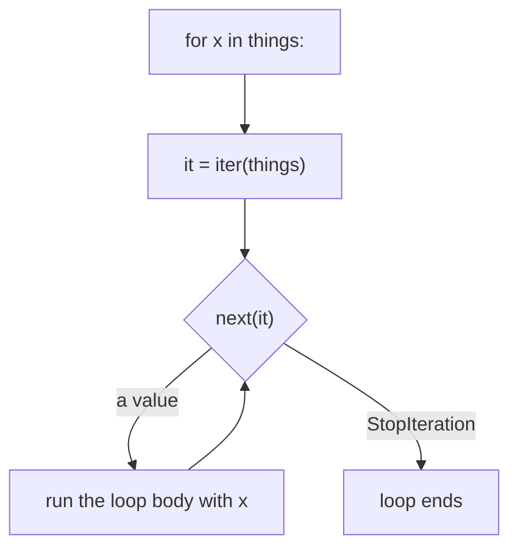

# Comprehensions and Iteration

> **Prerequisites:** [04 · Lists](../04-lists-every-operation/README.md), [05 · Tuples and unpacking](../05-tuples-and-unpacking/README.md), [06 · Sets](../06-sets-every-operation/README.md) and [07 · Dictionaries](../07-dictionaries-every-operation/README.md).  
> **Reading time:** ~30 minutes  
> **Audience:** a complete beginner who can already write loops, functions and the four collection types

> [!NOTE]
> **In one line:** Python can loop over almost anything, and it has short, readable ways to build a new list, set or dict from an old one (comprehensions) or to produce values one at a time without storing them all (generators).

> [!TIP]
> **Golden rule:** Write the plain `for` loop first. Turn it into a comprehension only when the result still reads like one English sentence.

> [!TIP]
> **Try it:** Open any Python prompt (type `python` in a terminal) and paste the small examples one by one. Change a number and run it again. Nothing here can break your computer.

---

## 1. Roadmap

Here is the road for this module.

1. What "iterable" and "iterator" mean, and what a `for` loop really does.
2. Comprehensions: list, set and dict, with conditions and nesting.
3. Generator expressions and generator functions (`yield`): lazy values.
4. The everyday helpers: `enumerate`, `zip`, `reversed`, `sorted`, `map`, `filter`, `any`, `all`.
5. A first look at `itertools`.
6. When a comprehension is too clever.

You already know how to write `for item in my_list:`. By the end you will know why that line works for a list, a string, a file and a dict, and how to write the same loop in one line when that helps.

---

## 2. Concept

> [!key]
> An **iterable** is anything you can loop over (list, tuple, set, dict, string, range, file). An **iterator** is the object that hands out the values one at a time, remembering where it is. A `for` loop asks an iterable for an iterator, then keeps asking that iterator for the next value until it says "no more".

Think of a book (iterable) and a bookmark (iterator). The book holds the pages. The bookmark knows which page you are on. You can put a fresh bookmark in the same book as often as you like.

---

## 3. Explanation

### 3.1 What a `for` loop really does

This short loop:

```python
for letter in "cat":
    print(letter)
# c
# a
# t
```

is the same as the following longer version, which uses two built-in functions, `iter()` and `next()`.

```python
it = iter("cat")      # ask the string for an iterator (a bookmark)
print(next(it))       # c
print(next(it))       # a
print(next(it))       # t
try:
    next(it)          # nothing left
except StopIteration:
    print("done")     # done
```

When the iterator has no more values, it raises a special error called `StopIteration`. A `for` loop catches that error quietly and ends the loop. You almost never write `iter()` and `next()` yourself, but knowing they exist explains many surprises later.

> [!pitfall]
> An iterator is **used up** once you have looped over it. A list is not used up (you can loop over it many times), but an iterator made from it is.

```python
nums = [1, 2, 3]
it = iter(nums)
print(list(it))   # [1, 2, 3]
print(list(it))   # []   (the bookmark is at the end)
print(list(nums)) # [1, 2, 3]   (the book is still fine)
```

### 3.2 Iterable or not?

Lists, tuples, sets, dicts, strings and `range` are iterables. An integer is not.

```python
for ch in "hi":
    print(ch)          # h  then  i

d = {"a": 1, "b": 2}
for key in d:          # looping over a dict gives its keys
    print(key)         # a  then  b

try:
    for x in 42:
        pass
except TypeError as err:
    print(err)         # 'int' object is not iterable
```

### 3.3 Unpacking in loops

Each pass of a loop can split the item into several names. You met unpacking in module 05. Here it is inside a `for`.

```python
pairs = [("Ann", 31), ("Raj", 27)]
for name, age in pairs:
    print(name, "is", age)
# Ann is 31
# Raj is 27

prices = {"tea": 2.5, "milk": 1.2}
for item, price in prices.items():
    print(item, price)
# tea 2.5
# milk 1.2

first, *middle, last = [1, 2, 3, 4, 5]
print(first, middle, last)   # 1 [2, 3, 4] 5
```

### 3.4 List comprehensions

You often build a new list inside a loop:

```python
squares = []
for n in range(1, 6):
    squares.append(n * n)
print(squares)   # [1, 4, 9, 16, 25]
```

A **list comprehension** does the same in one line. Read it from the left: "give me `n * n` for each `n` in `range(1, 6)`".

```python
squares = [n * n for n in range(1, 6)]
print(squares)   # [1, 4, 9, 16, 25]
```

The shape is always:

```text
[ expression  for name in iterable  if condition ]
   what to keep    where from          optional filter
```

Add an `if` at the end to keep only some items.

```python
evens = [n for n in range(10) if n % 2 == 0]
print(evens)     # [0, 2, 4, 6, 8]

words = ["apple", "fig", "banana", "kiwi"]
long_words = [w.upper() for w in words if len(w) > 4]
print(long_words)   # ['APPLE', 'BANANA']
```

Use `if ... else` **before** the `for` when you want to change a value rather than drop it. This one is a different shape: the `if/else` is part of the expression.

```python
labels = ["even" if n % 2 == 0 else "odd" for n in range(4)]
print(labels)    # ['even', 'odd', 'even', 'odd']
```

> [!pitfall]
> Two places for `if`. After the loop it **filters** (drops items). Before the loop, with `else`, it **chooses a value** (keeps every item). Mixing them up is the number one comprehension mistake.

### 3.5 Nested loops in a comprehension

Two `for` parts read in the same order as two nested loops.

```python
pairs = [(x, y) for x in [1, 2] for y in ["a", "b"]]
print(pairs)   # [(1, 'a'), (1, 'b'), (2, 'a'), (2, 'b')]

matrix = [[1, 2, 3], [4, 5, 6]]
flat = [value for row in matrix for value in row]
print(flat)    # [1, 2, 3, 4, 5, 6]

table = [[r * c for c in range(1, 4)] for r in range(1, 4)]
print(table)   # [[1, 2, 3], [2, 4, 6], [3, 6, 9]]
```

The last line puts a comprehension inside another one: the inner one builds each row.

### 3.6 Set and dict comprehensions

Swap the square brackets for curly braces. A set comprehension has one expression. A dict comprehension has `key: value`.

```python
words = ["Tea", "tea", "Milk", "milk", "milk"]
unique = {w.lower() for w in words}
print(sorted(unique))   # ['milk', 'tea']

lengths = {w: len(w) for w in ["pear", "plum", "apple"]}
print(lengths)          # {'pear': 4, 'plum': 4, 'apple': 5}

prices = {"tea": 2.5, "milk": 1.2, "cake": 4.0}
cheap = {k: v for k, v in prices.items() if v < 3}
print(cheap)            # {'tea': 2.5, 'milk': 1.2}

flipped = {v: k for k, v in {"a": 1, "b": 2}.items()}
print(flipped)          # {1: 'a', 2: 'b'}
```

### 3.7 Generator expressions: lazy values

Change the brackets to round brackets and you get a **generator expression**. It does not build a list. It makes values **one at a time, only when asked**.

```python
import sys

big_list = [n * n for n in range(1_000_000)]
lazy = (n * n for n in range(1_000_000))

print(sys.getsizeof(big_list) > 1_000_000)   # True  (millions of bytes)
print(sys.getsizeof(lazy) < 1_000)           # True  (a few hundred bytes)

print(next(lazy))   # 0
print(next(lazy))   # 1
print(next(lazy))   # 4
```

Generators are perfect when you only need to loop once, or feed the values straight into another function:

```python
total = sum(n * n for n in range(1, 4))   # no extra brackets needed
print(total)   # 14   (1 + 4 + 9)
print(max(len(w) for w in ["a", "abc", "ab"]))   # 3
```

> [!pitfall]
> A generator is an iterator, so it is used up after one pass. If you need the values twice, build a list.

### 3.8 Generator functions with `yield`

A function that uses `yield` instead of `return` is a **generator function**. Each `yield` hands one value out and **pauses** the function. The next request resumes it right where it stopped.

```python
def countdown(start):
    while start > 0:
        yield start
        start -= 1

for n in countdown(3):
    print(n)     # 3  then 2  then 1

gen = countdown(2)
print(next(gen)) # 2
print(next(gen)) # 1
```

Why bother? Memory. Imagine reading a file with ten million lines. A list holds them all. A generator holds one line at a time.

```python
def numbers_forever():
    n = 0
    while True:        # an endless loop is fine: it pauses at each yield
        yield n
        n += 1

gen = numbers_forever()
print([next(gen) for _ in range(5)])   # [0, 1, 2, 3, 4]
```

### 3.9 The everyday helpers

**`enumerate`** gives you the position and the item together. Stop writing `range(len(x))`.

```python
for i, fruit in enumerate(["apple", "pear"]):
    print(i, fruit)
# 0 apple
# 1 pear

for i, fruit in enumerate(["apple", "pear"], start=1):
    print(i, fruit)
# 1 apple
# 2 pear
```

**`zip`** walks several iterables side by side and stops at the shortest.

```python
names = ["Ann", "Raj", "Mei"]
scores = [90, 72]
print(list(zip(names, scores)))   # [('Ann', 90), ('Raj', 72)]
print(dict(zip(["a", "b"], [1, 2])))   # {'a': 1, 'b': 2}
```

**`reversed`** and **`sorted`**:

```python
print(list(reversed([1, 2, 3])))        # [3, 2, 1]
print(sorted([3, 1, 2]))                # [1, 2, 3]
print(sorted([3, 1, 2], reverse=True))  # [3, 2, 1]
print(sorted(["pear", "fig", "apple"], key=len))   # ['fig', 'pear', 'apple']
```

`sorted` returns a **new list** and leaves the original alone. `reversed` returns an iterator.

**`map`** and **`filter`** do what a comprehension does, in function form. Most Python programmers prefer the comprehension.

```python
print(list(map(str.upper, ["a", "b"])))          # ['A', 'B']
print(list(filter(lambda n: n > 2, [1, 2, 3, 4])))   # [3, 4]
# same results:
print([s.upper() for s in ["a", "b"]])           # ['A', 'B']
print([n for n in [1, 2, 3, 4] if n > 2])        # [3, 4]
```

**`any`** and **`all`** answer yes/no questions about a whole sequence.

```python
nums = [2, 4, 6, 7]
print(any(n % 2 == 1 for n in nums))   # True   (at least one odd)
print(all(n % 2 == 0 for n in nums))   # False  (not all even)
print(any([]), all([]))                # False True
```

`any` stops at the first `True`. `all` stops at the first `False`. With a generator expression that saves work.

### 3.10 A first look at `itertools`

The standard library has a toolbox for iterators called `itertools`. Four you will meet first:

```python
from itertools import chain, islice, groupby, product

# chain: glue iterables end to end
print(list(chain([1, 2], (3,), "ab")))   # [1, 2, 3, 'a', 'b']

# islice: take a slice of ANY iterator (even an endless one)
def numbers_forever():
    n = 0
    while True:
        yield n
        n += 1
print(list(islice(numbers_forever(), 3, 7)))   # [3, 4, 5, 6]

# product: every combination, like nested loops
print(list(product("AB", [1, 2])))   # [('A', 1), ('A', 2), ('B', 1), ('B', 2)]

# groupby: group NEIGHBOURING equal keys (sort first!)
words = sorted(["bee", "ant", "bat", "ape", "cow"])
for first_letter, group in groupby(words, key=lambda w: w[0]):
    print(first_letter, list(group))
# a ['ant', 'ape']
# b ['bat', 'bee']
# c ['cow']
```

> [!pitfall]
> `groupby` only groups items that are **next to each other**. If the data is not sorted by the same key, you get many small groups instead of one per key.

### 3.11 When a comprehension is too clever

Compare these two. They do the same job.

```python
data = [[1, -2, 3], [4, 5, -6]]

# too clever
result = [y * 2 for x in data for y in x if y > 0 if y % 2 == 1]

# clear
result = []
for row in data:
    for value in row:
        if value > 0 and value % 2 == 1:
            result.append(value * 2)
print(result)   # [2, 6, 10]
```

Warning signs that a comprehension should become a loop:

- It does not fit comfortably on one or two lines.
- It has more than two `for` parts, or an `if` and an `else` and a nested loop.
- It calls a function only for its side effect, such as `print`. A comprehension is for **building a value**, not for doing work.
- You had to read it twice.

```python
# Bad: builds a throwaway list of Nones just to print
[print(n) for n in range(3)]

# Good
for n in range(3):
    print(n)
```

---

## 4. Code: the same ideas in C#

C# has the same ideas under other names. **LINQ** (Language Integrated Query, the `System.Linq` namespace) gives you `Select` (map), `Where` (filter), `OrderBy`, `GroupBy` and `ToDictionary`. `yield return` is C#'s `yield`.

````carousel
```python
nums = [1, 2, 3, 4, 5, 6]

# keep evens, square them
result = [n * n for n in nums if n % 2 == 0]
print(result)          # [4, 16, 36]

# sort words by length
words = ["pear", "fig", "apple"]
print(sorted(words, key=len))   # ['fig', 'pear', 'apple']

# any / all
print(any(n > 5 for n in nums))   # True
print(all(n > 0 for n in nums))   # True
```

<!-- slide -->

```csharp
using System;
using System.Linq;
using System.Collections.Generic;

var nums = new List<int> { 1, 2, 3, 4, 5, 6 };

// keep evens, square them
var result = nums.Where(n => n % 2 == 0).Select(n => n * n).ToList();
Console.WriteLine(string.Join(", ", result));   // 4, 16, 36

// sort words by length
var words = new List<string> { "pear", "fig", "apple" };
Console.WriteLine(string.Join(", ", words.OrderBy(w => w.Length)));   // fig, pear, apple

// Any / All
Console.WriteLine(nums.Any(n => n > 5));   // True
Console.WriteLine(nums.All(n => n > 0));   // True
```
````

Grouping and dictionaries:

````carousel
```python
words = ["bee", "ant", "bat", "ape", "cow"]

groups = {}
for w in words:
    groups.setdefault(w[0], []).append(w)
print(groups)   # {'b': ['bee', 'bat'], 'a': ['ant', 'ape'], 'c': ['cow']}

lengths = {w: len(w) for w in words}
print(lengths["ant"])   # 3
```

<!-- slide -->

```csharp
using System;
using System.Linq;

var words = new[] { "bee", "ant", "bat", "ape", "cow" };

var groups = words.GroupBy(w => w[0]);
foreach (var g in groups)
    Console.WriteLine($"{g.Key}: {string.Join(", ", g)}");
// b: bee, bat
// a: ant, ape
// c: cow

var lengths = words.ToDictionary(w => w, w => w.Length);
Console.WriteLine(lengths["ant"]);   // 3
```
````

Lazy sequences with `yield`:

````carousel
```python
def countdown(start):
    while start > 0:
        yield start
        start -= 1

print(list(countdown(3)))   # [3, 2, 1]
```

<!-- slide -->

```csharp
using System;
using System.Collections.Generic;

static IEnumerable<int> Countdown(int start)
{
    while (start > 0)
    {
        yield return start;
        start--;
    }
}

Console.WriteLine(string.Join(", ", Countdown(3)));   // 3, 2, 1
```
````

> [!NOTE]
> LINQ queries are lazy too. `Where` and `Select` do no work until you loop over the result or call `ToList()`. That matches Python generators.

---

## 5. Visual: what a `for` loop does



And a picture of list versus generator memory:

```text
List comprehension  [n*n for n in range(5)]
  builds everything now:  [0, 1, 4, 9, 16]   <- all stored in memory

Generator expression (n*n for n in range(5))
  stores only the recipe + the position
  next() -> 0
  next() -> 1
  next() -> 4   ... one value at a time
```

---

## 6. Practice

Try each one before opening the answer.

<details>
<summary><strong>1. Build the list of cubes of 1 to 5 with a comprehension.</strong></summary>

```python
cubes = [n ** 3 for n in range(1, 6)]
print(cubes)   # [1, 8, 27, 64, 125]
```
</details>

<details>
<summary><strong>2. From <code>["a", "", "b", ""]</code> keep only the non-empty strings.</strong></summary>

An empty string counts as false, so the filter can be just the item itself.

```python
items = ["a", "", "b", ""]
print([s for s in items if s])   # ['a', 'b']
```
</details>

<details>
<summary><strong>3. Make a dict from a list of words that maps each word to its first letter.</strong></summary>

```python
words = ["tea", "milk", "cake"]
print({w: w[0] for w in words})   # {'tea': 't', 'milk': 'm', 'cake': 'c'}
```
</details>

<details>
<summary><strong>4. Print each name with its number, starting at 1, using <code>enumerate</code>.</strong></summary>

```python
for i, name in enumerate(["Ann", "Raj"], start=1):
    print(f"{i}. {name}")
# 1. Ann
# 2. Raj
```
</details>

<details>
<summary><strong>5. Combine two lists into pairs, then back into two lists.</strong></summary>

`zip(*pairs)` unpacks the pairs and zips them again, which turns rows into columns.

```python
names = ["Ann", "Raj"]
ages = [31, 27]
pairs = list(zip(names, ages))
print(pairs)             # [('Ann', 31), ('Raj', 27)]
back_names, back_ages = zip(*pairs)
print(back_names)        # ('Ann', 'Raj')
print(back_ages)         # (31, 27)
```
</details>

<details>
<summary><strong>6. Write a generator <code>evens(limit)</code> that yields even numbers below <code>limit</code>.</strong></summary>

```python
def evens(limit):
    for n in range(0, limit, 2):
        yield n

print(list(evens(9)))   # [0, 2, 4, 6, 8]
```
</details>

<details>
<summary><strong>7. Check whether every password in a list has at least 8 characters.</strong></summary>

```python
passwords = ["longenough", "short", "alsolongenough"]
print(all(len(p) >= 8 for p in passwords))   # False
```
</details>

<details>
<summary><strong>8. Flatten <code>[[1, 2], [3], [4, 5]]</code> in two different ways.</strong></summary>

```python
from itertools import chain

nested = [[1, 2], [3], [4, 5]]
print([x for row in nested for x in row])   # [1, 2, 3, 4, 5]
print(list(chain.from_iterable(nested)))    # [1, 2, 3, 4, 5]
```
</details>

<details>
<summary><strong>9. Rewrite this unclear line as a loop: <code>[x for x in range(30) if x % 2 if x % 3 == 0]</code>.</strong></summary>

Two `if`s in a row both have to be true: odd and a multiple of 3.

```python
result = []
for x in range(30):
    if x % 2 == 1 and x % 3 == 0:
        result.append(x)
print(result)   # [3, 9, 15, 21, 27]
```
</details>

---

## 7. Mini project: word report

Read a short text and print a small report: the five most common words, and every word grouped by its first letter. It uses a comprehension, `sorted`, `groupby` and a dict.

```python
from itertools import groupby

text = """the cat sat on the mat the dog sat on the log"""
words = text.split()

# 1. count words (dict + loop)
counts = {}
for w in words:
    counts[w] = counts.get(w, 0) + 1

# 2. the most common, biggest first; ties in alphabetical order
ranked = sorted(counts.items(), key=lambda pair: (-pair[1], pair[0]))
for word, n in ranked[:3]:
    print(f"{word:5} {n}")
# the   4
# on    2
# sat   2

# 3. group the unique words by first letter
unique = sorted(set(words))
for letter, group in groupby(unique, key=lambda w: w[0]):
    print(letter, list(group))
# c ['cat']
# d ['dog']
# l ['log']
# m ['mat']
# o ['on']
# s ['sat']
# t ['the']
```

Stretch goals: ignore capital letters; ignore words shorter than 3 letters; load the text from a file after you finish [module 10](../10-files-modules-and-the-standard-library/README.md).

---

## 8. Interview questions

<details>
<summary><strong>1. What is the difference between an iterable and an iterator? [BASIC]</strong></summary>

An iterable can produce an iterator when you call `iter()` on it (lists, strings, dicts). An iterator has `__next__`, gives one value per call, and raises `StopIteration` when done. An iterator is single-use. Iterators are also iterable (`iter(it)` returns itself), which is why you can put one in a `for` loop.
</details>

<details>
<summary><strong>2. List comprehension or generator expression: how do you choose? [BASIC]</strong></summary>

Use a list when you need to index, reuse, sort in place or look at the length. Use a generator expression when you will loop once or pass the values to `sum`, `max`, `any`, `all` or `join`. It uses constant memory.
</details>

<details>
<summary><strong>3. What does <code>yield</code> do? [BASIC]</strong></summary>

It turns the function into a generator function. Calling it returns a generator without running the body. Each `next()` runs the body until the next `yield`, hands out that value and pauses with all local variables kept.
</details>

<details>
<summary><strong>4. Why does <code>list(zip(a, b))</code> sometimes drop items? [BASIC]</strong></summary>

`zip` stops at the shortest input. Use `itertools.zip_longest` to keep going and fill gaps, or `zip(a, b, strict=True)` (Python 3.10 and later) to raise an error when the lengths differ.
</details>

<details>
<summary><strong>5. What is wrong with <code>for i in range(len(items)): print(items[i])</code>? [TRICKY]</strong></summary>

It works but it is noisy and easy to get wrong. Loop directly: `for item in items`. If you need the position as well, use `enumerate(items)`.
</details>

<details>
<summary><strong>6. Why does a second loop over a generator print nothing? [TRICKY]</strong></summary>

A generator is an iterator and it is exhausted after the first pass. Make a new generator, or store the values in a list when you need two passes.
</details>

<details>
<summary><strong>7. Name the C# equivalents of map, filter and a generator function. [BASIC]</strong></summary>

`Select`, `Where` and a method returning `IEnumerable<T>` that uses `yield return`. LINQ is lazy until you enumerate it (`foreach`, `ToList()`).
</details>

---

## Further reading

- [Python tutorial: Iterators](https://docs.python.org/3/tutorial/classes.html#iterators) and [Generators](https://docs.python.org/3/tutorial/classes.html#generators)
- [Python tutorial: List comprehensions](https://docs.python.org/3/tutorial/datastructures.html#list-comprehensions)
- [`itertools` in the standard library](https://docs.python.org/3/library/itertools.html)
- [Built-in functions](https://docs.python.org/3/library/functions.html) (`enumerate`, `zip`, `sorted`, `any`, `all`)
- [Real Python: Python generators](https://realpython.com/introduction-to-python-generators/)
- [Real Python: When to use a list comprehension](https://realpython.com/list-comprehension-python/)
- [Microsoft Learn: LINQ overview](https://learn.microsoft.com/en-us/dotnet/csharp/linq/)
- [Microsoft Learn: `yield` statement](https://learn.microsoft.com/en-us/dotnet/csharp/language-reference/statements/yield)

## Next

**[09 · Errors and exceptions basics](../09-errors-and-exceptions-basics/README.md)** — what happens when something goes wrong, and how to handle it calmly.
