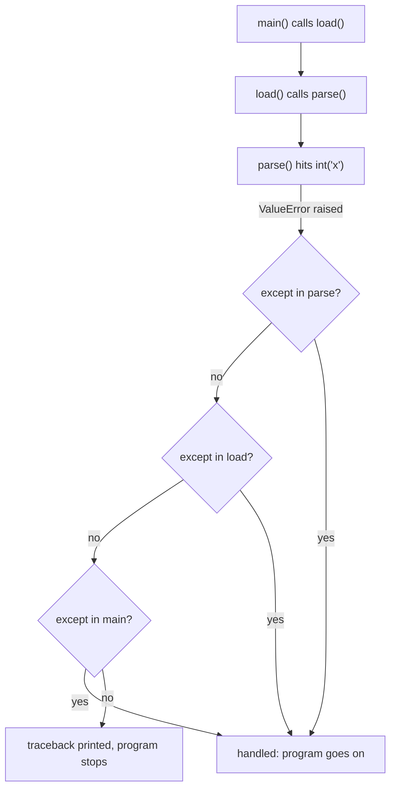

# Errors and Exceptions Basics

> **Prerequisites:** [08 · Comprehensions and iteration](../08-comprehensions-and-iteration/README.md) (and everything before it: functions, lists, dicts).  
> **Reading time:** ~30 minutes  
> **Audience:** a complete beginner who has seen a red error message and did not know what to do

> [!NOTE]
> **In one line:** An error is not a failure of you. It is Python telling you exactly what went wrong and where. With `try` and `except` you can answer it calmly instead of crashing.

> [!TIP]
> **Golden rule:** Catch only the errors you know how to handle, name them exactly, and never write a bare `except:` that hides everything.

> [!TIP]
> **Try it:** Type `int("abc")` at a Python prompt on purpose. Read the message from the bottom up. You will do this many times in this module.

---

## 1. Roadmap

1. Two kinds of problems: syntax errors and runtime errors.
2. How to read a traceback.
3. `try`, `except`, `else`, `finally`.
4. The common built-in errors and what causes them.
5. Raising your own errors, and writing custom exception classes.
6. Good habits: EAFP, validating input, `assert`, `with`, logging, error messages.

---

## 2. Concept

> [!key]
> An **exception** is an object that Python creates when something goes wrong. It travels up through the functions that called each other until some `except` block handles it. If nobody handles it, the program stops and prints a **traceback**.

Think of a fire alarm in a building. Whoever finds the fire pulls the alarm (`raise`). The alarm rings on every floor above (the call stack). The first person who knows what to do (`except`) deals with it. If nobody does, the building is evacuated (the program stops).

---

## 3. Explanation

### 3.1 Syntax error or runtime error?

A **syntax error** means Python could not even read your code. Nothing runs at all.

```text
print("hello"
```

```text
  File "demo.py", line 1
    print("hello"
         ^
SyntaxError: '(' was never closed
```

Usually this is a missing bracket, quote or colon. Fix the spelling of the code and run again.

A **runtime error** (an exception) happens while the program runs. The code was readable but one line could not do its job. The program ran fine up to that point.

```text
print("start")
print(10 / 0)
```

```text
start
Traceback (most recent call last):
  File "demo.py", line 2, in <module>
    print(10 / 0)
ZeroDivisionError: division by zero
```

A third kind is a **logic error**: the program runs without any error but gives a wrong answer (for example, using `+` where you meant `-`). Python cannot tell you about those. Tests and careful reading can.

### 3.2 Reading a traceback

Read it from the **bottom up**.

```text
Traceback (most recent call last):
  File "shop.py", line 9, in <module>
    total = add_tax(price)
  File "shop.py", line 4, in add_tax
    return price * (1 + RATE)
TypeError: unsupported operand type(s) for *: 'str' and 'float'
```

1. **Last line:** the error type (`TypeError`) and a message. This is the what.
2. **The line just above it:** the exact line that failed (`shop.py`, line 4, inside `add_tax`).
3. **Lines above that:** who called whom. Line 9 called `add_tax`. This is the how-did-we-get-here.

The message says we multiplied a `str` by a `float`: `price` was text, not a number. Now you know where to look.

### 3.3 `try` and `except`

Put the risky code in `try`. If an error happens there, Python jumps to `except`.

```python
text = "abc"
try:
    number = int(text)
    print("Got", number)
except ValueError:
    print("That is not a number")
# That is not a number
```

Lines in the `try` block after the failing line are skipped. Lines after the whole `try` statement run as normal.

```python
try:
    print("before")
    print(int("x"))       # fails here
    print("never printed")
except ValueError:
    print("caught")
print("after")
# before
# caught
# after
```

### 3.4 Catch specific errors, and look at the error object

Always name the error type you expect. Use `as err` to look at the message.

```python
def safe_divide(a, b):
    try:
        return a / b
    except ZeroDivisionError as err:
        print("Problem:", err)
        return None

print(safe_divide(10, 4))   # 2.5
print(safe_divide(1, 0))
# Problem: division by zero
# None
```

You can have several `except` blocks. Python checks them top to bottom and runs the first that matches.

```python
def parse_age(text):
    try:
        age = int(text)
        return 100 // age
    except ValueError:
        return "not a number"
    except ZeroDivisionError:
        return "age cannot be zero"

print(parse_age("20"))   # 5
print(parse_age("abc"))  # not a number
print(parse_age("0"))    # age cannot be zero
```

One block can handle several types if you put them in a tuple:

```python
for value in ["5", "x", None]:
    try:
        print(int(value))
    except (ValueError, TypeError) as err:
        print("bad value:", value)
# 5
# bad value: x
# bad value: None
```

> [!pitfall]
> Never write a bare `except:` or `except Exception: pass`. It swallows every bug, including typos, and leaves you with a program that silently does the wrong thing.

### 3.5 `else` and `finally`

- `else` runs only if the `try` block had **no error**.
- `finally` runs **always**: after success, after a handled error, even if the function returns early. Use it for clean-up.

```python
def read_number(text):
    try:
        n = int(text)
    except ValueError:
        print("bad input")
    else:
        print("good input:", n)      # only when no error happened
    finally:
        print("done with", repr(text))   # always

read_number("7")
# good input: 7
# done with '7'
read_number("q")
# bad input
# done with 'q'
```

Why `else`? It keeps the `try` block as short as possible, so you only catch errors from the line you actually worry about.

### 3.6 The common built-in errors

| Error | What causes it | Tiny example |
| :--- | :--- | :--- |
| `ValueError` | Right type, unsuitable value | `int("abc")` |
| `TypeError` | Wrong type for an operation | `"a" + 1` |
| `KeyError` | Dict key not found | `{"a": 1}["b"]` |
| `IndexError` | List position does not exist | `[1, 2][5]` |
| `ZeroDivisionError` | Dividing by zero | `5 / 0` |
| `AttributeError` | The object has no such attribute or method | `"abc".push(1)` |
| `FileNotFoundError` | Opening a file that is not there | `open("nope.txt")` |
| `NameError` | A name was never defined (often a typo) | `print(totl)` |

Here they are caught one by one, so you can see each message:

```python
def show(action):
    try:
        action()
    except Exception as err:
        print(type(err).__name__, "->", err)

show(lambda: int("abc"))
show(lambda: "a" + 1)
show(lambda: {"a": 1}["b"])
show(lambda: [1, 2][5])
show(lambda: 5 / 0)
show(lambda: "abc".push(1))
# ValueError -> invalid literal for int() with base 10: 'abc'
# TypeError -> can only concatenate str (not "int") to str
# KeyError -> 'b'
# IndexError -> list index out of range
# ZeroDivisionError -> division by zero
# AttributeError -> 'str' object has no attribute 'push'
```

(Catching `Exception` is fine for a demo that just prints. In real code, name the specific error.)

Errors form a family tree. `KeyError` and `IndexError` are both kinds of `LookupError`. All of them are kinds of `Exception`. Catching a parent type catches all its children.

```python
try:
    [1, 2][5]
except LookupError as err:       # catches IndexError and KeyError
    print("lookup failed:", err)
# lookup failed: list index out of range
```

### 3.7 Raising errors yourself

Use `raise` when your own function is given something it cannot accept.

```python
def set_age(age):
    if not isinstance(age, int):
        raise TypeError("age must be a whole number")
    if age < 0:
        raise ValueError("age cannot be negative")
    return age

try:
    set_age(-3)
except ValueError as err:
    print("Rejected:", err)
# Rejected: age cannot be negative
```

A bare `raise` inside an `except` block re-raises the same error. That is useful when you log it and still want it to continue upward.

```python
def risky():
    try:
        return 1 / 0
    except ZeroDivisionError:
        print("logging the problem")
        raise            # pass the same error along

try:
    risky()
except ZeroDivisionError:
    print("handled at the top")
# logging the problem
# handled at the top
```

### 3.8 Custom exceptions and `raise ... from`

Make your own error type by inheriting from `Exception`. A name like `InsufficientFundsError` tells the reader far more than `ValueError`.

```python
class InsufficientFundsError(Exception):
    """Raised when a withdrawal is bigger than the balance."""

    def __init__(self, balance, amount):
        super().__init__(f"balance {balance} is less than {amount}")
        self.balance = balance
        self.amount = amount

def withdraw(balance, amount):
    if amount > balance:
        raise InsufficientFundsError(balance, amount)
    return balance - amount

try:
    withdraw(50, 80)
except InsufficientFundsError as err:
    print(err)                      # balance 50 is less than 80
    print(err.amount - err.balance) # 30
```

`raise NewError(...) from original` wraps a low-level error in a higher-level one but keeps the original as the cause. Python then prints both in the traceback.

```python
class ConfigError(Exception):
    pass

def load_port(text):
    try:
        return int(text)
    except ValueError as err:
        raise ConfigError(f"bad port {text!r}") from err

try:
    load_port("eighty")
except ConfigError as err:
    print(err)               # bad port 'eighty'
    print(repr(err.__cause__))
# ValueError("invalid literal for int() with base 10: 'eighty'")
```

### 3.9 EAFP or LBYL

Two styles of dealing with risk:

- **LBYL**, Look Before You Leap: check first, then act.
- **EAFP**, Easier to Ask Forgiveness than Permission: act, and handle the error if it comes.

```python
config = {"debug": True}

# LBYL
if "port" in config:
    port = config["port"]
else:
    port = 8080

# EAFP
try:
    port = config["port"]
except KeyError:
    port = 8080

print(port)   # 8080
```

Python programmers like EAFP when the failure is rare, because it avoids race conditions (a file can vanish between your check and your open) and often reads shorter. For a plain dict, though, `config.get("port", 8080)` is simplest of all. Choose the clearest.

### 3.10 Validating input

The classic loop: keep asking until the answer is good. Here the "user" is a list so the example can run by itself.

```python
answers = iter(["abc", "-4", "12"])   # pretend someone typing

def ask_age():
    while True:
        raw = next(answers)           # in real code: input("Age? ")
        try:
            age = int(raw)
        except ValueError:
            print(f"{raw!r} is not a number, try again")
            continue
        if age < 0:
            print("age cannot be negative, try again")
            continue
        return age

print(ask_age())
# 'abc' is not a number, try again
# age cannot be negative, try again
# 12
```

### 3.11 `assert` is not for user input

`assert condition, "message"` raises `AssertionError` when the condition is false. It checks **your own assumptions** (a bug if it fails). It can be switched off (`python -O`), so never use it to validate things users or files can get wrong. Use `raise ValueError` for that.

```python
def average(numbers):
    assert len(numbers) > 0, "average() needs at least one number"   # a programmer promise
    return sum(numbers) / len(numbers)

print(average([2, 4]))   # 3.0
```

### 3.12 Context managers: `with` (briefly)

A `with` block guarantees clean-up, even when an error occurs inside it. You will use it most for files (module 10). It replaces a `try/finally`.

```python
import os, tempfile

path = os.path.join(tempfile.gettempdir(), "demo_with.txt")
with open(path, "w", encoding="utf-8") as f:
    f.write("hello")
print(f.closed)    # True   (closed for us, even if write had failed)

with open(path, encoding="utf-8") as f:
    print(f.read())   # hello
os.remove(path)
```

### 3.13 Log it, do not just print it

`print` is for the user. For a record of what went wrong (with time and severity), use the `logging` module. `logging.exception` inside an `except` block also records the traceback.

```python
import logging

logging.basicConfig(level=logging.INFO, format="%(levelname)s: %(message)s")

def divide(a, b):
    try:
        return a / b
    except ZeroDivisionError:
        logging.exception("could not divide %s by %s", a, b)
        return None

divide(1, 0)
# ERROR: could not divide 1 by 0
# Traceback (most recent call last):  (full traceback follows)
# ...
# ZeroDivisionError: division by zero
```

Levels, from quietest to loudest: `DEBUG`, `INFO`, `WARNING`, `ERROR`, `CRITICAL`.

### 3.14 Write error messages people can act on

A good message says **what happened, with the value, and what to do**.

```text
Bad:   ValueError("invalid")
Good:  ValueError("port must be between 1 and 65535, got 70000")
```

---

## 4. Code: the same ideas in C#

The idea is identical. C# uses `try`, `catch`, `finally`, `throw`, and `using` instead of `with`. Python's `except X as e` is `catch (X e)`. Python's `else` has no direct C# keyword.

````carousel
```python
def parse_age(text):
    try:
        return int(text)
    except ValueError:
        print("not a number:", text)
        return -1
    finally:
        print("checked", text)

print(parse_age("12"))
# checked 12
# 12
print(parse_age("x"))
# not a number: x
# checked x
# -1
```

<!-- slide -->

```csharp
using System;

static int ParseAge(string text)
{
    try
    {
        return int.Parse(text);
    }
    catch (FormatException)
    {
        Console.WriteLine($"not a number: {text}");
        return -1;
    }
    finally
    {
        Console.WriteLine($"checked {text}");
    }
}

Console.WriteLine(ParseAge("12"));
// checked 12
// 12
Console.WriteLine(ParseAge("x"));
// not a number: x
// checked x
// -1
```
````

Custom exceptions and `raise` / `throw`:

````carousel
```python
class InsufficientFundsError(Exception):
    def __init__(self, balance, amount):
        super().__init__(f"balance {balance} is less than {amount}")

def withdraw(balance, amount):
    if amount > balance:
        raise InsufficientFundsError(balance, amount)
    return balance - amount

try:
    withdraw(50, 80)
except InsufficientFundsError as err:
    print(err)   # balance 50 is less than 80
```

<!-- slide -->

```csharp
using System;

class InsufficientFundsException : Exception
{
    public InsufficientFundsException(decimal balance, decimal amount)
        : base($"balance {balance} is less than {amount}") { }
}

static decimal Withdraw(decimal balance, decimal amount)
{
    if (amount > balance)
        throw new InsufficientFundsException(balance, amount);
    return balance - amount;
}

try
{
    Withdraw(50, 80);
}
catch (InsufficientFundsException ex)
{
    Console.WriteLine(ex.Message);   // balance 50 is less than 80
}
```
````

`using` is C#'s `with`. It calls `Dispose()` for you at the end of the block.

````carousel
```python
with open("notes.txt", "w", encoding="utf-8") as f:
    f.write("hi")
```

<!-- slide -->

```csharp
using System.IO;

using (var writer = new StreamWriter("notes.txt"))
{
    writer.Write("hi");
}   // writer is closed here, even if Write threw
```
````

> [!NOTE]
> C# convention: custom exception names end in `Exception`; Python convention: they end in `Error`. C# also lets you write `throw;` (no variable) inside `catch` to re-throw, like Python's bare `raise`.

---

## 5. Visual: where an error travels



And the shape of a full `try` statement:

```text
try:        the risky lines
except X:   runs if an X error happened in try
else:       runs if NO error happened
finally:    runs always (clean-up)
```

---

## 6. Practice

<details>
<summary><strong>1. What is wrong here? <code>if x == 3 print("three")</code></strong></summary>

It is a `SyntaxError`: the colon is missing. The fix is `if x == 3:` on one line and the `print` indented below it.
</details>

<details>
<summary><strong>2. Name the error type for each: <code>[1,2,3][3]</code>, <code>{"a":1}["z"]</code>, <code>int("4.5")</code>, <code>None + 1</code>.</strong></summary>

`IndexError`, `KeyError`, `ValueError`, `TypeError`. Check it yourself:

```python
for action in (lambda: [1, 2, 3][3], lambda: {"a": 1}["z"],
               lambda: int("4.5"), lambda: None + 1):
    try:
        action()
    except Exception as err:
        print(type(err).__name__)
# IndexError
# KeyError
# ValueError
# TypeError
```
</details>

<details>
<summary><strong>3. Write <code>to_int(text, default)</code> that returns the number or the default.</strong></summary>

```python
def to_int(text, default=0):
    try:
        return int(text)
    except ValueError:
        return default

print(to_int("42"))       # 42
print(to_int("nope", -1)) # -1
```
</details>

<details>
<summary><strong>4. Why is the order of these two <code>except</code> blocks a bug?</strong></summary>

```python
try:
    [][0]
except LookupError:
    print("lookup")
except IndexError:
    print("index")      # can never run
```

`IndexError` is a kind of `LookupError`, so the first block always catches it first. Put the more specific type first.
</details>

<details>
<summary><strong>5. Make a custom <code>EmptyBasketError</code> and raise it from <code>checkout(items)</code> when the list is empty.</strong></summary>

```python
class EmptyBasketError(Exception):
    pass

def checkout(items):
    if not items:
        raise EmptyBasketError("add something before checking out")
    return len(items)

try:
    checkout([])
except EmptyBasketError as err:
    print(err)   # add something before checking out
```
</details>

<details>
<summary><strong>6. Predict the output.</strong></summary>

```python
def f():
    try:
        return "try"
    finally:
        print("cleanup")

print(f())
# cleanup
# try
```

`finally` runs before the function actually hands back its value, so `cleanup` prints first.
</details>

<details>
<summary><strong>7. Is this a good use of <code>assert</code>? <code>assert age &gt; 0, "age must be positive"</code> where <code>age</code> comes from a web form.</strong></summary>

No. Form data is outside your control and `assert` can be disabled. Raise `ValueError` (or return an error message to the user) instead.
</details>

<details>
<summary><strong>8. Rewrite the LBYL code in EAFP style.</strong></summary>

```python
import os
# LBYL
# if os.path.exists("data.txt"):
#     text = open("data.txt").read()

# EAFP
try:
    with open("data.txt", encoding="utf-8") as f:
        text = f.read()
except FileNotFoundError:
    text = ""
print(repr(text))   # '' (when the file does not exist)
```
</details>

---

## 7. Mini project: safe calculator

Build a function that takes text like `"12 / 4"` and returns the answer, but never crashes. It handles bad numbers, bad operators and divide-by-zero with a custom error.

```python
class CalcError(Exception):
    """Anything that goes wrong in the calculator."""

def calculate(text):
    parts = text.split()
    if len(parts) != 3:
        raise CalcError(f"expected 'number operator number', got {text!r}")
    left_text, op, right_text = parts
    try:
        left, right = float(left_text), float(right_text)
    except ValueError as err:
        raise CalcError(f"not a number in {text!r}") from err
    if op == "+":
        return left + right
    if op == "-":
        return left - right
    if op == "*":
        return left * right
    if op == "/":
        if right == 0:
            raise CalcError("cannot divide by zero")
        return left / right
    raise CalcError(f"unknown operator {op!r}")

for line in ["12 / 4", "3 + x", "5 / 0", "2 ^ 3", "hello"]:
    try:
        print(line, "=", calculate(line))
    except CalcError as err:
        print(line, "-> error:", err)
# 12 / 4 = 3.0
# 3 + x -> error: not a number in '3 + x'
# 5 / 0 -> error: cannot divide by zero
# 2 ^ 3 -> error: unknown operator '^'
# hello -> error: expected 'number operator number', got 'hello'
```

Stretch goals: add `%` and `**`; log each error with `logging`; read the lines from a file after module 10.

---

## 8. Interview questions

<details>
<summary><strong>1. What is the difference between a syntax error and an exception? [BASIC]</strong></summary>

A syntax error stops Python from parsing the file, so nothing runs. An exception is raised while the program is running and can be caught with `try/except`.
</details>

<details>
<summary><strong>2. When does <code>else</code> run in a try statement, and when does <code>finally</code>? [BASIC]</strong></summary>

`else` runs only when the `try` block raised nothing. `finally` runs every time, whether or not there was an error, and even with `return`, `break` or `continue` in the block.
</details>

<details>
<summary><strong>3. Why is a bare <code>except:</code> bad? [BASIC]</strong></summary>

It catches everything, including `KeyboardInterrupt` and `SystemExit`, and typos like `NameError`. Real bugs become silent. Catch the narrowest type you can handle.
</details>

<details>
<summary><strong>4. What does <code>raise ... from err</code> do? [TRICKY]</strong></summary>

It sets `__cause__` on the new exception so the traceback shows both: the original error and the higher-level error that wraps it. It keeps the root cause visible.
</details>

<details>
<summary><strong>5. EAFP or LBYL? [BASIC]</strong></summary>

Python style leans to EAFP: try it and catch the specific error. It avoids check-then-use race conditions. LBYL is fine when checking is cheap and clear, or when failure is common.
</details>

<details>
<summary><strong>6. <code>assert</code> or <code>raise</code> for validating function arguments? [TRICKY]</strong></summary>

`raise` for anything that comes from callers or users. `assert` only documents internal assumptions, and may be removed with `-O`.
</details>

<details>
<summary><strong>7. What is the C# counterpart of <code>with</code>? [BASIC]</strong></summary>

`using`, which calls `Dispose()` when the block ends. In C# 8 and later you can also write `using var x = ...;` without braces.
</details>

---

## Further reading

- [Python tutorial: Errors and Exceptions](https://docs.python.org/3/tutorial/errors.html)
- [Built-in exceptions (the full family tree)](https://docs.python.org/3/library/exceptions.html)
- [`logging` HOWTO](https://docs.python.org/3/howto/logging.html)
- [Real Python: Python exceptions, an introduction](https://realpython.com/python-exceptions/)
- [Real Python: Python Traceback explained](https://realpython.com/python-traceback/)
- [Microsoft Learn: Exception handling in C#](https://learn.microsoft.com/en-us/dotnet/csharp/fundamentals/exceptions/)
- [Microsoft Learn: Creating and throwing exceptions](https://learn.microsoft.com/en-us/dotnet/csharp/fundamentals/exceptions/creating-and-throwing-exceptions)
- [Microsoft Learn: `using` statement](https://learn.microsoft.com/en-us/dotnet/csharp/language-reference/statements/using)

## Next

**[10 · Files, modules and the standard library](../10-files-modules-and-the-standard-library/README.md)** — read and write files, split code across files, and meet the tools that ship with Python.
