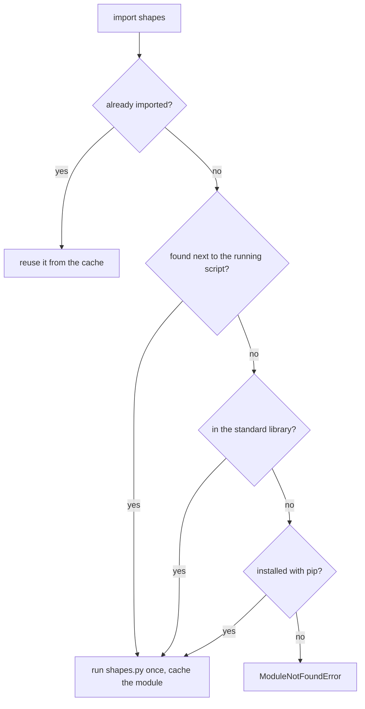

# Files, Modules and the Standard Library

> **Prerequisites:** [09 · Errors and exceptions basics](../09-errors-and-exceptions-basics/README.md) (you will catch `FileNotFoundError` here).  
> **Reading time:** ~35 minutes  
> **Audience:** a complete beginner who wants programs that save data, split into several files, and reuse code Python already ships with

> [!NOTE]
> **In one line:** A file is how a program remembers things after it stops, a module is a file of code you can reuse, and the standard library is a big box of ready-made modules that comes with Python.

> [!TIP]
> **Golden rule:** Always open files with `with open(...)`, always pass `encoding="utf-8"` for text, and check the standard library before you write a helper yourself.

> [!TIP]
> **Try it:** Make an empty folder, open a terminal inside it, and run the file examples there. Every example creates its own small files, so nothing else is touched.

---

## 1. Roadmap

1. Reading and writing text files.
2. `pathlib`: file paths done properly.
3. CSV and JSON files.
4. Importing: `import`, `from`, `as`, packages, and `__name__ == "__main__"`.
5. Writing your own module.
6. A tour of the standard library.
7. `pip` and virtual environments.
8. Running a script with arguments.

---

## 2. Concept

> [!key]
> A **file** stores data outside the running program. A **module** is simply a `.py` file whose names (functions, classes, constants) another file can borrow with `import`. A **package** is a folder of modules. The **standard library** is the set of modules that installs with Python itself.

Compare it to a kitchen. Your program is the cook. Files are the pantry. Modules are cookbooks you pull from the shelf. The standard library is the big shelf that was already in the kitchen when you moved in.

---

## 3. Explanation

### 3.1 Writing and reading a text file

```python
with open("hello.txt", "w", encoding="utf-8") as f:
    f.write("first line\n")
    f.write("second line\n")

with open("hello.txt", "r", encoding="utf-8") as f:
    content = f.read()

print(content)
# first line
# second line
print(len(content))   # 23
```

Notes on that code:

- `open(name, mode, encoding=...)` gives you a file object. `with` closes it for you, even if an error happens (see module 09).
- `"\n"` is the new-line character. `write` does not add one for you.
- `encoding="utf-8"` makes accents and symbols work the same on every computer. Without it Windows may pick a different default.

### 3.2 Modes

| Mode | Meaning | If the file exists | If it does not exist |
| :--- | :--- | :--- | :--- |
| `"r"` | read (the default) | reads it | `FileNotFoundError` |
| `"w"` | write | **erases it first** | creates it |
| `"a"` | append | adds to the end | creates it |
| `"x"` | create new only | `FileExistsError` | creates it |
| `"rb"`, `"wb"` | the same but for bytes (images, zips) | | |

> [!pitfall]
> `"w"` wipes the file the moment you open it, before you write a single character. Use `"a"` to add to the end.

```python
with open("log.txt", "w", encoding="utf-8") as f:
    f.write("one\n")
with open("log.txt", "a", encoding="utf-8") as f:
    f.write("two\n")
with open("log.txt", encoding="utf-8") as f:
    print(f.read())
# one
# two
```

### 3.3 Reading line by line

`read()` loads everything. A file is also an iterable of lines (module 08), so a `for` loop reads one line at a time and works even for huge files.

```python
with open("fruit.txt", "w", encoding="utf-8") as f:
    f.write("apple\nbanana\ncherry\n")

with open("fruit.txt", encoding="utf-8") as f:
    for line in f:
        print(repr(line))
# 'apple\n'
# 'banana\n'
# 'cherry\n'

with open("fruit.txt", encoding="utf-8") as f:
    print(f.readline().strip())   # apple
    rest = f.readlines()          # the remaining lines, as a list
    print(rest)                   # ['banana\n', 'cherry\n']

with open("fruit.txt", encoding="utf-8") as f:
    names = [line.strip() for line in f]
print(names)   # ['apple', 'banana', 'cherry']
```

Each line ends with `"\n"`. `.strip()` removes it (and spaces at both ends). `writelines` writes a list of strings, but adds no new-lines for you.

### 3.4 Missing files

```python
try:
    with open("does_not_exist.txt", encoding="utf-8") as f:
        f.read()
except FileNotFoundError:
    print("no such file")
# no such file
```

### 3.5 `pathlib`: paths as objects

File paths differ between Windows (`C:\Users\me\a.txt`) and Linux (`/home/me/a.txt`). The `pathlib` module hides the difference. The `/` operator joins parts.

```python
from pathlib import Path

folder = Path("reports")
folder.mkdir(exist_ok=True)           # create the folder if it is missing
file = folder / "today.txt"           # reports/today.txt on any system

file.write_text("sales: 42\n", encoding="utf-8")
print(file.read_text(encoding="utf-8"))   # sales: 42
print(file.exists())                      # True
print(file.name, file.stem, file.suffix)  # today.txt today .txt
print(file.parent)                        # reports

for p in sorted(folder.glob("*.txt")):    # find files by pattern
    print(p.name)                         # today.txt

file.unlink()      # delete the file
folder.rmdir()     # delete the (now empty) folder
print(file.exists())   # False
```

`Path.cwd()` is the current folder and `Path.home()` is your home folder. Prefer `pathlib` over gluing strings with `+` or `"\\"`.

### 3.6 CSV files

CSV (comma-separated values) is a plain-text table, the format spreadsheets can export. Use the `csv` module so commas inside quoted text are handled correctly.

```python
import csv

rows = [
    {"name": "Ann", "age": 31},
    {"name": "Raj", "age": 27},
]

with open("people.csv", "w", newline="", encoding="utf-8") as f:
    writer = csv.DictWriter(f, fieldnames=["name", "age"])
    writer.writeheader()
    writer.writerows(rows)

print(open("people.csv", encoding="utf-8").read())
# name,age
# Ann,31
# Raj,27

with open("people.csv", newline="", encoding="utf-8") as f:
    for row in csv.DictReader(f):
        print(row["name"], int(row["age"]) + 1)
# Ann 32
# Raj 28
```

`newline=""` is required when you hand a file to the `csv` module. Everything read from a CSV is **text**, so convert numbers yourself (`int(...)`).

### 3.7 JSON files

JSON is the format almost every web service speaks. It maps neatly onto Python: objects become dicts, arrays become lists, and `true/false/null` become `True/False/None`.

```python
import json

data = {"name": "Ann", "langs": ["python", "c#"], "active": True, "boss": None}

text = json.dumps(data)                 # dict -> string
print(text)   # {"name": "Ann", "langs": ["python", "c#"], "active": true, "boss": null}

back = json.loads(text)                 # string -> dict
print(back["langs"][1])                 # c#

with open("data.json", "w", encoding="utf-8") as f:
    json.dump(data, f, indent=2)        # dict -> file, pretty-printed

with open("data.json", encoding="utf-8") as f:
    loaded = json.load(f)               # file -> dict
print(loaded == data)                   # True
```

Remember `dump/load` work with **files**, `dumps/loads` (with the s) work with **strings**. JSON keys are always strings, and tuples or sets must be converted to lists first.

### 3.8 Importing

Every file you have written so far could be imported by another file. The built-in ways:

```python
import math                    # use as math.sqrt(...)
from math import sqrt, pi      # use as sqrt(...)
import datetime as dt          # a short nickname
from collections import Counter as C

print(math.sqrt(16))   # 4.0
print(sqrt(25))        # 5.0
print(round(pi, 3))    # 3.142
print(dt.date(2026, 1, 31).year)   # 2026
print(C("aab"))        # Counter({'a': 2, 'b': 1})
```

> [!pitfall]
> Avoid `from math import *`. It dumps unknown names into your file and hides where things come from.

### 3.9 Writing your own module

Make two files in the same folder. First `shapes.py`:

```text
# shapes.py
PI = 3.14159

def circle_area(radius):
    return PI * radius * radius

def describe():
    return "shapes helper module"

if __name__ == "__main__":
    # runs only when you execute: python shapes.py
    print("self-test:", circle_area(1))
```

Then `main.py`, next to it:

```text
# main.py
import shapes
from shapes import circle_area

print(shapes.describe())     # shapes helper module
print(circle_area(2))        # 12.56636
```

The magic line `if __name__ == "__main__":` solves one problem. When you **run** a file directly, Python sets its `__name__` to `"__main__"`. When you **import** it, `__name__` is the module's name (`"shapes"`). So the block runs for `python shapes.py` but not for `import shapes`. Here is the whole thing in one runnable script that builds the module and imports it:

```python
import sys
from pathlib import Path

Path("shapes.py").write_text('''PI = 3.14159

def circle_area(radius):
    return PI * radius * radius

if __name__ == "__main__":
    print("self-test:", circle_area(1))
''', encoding="utf-8")

sys.path.insert(0, ".")          # make sure Python looks in this folder
import shapes
print(shapes.__name__)           # shapes
print(shapes.circle_area(2))     # 12.56636
```

(The self-test line does not print, because the file was imported, not run.)

A **package** is a folder holding modules, usually with an empty `__init__.py` file. `from mytools.text import clean` means: folder `mytools`, file `text.py`, name `clean`.

```text
project/
  main.py
  mytools/
    __init__.py
    text.py        <- def clean(s): ...
```

Python looks for modules in the script's folder first, then the standard library, then installed packages. Do not name your file `random.py` or `math.py`: yours would hide the real one.

### 3.10 A tour of the standard library

Python is called "batteries included". You do not install any of these. A few you will use constantly:

**`math`** and **`random`**

```python
import math, random

print(math.floor(3.7), math.ceil(3.2))   # 3 4
print(math.sqrt(81), math.pi > 3.14)     # 9.0 True

random.seed(42)                          # fixed seed = repeatable results
print(random.randint(1, 6) in range(1, 7))   # True
print(random.choice(["a", "b", "c"]) in "abc")   # True
cards = [1, 2, 3, 4, 5]
random.shuffle(cards)                    # reorders in place
print(sorted(cards))                     # [1, 2, 3, 4, 5]
```

**`datetime`** for dates and times

```python
from datetime import date, datetime, timedelta

d = date(2026, 3, 15)
print(d.weekday())                       # 6   (Monday is 0, so this is Sunday)
print(d + timedelta(days=20))            # 2026-04-04
print(date(2026, 12, 25) - d)            # 285 days, 0:00:00
print(d.strftime("%d %B %Y"))            # 15 March 2026
parsed = datetime.strptime("2026-03-15 14:30", "%Y-%m-%d %H:%M")
print(parsed.hour, parsed.minute)        # 14 30
```

**`collections`**: Counter, defaultdict, deque, namedtuple

```python
from collections import Counter, defaultdict, deque, namedtuple

print(Counter("banana").most_common(2))   # [('a', 3), ('n', 2)]

groups = defaultdict(list)                # missing keys start as []
for word in ["ant", "bee", "ape"]:
    groups[word[0]].append(word)
print(dict(groups))                       # {'a': ['ant', 'ape'], 'b': ['bee']}

queue = deque([1, 2, 3])
queue.append(4)
print(queue.popleft(), list(queue))       # 1 [2, 3, 4]

Point = namedtuple("Point", ["x", "y"])
p = Point(3, 4)
print(p.x, p.y, p)                        # 3 4 Point(x=3, y=4)
```

**`itertools`** and **`functools`**

```python
from itertools import combinations
from functools import lru_cache, partial

print(list(combinations("abc", 2)))   # [('a', 'b'), ('a', 'c'), ('b', 'c')]

@lru_cache(maxsize=None)              # remembers results already computed
def fib(n):
    return n if n < 2 else fib(n - 1) + fib(n - 2)
print(fib(50))                        # 12586269025

power_of_two = partial(pow, 2)        # fix the first argument
print(power_of_two(10))               # 1024
```

**`os` and `sys`**

```python
import os, sys

print(os.name in ("nt", "posix"))        # True
print(os.environ.get("NO_SUCH_VAR", "default"))   # default
print(sys.version_info >= (3, 8))        # True
print(type(sys.argv))                    # <class 'list'>
print(sys.platform in ("win32", "linux", "darwin"))   # True
```

**`re`**: regular expressions (basics)

```python
import re

text = "Call 555-1234 or 555-9876 today"
print(re.findall(r"\d{3}-\d{4}", text))      # ['555-1234', '555-9876']
m = re.search(r"(\w+)@(\w+)\.com", "mail ann@example.com now")
print(m.group(1), m.group(2))                # ann example
print(re.sub(r"\s+", " ", "too    many   spaces"))   # too many spaces
print(bool(re.fullmatch(r"[A-Z]{2}\d{2}", "AB12")))   # True
```

### 3.11 `pip` and virtual environments

The standard library is not everything. Thousands of extra packages live on **PyPI** (the Python Package Index). **`pip`** downloads and installs them.

```text
pip install requests          # install a package
pip install requests==2.32.3  # a specific version
pip list                      # what is installed
pip uninstall requests
pip freeze > requirements.txt # save exact versions
pip install -r requirements.txt   # install them all on another machine
```

If every project installs into the same place, versions fight. A **virtual environment** is a private folder of packages for one project.

```text
python -m venv .venv                # make it (once per project)

# activate it:
.venv\Scripts\activate              # Windows (Command Prompt / PowerShell)
source .venv/bin/activate           # macOS / Linux

pip install requests                # goes into .venv only
deactivate                          # leave it
```

Rule of thumb: one folder per project, one `.venv` per folder, and do not commit `.venv` to git (commit `requirements.txt`). On some systems the command is `python3` / `pip3`, or `py -m pip` on Windows.

### 3.12 Running a script with arguments

`sys.argv` is the list of words typed after `python`. Item 0 is the script name.

```text
# greet.py
import sys
print(sys.argv)
if len(sys.argv) > 1:
    print("Hello,", sys.argv[1])
```

```text
> python greet.py Ann
['greet.py', 'Ann']
Hello, Ann
```

For anything beyond one or two values, `argparse` gives you help text, types and error messages for free:

```python
import argparse

parser = argparse.ArgumentParser(description="Greet someone")
parser.add_argument("name", help="who to greet")
parser.add_argument("--times", type=int, default=1, help="how many times")
parser.add_argument("--shout", action="store_true", help="use capitals")

# normally: args = parser.parse_args()   (reads sys.argv)
args = parser.parse_args(["Ann", "--times", "2", "--shout"])   # fake input
for _ in range(args.times):
    msg = f"Hello, {args.name}"
    print(msg.upper() if args.shout else msg)
# HELLO, ANN
# HELLO, ANN
```

Typing `python greet.py --help` prints a usage message automatically, and a wrong option stops with a clear error.

---

## 4. Code: the same ideas in C#

C# calls the idea of a module a **namespace** (a name for a group of types) inside an **assembly** (a built `.dll`). `using System.IO;` is like `import`. Packages come from **NuGet** instead of pip.

````carousel
```python
from pathlib import Path

Path("a.txt").write_text("hi\nthere\n", encoding="utf-8")
text = Path("a.txt").read_text(encoding="utf-8")
print(text.splitlines())   # ['hi', 'there']

with open("a.txt", "a", encoding="utf-8") as f:
    f.write("more\n")
for line in open("a.txt", encoding="utf-8"):
    print(line.strip())
# hi
# there
# more
```

<!-- slide -->

```csharp
using System;
using System.IO;

File.WriteAllText("a.txt", "hi\nthere\n");
string text = File.ReadAllText("a.txt");
Console.WriteLine(string.Join(",", text.Split('\n', StringSplitOptions.RemoveEmptyEntries)));
// hi,there

File.AppendAllText("a.txt", "more\n");
foreach (string line in File.ReadLines("a.txt"))   // lazy, one line at a time
    Console.WriteLine(line);
// hi
// there
// more
```
````

JSON with `System.Text.Json` (built into .NET, no extra package):

````carousel
```python
import json

person = {"name": "Ann", "age": 31}
text = json.dumps(person)
print(text)                       # {"name": "Ann", "age": 31}
back = json.loads(text)
print(back["name"])               # Ann
```

<!-- slide -->

```csharp
using System;
using System.Text.Json;

var person = new Person("Ann", 31);
string text = JsonSerializer.Serialize(person);
Console.WriteLine(text);                       // {"Name":"Ann","Age":31}
Person back = JsonSerializer.Deserialize<Person>(text)!;
Console.WriteLine(back.Name);                  // Ann

record Person(string Name, int Age);
```
````

Imports, entry point and packages:

````carousel
```python
import math
from collections import Counter

if __name__ == "__main__":
    print(math.sqrt(9))        # 3.0
```

<!-- slide -->

```csharp
using System;                      // import a namespace
using System.Collections.Generic;

namespace MyApp.Tools;             // where this file's types live (file-scoped)

public static class Program
{
    public static void Main(string[] args)   // args is like sys.argv[1:]
    {
        Console.WriteLine(Math.Sqrt(9));     // 3
    }
}
```
````

Installing packages in .NET uses the CLI, similar to `pip install`:

```text
dotnet add package Newtonsoft.Json     # NuGet, like pip install
dotnet restore                          # fetch what the project file lists
```

The project file (`.csproj`) plays the role of `requirements.txt`.

---

## 5. Visual: how an import finds code



A folder layout that follows the rules:

```text
my_project/
  .venv/              <- private packages (not in git)
  requirements.txt    <- list of needed packages
  main.py             <- run:  python main.py
  shapes.py           <- your module
  data/
    people.csv
```

---

## 6. Practice

<details>
<summary><strong>1. Write the numbers 1 to 5 to <code>nums.txt</code>, one per line, then read them back and print the sum.</strong></summary>

```python
with open("nums.txt", "w", encoding="utf-8") as f:
    for n in range(1, 6):
        f.write(f"{n}\n")

with open("nums.txt", encoding="utf-8") as f:
    print(sum(int(line) for line in f))   # 15
```
</details>

<details>
<summary><strong>2. Count the lines in a file without loading the whole file.</strong></summary>

```python
with open("nums.txt", "w", encoding="utf-8") as f:
    f.write("a\nb\nc\n")

with open("nums.txt", encoding="utf-8") as f:
    print(sum(1 for _ in f))   # 3
```
</details>

<details>
<summary><strong>3. Why did my file become empty after I opened it with <code>"w"</code> and wrote nothing?</strong></summary>

Mode `"w"` truncates the file as soon as it opens. Use `"a"` to add, or `"r"` to only read.
</details>

<details>
<summary><strong>4. Use <code>pathlib</code> to list every <code>.py</code> file in the current folder, sorted.</strong></summary>

```python
from pathlib import Path

Path("one.py").write_text("x = 1", encoding="utf-8")
Path("two.py").write_text("y = 2", encoding="utf-8")
print([p.name for p in sorted(Path(".").glob("*.py"))])   # ['one.py', 'two.py'] (plus any other .py files there)
```
</details>

<details>
<summary><strong>5. Save <code>{"scores": [3, 5]}</code> as JSON and read it back, then add a score.</strong></summary>

```python
import json

with open("s.json", "w", encoding="utf-8") as f:
    json.dump({"scores": [3, 5]}, f)

with open("s.json", encoding="utf-8") as f:
    data = json.load(f)
data["scores"].append(9)
print(data)   # {'scores': [3, 5, 9]}
```
</details>

<details>
<summary><strong>6. Turn the text <code>"b,a,c"</code> into a sorted list using one line, then write it as a CSV row.</strong></summary>

```python
import csv, io

letters = sorted("b,a,c".split(","))
print(letters)               # ['a', 'b', 'c']
buffer = io.StringIO()       # an in-memory "file" for the demo
csv.writer(buffer).writerow(letters)
print(buffer.getvalue().strip())   # a,b,c
```
</details>

<details>
<summary><strong>7. What does <code>if __name__ == "__main__":</code> protect against?</strong></summary>

It stops test or demo code in a module from running when another file imports the module. The block runs only when the file itself is started with `python thatfile.py`.
</details>

<details>
<summary><strong>8. Find all words that start with a capital letter using <code>re</code>.</strong></summary>

```python
import re

text = "Ann met Raj in Paris on monday"
print(re.findall(r"\b[A-Z]\w*", text))   # ['Ann', 'Raj', 'Paris']
```
</details>

<details>
<summary><strong>9. What is the benefit of a virtual environment?</strong></summary>

Each project gets its own packages and versions, so installing something for one project cannot break another one. It also makes `requirements.txt` an exact list of what the project needs.
</details>

---

## 7. Mini project: expense tracker

A small command-line program that stores expenses in a JSON file and prints a total per category. It uses files, JSON, `collections`, `argparse` and error handling together.

```python
import argparse
import json
from collections import defaultdict
from pathlib import Path

DATA = Path("expenses.json")

def load():
    try:
        return json.loads(DATA.read_text(encoding="utf-8"))
    except FileNotFoundError:
        return []                      # first run: no file yet

def save(items):
    DATA.write_text(json.dumps(items, indent=2), encoding="utf-8")

def totals(items):
    sums = defaultdict(float)
    for item in items:
        sums[item["category"]] += item["amount"]
    return dict(sums)

def main(argv=None):
    parser = argparse.ArgumentParser(description="Tiny expense tracker")
    sub = parser.add_subparsers(dest="command", required=True)
    add = sub.add_parser("add", help="record an expense")
    add.add_argument("category")
    add.add_argument("amount", type=float)
    sub.add_parser("report", help="totals per category")
    args = parser.parse_args(argv)

    items = load()
    if args.command == "add":
        items.append({"category": args.category, "amount": args.amount})
        save(items)
        print("saved")
    else:
        for category, total in sorted(totals(items).items()):
            print(f"{category:8} {total:7.2f}")

if __name__ == "__main__":
    # real use:  python expenses.py add food 12.5   (reads sys.argv)
    main(["add", "food", "12.5"])
    main(["add", "travel", "40"])
    main(["add", "food", "7.25"])
    main(["report"])
# saved
# saved
# saved
# food       19.75
# travel     40.00
```

Stretch goals: add a `--date` option using `datetime`; add a `delete` command; write the report as a CSV file; keep the program in `expenses.py` and import `load`/`save` from a second module.

---

## 8. Interview questions

<details>
<summary><strong>1. Why use <code>with open(...)</code>? [BASIC]</strong></summary>

It closes the file automatically, even when an exception happens inside the block. Without it you may leak file handles or lose buffered data that was never flushed.
</details>

<details>
<summary><strong>2. What is the difference between <code>json.load</code> and <code>json.loads</code>? [BASIC]</strong></summary>

`load` reads from a file object, `loads` reads from a string. The same pairing applies to `dump` and `dumps`.
</details>

<details>
<summary><strong>3. What happens when you import the same module twice? [TRICKY]</strong></summary>

Python runs the module only once and caches it in `sys.modules`. Later imports reuse that object. This is why top-level code in a module runs only the first time.
</details>

<details>
<summary><strong>4. Explain <code>if __name__ == "__main__":</code>. [BASIC]</strong></summary>

When a file runs as the main program its `__name__` is `"__main__"`. When imported, `__name__` is the module name. The guard lets one file be both a reusable module and a runnable script.
</details>

<details>
<summary><strong>5. Why is reading a file with a <code>for</code> loop better than <code>read()</code> for big files? [TRICKY]</strong></summary>

The loop reads one line at a time, so memory stays small. `read()` loads the entire file into one string.
</details>

<details>
<summary><strong>6. What is a virtual environment and why use one? [BASIC]</strong></summary>

A private copy of the Python packages for one project, created with `python -m venv`. It isolates dependency versions between projects.
</details>

<details>
<summary><strong>7. How do .NET and Python differ in installing third-party code? [BASIC]</strong></summary>

Python uses `pip` with PyPI and `requirements.txt`. .NET uses NuGet with `dotnet add package`, and the dependency list is stored in the `.csproj` file.
</details>

## Cheat sheet

```text
with open(path, "r", encoding="utf-8") as f:   modes r w a x  (+ "b" for bytes)
f.read()  f.readline()  for line in f  (memory-friendly)  f.write(s)  writelines
pathlib: Path("a") / "b.txt"  .exists() .read_text() .write_text() .mkdir(parents=True, exist_ok=True)
csv.reader / DictReader / DictWriter (newline="")   json.load / dump / loads / dumps
import x | from x import y | import x as z   file = module, folder with __init__.py = package
if __name__ == "__main__": runs only when executed directly
Stdlib: math random datetime collections itertools sys os argparse logging
pip install pkg  inside a venv: python -m venv .venv
Always encoding="utf-8"; use with so files close
```

---

## Further reading

- [Python tutorial: Reading and writing files](https://docs.python.org/3/tutorial/inputoutput.html#reading-and-writing-files)
- [`pathlib` — object-oriented paths](https://docs.python.org/3/library/pathlib.html)
- [`csv`](https://docs.python.org/3/library/csv.html) and [`json`](https://docs.python.org/3/library/json.html)
- [Python tutorial: Modules](https://docs.python.org/3/tutorial/modules.html)
- [Python Standard Library index](https://docs.python.org/3/library/index.html)
- [`argparse` tutorial](https://docs.python.org/3/howto/argparse.html)
- [Python Packaging User Guide: virtual environments](https://packaging.python.org/en/latest/guides/installing-using-pip-and-virtual-environments/)
- [Real Python: Working with files in Python](https://realpython.com/read-write-files-python/)
- [Microsoft Learn: File and stream I/O in .NET](https://learn.microsoft.com/en-us/dotnet/standard/io/)
- [Microsoft Learn: How to serialize JSON in .NET](https://learn.microsoft.com/en-us/dotnet/standard/serialization/system-text-json/how-to)
- [Microsoft Learn: NuGet overview](https://learn.microsoft.com/en-us/nuget/what-is-nuget)

## Next

**[11 · Your first classes and objects](../11-your-first-classes-and-objects/README.md)** — bundle data and behaviour together, the bridge to object-oriented design.
