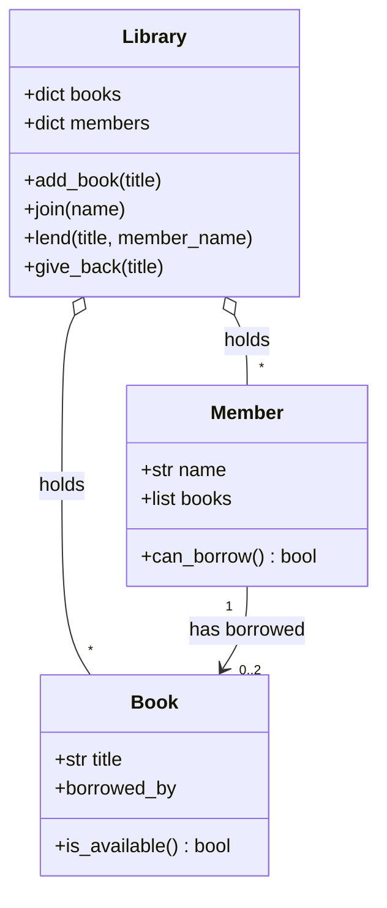

# Your First Classes and Objects

> **Prerequisites:** [03 · Functions](../03-functions-from-scratch/README.md), [07 · Dictionaries](../07-dictionaries-every-operation/README.md) and [09 · Errors and exceptions](../09-errors-and-exceptions-basics/README.md).  
> **Reading time:** ~35 minutes  
> **Audience:** a complete beginner who is about to start the object-oriented design course

> [!NOTE]
> **In one line:** A class is a blueprint that bundles data and the functions that work on that data, and an object is one thing built from that blueprint.

> [!TIP]
> **Golden rule:** Keep the data and the rules about that data together. If you keep passing the same three variables to five functions, you probably want a class.

> [!TIP]
> **Try it:** Type every class in this module yourself instead of pasting. Typing `self` fifty times is how it becomes natural.

---

## 1. Roadmap

1. Why classes exist.
2. Class versus object.
3. `__init__` and `self`; attributes and methods.
4. A first full class, step by step.
5. `__str__` and `__repr__`.
6. Class attributes versus instance attributes.
7. Objects are references (two names, one object).
8. Objects inside lists and dicts.
9. `@dataclass`, the lazy way.
10. Methods that return versus methods that print.
11. Three classes working together (Library, Book, Member).
12. Common beginner mistakes.

---

## 2. Concept

> [!key]
> A **class** describes what things of one kind look like (their data, called **attributes**) and what they can do (their functions, called **methods**). An **object** (also called an **instance**) is one real thing made from the class, with its own values.

Real-world picture: a house **blueprint** is the class. It says "a house has a number of rooms, a colour and a front door that can open". Each actual house built from it is an object. Two houses from the same blueprint can have different colours, but both can open their front door.

```text
class Dog (blueprint)           objects (real dogs)
  data:    name, age       -->    Dog("Rex", 3)
  actions: bark(), birthday()     Dog("Luna", 5)
```

---

## 3. Explanation

### 3.1 Why classes?

Without classes you might keep an account like this:

```python
balance = 100
owner = "Ann"

def deposit(balance, amount):
    return balance + amount

balance = deposit(balance, 50)
print(owner, balance)   # Ann 150
```

That is fine for one account. For ten accounts you now have twenty loose variables and no guarantee that the right balance goes with the right owner. A dict helps, but a class does better: it keeps the data **and** the rules in one place.

### 3.2 Your first class

```python
class Dog:
    def __init__(self, name, age):
        self.name = name
        self.age = age

    def bark(self):
        return f"{self.name} says woof"

rex = Dog("Rex", 3)
luna = Dog("Luna", 5)

print(rex.name)        # Rex
print(luna.age)        # 5
print(rex.bark())      # Rex says woof
print(luna.bark())     # Luna says woof
```

Slowly, line by line:

- `class Dog:` starts the blueprint. Class names use `CapitalizedWords`.
- `def __init__(self, name, age):` is the **initializer**. Python calls it automatically when you write `Dog("Rex", 3)`. Its job is to set up the new object.
- `self` is the object being built (or used). Python passes it in for you. It is always the first parameter of a method, and you never type it when calling.
- `self.name = name` creates an **attribute** on the object: a variable that belongs to this one dog.
- `def bark(self):` is a **method**: a function that belongs to the class. Inside it `self.name` is the name of the dog that is barking.
- `Dog("Rex", 3)` makes an **object**. The call is `Dog.__init__(new_object, "Rex", 3)` behind the scenes.

Attributes can be read and changed with a dot:

```python
class Dog:
    def __init__(self, name, age):
        self.name = name
        self.age = age

rex = Dog("Rex", 3)
rex.age = 4              # change an attribute
rex.color = "brown"      # Python even lets you add new ones
print(rex.age, rex.color)   # 4 brown
print(isinstance(rex, Dog)) # True
print(type(rex).__name__)   # Dog
```

(Adding attributes outside `__init__`, like `color`, works but makes code hard to follow. Set every attribute in `__init__`.)

### 3.3 Methods that change the object

A method can change `self`'s attributes. Here is the classic example, a bank account with a rule: you cannot withdraw more than you have.

```python
class Account:
    def __init__(self, owner, balance=0):
        self.owner = owner
        self.balance = balance

    def deposit(self, amount):
        if amount <= 0:
            raise ValueError("deposit must be positive")
        self.balance += amount

    def withdraw(self, amount):
        if amount > self.balance:
            raise ValueError("not enough money")
        self.balance -= amount

acct = Account("Ann", 100)
acct.deposit(50)
acct.withdraw(30)
print(acct.balance)   # 120

try:
    acct.withdraw(500)
except ValueError as err:
    print("Refused:", err)   # Refused: not enough money
print(acct.balance)          # 120   (unchanged)
```

This is the heart of object-oriented design: the object protects its own rules.

### 3.4 `__str__` and `__repr__`

If you print an object you have not taught Python to describe, you get an ugly default.

```python
class Plain:
    def __init__(self, x):
        self.x = x

print("<__main__.Plain object at 0x" in str(Plain(1)))   # True  (the ugly default)
```

Two special methods fix that:

- `__str__` gives the friendly text, used by `print()` and `str()`.
- `__repr__` gives the developer text, used in the prompt, in lists and in debugging. Aim for something that looks like the code that would build the object.

```python
class Dog:
    def __init__(self, name, age):
        self.name = name
        self.age = age

    def __str__(self):
        return f"{self.name} ({self.age} years old)"

    def __repr__(self):
        return f"Dog(name={self.name!r}, age={self.age!r})"

rex = Dog("Rex", 3)
print(rex)           # Rex (3 years old)
print(repr(rex))     # Dog(name='Rex', age=3)
print([rex])         # [Dog(name='Rex', age=3)]
```

If you write only one of them, write `__repr__`. When `__str__` is missing, Python uses `__repr__` for `print` as well.

### 3.5 Class attributes versus instance attributes

An **instance attribute** is set on `self` and belongs to one object. A **class attribute** is written directly in the class body and is shared by every object.

```python
class Dog:
    species = "Canis familiaris"     # class attribute: shared
    count = 0

    def __init__(self, name):
        self.name = name             # instance attribute: one per dog
        Dog.count += 1               # change the shared counter through the class

a = Dog("Rex")
b = Dog("Luna")
print(a.species, b.species)   # Canis familiaris Canis familiaris
print(Dog.count)              # 2
print(a.name, b.name)         # Rex Luna
```

Reading `a.species` first looks on the object, then on the class. Good uses for class attributes: constants and counters.

> [!pitfall]
> **Never put a list or dict in a class attribute and then change it through `self`.** All objects share the same one.

```python
class BadBasket:
    items = []                 # ONE list shared by every basket

    def add(self, thing):
        self.items.append(thing)

a = BadBasket()
b = BadBasket()
a.add("apple")
print(b.items)                 # ['apple']   <- surprise! b has an apple too

class GoodBasket:
    def __init__(self):
        self.items = []        # a NEW list for each basket

    def add(self, thing):
        self.items.append(thing)

c = GoodBasket()
d = GoodBasket()
c.add("apple")
print(d.items)                 # []
```

### 3.6 Objects hold references

A variable does not contain the object. It **points to** it, like a name tag. Two names can point to the same object.

```python
class Counter:
    def __init__(self):
        self.value = 0

x = Counter()
y = x                   # y is another name for the SAME object
y.value = 10
print(x.value)          # 10
print(x is y)           # True

z = Counter()           # a brand new, separate object
print(z.value)          # 0
print(x is z)           # False
```

The same thing happens when you pass an object to a function: the function receives a reference, so changes inside are seen outside.

```python
class Counter:
    def __init__(self):
        self.value = 10

def reset(counter):
    counter.value = 0

x = Counter()
reset(x)
print(x.value)          # 0
```

To get an independent copy, build a new object or use `copy.copy(obj)`.

### 3.7 Objects in lists and dicts

Objects are values like any other, so they fit in collections.

```python
class Dog:
    def __init__(self, name, age):
        self.name = name
        self.age = age

    def __repr__(self):
        return f"Dog({self.name!r}, {self.age})"

dogs = [Dog("Rex", 3), Dog("Luna", 5), Dog("Max", 1)]

print(max(dogs, key=lambda d: d.age))        # Dog('Luna', 5)
print(sorted(dogs, key=lambda d: d.name))    # [Dog('Luna', 5), Dog('Max', 1), Dog('Rex', 3)]
print([d.name for d in dogs if d.age > 2])   # ['Rex', 'Luna']

by_name = {d.name: d for d in dogs}          # look up by name
by_name["Max"].age += 1
print(by_name["Max"])                        # Dog('Max', 2)
print(dogs[2])                               # Dog('Max', 2)  (same object)
```

### 3.8 `@dataclass`: the lazy way

Classes that mostly hold data need a lot of repeated code: `__init__`, `__repr__`, `__eq__`. A **dataclass** writes them for you from a list of fields with type hints.

```python
from dataclasses import dataclass

@dataclass
class Point:
    x: int
    y: int = 0               # a default value

p = Point(3, 4)
print(p)                     # Point(x=3, y=4)
print(Point(1))              # Point(x=1, y=0)
print(p == Point(3, 4))      # True   (compares the fields)
p.x = 10
print(p.x)                   # 10
```

Useful options:

```python
from dataclasses import dataclass, field

@dataclass(frozen=True)      # immutable: assigning raises an error
class Coordinate:
    lat: float
    lon: float

c = Coordinate(1.5, 2.5)
try:
    c.lat = 9.9
except Exception as err:
    print(type(err).__name__)    # FrozenInstanceError

@dataclass
class Team:
    name: str
    members: list = field(default_factory=list)   # a fresh list per team

t1, t2 = Team("A"), Team("B")
t1.members.append("Ann")
print(t2.members)                # []
```

You can still add methods to a dataclass. Reach for it whenever a class is mostly "a bundle of fields".

### 3.9 Methods that return versus methods that print

A method that **prints** is hard to reuse and hard to test. A method that **returns** a value lets the caller decide what to do.

```python
class Rectangle:
    def __init__(self, width, height):
        self.width = width
        self.height = height

    def area(self):                    # returns: reusable
        return self.width * self.height

    def show_area(self):               # prints: dead end
        print("Area is", self.width * self.height)

r = Rectangle(3, 4)
total = r.area() + 10
print(total)            # 22
value = r.show_area()   # Area is 12
print(value)            # None   (a method with no return gives None)
```

Rule: calculate with `return`, and print in the top-level code.

### 3.10 Three classes working together

Real programs are many small classes that cooperate. Here is a mini library: a `Book` knows its title and whether it is borrowed, a `Member` has a name and a list of books, and the `Library` coordinates them.

```python
class Book:
    def __init__(self, title):
        self.title = title
        self.borrowed_by = None          # no one yet

    def is_available(self):
        return self.borrowed_by is None

    def __repr__(self):
        return f"Book({self.title!r})"


class Member:
    MAX_BOOKS = 2

    def __init__(self, name):
        self.name = name
        self.books = []

    def can_borrow(self):
        return len(self.books) < self.MAX_BOOKS


class Library:
    def __init__(self):
        self.books = {}                  # title -> Book
        self.members = {}                # name  -> Member

    def add_book(self, title):
        self.books[title] = Book(title)

    def join(self, name):
        self.members[name] = Member(name)

    def lend(self, title, member_name):
        book = self.books.get(title)
        member = self.members.get(member_name)
        if book is None or member is None:
            raise KeyError("unknown book or member")
        if not book.is_available():
            raise ValueError(f"{title!r} is already borrowed")
        if not member.can_borrow():
            raise ValueError(f"{member.name} has too many books")
        book.borrowed_by = member
        member.books.append(book)

    def give_back(self, title):
        book = self.books[title]
        if book.is_available():
            raise ValueError(f"{title!r} was not borrowed")
        book.borrowed_by.books.remove(book)
        book.borrowed_by = None


lib = Library()
for t in ["Dune", "Emma", "Ulysses"]:
    lib.add_book(t)
lib.join("Ann")
lib.join("Raj")

lib.lend("Dune", "Ann")
lib.lend("Emma", "Ann")
print(lib.members["Ann"].books)       # [Book('Dune'), Book('Emma')]

for title, who in [("Ulysses", "Ann"), ("Dune", "Raj")]:
    try:
        lib.lend(title, who)
    except ValueError as err:
        print("Cannot lend:", err)
# Cannot lend: Ann has too many books
# Cannot lend: 'Dune' is already borrowed

lib.give_back("Dune")
lib.lend("Dune", "Raj")
print(lib.books["Dune"].borrowed_by.name)   # Raj
```

Notice how each class has **one job**: `Book` knows about a book, `Member` about a member and their limit, `Library` about the rules between them. That habit is the start of good design.

### 3.11 Common beginner mistakes

1. **Forgetting `self` in the method definition.** `def bark():` fails when called as `rex.bark()` because Python passes `self` automatically.

```python
class Dog:
    def bark():            # forgot self
        return "woof"

try:
    Dog().bark()
except TypeError as err:
    print(err)   # Dog.bark() takes 0 positional arguments but 1 was given
```

2. **Forgetting `self.` when using an attribute.** Inside a method, `name` is a local variable, `self.name` is the attribute.

```python
class Dog:
    def __init__(self, name):
        self.name = name

    def greet(self):
        return "I am " + name      # NameError: should be self.name

try:
    Dog("Rex").greet()
except NameError as err:
    print(err)   # name 'name' is not defined
```

3. **A mutable class attribute shared by all objects** (section 3.5).
4. **Comparing objects with `==` without `__eq__`.** By default, two separate objects are never equal, even with the same data. A dataclass fixes this.
5. **Printing instead of returning** (section 3.9).
6. **Calling the class without parentheses.** `d = Dog` makes another name for the class. `d = Dog("Rex")` makes an object.

---

## 4. Code: the same ideas in C#

C# classes look similar but are more formal: you declare the types of fields, you write a **constructor** (same name as the class) instead of `__init__`, there is no `self` (you may use `this`), and the preferred way to expose data is a **property**. `ToString()` is `__str__`. A `record` is C#'s dataclass.

````carousel
```python
class Dog:
    def __init__(self, name, age):
        self.name = name
        self.age = age

    def bark(self):
        return f"{self.name} says woof"

    def __str__(self):
        return f"{self.name} ({self.age})"

rex = Dog("Rex", 3)
print(rex.bark())   # Rex says woof
print(rex)          # Rex (3)
```

<!-- slide -->

```csharp
using System;

var rex = new Dog("Rex", 3);
Console.WriteLine(rex.Bark());   // Rex says woof
Console.WriteLine(rex);          // Rex (3)

class Dog
{
    public string Name { get; set; }      // property: a field with built-in get/set
    public int Age { get; set; }

    public Dog(string name, int age)      // constructor
    {
        Name = name;
        Age = age;
    }

    public string Bark() => $"{Name} says woof";

    public override string ToString() => $"{Name} ({Age})";
}
```
````

Rules that protect the object, with a private field and a read-only property:

````carousel
```python
class Account:
    def __init__(self, balance=0):
        self._balance = balance      # leading underscore: "please do not touch"

    @property
    def balance(self):               # read-only from outside
        return self._balance

    def deposit(self, amount):
        if amount <= 0:
            raise ValueError("must be positive")
        self._balance += amount

a = Account(10)
a.deposit(5)
print(a.balance)   # 15
```

<!-- slide -->

```csharp
using System;

var a = new Account(10);
a.Deposit(5);
Console.WriteLine(a.Balance);   // 15

class Account
{
    public decimal Balance { get; private set; }   // anyone reads, only the class writes

    public Account(decimal balance = 0) => Balance = balance;

    public void Deposit(decimal amount)
    {
        if (amount <= 0) throw new ArgumentException("must be positive");
        Balance += amount;
    }
}
```
````

A dataclass versus a record:

````carousel
```python
from dataclasses import dataclass

@dataclass(frozen=True)
class Point:
    x: int
    y: int = 0

print(Point(3, 4))                 # Point(x=3, y=4)
print(Point(1, 2) == Point(1, 2))  # True
```

<!-- slide -->

```csharp
using System;

Console.WriteLine(new Point(3, 4));                   // Point { X = 3, Y = 4 }
Console.WriteLine(new Point(1, 2) == new Point(1, 2)); // True

record Point(int X, int Y = 0);
```
````

> [!NOTE]
> In C#, `class` objects are references just like in Python, and `Equals` compares references unless you override it. `record` types compare by value automatically.

---

## 5. Visual: class, objects and references



And what two names for one object look like in memory:

```text
x = Counter()      x ----+
y = x                    +--->  [ Counter object: value = 10 ]
                   y ----+

z = Counter()      z ------->  [ Counter object: value = 0  ]
```

---

## 6. Practice

<details>
<summary><strong>1. Write a class <code>Rectangle</code> with <code>width</code>, <code>height</code> and methods <code>area()</code> and <code>perimeter()</code>.</strong></summary>

```python
class Rectangle:
    def __init__(self, width, height):
        self.width = width
        self.height = height

    def area(self):
        return self.width * self.height

    def perimeter(self):
        return 2 * (self.width + self.height)

r = Rectangle(3, 4)
print(r.area(), r.perimeter())   # 12 14
```
</details>

<details>
<summary><strong>2. Add a <code>__str__</code> to <code>Rectangle</code> that prints <code>3 x 4</code>.</strong></summary>

```python
class Rectangle:
    def __init__(self, width, height):
        self.width = width
        self.height = height

    def __str__(self):
        return f"{self.width} x {self.height}"

print(Rectangle(3, 4))   # 3 x 4
```
</details>

<details>
<summary><strong>3. Build a <code>TicketCounter</code> that sells tickets until a limit and refuses after that.</strong></summary>

```python
class TicketCounter:
    def __init__(self, capacity):
        self.capacity = capacity
        self.sold = 0

    def sell(self):
        if self.sold >= self.capacity:
            raise ValueError("sold out")
        self.sold += 1
        return self.sold

    def remaining(self):
        return self.capacity - self.sold

c = TicketCounter(2)
print(c.sell(), c.sell())   # 1 2
try:
    c.sell()
except ValueError as err:
    print(err)              # sold out
print(c.remaining())        # 0
```
</details>

<details>
<summary><strong>4. Predict the output.</strong></summary>

```python
class Box:
    def __init__(self):
        self.items = []

a = Box()
b = a
b.items.append(1)
c = Box()
print(a.items, c.items, a is b)
# [1] [] True
```

`a` and `b` are two names for one box. `c` is a different box with its own empty list.
</details>

<details>
<summary><strong>5. Give every <code>Student</code> a shared class attribute <code>school</code> and an individual <code>name</code>. Change the school for everyone at once.</strong></summary>

```python
class Student:
    school = "Oak High"

    def __init__(self, name):
        self.name = name

a, b = Student("Ann"), Student("Raj")
Student.school = "Pine High"      # change it through the class
print(a.school, b.school)         # Pine High Pine High
```
</details>

<details>
<summary><strong>6. Turn this class into a dataclass.</strong></summary>

```python
# before
class Item:
    def __init__(self, name, price):
        self.name = name
        self.price = price

# after
from dataclasses import dataclass

@dataclass
class Item:
    name: str
    price: float

print(Item("tea", 2.5))   # Item(name='tea', price=2.5)
```
</details>

<details>
<summary><strong>7. Why does this fail and how do you fix it?</strong></summary>

```python
class Cat:
    def meow():
        return "meow"
```

The method has no `self`, so `Cat().meow()` raises `TypeError` (Python passes the object as an argument). Fix: `def meow(self):`.
</details>

<details>
<summary><strong>8. Keep a list of <code>Dog</code> objects and print the names of the dogs older than 2, oldest first.</strong></summary>

```python
from dataclasses import dataclass

@dataclass
class Dog:
    name: str
    age: int

dogs = [Dog("Rex", 3), Dog("Luna", 5), Dog("Max", 1)]
old = sorted((d for d in dogs if d.age > 2), key=lambda d: d.age, reverse=True)
print([d.name for d in old])   # ['Luna', 'Rex']
```
</details>

---

## 7. Mini project: pet shop

Three cooperating classes: `Pet` (a dataclass), `Customer`, and `Shop`. The shop sells pets, tracks money and refuses sales it cannot make.

```python
from dataclasses import dataclass


@dataclass
class Pet:
    name: str
    kind: str
    price: float


class Customer:
    def __init__(self, name, cash):
        self.name = name
        self.cash = cash
        self.pets = []

    def __repr__(self):
        return f"Customer({self.name!r}, cash={self.cash})"


class Shop:
    def __init__(self):
        self.stock = []
        self.takings = 0.0

    def add(self, pet):
        self.stock.append(pet)

    def find(self, name):
        for pet in self.stock:
            if pet.name == name:
                return pet
        raise KeyError(f"no pet called {name!r}")

    def sell(self, pet_name, customer):
        pet = self.find(pet_name)
        if customer.cash < pet.price:
            raise ValueError(f"{customer.name} cannot afford {pet.name}")
        customer.cash -= pet.price
        customer.pets.append(pet)
        self.stock.remove(pet)
        self.takings += pet.price
        return pet


shop = Shop()
shop.add(Pet("Rex", "dog", 120.0))
shop.add(Pet("Tom", "cat", 80.0))
shop.add(Pet("Goldie", "fish", 5.0))

ann = Customer("Ann", 130.0)
print(shop.sell("Rex", ann))         # Pet(name='Rex', kind='dog', price=120.0)
print(ann)                           # Customer('Ann', cash=10.0)

for wanted in ["Tom", "Goldie", "Missing"]:
    try:
        shop.sell(wanted, ann)
        print("sold", wanted)
    except (ValueError, KeyError) as err:
        print("no sale:", err)
# no sale: Ann cannot afford Tom
# sold Goldie
# no sale: "no pet called 'Missing'"

print(shop.takings, [p.name for p in ann.pets])   # 125.0 ['Rex', 'Goldie']
print([p.name for p in shop.stock])               # ['Tom']
```

Stretch goals: add a `Pet.discount(percent)` method; keep a list of every sale in the shop; save the stock to JSON using `dataclasses.asdict` after module 10.

---

## 8. Interview questions

<details>
<summary><strong>1. What is the difference between a class and an object? [BASIC]</strong></summary>

A class is the blueprint: it defines attributes and methods. An object (instance) is one concrete thing created from that class, with its own attribute values.
</details>

<details>
<summary><strong>2. What is <code>self</code>? [BASIC]</strong></summary>

The first parameter of an instance method. It refers to the object the method was called on. Python supplies it automatically, so <code>rex.bark()</code> means <code>Dog.bark(rex)</code>.
</details>

<details>
<summary><strong>3. What is the difference between <code>__str__</code> and <code>__repr__</code>? [BASIC]</strong></summary>

`__str__` is the readable text for users (`print`). `__repr__` is the unambiguous text for developers (debugger, lists, the prompt). If only `__repr__` exists, `print` uses it too.
</details>

<details>
<summary><strong>4. Class attribute versus instance attribute? [BASIC]</strong></summary>

A class attribute is shared by all instances and defined in the class body. An instance attribute is set on `self` (usually in `__init__`) and is separate per object. Mutable class attributes are a classic bug source.
</details>

<details>
<summary><strong>5. After <code>b = a</code> for an object, how many objects exist? [TRICKY]</strong></summary>

One. Both names refer to the same object, so changes through one name are visible through the other. Use `copy.copy` or build a new object for an independent copy.
</details>

<details>
<summary><strong>6. When would you use a dataclass? [BASIC]</strong></summary>

When the class mainly stores values. It generates `__init__`, `__repr__` and `__eq__` for you. Use `frozen=True` for immutable values and `field(default_factory=list)` for mutable defaults.
</details>

<details>
<summary><strong>7. Why should a method usually return a value instead of printing it? [TRICKY]</strong></summary>

Returning keeps the class reusable and testable: a test can compare the value, a web page can display it, a file can store it. Printing fixes one output channel.
</details>

<details>
<summary><strong>8. How do Python and C# differ in making an object? [BASIC]</strong></summary>

Python calls `ClassName(args)` and runs `__init__`. C# needs `new ClassName(args)` and runs a constructor named like the class. C# fields and properties have declared types and access modifiers (`public`, `private`).
</details>

---

## Practice on the site

Try these real exercises in the browser. They use exactly what you learned in this module:

- [Movie ticket counter](/practice/code/oop-movie-ticket-counter/)
- [Rectangle basics](/practice/code/oop-rectangle-basics/)
- [Class versus instance attributes](/practice/code/oop-class-vs-instance-attributes/)

---

## Further reading

- [Python tutorial: Classes](https://docs.python.org/3/tutorial/classes.html)
- [Python data model: special method names](https://docs.python.org/3/reference/datamodel.html#special-method-names)
- [`dataclasses` module](https://docs.python.org/3/library/dataclasses.html)
- [Real Python: Object-oriented programming in Python](https://realpython.com/python3-object-oriented-programming/)
- [Real Python: Data classes in Python](https://realpython.com/python-data-classes/)
- [Microsoft Learn: Classes in C#](https://learn.microsoft.com/en-us/dotnet/csharp/fundamentals/types/classes)
- [Microsoft Learn: Properties](https://learn.microsoft.com/en-us/dotnet/csharp/programming-guide/classes-and-structs/properties)
- [Microsoft Learn: Records](https://learn.microsoft.com/en-us/dotnet/csharp/language-reference/builtin-types/record)

## Next

**[01 · Classes and objects: OOP building blocks](../../01-classes-objects-and-oop-building-blocks/README.md)** — encapsulation, invariants and constructors, now with design in mind. Back to the track overview: [Python basics step by step](../README.md).
