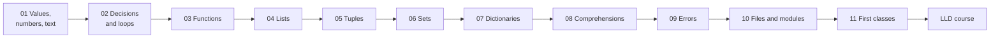

# Python Basics, Step by Step (with C# beside it)

> **Prerequisites:** none. If you have never written a program, start here.  
> **Reading time:** ~6 hours in total, as 11 modules of 30 to 40 minutes each  
> **Audience:** complete beginners, and anyone who will take the LLD course and wants every Python basic in one place

> [!NOTE]
> **In one line:** Eleven short modules take you from `print("hello")` to writing your first classes. Every idea comes with small examples, the output shown in a comment, and the C# version beside the Python version.

> [!TIP]
> **Golden rule:** Type every example yourself. Do not copy and paste. Then change one thing and predict what will happen before you run it. Reading code is not the same as writing code.

> [!TIP]
> **Try it:** Install Python from python.org (or use the Run button on lessons in this site), open a terminal and type `python`. Then type `print("hello")`.

---

## 1. Why this track exists

The LLD (low-level design) course in this site assumes you can already read Python. Many learners cannot yet. This track fills that gap. It goes slowly, repeats the important points, and covers every common operation, not only a sample. When a module says "every operation", it means it.

Python is the main language. The same idea is shown in **C#** next to the Python code, because this site teaches both, and because seeing one idea in two languages shows you what is the idea and what is just spelling.

---

## 2. The roadmap



Each module teaches in the same order, so you always know where you are:

1. **Roadmap**: where this sits and what you can do afterwards.
2. **Concept**: the big idea in one or two sentences.
3. **Explanation**: the idea in small steps.
4. **Code**: runnable examples. A comment shows the output.
5. **Visual diagram**: a picture of the idea.
6. **Practice**: 6 to 10 exercises, each with a worked answer.
7. **Mini project**: a small program that uses the whole module.
8. **Interview questions**: the things people really ask.

---

## 3. The modules

| # | Module | What you get | Time |
| :--- | :--- | :--- | :--- |
| 01 | [Values, numbers and text](./01-values-numbers-and-text/README.md) | Variables, `int`/`float`/`bool`/`None`, every operator, conversions, floating point and `Decimal`, every common string method, f-strings, `input` and `print` | 35 min |
| 02 | [Making decisions and loops](./02-making-decisions-and-loops/README.md) | `if`/`elif`/`else`, truthy and falsy, `match`, `while`, `for`, `range`, `break`/`continue`/`else`, accumulators, FizzBuzz, loop pitfalls | 35 min |
| 03 | [Functions from scratch](./03-functions-from-scratch/README.md) | `def`, return values, defaults and the mutable-default trap, `*args`/`**kwargs`, scope, lambdas and `key=`, recursion, type hints, `assert` tests | 40 min |
| 04 | [Lists, every operation](./04-lists-every-operation/README.md) | Create, index, slice, add, remove, sort, copy, nested lists, the aliasing trap | 35 min |
| 05 | [Tuples and unpacking](./05-tuples-and-unpacking/README.md) | Fixed sequences, unpacking, swapping, returning many values, named tuples | 25 min |
| 06 | [Sets, every operation](./06-sets-every-operation/README.md) | Unique items, membership, union, intersection, difference | 25 min |
| 07 | [Dictionaries, every operation](./07-dictionaries-every-operation/README.md) | Key/value pairs, lookup, update, loop, nest, count, group | 35 min |
| 08 | [Comprehensions and iteration](./08-comprehensions-and-iteration/README.md) | List/dict/set comprehensions, generators, iterators, `sorted`, `any`, `all` | 35 min |
| 09 | [Errors and exceptions basics](./09-errors-and-exceptions-basics/README.md) | Reading a traceback, `try`/`except`/`finally`, raising, custom errors | 30 min |
| 10 | [Files, modules and the standard library](./10-files-modules-and-the-standard-library/README.md) | Read and write files, `import`, `json`, `datetime`, `random`, your own modules | 35 min |
| 11 | [Your first classes and objects](./11-your-first-classes-and-objects/README.md) | `class`, `__init__`, methods, attributes, `__str__`, a small design | 40 min |

Total: about 6 hours of reading and doing. Most people finish in 2 to 3 weeks at 30 minutes a day.

---

## 4. How to study

- **One module a day** is plenty. A short daily habit beats a long weekend binge.
- **Type every example.** Your fingers learn the syntax. Typos teach you to read error messages.
- **Predict before you run.** Cover the output comment, guess it, run, compare. A wrong guess is the best teacher.
- **Do every exercise** before you open the answer. Stuck for 10 minutes? Open the answer, read it, close it, then write it again from memory.
- **Break things on purpose.** Remove a colon. Use a name that does not exist. Python's error message will point at the line. Learn to read it.
- **Build the mini project.** It is the only part where you decide the structure yourself.
- **Come back to the interview questions** after a week. If you can answer them out loud, you know the module.
- **Look at the C# slide** even if you do not use C#. A second language makes the first one clearer.

> [!pitfall]
> Do not jump to classes (module 11) early. Classes are made from functions, lists and dictionaries. Skipping those is why people find the LLD course hard.

---

## 5. What you will be able to do

After the whole track you can:

- store, combine and format numbers and text, and avoid the floating point trap;
- write programs that decide and repeat;
- split a problem into small functions, and test each with `assert`;
- choose the right container: list, tuple, set or dictionary;
- count, group, filter and sort data with a few lines of code;
- read an error message and fix it, and handle expected errors with `try`/`except`;
- read and write files, and use the standard library (`json`, `random`, `datetime`);
- write a small class with data and behaviour, and explain what `self` is;
- read the Python in the LLD course without stopping at every line.

---

## 6. Python and C# at a glance

You will see this table many times in the modules.

| Idea | Python | C# |
| :--- | :--- | :--- |
| Declare a variable | `count = 5` | `int count = 5;` |
| Print | `print(x)` | `Console.WriteLine(x);` |
| Blocks | indentation | `{ }` braces |
| Comment | `# text` | `// text` |
| Integer divide | `7 // 2` | `7 / 2` |
| Booleans | `True`, `False`, `and`, `or`, `not` | `true`, `false`, `&&`, `\|\|`, `!` |
| Nothing | `None` | `null` |
| String format | `f"{name}"` | `$"{name}"` |
| Loop over items | `for x in items:` | `foreach (var x in items)` |
| Function | `def add(a, b):` | `static int Add(int a, int b)` |
| List | `[1, 2, 3]` | `new List<int> { 1, 2, 3 }` |
| Dictionary | `{"a": 1}` | `new Dictionary<string, int> { ["a"] = 1 }` |
| Types | decided at run time | declared and checked at compile time |

Biggest difference: Python figures out types while the program runs. C# makes you write the types and checks them before the program runs. Python code is shorter. C# catches more mistakes early. Both are fine tools.

---

## 7. What you need

- **Python 3.10 or newer** (for `match`). Check with `python --version`.
- **A code editor.** VS Code with the Python extension is a good free choice.
- **Optional, for C#:** the .NET SDK from dotnet.microsoft.com. You can read the C# slides without installing anything.
- **A notes file.** Write down every error message you meet, and what fixed it.

A quick test that your setup works:

```python
import sys

print(sys.version_info >= (3, 10))   # True
print("setup ok")                    # setup ok
```

---

## 8. Common beginner mistakes (read once now, again later)

| Mistake | What you see | Fix |
| :--- | :--- | :--- |
| Forgot the colon after `if`/`for`/`def` | `SyntaxError: expected ':'` | add `:` |
| Bad indentation | `IndentationError` | use 4 spaces, never mix tabs |
| Used `=` where you meant `==` | `SyntaxError` or wrong result | `==` compares |
| Used a name before assigning it | `NameError` | assign first |
| Added a number to text | `TypeError` | convert with `str()` or `int()` |
| Forgot `return` | the answer is `None` | add `return` |
| Off-by-one in a loop | one item too many or too few | remember `range` excludes the stop |

---

## 9. After this track

Continue to the LLD course: [01 · Classes and objects](../01-classes-objects-and-oop-building-blocks/README.md) and [02 · OOP foundations and UML](../02-oop-foundations-and-uml/README.md). You will recognise the Python.

---

## Further reading

- [The Python Tutorial (official)](https://docs.python.org/3/tutorial/index.html)
- [Python Standard Library reference](https://docs.python.org/3/library/index.html)
- [Python for Beginners (python.org)](https://www.python.org/about/gettingstarted/)
- [Real Python: Python basics learning path](https://realpython.com/learning-paths/python-basics/)
- [PEP 8: the Python style guide](https://peps.python.org/pep-0008/)
- [Microsoft Learn: C# fundamentals for absolute beginners](https://learn.microsoft.com/en-us/dotnet/csharp/tour-of-csharp/)
- [Microsoft Learn: the .NET download page and docs](https://learn.microsoft.com/en-us/dotnet/core/introduction)

## Next

Start with [01 · Values, numbers and text](./01-values-numbers-and-text/README.md).
